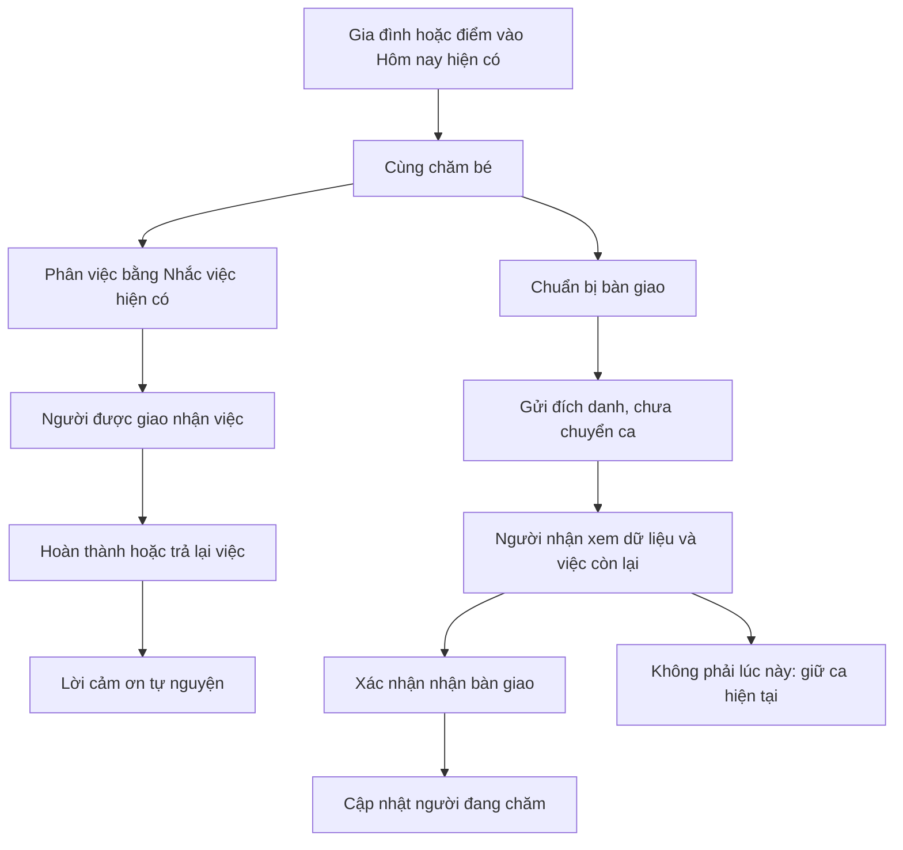

> Bản này là khám phá ban đầu. Luồng áp dụng theo tài liệu và summary mới nhất nằm ở [Cùng Chăm Con — flow nối vào app hiện tại](../cung-cham-con/FLOW.md), cùng [frame Figma mới](https://www.figma.com/design/sJLG1fAXKDnDr9YI6Yx8ex/Child-Life?node-id=1317-20330).

# Phối hợp chăm sóc và bàn giao — review, mockup và đặc tả tích hợp

Ngày: **28/10/2026**. Trạng thái: **đề xuất thiết kế và prototype Flutter độc lập**, chưa đưa vào app thật. Không đổi quyền, backend, route, token, ARB hay golden baseline của ứng dụng. Mọi tên, thời gian và ghi nhận trong prototype là dữ liệu mẫu; các thao tác chỉ đổi trạng thái trong bộ nhớ, mất khi khởi động lại.

## 1. Kết luận dành cho chủ sản phẩm

Child Life đã có nền tảng phối hợp khá đầy đủ: vai trò theo từng bé; lời mời; nhắc việc có người được giao; nhận/trả/hoàn thành việc; ai đang chăm; gửi/xem/nhận bàn giao. Nhu cầu chính là **kết nối các khả năng này thành một trải nghiệm dễ hiểu**, thay vì xây thêm hệ thống công việc.

Chọn một màn chính **“Cùng chăm bé”**: biết ai đang chăm, việc cần làm tiếp và điểm vào chuẩn bị bàn giao. Gia đình tiếp tục quản lý người và quyền. Bàn giao tiếp tục giữ thông tin thực tế, dấu hiệu sức khỏe, nguồn ghi nhận và xác nhận nhận ca. “Cùng chăm bé” là tên làm việc của prototype, chưa đổi tên tính năng hay thêm tab điều hướng chính thức.

Ba rủi ro được bổ sung trong yêu cầu đã chuyển thành quyết định thiết kế:

- **Ít mở app hoặc ngại thao tác:** giao diện “Việc của tôi”; nhận việc một lần, hoàn thành việc thông thường bằng một thao tác; mở đúng việc từ thông báo; thao tác nhanh có xác thực và kiểm quyền.
- **Biến thành bảng chấm công:** không phần trăm công sức, huy hiệu cạnh tranh, chuỗi thành tích hay xếp hạng. Ghi nhận một việc cụ thể bằng lời cảm ơn tự nguyện. Đếm bản ghi không đo được công sức, thời gian nghĩ, chăm tinh thần hoặc việc chưa ghi.
- **Mệt mỏi thông báo:** phân biệt nhắc việc cá nhân, bàn giao được gửi đích danh và lời cảm ơn; lời cảm ơn không push mặc định. Không gửi thêm một push cho mọi lần hoàn thành việc. Giữ giờ yên tĩnh, lựa chọn cá nhân và ràng buộc thiết bị hiện có.

## 2. Bộ mockup có thể dùng để thiết kế tiếp

[Màn chính](assets/overview_light_vi.png) · [Board flow](assets/flow-board.png) · [PDF các màn](care-coordination-mockups.pdf)

| Mã | Màn | Nội dung và hành động |
|---|---|---|
| CC01 | [Cùng chăm bé](assets/overview_light_vi.png) | Người đang chăm, trạng thái bé, việc tiếp theo có giờ/người/trạng thái, ghi nhận gần nhất, lịch chăm sóc, chuẩn bị bàn giao |
| CC02 | [Phân việc](assets/assignment_light_vi.png) | Chọn người có quyền, giờ, lưu; người chưa được giao hiện rõ. Prototype minh họa hai việc cố định, không phải trình tạo việc đầy đủ |
| CC03 | [Chuẩn bị bàn giao](assets/outgoing_light_vi.png) | Mẹ gửi cho Ba, Cô Lan vẫn đang chăm; tổng hợp trong ca, việc còn lại, lời nhắn; gửi không tự chuyển ca |
| CC04 | [Nhận bàn giao](assets/incoming_light_vi.png) | Ai gửi, ai đang chăm, việc còn lại, lời nhắn, hệ quả xác nhận; nút nhận cố định phía dưới |
| CC05 | [Việc của tôi](assets/simple_light_vi.png) | Người chăm chỉ thấy hành động phù hợp: nhận việc → hoàn thành, trả lại việc, hoàn tác; nhập lượng thực tế khi ghi bú |
| CC06 | [Lịch chăm sóc](assets/routine_light_vi.png) | Bản nháp do gia đình chọn, người được giao, xem trước rồi áp dụng. Không sinh lịch y tế từ độ tuổi |
| CC07 | [Gia đình](assets/family_light_vi.png) | Giữ quan hệ và vai trò tách biệt; thêm lối vào phối hợp và thông báo. Các thao tác quản lý thành viên hiện có vẫn dùng màn thật |
| CC08 | [Thông báo chăm sóc](assets/notifications_light_vi.png) | Việc của tôi, bàn giao gửi cho tôi, lời cảm ơn mặc định tắt, giải thích giờ yên tĩnh và giới hạn đồng bộ |
| CC09 | [Lời cảm ơn](assets/gratitude_light_vi.png) | Cảm ơn cho một việc cụ thể; gửi một lần trong phiên demo; không có thứ hạng hoặc điểm |
| CC10 | [Thao tác nhanh](assets/quickAction_light_vi.png) | Minh họa trạng thái khóa/mở khóa: khóa ẩn chi tiết và mở đúng việc; mở khóa cho việc thông thường đã nhận thì có hoàn thành nhanh; chờ đồng bộ hiện riêng |

CC10 là **bản minh họa hành vi trong Flutter**, không phải notification/widget native đã triển khai. Chưa có background handler hay App Intent mới. CC08–CC10 có phần hành vi mới cần chốt khi triển khai, không tự ghi đè cài đặt thật.

Bản Light/Night care × vi/en nằm trong `assets/`. Ảnh chính là khung 390 × 1000 để review thiết kế; app thật cuộn theo màn hình. Có probe 375 × 812, chữ 200%, trạng thái thiếu dữ liệu và mất mạng. Nội dung dưới nếp gấp vẫn cần cuộn, nhất là chữ lớn.

## 3. Những gì đang có — kiểm chứng từ code hiện tại

| Khả năng | Hiện trạng xác minh | Nguồn |
|---|---|---|
| Thành viên, lời mời và quyền | Cùng nuôi / Người chăm sóc / Người thân; quyền theo từng bé; quan hệ Bà không tự đồng nghĩa quyền chăm sóc; chỉ chủ gia đình quản lý Cùng nuôi khác | `features/family/family_screen.dart`, `baby/baby_models.dart`, D-017/018/019/022 |
| Mời gia đình | Mã, link/QR/email, chờ nhận, thu hồi, hạn quyền; đã có, không coi là tính năng còn thiếu | `family/invite_screens.dart`, `firebase/functions/src/family.ts` |
| Phân công nhắc việc | Có `assigneeUid`, ngày/giờ hoặc cả ngày, hoàn thành/hoàn tác, người đánh dấu; chỉ Cùng nuôi phân công; chỉ Cùng nuôi/Người chăm sóc đang hoạt động được giao | `reminders/reminder_models.dart`, `docs/product/reminders-allday-assignee-plan.md`, D-075 #5 |
| Nhận/trả/hoàn thành việc | **Đã có**, qua `PersonalHandoverScreen` và `careWork/{reminderId}`. Chuyển `unclaimed → accepted → completed`; có `release`, revision, transaction và replay cùng thao tác | `rhythm/personal_day_pages.dart`, `packages/contracts/src/personalization-v2.ts`, `firebase/functions/src/personalization-v2.ts` |
| Quyền thực hiện | Server kiểm membership; caregiver chỉ tác động việc được giao; cha mẹ có quyền rộng hơn. Người thân không được nhận/hoàn thành việc | Nhánh `case 'work'` trong `personalization-v2.ts` |
| Ai đang chăm | Một người hoặc Ba và Mẹ cùng chăm; nhận ca/kết thúc ca; nhắc việc không tự đi theo ca | `care/care_duty.dart`, `packages/contracts/src/care-duty.ts`, P-181 |
| Bàn giao thực tế | Dữ liệu gần nhất, ngủ/thức, bú/tã, gợi ý cữ tiếp theo dựa dữ liệu, nhắc việc, lịch tiêm, cách từng có ích; loading/error và mốc cập nhật | `ai/handover_now.dart`, P-180 |
| Tóm tắt AI | Có sẵn nhưng không tự tạo khi mở; consent/credit/gate/fallback được giữ. Phần thực tế phải phân biệt phần AI | `ai/handover_screen.dart`, D-127 |
| Gửi và nhận ca | Có gửi cho một thành viên, lời nhắn, `sentAt/seenAt/receivedAt`. `received` cập nhật người đang chăm trong transaction nếu đủ quyền; `seen` không tương đương nhận | `packages/contracts/src/ai-summary.ts`, `firebase/functions/src/handover-send.ts` |
| Nhắc việc đích danh | Hiện là local notification sau khi thiết bị mở app và đồng bộ. Người được giao có thể nhận trên các thiết bị của mình; `notifyDevice` cá nhân vẫn là một đường nhận riêng | `Reminder.ringsOn`, `reminder_notifications.dart`, D-029 và D-075 #5 |
| Chống nhiễu | Có category, cài đặt theo vai trò, giờ yên tĩnh, dedup, fatigue; không xây lại từ đầu | `notifications/notification_settings_screen.dart`, `packages/contracts/src/notification-platform.ts` |
| Hành động notification iOS | Đã có Ghi / Báo lại / Bỏ qua cho rule reminder; “Ghi” mở foreground. Chưa xác minh có native hoàn thành `careWork` dùng chung iOS/Android | `ios/Runner/RuleNotifications.swift` |

**Điểm cần đối chiếu tài liệu:** Q-085 còn mô tả câu hỏi nhận/hoàn thành/chuyển việc. Code hiện đã thực hiện một phần đáng kể. Khi lập ticket phải đối chiếu từng khả năng, không lấy trạng thái “Open” làm bằng chứng chưa triển khai. Không tự sửa owner decision trong lượt thiết kế này.

## 4. Review giao diện hiện tại

Evidence: **R** = thấy trên render mới; **C** = xác minh code; **H** = giả thuyết cần thử người dùng. Golden lưu sẵn chỉ được dùng sau khi chạy đối chiếu hiện tại.

| Phát hiện | Bằng chứng, tác động | Mức độ / ưu tiên | Hướng xử lý |
|---|---|---|---|
| Gia đình làm tốt việc quản lý người và quyền, nhưng chưa nối trực tiếp người với việc tiếp theo | R+C: `s3/14a_family_*`; người dùng phải đi sang Nhắc việc/Việc cần làm/Bàn giao để phối hợp | Medium / P2 / L2 presentation; entry mới là đề xuất | **REFINE** Gia đình; thêm một lối vào phối hợp trong thiết kế, giữ quản lý thành viên |
| Bàn giao đã mạnh ở “bé đang thế nào”; danh sách tiếp theo chưa cho nhìn cùng lúc giờ, người được giao và trạng thái nhận việc | R+C: `ai/su01_create_*`, `HandoverNow`; dễ hiểu việc cần làm nhưng chưa rõ ai sẽ chịu trách nhiệm | Medium / P1 / L2 | **RESTRUCTURE** phần phối hợp, giữ phần thông tin bé |
| Nhận việc, nhận ca và xác nhận đã xem là ba việc khác nhau | C: careWork, handover sends, careDuty; dùng một nhãn “Đã nhận” sẽ dễ gây hiểu nhầm | High / P1 / L2 làm rõ chữ; logic mới L3 | Dùng nhãn đầy đủ; thể hiện hậu quả nhận ca trước CTA |
| “Việc cần làm hôm nay” đã có nhận/trả/hoàn thành, nhưng tách khỏi bối cảnh bàn giao | R+C: `pd/handover_*`, `PersonalHandoverScreen`; cần nối bối cảnh, không thêm workflow trùng | Medium / P1 / L2 | Chọn luồng chính, tái sử dụng cùng reminderId/revision |
| Hành vi người thân lớn tuổi/ít mở app chưa được kiểm chứng với người dùng Việt Nam trong lượt này | H; không suy từ tuổi hoặc giới tính rằng người đó lười hay kém công nghệ | Unknown / nghiên cứu | Test theo nhu cầu và khả năng thao tác, cho lựa chọn giao diện đơn giản |

Phân loại cấu trúc: Gia đình **REFINE**; phần phối hợp liên màn **RESTRUCTURE**; Bàn giao giữ phần dữ liệu và safety, cấu trúc lại phần trách nhiệm. Không cần A/B vì chưa có hai hướng cấu trúc có đánh đổi đáng kể chưa giải quyết: một mô hình dùng chung dữ liệu đã có rủi ro thấp hơn mô hình thêm Tasks độc lập.

Đánh giá sáu chiều: IA cần nối người–việc–ca; hierarchy đưa trách nhiệm hiện tại lên đầu; composition dùng nhóm danh sách thay card cho từng việc; interaction mở trực tiếp việc cần làm; simplification bỏ giải thích/đếm trùng; visual giữ token và palette hiện tại. Đây là đánh giá thiết kế, không phải kết quả usability study.

## 5. Diễn giải lại năm giả thuyết về gia đình trẻ

Nghiên cứu về 322 bà mẹ có con nhỏ phân biệt việc lên kế hoạch với việc thực hiện, ghi nhận phân bổ gánh nặng nhận thức chênh lệch hơn và có liên hệ với sức khỏe tinh thần. Đây là nghiên cứu tự báo cáo, không chứng minh quan hệ nhân quả và không đại diện Việt Nam. [Aviv và cộng sự](https://pmc.ncbi.nlm.nih.gov/articles/PMC11761833/)

Khảo sát Pew 2026 về cha mẹ đi làm tại Mỹ cho thấy trách nhiệm gia đình vẫn phân bổ không đều và cách cha mẹ nhìn nhận sự phân chia cũng khác nhau. Không thể từ đó kết luận Millennials/Gen Z Việt Nam đã đạt “đồng đối tác”, hay mặc định một người mẹ gánh 80%. [Pew Research Center](https://www.pewresearch.org/social-trends/2026/06/16/how-working-parents-divide-family-responsibilities/)

Các quyết định dưới đây là suy luận thiết kế cần kiểm chứng trong bối cảnh Child Life:

| Chủ đề | Nhu cầu nên giải quyết | Hệ quả thiết kế |
|---|---|---|
| Đồng đối tác | Người làm biết việc, thời điểm và bối cảnh mà không phải hỏi người còn lại | Giao người cụ thể; hiển thị đã nhận việc; cho trả lại rõ ràng; không tự chia vai Mẹ tắm/Ba đọc sách |
| Mental load | Bớt phải nhớ, nhắc lại, kiểm tra và làm lại kế hoạch | Tái dùng lịch gia đình đã xác nhận; hiển thị việc chưa có người; ai nhận có trách nhiệm theo dõi việc đó; không coi gửi một nhắc việc là đã giải quyết mental load |
| Góc nhìn chung | Người vào sau thấy cùng dữ liệu và độ mới | Nguồn ghi nhận, phạm vi thời gian, chưa đồng bộ, bản gửi so với dữ liệu mới, trạng thái xem/nhận riêng |
| Người hỗ trợ | Thực hiện được việc dù dùng ít hoặc cần chữ lớn | “Việc của tôi”, số thao tác ít, chọn thay vì nhập khi phù hợp; chế độ giao diện không tự đổi role/quyền |
| Ghi nhận công sức | Được nhìn nhận mà không bị phán xét | Lời cảm ơn theo một việc; không suy công bằng từ số bản ghi. Điểm/huy hiệu cạnh tranh không nằm trong MVP |

## 6. Flow và vòng đời trạng thái



Không tự thêm tab, không đổi Adaptive ranking hoặc thứ tự tùy chỉnh Hôm nay. Entry cụ thể là đề xuất tích hợp, phải tôn trọng route và cấu hình hiện tại.

| Đối tượng | Trạng thái chính | Điều cần giữ |
|---|---|---|
| Việc được giao | chưa nhận / đã nhận / hoàn thành; trả lại → chưa nhận | `assigneeUid` là người được giao, `actorUid` là người nhận thực hiện; không gộp hai khái niệm |
| Hoàn tác | mở lại reminder; `liveClaim` xử lý completed cũ thành unclaimed | Không giữ “đã xong” cũ sau undo |
| Bàn giao | đã gửi / đã xem / đã nhận | Chỉ xác nhận nhận mới đổi ca theo policy hiện tại; gửi không kết thúc ca người cũ |
| Ca chăm | chưa ai nhận / một người / cùng chăm / cũ | Ca không tự thay assignee hoặc thiết bị nhận nhắc việc |
| Dữ liệu | đang tải / lỗi / cache / chờ đồng bộ / server đã xác nhận | Không loading-as-empty; không hiển thị thành công chia sẻ trước ack |

Prototype đi qua các trạng thái để review hành vi; không giả lập transaction hoặc push delivery thật. Trang gửi/nhận dùng dữ liệu mẫu cố định; trạng thái gửi của một scenario không được phát tới một phiên thiết bị khác.

## 7. Giải quyết các rủi ro bổ sung

| Rủi ro | Quyết định UI | Yêu cầu hệ thống và tiêu chí chấp nhận |
|---|---|---|
| Ít mở app | Đi thẳng vào “Việc của tôi”; CTA nhận/xong lớn; thông báo mở đúng việc | Phải hiện trạng thái giao việc dù chưa có notification receipt. Mời người chăm không bắt cấu hình quá nhiều; không mặc định theo giới/tuổi |
| Thao tác từ màn hình khóa | CC10 khóa ẩn chi tiết; không xác nhận nhận ca ngoài ngữ cảnh | Action có opaque taskId, binding user/baby/session, auth khi cần, kiểm membership và revision lại trên server. Logout/thu hồi quyền xóa hoặc vô hiệu action cũ |
| Ghi nhanh sai dữ liệu | Một chạm chỉ dùng việc thường đã nhận; bú mở nhập lượng, tã chọn loại, thuốc mở đúng quy trình hiện tại | Không suy “120 ml” từ lần trước; không dùng button để tự sinh đã uống thuốc. Complete reminder không tự tạo care record hoặc coi điều trị đã thực hiện |
| Chấm công gây đối đầu | CC09 cảm ơn không có điểm/%/rank; không push mọi lần hoàn thành | Không có tiêu đề “ai chăm nhiều hơn”, hạn hoàn thành thành tích hay phạt bỏ chuỗi. Nếu về sau có thống kê, gọi đúng “ghi nhận”, nêu giới hạn và để opt-in |
| Lời cảm ơn cũng gây nhiễu | Mặc định trong app, push tắt | Khi triển khai, một lời cảm ơn/actor/việc; chặn spam/replay; không yêu cầu cảm ơn để hoàn thành; không gửi push tên bé/nội dung care |
| Notification fatigue | CC08 ba nhóm rõ, không gửi cả nhà | Dùng engine hiện có; kiểm consent/settings trước gửi, hủy lịch cũ khi đổi người, idempotency theo việc+lần nhắc+người nhận. Không thêm remote push chồng local notification |
| Nhắc sai người hoặc quá nhiều thiết bị | Hiển thị người được giao và giải thích đồng bộ | Giữ `notifyDevice` override D-029; việc đổi ca không tự chuyển nhắc việc. “Chỉ người được giao” không được âm thầm xóa lựa chọn nhận trên máy khác đã có |
| Hai người cùng nhấn xong | Giữ trạng thái chờ xử lý; lỗi xung đột có “Xem cập nhật” | Reuse careWork revision/transaction; kiểm due/task still exists, assignee, active membership; nhiều action/retry chỉ một kết quả |
| Mất mạng | CC10 “Chờ đồng bộ · Chưa báo đã xong cho gia đình” | Mutation queue theo UID; không show server success. Nếu server từ chối sau sync: đưa về trạng thái thật, nêu lý do; không tự bỏ action |
| Bàn giao bị hiểu thành hoàn tất trách nhiệm | Gửi vẫn hiện người đang chăm; nhận ghi rõ hệ quả | Không tự chuyển ca do gửi, đọc push, cảm ơn hay complete một việc. Giữ đường cùng chăm hiện có |
| Lịch mẫu trở thành khuyến nghị y tế | Lịch nháp gia đình chọn, xem trước; không gán vai theo giới | Tự động lặp/đề xuất theo tuổi cần decision riêng. Thuốc/vitamin/liều/EASY không tự sinh từ tuổi. Áp dụng lặp phải dedup theo template+date+item |

Native action có hỗ trợ từ nền tảng, nhưng cần triển khai và kiểm máy thật: [Apple actionable notifications](https://developer.apple.com/documentation/usernotifications/declaring-your-actionable-notification-types), [Apple authenticationRequired](https://developer.apple.com/documentation/usernotifications/unnotificationactionoptions/authenticationrequired), [Android notification actions và lock screen](https://developer.android.com/develop/ui/views/notifications/build-notification). Hỗ trợ API không đồng nghĩa hành vi nền luôn chạy hoặc thông báo luôn đến.

Không thay policy giờ yên tĩnh vì mockup: nhắc việc do người dùng đặt theo giờ đã chọn; bàn giao theo category hiện tại có thể chờ hết giờ yên tĩnh. Đề xuất bypass hoặc ưu tiên đặc biệt phải có quyết định riêng. Thuốc không mặc nhiên là quyền gửi critical alert; mockup không làm hệ thống nhắc thuốc mới.

## 8. Simplify trước khi thiết kế

| Thành phần | Loại | Xử lý | Lý do |
|---|---|---|---|
| Ai chăm + từ lúc nào | Essential | PRESERVE | Xác định trách nhiệm hiện tại |
| Ai tiếp theo + dự kiến | Essential trong lịch đã chọn | PRESERVE | Không nhầm dự kiến thành đã nhận |
| % Ba/Mẹ và tổng điểm | Không đủ cơ sở đo | REMOVE khỏi MVP | Có thể gây đối đầu, không đo mental load |
| Tổng số checklist + lời khen tự động | Redundant | REMOVE | Không giúp quyết định việc tiếp theo |
| Hướng dẫn dài cho người chăm | Contextual | RELOCATE vào form khó | Mở app để hành động, không đọc hướng dẫn |
| Giờ + người + trạng thái của việc | Essential | MERGE thành dòng phụ | Quét được trách nhiệm ngay |
| Chi tiết lịch mẫu | Contextual | RELOCATE vào CC06 | Không biến màn chính thành lịch dài |
| Cảm ơn | Contextual | RELOCATE sau việc đã xong | Không cạnh tranh với việc còn phải làm |
| Mốc cập nhật, chờ đồng bộ, lỗi | Essential | PRESERVE | Tránh hiểu dữ liệu cũ là hiện tại |
| Nút nhận ca + hệ quả | Essential | PRESERVE | Không dùng câu “Đã nhận” mơ hồ |
| Lối vào phối hợp ở Gia đình | Contextual | Một dòng | Bỏ heading lặp lại cùng CTA |

## 9. Handoff vào ứng dụng hiện tại

**Reuse trước:** `ClCardGroup`, `ClListRow`, `ClSectionHeader`, `ClButton`, `ClSettingRow`, `ClTextField`, `ClPressable`, `showClSheet`; màu từ `context.cl`, typography theo role, `ClSpace`. Không thêm token hoặc feature widget kit. Prototype có các hàm composition cục bộ, không tạo bộ card dùng chung mới.

| UI | Nguồn/tích hợp đề nghị |
|---|---|
| Người đang chăm | `careDutyProvider` và API care duty hiện tại; giữ cùng chăm và stale handling |
| Việc tiếp theo/việc của tôi | Cùng reminderId và projection `personalDay.work`, không copy dữ liệu sang Tasks mới |
| Nhận/trả/xong | `PersonalDayWrite` work transitions với revision; bảo toàn kiểm quyền hiện tại |
| Phân công | Form Nhắc việc và assignee picker đã có; coParent-only; giờ theo timezone của bé |
| Nhận bàn giao | `markHandover(action: received)` hiện tại; không tạo API chuyển ca song song |
| Đã gửi/đã xem | `handoverSends` hiện tại; chỉ sender và recipient đọc receipt theo policy |
| Số liệu trong ca | Phải xác định phạm vi bằng care-duty span, clip giấc ngủ qua ranh giới; bình ml không tính hút sữa/bú mẹ là ml; thiếu dữ liệu hiện rõ |
| Nội dung tóm tắt AI | Giữ consent/credit/source/fallback; dữ liệu thực tế phối hợp không bị hiểu là AI đã suy luận |
| Notification | Tái dùng cài đặt, registry, quiet hours, dedup và local scheduling; có ticket riêng cho background complete |
| Lời cảm ơn | Dữ liệu/consent/dedup mới cần chốt; giữ riêng khỏi trạng thái công việc và notification broadcast |
| Lịch chăm sóc | Đề xuất mới; schema version, timezone, date, creator, assignees, template instance key; preview trước commit và dedup |

**Các phần không được làm mất khi áp dụng mockup:** baby switcher, mời/chờ nhận/gửi lại/thu hồi, thay quyền/giới hạn quyền, owner protection, cùng chăm/kết thúc ca, care history/source links, tổng hợp dài ngày, stale/refresh AI, cảnh báo sức khỏe, số hỗ trợ khẩn theo khu vực và đường Sơ cứu. Prototype CC03/04 chỉ thể hiện lớp phối hợp, **không phải replacement đầy đủ** của Bàn giao hiện tại; safety và các trạng thái này phải tiếp tục do `HandoverScreen`/`HandoverSafety` thật cung cấp. Không gắn cứng số khẩn cấp từ dữ liệu mockup.

**Cần chốt trước triển khai L3** (không cản hoàn thành thiết kế): entry/route và tên màn cuối cùng; lịch mẫu và tự lặp; native complete widget/action; lời cảm ơn và retention/notification mặc định; bất kỳ thay đổi nào về người nhận/độ ưu tiên thông báo, entitlement hay quyền. Không cần quyết định lại quyền/claim đã triển khai nếu giữ nguyên.

## 10. Kế hoạch triển khai và đo hiệu quả

1. **P1 — nối UI bằng dữ liệu đã có:** làm rõ người đang chăm, giờ/người/trạng thái của việc, entry tới flow hiện hữu; kiểm callback/role/nguồn và giữ safety.
2. **P1 — xử lý thao tác ít và sai dữ liệu:** “Việc của tôi”, text lớn, undo, đồng bộ/conflict rõ; deep link đúng việc. Không hoàn thành hộ medicine/care record bằng dữ liệu mặc định.
3. **P2 — native actions:** đăng ký category/action, auth, background retry và account cleanup, kiểm iOS/Android thật; triển khai dần theo feature flag.
4. **P2 — cảm ơn tự nguyện:** trong app trước, tách khỏi push, không score.
5. **P2 — lịch gia đình:** template thủ công có preview, idempotent apply; sau đó mới cân nhắc đề xuất tự động qua nghiên cứu.

Đo bằng task success khi thử prototype, thời gian người nhận tìm ra việc tiếp theo, tỷ lệ việc chưa có người nhận, lỗi/duplicate completion và tỷ lệ tắt thông báo. Theo dõi riêng mức phải hỏi lại và cảm giác bị chấm công bằng phỏng vấn. Không dùng số log/ngày làm chỉ số công sức hay cố tăng lượng push. Khi instrument chỉ thu sự kiện/count cần thiết theo policy; không tên bé, nội dung việc, lượng bú, lời nhắn hoặc dữ liệu sức khỏe trong analytics/logs.

Test định tính đề nghị: các gia đình có người chăm thường xuyên và người hỗ trợ dùng ít app; quan hệ/giới đa dạng; ít nhất một nhóm cần chữ lớn. Nhiệm vụ: phân một việc; nhận/trả việc; vào ca sau mà không hỏi lại; xử lý thông báo khi offline; thu hồi quyền rồi mở notification cũ. Chưa thực hiện nghiên cứu người dùng trong lượt này, chưa có con số chứng minh tăng retention.

## 11. Chạy prototype và kiểm chứng

Từ repository:

```sh
cd apps/mobile
test/design_explorations/care_coordination/run_web_preview.sh
```

Script tạo web scaffold tạm ngoài repository vì app hiện không bật nền tảng web; không sửa cấu hình ứng dụng thật. Mở địa chỉ hiện trong terminal bằng trình duyệt. Có launcher vi/en và Light/Night care. Chọn “Cùng chăm bé” để đi flow chính; chọn các màn khác để kiểm kịch bản người gửi, người nhận, người chăm, thông báo và cảm ơn. Prototype không gọi Firebase. Phiên web tạm của lượt làm việc: `http://127.0.0.1:8268` (chỉ trên máy đang chạy, không phải link public).

```sh
flutter analyze test/design_explorations/care_coordination
flutter test test/design_explorations/care_coordination/render_preview.dart
```

Tạo lại **chỉ ảnh proposal** khi có thay đổi có chủ ý:

```sh
python3 test/design_explorations/care_coordination/make_strings.py
flutter test --update-goldens test/design_explorations/care_coordination/render_preview.dart
```

Lệnh trên ghi vào thư mục `docs/design/explorations/care-coordination/assets`, không cập nhật baseline app. Catalogue vi/en của prototype nằm riêng trong `test/design_explorations/care_coordination/l10n`; chưa thêm copy vào ARB của app thật để tránh coi proposal là feature đã ship.

Xuất lại PDF/board sau khi render: chạy `export_artifacts.py` trong thư mục prototype, bằng Python có Pillow (lượt này dùng Pillow 11.3.0 trong virtualenv riêng ngoài repository). UI trong các file này là ảnh render Flutter, không vẽ lại.

Chi tiết kiểm thử và review cuối cùng: [VERIFICATION.md](VERIFICATION.md).
