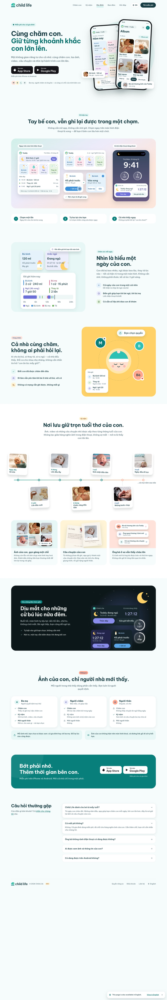
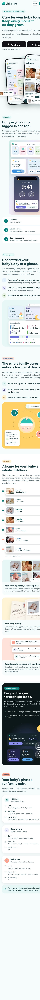

# S14 — Landing site (dev)

**Live (dev):** https://child-life-dev-landing.web.app/ (Vietnamese) · https://child-life-dev-landing.web.app/en/ (English) · `/quyen-rieng-tu/`, `/dieu-khoan/`, `/en/privacy/`, `/en/terms/`
**Status:** landing built and deployed on **dev** (checklist rows ◐, not done) and verified in a browser. **Not ready for prod**: it is waiting on the owner items below (copy approvals, store links, legal text, official badges). Dev is `noindex` and `robots.txt` disallows everything (plan §3.7).

| Desktop 1440 (vi)                  | Mobile 375 (en)                  |
| ---------------------------------- | -------------------------------- |
|  |  |

## What was built

- **All 11 Figma sections** (Website `219:1391` desktop / `233:804` mobile), per `docs/discovery/figma-extract/11-landing-specs.md`: nav, hero, Thao tác nhanh, Chăm sóc, Cùng chăm, Tuổi thơ, Night care, Quyền xem, CTA, Hỏi đáp, footer. The desktop layout starts at 1120 px. Below 1120 px the page uses the mobile layout, in a column up to 640 px wide.
- **Mockups are live HTML, not images.** Widgets, Lock screen, Live Activity, CareTiles, DayRhythm, timeline, story cards and the Night care visual all reuse the design tokens and the app's icons and illustrations (`apps/mobile/assets`).
  - Each is built once at Figma desktop size and scaled to fit its width (`Fit`). On mobile it renders at the Figma scale (0.5583 / 0.5234 / 0.4917).
  - The hero phones were raster snapshots in Figma. They are rebuilt in HTML so the English page shows English UI and the hero no longer costs 1.3 MB of PNG.
- **Two languages (D-012).** Vietnamese is served at `/` and English at `/en/`, from typed catalogs (`src/content/{vi,en}.ts`). A test enforces that both catalogs have the same structure.
  - Language switch in the nav and the footer. The chosen language is remembered.
  - Visitors whose saved or browser language differs from the page see a dismissible suggestion banner. They are never redirected, so crawlers and shared links always get the page they asked for.
- **SEO**
  - Every route is prerendered to static HTML (React SSR at build time).
  - Each page has its own title, description, canonical URL, `hreflang` vi / en / x-default, Open Graph and Twitter tags, and an OG image per language (`/og/{vi,en}.png`).
  - JSON-LD: Organization, WebSite, MobileApplication (free), and FAQPage built from the real answers.
  - `sitemap.xml` with xhtml alternates. `robots.txt` per environment: prod allows crawling but blocks `/s/` and `/i/`; dev blocks everything.
  - Semantics: one `h1`, a section `h2` per section, `h3` for tiles, roles and FAQ questions. The FAQ uses native `
`, so the answers are in the HTML.
  - Trailing-slash URLs are canonical; Hosting now 301s `/en` to `/en/`.
- **Motion** (Figma Motion spec `269:19` tokens: gentle 600 ms, standard spring curve, instant press 0.96, stagger 30 ms):
  - **Hero entrance** is CSS-only, so it never waits for JS. The mint circle scales in, the phones rise and rotate into place, the chips pop in and then float gently. The headline and lead paint immediately because they are the LCP element.
  - **Scroll reveal** happens once per element, with staggered children. Rings fill, the 24 h DayRhythm bars grow, the timeline rail draws and the polaroids land as it reaches them, notifications slide in, and the heart beats.
  - **Live details**: the timers really tick (`1:27:06`), the tap ripple loops on the widget, the stars twinkle and the moon floats.
  - **Interaction**: hover lifts on tiles, cards, badges and polaroids; the FAQ height animates (`::details-content`) and the plus swaps to a chevron; the nav frosts on scroll, and an underline follows the section in view.
  - **Page changes** use cross-document View Transitions between pages and languages.
  - **Reduced motion** turns all of this off, and the page is fully visible without JS.
- **Store badges.** Store links do not exist yet (`site.ts` → `storeLinks: null`). Until they do, tapping a badge shows a "coming soon" toast instead of a dead link. The nav "Tải miễn phí / Tải app" button scrolls to the CTA.
- **Legal pages:** placeholders that say the full text is coming, plus the contact email.
- **Assets**
  - Favicon (the logo mark).
  - Apple touch and manifest icons, rendered full-bleed.
  - `site.webmanifest`.
  - OG images, rendered by `scripts/render-brand-assets.mjs` with local Chrome.
  - Story-card fonts (Lora and Dancing Script, OFL) are self-hosted as latin + vietnamese subsets and load only when that tile gets near the screen.
- **Hosting**
  - Immutable cache for `/assets/**`, 30 days for fonts, 1 day for icons and OG images.
  - Security headers: HSTS, nosniff, Referrer-Policy, `X-Frame-Options: DENY`, Permissions-Policy.

## Verification

- `pnpm lint`, `pnpm typecheck`, `pnpm format:check` and `pnpm test` all pass. That includes 16 new landing tests:
  - the vi / en catalogs have the same structure, no empty strings, and no untranslated sentences;
  - the Figma copy that contradicts the app is not shipped (see below);
  - routes and alternates are symmetric;
  - dev pages are `noindex` and prod pages are not;
  - canonical, hreflang and OG tags are correct;
  - the FAQ JSON-LD covers every question;
  - every route prerenders in its own language with exactly one `h1`, and the FAQ answers are in the HTML.
- Browser checks (the in-app browser, local preview and live dev):
  - Every section was checked at 1440 and 375 in both languages, plus the legal pages.
  - FAQ toggle, badge toast, language banner, ticking timers and on-demand fonts all work.
  - No console errors.
  - Live routes return 200, `/en` returns 301, unknown paths get the 404 page, and the headers are as configured.
- **Lighthouse 12.8.2** against the live dev site:

  | Run                 | Performance | Accessibility | Best practices | SEO        | LCP       | CLS | TBT  |
  | ------------------- | ----------- | ------------- | -------------- | ---------- | --------- | --- | ---- |
  | Mobile `/` (3 runs) | 93–100      | 100           | 100            | 69 (dev)\* | 1.6–2.7 s | 0   | 0 ms |
  | Mobile `/en/`       | 100         | 100           | 100            | 69 (dev)\* | 1.7 s     | 0   | 0 ms |
  | Desktop `/`         | 100         | —             | —              | —          | 0.5 s     | 0   | —    |

  \* The only failing SEO audit is `is-crawlable`, which fails because dev is deliberately `noindex`. Every other SEO audit passes.

  Mobile LCP is a lab measurement (simulated slow 4G) and varies between runs; one run of three was above the 2.5 s budget. Field Core Web Vitals and INP still need to be measured after launch.

## Owner decisions needed before prod

1. **Replacement copy, shipped on dev as PROPOSED** (marked in `src/content/vi.ts`):
   - **D-001.** Figma: "Ảnh mới mặc định chỉ ba mẹ thấy…". On dev: "Mỗi ảnh mới, bạn chọn ai được xem: cả gia đình hay chỉ ba mẹ. Đổi lại lúc nào cũng được."
   - **Q-008.** Caregiver › Kỷ niệm. Figma: ✓ "Gửi ảnh bé cho ba mẹ, không xem album riêng". On dev: 🔒 "Không xem ảnh và kỷ niệm của con".
   - **Q-009.** Figma: "Ông ngoại đã xem 12 ảnh mới". On dev: "Ông ngoại thương 3 ảnh mới".
2. **FAQ answers 3–5 (G-065)** were drafted by engineering. They are in both languages and need approval.
3. **English copy (G-081):** all of it was drafted by engineering.
4. **Store URLs, plus the official App Store / Google Play badges** (Figma draws placeholder glyphs).
5. **Privacy and terms text.**
6. **Contact email:** confirm `hello@childlife.app`.
7. **Photo licences:** the rights to the baby photos used in Figma.
8. **DNS:** `dev.childlife.app` and `childlife.app`.

## Not done / follow-ups

- Prod deploy: needs `child-life-prod` and owner approval (D-005).
- AASA / assetlinks and the `/i/{token}` and `/s/{token}` web flows belong to later slices.
- Not designed in Figma: a tablet layout, a hover state per element, a mobile menu. All of these were engineering-supplied.
- A Content-Security-Policy header is not set yet. The page has two inline scripts (the `js` class and JSON-LD) that would need hashes.
- The JS bundle is about 96 KB gzip, mostly React. It never blocks first paint because the HTML is prerendered and the CSS is inlined.
