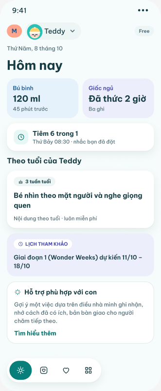
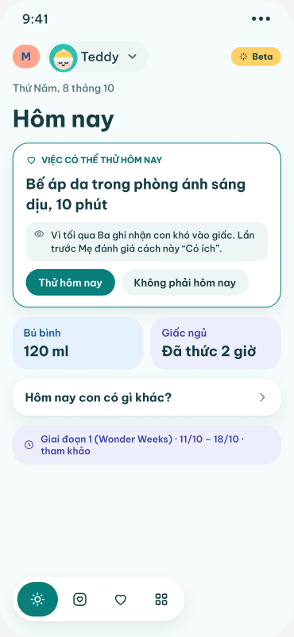
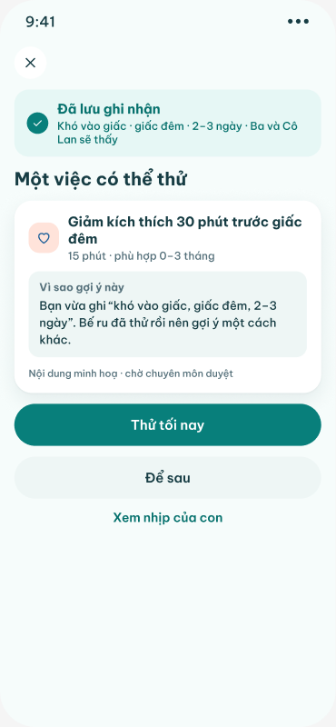
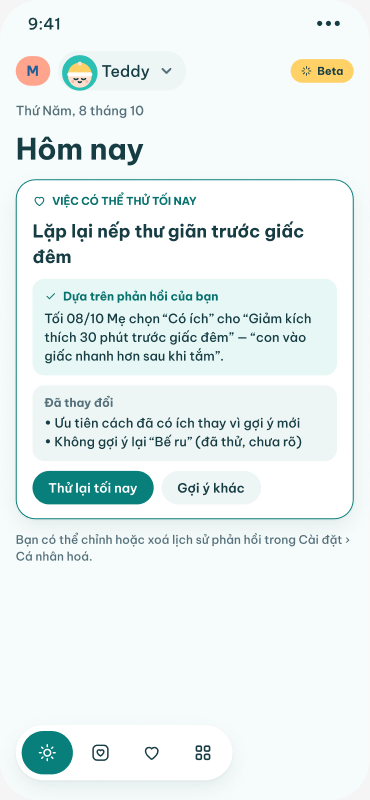
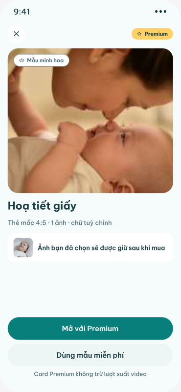
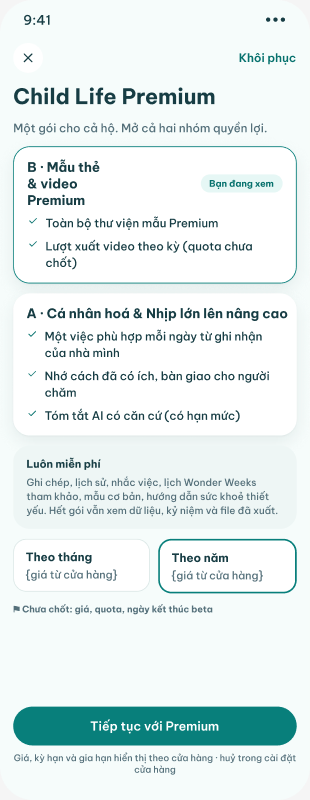

# Figma extraction — Cá nhân hoá & Nhịp lớn lên, and v2.0 Premium & cá nhân hoá

Source: Figma `sJLG1fAXKDnDr9YI6Yx8ex`, page **"Cá nhân hoá & Nhịp lớn lên"** `568:18`. Extracted read-only on 2026-10-14 with `get_design_context` (one call per frame, screenshot excluded; rendered `<p>` text and component props are authoritative, layer names are truncated at ~30 characters and several are stale), `get_metadata` (a saved page dump, plus one probe of `603:6186`) and `get_screenshot` (6 key frames, saved under [`img/pp/`](img/pp/) and named after the node id with `-` for `:`). No Figma node was modified.

**Precedence.** The page holds two generations of the same feature:
- **v1.1** (top of the page): section 1 "Lớp gắn kết" (EN00–EN10, where "EN" means *engagement*), section 2 "Nhịp lớn lên (thay Wonder Week)" (portal PN01–PN04, app NL01–NL10b), section 3 "Thẻ theo tuổi" (portal B05/B06, app 2a–2c), then the v1.1 content clusters already covered by `20-v11-content-features.md` (Mốc, Thư viện, Dinh dưỡng, Ăn dặm, Tiêm chủng, old Wonder Week).
- **v2.0** (label `588:6308`, y 15900 and below): "Premium & cá nhân hoá", 22 screens, each drawn twice — **VI** (y 16300) and **EN = English** (y 17800) — with one yellow annotation card per column (y 19300) and a "screen → action → capability" table (`595:7162`).

Where a v2.0 screen revises a v1.1 one, **v2.0 wins**. Every v1.1 frame below carries a "**Superseded by v2.0:**" line naming the v2.0 screen(s) that replace it, or "no v2.0 counterpart".

**Theme.** All app frames on this page are **Light**; no Night care twin was found for any v1.1 or v2.0 screen. Portal frames are desktop 1440 wide.

**Relation to the map.** D-072 (owner, 2026-10-14) gives the first answers for this page: only the family owner buys and manages the plan, caregivers may check in but not generate AI summaries, the country is asked, billing is `in_app_purchase` with our own verification, the user-facing name of the free age content is "Tuần này của {bé}" (Q-067), and the reference calendar is "Lịch tham khảo" with stages labelled "(Wonder Weeks)". Open items Q-068…Q-073 cite frames transcribed here (`594:6967`, `573:1109`, `576:3679`, `574:1222`, `592:6826`, `593:6931`, `592:6782`). D-068 #3 (★ Cao cấp card templates free during the Kỷ niệm 2.0 beta) interacts with the v2.0 rule "Beta A does not unlock B templates". Plan: `docs/product/premium-personalization-plan.md`.

## Frame list

### v2.0 · Premium & cá nhân hoá (VI y 16300 · EN y 17800; annotation `cột N` at x = 420·N, y 19300)

| Col | Code | Title (layer name) | VI node | EN node | Size VI / EN | Annotation | Screenshot |
|---|---|---|---|---|---|---|---|
| 0 | H01 | Home · Free | `589:6281` | `589:6544` | 375×907 / 375×907 | `595:7034` | [`img/pp/589-6281.png`](img/pp/589-6281.png) |
| 1 | H02 | Home · Beta/Premium · ưu tiên nhu cầu | `589:6368` | `589:6631` | 375×812 | `595:7038` | [`img/pp/589-6368.png`](img/pp/589-6368.png) |
| 2 | C01 | Check-in · bắt đầu từ một quan sát | `589:6451` | `589:6714` | 375×812 | `595:7043` | — |
| 3 | C02 | Check-in · hỏi thêm theo ngữ cảnh | `589:6492` | `589:6755` | 375×812 | `595:7047` | — |
| 4 | PS01 | Kết quả sau khi lưu · có quyền A | `590:6445` | `590:6593` | 375×812 | `595:7051` | [`img/pp/590-6445.png`](img/pp/590-6445.png) |
| 5 | PS01F | Kết quả sau khi lưu · Free | `590:6481` | `590:6629` | 375×812 | `595:7055` | — |
| 6 | AC01 | Hoạt động · Chưa thử | `590:6515` | `590:6663` | 375×812 | `595:7060` | — |
| 7 | AC02 | Hoạt động · Đã thử → phản hồi | `590:6558` | `590:6706` | 375×812 | `595:7064` | — |
| 8 | PS02 | Lần sau · phản hồi đã được dùng | `591:6495` | `591:6761` | 375×812 | `595:7068` | [`img/pp/591-6495.png`](img/pp/591-6495.png) |
| 9 | SU01 | Tóm tắt gia đình · bàn giao | `591:6564` | `591:6830` | 375×812 | `595:7072` | — |
| 10 | MS01 | Mốc đã lưu → Moments | `591:6632` | `591:6898` | 375×812 | `595:7077` | — |
| 11 | MO01 | Moments · thư viện mẫu | `591:6681` | `591:6947` | 375×812 | `595:7081` | — |
| 12 | MO02 | Mẫu Premium · xem mẫu & cần quyền | `592:6782` | `592:6906` | 375×812 | `595:7085` | [`img/pp/592-6782.png`](img/pp/592-6782.png) |
| 13 | PR01 | Quyền lợi & paywall · lối vào B (mẫu) | `592:6826` | `592:6950` | 375×968 / 375×1069 | `595:7089` | [`img/pp/592-6826.png`](img/pp/592-6826.png) |
| 14 | PR02 | Mua thành công → tiếp tục (variants: Pending/Error/Restore) | `592:6885` | `592:7009` | 375×812 | `595:7094` | — |
| 15 | MO03 | Sau khi mua · tiếp tục đúng mẫu & ảnh | `593:6797` | `593:7045` | 375×812 | `595:7098` | — |
| 16 | MO04 | Video · trạng thái xuất & quota | `593:6843` | `593:7091` | 375×812 | `595:7102` | — |
| 17 | PR03 | Gói của hộ · Free/Beta/Premium/Expired | `593:6931` | `593:7179` | 375×812 / 375×828 | `595:7107` | — |
| 18 | PR04 | Hết gói · lịch sử vẫn giữ | `593:6990` | `593:7238` | 375×812 / 375×825 | `595:7112` | — |
| 19 | ST01 | Trạng thái · thiếu dữ liệu · AI tắt/lỗi | `594:6967` | `594:7096` | 375×865 / 375×849 | `595:7116` | — |
| 20 | ST02 | Trạng thái · quyền vai trò · vùng chưa hỗ trợ | `594:7020` | `594:7149` | 375×812 | `595:7120` | — |
| 21 | HL01 | Sức khoẻ · luôn miễn phí (kể cả khi hết gói) | `594:7066` | `594:7195` | 375×812 | `595:7124` | — |

Components and tables in the v2.0 area: `588:6290` **Quyền/Badge** (household plan badge: Free, Beta, Premium, Expired, Pending), `588:6307` **Mẫu/Badge** (template badge: Free, Premium, Sample, Locked), `592:6781` **Mua/Trạng thái** (purchase sheet: Pending, Success, Error, Restore × VI/EN), label `588:6308`, table `595:7162`.

Found outside the v2.0 row and newer than the saved dump: **"Premium exploration / VI"** `603:6186` (PW01 Paywall + PW02 Compare plans, marked *exploratory*, x 12920 y 2020) and **"Premium exploration / EN"** `603:6278` — see the appendix at the end.

### v1.1 · section 1 "Lớp gắn kết" (labels `568:19`–`568:21`, y 120)

| Code | Node | Title | Size |
|---|---|---|---|
| EN00 | `559:57782` | Hôm nay · lời mời cá nhân hoá | 375×1480 |
| EN01 | `559:2288` | Cá nhân hoá · điều bạn quan tâm | 375×812 |
| EN02 | `559:2383` | Cá nhân hoá · giờ nhận gợi ý | 375×812 |
| EN03 | `559:2458` | Bật thông báo (trước hộp thoại hệ thống) | 375×812 |
| EN04 | `559:57551` | Hôm nay · cá nhân hoá | 375×1480 |
| EN05 | `560:2752` | Phản hồi thẻ gợi ý | 375×812 |
| EN06 | `560:2884` | Hộp thông báo | 375×812 |
| EN07 | `560:2981` | Cài đặt thông báo | 375×1180 |
| EN08 | `561:3011` | Thông báo đẩy · mẫu nội dung | 375×812 |
| EN09 | `561:3102` | Tóm tắt tuần | 375×1010 |
| EN10 | `561:3215` | Quay lại sau vài ngày | 375×1480 |

### v1.1 · section 2 "Nhịp lớn lên (thay Wonder Week)" (labels `568:22`, `568:23`, `576:59571`, `576:59572`; y 2020)

| Code | Node | Title | Size |
|---|---|---|---|
| PN01 | `576:3116` | Nhịp lớn lên · Mô hình tham khảo (portal) | 1440×1000 |
| PN02 | `575:3156` | Nhịp lớn lên · Soạn giai đoạn (portal) | 1440×1180 |
| PN03 | `576:3407` | Nhịp lớn lên · Hoạt động gợi ý (portal) | 1440×1000 |
| PN04 | `576:3679` | Nhịp lớn lên · Quy tắc & sức khoẻ (portal) | 1440×1080 |
| NL01 | `569:973` | Nhịp lớn lên · Tổng quan | 375×1334 |
| NL01b | `570:1002` | Tổng quan · chưa có dự sinh, chưa đủ dữ liệu | 375×812 |
| NL02a | `570:1070` | Thiết lập · hai lớp thông tin | 375×812 |
| NL02b | `570:1108` | Thiết lập · ngày dự sinh | 375×812 |
| NL02c | `570:1153` | Thiết lập · tuỳ chọn nhắc | 375×812 |
| NL03 | `571:1054` | Lịch tham khảo | 375×801 |
| NL04 | `571:1158` | Chi tiết cửa sổ tham khảo | 375×1028 |
| NL05 | `572:1089` | Check-in hôm nay | 375×997 |
| NL05b | `572:1161` | Check-in · câu hỏi sức khoẻ | 375×812 |
| NL06 | `572:1219` | Hỗ trợ sức khoẻ | 375×812 |
| NL07 | `573:1109` | Nhịp thực tế của con | 375×1054 |
| NL07b | `573:1199` | Gợi ý nhóm thành đợt quan sát | 375×812 |
| NL08 | `573:1303` | Gợi ý hoạt động & phản hồi | 375×812 |
| NL09 | `574:1153` | Điều mới → Kỷ niệm | 375×812 |
| NL10 | `574:1222` | Tóm tắt gia đình & quyền lợi | 375×877 |
| NL10b | `574:1317` | Tóm tắt · AI tắt hoặc lỗi | 375×812 |

### v1.1 · section 3 "Thẻ theo tuổi" (labels `568:24`–`568:27`, y 3774)

| Code | Node | Title | Where transcribed |
|---|---|---|---|
| B05 | `319:2030` | Thẻ theo tuổi · Danh sách (portal, 1440×1120) | here, Part C (file 18 §10 had a one-line summary only) |
| B06 | `319:2345` | Thẻ theo tuổi · Soạn thẻ (portal, 1440×1180) | here, Part C |
| 2a | `310:42550` | Thẻ theo tuổi | `20-v11-content-features.md` Part A (full) |
| 2b | `310:42649` | Chi tiết giai đoạn | `20-v11-content-features.md` Part A (full) |
| 2c | `310:42762` | Thiếu ngày sinh | `20-v11-content-features.md` Part A (full) |

The rest of the page (sections 4–8 and "Bản cũ · Wonder Week": B01–B04, B07–B10, D01–D04, C04, 3a–3g, 4a–4f, 5a–5h, 6a–6f, 9a–9g) are the v1.1 content frames; their app frames are in `20-v11-content-features.md` and `17-vaccination.md` and were not re-read.

## v2.0 at a glance

  

  

- **One household plan, two benefit groups.** PR01 sells "Child Life Premium · Một gói cho cả hộ. Mở cả hai nhóm quyền lợi.": **A · Cá nhân hoá & Nhịp lớn lên nâng cao** (one suitable thing a day from the family's logs; remembers what helped and hands over to the next carer; grounded AI summary, with a limit) and **B · Mẫu thẻ & video Premium** (the full Premium template library; video exports per period, quota not decided). The paywall opens on the group that triggered it ("Bạn đang xem" on B when entered from a template). Prices are placeholders `{giá từ cửa hàng}` and the footnote says "⚑ Chưa chốt: giá, quota, ngày kết thúc beta".
- **Plan states** (`Quyền/Badge`, PR03): **Free**, **Beta** (group A free until an undecided end date, never Premium templates, no automatic charge), **Pending** (purchase being verified, nothing new unlocked), **Premium**, **Expired** (everything created stays viewable, only creating new Premium content is locked, PR04).
- **Always free** (PR01 "Luôn miễn phí", H01, PR03 Free card, HL01): logging, history, reminders, the reference calendar ("lịch Wonder Weeks tham khảo"), age-based content ("Nội dung theo tuổi · luôn miễn phí"), basic templates, essential health guidance, check-in (`rhythm.checkin (free)`), and reading everything already saved (`history.read`).
- **Paywall entry points as drawn**: H01 "Hỗ trợ phù hợp với con · Tìm hiểu thêm" (entry A), PS01F "Tìm hiểu thêm (tuỳ chọn)" (entry A, `PREMIUM_REQUIRED (chỉ khi user bấm)`, never blocking the save), MO02 "Mở với Premium" (entry B, `getCapabilities (PREMIUM_REQUIRED)`), PR04 "Gia hạn Premium" (renewal). No paywall or upsell appears on C01/C02, HL01 or ST02.
- **Capabilities named in the annotations/table**: `module.basic`, `personalization.basic`, `wonder.reference`, `personalization.cross_module` (A), `rhythm.checkin` (free), `rhythm.advanced` (A), `ai.assistance` (quota, template fallback), `moments.basic`, `templates.premium` (B), `render.video` (separate quota), `billing`, `history.read` (free), `health.guidance` (free in every state). Reason codes: `SELF_REPORTED_NEED`, `DATA_INSIGHT`, `PREMIUM_REQUIRED`, `CONSENT_REQUIRED`, `QUOTA_EXCEEDED`, `ROLE_DENIED`, `REGION_UNAVAILABLE`. Backend names: `composeHome`, `getCapabilities`, `saveCheckIn` (idempotent), `submitFeedback`, `generateSummary`, `milestoneLink`, `getTemplates`, `verifyPurchase`, `restore`, `handleWebhook`, `createRenderJob`, `getJob`, `QuotaLedger`, `getRhythmFacts`, health routing via `RuleConfig`.

### Navigation graph (v2.0, from annotations + table + CTAs)

```
H01 Home·Free ──"Hỗ trợ phù hợp…/Tìm hiểu thêm"──▶ (getCapabilities → PREMIUM_REQUIRED) ▶ PR01 entry A
H02 Home·Beta/Premium ──"Thử hôm nay"──▶ AC01 · "Không phải hôm nay" (dismiss) · "Hôm nay con có gì khác?"──▶ C01
C01 Check-in ──1 observation──▶ C02 (context questions) ──Lưu ghi nhận / Bỏ qua câu hỏi──▶ PS01 (entitled) | PS01F (Free)
     └─"Mình lo về sức khoẻ của con"──▶ HL01 (free, never a paywall)
PS01 ──Thử tối nay──▶ AC01 ──Mình sẽ thử──▶ (later) AC02 ──Lưu phản hồi──▶ PS02 (next time: feedback used)
     └─Để sau / Xem nhịp của con                       AC01 ──Không phù hợp với con──▶ item removed · Gợi ý khác (3-day cooldown, fixture)
PS01F ──Đọc bài (free) · Tìm hiểu thêm (tuỳ chọn)──▶ PR01 entry A · Xong
SU01 Tóm tắt gia đình ──Xem ghi nhận / Báo lại──▶ facts · CONSENT_REQUIRED / QUOTA_EXCEEDED ──▶ ST01
MS01 Mốc đã lưu ──Tạo thẻ mốc──▶ MO01 Thư viện mẫu ──Premium template──▶ MO02 ──Mở với Premium──▶ PR01 entry B
PR01 ──Tiếp tục với Premium──▶ store sheet ──▶ PR02 / Mua/Trạng thái: Pending · Success · Error · Restore
     Success ──▶ MO03 (same template + photo kept; card does not use video quota) ──video──▶ MO04 (queue, quota)
PR03 Gói của hộ (Manage in App Store · Khôi phục) · PR04 Hết gói ──Gia hạn Premium──▶ PR01 · Ghi nhận hôm nay (free)
ST02 role denied / region unavailable (A off, free still works) · HL01 health (Gọi hỗ trợ; placeholder content, BLOCKED)
```

## Part A · v2.0 Premium & cá nhân hoá (label `588:6308`)

### Label v2.0

`588:6308` (text, Be Vietnam Pro Bold 40 px, black, single line):

"v2.0 · Premium & cá nhân hoá — VI (hàng trên) · EN (hàng dưới) · annotations"

(Gloss: "v2.0 · Premium & personalization — VI (top row) · EN (bottom row) · annotations".) No sub-label exists beside it.

### Annotations (verbatim)

All 22 cards share one style: fill `#fff5c7` (soft yellow), text `#40330d`, radius 16, padding 16/14, gap 6. Line 1 is Bold 13 px (screen code + title); the lines after it are Medium 12 px. Layer name pattern: "Annotation · cột N". Each paragraph is given in order and separated by " / ".

- cột 0 · H01 (`595:7034`): "H01 Home · Free" / "cap: module.basic, personalization.basic, wonder.reference" / "Thẻ theo tuổi + nhắc việc + lịch tham khảo; “Hỗ trợ phù hợp” → PR01 (entry A). Không blur bản AI."
- cột 1 · H02 (`595:7038`): "H02 Home · Beta/Premium" / "cap: personalization.cross_module (A)" / "Primary = 1 hành động từ nhu cầu thực tế; Wonder Weeks xuống dưới. Thứ tự: health > reminder > need > milestone > moments > interest." / "reasonCode: SELF_REPORTED_NEED / DATA_INSIGHT"
- cột 2 · C01 (`595:7043`): "C01 Check-in · 1 quan sát" / "cap: rhythm.checkin (free)" / "Một lựa chọn; “lo về sức khoẻ” → HL01 (free)."
- cột 3 · C02 (`595:7047`): "C02 Hỏi thêm theo ngữ cảnh" / "cap: rhythm.checkin (free)" / "Câu hỏi đổi theo quan sát; dùng lại Care facts, không bắt nhập lại."
- cột 4 · PS01 (`595:7051`): "PS01 Kết quả sau lưu · A" / "cap: personalization.cross_module" / "Đã lưu → 1 gợi ý + lý do → Thử / Để sau. Event next_action_shown(reason)."
- cột 5 · PS01F (`595:7055`): "PS01F Kết quả sau lưu · Free" / "cap: module.basic" / "Nội dung theo tuổi + CTA tuỳ chọn → PR01. Không chặn hoàn tất." / "reasonCode: PREMIUM_REQUIRED (chỉ khi user bấm)"
- cột 6 · AC01 (`595:7060`): "AC01 Hoạt động · Chưa thử" / "cap: rhythm.advanced" / "Trạng thái Chưa thử; “Không phù hợp” loại item; “Gợi ý khác” cooldown 3 ngày (fixture)."
- cột 7 · AC02 (`595:7064`): "AC02 Đã thử → phản hồi" / "cap: rhythm.advanced" / "Feedback Có ích/Chưa rõ/Không phù hợp + ghi chú; không coi là nhân quả."
- cột 8 · PS02 (`595:7068`): "PS02 Lần sau" / "cap: rhythm.advanced" / "Chứng minh feedback được dùng: hiện phản hồi trước + điều đã thay đổi trong ranking."
- cột 9 · SU01 (`595:7072`): "SU01 Tóm tắt gia đình" / "cap: ai.assistance (quota) · fallback template" / "3 phần; liên kết ghi nhận thay [F1]. AI chỉ diễn đạt facts." / "reasonCode: CONSENT_REQUIRED / QUOTA_EXCEEDED → ST01"
- cột 10 · MS01 (`595:7077`): "MS01 Mốc → Moments" / "cap: moments.basic" / "Mốc do người có quyền xác nhận; gắn moment bằng ID; template Free hoặc Premium."
- cột 11 · MO01 (`595:7081`): "MO01 Thư viện mẫu" / "cap: moments.basic / templates.premium" / "Badge chữ Free/Premium + nhãn Mẫu minh hoạ."
- cột 12 · MO02 (`595:7085`): "MO02 Mẫu Premium · gate" / "cap: templates.premium" / "Beta A KHÔNG mở mẫu B. Giữ template + media selection khi đi PR01."
- cột 13 · PR01 (`595:7089`): "PR01 Paywall" / "entry A (Nhịp) ưu tiên nhóm A · entry B (mẫu) ưu tiên nhóm B" / "Một SKU/entitlement. Giá/kỳ/renewal từ storefront." / "⚑ Chưa chốt: giá, SKU tháng/năm, quota"
- cột 14 · PR02 (`595:7094`): "PR02 Mua · variants" / "Component “Mua/Trạng thái”: Pending / Success / Error / Restore × VI/EN" / "Pending không mở quyền; Success → MO03 tiếp tục đúng chỗ."
- cột 15 · MO03 (`595:7098`): "MO03 Tiếp tục sau mua" / "cap: templates.premium" / "Template + ảnh giữ nguyên; card không trừ quota video."
- cột 16 · MO04 (`595:7102`): "MO04 Xuất video & quota" / "cap: render.video (quota riêng)" / "Queued/Rendering/Done/Failed; fail → release reservation; retry không trừ thêm." / "⚑ Quota 1/5 là fixture, chưa chốt"
- cột 17 · PR03 (`595:7107`): "PR03 Gói của hộ" / "Free / Beta / Pending / Premium / Expired" / "Chỉ người mua quản lý; người thân thấy “Hộ đã có Premium”." / "⚑ Chưa chốt: ngày kết thúc beta, policy nhiều hộ"
- cột 18 · PR04 (`595:7112`): "PR04 Hết gói" / "history.read (free)" / "Lịch sử, tóm tắt đã lưu, kỷ niệm, file xuất vẫn xem; chỉ tạo mới bị khoá."
- cột 19 · ST01 (`595:7116`): "ST01 Thiếu dữ liệu · AI tắt/lỗi · offline" / "cap: ai.assistance fallback" / "Thiếu dữ liệu → SELF_REPORTED_NEED; AI lỗi không trừ quota."
- cột 20 · ST02 (`595:7120`): "ST02 Quyền vai trò · vùng" / "reasonCode: ROLE_DENIED / REGION_UNAVAILABLE" / "Premium không đổi vai trò; vùng chưa duyệt → A tắt, free vẫn chạy."
- cột 21 · HL01 (`595:7124`): "HL01 Sức khoẻ" / "health.guidance (free mọi trạng thái)" / "Không paywall/upsell; nội dung y tế = placeholder chờ duyệt theo vùng."

Short English glosses, for readers only (the authoritative text is the VI above):
- 0: age-based cards, reminders and a reference calendar; "Hỗ trợ phù hợp" (Suitable support) goes to PR01 entry A; the AI version is not blurred.
- 1: the primary card is one action drawn from the real need; Wonder Weeks moves down. Priority: health > reminder > need > milestone > moments > interest.
- 2: a single choice; "lo về sức khoẻ" (health worry) goes to HL01 (free).
- 3: the follow-up questions change with the observation; Care facts are reused, so the parent is not asked to re-enter them.
- 4: Saved → 1 suggestion + its reason → Try / Later; fires the event next_action_shown(reason).
- 5: age-based content plus an optional CTA to PR01; it never blocks completion; PREMIUM_REQUIRED only when the user taps.
- 6: the "Not tried" state; "Not suitable" removes the item; "Another suggestion" has a 3-day cooldown (fixture).
- 7: feedback is Helpful / Unclear / Not suitable + a note; it is not treated as causal.
- 8: proves the feedback is used by showing the earlier feedback and what changed in the ranking.
- 9: 3 parts; a "view entries" link replaces [F1]; the AI only rephrases facts.
- 10: a milestone is confirmed by someone with permission; the moment is linked by ID; the template is Free or Premium.
- 11: text badges Free/Premium plus a "Mẫu minh hoạ" (sample) label.
- 12: Beta A does NOT unlock B templates; the template and media selection are kept on the way to PR01.
- 13: entry A (Rhythm) leads with group A, entry B (templates) leads with group B. One SKU/entitlement; price, period and renewal come from the storefront. Open: price, monthly/yearly SKU, quota.
- 14: Pending does not grant access; Success goes to MO03 and resumes in the right place.
- 15: the template and photos are kept; a card does not use video quota.
- 16: a failure releases the reservation; a retry is not charged again. The 1/5 quota is a fixture, not final.
- 17: only the purchaser manages the plan; relatives see "Hộ đã có Premium" (Household has Premium). Open: beta end date, multi-household policy.
- 18: history, saved summaries, memories and exported files stay viewable; only creating new items is locked.
- 19: missing data falls back to SELF_REPORTED_NEED; an AI error does not use quota.
- 20: Premium does not change roles; in a region not yet approved, A is off and the free features keep working.
- 21: no paywall or upsell; the medical content is a placeholder awaiting per-region approval.

### Bảng · screen → action → capability (`595:7162`)

Title (`595:7163`, Bold 24 px, `--ink`): "Bảng screen → action → capability (v2.0)"

The card uses `--surface`, a 1 px `--separator` border, radius 24 and padding 24. The header row (`595:7164`) is Bold 13 px in `--ink-muted`. Body rows are 13 px `--ink`, with the Screen column in SemiBold. The Status cells marked [red] are coloured `--error` (#a12b32) in Figma. Column widths: 90/200/220/240/260/170/170. There is no footnote or other text in the table.

| Screen | Action | Capability | Backend / API | Status | Node VI | Node EN |
|---|---|---|---|---|---|---|
| H01 | Mở “Hỗ trợ phù hợp” | module.basic · personalization.basic | composeHome · getCapabilities | Ready for review | 589:6281 | 589:6544 |
| H02 | Thử hành động ưu tiên | personalization.cross_module | composeHome (ranking v fixture) | Ready for review | 589:6368 | 589:6631 |
| C01 | Chọn 1 quan sát | rhythm.checkin | saveCheckIn | Ready for review | 589:6451 | 589:6714 |
| C02 | Trả lời thêm · lưu | rhythm.checkin | saveCheckIn (idempotent) | Ready for review | 589:6492 | 589:6755 |
| PS01 | Thử / Để sau | personalization.cross_module | saveCheckIn → recommendation | Ready for review | 590:6445 | 590:6593 |
| PS01F | Đọc bài · Tìm hiểu thêm | module.basic | getCapabilities (PREMIUM_REQUIRED) | Ready for review | 590:6481 | 590:6629 |
| AC01 | Mình sẽ thử / Không phù hợp | rhythm.advanced | submitFeedback(started/not_suitable) | Ready for review | 590:6515 | 590:6663 |
| AC02 | Lưu phản hồi | rhythm.advanced | submitFeedback(outcome) | Ready for review | 590:6558 | 590:6706 |
| PS02 | Thử lại / Gợi ý khác | rhythm.advanced | composeHome (feedback-aware) | Ready for review | 591:6495 | 591:6761 |
| SU01 | Xem ghi nhận · Báo lại | ai.assistance (quota) | generateSummary + fallback | Ready for review · AI provider TBD | 591:6564 | 591:6830 |
| MS01 | Tạo thẻ mốc | moments.basic | milestoneLink | Ready for review | 591:6632 | 591:6898 |
| MO01 | Chọn mẫu | moments.basic / templates.premium | getTemplates | Ready for review | 591:6681 | 591:6947 |
| MO02 | Mở với Premium | templates.premium | getCapabilities (PREMIUM_REQUIRED) | Ready for review | 592:6782 | 592:6906 |
| PR01 | Chọn gói · tiếp tục · khôi phục | billing | verifyPurchase / restore | TBD: giá, SKU [red] | 592:6826 | 592:6950 |
| PR02 | Pending / Success / Error / Restore | billing | verifyPurchase · handleWebhook | Ready for review | 592:6885 | 592:7009 |
| MO03 | Lưu thẻ (giữ lựa chọn) | templates.premium | createRenderJob (card) | Ready for review | 593:6797 | 593:7045 |
| MO04 | Theo dõi job · thử lại | render.video (quota) | createRenderJob · getJob · QuotaLedger | TBD: quota [red] | 593:6843 | 593:7091 |
| PR03 | Quản lý · khôi phục | billing · history.read | getCapabilities · restore | TBD: beta end, nhiều hộ [red] | 593:6931 | 593:7179 |
| PR04 | Xem lịch sử · gia hạn | history.read | getRhythmFacts (read) | Ready for review | 593:6990 | 593:7238 |
| ST01 | Ghi nhận · bật AI · thử lại | ai.assistance fallback | generateSummary(fallback) | Ready for review | 594:6967 | 594:7096 |
| ST02 | Xin quyền · đổi khu vực | role / region | reasonCode ROLE_DENIED · REGION_UNAVAILABLE | Ready for review | 594:7020 | 594:7149 |
| HL01 | Gọi hỗ trợ | health.guidance (free) | health routing (RuleConfig) | BLOCKED: nội dung y tế theo vùng [red] | 594:7066 | 594:7195 |

Row node ids, header then rows in order: 595:7164, 7172, 7180, 7188, 7196, 7204, 7212, 7220, 7228, 7236, 7244, 7252, 7260, 7268, 7276, 7284, 7292, 7300, 7308, 7316, 7324, 7332, 7340. The 22 data rows match the 22 annotation columns one to one, in the same order.

### 589:6281 (VI) / 589:6544 (EN) — H01 · Home · Free

**Annotation:** No note inside the frame. Below the row, "Annotation · cột 0" `595:7034` (verbatim; see “Annotations” above): "H01 Home · Free" / "cap: module.basic, personalization.basic, wonder.reference" / "Thẻ theo tuổi + nhắc việc + lịch tham khảo; “Hỗ trợ phù hợp” → PR01 (entry A). Không blur bản AI." Capability-table row: H01 | "Mở “Hỗ trợ phù hợp”" | module.basic · personalization.basic | composeHome · getCapabilities | Ready for review. Layer names: "H01 · Home · Free · VI" / "· EN". Frame size 375×907 (both).

**Text (reading order)**

**VI**
- Status bar: "9:41", "•••"
- Header: avatar chip "M" (peach `card-peach` pill, ink `care-bottle-ink`); BabySwitcher name "Teddy" (+ chevron icon); spacer; badge component **Quyền/Badge, prop `trạngThái = "Free"`** rendering "Free" (surface-2 pill, ink-muted 11px bold).
- Date: "Thứ Năm, 8 tháng 10"
- Title: "Hôm nay"
- Care tiles (two side by side):
  - Tile 1 (`care-bottle-soft`): "Bú bình" / "120 ml" / "45 phút trước"
  - Tile 2 (`care-sleep-soft`): "Giấc ngủ" / "Đã thức 2 giờ" / "Ba ghi"
- Reminder card (white, clock icon on `mint-soft`): "Tiêm 6 trong 1" / "Thứ Bảy 08:30 · nhắc bạn đã đặt"
- Section heading: "Theo tuổi của Teddy"
- Age card (white): pill (cake icon) "3 tuần tuổi" / "Bé nhìn theo mặt người và nghe giọng quen" / "Nội dung theo tuổi · luôn miễn phí"
- Reference-calendar card (`care-sleep-soft`): white pill (clock icon) "LỊCH THAM KHẢO" / "Giai đoạn 1 (Wonder Weeks) dự kiến 11/10 – 18/10"
- Upsell/discovery card (white, 1px `separator` border, whole card is a link `<a>`): spark icon + "Hỗ trợ phù hợp với con" / "Gợi ý một việc dựa trên điều nhà mình ghi nhận, nhớ cách đã có ích, bản bàn giao cho người chăm tiếp theo." / link text "Tìm hiểu thêm" (`mint-text`)
- Floating tab bar (icons only, no labels): t0 Today (selected, `mint-deep` fill), t1 Memories, t2 Heart, t3 Grid.

**EN**
- Status bar: "9:41", "•••"
- Header: "M"; "Teddy"; badge Quyền/Badge `trạngThái = "Free"` → "Free"
- Date: "Thursday, 8 October"
- Title: "Today"
- Care tiles: "Bottle" / "120 ml" / "45 min ago"; "Sleep" / "Awake 2h" / "Dad logged"
- Reminder card: "6-in-1 vaccine" / "Sat 08:30 · your reminder"
- Section heading: "For Teddy’s age" (curly apostrophe)
- Age card: pill "3 weeks old" / "Your baby follows faces and familiar voices" / "Age-based content · always free"
- Reference-calendar card: pill "REFERENCE CALENDAR" / "Wonder Weeks stage 1 expected 11 Oct – 18 Oct"
- Discovery card (link): "Support that fits your baby" / "One next step based on what your family logs, remembers what helped, and a handover for the next carer." / "Learn more"
- Tab bar: Today (selected), Memories, Heart, Grid (icons only).

**Visual:** Single 375-wide Light screen; content column 16px gutters, 12px gaps, starts at y52; floating pill tab bar at top 831 (so frame ~ 900 tall). Tokens: `cloud`, `surface`, `surface-2`, `card-peach`, `care-bottle-soft`/`care-bottle-ink`, `care-sleep-soft`/`care-sleep-ink`, `mint-soft`, `mint-text`, `mint-deep`, `separator`, `ink`, `ink-muted`; cards use shadow-card. The "Hỗ trợ phù hợp" card is deliberately quieter than the others (white with hairline border, no shadow) — a soft upsell, not a paywall.

**Navigation (inferred):** "M" chip → account/profile (Me). BabySwitcher → baby picker. Care tiles → Bú bình / Giấc ngủ logs. Reminder card → reminder detail. Age card → age content (free). LỊCH THAM KHẢO card → Nhịp lớn lên / leap-window detail (NL-series). "Hỗ trợ phù hợp với con" card / "Tìm hiểu thêm" → PR01 "Quyền lợi & paywall · lối vào A" per annotation 595:7034 ("→ PR01 (entry A)"); the table row routes it through getCapabilities. Tab bar → Hôm nay / Kỷ niệm / Heart (care/health?) / Grid (more).

**Notes:**
- Free user Home: no personalised "ưu tiên nhu cầu" card, no check-in entry; instead a one-card soft upsell "Hỗ trợ phù hợp với con" with "Tìm hiểu thêm". No price, no "Premium" word, no lock icon in the copy.
- Age content and the reference calendar are shown to Free explicitly ("luôn miễn phí" / "always free").
- The badge is an instance of component set "Quyền/Badge" (`588:6290`), variant "Trạng thái=Free" (`588:6270`). The set has 5 variants (from saved page metadata): Free `588:6270`, Beta `588:6272`, Premium `588:6276`, Expired `588:6280`, Pending `588:6285`. A separate set "Mẫu/Badge" (`588:6307`: Free / Premium / Sample / Locked) is for templates and is not used in these frames.
- "Wonder Weeks" is still named in v2.0 copy ("Giai đoạn 1 (Wonder Weeks)" / "Wonder Weeks stage 1"), labelled as a reference calendar.
- VI/EN parity: all strings present in both. EN shortens "Thứ Bảy" to "Sat" and "nhắc bạn đã đặt" ("a reminder you set") to "your reminder"; EN "Your baby follows faces..." drops the "Bé" subject nuance (fine). Date format VI "11/10 – 18/10" vs EN "11 Oct – 18 Oct". Layout identical.

### 589:6368 (VI) / 589:6631 (EN) — H02 · Home · Beta/Premium · ưu tiên nhu cầu

**Annotation:** No note inside the frame. "Annotation · cột 1" `595:7038` (verbatim): "H02 Home · Beta/Premium" / "cap: personalization.cross_module (A)" / "Primary = 1 hành động từ nhu cầu thực tế; Wonder Weeks xuống dưới. Thứ tự: health > reminder > need > milestone > moments > interest." / "reasonCode: SELF_REPORTED_NEED / DATA_INSIGHT". Table row: H02 | "Thử hành động ưu tiên" | personalization.cross_module | "composeHome (ranking v fixture)" | Ready for review. Layer names: "H02 · Home · Beta/Premium · ưu tiên nhu cầu · VI" / "... · EN". Frame 375×812 (both).

**Text (reading order)**

**VI**
- Status bar: "9:41", "•••"
- Header: "M" chip; BabySwitcher "Teddy" (+ chevron); spacer; badge **Quyền/Badge, prop `trạngThái = "Beta"`** rendering spark icon + "Beta" (`sunshine` #ffd166 fill, ink text 11px bold) — layer id 588:6272.
- Date: "Thứ Năm, 8 tháng 10"
- Title: "Hôm nay"
- Priority-action card (layer "Hành động ưu tiên"; white, 1px `mint-deep` border, shadow-card):
  - Kicker (heart icon, `mint-text`): "VIỆC CÓ THỂ THỬ HÔM NAY"
  - Headline (18 bold): "Bế áp da trong phòng ánh sáng dịu, 10 phút"
  - "Vì sao" (why) box (`surface-2`, eye icon): "Vì tối qua Ba ghi nhận con khó vào giấc. Lần trước Mẹ đánh giá cách này “Có ích”."
  - Buttons: primary `mint-deep` pill "Thử hôm nay"; secondary `surface-2` pill "Không phải hôm nay"
- Care tiles (compact, no subtitles): "Bú bình" / "120 ml"; "Giấc ngủ" / "Đã thức 2 giờ"
- Check-in entry row (white card, whole card is a link, chevron-right): "Hôm nay con có gì khác?"
- Reference-calendar strip (`care-sleep-soft`, clock icon, one line, `care-sleep-ink`): "Giai đoạn 1 (Wonder Weeks) · 11/10 – 18/10 · tham khảo"
- Floating tab bar: Today (selected), Memories, Heart, Grid (icons only).

**EN**
- Status bar: "9:41", "•••"
- Header: "M"; "Teddy"; badge Quyền/Badge `trạngThái = "Beta"` → spark + "Beta"
- Date: "Thursday, 8 October"
- Title: "Today"
- Priority-action card:
  - Kicker: "ONE THING TO TRY TODAY"
  - Headline: "Skin-to-skin in a dim room, 10 minutes"
  - Why box: "Because Dad noted last night that Teddy struggled to settle. Mum rated this “Helpful” last time."
  - Buttons: "Try today" (primary), "Not today" (secondary)
- Care tiles: "Bottle" / "120 ml"; "Sleep" / "Awake 2h"
- Check-in entry row: "Anything different today?" + chevron
- Reference strip: "Wonder Weeks stage 1 · 11–18 Oct · reference"
- Tab bar: Today (selected), Memories, Heart, Grid.

**Visual:** Same shell as H01 but shorter: floating tab bar at top 736 (H01: 831), so the frame is ~95 px shorter (~812 vs ~907). The personalised "next step" card is the hero, directly under the title, outlined in `mint-deep` with a `surface-2` explanation box. Care tiles shrink (18px value, 12px vertical padding, no "45 phút trước"/"Ba ghi" sub-lines). Badge switches from neutral `surface-2` "Free" to `sunshine` "Beta" with spark icon. Light theme.

**Navigation (inferred):** "Thử hôm nay" → accept the suggestion (likely logs/plans the action; result/feedback later rated "Có ích"); "Không phải hôm nay" → dismiss for today. "Hôm nay con có gì khác?" → Check-in flow (C01). Reference strip → Nhịp lớn lên leap-window detail. Care tiles → logs. Badge → plan/entitlement info (not drawn).

**Notes:**
- Free (H01) vs Beta/Premium (H02) differences: H02 adds (1) the "VIỆC CÓ THỂ THỬ HÔM NAY" personalised suggestion with an explicit "Vì sao" explanation citing family logs and prior ratings ("Có ích"), (2) the check-in entry "Hôm nay con có gì khác?"; it removes (a) the reminder card "Tiêm 6 trong 1", (b) the "Theo tuổi của Teddy" age card ("luôn miễn phí"), (c) the "Hỗ trợ phù hợp với con / Tìm hiểu thêm" upsell card; the reference calendar is collapsed to a one-line strip; badge Free → Beta. Whether the reminder and age card are intentionally hidden for Beta/Premium or just cropped for space is not stated.
- Frame is titled "Beta/Premium" but only the "Trạng thái=Beta" badge variant (`588:6272`) is drawn; a Premium user would presumably show "Trạng thái=Premium" (`588:6276`, not rendered here) with otherwise the same screen.
- Annotation ranking "health > reminder > need > milestone > moments > interest" puts reminders above need, yet the H01 reminder card "Tiêm 6 trong 1" is absent in H02 — either no reminder exists in the H02 fixture or it was dropped; unclear.
- The suggestion is a soothing/sleep action, not health/medical; no health escalation copy on this screen; no paywall.
- "Ba"/"Mẹ" (Dad/Mum) attribution shows multi-carer data feeds the "why" explanation.
- VI/EN parity: all strings present. VI "con khó vào giấc" (the child) vs EN names "Teddy"; VI kicker "VIỆC CÓ THỂ THỬ HÔM NAY" ("a thing you could try today") vs EN "ONE THING TO TRY TODAY". VI date range "11/10 – 18/10" (spaced en dash) vs EN "11–18 Oct" (also differs from H01 EN "11 Oct – 18 Oct"). EN quotes "Helpful" with curly quotes like VI.

### 589:6451 (VI) / 589:6714 (EN) — C01 · Check-in · bắt đầu từ một quan sát

**Annotation:** No note inside the frame. "Annotation · cột 2" `595:7043` (verbatim): "C01 Check-in · 1 quan sát" / "cap: rhythm.checkin (free)" / "Một lựa chọn; “lo về sức khoẻ” → HL01 (free)." Table row: C01 | "Chọn 1 quan sát" | rhythm.checkin | saveCheckIn | Ready for review. Layer names: "C01 · Check-in · bắt đầu từ một quan sát · VI" / "... · EN". Frame 375×812.

**Text (reading order)**

**VI**
- Status bar: "9:41", "•••"
- Top bar: close (X) icon button (white circle), no title, no badge.
- Title (26 bold): "Hôm nay con có gì khác?"
- Subtitle: "Chọn một điều bạn để ý. Không cần trả lời hết."
- Observation options (single list, 8px gap):
  1. sleep icon "Khó vào giấc / hay thức" — **selected** (`mint-soft` fill, 1.5px `mint-deep` border, text `mint-text`)
  2. feed icon "Bú / ăn khác thường" — unselected (white, `separator` border)
  3. heart icon "Cần được dỗ nhiều hơn" — unselected
  4. star icon "Con có điều mới" — unselected
  5. check icon "Như mọi ngày" — unselected
  6. alert icon "Mình lo về sức khoẻ của con" — unselected; rendered as a link `<a>` (not a toggle) — the health escape row.
- Bottom bar (pinned, `cloud` background, top 723): full-width primary `mint-deep` pill "Tiếp tục" (link).

**EN**
- Status bar: "9:41", "•••"
- Top bar: close (X).
- Title: "What’s different today?"
- Subtitle: "Pick one thing you noticed. No need to answer everything."
- Options:
  1. "Hard to settle / waking more" — selected
  2. "Feeding seems different"
  3. "Needs more soothing"
  4. "Something new"
  5. "Same as usual"
  6. "I’m worried about health" — link row, alert icon
- Bottom: "Continue" (primary).

**Visual:** Light full-screen modal-style step (close X, not back arrow), ~812 tall (bottom bar at 723 + 12/30 padding + 47 button). Option rows: 16 radius, 14/13 padding, 18px line icons. Selected row uses `mint-soft` + `mint-deep` border + `mint-text`. No tab bar, no Quyền badge.

**Navigation (inferred):** X → back to Home (H02). "Tiếp tục" with an observation selected → C02 (follow-up questions for that context — C02 is the sleep follow-up). "Mình lo về sức khoẻ của con" → HL01 "Sức khoẻ · luôn miễn phí (kể cả khi hết gói)" per annotation 595:7043 ("→ HL01 (free)"); it leaves the check-in rather than asking follow-ups. "Như mọi ngày" likely saves a "normal day" check-in straight to the post-save result (PS01).

**Notes:**
- Single-choice ("Chọn một điều") but the copy "Không cần trả lời hết" implies optional/partial answers across later steps.
- Health row is visually identical to the other options (no warning colour), differs only by alert icon and link semantics; no paywall or badge on this screen, consistent with the rule that the health flow never shows a paywall.
- Entry copy mismatch in EN: Home H02 EN row says "Anything different today?" while C01 EN title says "What’s different today?"; VI is identical in both ("Hôm nay con có gì khác?").
- VI "Bú / ăn khác thường" ("feeding/eating unusual") vs EN "Feeding seems different"; VI "Con có điều mới" vs EN "Something new"; VI "Mình lo về sức khoẻ của con" ("I'm worried about my child's health") vs EN "I’m worried about health". Layout identical.
- Not drawn: disabled "Tiếp tục" state when nothing is selected; behaviour when the health row is tapped.

### 589:6492 (VI) / 589:6755 (EN) — C02 · Check-in · hỏi thêm theo ngữ cảnh

**Annotation:** No note inside the frame. "Annotation · cột 3" `595:7047` (verbatim): "C02 Hỏi thêm theo ngữ cảnh" / "cap: rhythm.checkin (free)" / "Câu hỏi đổi theo quan sát; dùng lại Care facts, không bắt nhập lại." Table row: C02 | "Trả lời thêm · lưu" | rhythm.checkin | "saveCheckIn (idempotent)" | Ready for review. Layer names: "C02 · Check-in · hỏi thêm theo ngữ cảnh · VI" / "... · EN". Frame 375×812.

**Text (reading order)**

**VI**
- Status bar: "9:41", "•••"
- Top bar: back (arrow) icon button (white circle); spacer; text link (13 semibold, ink-muted) "Bỏ qua câu hỏi"
- Context pill (`mint-soft`, sleep icon, `mint-text` 11 bold; layer stretched full width): "Khó vào giấc / hay thức"
- Title (22 bold): "Thêm một chút để gợi ý đúng hơn"
- Question card 1 (white, `separator` border): "Khi nào?" — chips: "Giấc đêm" (**selected**), "Giấc ngày", "Cả hai"
- Question card 2: "Từ bao giờ?" — chips: "Hôm nay", "2–3 ngày" (**selected**), "Lâu hơn"
- Question card 3: "Đã thử gì chưa? (tuỳ chọn)" — chips: "Bế ru" (**selected**), "Tiếng ồn trắng", "Chưa"
- Context box (`surface-2`, sleep icon, ink-muted 12): "Từ nhật ký: giấc đêm qua được ghi 7 giờ 50 (Ba ghi). Bạn không cần nhập lại."
- Bottom bar (pinned at top 700, `cloud`): primary `mint-deep` pill "Lưu ghi nhận"; centred helper below: "Ghi nhận luôn miễn phí · cả nhà cùng thấy"

**EN**
- Status bar: "9:41", "•••"
- Top bar: back; "Skip questions"
- Context pill: "Hard to settle / waking more"
- Title: "A little more so the suggestion fits"
- "When?" — "Night sleep" (selected), "Naps", "Both"
- "Since when?" — "Today", "2–3 days" (selected), "Longer"
- "Tried anything? (optional)" — "Rocking" (selected), "White noise", "Not yet"
- Context box: "From the log: last night’s sleep was logged as 7h 50m (Dad). No need to re-enter."
- Bottom: "Save note" (primary); helper "Logging is always free · shared with family"

**Visual:** Light, ~812 tall; three stacked question cards with wrap-chips (12 radius, 12/9 padding). Selected chip: `mint-soft` fill, 1.5px `mint-deep` border, `mint-text` bold; unselected chip: white, 1px `control-border` (#7e959a), ink semibold. Pinned bottom bar with primary button + reassurance line. No tab bar, no badge.

**Navigation (inferred):** Back → C01. "Bỏ qua câu hỏi" → save the observation without follow-ups (straight to PS01/PS01F). "Lưu ghi nhận" → saves the check-in → post-save result PS01 (entitled: Beta "A"/Premium) or PS01F (Free).

**Notes:**
- The follow-up questions are context-specific to the chosen observation (sleep here: night vs nap, duration, what was tried); other observation branches (feeding, soothing, something new) are not drawn.
- Single-select per question is implied (one selected chip per row); third question is optional.
- Pulls existing log data ("Từ nhật ký ... (Ba ghi)") to avoid re-entry — attribution to the carer who logged.
- Free-ness statement: "Ghi nhận luôn miễn phí · cả nhà cùng thấy" — saving a check-in is free for every plan; only what comes after (personalised suggestion) differs by entitlement (see PS01 vs PS01F).
- VI "Lưu ghi nhận" ("save observation") vs EN "Save note"; VI "Giấc ngày" vs EN "Naps"; VI "Bế ru" ("hold and rock/sing") vs EN "Rocking". VI time "7 giờ 50" vs EN "7h 50m". Layout identical.
- Health concerns are not asked here (no red-flag question); the health path branches from C01.

### 590:6445 (VI) / 590:6593 (EN) — PS01 · Kết quả sau khi lưu · có quyền A

**Annotation:** No note inside the frame. "Annotation · cột 4" `595:7051` (verbatim): "PS01 Kết quả sau lưu · A" / "cap: personalization.cross_module" / "Đã lưu → 1 gợi ý + lý do → Thử / Để sau. Event next_action_shown(reason)." Table row: PS01 | "Thử / Để sau" | personalization.cross_module | "saveCheckIn → recommendation" | Ready for review. Layer names: "PS01 · Kết quả sau khi lưu · có quyền A · VI" / "... · EN". Frame 375×812. ("có quyền A" = holds entitlement A = capability `personalization.cross_module`, which per H02's annotation Beta and Premium both carry.)

**Text (reading order)**

**VI**
- Status bar: "9:41", "•••"
- Top bar: close (X) icon button; no title, no badge.
- Saved banner (`mint-soft`, check icon in `mint-deep` circle, `mint-text`): "Đã lưu ghi nhận" / "Khó vào giấc · giấc đêm · 2–3 ngày · Ba và Cô Lan sẽ thấy"
- Section title (20 bold): "Một việc có thể thử"
- Suggestion card (white, shadow-card):
  - Heart icon on `peach-soft` tile; title "Giảm kích thích 30 phút trước giấc đêm"; meta "15 phút · phù hợp 0–3 tháng"
  - Why box (`surface-2`): label "Vì sao gợi ý này" / body "Bạn vừa ghi “khó vào giấc, giấc đêm, 2–3 ngày”. Bế ru đã thử rồi nên gợi ý một cách khác."
  - Footnote (11, ink-muted): "Nội dung minh hoạ · chờ chuyên môn duyệt"
- Primary button (full width, `mint-deep`, link): "Thử tối nay"
- Secondary button (full width, `surface-2`): "Để sau"
- Text link (centred, `mint-text`): "Xem nhịp của con"

**EN**
- Status bar: "9:41", "•••"
- Top bar: close (X).
- Saved banner: "Note saved" / "Hard to settle · night · 2–3 days · Dad and Lan will see it"
- Section title: "One thing you could try"
- Suggestion card: "Wind down 30 minutes before night sleep" / "15 min · fits 0–3 months"; why box "Why this" / "You just noted “hard to settle, night, 2–3 days”. Rocking was already tried, so this is a different approach."; footnote "Illustrative content · pending expert review"
- Primary: "Try tonight"
- Secondary: "Later"
- Link: "See Teddy’s rhythm"

**Visual:** Light, content-height screen (content padding bottom 40, no pinned bar, no tab bar). Mint confirmation banner on top, then one suggestion card with `peach-soft` icon tile and `surface-2` explanation; stacked full-width primary/secondary pills. No Quyền badge, no lock, no price.

**Navigation (inferred):** X → back to Home (H02, where the suggestion likely appears as "VIỆC CÓ THỂ THỬ HÔM NAY"). "Thử tối nay" → accept/schedule the suggestion for tonight (later feedback "Có ích"). "Để sau" → dismiss, return Home. "Xem nhịp của con" → Nhịp lớn lên / child's rhythm screen (NL-series, v2.0 rhythm frames).

**Notes:**
- Entitled ("quyền A") result = saved confirmation + one personalised suggestion with explanation that reflects the check-in answers (uses "Bế ru đã thử" from C02 to avoid repeating a tried approach).
- Footnote "Nội dung minh hoạ · chờ chuyên môn duyệt" / "Illustrative content · pending expert review" marks the suggestion text as placeholder awaiting expert review — content must not ship as-is.
- The saved banner names who will see the note: "Ba và Cô Lan" (Dad and a carer "Cô Lan"); EN drops the honorific "Cô" ("Dad and Lan").
- No health escalation copy; no paywall; no badge on this screen.
- Suggestion title says "30 phút trước giấc đêm" while meta says "15 phút" (duration of the activity vs lead time) — could read as contradictory.
- VI "Xem nhịp của con" ("see your child's rhythm") vs EN names the baby "See Teddy’s rhythm". VI "Để sau" vs EN "Later". Layout identical.

### 590:6481 (VI) / 590:6629 (EN) — PS01F · Kết quả sau khi lưu · Free

**Annotation:** (below the row, "Annotation · cột 5" `595:7055`, verbatim) "PS01F Kết quả sau lưu · Free" / "cap: module.basic" / "Nội dung theo tuổi + CTA tuỳ chọn → PR01. Không chặn hoàn tất." / "reasonCode: PREMIUM_REQUIRED (chỉ khi user bấm)". Capability-table row: PS01F | "Đọc bài · Tìm hiểu thêm" | module.basic | "getCapabilities (PREMIUM_REQUIRED)" | Ready for review. No note inside the frame itself.

**Text (reading order)**

**VI**
- Status bar: "9:41", "•••"
- Top bar: close (X) icon button; no title, no badge.
- Saved banner (`mint-soft`, check in `mint-deep` circle): "Đã lưu ghi nhận" / "Khó vào giấc · giấc đêm · 2–3 ngày · Ba và Cô Lan sẽ thấy" (identical to PS01)
- Section title (20 bold): "Đọc thêm theo tuổi"
- Free article card (white, shadow-card; layer "Bài cơ bản"): pill (journal icon, `surface-2`) "Miễn phí · theo tuổi" / title "Giấc ngủ của bé 0–3 tháng: điều thường gặp" / meta "Đọc 3 phút"
- Optional upsell card (white, 1px `separator` border, no shadow; layer "Nâng cao"): spark icon + "Muốn một gợi ý theo đúng tình huống?" / "Hỗ trợ phù hợp với con chọn một việc từ ghi nhận của nhà mình và nhớ cách đã có ích." / link (`mint-text`) "Tìm hiểu thêm (tuỳ chọn)"
- Button (full width, secondary `surface-2` style): "Xong"

**EN**
- Status bar: "9:41", "•••"
- Top bar: close (X).
- Saved banner: "Note saved" / "Hard to settle · night · 2–3 days · Dad and Lan will see it"
- Section title: "More for this age"
- Article card: pill "Free · age-based" / "Sleep at 0–3 months: what’s common" / "3-min read"
- Upsell card: "Want a suggestion for this exact situation?" / "Support that fits your baby picks one step from your family’s notes and remembers what helped." / "Learn more (optional)"
- Button: "Done"

**Visual:** Same shell as PS01 (Light, ~812, close X, mint saved banner). Instead of the personalised suggestion card + primary "Thử tối nay", Free gets one shadowed free article card (pill "Miễn phí · theo tuổi") and one quiet hairline-bordered upsell card with spark icon; the only button "Xong" is the secondary `surface-2` pill (no primary/mint-deep CTA on the screen). No lock icon, no blur of the AI content, no price, no Premium/Beta badge.

**Navigation (inferred):** X / "Xong" → back to Home (H01). Article card → free age-based article. "Tìm hiểu thêm (tuỳ chọn)" → per annotation, PR01 (Quyền lợi & paywall · lối vào A) — only when the user taps, via getCapabilities returning `PREMIUM_REQUIRED`.

**Notes:**
- PS01 (quyền A) vs PS01F (Free): same saved confirmation (saving is free for all, per C02 "Ghi nhận luôn miễn phí"); entitled users get "Một việc có thể thử" + personalised suggestion + "Vì sao gợi ý này" + "Thử tối nay"/"Để sau" + "Xem nhịp của con"; Free users get "Đọc thêm theo tuổi" (generic free article) + optional "Muốn một gợi ý theo đúng tình huống?" card + "Xong". Free does not get the "Xem nhịp của con" link.
- Paywall behaviour: the upsell is explicitly optional ("(tuỳ chọn)"/"(optional)"), non-blocking ("Không chặn hoàn tất"), and the paywall is reached only on tap → `PREMIUM_REQUIRED` — matches the owner rule.
- Upsell copy reuses the product name "Hỗ trợ phù hợp với con" / "Support that fits your baby" from H01's card; H01 lists three benefits (one step, remembers what helped, handover for next carer) while PS01F lists two (no handover).
- VI title "Đọc thêm theo tuổi" ("read more by age") vs EN "More for this age"; VI "Đọc 3 phút" vs EN "3-min read". Layout identical.
- No health escalation copy (sleep observation is non-health).

#### Free vs Beta/Premium ("quyền A") at a glance

| Area | Free (H01, PS01F) | Beta/Premium = quyền A (H02, PS01) |
|---|---|---|
| Badge (Quyền/Badge) | "Free" (`surface-2`, ink-muted) | "Beta" (`sunshine` + spark icon); Premium variant exists but not drawn |
| Home hero | none; care tiles with sub-lines, reminder "Tiêm 6 trong 1", "Theo tuổi của Teddy" card ("luôn miễn phí"), full LỊCH THAM KHẢO card | "VIỆC CÓ THỂ THỬ HÔM NAY" suggestion + "Vì sao" + "Thử hôm nay"/"Không phải hôm nay"; compact tiles; reference calendar as a one-line strip |
| Check-in entry on Home | not shown | "Hôm nay con có gì khác?" row |
| Upsell | "Hỗ trợ phù hợp với con … Tìm hiểu thêm" (H01); "Muốn một gợi ý theo đúng tình huống? … Tìm hiểu thêm (tuỳ chọn)" (PS01F) → PR01 only on tap (PREMIUM_REQUIRED) | none |
| Check-in (C01/C02) | free ("Ghi nhận luôn miễn phí · cả nhà cùng thấy") | same |
| After save | "Đọc thêm theo tuổi" free article + optional upsell + "Xong" | "Một việc có thể thử" personalised suggestion + "Vì sao gợi ý này" + "Thử tối nay"/"Để sau" + "Xem nhịp của con" |
| Health | C01 "Mình lo về sức khoẻ của con" → HL01 (free), no badge/paywall | same |

### 590:6515 (VI) / 590:6663 (EN) — AC01 · Hoạt động · Chưa thử

**Annotation:** (Annotation · cột 6, `595:7060`) "AC01 Hoạt động · Chưa thử" / "cap: rhythm.advanced" / "Trạng thái Chưa thử; “Không phù hợp” loại item; “Gợi ý khác” cooldown 3 ngày (fixture)."

**VI**
- Top bar: close button (`Icon/close`, white circle, left) · spacer · status pill (`surface-2`, `Icon/clock`, `ink-muted`): `Chưa thử`
- Activity hero card (`peach-soft` #ffe3da, radius 20):
  - eyebrow (`care-bottle-ink` #1d5f99, 12 bold): `Gợi ý · 15 phút`
  - title (22 bold): `Giảm kích thích 30 phút trước giấc đêm`
  - reason (13, `ink-muted`): `Vì: “khó vào giấc, 2–3 ngày” (Ba ghi 07/10)`
- Steps card (white, shadow-card): heading `Cách làm`; numbered pills (`surface-2`) + text:
  - `1` `Giảm đèn và tiếng ồn`
  - `2` `Tắm hoặc lau người ấm`
  - `3` `Cho bú yên tĩnh`
  - `4` `Đặt bé xuống khi buồn ngủ`
- Disclaimer (11, `ink-muted`): `Nội dung minh hoạ · chờ chuyên môn duyệt`
- Primary button (full width, `mint-deep`): `Mình sẽ thử`
- Text-link row (centred, 13 semibold): `Không phù hợp với con` (`ink-muted`) · `Gợi ý khác` (`mint-text`)

**EN**
- Top bar: close button · status pill (`Icon/clock`): `Not tried yet`
- Activity hero card:
  - `Suggestion · 15 min`
  - `Wind down 30 minutes before night sleep`
  - `Because: “hard to settle, 2–3 days” (Dad, 7 Oct)`
- Steps card: heading `How`
  - `1` `Dim lights and noise`
  - `2` `Warm bath or wipe-down`
  - `3` `Quiet feed`
  - `4` `Put down when drowsy`
- Disclaimer: `Illustrative content · pending expert review`
- Primary button: `I’ll try this`
- Text-link row: `Not right for my baby` · `Another idea`

**Visual:** Full-screen modal-style detail (close X, no tab bar). Hero card in `peach-soft` with a blue `care-bottle-ink` eyebrow; steps in a white shadow card with grey numbered chips; one full-width `mint-deep` pill CTA and two secondary text links underneath. No plan badge on this screen.

**Navigation (inferred):** X closes back to Home (H02, priority-action card) / PS01. `Mình sẽ thử` / `I’ll try this` marks the activity as being tried (state moves toward AC02 "Đã thử", feedback asked later). `Không phù hợp với con` removes the item (per annotation). `Gợi ý khác` swaps to another suggestion and puts this one on a 3-day cooldown (fixture value).

**Notes:**
- Capability gate `rhythm.advanced` (annotation) — i.e. Beta/Premium-only; Free path not drawn here (see PS01F).
- Reason line cites the source observation with author + date (`Ba ghi 07/10` / `Dad, 7 Oct`) — consistent with SU01 link chip `Ghi nhận của Ba · 07/10`.
- Content is explicitly flagged as illustrative, pending expert review — copy is placeholder, not approved guidance.
- VI-EN: wording otherwise parallel; EN eyebrow `Suggestion` vs VI `Gợi ý`; EN "How" vs "Cách làm". Same layout/height.
- States not drawn: loading, item removed confirmation, cooldown/"no more ideas" state, offline.

---

### 590:6558 (VI) / 590:6706 (EN) — AC02 · Hoạt động · Đã thử → phản hồi

**Annotation:** (Annotation · cột 7, `595:7064`) "AC02 Đã thử → phản hồi" / "cap: rhythm.advanced" / "Feedback Có ích/Chưa rõ/Không phù hợp + ghi chú; không coi là nhân quả."

**VI**
- Top bar: close button (`Icon/close`) · status pill (`mint-soft`, `Icon/check`, `mint-text`): `Đã thử · tối 08/10`
- Title (20 bold): `Giảm kích thích 30 phút trước giấc đêm`
- Feedback card (white, `mint-deep` 1px border, shadow):
  - heading: `Tối qua thế nào?`
  - 3 equal segmented choices: `Có ích` (SELECTED — `mint-soft` fill, 1.5px `mint-deep` border, `mint-text`) · `Chưa rõ` (unselected, `surface-2`) · `Không phù hợp` (unselected)
  - note field (white, `control-border` outline), filled value: `Con vào giấc nhanh hơn sau khi tắm`
  - info strip (`surface-2`, `Icon/sliders`, 12 `ink-muted`): `Phản hồi này được dùng để chọn gợi ý lần sau. “Có ích” không có nghĩa là cách này gây ra thay đổi.`
- Primary button (full width, `mint-deep`): `Lưu phản hồi`

**EN**
- Top bar: close button · pill (`Icon/check`): `Tried · 8 Oct evening`
- Title: `Wind down 30 minutes before night sleep`
- Feedback card:
  - `How did last night go?`
  - `Helpful` (SELECTED) · `Not sure` · `Not a fit`
  - note field value: `Settled faster after the bath`
  - info strip: `This feedback shapes your next suggestion. “Helpful” doesn’t mean this caused the change.`
- Primary button: `Save feedback`

**Visual:** Same shell as AC01 (close X, no tab bar). The feedback card is outlined in `mint-deep` to mark it as the active task; the selected choice uses `mint-soft` + thicker `mint-deep` border. Note input uses `control-border` (#7e959a). Plenty of empty space below the CTA.

**Navigation (inferred):** `Lưu phản hồi` / `Save feedback` saves and returns to Home; the next Home render is PS02 (feedback used). X discards. Note field is free text (optional, presumably).

**Notes:**
- Feedback enum: `Có ích / Chưa rõ / Không phù hợp` = `Helpful / Not sure / Not a fit`. Note: AC01's dismiss link is `Không phù hợp với con` / `Not right for my baby` — same VI root, different EN wording (`Not a fit` vs `Not right for my baby`).
- Explicit non-causal disclaimer (“Có ích” does not imply causation) — a copy rule worth keeping.
- The pill says the activity was tried on the evening of 08/10 and the question is "Tối qua thế nào?" (how was last night) — so this screen is being viewed on 09/10 or later. PS02 then shows the feedback applied but is dated `Thứ Năm, 8 tháng 10` (see Inconsistencies).
- Who gave the feedback is not shown here; PS02/SU01 attribute it to Mẹ / Mum.
- States not drawn: nothing selected (CTA disabled?), `Chưa rõ`/`Không phù hợp` selected, save error.

---

### 591:6495 (VI) / 591:6761 (EN) — PS02 · Lần sau · phản hồi đã được dùng

**Annotation:** (Annotation · cột 8, `595:7068`) "PS02 Lần sau" / "cap: rhythm.advanced" / "Chứng minh feedback được dùng: hiện phản hồi trước + điều đã thay đổi trong ranking."

**VI**
- Header: caregiver avatar chip `M` (`card-peach` #ffa58d, `care-bottle-ink`) · `BabySwitcher` name=`Teddy` (BabyFace avatar + chevron) · spacer · `Quyền/Badge` = **Beta** (`sunshine`, `Icon/spark`): `Beta`
- Date (13, `ink-muted`): `Thứ Năm, 8 tháng 10`
- Title (30 bold): `Hôm nay`
- Priority-action card (white, `mint-deep` border, shadow):
  - kicker (`Icon/heart`, 11 bold caps, `mint-text`): `VIỆC CÓ THỂ THỬ TỐI NAY`
  - title (18 bold): `Lặp lại nếp thư giãn trước giấc đêm`
  - "feedback used" box (`mint-soft`): `Icon/check` + `Dựa trên phản hồi của bạn` (bold, `mint-text`); body: `Tối 08/10 Mẹ chọn “Có ích” cho “Giảm kích thích 30 phút trước giấc đêm” — “con vào giấc nhanh hơn sau khi tắm”.`
  - "what changed" box (`surface-2`): label `Đã thay đổi`; bullets: `• Ưu tiên cách đã có ích thay vì gợi ý mới` / `• Không gợi ý lại “Bế ru” (đã thử, chưa rõ)`
  - buttons: `Thử lại tối nay` (primary `mint-deep` pill) · `Gợi ý khác` (secondary `surface-2` pill)
- Footer helper (12, `ink-muted`): `Bạn có thể chỉnh hoặc xoá lịch sử phản hồi trong Cài đặt › Cá nhân hoá.`
- Floating tab bar (top 736): 4 icon-only tabs — `Icon/today` (ACTIVE, `mint-deep` fill) · `Icon/memories` · `Icon/heart` · `Icon/grid`

**EN**
- Header: `M` chip · `Teddy` switcher · `Beta` badge
- Date: `Thursday, 8 October`
- Title: `Today`
- Priority-action card:
  - `ONE THING FOR TONIGHT`
  - `Repeat the evening wind-down`
  - `Based on your feedback` / `On 8 Oct Mum marked “Wind down 30 minutes before night sleep” as Helpful — “settled faster after the bath”.`
  - `What changed` / `• Prioritises what helped over a new idea` / `• “Rocking” not suggested again (tried, not sure)`
  - buttons: `Do it again tonight` · `Something else`
- Footer: `Edit or reset feedback history in Settings › Personalisation.`
- Tab bar: Today (active) · Memories · Heart · Grid (icons only)

**Visual:** Home (Hôm nay) tab in its Beta state — same header as H02 (M avatar chip, Teddy switcher, plan badge right). Single hero card with a `mint-deep` outline containing two nested info boxes (`mint-soft` for "based on your feedback", `surface-2` for "what changed") and two pill buttons. Large empty area below; floating pill tab bar.

**Navigation (inferred):** `Thử lại tối nay` → AC01-like detail for the repeated activity (or marks it planned). `Gợi ý khác` → next suggestion (cooldown per AC01 annotation). Footer points to Settings › Cá nhân hoá (feedback history edit/reset — screen not in this set). Tabs: Hôm nay / Kỷ niệm / (heart = care or Nhịp lớn lên?) / Thêm.

**Notes:**
- Plan badge = `Beta` (consistent with `cap: rhythm.advanced` being available under Beta).
- VI says `Tối 08/10` (evening) but EN says `On 8 Oct` (no "evening"). VI kicker "VIỆC CÓ THỂ THỬ TỐI NAY" (= "things you could try tonight") vs EN "ONE THING FOR TONIGHT". VI secondary button `Gợi ý khác` vs EN `Something else` (AC01 EN used `Another idea` for the same VI string).
- VI `Cá nhân hoá` = EN `Personalisation` (British spelling; also `Prioritises`).
- New activity name `Lặp lại nếp thư giãn trước giấc đêm` / `Repeat the evening wind-down` differs from the original `Giảm kích thích…` title — it's a "repeat" item, fine, but EN drops "night sleep".
- "Bế ru" / "Rocking" is mentioned as tried & "chưa rõ" but no frame shows that feedback being given.
- Date: `Thứ Năm, 8 tháng 10` is correct for 2026 (8 Oct 2026 is a Thursday), but conflicts with feedback given "tối 08/10" about "last night" (see Inconsistencies).
- Shows reasoning transparency (prior feedback + ranking change) — no AI label on this card (it's ranking, not generated text).

---

### 591:6564 (VI) / 591:6830 (EN) — SU01 · Tóm tắt gia đình · bàn giao

**Annotation:** (Annotation · cột 9, `595:7072`) "SU01 Tóm tắt gia đình" / "cap: ai.assistance (quota) · fallback template" / "3 phần; liên kết ghi nhận thay [F1]. AI chỉ diễn đạt facts." / "reasonCode: CONSENT_REQUIRED / QUOTA_EXCEEDED → ST01"

**VI**
- Top bar: back button (`Icon/back`) · spacer · `Quyền/Badge` = **Beta**: `Beta`
- Title (24 bold): `Bàn giao cho người chăm tiếp`
- Subtitle (13, `ink-muted`): `06/10 – 08/10 · từ 6 ghi nhận của Mẹ, Ba, Cô Lan`
- Card 1 "Điều đã thấy" (icon tile `care-sleep-soft` + `Icon/eye`): heading `Điều đã thấy`; body `Teddy khó vào giấc đêm 2–3 ngày qua và cần được dỗ nhiều hơn.`; source chips (`surface-2`, chevron-right, `mint-text`):
  - avatar `B` (`care-sleep-soft` / `care-sleep-ink`) `Ghi nhận của Ba · 07/10`
  - avatar `M` (`card-peach`) `Ghi nhận của Mẹ · 06/10`
- Card 2 "Cách từng có ích" (icon tile `mint-soft` + `Icon/heart`): heading `Cách từng có ích`; body `Giảm kích thích trước giấc đêm, tắm ấm — Mẹ đánh giá “Có ích”. Bế ru: “Chưa rõ”.`; source chip: avatar `M` `Phản hồi của Mẹ · 08/10`
- Card 3 "Việc có thể chọn tiếp" (icon tile `peach-soft` + `Icon/arrow-right`): heading `Việc có thể chọn tiếp`; body `Lặp lại nếp thư giãn lúc 19:30, hoặc ghi nhận lại nếu tối nay khác.` (no source chip)
- AI provenance line (`Icon/spark`, 11, `ink-muted`): `Diễn đạt bởi AI từ ghi nhận đã lưu · số liệu lấy từ nhật ký`
- Two outline pill buttons (white, `control-border`): `Chưa đúng? Báo lại` · `Gửi cho Cô Lan`

**EN**
- Top bar: back · `Beta`
- Title: `Handover for the next carer`
- Subtitle: `6–8 Oct · from 6 notes by Mum, Dad, Lan`
- Card 1: `What was noticed` / `Teddy has been harder to settle at night for 2–3 days and needs more soothing.` / chips `B` `Dad’s note · 7 Oct`, `M` `Mum’s note · 6 Oct`
- Card 2: `What helped` / `Wind-down before night sleep with a warm bath — Mum: Helpful. Rocking: Not sure.` / chip `M` `Mum’s feedback · 8 Oct`
- Card 3: `What you could do next` / `Repeat the wind-down at 19:30, or add a note if tonight is different.`
- AI line: `Worded by AI from saved notes · numbers come from the log`
- Buttons: `Not right? Tell us` · `Send to Lan`

**Visual:** Pushed detail screen (back arrow, no tab bar) with three white shadow cards, each with a tinted 26px icon tile (sleep-soft / mint-soft / peach-soft) and wrap-row source chips linking to the underlying notes. Small spark-icon AI disclosure under the cards; two equal outline buttons.

**Navigation (inferred):** each source chip → the referenced note/feedback (note detail / AC02 feedback). `Chưa đúng? Báo lại` → report-inaccuracy flow (not drawn). `Gửi cho Cô Lan` → share handover to the caregiver (share sheet or in-app; not drawn). Back → Home / wherever the summary was opened (probably H02 or Nhịp lớn lên).

**Notes:**
- AI labelling present: `Diễn đạt bởi AI…` / `Worded by AI…` with the spark icon; claims numbers come from the log (deterministic) while wording is AI.
- Plan badge `Beta`. Capability is `ai.assistance` (quota-limited) with a `fallback template` when AI is unavailable; failure reason codes `CONSENT_REQUIRED` / `QUOTA_EXCEEDED` route to ST01. Annotation says the source-note links replace the earlier `[F1]` footnote style and that AI only rewords facts.
- Subtitle says **6** notes from Mẹ, Ba, Cô Lan, but only 3 sources are linked (Ba 07/10, Mẹ 06/10, Mẹ feedback 08/10) and none from Cô Lan.
- VI "Cô Lan" (Aunt/Ms Lan, nanny) → EN just "Lan"; EN "Mum/Dad" ↔ VI "Mẹ/Ba".
- VI card 2 lists two separate things (`Giảm kích thích trước giấc đêm, tắm ấm`) whereas EN merges them (`Wind-down before night sleep with a warm bath`).
- Card 3 introduces a concrete time `19:30` not seen elsewhere (AC01 says "30 phút trước giấc đêm" without a time).
- VI date range `06/10 – 08/10` vs EN `6–8 Oct` — consistent.
- States not drawn: AI off / quota exhausted / consent required (covered by ST01 per annotation reason codes), fewer notes, single-caregiver family.

---

### 591:6632 (VI) / 591:6898 (EN) — MS01 · Mốc đã lưu → Moments

**Annotation:** (Annotation · cột 10, `595:7077`) "MS01 Mốc → Moments" / "cap: moments.basic" / "Mốc do người có quyền xác nhận; gắn moment bằng ID; template Free hoặc Premium."

**VI**
- Top bar: close button (`Icon/close`) · spacer (no plan badge)
- Saved-milestone banner (`care-growth-soft` #fdede2, icon disc `care-growth-accent` #e8894a with `Icon/star`, text `care-growth-ink` #9a4a14): `Đã lưu điều mới` / `Ngẩng đầu khi nằm sấp · 08/10 · Mẹ xác nhận`
- Heading (20 bold): `Giữ khoảnh khắc này?`
- Moments card (white, shadow) — preview row of two template tiles (150 x 186, `Illustration/Photo` placeholders):
  - Tile 1 (mint gradient): `Mẫu/Badge` **Loại=Free** → `Free`; caption `Thẻ mốc cơ bản`
  - Tile 2 (peach gradient): `Mẫu/Badge` **Loại=Premium** → `Icon/star` + `Premium`; caption `Thẻ mốc Premium`
  - helper (12, `ink-muted`): `Ảnh đã gắn: 1 ảnh từ Kỷ niệm (Chỉ ba mẹ).`
- Primary button (full width, `mint-deep`): `Tạo thẻ mốc`
- Secondary button (full width, `surface-2`): `Để sau`

**EN**
- Top bar: close button
- Banner: `New milestone saved` / `Lifts head during tummy time · 8 Oct · confirmed by Mum`
- Heading: `Keep this moment?`
- Tiles: `Free` badge + `Basic milestone card`; `Premium` badge + `Premium milestone card`
- Helper: `Linked: 1 photo from Moments (Parents only).`
- Buttons: `Create milestone card` · `Later`

**Visual:** Modal bottom-of-flow prompt after confirming a milestone: warm `care-growth` banner, then a white card with two side-by-side portrait template previews carrying top-left template badges, then stacked primary/secondary full-width pills. Light theme; no tab bar.

**Navigation (inferred):** Tapping a tile probably selects/previews it; `Tạo thẻ mốc` → card editor with the selected template (Free tile → creates directly; Premium tile → MO02 sample preview / PR01 paywall only on a `PREMIUM_REQUIRED` result). `Để sau` dismisses back to the milestone / Nhịp lớn lên. X closes.

**Notes:**
- Annotation: milestone must be confirmed by someone with permission; the moment is attached by ID; template can be Free or Premium (cap `moments.basic`).
- Template badges here: Free + Premium only; no `Sample` badge on the Premium preview (unlike MO01, where every Premium tile also carries `Mẫu minh hoạ`). No `Locked` variant used, and no plan badge on the screen, so it is unclear whether the user is Free, Beta or Premium here.
- No selected state is drawn on either tile, so it's ambiguous which template `Tạo thẻ mốc` uses.
- Privacy label: linked photo is "Chỉ ba mẹ" / "Parents only" visibility.
- Terminology: VI body uses `Kỷ niệm` for the Moments area (frame name says "Moments"); EN uses `Moments`. VI banner `Đã lưu điều mới` ("saved something new") vs EN `New milestone saved` — VI avoids the word "mốc" in the banner but uses it in tiles/CTA.
- Milestone date 08/10 confirmed by Mẹ — consistent with the other frames' 06–08/10 timeline.
- EN banner text block is set to fill width (wraps), VI is hug/nowrap — minor layout difference.

---

### 591:6681 (VI) / 591:6947 (EN) — MO01 · Moments · thư viện mẫu

**Annotation:** (Annotation · cột 11, `595:7081`) "MO01 Thư viện mẫu" / "cap: moments.basic / templates.premium" / "Badge chữ Free/Premium + nhãn Mẫu minh hoạ."

**VI**
- Top bar: back button (`Icon/back`) · spacer · `Quyền/Badge` = **Free** (`surface-2`, `ink-muted`): `Free`
- Title (24 bold): `Thẻ & video kỷ niệm`
- Segmented control (`surface-2` track): `Thẻ` (SELECTED, white) · `Video` (unselected, `ink-muted`)
- 2 x 2 template grid (165 x 206 tiles, `Illustration/Photo` placeholders with gradients):
  - Row 1, tile 1 (mint): `Mẫu/Badge` Free → `Free`; caption `Tròn trịa`
  - Row 1, tile 2 (peach; the only tile wired as a link `<a>`): top-left `Mẫu/Badge` Premium → `Icon/star` + `Premium`; bottom-left `Mẫu/Badge` Sample → `Icon/eye` + `Mẫu minh hoạ`; caption `Hoạ tiết giấy`
  - Row 2, tile 1 (yellow): Free → `Free`; caption `Toàn ảnh`
  - Row 2, tile 2 (blue): Premium → `Icon/star` + `Premium`; Sample → `Mẫu minh hoạ`; caption `Đêm sao`
- Footnote (12, `ink-muted`): `Premium hiển thị bằng chữ, không chỉ bằng màu. Ảnh mẫu được gắn nhãn “Mẫu minh hoạ”.`

**EN**
- Top bar: back · plan badge `Free`
- Title: `Cards & memory videos`
- Segmented: `Cards` (selected) · `Video`
- Grid:
  - `Free` / `Round`
  - `Premium` + `Sample` / `Paper craft` (link)
  - `Free` / `Full photo`
  - `Premium` + `Sample` / `Starry night`
- Footnote: `Premium is labelled in text, not colour only. Samples are marked “Sample”.`

**Visual:** Template library for a Free household: 2-column grid of portrait template previews; Premium tiles carry a `sunshine` `Premium` badge (star) top-left and an outlined `Mẫu minh hoạ`/`Sample` badge bottom-left (at y 172). Free tiles carry a white `Free` badge. Segmented Thẻ/Video control (Thẻ active). Light theme, no tab bar (pushed screen).

**Navigation (inferred):** Tapping `Hoạ tiết giấy` / `Paper craft` (Premium) → MO02 "Mẫu Premium · xem mẫu & cần quyền" (sample preview + entitlement needed), and from there PR01 paywall "lối vào B (mẫu)". Tapping a Free tile → editor directly. `Video` segment → video templates (MO04 for export/quota). Back → Kỷ niệm tab / MS01.

**Notes:**
- Capabilities (annotation): `moments.basic` for the library, `templates.premium` for the Premium tiles.
- Locking rule as drawn: user plan = Free; Premium templates are visible and previewable (labelled as samples) but not usable; there is **no `Locked` badge** on them (the `Locked` variant of `Mẫu/Badge` — lock icon + `Cần Premium` — exists but is unused here). The lock/paywall happens on tap (MO02/PR01), presumably on a `PREMIUM_REQUIRED` result.
- Accessibility rule stated in-frame: Premium indicated by text, not colour only; sample imagery labelled.
- Sample badge text: VI uses the component default `Mẫu minh hoạ`; EN overrides to `Sample` (EN instances are overridden, not a separate EN variant — i18n should key this string rather than bake it into the component).
- VI/EN template names: `Tròn trịa`/`Round`, `Hoạ tiết giấy`/`Paper craft`, `Toàn ảnh`/`Full photo`, `Đêm sao`/`Starry night`. MS01's template names (`Thẻ mốc cơ bản`, `Thẻ mốc Premium`) don't match any of these four.
- Title VI `Thẻ & video kỷ niệm` vs frame name "Moments" (EN `Cards & memory videos`).
- No Beta-state version of this library is drawn; per the owner rule, Beta "A" access must not unlock Premium templates — this frame (Free) doesn't demonstrate the Beta case.
- States not drawn: Video tab, Premium/Beta households, Expired, loading/empty.

---

### 592:6782 (VI) / 592:6906 (EN) — MO02 · Mẫu Premium · xem mẫu & cần quyền

**Annotation:** "Annotation · cột 12" `595:7085`:
- `MO02 Mẫu Premium · gate`
- `cap: templates.premium`
- `Beta A KHÔNG mở mẫu B. Giữ template + media selection khi đi PR01.`

Table row `595:7268`: Screen `MO02` · Action `Mở với Premium` · Capability `templates.premium` · Backend/API `getCapabilities (PREMIUM_REQUIRED)` · Status `Ready for review` · Node VI `592:6782` · Node EN `592:6906`.

**Text (reading order)**

**VI**
- Top bar: close button (Icon/close, white circle) · spacer · `Mẫu/Badge` `Loại=Premium`: `Premium` (sunshine pill with star)
- Template preview (343x300, radius 22, peach illustration) with overlay badge top-left `Mẫu/Badge` `Loại=Sample`: `Mẫu minh hoạ`
- Title: `Hoạ tiết giấy`
- Meta: `Thẻ mốc 4:5 · 1 ảnh · chữ tuỳ chỉnh`
- Selected-photo row (white card, 40x40 mint photo thumb): `Ảnh bạn đã chọn sẽ được giữ sau khi mua`
- Bottom bar (`Thanh dưới`, top 645):
  - Primary (mint-deep, white text): `Mở với Premium`
  - Secondary (surface-2): `Dùng mẫu miễn phí`
  - Footnote (12px, ink-muted, centred): `Card Premium không trừ lượt xuất video`

**EN**
- Top bar: close button · spacer · badge `Premium`
- Template preview with overlay badge: `Sample`
- Title: `Paper craft`
- Meta: `4:5 milestone card · 1 photo · custom text`
- Selected-photo row: `Your selected photo is kept after purchase`
- Bottom bar:
  - Primary: `Unlock with Premium`
  - Secondary: `Use a free template`
  - Footnote: `Premium cards don’t use video export quota`

**Visual:** Light theme, 375x812 both languages. Full-screen modal-style detail (close X, not back arrow) over `--cloud`; large preview photo card on `--surface-2`, selected-photo confirmation row on `--surface` radius 14. Sticky bottom bar on `--cloud` with full-width pill buttons (`--mint-deep` primary, `--surface-2` secondary). Premium tag uses `Mẫu/Badge Loại=Premium` (`--sunshine #ffd166` fill), not the `Quyền/Badge` entitlement chip.

**Navigation (inferred):**
- Close → back to MO01 (template library).
- `Mở với Premium` / `Unlock with Premium` → PR01 paywall, entry B (templates), carrying the template id and selected photo (annotation: "Giữ template + media selection khi đi PR01").
- `Dùng mẫu miễn phí` / `Use a free template` → back to the library filtered to free templates (or a free equivalent) with the photo kept.

**Notes:**
- This is the gate screen for a locked Premium template. Per annotation and table, it is driven by capability `templates.premium`; Beta access (group A) explicitly does NOT unlock group B templates. Nothing on the screen mentions Beta.
- The footnote states Premium (photo) cards never consume video export quota — consistent with MO04 "Thẻ ảnh không tính lượt".
- VI footnote uses the English loan word "Card" (`Card Premium ...`) where other VI copy uses "Thẻ" (e.g. `Thẻ mốc 4:5`, MO03 `Lưu thẻ`).
- EN Sample badge `592:6927` is rendered as an instance named `Mẫu/Badge` whose text was overridden to `Sample`; VI uses the `Loại=Sample` variant with its default text `Mẫu minh hoạ`. The component itself has no language property, so EN needs a localized label.
- VI/EN layouts identical (same 812 height, bottom bar at 645).
- No price shown on this screen; no Night care.

---

### 592:6826 (VI) / 592:6950 (EN) — PR01 · Quyền lợi & paywall · lối vào B (mẫu)

**Annotation:** "Annotation · cột 13" `595:7089`:
- `PR01 Paywall`
- `entry A (Nhịp) ưu tiên nhóm A · entry B (mẫu) ưu tiên nhóm B`
- `Một SKU/entitlement. Giá/kỳ/renewal từ storefront.`
- `⚑ Chưa chốt: giá, SKU tháng/năm, quota`

Table row `595:7276`: Screen `PR01` · Action `Chọn gói · tiếp tục · khôi phục` · Capability `billing` · Backend/API `verifyPurchase / restore` · Status `TBD: giá, SKU` · Node VI `592:6826` · Node EN `592:6950`.

In-frame flag text (part of the design, bold 11px ink-muted): VI `⚑ Chưa chốt: giá, quota, ngày kết thúc beta` / EN `⚑ Not decided: price, quota, beta end date`.

**Text (reading order)**

**VI**
- Top bar: close button (Icon/close) · spacer · text link (mint-text, 14px SemiBold): `Khôi phục`
- Title (26px Bold): `Child Life Premium`
- Subtitle: `Một gói cho cả hộ. Mở cả hai nhóm quyền lợi.`
- Benefit card B (highlighted: 1px `--mint-deep` border, card shadow):
  - Header: `B · Mẫu thẻ & video Premium` + pill (mint-soft, mint-text): `Bạn đang xem`
  - check `Toàn bộ thư viện mẫu Premium`
  - check `Lượt xuất video theo kỳ (quota chưa chốt)`
- Benefit card A (plain white card, shadow):
  - Header: `A · Cá nhân hoá & Nhịp lớn lên nâng cao`
  - check `Một việc phù hợp mỗi ngày từ ghi nhận của nhà mình`
  - check `Nhớ cách đã có ích, bàn giao cho người chăm`
  - check `Tóm tắt AI có căn cứ (có hạn mức)`
- Always-free box (surface-2):
  - `Luôn miễn phí`
  - `Ghi chép, lịch sử, nhắc việc, lịch Wonder Weeks tham khảo, mẫu cơ bản, hướng dẫn sức khoẻ thiết yếu. Hết gói vẫn xem dữ liệu, kỷ niệm và file đã xuất.`
- Plan picker (`Gói`, two equal tiles side by side):
  - `Theo tháng` / `{giá từ cửa hàng}` — unselected (1px `--separator` border)
  - `Theo năm` / `{giá từ cửa hàng}` — SELECTED (2px `--mint-deep` border)
- Flag: `⚑ Chưa chốt: giá, quota, ngày kết thúc beta`
- Bottom bar (`Thanh dưới`, top 843):
  - Primary: `Tiếp tục với Premium`
  - Legal line (11px, centred, ink-muted): `Giá, kỳ hạn và gia hạn hiển thị theo cửa hàng · huỷ trong cài đặt cửa hàng`

**EN**
- Top bar: close · spacer · link `Restore`
- Title: `Child Life Premium`
- Subtitle: `One plan for the whole household. Unlocks both benefit groups.`
- Benefit card B (highlighted):
  - Header: `B · Premium card & video templates` + pill `You’re here`
  - check `The full Premium template library`
  - check `Video exports per period (quota not decided)`
- Benefit card A:
  - Header: `A · Personalisation & advanced rhythm`
  - check `One step a day from your family’s notes`
  - check `Remembers what helped, handover for carers`
  - check `Grounded AI summaries (with limits)`
- Always-free box:
  - `Always free`
  - `Logging, history, reminders, Wonder Weeks reference, basic templates, essential health guidance. After Premium ends you keep your data, moments and exported files.`
- Plan picker:
  - `Monthly` / `{store price}` — unselected
  - `Yearly` / `{store price}` — SELECTED
- Flag: `⚑ Not decided: price, quota, beta end date`
- Bottom bar (top 944):
  - Primary: `Continue with Premium`
  - Legal line: `Price, period and renewal shown by the store · cancel in store settings`

**Visual:** Light theme; VI 375x968, EN 375x1069 (EN is 101 px taller because the longer English strings wrap; bottom bar moves from y 843 to 944). Stacked cards on `--cloud`: entry-group card B gets a `--mint-deep` outline + "you're here" pill (`--mint-soft` / `--mint-text`), group A card is a plain `--surface` card, "always free" block on `--surface-2`. Plan tiles radius 16, selected tile has a 2 px `--mint-deep` border; no radio, no savings badge. Primary CTA `--mint-deep` pill in a sticky bottom bar.

**Navigation (inferred):**
- Close → back to MO02 with template and photo kept.
- `Khôi phục` / `Restore` → `Mua/Trạng thái` `Trạng thái=Restore` sheet (592:6729 / 592:6770).
- Plan tiles → select monthly/yearly SKU (yearly preselected).
- `Tiếp tục với Premium` / `Continue with Premium` → native store purchase sheet → `Mua/Trạng thái` Pending / Success / Error (PR02); Success → MO03.

**Notes:**
- Pricing: NO concrete prices, currencies, periods text, discounts or trial anywhere. Both tiles show only the placeholder `{giá từ cửa hàng}` / `{store price}` — prices must come from the store (annotation: "Giá/kỳ/renewal từ storefront"). VI and EN are therefore identical in numbers (none). No free-trial copy, no intro offer.
- Legal: only the one-line store notice. There are NO Terms of Use / Privacy Policy links, no auto-renew disclosure text beyond "renewal shown by the store", no "Restore" button in the footer (restore is only the top-right text link). App Store/Play guidelines usually expect Terms/Privacy links and renewal terms on a subscription paywall — not drawn.
- One SKU/entitlement covers both groups A and B (subtitle "Mở cả hai nhóm quyền lợi" / "Unlocks both benefit groups"); "Một gói cho cả hộ" = household-wide entitlement. SKU monthly/yearly split itself is flagged undecided in the annotation.
- Entry point: this frame is "lối vào B (mẫu)" — reached from a template gate (MO02). Group B card is highlighted/first. Annotation says entry A (from Nhịp lớn lên) should prioritise group A; entry A is not drawn.
- Beta: the paywall does not present Beta as unlocking templates; Beta appears only in the flag "ngày kết thúc beta / beta end date". Nothing implies Beta users already have B.
- Paywall trigger: drawn only as the destination of MO02 `Mở với Premium` (a `templates.premium` gate). Table row `595:7272` for MO02 lists Backend/API `getCapabilities (PREMIUM_REQUIRED)` — i.e. the gate (and therefore the paywall entry) is driven by a PREMIUM_REQUIRED capability result, as the brief requires. No frame in this set shows the paywall opened from the health flow or from anything else.
- Always-free list mentions `lịch Wonder Weeks tham khảo` / `Wonder Weeks reference`, although the page labels Wonder Week as the old version replaced by Nhịp lớn lên (label `568:46`).
- "Hết gói vẫn xem dữ liệu, kỷ niệm và file đã xuất" — post-expiry retention promise (cf. PR04).
- Group A EN header "advanced rhythm" vs VI "Nhịp lớn lên nâng cao" (product name "Nhịp lớn lên" not carried into EN; elsewhere EN may use a different product name).
- Quota on paywall is described only as "theo kỳ (quota chưa chốt)" — no number.

---

### 592:6885 (VI) / 592:7009 (EN) — PR02 · Mua thành công → tiếp tục (variants: Pending/Error/Restore)

**Annotation:** "Annotation · cột 14" `595:7094`:
- `PR02 Mua · variants`
- `Component “Mua/Trạng thái”: Pending / Success / Error / Restore × VI/EN`
- `Pending không mở quyền; Success → MO03 tiếp tục đúng chỗ.`

Table row `595:7284`: Screen `PR02` · Action `Pending / Success / Error / Restore` · Capability `billing` · Backend/API `verifyPurchase · handleWebhook` · Status `Ready for review` · Node VI `592:6885` · Node EN `592:7009`.

**Text (reading order)**

**VI** (instance of `Mua/Trạng thái`, `Trạng thái=Success`, `Ngôn ngữ=VI`)
- Background: full-bleed photo (peach illustration) + StatusBar, dimmed by `rgba(0,0,0,0.45)` scrim
- Bottom sheet (top 582, radius 28 top corners):
  - Icon chip (mint-soft) with check
  - Title: `Hộ đã có Premium`
  - Body: `Tiếp tục đúng mẫu “Hoạ tiết giấy” với ảnh bạn đã chọn.`
  - Primary: `Tiếp tục tạo thẻ`

**EN** (`Trạng thái=Success`, `Ngôn ngữ=EN`)
- Same background + scrim
- Sheet:
  - Icon chip with check
  - Title: `Your household has Premium`
  - Body: `Continuing with “Paper craft” and the photos you chose.`
  - Primary: `Continue creating`

**Visual:** Light theme, 375x812 both. Modal bottom sheet (`--surface`, 375x230) over a dimmed full-screen photo; success chip `--mint-soft` with check; single full-width `--mint-deep` CTA. Pending/Error/Restore are only in the component set (below), not drawn as separate screens.

**Navigation (inferred):** `Tiếp tục tạo thẻ` / `Continue creating` → MO03 (editor reopened on the same template with the same photo).

**Notes:**
- Frame title says "variants: Pending/Error/Restore" but the frame itself only shows Success; other states are in `592:6781`.
- EN body says "the photos you chose" (plural); VI "ảnh bạn đã chọn" (number-neutral); MO02 says the template takes `1 ảnh` / `1 photo` and MO03 EN says "Photo chosen before purchase" (singular). EN plural is inconsistent.
- Template name is interpolated (`“Hoạ tiết giấy”` / `“Paper craft”`) — needs a placeholder in ARB.
- The dimmed background is a generic photo, not the MO02 screen.

---

### 593:6797 (VI) / 593:7045 (EN) — MO03 · Sau khi mua · tiếp tục đúng mẫu & ảnh

**Annotation:** "Annotation · cột 15" `595:7098`:
- `MO03 Tiếp tục sau mua`
- `cap: templates.premium`
- `Template + ảnh giữ nguyên; card không trừ quota video.`

Table row `595:7292`: Screen `MO03` · Action `Lưu thẻ (giữ lựa chọn)` · Capability `templates.premium` · Backend/API `createRenderJob (card)` · Status `Ready for review` · Node VI `593:6797` · Node EN `593:7045`.

**Text (reading order)**

**VI**
- Top bar: back button (Icon/back) · spacer · `Quyền/Badge` `Trạng thái=Premium`: `Premium` (mint-deep pill, white text, star)
- Confirmation banner (mint-soft, check icon, mint-text): `Đã mở Premium · tiếp tục chỗ bạn dừng`
- Card preview (343x300, peach illustration) with caption plate (white 92%):
  - `1 tháng` (22px Bold, `--care-bottle-ink #1d5f99`)
  - `Teddy · 14.11.2026`
- Template name: `Hoạ tiết giấy`
- Kept-selection row (36x36 mint photo thumb): `Ảnh đã chọn trước khi mua · chữ đã điền sẵn`
- Bottom bar (top 700):
  - Primary: `Lưu thẻ`
  - Hint (camera icon, 12px ink-muted): `Muốn làm video? Còn 4/5 lượt xuất kỳ này (giá trị thử nghiệm)`

**EN**
- Top bar: back · badge `Premium`
- Banner: `Premium unlocked · picking up where you left off`
- Card preview caption: `1 month` / `Teddy · 14.11.2026`
- Template name: `Paper craft`
- Kept-selection row: `Photo chosen before purchase · text prefilled`
- Bottom bar:
  - Primary: `Save card`
  - Hint: `Want a video? 4/5 exports left this period (test value)`

**Visual:** Light theme, 375x812 both. Editor/preview after purchase: `--mint-soft` success banner, large card preview with a translucent white caption plate using `--care-bottle-ink` for the milestone, selection summary row, sticky bottom bar with `--mint-deep` `Lưu thẻ`. Entitlement chip is `Quyền/Badge Premium` (mint-deep), unlike MO02's sunshine `Mẫu/Badge Premium`.

**Navigation (inferred):**
- Back → MO01/MO02 (template already unlocked).
- `Lưu thẻ` / `Save card` → createRenderJob(card) → saved to Kỷ niệm/Moments (MS01-style confirmation; not drawn here).
- Video hint → video template flow / MO04 (not clearly a link; rendered as plain text).

**Notes:**
- Quota number here is "Còn 4/5" (4 of 5 REMAINING), labelled test value. MO04 shows `3 / 5` with "2 đã dùng · 1 đang giữ chỗ" (i.e. 3 CONSUMED, 2 remaining), and the MO04 annotation says the fixture is `1/5`. Three different fixture numbers and two different conventions (remaining vs consumed) across adjacent screens.
- Milestone date `14.11.2026` for `1 tháng` implies a DOB of 14.10.2026 for Teddy; check against other frames' Teddy DOB.
- The large preview uses the peach sample illustration (same image as MO02's "Mẫu minh hoạ" sample), while the kept-photo thumbnail is the mint illustration (the user's chosen photo in MO02). If the preview is meant to show the user's photo in the template, the image is inconsistent with MO02.
- EN "1 month" / VI "1 tháng" — milestone label localized; date format `dd.MM.yyyy` used in both languages.
- VI hint wraps (flex), EN set to no-wrap — EN string may overflow at 343 px on small widths.

---

### 593:6843 (VI) / 593:7091 (EN) — MO04 · Video · trạng thái xuất & quota

**Annotation:** "Annotation · cột 16" `595:7102`:
- `MO04 Xuất video & quota`
- `cap: render.video (quota riêng)`
- `Queued/Rendering/Done/Failed; fail → release reservation; retry không trừ thêm.`
- `⚑ Quota 1/5 là fixture, chưa chốt`

Table row `595:7300`: Screen `MO04` · Action `Theo dõi job · thử lại` · Capability `render.video (quota)` · Backend/API `createRenderJob · getJob · QuotaLedger` · Status `TBD: quota` · Node VI `593:6843` · Node EN `593:7091`.

**Text (reading order)**

**VI**
- Top bar: back · spacer · `Quyền/Badge Trạng thái=Premium`: `Premium`
- Title (24px): `Video đang xuất`
- Quota card (surface-2):
  - `Lượt xuất video kỳ này` ... `3 / 5`
  - Progress bar: 2/5 segment `--mint-deep` (used) + 1/5 segment `--mint` (reserved) on white track
  - `2 đã dùng · 1 đang giữ chỗ · làm mới 01/11 theo múi giờ của hộ. Thẻ ảnh không tính lượt. Giá trị thử nghiệm, chưa chốt.`
- Job rows (white cards, 48x64 thumb):
  1. `Tháng đầu tiên` — status pill (surface-2, clock icon, ink-muted) `Đang xếp hàng`; sub `Giữ 1 lượt · bạn có thể rời màn hình`
  2. `7 ngày đầu đời` — pill (`--care-sleep-soft` bg, `--care-sleep-ink` text, retry/spinner icon) `Đang xuất · 64%`
  3. `100 ngày` — pill (mint-soft, check, mint-text) `Đã xong · đã lưu vào Kỷ niệm`
  4. `Nửa năm` — pill (`--error-soft` bg, `--error #a12b32` text, alert icon) `Chưa xuất được`; sub `Đã hoàn lượt giữ chỗ · Thử lại không trừ thêm lượt`
- Info box (white, separator border):
  - `Khi hết lượt`
  - `Vẫn xem mẫu và tạo thẻ ảnh. Video mới chờ kỳ sau.`

**EN**
- Top bar: back · badge `Premium`
- Title: `Video exports`
- Quota card:
  - `Video exports this period` ... `3 / 5`
  - same bar
  - `2 used · 1 reserved · resets 1 Nov in household time. Cards don’t count. Test values, not decided.`
- Job rows:
  1. `First month` — `Queued`; sub `1 export reserved · you can leave this screen`
  2. `First 7 days` — `Rendering · 64%`
  3. `100 days` — `Done · saved to Moments`
  4. `Half a year` — `Export failed`; sub `Reservation released · retry doesn’t use another export`
- Info box:
  - `When exports run out`
  - `You can still browse templates and make cards. New videos wait for the next period.`

**Visual:** Light theme, 375x812 both, no bottom bar. Quota summary on `--surface-2` with a two-tone segmented bar (`--mint-deep` used, `--mint` reserved). Status pills use semantic tokens: neutral `--surface-2`/`--ink-muted` (queued), `--care-sleep-soft`/`--care-sleep-ink` (rendering), `--mint-soft`/`--mint-text` (done), `--error-soft`/`--error` (failed).

**Navigation (inferred):**
- Back → previous video/template screen.
- Done row → open the video in Kỷ niệm/Moments.
- Failed row → retry (no explicit retry button drawn; the row or pill presumably tappable).

**Notes:**
- Quota fixture: max 5 per period, resets on the 1st (`01/11` / `1 Nov`) in household time zone. "Thẻ ảnh không tính lượt" / "Cards don’t count". Annotation says the fixture is `1/5`, frames show `3 / 5` (MO04) and `Còn 4/5` (MO03). Numbers identical between VI and EN.
- `3 / 5` counts used + reserved (bar = 2 used + 1 reserved), i.e. it is "consumed", whereas MO03 shows "remaining" — pick one convention.
- Job/quota arithmetic: only the Queued row says it holds a reservation; the Rendering row (`7 ngày đầu đời`) should also hold one, yet the header says only 1 reserved. With 1 Done visible, "2 used" implies either the Rendering job is counted as used or an older export is not listed.
- Reservation semantics: reserve on queue, release on failure, retry is free ("retry không trừ thêm"). Quota is per household per period.
- VI title `Video đang xuất` ("videos being exported") vs EN `Video exports` — meaning differs slightly.
- Out-of-quota behaviour: templates and photo cards still available; new videos wait for next period — no upsell/paywall mentioned (user is already Premium).

---

### 592:6781 — Component set "Mua/Trạng thái" (1620x688, at x 1921 y 15507)

**Annotation:** none inside the set; referenced by "Annotation · cột 14" (`Component “Mua/Trạng thái”: Pending / Success / Error / Restore × VI/EN` · `Pending không mở quyền; Success → MO03 tiếp tục đúng chỗ.`).

Properties: `Trạng thái` ∈ {Pending, Success, Error, Restore} × `Ngôn ngữ` ∈ {VI, EN}. Layout: bottom sheet 375 wide, `--surface`, radius 28 top corners, padding 20/16/24, gap 10; icon chip (22 px icon in 10 px padded circle) → title (20px Bold ink) → body (14px Medium ink-muted, line-height 1.5) → buttons (full-width pills; primary `--mint-deep` / white text, secondary `--surface-2` / ink).

| Node | Trạng thái | Ngôn ngữ | Size | Icon chip | Title | Body | Primary | Secondary |
|---|---|---|---|---|---|---|---|---|
| 592:6699 | Pending | VI | 375x308 | `--surface-2` + Icon/clock | `Đang chờ xác nhận thanh toán` | `Cửa hàng chưa xác nhận giao dịch. Premium chưa được mở. Lựa chọn mẫu và ảnh của bạn vẫn được giữ.` | `Kiểm tra lại` | `Đóng` |
| 592:6710 | Success | VI | 375x230 | `--mint-soft` + Icon/check | `Hộ đã có Premium` | `Tiếp tục đúng mẫu “Hoạ tiết giấy” với ảnh bạn đã chọn.` | `Tiếp tục tạo thẻ` | — |
| 592:6718 | Error | VI | 375x287 | `--error-soft` + Icon/alert | `Chưa mua được` | `Bạn chưa bị trừ tiền nếu cửa hàng không xác nhận. Thử lại hoặc dùng mẫu miễn phí.` | `Thử lại` | `Dùng mẫu miễn phí` |
| 592:6729 | Restore | VI | 375x308 | `--surface-2` + Icon/retry | `Khôi phục giao dịch` | `Child Life kiểm tra giao dịch thuộc tài khoản này và gắn lại cho hộ của bạn. Không chuyển gói từ hộ khác.` | `Khôi phục` | `Huỷ` |
| 592:6740 | Pending | EN | 375x308 | `--surface-2` + Icon/clock | `Waiting for payment confirmation` | `The store hasn’t confirmed yet. Premium isn’t active. Your template and photo selection are kept.` | `Check again` | `Close` |
| 592:6751 | Success | EN | 375x230 | `--mint-soft` + Icon/check | `Your household has Premium` | `Continuing with “Paper craft” and the photos you chose.` | `Continue creating` | — |
| 592:6759 | Error | EN | 375x287 | `--error-soft` + Icon/alert | `Purchase didn’t complete` | `You aren’t charged unless the store confirms. Try again or use a free template.` | `Try again` | `Use a free template` |
| 592:6770 | Restore | EN | 375x308 | `--surface-2` + Icon/retry | `Restore purchase` | `We check purchases on this account and re-link them to your household. Plans aren’t moved from other households.` | `Restore` | `Cancel` |

Grid: VI row at y 24, EN row at y 356; columns x 24 / 423 / 822 / 1221 = Pending / Success / Error / Restore.

**Notes:**
- Pending explicitly states Premium is NOT active while the store is pending (matches annotation "Pending không mở quyền") and that the template/photo selection is kept.
- Error copy promises no charge unless the store confirms, and offers the free-template fallback (same label as MO02 secondary).
- Restore is a confirmation sheet (pre-action), not a result: it explains re-linking purchases from this store account to the current household and that a plan is not moved from another household. There is NO drawn result for restore (restored successfully / nothing to restore / purchase belongs to another household).
- VI Restore body names "Child Life" as subject; EN uses "We".
- Success body hard-codes the template name and "ảnh"/"photos" — needs a parameterised string and a variant for video templates (button says "tạo thẻ"/"creating" only; for a video template the CTA text would differ).
- States not drawn: user cancelled in the store sheet, store unavailable/offline, family-sharing / Ask-to-Buy deferred (could reuse Pending), already Premium in this household, purchase made by a non-owner role (see ST02), Night care versions.
- The set has no Beta state — consistent with Beta not being a purchase outcome.

---

Shared tokens seen: `--ink` #173d44, `--ink-muted` #55707a, `--surface` white, `--surface-2` #eef6f5, `--mint-deep` #087f7b, `--on-mint-deep` white, `--mint-text` #06716d, `--sunshine` #ffd166, `--sunshine-soft` #fff4d6, `--control-border` #7e959a, `--separator` #dce8e7. Card shadow style `shadow-card` (0/1/2 #173D440F + 0/8/24 #173D4414). Font Be Vietnam Pro throughout.

### 593:6931 (VI) / 593:7179 (EN) — PR03 · Gói của hộ · Free/Beta/Premium/Expired

**Annotation:** (595:7107 "Annotation · cột 17") `PR03 Gói của hộ` / `Free / Beta / Pending / Premium / Expired` / `Chỉ người mua quản lý; người thân thấy “Hộ đã có Premium”.` / `⚑ Chưa chốt: ngày kết thúc beta, policy nhiều hộ` (gloss: only the purchaser manages; relatives see "Household has Premium". Not decided: beta end date, multi-household policy.)

**VI**
- Header: back chip (no title in top bar, no right-side element).
- Title (24 Bold): `Gói của hộ`
- Current-plan card ("Hiện tại", mint-deep 1px border, shadow): `Child Life Premium` · Quyền/Badge **Premium** (`Premium`, star icon)
  - `Gia hạn tự động 14/11/2026 · mua bởi Mẹ (App Store)`
  - `Ba và Cô Lan thấy “Hộ đã có Premium”. Chỉ người mua quản lý gói.`
  - Pill buttons (surface-2): `Quản lý trong App Store` · `Khôi phục`
- Section label (13 Bold muted): `Các trạng thái khác (variant)`
- Free card: Quyền/Badge **Free** (`Free`) · `Đang dùng miễn phí` / `Ghi chép, lịch tham khảo, mẫu cơ bản, hướng dẫn sức khoẻ.`
- Beta card: Quyền/Badge **Beta** (spark icon, `Beta`) · `Beta cá nhân hoá đang mở` / `Mở nhóm A miễn phí đến ngày kết thúc beta (chưa chốt). Không mở mẫu Premium. Không tự trừ tiền khi beta kết thúc.`
- Pending card: Quyền/Badge **Pending** (clock icon, `Đang xác minh`) · `Đang xác minh giao dịch` / `Chưa mở quyền mới; dữ liệu và lựa chọn vẫn giữ.`
- Expired card (rendered as a tappable `<a>`): Quyền/Badge instance 593:6982 showing clock icon + `Hết hạn` (Trạng thái=Expired; sub-nodes `588:6281`/`588:6284`; text overridden to `Hết hạn` because the master text is English `Expired`) · `Premium đã hết hạn 14/10` / `Vẫn xem dữ liệu, tóm tắt đã lưu, kỷ niệm và file đã xuất. Tạo mới nội dung Premium cần gia hạn.`

**EN**
- Header: back chip.
- Title: `Household plan`
- Current-plan card: `Child Life Premium` · Quyền/Badge **Premium** (`Premium`)
  - `Renews 14 Nov 2026 · purchased by Mum (App Store)`
  - `Dad and Lan see “Household has Premium”. Only the purchaser manages it.`
  - Pills: `Manage in App Store` · `Restore`
- Section label: `Other states (variants)`
- Free card: badge **Free** (`Free`) · `Using Free` / `Logging, reference calendar, basic templates, health guidance.`
- Beta card: badge **Beta** (`Beta`) · `Personalisation beta active` / `Group A free until beta ends (date not decided). Premium templates not included. No automatic charge when beta ends.`
- Pending card: badge **Pending** (clock, `Verifying`; inlined instance 593:7221) · `Verifying purchase` / `No new access yet; your data and selections are kept.`
- Expired card (tappable `<a>`): badge **Expired** (clock, `Expired`) · `Premium ended 14 Oct` / `You keep data, saved summaries, moments and exports. Creating new Premium content needs renewal.`

**Visual:** Single scrolling column, 16 px gutters, 12 px gaps. Current plan card is `--surface` with a 1 px `--mint-deep` border, radius 20 and card shadow; the four "other state" cards are plain `--surface` radius 16, no shadow. Premium badge `--mint-deep` fill + `--on-mint-deep` text; Beta `--sunshine` fill + `--ink` text; Free `--surface-2` fill + `--ink-muted`; Pending/Expired `--surface` with `--control-border` outline + `--ink-muted` text and clock icon. Light theme only.

**Navigation (inferred):** Back -> previous screen (household / settings / premium area). `Quản lý trong App Store` / `Manage in App Store` -> OS subscription management (App Store). `Khôi phục` / `Restore` -> restore purchases. Expired card is a link (probably to the renew paywall or to PR04-style "history kept" view). Other variant cards are documentation of states, not separate navigation.

**Notes:**
- Plan states shown: **Premium** (active, auto-renew), **Free**, **Beta** (personalisation beta, group A), **Pending** (purchase verification), **Expired**. Title says "Free/Beta/Premium/Expired" but the screen also draws Pending.
- What each keeps / loses: Free = logging, reference calendar, basic templates, health guidance. Beta = group A unlocked free until (undecided) beta end; does NOT unlock Premium templates; no auto-charge when beta ends. Pending = no new entitlements yet, data and selections kept. Expired = still view data, saved summaries, moments (`kỷ niệm`) and exported files; creating new Premium content requires renewal.
- Who can buy/manage: the plan is household-level; the purchaser (here Mẹ/Mum via App Store) is the only one who manages it; other members (Ba/Dad, Cô Lan/Lan) see “Hộ đã có Premium” / “Household has Premium”. The current card shows "manage" + "restore" — the screen is drawn from the purchaser's perspective; a non-purchaser view (no Manage button) is not drawn.
- VI-vs-EN differences: VI `Gia hạn tự động 14/11/2026` (auto-renews) vs EN `Renews 14 Nov 2026`; VI `Cô Lan` vs EN `Lan` (honorific dropped); VI `Premium đã hết hạn 14/10` vs EN `Premium ended 14 Oct`; VI Beta body `Mở nhóm A miễn phí` (unlocks group A free) vs EN `Group A free`. Badge text overrides: the Quyền/Badge masters mix languages (Pending master = VI `Đang xác minh`, Expired master = EN `Expired`), so the VI Expired instance overrides to `Hết hạn` and the EN Pending instance (593:7221) overrides to `Verifying`.
- The annotation lists the order `Free / Beta / Pending / Premium / Expired`; the frame name omits Pending.
- Dates: renew 14/11/2026, expired 14/10 — both are drawn in the same frame for different variants, fine as illustrations. Expired date 14/10 is "today" (2026-10-14) if read literally.
- States not drawn: Android/Google Play variant of the manage button (only App Store shown), non-purchaser view of Premium card, grace period / billing retry, cancelled-but-still-active, Beta ending.

### 593:6990 (VI) / 593:7238 (EN) — PR04 · Hết gói · lịch sử vẫn giữ

**Annotation:** (595:7112 "Annotation · cột 18") `PR04 Hết gói` / `history.read (free)` / `Lịch sử, tóm tắt đã lưu, kỷ niệm, file xuất vẫn xem; chỉ tạo mới bị khoá.` (gloss: capability `history.read` is free; history, saved summaries, moments, exported files stay viewable; only creating new is locked.)

**VI**
- Top bar: back chip · spacer · Quyền/Badge **Expired** (clock, `Hết hạn`) at top-right.
- Title (24 Bold): `Nhịp riêng của con`
- Info strip (surface-2, lock icon): `Premium đã hết hạn. Mọi ghi nhận, phản hồi và bản tóm tắt đã lưu vẫn ở đây.`
- History list ("Lịch sử", white card radius 18, rows with chevron-right):
  1. `Bàn giao 06–08/10` / `Đã lưu · xem được`
  2. `Phản hồi: Giảm kích thích trước giấc đêm` / `Mẹ · Có ích`
  3. `Ghi nhận của Ba · 07/10` / `Khó vào giấc`
- "Tạo mới" card (white, `--separator` border): spark icon · `Gợi ý mới theo nhu cầu` · pill (surface-2, lock icon) `Cần Premium`
  - `Bạn vẫn có nội dung theo tuổi và có thể ghi nhận như bình thường.`
  - Text link (mint-text, 14 Bold): `Gia hạn Premium`
- Primary button (mint-deep, full width): `Ghi nhận hôm nay`

**EN**
- Top bar: back chip · Quyền/Badge **Expired** (clock, `Expired`).
- Title: `Teddy’s own rhythm`
- Info strip: `Premium has ended. All notes, feedback and saved summaries are still here.`
- History list:
  1. `Handover 6–8 Oct` / `Saved · viewable`
  2. `Feedback: evening wind-down` / `Mum · Helpful`
  3. `Dad’s note · 7 Oct` / `Hard to settle`
- "Tạo mới" card: spark · `New need-based suggestions` · pill `Premium required` (lock)
  - `You still get age-based content and can keep logging.`
  - Link: `Renew Premium`
- Primary button: `Add today’s note`

**Visual:** Light theme. Info strip `--surface-2` radius 14 with `--ink` 13 text. History list is a white grouped card (radius 18) of three rows (15 SemiBold title, 12 muted subtitle, 16 px chevron). The locked "new suggestions" card is outlined with `--separator` (no shadow) and a muted lock pill; renew is a text link in `--mint-text`, while the only filled CTA is the free action `Ghi nhận hôm nay` (`--mint-deep`).

**Navigation (inferred):** Back -> previous (Nhịp riêng / personalisation home). History rows -> saved handover detail, feedback detail, Ba's note detail (all still viewable after expiry). `Gia hạn Premium` / `Renew Premium` -> paywall / PR03 plan screen (this is where a PREMIUM_REQUIRED-style upsell is legitimate). `Ghi nhận hôm nay` -> log/ghi nhận flow (free).

**Notes:**
- Rule drawn: expiry never removes history — notes (ghi nhận), feedback (phản hồi) and saved summaries/handovers stay viewable; only creation of new need-based suggestions is locked. Age-based content and logging remain free.
- Primary CTA after expiry is the free logging action, not the paywall — renewal is secondary (text link).
- VI-vs-EN: VI title `Nhịp riêng của con` (child's own rhythm, generic) vs EN `Teddy’s own rhythm` (uses baby name). VI row 2 `Phản hồi: Giảm kích thích trước giấc đêm` (literally "reduce stimulation before night sleep") vs EN `Feedback: evening wind-down`. VI `Bàn giao 06–08/10` vs EN `Handover 6–8 Oct` (zero-padded vs not). In EN the `Premium required` pill is flex-1 (stretches) while VI `Cần Premium` pill hugs content — minor layout difference.
- Dates 06–08/10 and 07/10 are consistent with PR03's expiry 14/10.
- States not drawn: what tapping a locked suggestion does; Free (never-paid) version of this screen.

### 594:6967 (VI) / 594:7096 (EN) — ST01 · Trạng thái · thiếu dữ liệu · AI tắt/lỗi

**Annotation:** (595:7116 "Annotation · cột 19") `ST01 Thiếu dữ liệu · AI tắt/lỗi · offline` / `cap: ai.assistance fallback` / `Thiếu dữ liệu → SELF_REPORTED_NEED; AI lỗi không trừ quota.` (gloss: capability `ai.assistance` with fallback; not-enough-data maps to source `SELF_REPORTED_NEED`; AI errors don't consume quota.)

**VI**
- Top bar: back chip · Quyền/Badge **Beta** (spark, `Beta`) top-right.
- Title (22 Bold): `Trạng thái dữ liệu & AI`
- Card 1 (icon chip surface-2, Icon/alert) label `THIẾU DỮ LIỆU`
  - `Nhà mình chưa có đủ nhật ký để so sánh.`
  - `2/5 ngày ghi đủ. Gợi ý hôm nay dựa trên điều bạn vừa chọn, không phải phân tích nhật ký. Không ghi không có nghĩa là bé ngủ ít.`
  - Link: `Ghi nhận hôm nay`
- Card 2 (surface-2 chip, Icon/spark) label `AI ĐANG TẮT`
  - `Đây là tóm tắt từ những ghi nhận đã lưu.`
  - `Bạn đã tắt AI. Bàn giao dùng mẫu cố định, vẫn đủ 3 phần: điều đã thấy, cách từng có ích, việc có thể chọn tiếp.`
  - Link: `Bật AI trong Cài đặt`
- Card 3 (`--sunshine-soft` chip, Icon/alert) label `AI CHƯA PHẢN HỒI`
  - `Đang hiển thị bản theo mẫu`
  - `Không trừ lượt AI khi lỗi. Ghi nhận và hướng dẫn sức khoẻ không bị ảnh hưởng.`
  - Link: `Thử lại`
- Card 4 (surface-2 chip, Icon/cloud-off) label `NGOẠI TUYẾN`
  - `Ghi nhận vẫn lưu trên máy`
  - `Sẽ đồng bộ khi có mạng. Gợi ý mới, AI và xuất video cần kết nối; trạng thái Premium đã lưu không tự mở dịch vụ.`
  - (no link)

**EN**
- Top bar: back chip · badge **Beta** (`Beta`).
- Title: `Data & AI states`
- Card 1 `NOT ENOUGH DATA`: `Not enough logs to compare yet.` / `2/5 complete days. Today’s suggestion is based on what you just chose, not a log analysis. Missing logs don’t mean less sleep.` / link `Add today’s note`
- Card 2 `AI IS OFF`: `This summary is built from your saved notes.` / `You turned AI off. The handover uses a fixed template with the same three parts.` / link `Turn on AI in Settings`
- Card 3 `AI DIDN’T RESPOND`: `Showing the template version` / `No AI quota is used on errors. Logging and health guidance are unaffected.` / link `Try again`
- Card 4 `OFFLINE`: `Notes still save on this device` / `They’ll sync when online. New suggestions, AI and video exports need a connection.` (no link)

**Visual:** Light theme; four identical white cards (radius 20, card shadow) each with a 26 px icon chip, an 11 Bold uppercase muted eyebrow, a 15 Bold headline, 13 muted body and a 13 Bold `--mint-text` text link. Only the "AI didn't respond" card uses a warm chip (`--sunshine-soft` background) to signal error; the rest use `--surface-2`. Beta badge (`--sunshine`) sits top-right, showing this is drawn in the Beta household state.

**Navigation (inferred):** `Ghi nhận hôm nay` -> logging/ghi nhận flow. `Bật AI trong Cài đặt` -> AI setting toggle (personalisation/privacy settings). `Thử lại` -> re-request the AI summary. Offline card has no action.

**Notes:**
- Not-enough-data rule: threshold shown as `2/5` complete days; suggestions then come only from the parent's current choice, explicitly not from log analysis; copy guards against misreading missing logs as "less sleep".
- AI off: handover falls back to a fixed template with the same 3 parts (VI names them: điều đã thấy / cách từng có ích / việc có thể chọn tiếp = what was seen / what helped before / what you can choose next).
- AI error: falls back to template version; AI quota (`lượt AI`) is not consumed on errors; logging and health guidance are unaffected.
- Offline: notes saved locally and synced later; new suggestions, AI and video export need a network; VI adds that a cached Premium status does not unlock services offline (entitlement must be checked server-side).
- VI-vs-EN differences: (a) EN card 2 body drops the enumeration of the 3 parts; (b) EN card 4 body drops the whole clause `trạng thái Premium đã lưu không tự mở dịch vụ` (saved Premium status doesn't unlock services) — a rule-bearing omission; (c) VI card 1 headline "Nhà mình chưa có đủ nhật ký để so sánh" (our home doesn't yet have enough logs) vs EN "Not enough logs to compare yet."
- None of these states shows a paywall; AI-off and error states keep the feature working via templates.
- Annotation ties the not-enough-data card to the suggestion source `SELF_REPORTED_NEED` (suggestion based on what the parent just chose), and the AI cards to capability `ai.assistance` with a template fallback.
- The Beta badge in the top bar is the plain Quyền/Badge Beta variant (no override).

### 594:7020 (VI) / 594:7149 (EN) — ST02 · Trạng thái · quyền vai trò · vùng chưa hỗ trợ

**Annotation:** (595:7120 "Annotation · cột 20") `ST02 Quyền vai trò · vùng` / `reasonCode: ROLE_DENIED / REGION_UNAVAILABLE` / `Premium không đổi vai trò; vùng chưa duyệt → A tắt, free vẫn chạy.` (gloss: Premium doesn't change roles; unapproved region -> group A off, free features keep working.)

**VI**
- Top bar: back chip · Quyền/Badge **Premium** (star, `Premium`) top-right.
- Title (22 Bold): `Quyền & khu vực`
- Card 1 (surface-2 chip, Icon/lock) label `NGƯỜI XEM`
  - `Bà nội đang xem với quyền “Xem kỷ niệm”`
  - `Hộ đã có Premium, nhưng Premium không đổi vai trò. Tạo thẻ, tạo tóm tắt AI hoặc sửa ghi nhận cần quyền của ba mẹ.`
  - Link: `Nhờ ba mẹ cấp quyền`
- Card 2 (`--peach-soft` chip, Icon/family) label `NGƯỜI CHĂM`
  - `Cô Lan xem được bàn giao, không xem Kỷ niệm`
  - `Quyền chăm sóc và quyền ảnh là hai quyền khác nhau.`
  - (no link)
- Card 3 (surface-2 chip, Icon/globe) label `KHU VỰC CHƯA HỖ TRỢ`
  - `Hỗ trợ phù hợp chưa mở ở khu vực này`
  - `Chưa có nội dung sức khoẻ được duyệt cho khu vực của hộ nên nhóm A chưa mở. Ghi chép, lịch tham khảo, Kỷ niệm và mẫu cơ bản vẫn dùng bình thường.`
  - Link: `Đổi khu vực trong hồ sơ hộ`

**EN**
- Top bar: back chip · badge **Premium** (`Premium`).
- Title: `Permissions & region`
- Card 1 `VIEWER`: `Grandma is viewing with “View moments” access` / `The household has Premium, but Premium doesn’t change roles. Creating cards, AI summaries or editing notes needs a parent role.` / link `Ask a parent for access`
- Card 2 `CAREGIVER`: `Lan can read the handover, not Moments` / `Care access and photo access are separate.` (no link)
- Card 3 `REGION NOT SUPPORTED`: `Personalised support isn’t available in your region yet` / `Health content for your region isn’t approved yet, so group A is off. Logging, reference calendar, Moments and basic templates work as usual.` / link `Change region in household profile`

**Visual:** Same state-card pattern as ST01 (white radius 20 cards with card shadow, icon chip + uppercase muted eyebrow, 15 Bold headline, 13 muted body, `--mint-text` link). Caregiver card uses a `--peach-soft` (#ffe3da) icon chip; its family icon SVG stroke is `#1D5F99` (a blue not among the named tokens in the code). Premium badge (`--mint-deep`) top-right indicates the household is Premium in this state. Light theme.

**Navigation (inferred):** `Nhờ ba mẹ cấp quyền` / `Ask a parent for access` -> request-access flow / notify parent (owner/admin) — no target screen drawn. `Đổi khu vực trong hồ sơ hộ` / `Change region in household profile` -> household profile region setting.

**Notes:**
- Role restrictions: a viewer with “Xem kỷ niệm” / “View moments” access (Bà nội / Grandma) cannot create cards, AI summaries or edit notes even when the household is Premium; those need a parent (ba mẹ) role. Premium is household-level entitlement, roles are separate (reasonCode `ROLE_DENIED`, not a paywall).
- Caregiver (Cô Lan) can read handovers but not Kỷ niệm/Moments: care permission and photo permission are distinct grants.
- Unsupported region (reasonCode `REGION_UNAVAILABLE`): no approved health content for the household's region -> group A (personalisation) not unlocked; logging, reference calendar, Kỷ niệm and basic templates still work. Region is a household-profile field.
- VI-vs-EN differences: VI region headline `Hỗ trợ phù hợp chưa mở ở khu vực này` (suitable support not yet open in this region) vs EN `Personalised support isn’t available in your region yet`; VI `quyền của ba mẹ` (parents' permission) vs EN `a parent role`; VI `Cô Lan` vs EN `Lan`; VI `Tạo thẻ` (create cards) vs EN `Creating cards`. VI "Kỷ niệm" capitalised as product name in card 2/3, lower-case `kỷ niệm` in the permission name “Xem kỷ niệm”; EN `“View moments”` lower-case vs `Moments` elsewhere.
- Not drawn: the parent-side screen receiving an access request; a viewer trying to buy Premium (who can buy is only stated in PR03: purchaser manages).

### 594:7066 (VI) / 594:7195 (EN) — HL01 · Sức khoẻ · luôn miễn phí (kể cả khi hết gói)

**Annotation:** (595:7124 "Annotation · cột 21") `HL01 Sức khoẻ` / `health.guidance (free mọi trạng thái)` / `Không paywall/upsell; nội dung y tế = placeholder chờ duyệt theo vùng.` (gloss: capability `health.guidance`, free in every plan state; no paywall/upsell; medical content is a placeholder awaiting per-region approval.)

**VI**
- Top bar: close chip (Icon/close, not back) · Quyền/Badge **Expired** top-right — renders master text `Expired` (English, no VI override in this VI frame).
- Title (24 Bold): `Nên liên hệ hỗ trợ y tế`
- Body (14 Medium ink): `Bạn đánh dấu một dấu hiệu cần chú ý trong ghi nhận. Child Life dừng gợi ý theo lịch và không hiển thị nội dung trả phí ở đây.`
- Action block (`--error-soft` card):
  - Primary button (`--error` fill, white text): `Gọi số khẩn cấp của khu vực`
  - Secondary button (white): `Gọi bác sĩ của bé`
  - Helper (12 muted): `Số và hướng dẫn lấy theo quốc gia cư trú của hộ, chỉ hiện khi đã có nội dung được duyệt cho vùng đó.`
- Placeholder card (white, `--separator` border): `Nội dung hướng dẫn` / `[Chờ nội dung y tế được chuyên môn duyệt theo vùng — không dùng nội dung minh hoạ khi phát hành]`
- Footer line (check icon, `--mint-text` 12 SemiBold): `Luôn miễn phí · không paywall, không upsell`

**EN**
- Top bar: close chip · badge **Expired** (`Expired`).
- Title: `Consider contacting medical help`
- Body: `You flagged a sign that needs attention. Child Life pauses calendar suggestions and shows no paid content here.`
- Action block: `Call your local emergency number` (error fill) · `Call your baby’s doctor` (white) · helper `Numbers and guidance follow the household’s country of residence and only show where approved content exists.`
- Placeholder card: `Guidance content` / `[Awaiting region-approved medical content — no placeholder text ships]`
- Footer: `Always free · no paywall, no upsell`

**Visual:** Light theme. Action block is an `--error-soft` (#fbe9ea) radius-20 panel holding a full-width `--error` (#a12b32) button with white text and a white secondary button (both radius 16, 15 Bold). Guidance placeholder is an outlined white card. Footer reassurance in `--mint-text` with a `--mint-text` check icon (stroke #06716D). Expired badge sits top-right to show this is drawn for an expired household.

**Navigation (inferred):** Close (X) -> dismiss back to the log/ghi nhận context. `Gọi số khẩn cấp của khu vực` -> tel: region emergency number. `Gọi bác sĩ của bé` -> tel: baby's doctor (requires a stored doctor contact; empty state not drawn). No paywall or upsell entry point anywhere.

**Notes:**
- Health flow rule: triggered when the parent flags a warning sign in a log; schedule-based suggestions stop; no paid content, no paywall, no upsell, in every plan state including Expired (frame title "kể cả khi hết gói"). Matches owner rule "health flow never shows a paywall".
- Emergency numbers and guidance are per household country of residence and shown only where approved content exists — implies a no-approved-content state (related to ST02 REGION_UNAVAILABLE) which is not drawn: what does the emergency button show then?
- Placeholder copy is explicitly not for release ("không dùng nội dung minh hoạ khi phát hành" / "no placeholder text ships").
- VI-vs-EN: VI `Nên liên hệ hỗ trợ y tế` ("should contact medical support") vs EN softer `Consider contacting medical help`; VI `dừng gợi ý theo lịch` vs EN `pauses calendar suggestions`; VI placeholder says content approved "bởi chuyên môn" (by professionals) — EN drops "professional". VI frame shows English badge text `Expired` (missing override).
- Close icon instead of back: modal presentation.

---

### 588:6290 — Component set "Quyền/Badge" (entitlement / plan badge)

Frame 478x58 at x 0, y 16040 (just below the v2.0 label `588:6308`: `v2.0 · Premium & cá nhân hoá — VI (hàng trên) · EN (hàng dưới) · annotations`). Single variant property **`Trạng thái`** (state). No component description. All variants: pill radius 999, padding 10/5, 11 px Be Vietnam Pro Bold text, 12 px icon, gap 5 when an icon is present.

| Variant (node) | Size | Fill / border | Icon (stroke) | Text (master) | Text colour |
|---|---|---|---|---|---|
| `Trạng thái=Free` (588:6270, text 588:6271) | 45x24 | `--surface-2` #eef6f5, no border | none | `Free` | `--ink-muted` #55707a |
| `Trạng thái=Beta` (588:6272; icon 588:6273, text 588:6275) | 64x24 | `--sunshine` #ffd166 | Icon/spark (#173D44 = ink) | `Beta` | `--ink` #173d44 |
| `Trạng thái=Premium` (588:6276; icon 588:6277, text 588:6279) | 86x24 | `--mint-deep` #087f7b | Icon/star (white) | `Premium` | `--on-mint-deep` white |
| `Trạng thái=Expired` (588:6280; icon 588:6281, text 588:6284) | 82x26 | `--surface` white + 1 px `--control-border` #7e959a | Icon/clock (#55707A = ink-muted) | `Expired` (EN) | `--ink-muted` |
| `Trạng thái=Pending` (588:6285; icon 588:6286, text 588:6289) | 121x26 | `--surface` white + 1 px `--control-border` | Icon/clock (ink-muted) | `Đang xác minh` (VI) | `--ink-muted` |

Instance overrides seen: Expired -> `Hết hạn` (VI: 593:6982 in PR03, 593:6995 in PR04; NOT in HL01 VI 594:7071, which shows `Expired`); Pending -> `Verifying` (EN 593:7221 in PR03). Used on the page in H01, H02, PS02, SU01, MO01, MO03, MO04, PR03, PR04, ST01, ST02, HL01 (VI and EN).

Notes: Expired and Pending are visually identical except text (both outlined + clock) — users can't tell them apart without reading. Master texts mix EN (`Expired`) and VI (`Đang xác minh`).

### 588:6307 — Component set "Mẫu/Badge" (template badge)

Frame 426x58 at x 600, y 16040. Single variant property **`Loại`** (type). No component description. Same pill geometry (radius 999, padding 10/5, 11 Bold, 12 px icon, gap 5).

| Variant (node) | Size | Fill / border | Icon (stroke) | Text (master) | Text colour |
|---|---|---|---|---|---|
| `Loại=Free` (588:6291, text 588:6292) | 45x24 | `--surface` white, no border | none | `Free` | `--ink` #173d44 |
| `Loại=Premium` (588:6293; icon 588:6294, text 588:6296) | 86x24 | `--sunshine` #ffd166 | Icon/star (#173D44 ink) | `Premium` | `--ink` |
| `Loại=Sample` (588:6297; icon 588:6298, text 588:6301) | 116x26 | `--surface` white + 1 px `--control-border` #7e959a | Icon/eye (#55707A ink-muted) | `Mẫu minh hoạ` | `--ink-muted` #55707a |
| `Loại=Locked` (588:6302; icon 588:6303, text 588:6306) | 111x24 | `--surface-2` #eef6f5, no border | Icon/lock (#55707A ink-muted) | `Cần Premium` | `--ink-muted` |

Used in MS01, MO01, MO02 (VI and EN). Not used in my frames: the `Cần Premium` / `Premium required` pill in PR04 (593:7039 / 593:7287) is a hand-built pill (padding 10/4, surface-2, lock icon, ink-muted) that mirrors `Loại=Locked` but is not an instance.

Notes: colour semantics collide across the two sets — Premium is `--mint-deep`/white in Quyền/Badge (plan) but `--sunshine`/ink in Mẫu/Badge (template), while `--sunshine` means Beta in Quyền/Badge. Free is `--surface-2` (plan) vs `--surface` (template).

---

## Part B · v1.1 Nhịp lớn lên — app (NL01–NL10b)

VI only (no EN twin); English glosses in parentheses are engineering's. Due date 21/09/2026 and DOB 18/09/2026 in the mocks; mock "today" 08/10.

### Section labels

- `568:22` (40px Bold, black): "2 · Nhịp lớn lên (thay Wonder Week)" (2 · Growth rhythm (replaces Wonder Week))
- `568:23` (20px Medium, 60% opacity): "Lịch tham khảo (Wonder Weeks) + nhịp riêng của con · portal PN01–PN04 · app NL01–NL10 theo brief “Nhịp lớn lên” v1.1" (Reference calendar (Wonder Weeks) + the baby's own rhythm · portal PN01–PN04 · app NL01–NL10 per the "Nhịp lớn lên" v1.1 brief)

---

### 569:973 — NL01 · Nhịp lớn lên · Tổng quan

**Superseded by v2.0:** H01 Home Free / H02 Home Beta/Premium (the "Lịch tham khảo" + "Nhịp riêng" + "Hôm nay thử một điều" summary moves onto Home); AC01/AC02 for the activity card; MS01 for the "Điều mới" row. The standalone overview screen itself has no exact v2.0 counterpart.

**Annotation:** none inside the frame (no note layer).

**Text (reading order)**
- Status bar: "9:41", "•••"
- Top bar: back button (icon only); BabySwitcher chip "Teddy" (with chevron)
- Title row: "Nhịp lớn lên" (28px Bold) + pill "Beta miễn phí" (Free beta; `sunshine` fill, ink text)
- Subtitle: "Teddy · 3 tuần 4 ngày · tính theo ngày dự sinh" (Teddy · 3 weeks 4 days · counted from the due date)
- Card "Lịch tham khảo" (`care-sleep-soft` fill):
  - Pill (clock icon): "LỊCH THAM KHẢO" (REFERENCE CALENDAR); link right: "Xem lịch" (See calendar)
  - Headline: "Sắp đến giai đoạn 1 (Wonder Weeks)" (Stage 1 (Wonder Weeks) coming up)
  - "Dự kiến 11/10 – 18/10 · còn 3 ngày đến giai đoạn" (Expected 11/10 – 18/10 · 3 days to go until the stage)
  - Mini timeline: 8 bars, the 3rd filled (`care-sleep-ink`), the rest white
  - Disclaimer: "Theo lịch tham khảo, con đang gần một giai đoạn Wonder Weeks. Lịch có thể không trùng với trải nghiệm của con." (Per the reference calendar, the baby is near a Wonder Weeks stage. The calendar may not match the baby's experience.)
- Card "Còn con những ngày này?" (And the baby these days?) + "~20 giây" (~20 seconds)
  - Three equal outline buttons: "Như thường" (As usual) · "Có thay đổi" (Something changed; drawn as a link `<a>`, i.e. the tappable one in the mock) · "Chưa rõ" (Not sure). No selected state.
- Card "Điều nhà mình ghi nhận" (What our family noticed):
  - Pill (heart icon, `mint-soft`): "NHỊP RIÊNG CỦA CON" (THE BABY'S OWN RHYTHM); link: "Xem nhịp thực tế" (See actual rhythm)
  - "Trong 3 lần check-in gần đây, ba mẹ ghi nhận con cần được dỗ nhiều hơn." (In the last 3 check-ins, parents noted the baby needed more soothing.)
  - Who-logged row: avatar "M" + "Mẹ · 06/10"; avatar "B" + "Ba · 07/10"; avatar "L" + "Cô Lan · hôm nay" (Mum 06/10 · Dad 07/10 · Aunt/nanny Lan · today)
  - Fact box (sleep icon, `surface-2`): "Trong các ngày ghi đủ gần đây, tổng ngủ được ghi thấp hơn khoảng 2 giờ so với trước." (On recent fully-logged days, logged total sleep is about 2 h lower than before.) / small: "Căn cứ: 3 ngày gần nhất so với 6 ngày ghi đủ trước đó" (Basis: last 3 days vs the 6 fully-logged days before)
- Section header: "Hôm nay thử một điều" (Try one thing today) · right: "Gợi ý khác" (Another suggestion)
- Activity card: icon (heart, `peach-soft`) · "Bế áp da trong phòng ánh sáng dịu" (Skin-to-skin hold in a softly lit room) · "10 phút · phù hợp 0–3 tháng" (10 min · suits 0–3 months)
  - "Vì ba mẹ ghi nhận con cần được dỗ nhiều hơn. Nội dung minh hoạ · chờ chuyên môn duyệt." (Because parents noted the baby needed more soothing. Illustrative content · awaiting expert review.)
  - Buttons: primary "Thử hôm nay" (Try today; `mint-deep`) · secondary "Không muốn thử" (Don't want to try; `surface-2`)
- Section header: "Điều mới của con" (The baby's new things) · link "Ghi điều mới" (Log something new)
- New-thing card: photo thumbnail (Illustration/Photo) · "Ngẩng đầu khi nằm sấp" (Lifts head during tummy time) · "Mẹ ghi · 06/10 · đã gắn vào Kỷ niệm" (Logged by Mum · 06/10 · attached to Memories)
- Section header: "Cách nhà mình đã thử" (What our family has tried)
- Tried list: "Ru bằng tiếng ồn trắng" / "Ba · 07/10" / pill "Có ích" (Helpful; `mint-soft`) — "Quấn chũn trước giấc đêm" (Swaddle before night sleep) / "Mẹ · 05/10" / pill "Chưa rõ" (Not sure; `surface-2`)
- Footer (lock icon): "Dữ liệu minh hoạ · thông tin là ghi nhận của gia đình, không phải chẩn đoán" (Illustrative data · information is the family's observations, not a diagnosis)

**Visual:** 375-wide Light screen on `cloud` background, rounded-40 frame, stacked cards with `shadow-card`. Two colour languages separate the layers: reference calendar = `care-sleep-soft` / `care-sleep-ink` (indigo); family's own rhythm = `mint-soft` / `mint-text`. Avatars use `card-peach`, `care-sleep-soft`, `care-growth-soft` per caregiver. No dock/tab bar (pushed screen with back button).

**Navigation (inferred):** back → previous (Home/Today or "Cá nhân hoá" hub); "Xem lịch" → NL03; "Có thay đổi" (and the other two) → NL05 check-in (NL05 likely pre-selects the answer); "Xem nhịp thực tế" → NL07; "Gợi ý khác" → swaps/opens NL08 list; "Thử hôm nay"/"Không muốn thử" → NL08 feedback flow; "Ghi điều mới" → NL09; BabySwitcher → baby picker.

**Notes:**
- Age is counted from the due date ("tính theo ngày dự sinh"), i.e. corrected/adjusted age, not DOB. Mock "today" is 08/10 (11/10 − 3 days; "Cô Lan · hôm nay" after Mẹ 06/10 and Ba 07/10).
- Two information layers are always labelled: "LỊCH THAM KHẢO" (generic reference, may not match) vs "NHỊP RIÊNG CỦA CON" (family observations). Stage naming combines "giai đoạn N" with "(Wonder Weeks)".
- Facts state their basis ("Căn cứ: …") and use "ngày ghi đủ" (fully-logged days) — implies a day-completeness rule.
- Activity reason is causal and tied to the observation; copy flags the content as illustrative and pending expert review ("chờ chuyên môn duyệt") — editorial content gate.
- "Beta miễn phí" pill: whole feature is free during Beta; no premium/lock marks on this screen.
- No AI label anywhere on NL01; the observation sentence is presented as a family record, not AI output.
- Caregiver "Cô Lan" contributes check-ins (non-parent role can check in).

---

### 570:1002 — NL01b · Tổng quan · chưa có dự sinh, chưa đủ dữ liệu

**Superseded by v2.0:** ST01 (thiếu dữ liệu · AI tắt/lỗi) for the not-enough-data state; ST02 (vùng chưa hỗ trợ) for the out-of-age/unsupported state; H01/H02 for the overview shell.

**Annotation:** none as a separate note; the frame contains an in-mock caption block "Trạng thái khác · minh hoạ" (see below) that documents two extra states.

**Text (reading order)**
- Status bar: "9:41", "•••"; back button; BabySwitcher "Teddy"
- Title: "Nhịp lớn lên" + pill "Beta miễn phí"
- Subtitle: "Teddy · 3 tuần 4 ngày" (no "tính theo ngày dự sinh" suffix — age here is from DOB)
- Card "Lịch tham khảo · chưa thiết lập" (`care-sleep-soft`):
  - Pill (clock): "LỊCH THAM KHẢO · chưa thiết lập" (REFERENCE CALENDAR · not set up)
  - "Thêm ngày dự sinh để xem lịch tham khảo" (Add the due date to see the reference calendar)
  - "Không có ngày dự sinh, bạn vẫn check-in và xem nội dung theo tuổi thực của Teddy." (Without a due date you can still check in and see content by Teddy's actual age.)
  - Buttons: "Thêm ngày dự sinh" (Add due date; filled `care-sleep-ink`, white text) · "Không nhớ" (Don't remember; white)
- Card "Nhịp riêng · chưa đủ dữ liệu":
  - Pill (heart): "NHỊP RIÊNG CỦA CON · chưa đủ dữ liệu" (THE BABY'S OWN RHYTHM · not enough data)
  - "Nhà mình chưa có đủ nhật ký để so sánh. Bạn vẫn có thể ghi nhận hôm nay." (We don't have enough logs to compare yet. You can still record today.)
  - Progress bar: 7 segments, 2 filled (`mint-deep`), 5 empty (`surface-2`)
  - "2/5 ngày ghi đủ giấc ngủ · cần thêm 3 ngày để so sánh. Không ghi không có nghĩa là bé ngủ ít." (2/5 days with complete sleep logs · 3 more days needed to compare. Not logging doesn't mean the baby slept little.)
  - Primary block button (h56 `mint-deep`): "Ghi nhận hôm nay" (Record today)
- Grey block "Ngoài tuổi hỗ trợ" (`surface-2`):
  - "Trạng thái khác · minh hoạ" (Other states · illustrative)
  - "Nhịp lớn lên đang hỗ trợ bé 0–12 tháng. Với bé lớn hơn, dữ liệu đã ghi vẫn xem được; nội dung mới chưa hỗ trợ." (Nhịp lớn lên supports babies 0–12 months. For older babies, recorded data stays viewable; new content isn't supported yet.)
  - "Ngoại tuyến: dữ liệu hiển thị từ lần đồng bộ 14:05 · check-in sẽ được gửi khi có mạng." (Offline: data shown from the 14:05 sync · check-ins will be sent when back online.)

**Visual:** Same shell as NL01 (Light, `cloud` bg, 375 wide). Reference card keeps the indigo `care-sleep` palette with a filled indigo CTA; own-rhythm card is white with mint progress segments and a full-width primary `Button` (h56). The "other states" block is a flat `surface-2` panel with a muted caption — a designer illustration, not a real card.

**Navigation (inferred):** "Thêm ngày dự sinh" → NL02b (due-date step); "Không nhớ" → dismisses the reference layer (stays on age-from-DOB content, possibly records "unknown"); "Ghi nhận hôm nay" → NL05 check-in; back → previous.

**Notes:**
- Due date is optional; without it the reference calendar is hidden and content uses actual age (tuổi thực, from DOB). With it (NL01) age is corrected ("tính theo ngày dự sinh"). "Không nhớ" is an explicit answer, not just skip.
- Data-sufficiency rule: 5 fully-logged sleep days needed before comparisons ("2/5 … cần thêm 3 ngày"); copy explicitly avoids inferring sleep from missing logs. NL01's comparison basis was "3 ngày gần nhất so với 6 ngày ghi đủ trước đó" (9 days) — threshold vs basis window need defining.
- Progress bar shows 7 segments for a 5-day threshold (inconsistency).
- Supported age range 0–12 months; older babies keep read access but get no new content.
- Offline state: cached data with last-sync time; check-ins queue offline.
- No AI label, no premium marks.

---

### 570:1070 — NL02a · Thiết lập · hai lớp thông tin

**Superseded by v2.0:** no v2.0 counterpart (v2.0 has no rhythm-setup intro; the two-layer explanation survives only as labels on H01/H02/C01). Still the reference for the setup flow.

**Annotation:** none.

**Text (reading order)**
- Status bar "9:41", "•••"; top-left close button (Icon/close, tappable)
- Title: "Nhịp lớn lên" + pill "Beta miễn phí"
- Intro: "Tham khảo điều có thể đến, hiểu điều con đang trải qua." (Look ahead to what may come, understand what the baby is going through.)
- Card 1 (`care-sleep-soft`): pill (clock) "LỊCH THAM KHẢO"; heading "Lịch tham khảo"; body "Khoảng thời gian dự kiến theo mô hình Wonder Weeks, tính từ ngày dự sinh. Mỗi bé mỗi khác — lịch chỉ để tham khảo." (Expected time windows per the Wonder Weeks model, counted from the due date. Every baby is different — the calendar is for reference only.); basis "Căn cứ: ngày dự sinh + mô hình đã duyệt" (Basis: due date + approved model)
- Card 2 (`mint-soft`): pill (heart) "NHỊP RIÊNG CỦA CON"; heading "Nhịp riêng của con"; body "Những gì cả nhà ghi nhận: giấc ngủ, nhu cầu được dỗ, điều mới. Child Life tóm tắt thay đổi và cách nhà mình đã thử." (What the whole family records: sleep, need for soothing, new things. Child Life summarises changes and what the family has tried.); basis "Căn cứ: check-in và nhật ký chăm sóc" (Basis: check-ins and care logs)
- Disclaimer: "Child Life không dự đoán chắc chắn ngày quấy hay chẩn đoán nguyên nhân." (Child Life doesn't predict fussy days with certainty or diagnose causes.)
- Bottom bar (pinned at y 714): primary Button "Bắt đầu" (Start)

**Visual:** Light, 375 wide, modal-style (close X instead of back). Two stacked explainer cards colour-coded indigo (`care-sleep-soft`) vs mint (`mint-soft`), the same palette used on every NL screen for the two layers. Single primary CTA pinned in a bottom bar on `cloud`.

**Navigation (inferred):** "Bắt đầu" → NL02b (due date); close → back to entry point (NL01b or Home).

**Notes:**
- Step 1 of a 3-step setup (NL02a → NL02b → NL02c); no step indicator drawn here.
- "mô hình đã duyệt" (approved model) implies the reference model is versioned and approved in the portal (PN01–PN04).
- "Child Life tóm tắt…" — summarisation is attributed to the app, with no "AI" label on this screen.

---

### 570:1108 — NL02b · Thiết lập · ngày dự sinh

**Superseded by v2.0:** no v2.0 counterpart (due-date capture is not redrawn in v2.0; this frame stays authoritative).

**Annotation:** none.

**Text (reading order)**
- Status bar "9:41", "•••"; back button (tappable)
- Heading: "Ngày dự sinh của Teddy" (Teddy's due date)
- "Lịch tham khảo tính từ ngày dự sinh, không phải ngày sinh. Bé sinh ngày 18/09/2026." (The reference calendar counts from the due date, not the birth date. Baby was born 18/09/2026.)
- Field label: "Ngày dự sinh" (Due date); field (cake icon, chevron-down): "21/09/2026"
- Card "Ước tính" (bordered white, `separator` border):
  - "Không nhớ ngày dự sinh?" (Don't remember the due date?)
  - "Ước tính từ tuổi thai khi sinh:" (Estimate from gestational age at birth:)
  - Two chips (`surface-2`): "39 tuần" (39 weeks) · "+ 4 ngày" (+ 4 days)
  - Result banner (alert icon, `sunshine-soft`): "Dự sinh ước tính: 21/09/2026 · gắn nhãn “ước tính”" (Estimated due date: 21/09/2026 · labelled "estimated")
  - "Bé sinh rất non hoặc có nhu cầu đặc biệt: hỏi bác sĩ trước khi dùng lịch." (Very premature baby or special needs: ask a doctor before using the calendar.)
- Text link (`mint-text`): "Bỏ qua — chỉ dùng nhịp riêng của con" (Skip — only use the baby's own rhythm)
- Bottom bar (y 691): primary Button "Tiếp tục" (Continue); helper "Sửa lại lúc nào cũng được · lịch và nhắc sẽ tính lại" (You can edit any time · calendar and reminders will be recalculated)

**Visual:** Light, 375 wide, form screen: date field with `control-border`, an estimator card with a `sunshine-soft` result banner, mint text-link skip, pinned bottom bar with one primary button and a muted helper line.

**Navigation (inferred):** date field → date picker; week/day chips → GA pickers; "Tiếp tục" → NL02c; "Bỏ qua…" → NL02c (or straight to NL01b-style overview without reference layer); back → NL02a.

**Notes:**
- Date maths check: DOB 18/09/2026 born at 39w4d → due date = DOB + 3 days = 21/09/2026. Consistent.
- Two provenance values for the due date: entered vs estimated-from-GA ("gắn nhãn “ước tính”" — the estimated label must persist and be shown wherever the calendar is used).
- Health/safety copy: very premature or special-needs babies → "hỏi bác sĩ trước khi dùng lịch" (no blocking rule drawn; no GA threshold given for "rất non").
- The mock shows both the field and the estimator filled with the same date; the field-vs-estimate precedence is not drawn.
- Editing the due date recalculates windows and reminders.

---

### 570:1153 — NL02c · Thiết lập · tuỳ chọn nhắc

**Superseded by v2.0:** no v2.0 counterpart (reminder preferences are not redrawn in v2.0).

**Annotation:** none.

**Text (reading order)**
- Status bar "9:41", "•••"; back button
- Heading: "Nhắc bạn khi nào?" (When should we remind you?)
- "Tất cả đều tuỳ chọn. Tối đa 1 thông báo Nhịp lớn lên mỗi ngày." (All optional. At most 1 Nhịp lớn lên notification per day.)
- Group 1 (toggles):
  - "Trước giai đoạn tham khảo" (Before a reference stage) / "3 ngày trước · tối đa 1 lần mỗi giai đoạn" (3 days before · at most once per stage) — Toggle ON
  - "Check-in buổi tối" (Evening check-in) / "20:30 · bỏ qua nếu đã ghi trong ngày" (20:30 · skipped if already logged that day) — Toggle OFF
  - "Hỏi lại sau khi thử hoạt động" (Ask again after trying an activity) / "1 lần, chỉ khi bạn chọn thử" (Once, only when you chose to try) — Toggle ON
- Group 2 (disclosure rows):
  - "Giờ yên lặng" (Quiet hours) / "22:00 – 06:00 · theo múi giờ gia đình" (22:00 – 06:00 · family time zone) ›
  - "Ai nhận" (Who receives) / "Mẹ, Ba" (Mum, Dad) ›
- Note (lock icon, `surface-2`): "Không có thông báo kiểu “nguy cơ leap cao”." (No "high leap risk"-style notifications.)
- Bottom bar: primary Button "Xong" (Done)

**Visual:** Light, 375 wide, iOS settings-style grouped lists on white `surface` with `Toggle` component (on = `mint-deep` track, off = `separator`). Lock-icon note on `surface-2`. Primary "Xong" pinned bottom.

**Navigation (inferred):** "Giờ yên lặng" → time-range picker; "Ai nhận" → member multi-select; "Xong" → NL01 (overview, setup complete); back → NL02b.

**Notes:**
- Toggle states verified by screenshot of group `570:1183`: pre-stage reminder ON, evening check-in OFF (default off — less nagging), post-activity follow-up ON.
- Notification rules: global cap 1 Nhịp lớn lên notification/day; pre-stage reminder 3 days before, max once per stage (matches NL01 "còn 3 ngày"); evening check-in 20:30 suppressed if a check-in already exists that day; post-activity follow-up once, only for activities the user chose to try; quiet hours 22:00–06:00 in the family time zone; recipients are per-member (Cô Lan not in the default recipients).
- Explicit content rule: no fear/risk-framed notifications ("nguy cơ leap cao").

---

### 571:1054 — NL03 · Lịch tham khảo

**Superseded by v2.0:** no v2.0 counterpart (the reference calendar screen is not redrawn in v2.0; plan keeps it under `wonder.reference`).

**Annotation:** none.

**Text (reading order)**
- Status bar "9:41", "•••"; back button; BabySwitcher "Teddy"
- Heading: "Lịch tham khảo" (Reference calendar)
- Basis row: "Mô hình Wonder Weeks · theo ngày dự sinh 21/09" (Wonder Weeks model · by due date 21/09) · right link (bold mint): "Đổi" (Change)
- Legend: solid indigo swatch "Giai đoạn tham khảo" (Reference stage) · dashed mint swatch "Đợt nhà mình ghi nhận" (Episode our family recorded)
- Today marker (mint dot): "Hôm nay · 08/10 · trước giai đoạn 1" (Today · 08/10 · before stage 1)
- Window list (number badge + card):
  - 1 (filled `care-sleep-ink` badge, highlighted `care-sleep-soft` card, tappable): "Giai đoạn 1" · "11/10 – 18/10"; "Sắp tới · còn 3 ngày" (Upcoming · 3 days left); dashed mint chip (heart): "Đợt quan sát 05–07/10 · ngoài giai đoạn" (Observation episode 05–07/10 · outside the stage)
  - 2 (grey badge, white bordered card): "Giai đoạn 2" · "01/11 – 15/11"
  - 3: "Giai đoạn 3" · "22/11 – 06/12"
  - 4: "Giai đoạn 4" · "16/12 – 02/01"; "Giai đoạn 4 và 5 chồng nhau · cả hai đều chỉ là tham khảo" (Stages 4 and 5 overlap · both are reference only)
  - 5: "Giai đoạn 5" · "28/12 – 25/01"
  - 6: "Giai đoạn 6" · "18/02 – 25/03"
  - 7: "Giai đoạn 7" · "14/04 – 26/05"
- "+ 3 giai đoạn đến khoảng 20 tháng · nội dung sau 12 tháng chưa hỗ trợ" (+ 3 stages up to about 20 months · content after 12 months not yet supported)
- Footer: "Lịch là mô hình tham khảo, chưa được chứng minh chính xác cho từng bé. Mô hình v1.2 · dữ liệu minh hoạ, chưa duyệt." (The calendar is a reference model, not proven accurate for each baby. Model v1.2 · illustrative data, not approved.)

**Visual:** Light, 375 wide, vertical list of numbered stage cards. Current/next stage uses `care-sleep-soft` card and `care-sleep-ink` badge; future stages are white cards with `separator` border and `surface-2` badges. Family episodes overlay as dashed `mint-deep` outlines on `mint-soft` — the visual contract for "reference vs ours".

**Navigation (inferred):** "Đổi" → NL02b (edit due date); stage 1 card → NL04 (window detail); other stage cards presumably → NL04 for that stage (not drawn as tappable); episode chip → NL07/NL07b; back → NL01.

**Notes:**
- Mock "today" is explicitly 08/10 (matches NL01 "còn 3 ngày" to 11/10).
- Window offsets from due date 21/09/2026: W1 day 20–27 (2w6d–3w6d), W2 5w6d–7w6d, W3 8w6d–10w6d, W4 12w2d–14w5d, W5 14w0d–18w0d, W6 21w3d–26w3d, W7 29w2d–35w2d. These are earlier than the commonly published Wonder Weeks ages (e.g. leap 1 ≈ week 5) — consistent with the footer "dữ liệu minh hoạ, chưa duyệt"; real windows must come from the approved, versioned model ("Mô hình v1.2").
- Overlapping windows are allowed and explicitly labelled (W4 16/12–02/01 overlaps W5 28/12–25/01).
- 10 stages total in the model (7 listed + 3 more to ~20 months), but content is only supported to 12 months (matches NL01b "0–12 tháng").
- Family episodes are plotted against windows and can be "ngoài giai đoạn" (outside a stage) — the app must not force-fit observations into windows.
- Model version string is shown to the user.

---

### 571:1158 — NL04 · Chi tiết cửa sổ tham khảo

**Superseded by v2.0:** no v2.0 counterpart (stage detail not redrawn; its activities link into the AC01/AC02 flow).

**Annotation:** none.

**Text (reading order)**
- Status bar "9:41", "•••"; back button
- Header card (`care-sleep-soft`): pill (clock) "LỊCH THAM KHẢO"; title "Giai đoạn 1 (Wonder Weeks)" (Stage 1 (Wonder Weeks)); "Dự kiến 11/10 – 18/10 · có thể không trùng với trải nghiệm của Teddy" (Expected 11/10 – 18/10 · may not match Teddy's experience)
- Card "Dấu hiệu có thể gặp" (Signs you might see) — eye-icon bullets:
  - "Có thể cần được bế, dỗ nhiều hơn" (May need more holding and soothing)
  - "Giấc ngủ và cữ bú có thể xáo trộn vài hôm" (Sleep and feeds may be unsettled for a few days)
  - "Một số bé không có thay đổi rõ — điều đó bình thường" (Some babies show no clear change — that's normal)
- Card "Kỹ năng tham khảo theo tuổi" (Reference skills by age) — star-icon bullets:
  - "Nhìn theo khuôn mặt, phản ứng với âm thanh" (Follows faces, reacts to sounds)
  - "Kỹ năng không bắt buộc khớp với giai đoạn này" (Skills don't have to line up with this stage) — layer name says "…khớp với cửa sổ này"; rendered text says "giai đoạn"
- Card "Hoạt động phù hợp" (Suitable activities):
  - "Bế áp da trong phòng ánh sáng dịu" · "10 phút"
  - "Hát nhẹ khi bé thức và tỉnh táo" (Sing softly while the baby is awake and alert) · "5 phút"
- Grey card "Nguồn & duyệt" (Sources & review): "Nội dung minh hoạ · chờ chuyên môn duyệt · mô hình v1.2 (fixture). CDC: theo dõi kỹ năng theo tuổi ≠ sàng lọc chuyên môn." (Illustrative content · awaiting expert review · model v1.2 (fixture). CDC: tracking skills by age ≠ professional screening.)
- Bottom bar (y 870): primary Button "Ghi nhận hôm nay" (Record today); secondary Button (h52 `surface-2`) "Con vẫn như mọi ngày" (Baby is the same as usual)

**Visual:** Light, 375 wide, long scroll (bottom bar at y 870, frame taller than 812). Indigo header card for the reference layer, then three white `shadow-card` content cards with small line-icon bullets, then a flat `surface-2` sources card. Two-button bottom bar (primary + secondary).

**Navigation (inferred):** "Ghi nhận hôm nay" → NL05; "Con vẫn như mọi ngày" → quick check-in saving "Như thường" (no separate screen) then back; activity rows → NL08 (activity detail/feedback); back → NL03.

**Notes:**
- Stage content is editorial per stage: signs, age-referenced skills (CDC-sourced), activities with durations, plus a source/review block. Content explicitly marked illustrative and pending expert review; model version shown ("v1.2 (fixture)").
- Health framing: "≠ sàng lọc chuyên môn" (not a professional screening). No health escalation on this screen.
- Copy normalises no change ("điều đó bình thường").
- Terminology drift: the frame name and layer names use "cửa sổ" (window) while rendered copy uses "giai đoạn" (stage).

---

### 572:1089 — NL05 · Check-in hôm nay

**Superseded by v2.0:** C01 (Check-in bắt đầu từ một quan sát) + C02 (hỏi thêm theo ngữ cảnh) — v2.0 replaces this fixed questionnaire with an observation-first, contextual flow; post-save result moves to PS01/PS01F.

**Annotation:** none.

**Text (reading order)**
- Status bar "9:41", "•••"; close button (Icon/close, tappable)
- Heading: "Ghi nhận hôm nay" (Record today)
- "Khoảng 20 giây · bỏ qua câu nào cũng được" (About 20 seconds · skip any question)
- Q1 card "Hôm nay con thế nào?" (How is the baby today?): "Như thường" · **"Có thay đổi" (selected)** · "Chưa rõ"; helper "Không có câu trả lời mặc định." (No default answer.)
- Q2 card "Giấc ngủ so với thường ngày" (Sleep compared with usual): "Tương tự" (Similar) · "Khó vào giấc hơn" (Harder to fall asleep) · **"Hay thức hơn" (Wakes more often; selected)** · "Chưa rõ"
- Q3 card "Bú / ăn" (Feeding / eating): **"Tương tự" (selected)** · "Thay đổi" (Changed) · "Chưa rõ"
- Q4 card "Cần được dỗ" (Needs soothing): "Tương tự" · **"Nhiều hơn" (More; selected)** · "Chưa rõ"
- Q5 card "Điều mới" (Something new): "Chọn kỹ năng" (Pick a skill) · "Mô tả riêng" (Describe it yourself) · "Bỏ qua" (Skip) — none selected
- Field "Ghi chú (tuỳ chọn)" (Note (optional)), value: "Tối nay con chỉ ngủ khi được bế" (Tonight the baby only sleeps when held)
- Bottom bar (y 876): primary Button "Lưu ghi nhận" (Save record); helper "Ba và Cô Lan sẽ thấy ghi nhận của bạn" (Dad and Cô Lan will see your record)

**Visual:** Light, 375 wide, long form (bottom bar at y 876). Each question is a white card with `separator` border and wrap-chips; selected chip = `mint-soft` fill + 1.5px `mint-deep` border + bold `mint-text`; unselected = white with `control-border`. Free-text note field h56.

**Navigation (inferred):** close → back (discard); "Chọn kỹ năng" → skill picker (NL09-style list); "Mô tả riêng" → free-text new-thing entry (NL09); "Lưu ghi nhận" → NL05b if health-relevant answers, else back to NL01 / NL07 with updated summary (v2.0: PS01/PS01F).

**Notes:**
- Single-select per question, all optional, no defaults (explicit rule). Answers are relative to "thường ngày" (usual), not absolute.
- Check-in is shared to all family members with access ("Ba và Cô Lan sẽ thấy") — visibility notice shown at save time; per-member authorship.
- Free-text note is child data (must stay out of logs/analytics per CLAUDE.md).
- No health questions on this screen — they live on NL05b. No AI label, no premium marks.

---

### 572:1161 — NL05b · Check-in · câu hỏi sức khoẻ

**Superseded by v2.0:** HL01 (Sức khoẻ luôn miễn phí) for the health branch; C02 for how the question is asked in context.

**Annotation:** none.

**Text (reading order)**
- Status bar "9:41", "•••"; close button
- Heading: "Ghi nhận hôm nay"
- Card "Bú / ăn": "Tương tự" · **"Thay đổi" (selected)** · "Chưa rõ"
- Health card (`sunshine-soft`, alert icon): "Trước khi tiếp tục" (Before you continue)
  - "Teddy có dấu hiệu nào sau đây không?" (Does Teddy have any of the following signs?)
  - Bullets:
    - "Sốt (bé dưới 3 tháng)" (Fever (baby under 3 months))
    - "Khó thở, thở rút lõm" (Difficulty breathing, chest indrawing)
    - "Lừ đừ, khó đánh thức" (Lethargic, hard to wake)
    - "Bú rất ít hoặc bỏ bú" (Feeding very little or refusing feeds)
    - "Khóc không dỗ được" (Inconsolable crying)
    - "Mất kỹ năng đã có" (Loss of a skill the baby already had)
  - Answer chips (none selected): "Có" (Yes; drawn tappable) · "Không" (No) · "Không chắc" (Not sure)
- Helper below card: "Nếu có, Child Life sẽ dừng gợi ý theo lịch và chỉ cho bạn hướng dẫn đã được chuyên môn duyệt." (If yes, Child Life will stop calendar-based suggestions and only show you expert-approved guidance.)
- Bottom bar: primary Button "Tiếp tục" (Continue; drawn as non-link — likely disabled until answered, but not drawn at 40% opacity)

**Visual:** Light, 375 wide. Shows the check-in mid-scroll with the feeding answer changed, then a `sunshine-soft` health card with an alert icon and dot bullets — warm warning fill, not red/danger. Primary "Tiếp tục" pinned bottom.

**Navigation (inferred):** "Có" → NL06 (Hỗ trợ sức khoẻ); "Không" → continue/save check-in (back to NL05 flow end / NL07); "Không chắc" → not drawn (probably NL06 too, or a softer variant — open question); close → discard.

**Notes:**
- Trigger: the health gate appears when the feeding answer is "Thay đổi" (NL05 had "Tương tự" selected, so NL05b is a different answer state of the same check-in). Other triggers (e.g. sleep, soothing "Nhiều hơn", note text) are not specified.
- One combined Yes/No/Not-sure answer for all six red-flag signs (no per-sign checkbox).
- Rule: a "Có" answer suspends calendar-based suggestions ("dừng gợi ý theo lịch") and limits content to expert-approved guidance — the health branch overrides personalization. No paywall, no premium marks, no AI on this screen (consistent with "health flow never shows a paywall").
- Age-conditioned sign: "Sốt (bé dưới 3 tháng)" — the copy should be age-aware (Teddy is under 3 months in the mock).

---

### 572:1219 — NL06 · Hỗ trợ sức khoẻ

**Superseded by v2.0:** HL01 (Sức khoẻ luôn miễn phí).

**Annotation:** none as a note layer; in-frame placeholder text "[Chờ nội dung y tế được chuyên môn duyệt theo vùng]" (node `594:60020`, a later edit — ids `572:1239`–`572:1250` are absent from the render, so the original "Trong lúc chờ" body appears to have been removed/replaced by this placeholder).

**Text (reading order)**
- Status bar "9:41", "•••"; close button
- Heading (26px): "Nên liên hệ hỗ trợ y tế" (You should contact medical help)
- "Bạn ghi nhận Teddy (3 tuần) có sốt. Với bé dưới 3 tháng, hướng dẫn chung là liên hệ bác sĩ ngay." (You noted Teddy (3 weeks) has a fever. For babies under 3 months, the general guidance is to contact a doctor right away.)
- Action card (`error-soft`):
  - Primary (filled `error` #a12b32, white bold): "Gọi số khẩn cấp của khu vực" (Call your region's emergency number)
  - Secondary (white): "Gọi bác sĩ của bé" (Call the baby's doctor)
  - "Số khẩn cấp lấy theo quốc gia cư trú của hộ. Khu vực chưa hỗ trợ sẽ chỉ hiện nguồn tổng quát đã duyệt." (The emergency number comes from the household's country of residence. Unsupported regions only show approved general resources.)
- Card "Trong lúc chờ" (While you wait): "[Chờ nội dung y tế được chuyên môn duyệt theo vùng]" (placeholder: awaiting region-specific medical content approved by experts; 60% black text)
- Footer: "Child Life không chẩn đoán và không kết luận “an toàn”. Hướng dẫn minh hoạ — cần chuyên môn duyệt trước phát hành. Màn hình này luôn miễn phí." (Child Life does not diagnose and does not conclude "safe". Illustrative guidance — needs expert review before release. This screen is always free.)
- Secondary Button (h52 `surface-2`): "Lưu ghi nhận và đóng" (Save record and close)

**Visual:** Light, 375 wide, no bottom bar (button inline). The only screen in the section using danger tokens: `error-soft` panel with a solid `error` call button. "Trong lúc chờ" is a white `shadow-card` with placeholder copy in raw black at 60% (not a token — a designer stub).

**Navigation (inferred):** "Gọi số khẩn cấp của khu vực" → system dialer with the region's emergency number (Vietnam 115); "Gọi bác sĩ của bé" → dialer with the saved doctor contact (data source not shown; if none saved, behaviour undrawn); "Lưu ghi nhận và đóng" → saves the check-in (with health flag) and closes to NL01/Home; close X → same without explicit save (ambiguous).

**Notes:**
- Health escalation copy is age-aware ("Với bé dưới 3 tháng…") and names the specific sign ("có sốt") — but NL05b collects only one combined Có/Không/Không chắc for six signs, so the app cannot know it was fever. Either NL05b needs per-sign selection or NL06 copy must be generic.
- Emergency number source: household country of residence (ties to the v2.0 country/region question — plan Q "Country for existing families"); unsupported region → approved general resources only (v2.0 ST02).
- "Màn hình này luôn miễn phí" — explicit: health support is never gated (matches HL01 and the owner rule "health flow never shows a paywall").
- Never conclude "an toàn" (safe); no diagnosis. No AI label. Primary CTA is the danger button, so the secondary save button is styled secondary even though it is the only Button component.
- Age shown as "3 tuần" here vs "3 tuần 4 ngày" on NL01/NL01b.

---

### 573:1109 — NL07 · Nhịp thực tế của con

**Superseded by v2.0:** no direct v2.0 counterpart (the "real rhythm" detail is not redrawn; its summary sentence feeds PS01/PS01F and H02). Plan keeps it under `rhythm.*`.

**Annotation:** none.

**Text (reading order)**
- Status bar "9:41", "•••"; back button; BabySwitcher "Teddy"
- Heading (26px): "Nhịp riêng của con" (The baby's own rhythm) — note the frame name says "Nhịp thực tế"
- Full-width pill (heart, `mint-soft`): "NHỊP RIÊNG CỦA CON · từ ghi nhận của gia đình" (… · from the family's records)
- Card "Giấc ngủ được ghi":
  - Header: "Tổng ngủ được ghi · 10 ngày" (Logged total sleep · 10 days) · link "Xem dữ liệu" (See data)
  - Bar chart (10 bars): bars 1, 2, 4, 5, 6 tall `mint-soft`; bars 3 and 7 are flat `surface-2` stubs (missing days); bars 8–10 shorter `mint-deep` (recent); dashed-looking reference line near the top (`ink-muted` 50%)
  - Legend: "— mức thường (median 13 giờ)" (— usual level (median 13 h)) · "▢ ngày ghi thiếu, không tính" (▢ incompletely logged day, not counted)
  - "Trong các ngày ghi đủ gần đây, tổng ngủ được ghi thấp hơn khoảng 2 giờ so với trước." (same sentence as NL01)
  - "Căn cứ: 3 ngày gần nhất (06–08/10) so với 6 ngày ghi đủ trước đó. Không phải chẩn đoán." (Basis: last 3 days (06–08/10) vs the 6 fully-logged days before. Not a diagnosis.)
- Episode card (`mint-soft`): "Đợt quan sát 06/10 – nay" (Observation episode 06/10 – now) · status pill (white) "Đang cập nhật" (Updating)
  - "Mẹ xác nhận nhóm 3 ghi nhận thành một đợt. Đợt kết thúc khi cả nhà xác nhận “con đã ổn hơn”." (Mum confirmed grouping 3 records into one episode. The episode ends when the family confirms "the baby is better".)
  - Buttons: "Con đã ổn hơn" (Baby is better; `mint-deep`) · "Thêm ghi nhận" (Add a record; white)
- Section "Ghi nhận theo ngày" (Records by day):
  - avatar L — "Cô Lan · Hôm nay 08/10" — "Cần được dỗ nhiều hơn · ngủ chỉ khi được bế" (Needs more soothing · sleeps only when held)
  - avatar B — "Ba · 07/10" — "Hay thức hơn" (Wakes more often)
  - avatar M — "Mẹ · 07/10" — "Như thường" (As usual)
  - avatar M — "Mẹ · 06/10" — "Cần được dỗ nhiều hơn"
- Footer: "Hai người ghi khác nhau trong cùng ngày được giữ nguyên cả hai, kèm thời điểm." (When two people record differently on the same day, both are kept, with timestamps.)

**Visual:** Light, 375 wide. Mint palette only (own-rhythm layer). Hand-drawn bar chart (311×110) with soft vs deep mint to separate baseline vs recent days, `surface-2` stubs for excluded days. Per-caregiver avatar colours consistent with NL01 (M `card-peach`/`care-bottle-ink`, B `care-sleep`, L `care-growth`).

**Navigation (inferred):** "Xem dữ liệu" → sleep history/log (Today/History tab); "Con đã ổn hơn" → closes the episode (may need confirmation from other members); "Thêm ghi nhận" → NL05; day rows → check-in detail (not drawn); back → NL01.

**Notes:**
- Data rules: incompletely-logged days are excluded from comparisons; baseline is a median ("median 13 giờ"); comparison = last 3 days vs prior 6 fully-logged days; always "Không phải chẩn đoán".
- Chart vs copy mismatch: within the 10-day chart only 5 baseline days are full (2 missing), yet the copy says "6 ngày ghi đủ trước đó"; recent bars are ~half the baseline height, which reads as far more than "khoảng 2 giờ" lower.
- Episode lifecycle: created by a member confirming a grouping (NL07b), open-ended ("– nay"), status "Đang cập nhật", ends only by family confirmation "con đã ổn hơn" — never auto-closed. Copy says "cả nhà xác nhận" (whole family) but a single button is drawn; who can close is unclear.
- Conflicting records are kept side by side (Mẹ 07/10 "Như thường" vs Ba 07/10 "Hay thức hơn").
- No AI label even though the summary sentence is generated; attributed to family records.

---

### 573:1199 — NL07b · Gợi ý nhóm thành đợt quan sát

**Superseded by v2.0:** no direct v2.0 counterpart (episode grouping is not redrawn; closest is PS01/PS01F, which shows what happens after a check-in is saved).

**Annotation:** none.

**Text (reading order)**
- Background (under scrim) = NL07 without the episode card: back, BabySwitcher "Teddy", "Nhịp riêng của con", pill "NHỊP RIÊNG CỦA CON · từ ghi nhận của gia đình", sleep card identical to NL07 ("Tổng ngủ được ghi · 10 ngày", "Xem dữ liệu", legend "— mức thường (median 13 giờ)" / "▢ ngày ghi thiếu, không tính", sentence "Trong các ngày ghi đủ gần đây, tổng ngủ được ghi thấp hơn khoảng 2 giờ so với trước.", basis "Căn cứ: 3 ngày gần nhất (06–08/10) so với 6 ngày ghi đủ trước đó. Không phải chẩn đoán."), "Ghi nhận theo ngày" list identical to NL07 (Cô Lan · Hôm nay 08/10 — "Cần được dỗ nhiều hơn · ngủ chỉ khi được bế"; Ba · 07/10 — "Hay thức hơn"; Mẹ · 07/10 — "Như thường"; Mẹ · 06/10 — "Cần được dỗ nhiều hơn"), footer "Hai người ghi khác nhau trong cùng ngày được giữ nguyên cả hai, kèm thời điểm."
- Bottom sheet (scrim `scrim`, sheet top 480, radius 28):
  - Title: "Nhóm thành một đợt quan sát?" (Group into one observation episode?)
  - "2 ngày gần đây có ghi nhận thay đổi: Mẹ (06/10) và Ba (07/10) thấy con cần được dỗ nhiều hơn, hay thức hơn." (2 recent days had changes recorded: Mum (06/10) and Dad (07/10) found the baby needed more soothing, woke more often.)
  - "Đây chỉ là cách nhà mình theo dõi, không phải xác nhận một giai đoạn Wonder Weeks." (This is just how our family keeps track, not confirmation of a Wonder Weeks stage.)
  - Primary Button: "Tạo đợt quan sát" (Create observation episode)
  - Secondary Button: "Không cần" (No need)

**Visual:** Light; NL07 content under a `scrim` (rgba(12,23,25,0.32)) with a white bottom sheet holding a primary (h56 `mint-deep`) and secondary (h52 `surface-2`) block button.

**Navigation (inferred):** "Tạo đợt quan sát" → NL07 with the new episode card ("Đợt quan sát 06/10 – nay · Đang cập nhật"); "Không cần" → dismiss, NL07 without episode (suggestion probably suppressed for a while — cooldown not specified).

**Notes:**
- The system proposes, a member confirms — episodes are never auto-created. Explicitly decoupled from the reference calendar ("không phải xác nhận một giai đoạn Wonder Weeks").
- Grouping evidence count: the sheet cites 2 records (Mẹ 06/10, Ba 07/10), NL07 says "Mẹ xác nhận nhóm 3 ghi nhận", NL01 says "Trong 3 lần check-in gần đây". Cô Lan's 08/10 record (in the list) is not in the sheet copy, and Mẹ's own 07/10 "Như thường" is ignored — the selection rule is undefined.
- Episode dates differ across frames: NL03 "Đợt quan sát 05–07/10 · ngoài giai đoạn", NL07 "06/10 – nay".
- No AI label on the suggestion.

---

### 573:1303 — NL08 · Gợi ý hoạt động & phản hồi

**Superseded by v2.0:** AC01 (Hoạt động chưa thử) / AC02 (đã thử → phản hồi) and PS02 (Lần sau · phản hồi đã được dùng).

**Annotation:** none.

**Text (reading order)**
- Status bar "9:41", "•••"; close button
- Hero card (`peach-soft`): heart icon + "Gợi ý cho hôm nay · 10 phút" (Suggestion for today · 10 min; `care-bottle-ink`); title (22px) "Bế áp da trong phòng ánh sáng dịu"; "Vì sao gợi ý này: ba mẹ ghi nhận con cần được dỗ nhiều hơn trong 3 ngày qua." (Why this suggestion: parents noted the baby needed more soothing over the past 3 days.)
- Card "Cách làm" (How to do it) — numbered steps:
  1. "Giảm đèn, tắt bớt tiếng ồn" (Dim the lights, reduce noise)
  2. "Bế bé áp vào ngực, đắp khăn mỏng" (Hold the baby against your chest, cover with a thin blanket)
  3. "Hát hoặc nói nhỏ, nhịp chậm" (Sing or talk softly, slowly)
  4. "Dừng khi bé ngủ hoặc không thích" (Stop when the baby falls asleep or doesn't like it)
- "Nội dung minh hoạ · chờ chuyên môn duyệt" (Illustrative content · awaiting expert review)
- Feedback card (white, 1px `mint-deep` border): "Sau khi thử, thấy thế nào?" (After trying, how was it?)
  - Three equal chips: "Có ích" (Helpful; `mint-soft` fill + `mint-text` — looks selected/highlighted) · "Chưa rõ" (Not sure; `surface-2`) · "Không phù hợp" (Not suitable; `surface-2`)
  - "Phản hồi giúp chọn gợi ý lần sau. “Có ích” không có nghĩa là hoạt động gây ra thay đổi." (Feedback helps choose the next suggestion. "Helpful" doesn't mean the activity caused the change.)
- Footer text actions: "Bỏ qua" (Skip; muted) · "Gợi ý khác" (Another suggestion; mint)

**Visual:** Light, 375 wide. Activity hero uses `peach-soft` (activity colour, same as NL01's activity icon tile); steps card white with numbered `surface-2` pills; feedback card outlined in `mint-deep` to draw attention. No pinned bottom bar.

**Navigation (inferred):** "Có ích"/"Chưa rõ"/"Không phù hợp" → records feedback, returns to NL01 where "Cách nhà mình đã thử" shows the pill (e.g. "Có ích"); "Gợi ý khác" → next suggestion (same screen, new content); "Bỏ qua" → dismiss; close → NL01.

**Notes:**
- The screen merges "try" and "feedback" in one view; v2.0 splits this into AC01 (not yet tried) and AC02 (tried → feedback), plus PS02 showing that feedback was used.
- Rules: every suggestion carries a reason ("Vì sao gợi ý này") tied to family records; feedback is used for ranking; explicit anti-causation disclaimer on "Có ích". Feedback values: Có ích / Chưa rõ / Không phù hợp (NL01's tried list uses "Có ích" and "Chưa rõ" pills).
- Reason window: "trong 3 ngày qua" here vs NL01 "Trong 3 lần check-in gần đây" (days vs check-ins).
- NL02c's "Hỏi lại sau khi thử hoạt động" reminder implies a deferred feedback entry point that lands here.
- Activity content is editorial, pending expert review. No AI label, no premium marks.

---

### 574:1153 — NL09 · Điều mới → Kỷ niệm

**Superseded by v2.0:** MS01 (Mốc đã lưu → Moments); downstream card/video creation → MO01–MO04.

**Annotation:** none.

**Text (reading order)**
- Status bar "9:41", "•••"; close button
- Heading: "Điều mới của Teddy" (Teddy's new thing)
- Card "Con vừa làm được gì?" (What did the baby just do?) — skill chips:
  - **"Ngẩng đầu khi nằm sấp" (selected)** · "Cười đáp lại" (Smiles back) · "Nhìn theo đồ vật" (Tracks objects) · "+ Mô tả riêng" (+ Describe it yourself)
  - "Gợi ý theo tuổi từ nội dung đã duyệt · không tự đánh dấu “đã thành thạo”." (Age-based suggestions from approved content · never auto-marks "mastered".)
- Row of two fields: "Ngày quan sát" (Observation date; cake icon) = "08/10/2026" · "Người ghi" (Recorded by) = "Mẹ"
- Card "Ảnh / video (tuỳ chọn)" (Photo / video (optional)) · right "Không cần ảnh" (No photo needed)
  - Thumbnails: photo 1 (selected, 3px `mint-deep` border), photo 2, tile "Chụp mới" (Take new; camera icon)
  - "Chọn từ Kỷ niệm đã lưu hoặc chụp mới. Ảnh vẫn theo quyền xem hiện tại (Chỉ ba mẹ)." (Choose from saved Memories or take a new one. The photo keeps its current visibility (Parents only).)
- Bottom bar (y 691): primary Button "Lưu điều mới" (Save new thing); helper "Lưu vào Mốc phát triển và gắn vào Kỷ niệm đã chọn" (Saves to Developmental milestones and attaches to the chosen Memory)

**Visual:** Light, 375 wide, form with chip selector (selected = `mint-soft` + `mint-deep` border), two side-by-side fields, photo picker strip of 72px tiles (Illustration/Photo placeholders), pinned primary button with helper line.

**Navigation (inferred):** "+ Mô tả riêng" → free-text input; date field → date picker; "Người ghi" → member picker (or read-only current user); photo tiles → pick from Kỷ niệm; "Chụp mới" → camera; "Không cần ảnh" → clears selection; "Lưu điều mới" → saves milestone and returns to NL01 (row "đã gắn vào Kỷ niệm"); v2.0 continues to MS01 → Moments.

**Notes:**
- Data link: a "điều mới" is saved as a Mốc phát triển (milestone) record and linked to an existing Kỷ niệm (memory) — link, not copy; photo keeps its original visibility ("Chỉ ba mẹ"), no privacy escalation.
- Skill list is age-based editorial content; the app never auto-marks mastery.
- Date mismatch: NL01 shows "Ngẩng đầu khi nằm sấp · Mẹ ghi · 06/10" while this form saves the same skill on 08/10/2026.
- The observation-date field uses Icon/cake (birthday icon), same as the due-date field on NL02b.
- No premium marks here (v2.0 MS01/MO01–MO04 carry the Moments/premium template rules).

---

### 574:1222 — NL10 · Tóm tắt gia đình & quyền lợi

**Superseded by v2.0:** SU01 (Tóm tắt gia đình · bàn giao) for the summary; PR03 (plan) — and PR01–PR04 generally — for the "Quyền lợi" entitlement block.

**Annotation:** none.

**Text (reading order)**
- Status bar "9:41", "•••"; back button; BabySwitcher "Teddy"
- Heading: "Tóm tắt cho cả nhà" (Summary for the whole family)
- AI summary card (white, `shadow-card`):
  - AI pill (spark icon, `surface-2`): "Tóm tắt do AI tạo từ 6 ghi nhận" (Summary generated by AI from 6 records) · timestamp "08/10 · 20:12"
  - Check-bullet 1: "Từ 06/10, cả nhà ghi nhận Teddy cần được dỗ nhiều hơn và hay thức hơn." (Since 06/10 the family has noted Teddy needs more soothing and wakes more often.) — citation "[F1] [F2]"
  - Check-bullet 2: "Bế áp da và tiếng ồn trắng được Ba đánh giá có ích." (Skin-to-skin holding and white noise were rated helpful by Dad.) — "[F4]"
  - Check-bullet 3: "Điều mới: Teddy ngẩng đầu khi nằm sấp (Mẹ ghi 08/10)." (New thing: Teddy lifts head during tummy time (Mum logged 08/10).) — "[F6]"
  - "Căn cứ: check-in 06–08/10 của Mẹ, Ba, Cô Lan · không phải chẩn đoán." (Basis: check-ins 06–08/10 by Mum, Dad, Cô Lan · not a diagnosis.)
  - Chips: "Xem căn cứ" (See sources) · "Chưa đúng? Báo lại" (Not right? Report it)
- Settings group:
  - "Dùng AI để tóm tắt" (Use AI to summarise) / "Tối đa 1 bản/bé/ngày · gửi tối thiểu dữ liệu, không gửi ảnh" (Max 1 per baby per day · sends minimal data, no photos) — Toggle ON (same switch asset as NL02c's verified-ON rows)
  - "Quyền riêng tư & dữ liệu" (Privacy & data) / "Thu hồi đồng ý, xoá ghi nhận" (Withdraw consent, delete records) ›
- Entitlements card (`sunshine-soft`): "Quyền lợi" (Entitlements) + pill "Beta miễn phí"
  - "Đang thử nghiệm miễn phí. Bạn sẽ được thông báo trước khi có thay đổi quyền lợi." (Free trial period in progress. You'll be notified before any entitlement changes.)
  - Table (feature — status):
    - "Lịch, check-in, dữ liệu đã ghi" (Calendar, check-ins, recorded data) — "Luôn miễn phí" (Always free)
    - "Hướng dẫn dấu hiệu sức khoẻ" (Health-sign guidance) — "Luôn miễn phí"
    - "Ghi kỹ năng, gắn Kỷ niệm" (Log skills, attach to Memories) — "Miễn phí" (Free)
    - "Phân tích xu hướng, tóm tắt tuần" (Trend analysis, weekly summary) — "Beta → Premium"
    - "Tóm tắt AI có căn cứ" (Grounded AI summary) — "Beta · có hạn mức" (Beta · rate-limited)

**Visual:** Light, 375 wide. The AI card is the only place in NL01–NL10 with an explicit AI label (spark icon pill, muted, not branded) and inline fact citations in `mint-text` bold "[F#]". Entitlements block uses `sunshine-soft` with the `sunshine` "Beta miễn phí" pill; no prices, no paywall CTA.

**Navigation (inferred):** "[F#]" citations / "Xem căn cứ" → list of source records (NL07 day list); "Chưa đúng? Báo lại" → feedback sheet (not drawn); AI toggle off → NL10b-style state; "Quyền riêng tư & dữ liệu" → privacy/consent screen (not in this section); back → NL01.

**Notes:**
- AI rules: explicit "do AI tạo" label with source count; each claim cites facts [F#]; basis line names dates and authors; "không phải chẩn đoán"; user can report wrong summaries; per-baby daily cap (1/baby/day); data minimisation, no photos sent; separate AI consent toggle and consent withdrawal.
- "6 ghi nhận" but only F1, F2, F4, F6 cited (F3, F5 unused) and NL07 lists only 4 check-ins for 06–08/10 — the 6 must include activity feedback and the new-thing record.
- Bullet 2 claims Ba rated both skin-to-skin and white noise helpful; NL01's tried list shows only "Ru bằng tiếng ồn trắng · Ba · 07/10 · Có ích" (skin-to-skin is the suggestion "Thử hôm nay", no rating).
- Bullet 3 date "Mẹ ghi 08/10" matches NL09 but not NL01 ("06/10").
- Premium mentions (v1.1): "Phân tích xu hướng, tóm tắt tuần — Beta → Premium" is the only premium-bound item; health guidance is "Luôn miễn phí" (consistent with NL06 and v2.0 HL01). No paywall shown; promise to notify before entitlement changes. v2.0 PR01–PR04 / PR03 define the real plan model and win where they differ.
- Summary timestamp "08/10 · 20:12" — generation time is shown to the user (freshness).

---

### 574:1317 — NL10b · Tóm tắt · AI tắt hoặc lỗi

**Superseded by v2.0:** ST01 (thiếu dữ liệu · AI tắt/lỗi); summary shell → SU01.

**Annotation:** none.

**Text (reading order)**
- Status bar "9:41", "•••"; back button; BabySwitcher "Teddy"
- Heading: "Tóm tắt cho cả nhà"
- Template summary card ("Tóm tắt theo mẫu", white `shadow-card`):
  - Header (journal icon, muted): "Đây là tóm tắt từ những ghi nhận đã lưu." (This is a summary from saved records.)
  - "3 ngày qua: 2 ghi nhận “cần được dỗ nhiều hơn”, 1 ghi nhận “như thường”." (Past 3 days: 2 records "needs more soothing", 1 record "as usual".)
  - "Đã thử: Bế áp da (Ba: Có ích), Quấn chũn (Mẹ: Chưa rõ)." (Tried: skin-to-skin (Dad: Helpful), swaddling (Mum: Not sure).)
  - "Điều mới: Ngẩng đầu khi nằm sấp · 08/10." (New thing: lifts head during tummy time · 08/10.)
- Notice (alert icon, `surface-2`): "AI đang tắt hoặc chưa phản hồi. Mọi số liệu vẫn lấy từ dữ liệu đã ghi." (AI is off or hasn't responded. All figures still come from recorded data.)
- Secondary Button (h52 `surface-2`): "Bật lại tóm tắt AI" (Turn AI summary back on)

**Visual:** Light, 375 wide, short screen: one white card with a journal icon (not the AI spark) to signal non-AI, then a flat `surface-2` notice and a secondary block button. No entitlements block, no AI settings group (unlike NL10).

**Navigation (inferred):** "Bật lại tóm tắt AI" → re-enables the AI toggle (NL10 settings) — when the cause is an error rather than opt-out, a "Thử lại" (retry) would fit better; not drawn; back → NL01.

**Notes:**
- Deterministic fallback: a template ("theo mẫu") summary built only from stored records — counts by answer, tried activities with rater and feedback, new things with date. No AI label, no citations; header states it comes from saved records.
- One state covers both "AI off" (user opt-out) and "AI error/timeout" ("đang tắt hoặc chưa phản hồi"), but the only CTA ("Bật lại…") fits the opt-out case.
- Counts: "2 … cần được dỗ nhiều hơn, 1 … như thường" matches NL07's 06–08/10 list if Ba's "Hay thức hơn" is not counted (it is a sleep answer) — the template's category rules need definition.
- Contradicts NL01 on what was tried: here "Bế áp da (Ba: Có ích)"; NL01 lists "Ru bằng tiếng ồn trắng · Ba · 07/10 · Có ích" and shows skin-to-skin as still un-tried ("Thử hôm nay"). NL10 says Ba rated both helpful.
- v2.0 ST01 covers missing data and AI off/error together; it wins.

---

#### Data model implied

Names below follow `docs/product/premium-personalization-plan.md` §4 where it already has a home; anything new is marked *(new)*.

- **Baby profile:** `dob` (18/09/2026) and `dueDate {date, estimated: bool, gestationAtBirth {weeks, days}?, unknown: bool}` — entered vs estimated from GA ("gắn nhãn “ước tính”"), plus an explicit "Không nhớ" state. Age shown corrected (from due date) when set, else actual (from DOB) (NL01/NL01b/NL02b). Editing it recalculates windows and reminders.
- **Reference model (versioned, approved):** `{version "v1.2", status draft|approved, stages[{n, offsetStartDays, offsetEndDays from due date, signs[], ageSkills[], activityIds[], sources}], maxSupportedAgeMonths 12, totalStages 10}`; overlaps allowed (W4/W5). Windows per baby are derived (dueDate + offsets), not stored, or cached with `modelVersion` (NL03/NL04).
- **Check-in** (`babies/{b}/checkins/{id}`): `author uid/role, date (family tz), overall: usual|changed|unsure, sleep: similar|harderToSettle|wakesMore|unsure, feeding: similar|changed|unsure, soothing: similar|more|unsure, newThing: skillId|custom|skip, note (free text, child data), healthGate {asked, answer yes|no|unsure, triggeredBy}, offlineQueuedAt?`. Multiple authors per day kept side by side with timestamps (NL05/NL05b/NL07).
- **Day completeness** (`babies/{b}/days/{date}.complete`): drives "ngày ghi đủ"; threshold 5 complete sleep days before comparisons (NL01b); comparison basis "3 gần nhất vs 6 ghi đủ trước đó", baseline median (NL07).
- **Episode** (`babies/{b}/episodes/{id}`): `startDate, endDate?, status open|closed, createdBy, checkinIds[], closedBy?, closedReason "con đã ổn hơn"`; created only from a system suggestion that a member confirms (NL07b); can sit outside stages (NL03).
- **Episode suggestion dismissal** *(new)*: record "Không cần" so the sheet isn't re-shown immediately (cooldown not specified).
- **Recommendation + feedback** (`recommendations`, `recFeedback`): `activityId, reason {code, factIds, text}, state suggested|trying|done|skipped`, feedback `helpful|unsure|not_suitable`, author, date; "Gợi ý khác" = next candidate; "Không muốn thử" = skip/decline (NL01/NL08).
- **New thing / milestone** *(milestone collection exists in app; link new)*: `{skillId|customText, observedDate, recordedBy, memoryIds[]}` — links to existing Kỷ niệm, photo keeps its visibility (NL09).
- **Notification prefs** (per person, `users/{uid}/settings/personalization`): `preStageReminder {on, daysBefore 3}`, `eveningCheckin {on, time "20:30"}`, `postActivityFollowUp {on}`, `quietHours {22:00–06:00, family tz}`; per-baby recipients list ("Ai nhận": Mẹ, Ba); global cap 1/day (NL02c).
- **AI summary** (`babies/{b}/summaries/{id}`): `method ai|template, generatedAt, sourceCount, facts[{id, ref}], sentences[{text, factIds}], basis {from, to, authors}`, `userReports[]` ("Chưa đúng? Báo lại"); `users/{uid}/settings/ai.consent`; quota 1/baby/day (NL10/NL10b).
- **Household country** (for emergency number) — `families/{f}.country` *(new or per plan Q)*; unsupported → general approved resources (NL06).
- **Entitlement view:** feature → `alwaysFree | free | betaToPremium | betaQuota` (NL10), now superseded by `config/entitlements` + grants (v2.0 PR*).

#### Static vs per-baby vs editorial

- **Static (in-app strings, ARB):** all section/heading labels ("Nhịp lớn lên", "LỊCH THAM KHẢO", "NHỊP RIÊNG CỦA CON", "Beta miễn phí"), check-in questions and answer chips, health-gate question and the six red-flag sign labels (but see editorial — they should be clinically reviewed), disclaimers ("không phải chẩn đoán", "Lịch có thể không trùng…", "Không có thông báo kiểu “nguy cơ leap cao”"), reminder option labels, template-summary sentence patterns (NL10b), offline/out-of-age/not-enough-data copy, entitlement table row labels.
- **Per-baby / per-family (Firestore):** DOB, due date + estimated flag, derived windows and "còn N ngày", corrected age, check-ins and notes, day completeness, sleep aggregates (median, deltas), episodes, recommendations shown + reason, activity feedback, new things + memory links, AI/template summaries with fact refs, notification prefs and recipients, AI consent, household country, last sync time.
- **Editorial / remote content (versioned, reviewed):** reference model (stage offsets, stage names incl. "(Wonder Weeks)" wording, version string), per-stage signs, age-based skills (CDC-referenced) and the NL09 skill chip list, activity catalogue (title, duration, age range, steps, reason templates, review status), health guidance per region ("Trong lúc chờ" content, emergency numbers), "Nguồn & duyệt" source/review blurbs, red-flag sign list and age conditions ("Sốt (bé dưới 3 tháng)").

#### Admin-portal candidates

(The portal frames PN01–PN04 are in Part C; these are what the app frames require.)
- Reference model editor: versions, stage offsets from due date, overlaps, supported age range, publish/approve with reviewer (NL03 "Mô hình v1.2", NL02a "mô hình đã duyệt").
- Stage content: signs, age skills, linked activities, sources/review note per stage (NL04).
- Activity catalogue: title, duration, age range, steps, reason templates, need tags, review status ("chờ chuyên môn duyệt") (NL01/NL08).
- Skill list for "Điều mới" chips by age (NL09).
- Health: red-flag sign list with age conditions, region emergency numbers, region "Trong lúc chờ" guidance, unsupported-region fallback resources (NL05b/NL06).
- Thresholds/limits (`config/limits`): complete-days threshold (5), comparison windows (3 vs 6), reminder lead days (3), notification cap (1/day), AI summaries per baby per day (1), supported age (0–12 months).
- AI ops: summary quota, kill switch (drives NL10b), review of "Chưa đúng? Báo lại" reports.
- Entitlement table copy and Beta → Premium mapping (superseded by v2.0 PR*/`config/entitlements`).

## Part C · v1.1 portal — Nhịp lớn lên (PN01–PN04) and Thẻ theo tuổi (B05, B06)

Desktop admin-portal frames, 1440 wide, VI only, Light (the portal has no Night variant). v2.0 has no portal frames, so each PN frame notes which v2.0 concepts it lacks.

**Labels**
- `576:59571` (text layer "Label · portal"): renders `PORTAL` (Bold 16, black, 50% opacity). It is the small row label above PN01–PN04.
- `568:24` (text "Label · 3 · Thẻ theo tuổi"): renders `3 · Thẻ theo tuổi` (Bold 40, black).
- `568:25` (text "Label · sub"): renders `Portal soạn thẻ → app hiện trên Hôm nay khi bé sang tuần/tháng mới` (Medium 20, 60% opacity). Gloss: the portal composes the cards; the app shows them on Today when the baby enters a new week or month.

### Shared admin sidebar (component `315:47173`, prop `active`)

Read once here and not repeated per frame. 300 px wide, fill `#163d44` (dark teal), white text.

- Logo: App Icon + `Child Life` / `Vận hành` (Operations)
- `Tổng quan` (Overview) · `Phân tích` (Analytics)
- Section `VẬN HÀNH`: `Gia đình` (Families) · `Hỗ trợ` (Support) badge `12` · `Mở rộng dung lượng` (Storage expansion) badge `4` · `Yêu cầu dữ liệu` (Data requests) badge `3` · `Dữ liệu tham chiếu` (Reference data)
- Section `HỆ THỐNG`: `Hệ thống & AI` · `Tính năng & phát hành` (Features & releases) · `Nhân sự & phân quyền` (Staff & permissions) · `Nhật ký thao tác` (Audit log)
- Section `NỘI DUNG` + release tag `v1.1`: `Bài viết` (Articles) · `Thẻ theo tuổi` (Age cards) · `Mốc phát triển` (Milestones) · `Nhịp lớn lên` (layer name still "Wonder Week") · `Dinh dưỡng` (Nutrition) · `Duyệt nội dung` (Content review) badge `5`
- Footer: env pill `Production` (yellow dot, `rgba(250,204,92,0.16)` fill, text `#fad973`) · user card avatar `L`, `Linh Trần` / `Admin · Vận hành`
- Badges are yellow `#facc5c` with `ink` text. The active item is a white pill with `ink` SemiBold text.
- **Active item:** `Nhịp lớn lên` in PN01–PN04, and `Thẻ theo tuổi` in B05–B06.
- The sidebar component is 1120 tall. In the 1000-tall PN01 frame the footer (env pill and user card) is cropped off-canvas. The B05 screenshot (1120 tall) shows it.

Common portal tokens: page bg `cloud #f6fcfb`. Panels are `surface` white with a 1 px `separator #dce8e7` border, radius 20, px 24 py 22. Primary button `mint-deep #087f7b` with `on-mint-deep` white text, radius 12. Secondary button is white with a `separator` border. Inputs are white with a 1 px `control-border #7e959a` border, radius 12. The Segmented control sits on `surface-2 #eef6f5`, and its selected tab is a white pill. Notes use `mint-soft #e6f7f5` with `mint-text #06716d`. The page title is Bold 34 `ink #173d44`; the subtitle is Medium 15 `ink-muted #55707a`.

---

### 576:3116 — PN01 · Nhịp lớn lên · Mô hình tham khảo

**Superseded by v2.0:** v2.0 draws only app screens and no portal, so PN01 remains the only drawn spec for managing the reference model. v2.0 adds concepts that need portal fields not drawn here (see "Admin-portal fields implied"):
- an AI on/off switch that is per-entitlement (premium) rather than a single global "Tóm tắt AI (beta)" toggle
- entitlement tiers (Free / Premium / Beta "A") for the calendar, activities and AI
- a guarantee that health escalation is always free and cannot be switched off
- check-in kill-switch semantics

The kill-switches drawn here (calendar, activity suggestions, AI summary, notifications) remain valid concepts.

**Annotation:** none.

**Text (reading order)**
- Sidebar (active `Nhịp lớn lên`).
- Page header: title `Nhịp lớn lên`; subtitle `Lịch tham khảo (mô hình có phiên bản) · nội dung · quy tắc. Mọi thay đổi phải duyệt chuyên môn rồi mới phát hành.` (Reference calendar (versioned model) · content · rules. Every change must pass expert review before release.) Primary button (right) `+ Tạo phiên bản mới` (Create new version; Icon/plus).
- Segmented tabs: **`Mô hình tham khảo` (selected)** · `Giai đoạn` · `Hoạt động gợi ý` · `Quy tắc & sức khoẻ`.
- Panel `Danh sách phiên bản` (Version list). Header button (secondary, small): `Rollback về v1.1`.

  | Phiên bản | Trạng thái | Giai đoạn | Phạm vi | Duyệt bởi | Ngôn ngữ | (action) |
  |---|---|---|---|---|---|---|
  | wonder-ref v1.3 | `Bản nháp · chờ duyệt` (draft, awaiting review) | 10 | 0–20 tháng | Chờ duyệt · BS. Hà (nhi khoa) | VI · EN | Mở |
  | wonder-ref v1.2 (row highlighted, `mint-soft`-like tint) | `Đang phát hành` (live) | 10 | 0–12 tháng (beta) | BS. Hà · 01/10/2026 | VI · EN | Mở |
  | wonder-ref v1.1 | `Đã thay thế` (superseded) | 8 | 0–12 tháng | BS. Hà · 20/08/2026 | VI | Xem |

  The header of the last column is an empty cell (zero-width space). The status chips are all the same neutral variant: fill `rgba(140,153,158,0.1)`, grey dot, `ink` text.
- Panel (left, bottom row) `Phiên bản đang phát hành · v1.2` (Live version · v1.2). Key/value list:
  - `Cách tính` (Calculation) → `Giai đoạn = ngày dự sinh + offset của từng giai đoạn (ngày địa phương, tính cả 2 đầu)` (Stage = due date + per-stage offset; local dates, inclusive at both ends)
  - `Không có dự sinh` (No due date) → `Trạng thái “chưa thiết lập” · không dùng ngày sinh thay thế` ("not set up" state · birth date is not used as a substitute)
  - `Dự sinh ước tính` (Estimated due date) → `Ngày sinh + (280 − tuổi thai) · người dùng xác nhận · nhãn “ước tính”` (Birth date + (280 − gestational age) · user confirms · "estimated" label)
  - `Đổi dự sinh` (Change due date) → `Tính lại toàn bộ lịch, huỷ nhắc cũ, tạo nhắc mới · lịch sử quan sát giữ nguyên` (Recompute whole calendar, cancel old reminders, create new ones · observation history kept)
  - `Nguồn & quyền` (Sources & rights) → `The Wonder Weeks (tham khảo) · CDC · quyền sử dụng tên/mô hình: đang xác minh` (name/model usage rights: being verified)
- Panel (right, bottom row) `Công tắc khẩn cấp` (Emergency switches). Four rows of title + helper + toggle; **all toggles ON** (mint-deep):
  - `Lịch tham khảo trên app` — `Tắt → app hiện “chưa hỗ trợ”, check-in vẫn dùng được` (Off → app shows "not supported", check-in still works)
  - `Gợi ý hoạt động` — `Tắt → ẩn “Hôm nay thử một điều”` (Off → hide "Try one thing today")
  - `Tóm tắt AI (beta)` — `Tắt → dùng tóm tắt theo mẫu` (Off → use the template summary)
  - `Thông báo Nhịp lớn lên` — `Tối đa 1/ngày/hộ` (Max 1/day/household)
  - Note (`mint-soft`, Icon/lock): `Mỗi lần bật/tắt được ghi vào Nhật ký thao tác.` (Every toggle is recorded in the Audit log.)

**Visual:** 1440 × 1000, Light. The page has a full-width table panel on top and two half-width panels below (a key/value spec and a kill-switch list). The status chips are not colour-coded: all three share the grey "neutral" variant.

**Navigation (inferred):** `Tạo phiên bản mới` creates a draft copy, probably of the live version, and opens it in the Giai đoạn tab (PN02). `Mở` opens a version for editing (v1.3 draft) or read-only (v1.2 live). `Xem` views a superseded version. `Rollback về v1.1` re-publishes v1.1, probably behind a confirm dialog and audit entry, which are not drawn. The tabs switch to PN02/PN03/PN04.

**Notes:**
- The model is versioned (`wonder-ref vX.Y`), with statuses draft-pending-review → live → superseded. It carries a reviewer and approval date, a language set, a stage count and an age scope. Only one version is live.
- The v1.2 scope says `0–12 tháng (beta)`, but the Rollback button points at v1.1, and v1.3 widens the scope to `0–20 tháng`. "(beta)" on the scope suggests a beta audience/flag on that part of the scope. Its meaning is not specified.
- Wording conflicts. The stage due-date rule uses ngày dự sinh (due date), while B06's age cards use ngày sinh (birth date). PN02's subtitle says "không tự cộng ±2 tuần cho mọi giai đoạn" (don't auto-add ±2 weeks to every stage).
- The kill-switches are global (no per-country or per-tier scope). There is no switch for health routing, which is consistent with health being always on.
- Not drawn: confirm dialogs, version diff, approval action (the reviewer's "Duyệt" screen), publish button, empty state.

### 575:3156 — PN02 · Nhịp lớn lên · Soạn giai đoạn

**Superseded by v2.0:** v2.0 has no portal, so this remains the only stage editor spec. v2.0's app screens add per-stage concepts that may need fields not drawn here:
- an entitlement tier per stage/content block (what is free vs premium vs Beta "A")
- check-in prompts per stage
- activity feedback hooks
- an AI summary template / fallback text
- a country gate for the health copy

The fields drawn here (offsets, VI/EN content, linked activities, pre-stage notification with length limits, sources and reviewer) carry over.

**Annotation:** none.

**Text (reading order)**
- Sidebar (active `Nhịp lớn lên`). No segmented tabs on this page.
- Page header: title `Giai đoạn 1 · wonder-ref v1.3`; subtitle `Bản nháp · chỉnh offset theo nguồn đã xác minh, không tự cộng ±2 tuần cho mọi giai đoạn.` (Draft · set offsets from verified sources; don't auto-add ±2 weeks to every stage.) Buttons: secondary `Lưu nháp` (Save draft) · primary `Gửi duyệt` (Submit for review; Icon/arrow-right).
- Left column (2/3 width):
  - Panel `Thời gian giai đoạn` (Stage timing; layer name "Thời gian cửa sổ"). Three fields in a row:

    | Field label | Value | Helper |
    |---|---|---|
    | `startOffsetDays` | `+ 21 ngày` | `Tính từ ngày dự sinh` (counted from due date) |
    | `endOffsetDays` | `+ 30 ngày` | `Inclusive` |
    | `Phạm vi tuổi` (Age range) | `0–3 tháng` | — |

    Note (`mint-soft`, Icon/clock): `Xem trước với dự sinh 21/09/2026 → giai đoạn 12/10 – 21/10. Giai đoạn chồng lấn với giai đoạn khác sẽ hiển thị cả hai trên app.` (Preview with due date 21/09/2026 → stage 12/10–21/10. A stage overlapping another shows both in the app.) The arithmetic checks out: 21/09 + 21 = 12/10 and 21/09 + 30 = 21/10.
  - Panel `Nội dung` (Content). Header language segmented: **`Tiếng Việt` (selected)** · `English`.
    - `Tên hiển thị` (Display name): `Giai đoạn 1 (Wonder Weeks)`
    - `Dấu hiệu có thể gặp (mỗi dòng một ý)` (Possible signs, one per line), textarea 96 h:
      - `Có thể cần được bế, dỗ nhiều hơn`
      - `Giấc ngủ và cữ bú có thể xáo trộn vài hôm`
      - `Một số bé không có thay đổi rõ — điều đó bình thường`
    - `Kỹ năng tham khảo` (Reference skills), textarea 56 h: `Nhìn theo khuôn mặt, phản ứng với âm thanh`
    - `Hoạt động gắn kèm` (Linked activities): tags (`surface-2`, Icon/link) `Bế áp da · 10 phút`, `Hát nhẹ khi bé tỉnh · 5 phút`, and an outlined tag `+ Gắn hoạt động` (Attach activity).
  - Panel `Thông báo trước giai đoạn` (Pre-stage notification; layer "Thông báo trước cửa sổ"). Two fields:
    - `Tiêu đề (≤40 ký tự)`: `Teddy sắp đến giai đoạn 1 (Wonder Weeks)` (exactly 40 characters, at the limit; "Teddy" here is a baby-name placeholder)
    - `Nội dung (≤90 ký tự)`: `Theo lịch tham khảo, có thể con cần được dỗ nhiều hơn. Xem gợi ý nhẹ nhàng.` (75 chars)
    - Helper: `Gửi 3 ngày trước · tối đa 1 lần mỗi giai đoạn · không gửi nếu ba mẹ đã ghi “con vẫn như mọi ngày”` (Sent 3 days before · max once per stage · not sent if parents logged "baby is the same as usual")
- Right column (1/3 width): Panel `Nguồn & duyệt` (Sources & review), key/value:
  - `Nguồn` → `[1] The Wonder Weeks · [6] CDC milestones`
  - `Người duyệt` (Reviewer) → `BS. Hà (nhi khoa) · chưa duyệt` (not yet reviewed)
  - `Hạn rà soát` (Review due) → `01/04/2027`
  - `Không được viết` (Must not write) → `“bão chắc chắn đến”, “còn 3 ngày hết khủng hoảng”, “bé chậm hơn chuẩn”` ("the storm will surely come", "3 days until the crisis ends", "baby is behind the norm")

**Visual:** 1440 wide, Light. Two columns at 2:1, with three stacked panels on the left and one on the right. Inputs use `control-border`. The offset field labels are raw code names (`startOffsetDays`, `endOffsetDays`), not localised labels.

**Navigation (inferred):** `Lưu nháp` saves the v1.3 draft. `Gửi duyệt` moves the version or stage to "chờ duyệt" and notifies the reviewer (BS. Hà). `+ Gắn hoạt động` opens a picker over the PN03 library. The `English` tab switches the content fields to EN. There is no back or breadcrumb control; presumably reached from PN01 `Mở` → stage list (Giai đoạn tab, not drawn).

**Notes:**
- The title uses `{babyName}` interpolation ("Teddy"). The ≤40 limit must count the interpolated name, and the drawn example hits 40 exactly with a 5-letter name. Longer names will overflow, so a truncation rule is needed.
- `Tên hiển thị` contains "(Wonder Weeks)", which matches D-072 #7 ("Giai đoạn 1 (Wonder Weeks)"). The rights check is still marked as being verified (PN01).
- The `Giai đoạn` tab (stage list for a version) is not drawn. Only one stage editor is drawn.
- `Phạm vi tuổi 0–3 tháng` for stage 1, whose window is 3–4 weeks after the due date. The relation between this age range and the offsets is unclear (display grouping or eligibility filter).
- Review-due date and "must-not-write" list are per stage (or per version), so they are content-governance fields.
- Not drawn: validation errors, the over-limit counter, the EN tab content, the reviewer's approve/reject screen.

### 576:3407 — PN03 · Nhịp lớn lên · Hoạt động gợi ý

**Superseded by v2.0:** v2.0 has no portal. v2.0 app screens show activities with feedback ("có ích" / "không phù hợp") and premium gating, which imply fields not drawn here:
- an entitlement tier per activity (free / premium / Beta)
- a feedback count next to the % (the note asks for it but the table doesn't show it)
- a "không phù hợp" rate
- interest tags (the PN04 score uses "sở thích")
- per-country availability

The list columns drawn here (age, need, conditions, usefulness, review due, status) carry over.

**Annotation:** none.

**Text (reading order)**
- Sidebar (active `Nhịp lớn lên`).
- Page header: title `Hoạt động gợi ý`; subtitle `Mỗi hoạt động có tuổi, nhu cầu, điều kiện và người duyệt. App chỉ chọn trong nội dung đã duyệt.` (Each activity has an age, need, conditions and reviewer. The app picks only from reviewed content.) Primary button `+ Thêm hoạt động` (Add activity).
- Segmented tabs: `Mô hình tham khảo` · `Giai đoạn` · **`Hoạt động gợi ý` (selected)** · `Quy tắc & sức khoẻ`.
- Panel `Thư viện hoạt động · 42` (Activity library · 42):

  | Hoạt động (title / sub) | Tuổi | Nhu cầu | Điều kiện | Có ích | Rà soát | Trạng thái |
  |---|---|---|---|---|---|---|
  | Bế áp da trong phòng ánh sáng dịu / `10 phút · VI · EN` | 0–3 th | Cần được dỗ · Ngủ | Không khi có cờ sức khoẻ | 68% | 04/2027 | `Đã phát hành` |
  | Hát nhẹ khi bé tỉnh / `5 phút · VI · EN` | 0–6 th | Chơi · Gắn kết | — | 61% | 04/2027 | `Đã phát hành` |
  | Tiếng ồn trắng trước giấc đêm / `15 phút · VI` | 0–6 th | Ngủ | Âm lượng thấp, đặt xa bé | 54% | 01/2027 | `Sắp hết hạn rà soát` (review expiring soon) |
  | Nằm sấp có giám sát / `3–5 phút · VI · EN` | 0–6 th | Vận động | Chỉ khi bé thức, có người lớn | — | 04/2027 | `Chờ duyệt` |

  Glosses: Cần được dỗ = needs soothing; Gắn kết = bonding; Vận động = motor; Không khi có cờ sức khoẻ = not when a health flag is set. All status chips use the neutral grey variant.
- Note (`mint-soft`, Icon/alert): `“Có ích” là tỷ lệ phản hồi của ba mẹ, luôn hiển thị kèm số phản hồi. Không dùng để khẳng định hoạt động gây ra thay đổi.` ("Useful" is the parents' feedback rate, always shown with the response count. Not used to claim the activity caused a change.)

**Visual:** 1440 wide, Light. A single full-width table panel and a note below it. The row subtitles (duration · languages) are `ink-muted`. There is no search, filter or pagination, although the header says 42 items and only 4 rows are drawn.

**Navigation (inferred):** `Thêm hoạt động` opens an activity editor (not drawn; fields implied by the columns). A row opens that editor. Activities are linked into stages from PN02 (`+ Gắn hoạt động`).

**Notes:**
- The "Có ích" column shows only percentages. The note says the % must always be shown with the response count, so the table violates its own rule (no n shown).
- "Bế áp da …" in PN03 versus the PN02 tag "Bế áp da · 10 phút": PN02 shows a short name, so activities may have a short label as well as a full title.
- The "Tiếng ồn trắng" row is VI only, so EN is missing. How the app handles an EN user and a VI-only activity (skip?) is not specified.
- The activity editor, search/filter, and the feedback breakdown are not drawn.

### 576:3679 — PN04 · Nhịp lớn lên · Quy tắc & sức khoẻ

**Superseded by v2.0:** v2.0 has no portal. v2.0's app concepts touch every panel here:
- **Health routing must be free for all tiers and never paywalled.** This page has no tier field, which is consistent with that rule, but nothing on the page states the guarantee explicitly.
- **Check-in** is opt-in and capped at 1/day here. v2.0 may gate history or insights behind premium.
- **AI summary** needs a per-tier on/off and a quota (here 1/bé/ngày). Caregivers may not generate summaries (D-072 #2).
- **Ranking** uses feedback ("từng có ích", "không phù hợp").

Fields not drawn here that v2.0 needs: entitlement mapping (free / premium / Beta "A" per feature), AI quota per tier, the country list for health support (the page has only `Việt Nam (115)` inline), and a paywall-exempt list.

**Annotation:** none.

**Text (reading order)**
- Sidebar (active `Nhịp lớn lên`).
- Page header: title `Quy tắc & sức khoẻ` (Rules & health); subtitle `Cấu hình có phiên bản · rule v0.4 (thử nghiệm, không phải chuẩn lâm sàng).` (Versioned config · rule v0.4 (experimental, not a clinical standard).) Buttons: secondary `Lưu nháp` · primary `Gửi duyệt` (no icon here, unlike PN02).
- Segmented tabs: `Mô hình tham khảo` · `Giai đoạn` · `Hoạt động gợi ý` · **`Quy tắc & sức khoẻ` (selected)**.
- Left column:
  - Panel `Nhịp thực tế · ngưỡng so sánh` (Actual rhythm · comparison thresholds), key/value (read-only text, not inputs):
    - `Baseline` → `7 ngày hợp lệ gần nhất trong 14 ngày trước 3 ngày đang so sánh · tối thiểu 5 ngày` (7 most recent valid days within the 14 days before the 3 days being compared · minimum 5 days)
    - `Ngày hợp lệ` (Valid day) → `Ba mẹ đánh dấu ghi đủ, không có timer dở/chồng lấn · không ghi ≠ ngủ 0 giờ` (Parents mark the day as fully logged, no unfinished/overlapping timers · not logging ≠ 0 hours of sleep)
    - `Tạo thẻ thay đổi` (Create change card) → `|chênh lệch| ≥ max(60 phút, 15% baseline) và cùng chiều ≥ 2 ngày` (|difference| ≥ max(60 min, 15% of baseline) and in the same direction for ≥ 2 days)
    - `Gợi ý đợt quan sát` (Suggest an observation period) → `≥ 2 ngày có ghi nhận thay đổi trong 3 ngày · người dùng xác nhận` (≥ 2 days with a recorded change within 3 days · user confirms)
  - Panel `Xếp hạng gợi ý` (Suggestion ranking):
    - `Lọc trước` (Pre-filter) → `Đã duyệt · đúng tuổi & điều kiện · không có cờ sức khoẻ` (Reviewed · right age & conditions · no health flag)
    - `Điểm` (Score) → `3×khớp nhu cầu + 2×khớp sở thích + 1×từng có ích − 2×đã xem gần đây − 4×không phù hợp` (3×need match + 2×interest match + 1×was useful before − 2×seen recently − 4×not suitable)
    - `Lặp lại` (Repeat) → `Không lặp cùng bài trong 3 ngày · giải thích “vì sao gợi ý này”` (Don't repeat the same item within 3 days · explain "why this suggestion")
- Right column:
  - Panel `Định tuyến sức khoẻ` (Health routing), header chip `Ưu tiên cao nhất` (Highest priority; neutral grey chip):
    - `Dấu hiệu` (Signs) → `Sốt (bé ≤3 tháng ≥38°C), khó thở, lừ đừ, bú rất ít, khóc không dỗ được, mất kỹ năng` (Fever (≤3 months ≥38°C), breathing difficulty, lethargy, feeding very little, inconsolable crying, loss of skills)
    - `Hành động` (Action) → `Dừng gợi ý theo lịch → màn Hỗ trợ sức khoẻ (nội dung đã duyệt theo quốc gia)` (Stop calendar suggestions → Health support screen (reviewed content per country))
    - `Quốc gia hỗ trợ` (Supported countries) → `Việt Nam (115) · khu vực khác: “Chưa hỗ trợ khu vực này” + nguồn tổng quát` (Vietnam (115) · other regions: "This region is not supported yet" + general sources)
    - `Ghi chú tự do` (Free-text notes) → `Không dựa vào AI để phát hiện · từ khoá chỉ để gợi ý hỏi lại` (Don't rely on AI for detection · keywords only prompt a follow-up question)
  - Panel `Thông báo & AI` (Notifications & AI):
    - `Nhắc lịch` (Calendar reminder) → `Tối đa 1 lần trước mỗi giai đoạn · 3 ngày trước · opt-in`
    - `Check-in` → `Opt-in · tối đa 1/ngày · bỏ qua nếu đã ghi` (Opt-in · max 1/day · skipped if already logged)
    - `Giới hạn chung` (Overall limit) → `1 push Nhịp lớn lên/ngày · ưu tiên tóm tắt nếu trùng · giờ yên lặng theo múi giờ hộ` (1 Nhịp lớn lên push/day · summary takes priority on clash · quiet hours in the household time zone)
    - `AI tóm tắt` (AI summary) → `Opt-in riêng · 1 bản/bé/ngày · cache theo dữ kiện + phiên bản nội dung · lỗi → mẫu` (Separate opt-in · 1 per baby per day · cached by facts + content version · error → template)

**Visual:** 1440 wide, Light. A two-column grid of four key/value panels (labels 150 px `ink-muted`, values `ink` 14/1.45). Every value is display text, not an input, even though the page has `Lưu nháp` / `Gửi duyệt` buttons.

**Navigation (inferred):** `Lưu nháp` / `Gửi duyệt` save or submit a new rule version (v0.4 → v0.5). Editing affordances (inputs) are not drawn, so the editable fields are unknown.

**Notes:**
- `115` is Vietnam's emergency medical number. Health routing is per-country content with a fallback.
- The PN01 Thông báo switch says `Tối đa 1/ngày/hộ` (per household), but the check-in here says `tối đa 1/ngày` (scope unstated). `Giới hạn chung` says 1 push/day overall, so check-in plus reminder plus summary must share one slot per day.
- The rule thresholds (60 min, 15%, 7/14/3/5 days, score weights 3/2/1/−2/−4, 3-day no-repeat, 3-day lead) are config values. They belong in `config/limits` or a versioned rules doc.
- `rule v0.4` is a separate version line from `wonder-ref v1.x`.
- Not drawn: the edit form, rule-version list, test/simulate tool, health-content editor per country.

---

### 319:2030 — B05 · Thẻ theo tuổi · Danh sách

**Annotation:** none. Section label above: `3 · Thẻ theo tuổi` / `Portal soạn thẻ → app hiện trên Hôm nay khi bé sang tuần/tháng mới`. App counterparts 2a/2b/2c are in `docs/discovery/figma-extract/20-v11-content-features.md`.

**Text (reading order)**
- Sidebar (active `Thẻ theo tuổi`).
- Page header: title `Thẻ theo tuổi`; subtitle `App tự hiện thẻ khớp với tuổi của bé. Mỗi khoảng tuổi nên có một thẻ đã xuất bản.` (The app automatically shows the card matching the baby's age. Each age range should have one published card.) Primary button `+ Thẻ mới` (New card).
- Panel `Độ phủ 0–24 tháng` (Coverage 0–24 months), right meta `14 / 16 khoảng có thẻ` (14/16 ranges have a card). A strip of 16 equal bars with labels:

  | Bucket | Bar colour → state |
  |---|---|
  | 0–2t | mint-deep → published |
  | 3–4t | mint-deep → published |
  | 1–2th | mint-deep |
  | 2–3th | mint-deep |
  | 3–4th | mint-deep |
  | 4–5th | mint-deep |
  | 5–6th | mint-deep |
  | 6–7th | mint-deep |
  | 7–8th | mint-deep |
  | 8–9th | `rgba(61,120,217,0.5)` light blue → draft |
  | 9–10th | `surface-2` with red dashed outline → no card |
  | 10–11th | mint-deep |
  | 11–12th | mint-deep |
  | 12–15th | `surface-2` with red dashed outline → no card |
  | 15–18th | `#f5ad21` amber → pending review |
  | 18–24th | mint-deep (published, although the table marks it "Cần rà soát lại") |

  ("t" = tuần/weeks, "th" = tháng/months.) Legend tags: `Đã xuất bản` (`mint-soft`/`mint-text`) · `Chờ duyệt` (`sunshine-soft`/`ink`) · `Nháp` (`care-sleep-soft`/`care-sleep-ink`) · `Chưa có thẻ · 9–10 tháng, 12–15 tháng` (`error-soft`/`error`).
- Panel (list). Toolbar: search `Tìm thẻ…` (Find card…) · dropdown `Trạng thái:` `Tất cả` (Status: All) · dropdown `Hiện với:` `Tất cả` (Shown to: All).

  | Độ tuổi | Tiêu đề | Điểm chính | Bài viết | Mốc | Trạng thái | Cập nhật |
  |---|---|---|---|---|---|---|
  | 0–2 tuần | Làm quen với thế giới mới | 3/3 | 2/2 | 1 | `Đã xuất bản` (teal chip `rgba(23,148,135,0.1)`, teal dot) | 09/2026 |
  | 3–4 tuần | Nhìn theo mặt người, nghe giọng quen | 3/3 | 2/2 | 2 | `Đã xuất bản` | 09/2026 |
  | 15–18 tháng | Bé đi vững, thích khám phá | 3/3 | 1/2 | 2 | `Chờ duyệt` (amber chip `rgba(245,173,33,0.1)`) | Hôm qua |
  | 8–9 tháng | Bò, bám đứng | 2/3 | 0/2 | 3 | `Nháp` (grey chip) | 2 giờ trước |
  | 18–24 tháng | Bé nói câu ngắn | 3/3 | 2/2 | 4 | `Cần rà soát lại` (orange chip `rgba(237,115,71,0.1)`) | 10/2025 |

  Column glosses: Điểm chính = key points (x/3 max); Bài viết = linked articles (x/2 max); Mốc = linked milestones (count, no max); Cập nhật = updated.

**Visual:** 1440 × 1120, Light. A coverage strip panel above a filterable table. Unlike the PN frames, these status chips are colour-coded per state (teal / amber / grey / orange). Missing ranges are dashed red outlines.

**Navigation (inferred):** `+ Thẻ mới` opens B06 empty. A row opens B06 for that card (B06 shows 3–4 tuần). A coverage bar probably jumps to its card or creates one for an empty range. The filters narrow the table.

**Notes:**
- 16 fixed buckets 0–24 months: 0–2 weeks, 3–4 weeks, monthly 1–12, then 12–15, 15–18 and 18–24. This matches 2a's granularity. "14/16 have a card" counts draft and pending cards. Only 12 buckets are published, while the subtitle wants one *published* card per range.
- The table is not sorted by age (15–18 tháng sits before 8–9 tháng). It may be sorted by "Cập nhật", but "09/2026" rows come first, so the order is not by update time either.
- `Cần rà soát lại` exists as a status in the table but not in the legend. On the coverage strip it renders as published (mint-deep). The status is time-based (last updated 10/2025, a year before the mock date), so an expiry/review-due rule exists but its period is not stated.
- The "Điểm chính 3/3" denominator is ambiguous. B06 has two 3-item lists ("Bé đang thế nào" and "Ba mẹ có thể thử"), so 3/3 could count one list or one per list.
- The `Hiện với` filter maps to B06's role chips (Bố mẹ / Người chăm / Gia đình).
- D-072 #5 / Q-067 renames the user-facing feature "Tuần này của {bé}". The portal name "Thẻ theo tuổi" can stay internal.

### 319:2345 — B06 · Thẻ theo tuổi · Soạn thẻ

**Annotation:** none.

**Text (reading order)**
- Sidebar (active `Thẻ theo tuổi`).
- Top bar (breadcrumb): `Thẻ theo tuổi  ›  ` (`ink-muted`) `3–4 tuần` (`ink`, Bold) · status chip `Đã xuất bản` (teal) · spacer · secondary `Lưu nháp` · primary `Gửi duyệt` (Icon/arrow-right).
- Left panel (form):
  - Section label `Khoảng tuổi hiển thị` (Display age range). Two fields: `Từ` (From) = `3 tuần`; `Đến (trước)` (To, exclusive) = `5 tuần`. Helper: `Tính theo ngày sinh của bé. App hiện thẻ khi tuổi của bé nằm trong khoảng này.` (Computed from the baby's birth date. The app shows the card while the baby's age is in this range.)
  - `Tiêu đề trên thẻ` (Title on card): `Bé nhìn theo mặt người, nghe giọng quen`; counter `38/60 ký tự`.
  - `Bé đang thế nào (tối đa 3 ý)` (How baby is doing, max 3 points), multi-line:
    - `Nhìn rõ nhất ở khoảng cách 20–30 cm`
    - `Quay về phía giọng nói quen thuộc`
    - `Giờ thức dài hơn một chút`
  - `Ba mẹ có thể thử (tối đa 3 ý)` (Parents can try, max 3 points):
    - `Nói chuyện, hát nhẹ khi bé thức`
    - `Cho bé nằm sấp vài phút khi có người lớn bên cạnh`
    - `Để bé nhìn mặt bạn thật gần`
  - `Bài viết liên quan (tối đa 2)` (Related articles, max 2): tags (`mint-soft`, Icon/journal) `Nằm sấp: bắt đầu thế nào cho nhẹ nhàng` · `Giấc ngủ của bé sơ sinh`
  - `Mốc thường gặp` (Common milestones): tags (`peach-soft`, Icon/star) `Nhìn theo mặt người` · `Mỉm cười đáp lại` · outlined `+ Thêm mốc` (Add milestone)
  - `Hiện với` (Show to): role chips **`Bố mẹ` (selected, mint-deep + check)** · **`Người chăm` (selected)** · `Gia đình` (unselected, outlined)
- Right: `Xem trước trên app` (Preview on app). A phone mock (`#141417` bezel) embeds the app screen "2b · Chi tiết giai đoạn":
  - StatusBar `9:41` `•••` · back button · bookmark button
  - Photo placeholder · chips `3–4 tuần` (`sunshine-soft`) · `Teddy · 3 tuần` (`surface-2`)
  - Title `Bé nhìn theo mặt người, nghe giọng quen`
  - Card `Bé đang thế nào` with Icon/eye bullets (the 3 items above)
  - Card `Ba mẹ có thể thử` with Icon/heart bullets (the 3 items above)
  - Section `Mốc thường gặp` · link `Xem tất cả`. Rows: `Nhìn theo mặt người` / `Tham khảo: 0–2 tháng` / pill `Đã ghi`; `Mỉm cười đáp lại` / `Tham khảo: 1–3 tháng` / pill `+ Ghi mốc`
  - Section `Bài viết liên quan`. Rows: `Nằm sấp: bắt đầu thế nào cho nhẹ nhàng` / `Phát triển · 4 phút đọc` ›; `Giấc ngủ của bé sơ sinh` / `Giấc ngủ · 6 phút đọc` ›
  - Footnote `Nội dung do đội chuyên môn Child Life soạn và rà soát · Cập nhật 09/2026. Mỗi bé phát triển theo nhịp riêng.`

**Visual:** 1440 wide, Light. A form panel on the left and a live phone preview on the right. The preview reuses the app's 2b layout verbatim, with sample baby "Teddy". The milestone tags use `peach-soft` with `ink` text, matching the memory rule "Ink on soft warm fills".

**Navigation (inferred):** The breadcrumb `Thẻ theo tuổi` goes back to B05. `Lưu nháp` saves a draft revision. `Gửi duyệt` sends it to the "Duyệt nội dung" queue (sidebar badge 5). The article tags open an article picker over "Bài viết", and `+ Thêm mốc` opens a picker over "Mốc phát triển".

**Notes:**
- The card is already `Đã xuất bản` yet shows `Gửi duyệt`. Editing a published card must create a new draft revision while the published one stays live; this is not drawn.
- The range is `[3 tuần, 5 tuần)` but labelled `3–4 tuần`, which is consistent with "Đến (trước)" being exclusive. The age is computed from **birth date**, while Nhịp lớn lên (PN01/PN02) uses the **due date**.
- The counter says `38/60 ký tự`, but the title has 39 characters.
- The B05 list title for this card is `Nhìn theo mặt người, nghe giọng quen` (without "Bé"), but B06 and the preview have `Bé nhìn theo …`. Extract 20 already notes three variants of this title across Today, 2a and 2b.
- No language toggle, so the card has no EN content field, unlike PN02, which has a VI/EN switch. D-012 needs vi and en.
- No source/reviewer/review-due fields, unlike PN02. B05's `Cần rà soát lại` status implies a review period anyway.
- The preview's milestone "Đã ghi" pill is per-baby data (Teddy's record), not card content.
- "Hiện với: Gia đình" unselected implies that family viewers (read-only members) don't see age cards. This conflicts with extract 20, where the caregiver Today lacks the age card. Here `Người chăm` is selected.

---

#### Admin-portal fields implied

- **Reference model version** (`wonder-ref vX.Y`): status (draft / pending review / live / superseded), stage count, age scope (+ beta flag), reviewer + approval date, languages, calculation rules, sources and rights status. Actions: create version, open/view, rollback, submit, approve, publish.
- **Stage** (per version): `startOffsetDays`, `endOffsetDays` (inclusive, from the due date), age-range label, VI/EN display name, signs list, reference skills, linked activity ids, pre-stage notification title (≤40, with `{babyName}`) and body (≤90), lead days (3), sources [refs], reviewer, review-due date, banned phrases.
- **Activity**: title, short label, duration, languages, age range (months), needs (multi), conditions/safety text, health-flag exclusion, interest tags (implied by the PN04 score), review-due date, status (draft / pending / published / review-expiring), feedback stats (useful % plus n, not-suitable %).
- **Rules config** (versioned `rule vX.Y`): baseline window (7 of 14 days, min 5, comparison 3 days), valid-day definition, change-card threshold (max(60 min, 15%), ≥2 same-direction days), observation suggestion (≥2 of 3 days), ranking pre-filter and weights (3/2/1/−2/−4), no-repeat days (3), health signs list and fever threshold, health action, supported countries + emergency number + fallback copy, notification caps (1 Nhịp push/day/household, 1 reminder per stage, check-in 1/day, quiet hours), AI summary (separate opt-in, 1/baby/day, cache key, template fallback).
- **Kill-switches** (audited): reference calendar, activity suggestions, AI summary, Nhịp notifications.
- **Not drawn but needed for v2.0**: entitlement tier per feature/stage/activity (Free / Premium / Beta "A"), with a hard rule that Beta "A" does not unlock premium templates; health routing marked always-free/no-paywall (non-configurable); per-tier AI on/off and quota; caregiver AI restriction (D-072 #2); country list management for health and country-of-residence prompts (D-072 #3); check-in kill-switch separate from the calendar.
- **Age card**: age range `from` / `toExclusive` (weeks or months, from birth date), title (≤60), "Bé đang thế nào" (≤3), "Ba mẹ có thể thử" (≤3), related article ids (≤2), milestone ids (unbounded), audience roles (Bố mẹ / Người chăm / Gia đình), status (draft / pending / published / needs re-review), updated-at. A coverage view over 16 fixed buckets 0–24 months. Missing from the drawn editor: EN content, reviewer, sources, review-due.

#### Data model implied

- `growthModels/{versionId}`: `{ name: 'wonder-ref', version, status, scopeMonths, beta, reviewer, approvedAt, locales[], rules{...}, sources[], rightsStatus }`, with subcollection `stages/{stageId}`: `{ order, startOffsetDays, endOffsetDays, ageLabel, content{vi,en}{name, signs[], skills}, activityIds[], notification{vi,en}{title≤40, body≤90}, leadDays, sourceRefs[], reviewer, reviewDue, bannedPhrases[] }`. Exactly one version is `live`; rollback re-points `live`.
- `growthActivities/{id}`: `{ title{vi,en}, shortLabel, durationMin, ageMonths[min,max], needs[], interests[], conditions{vi,en}, excludeOnHealthFlag, status, reviewDue, reviewer, tier? }`. Aggregated feedback is kept in a separate server-written doc `{ useful, notSuitable, n }`.
- `growthRules/{version}`: thresholds, weights, health routing per country, notification caps, AI policy. Kill-switches go in `config/flags` mirrored to `publicConfig/*`, with toggles written to the audit log.
- `ageCards/{id}`: `{ fromDays, toDaysExclusive, title{vi,en}, nowPoints[≤3], tryPoints[≤3], articleIds[≤2], milestoneIds[], audienceRoles[], status, revision, publishedRevision, updatedAt, reviewDue }`. Each card has draft and published revisions.
- Per-baby (app side, not portal): due date (or estimated, plus a flag), country, check-ins, observation periods, activity feedback, milestone records ("Đã ghi").

## Part D · v1.1 Lớp gắn kết — Hôm nay, cá nhân hoá, thông báo (EN00–EN10)

"EN" here = engagement, not English. All frames are VI-only (v1.1). Figma file `sJLG1fAXKDnDr9YI6Yx8ex`, page `568:18`.

### Section labels

- `568:19` (Be Vietnam Pro Bold 40, black): "1 · Lớp gắn kết — Hôm nay, cá nhân hoá, thông báo" (Engagement layer — Today, personalisation, notifications)
- `568:20` (Medium 20, 60% opacity): "Cá nhân hoá bằng điều ba mẹ chọn; gợi ý lấy từ nội dung các module bên dưới." (Personalise from what parents choose; suggestions are drawn from the content of the modules below.)
- `568:21` (Bold 16, 50% opacity): "APP"

---

### 559:57782 — EN00 · Hôm nay · lời mời cá nhân hoá (Today with personalisation invite)

**Superseded by v2.0:** H01 Home Free / H02 Home Beta·Premium (partly — v2.0 replaces the "Dành cho bé hôm nay" block (Wonder Week card + age card) with "Theo tuổi của Teddy", "LỊCH THAM KHẢO" and the upsell; the personalisation-invite card itself has no explicit v2.0 counterpart — check whether H01/H02 keep it).

**Annotation:** (attached to the frame, `data-annotations`) "Thẻ lớn = vừa ghi vừa xem: chạm thẻ → mở sheet ghi mục đó (1 chạm); dòng dưới là lần cuối (bao lâu trước · chi tiết · ai ghi). Ngủ khi timer chạy → CareTile Tone=Active hiện thời gian đang chạy. Tăng trưởng: hàng riêng, + mở màn nhập số đo. “Lịch sử” → dòng thời gian." (Large tiles = log and view: tap tile → opens that item's log sheet (1 tap); bottom line is the last entry (how long ago · detail · who logged). Sleep while timer runs → CareTile Tone=Active shows running time. Growth: own row, + opens measurement entry. "Lịch sử" → timeline.) — this is the generic Home annotation carried over from the base Hôm nay frame, not personalisation-specific.

**Text (reading order)**
- Status bar: "9:41", "•••"
- Header: avatar "M"; BabySwitcher `name = "Teddy · 3 tuần"` (3 weeks) with chevron; bell icon (layer "Thông báo", no badge drawn); Night care toggle (Icon/sleep).
- Date: "Thứ Năm, 8 tháng 10" (Thursday, 8 October)
- Title row: "Hôm nay" (large title) · pill "Tuỳ chỉnh" (Customise, Icon/sliders)
- Personalisation invite card (layer "Lời mời cá nhân hoá", `mint-soft` bg): sliders icon · "Hôm nay theo cách của nhà bạn" (Today, your family's way) · "Chọn điều bạn quan tâm · 30 giây" (Choose what you care about · 30 seconds) · close (X) icon · button "Bắt đầu" (Start, `mint-deep`).
- Care tiles (2-col grid):
  - "Bú bình" (bottle) — "120 ml" — "45 phút trước" · "Mẹ ghi"
  - "Bú mẹ" (breastfeed) — "15 phút" — "Kết thúc 3 giờ 35 phút trước" (ended 3 h 35 min ago) · "Mẹ ghi"
  - "Giấc ngủ" (sleep) — "Đã thức 2 giờ" (awake 2 h) — "Dậy lúc 13:05" (woke 13:05) · "Ba ghi" (Dad logged)
  - "Thay tã" (diaper) — "Tã ướt" (wet) — "1h 25p trước" · "Cô Lan ghi" (Cô Lan = nanny, logged)
  - CareTile type=Pump: "Hút sữa" (pumping) — "90 ml" — "2 giờ trước" · "Mẹ ghi"
  - CareTile type=Growth: "Tăng trưởng" — "4,3 kg" — "54,5 cm" · "+0,4 kg · hôm nay"
- ReminderPeek (defaults): "Nhắc việc · 3" (Reminders · 3) · "Tiêm 6 trong 1" (6-in-1 vaccine) · "Thứ Bảy 08:30 · còn 2 ngày" (Saturday 08:30 · 2 days left) · chevron.
- Section "Dành cho bé hôm nay" (For baby today):
  - Card "Wonder Week sắp tới" (`care-sleep-soft`): pill "Còn 3 ngày" (3 days left) · chevron · "Sắp đến giai đoạn 1 (Wonder Weeks)" (Phase 1 coming up) · "Theo lịch tham khảo · ba mẹ ghi nhận con cần được dỗ nhiều hơn 2 ngày qua. Xem nhịp của con →" (Per the reference calendar · parents noted baby needed more soothing the past 2 days. See baby's rhythm →)
  - Age card "Thẻ theo tuổi" (cake icon): "3 tuần tuổi" · "Bé nhìn theo mặt người và nghe giọng quen" (Baby follows faces and familiar voices) · checks "Nói chuyện, hát nhẹ khi bé thức" · "Cho bé nằm sấp vài phút khi có người lớn bên cạnh" (tummy time with an adult) · footer "Hướng dẫn · 2 bài viết · 3 mốc" (Guide · 2 articles · 3 milestones) · arrow.
- SectionHeader: "Hôm nay" · "Lịch sử" (History)
- DayRhythm: "Đã ghi hôm nay" (Logged today) · "Bú bình" "2 cữ · 240 ml" · "Bú mẹ" "1 cữ · 15 phút" · "Ngủ (đã xong)" "7 giờ 50" · "Thay tã" "2 lần"; 24 h track (layers: Night, Sleep 00:00–06:30, Sleep 11:45–13:05, Feed 08:00, Breastfeed 11:30–11:45, Feed 14:20, Diaper 09:10, Diaper 13:40, Now 15:05); axis "0h" "6h" "12h" "18h" "24h"; legend "Ngủ" "Bú bình" "Bú mẹ" "Tã".
- TabDock (NavBar v1.1): "Hôm nay" (active, labelled), Kỷ niệm / Gia đình / Tiện ích (icon-only), QuickLogButton (+).

**Visual:** 375x1480 Light frame on `cloud` background. The invite card sits directly under the title row, above the care tiles, on `mint-soft` with a `mint-deep` "Bắt đầu" pill; Wonder Week card is `care-sleep-soft` with a `surface` "Còn 3 ngày" pill; age card is `surface`. Care tiles use the `care-*-soft/-accent/-ink` families.

**Navigation (inferred):** "Bắt đầu" → EN01 (step 1 of 3); X → dismisses invite (state not drawn; presumably → EN04-style Home without invite); "Tuỳ chỉnh" → EN01 or a Home-layout editor (EN04 shows the post-personalisation Home); bell → EN06 Hộp thông báo; Wonder Week card → Nhịp lớn lên (NL frames, section 2); age card → guide/milestones; ReminderPeek → reminders list; tiles → log sheets; "Lịch sử" → timeline.

**Notes:**
- Date "Thứ Năm, 8 tháng 10" with "Teddy · 3 tuần" and "Còn 3 ngày" to phase 1 → phase 1 would start ~11/10, which matches v2.0 H01 "Giai đoạn 1 (Wonder Weeks) dự kiến 11/10 – 18/10". 8 Oct 2026 is indeed a Thursday.
- ReminderPeek "Thứ Bảy 08:30 · còn 2 ngày": Saturday is 10/10, 2 days after Thursday 8/10 — consistent.
- Data mismatch inside the frame: DayRhythm "Bú bình 2 cữ · 240 ml" vs tile "120 ml"; plausible (2 feeds of 120). Sleep "Đã thức 2 giờ"/"Dậy lúc 13:05" but Now marker is 15:05 — consistent. Tile "Bú mẹ … Kết thúc 3 giờ 35 phút trước" with breastfeed 11:30–11:45 and now 15:05 → 3 h 20 min, not 3 h 35 (minor copy/data inconsistency). Bottle "45 phút trước" vs last Feed marker 14:20 at now 15:05 → 45 min, consistent. Diaper "1h 25p trước" vs Diaper 13:40 → 1 h 25, consistent.
- The Wonder Week card still uses the term "Wonder Weeks" and "Wonder Week sắp tới" layer name; v2.0 renames to "Nhịp lớn lên"/"LỊCH THAM KHẢO".
- Bell has no unread badge here (contrast EN04/EN06).

---

### 559:2288 — EN01 · Cá nhân hoá · điều bạn quan tâm (Personalise · what you care about)

**Superseded by v2.0:** no direct v2.0 counterpart (v2.0 H02 "ưu tiên nhu cầu" consumes these needs; C01/C02 Check-in may partly replace the interest picker — partly).

**Annotation:** none

**Text (reading order)**
- Status bar "9:41" "•••"
- Step indicator: 3 bars (1st active/long `mint-deep`, 2nd and 3rd `control-border`) · link "Bỏ qua" (Skip)
- Title: "Bạn muốn đồng hành cùng Teddy ở những gì?" (What would you like to accompany Teddy with?)
- Sub: "Hôm nay và thông báo sẽ ưu tiên những mục này. Đổi lại lúc nào cũng được." (Today and notifications will prioritise these. Change any time.)
- Option cards (2x3 grid; selected = 2 px `mint-deep` border + filled check; unselected = 1 px `separator` border + empty ring):
  - "Giấc ngủ" — "Nhịp ngủ, nhịp lớn lên" (sleep rhythm, growth rhythm) — SELECTED (`care-sleep-soft` icon)
  - "Bú & sữa" — "Lượng sữa theo tuổi" (milk amount by age) — SELECTED (`care-bottle-soft`)
  - "Mốc phát triển" — "Gợi ý mốc theo tuần tuổi" (milestone suggestions by week of age) — SELECTED (`care-growth-soft`, star)
  - "Tiêm chủng" — "Nhắc trước lịch tiêm" (reminders before vaccine dates) — SELECTED (`mint-soft`, check icon)
  - "Dinh dưỡng" — "Vi chất, vitamin theo tháng" (micronutrients, vitamins by month) — unselected (`peach-soft`, drop)
  - "Kỷ niệm" — "Gợi ý ghi lại khoảnh khắc" (prompts to capture moments) — unselected (`sunshine-soft`, memories icon)
- Info row (`surface-2`, clock icon): "Ăn dặm sẽ tự mở khi Teddy gần 6 tháng tuổi." (Solids will unlock automatically when Teddy is near 6 months.)
- Bottom bar: primary Button "Tiếp tục · 4 mục" (Continue · 4 items)

**Visual:** 375x812 Light, `cloud` background, 2-column card grid (cards 135 px tall selected / 133 unselected), full-width primary pill pinned at y 714.

**Navigation (inferred):** "Tiếp tục · 4 mục" → EN02; "Bỏ qua" → skip the flow (→ EN03 or back to Home EN00).

**Notes:** Button count reflects selection count ("· 4 mục"). "Ăn dặm" (solids) is an age-gated interest not selectable before ~6 months — implies interest catalogue with age gates. No minimum/maximum selection rule drawn; zero-selection state not drawn. Uses "Teddy" name (per-baby copy).

---

### 559:2383 — EN02 · Cá nhân hoá · giờ nhận gợi ý (Personalise · suggestion delivery time)

**Superseded by v2.0:** no v2.0 counterpart (v2.0 row does not redraw notification timing).

**Annotation:** none

**Text (reading order)**
- Status bar "9:41" "•••"
- Step indicator: 3 bars (1st `mint-deep` short = done, 2nd `mint-deep` long = current, 3rd `control-border`) · "Bỏ qua"
- Title: "Khi nào bạn tiện đọc gợi ý?" (When is it convenient to read suggestions?)
- Sub: "Child Life gom gợi ý trong ngày vào một lần, đúng giờ bạn chọn. Nhắc việc bạn tự đặt (bú, tiêm…) vẫn đến đúng giờ." (Child Life bundles the day's suggestions into one delivery at the time you choose. Reminders you set yourself (feeding, vaccines…) still arrive on time.)
- Time options (radio rows):
  - "Buổi sáng" — "08:00" (sunrise icon) — unselected
  - "Giờ nghỉ trưa" — "12:30" (today icon) — unselected
  - "Buổi tối" — "20:30" (sunset icon, `mint-soft`) — SELECTED (2 px `mint-deep` border, filled radio)
- Card "Giờ yên lặng" (Quiet hours) — "Không gửi gợi ý, chỉ nhắc việc bạn đặt" (No suggestions, only reminders you set) — Toggle (image; iOS switch, appears ON per pairing with active time range) — time chips "22:00" "đến" (to) "06:00"
- Card "Ai nhận gợi ý về Teddy" (Who receives suggestions about Teddy): chips "Mẹ (bạn)" (Mum (you), checked, `mint-soft`/`mint-text`) · "Ba" (checked) · "+ Cô Lan" (not included, `surface-2` with plus)
- Bottom bar: primary "Tiếp tục" (Continue)

**Visual:** 375x812 Light, `cloud` bg; radio-card list then two white `surface` cards (quiet hours, recipients); primary pill at bottom.

**Navigation (inferred):** "Tiếp tục" → EN03 (step 3, notification permission primer); "Bỏ qua" → skip; time chips → time pickers; "Cô Lan" chip toggles caregiver as recipient.

**Notes:**
- Rules implied: one daily digest of suggestions at a chosen slot (08:00 / 12:30 / 20:30); user-set reminders bypass the digest and quiet hours; quiet hours default 22:00–06:00 block suggestions only.
- Recipient choice is per baby ("về Teddy") and per family member; caregiver (Cô Lan) is opt-in, parents default in. Implies the person configuring can set recipients for other members (permission question: can Mẹ opt Ba in/out of notifications on his device? see open questions).
- No custom time option drawn (only 3 presets); time zone not shown.
- Toggle on/off cannot be read from code (image) — see Coverage.

---

### 559:2458 — EN03 · Bật thông báo (trước hộp thoại hệ thống) (Enable notifications — pre-permission primer)

**Superseded by v2.0:** no v2.0 counterpart.

**Annotation:** none

**Text (reading order)**
- Status bar "9:41" "•••"
- Step indicator: 3 bars, all `mint-deep` (3rd long = current, step 3 of 3) · "Bỏ qua" (Skip)
- Title: "Để Child Life nhắc bạn đúng lúc" (Let Child Life remind you at the right time)
- Sub: "Chỉ những gì bạn vừa chọn. Không quảng cáo, tối đa 2 gợi ý mỗi ngày." (Only what you just chose. No ads, at most 2 suggestions per day.)
- Card "Ví dụ các loại thông báo" (`surface`, `separator` border): header "Bạn có thể nhận những loại sau" (You may receive these types) · tag "Ví dụ" (Example)
  - Row "Nhắc lịch tiêm" (vaccine reminder, `mint-soft` check icon) · timing "Trước 1 ngày" (1 day before) · sample "“Mai Teddy tiêm 6 trong 1 lúc 08:30.”" (Tomorrow Teddy gets the 6-in-1 at 08:30.)
  - Row "Nhịp lớn lên" (growth rhythm, `care-sleep-soft` clock icon) · "Trước 3 ngày" (3 days before) · "“Theo lịch tham khảo, Teddy sắp đến giai đoạn 1.”" (Per the reference calendar, Teddy is approaching phase 1.)
  - Row "Thẻ theo tuổi" (age card, `care-growth-soft` star) · "Khi sang tuần mới" (When a new week starts) · "“Teddy bước sang tuần 5 — 3 điều thú vị tuần này.”" (Teddy enters week 5 — 3 interesting things this week.)
- Bottom bar: primary "Bật thông báo" (Turn on notifications) · text link "Để sau" (Later) · caption "Tắt hoặc chỉnh lại trong Cài đặt › Thông báo" (Turn off or adjust in Settings › Notifications)

**Visual:** 375x812 Light, `cloud` bg; a single white example card listing three notification types with timing on the right; bottom bar at y 660 with primary pill, plain "Để sau" and a muted caption.

**Navigation (inferred):** "Bật thông báo" → OS permission dialog (iOS/Android 13+), then → EN04 Home (personalised); "Để sau"/"Bỏ qua" → EN04 without permission; caption references EN07 Cài đặt thông báo.

**Notes:**
- Hard rule in copy: "tối đa 2 gợi ý mỗi ngày" (max 2 suggestions/day) and "Không quảng cáo" (no ads). This conflicts slightly with EN02 "gom gợi ý trong ngày vào một lần" (one bundled delivery a day) — max 2 vs one digest; and with EN07's own cap (check EN07).
- Lead times as rules: vaccine reminder T-1 day; growth-rhythm phase T-3 days (matches EN00 "Còn 3 ngày"); age card on week rollover.
- Sample "tuần 5" while EN00/EN04 show "Teddy · 3 tuần" → next rollover would be tuần 4 (sample-only inconsistency). Sample vaccine time 08:30 matches ReminderPeek "Thứ Bảy 08:30".
- Pre-permission (soft ask) pattern: the OS dialog only fires on "Bật thông báo".

---

### 559:57551 — EN04 · Hôm nay · cá nhân hoá (Today · personalised)

**Superseded by v2.0:** H01 Home Free / H02 Home Beta·Premium ưu tiên nhu cầu (mostly — v2.0 redraws the "Dành cho bé hôm nay" block: "Theo tuổi của Teddy" card, "LỊCH THAM KHẢO" card, upsell; the v1.1 "Theo điều bạn quan tâm · Đổi" line and suggestion carousel likely map to H02's need-prioritised ordering).

**Annotation:** same generic Home annotation as EN00 (verbatim): "Thẻ lớn = vừa ghi vừa xem: chạm thẻ → mở sheet ghi mục đó (1 chạm); dòng dưới là lần cuối (bao lâu trước · chi tiết · ai ghi). Ngủ khi timer chạy → CareTile Tone=Active hiện thời gian đang chạy. Tăng trưởng: hàng riêng, + mở màn nhập số đo. “Lịch sử” → dòng thời gian."

**Text (reading order)**
- Status bar "9:41" "•••"
- Header: avatar "M" · BabySwitcher "Teddy · 3 tuần" · bell (layer "Thông báo", 44 px, now a link, with red unread dot) · Night care toggle (moon)
- Date "Thứ Năm, 8 tháng 10" · title "Hôm nay" · pill "Tuỳ chỉnh"
- (No invite card — removed after personalisation.)
- Care tiles identical to EN00: "Bú bình" "120 ml" "45 phút trước" "Mẹ ghi" · "Bú mẹ" "15 phút" "Kết thúc 3 giờ 35 phút trước" "Mẹ ghi" · "Giấc ngủ" "Đã thức 2 giờ" "Dậy lúc 13:05" "Ba ghi" · "Thay tã" "Tã ướt" "1h 25p trước" "Cô Lan ghi" · "Hút sữa" "90 ml" "2 giờ trước" "Mẹ ghi" · "Tăng trưởng" "4,3 kg" "54,5 cm" "+0,4 kg · hôm nay"
- ReminderPeek: "Nhắc việc · 3" · "Tiêm 6 trong 1" · "Thứ Bảy 08:30 · còn 2 ngày"
- Section "Dành cho bé hôm nay"
  - "Why" line (layer "Vì sao", sliders icon): "Theo điều bạn quan tâm" (Based on what you care about) · link "Đổi" (Change, `mint-text`)
  - Card "Nhịp lớn lên" (link, `care-sleep-soft`): pill "Nhịp lớn lên · Beta" (layer still named "Còn 3 ngày") · chevron · "Sắp đến giai đoạn 1 (Wonder Weeks)" · "Theo lịch tham khảo · ba mẹ ghi nhận con cần được dỗ nhiều hơn 2 ngày qua. Xem nhịp của con →"
  - Horizontal carousel "Gợi ý nhỏ" (small suggestions; 236x126 `surface` cards, partly off-screen):
    - Card 1 (`care-growth-soft` star icon): "Mốc có thể thấy · tuần 3–6" (Milestone you may see · weeks 3–6) · close X (link) · "Bé ngẩng đầu khi nằm sấp" (Baby lifts head during tummy time) · CTA "Ghi nhận khi bé làm được" (Record it when baby does it) →
    - Card 2 (`mint-soft` journal icon): "Đọc 2 phút" (2-minute read) · X · "Vì sao bé hay giật mình khi ngủ?" (Why does baby startle in sleep?) · CTA "Đọc bài" (Read article) →
  - Page dots (3; first active) — only 2 cards drawn.
- SectionHeader "Hôm nay" · "Lịch sử"; DayRhythm identical to EN00 ("Đã ghi hôm nay", "Bú bình 2 cữ · 240 ml", "Bú mẹ 1 cữ · 15 phút", "Ngủ (đã xong) 7 giờ 50", "Thay tã 2 lần", axis 0h–24h, legend Ngủ/Bú bình/Bú mẹ/Tã)
- TabDock: "Hôm nay" active + icon tabs + QuickLog (+)

**Visual:** 375x1480 Light (screenshot checked). Same Home skeleton as EN00; the "Dành cho bé" area now has a muted "Theo điều bạn quan tâm · Đổi" row, a lavender (`care-sleep-soft`) Nhịp lớn lên card with a white "Nhịp lớn lên · Beta" pill, and a swipeable row of two white suggestion cards with dots.

**Navigation (inferred):** "Đổi" → EN01 (edit interests); Nhịp lớn lên card → NL (section 2) rhythm screen; card X → EN05 feedback sheet; "Ghi nhận khi bé làm được" → milestone log / Mốc (v2.0 MS01 Mốc → Moments); "Đọc bài" → article; bell (red dot) → EN06.

**Notes:**
- EN00 → EN04 differences: invite card removed; "Còn 3 ngày" pill replaced by "Nhịp lớn lên · Beta" (the countdown is gone from this card); age card "3 tuần tuổi" removed and replaced by the suggestion carousel; bell gains unread dot.
- "Beta" label on Nhịp lớn lên — check against brief rule that Beta access must not unlock premium templates (not relevant here, but "Beta" in v1.1 is a feature-maturity label, whereas v2.0 "Beta" is an access tier — naming collision).
- Title "Sắp đến giai đoạn 1 (Wonder Weeks)" has no date range; v2.0 H01 (per caller) reads "Giai đoạn 1 (Wonder Weeks) dự kiến 11/10 – 18/10" — keeps "(Wonder Weeks)" in parentheses and adds the window, which matches EN09's "11/10 – 18/10 · tham khảo".
- "Mốc có thể thấy · tuần 3–6" fits Teddy at 3 weeks.
- 3 page dots vs 2 cards drawn → implies up to 3 suggestions in carousel, vs EN03 "tối đa 2 gợi ý mỗi ngày" (the push cap may differ from in-app cap).

---

### 560:2752 — EN05 · Phản hồi thẻ gợi ý (Suggestion-card feedback)

**Superseded by v2.0:** PS02 phản hồi đã được dùng (partly — v2.0 shows that feedback was used; the v1.1 per-card action sheet itself) and H01/H02 for the underlying Home (partly).

**Annotation:** generic Home annotation inherited from the Home base (verbatim, same as EN00): "Thẻ lớn = vừa ghi vừa xem: chạm thẻ → mở sheet ghi mục đó (1 chạm); dòng dưới là lần cuối (bao lâu trước · chi tiết · ai ghi). Ngủ khi timer chạy → CareTile Tone=Active hiện thời gian đang chạy. Tăng trưởng: hàng riêng, + mở màn nhập số đo. “Lịch sử” → dòng thời gian."

**Text (reading order)**
- Background (under scrim): EN04 Home verbatim — "M", "Teddy · 3 tuần", "Thứ Năm, 8 tháng 10", "Hôm nay", "Tuỳ chỉnh", care tiles (same values as EN04), ReminderPeek "Nhắc việc · 3" / "Tiêm 6 trong 1" / "Thứ Bảy 08:30 · còn 2 ngày", "Dành cho bé hôm nay", "Theo điều bạn quan tâm" · "Đổi", "Nhịp lớn lên · Beta", "Sắp đến giai đoạn 1 (Wonder Weeks)", "Theo lịch tham khảo · ba mẹ ghi nhận con cần được dỗ nhiều hơn 2 ngày qua. Xem nhịp của con →", suggestion cards "Mốc có thể thấy · tuần 3–6" / "Bé ngẩng đầu khi nằm sấp" / "Ghi nhận khi bé làm được" and "Đọc 2 phút" / "Vì sao bé hay giật mình khi ngủ?" / "Đọc bài", "Hôm nay" · "Lịch sử", DayRhythm, TabDock "Hôm nay". (Bell here is a plain 44 px div — no unread dot in the code.)
- Scrim (`scrim`, full 375x812, tappable)
- Bottom sheet (`surface`):
  - Header: "Bé ngẩng đầu khi nằm sấp" · "Mốc có thể thấy · tuần 3–6"
  - Row (check icon, `surface-2`): "Bé đã làm được" (Baby did it) — "Ghi nhận mốc, lưu vào Kỷ niệm" (Record the milestone, save to Memories) — chevron
  - Row (clock): "Nhắc lại sau 3 ngày" (Remind again in 3 days) — "Thẻ ẩn và quay lại sau" (Card hides and comes back later) — chevron
  - Row (eye): "Ẩn thẻ này" (Hide this card) — "Không hiện lại mốc này trên Hôm nay" (Don't show this milestone on Today again) — chevron
  - Row (sliders): "Ít gợi ý kiểu này hơn" (Fewer suggestions like this) — "Chỉnh trong điều bạn quan tâm" (Adjust in your interests) — chevron
  - Footer reassurance (`ink-muted`): "Mỗi bé mỗi khác. Chưa thấy mốc này cũng là bình thường." (Every baby is different. Not seeing this milestone yet is normal.)

**Visual:** Light; EN04 Home dimmed by `scrim` (812 px tall, so the visible frame is phone-height), with a white bottom sheet holding four list rows with `surface-2` icon tiles and chevrons.

**Navigation (inferred):** Opened by the X on a suggestion card (EN04). "Bé đã làm được" → milestone record → Kỷ niệm (v2.0 MS01 Mốc → Moments); "Nhắc lại sau 3 ngày" → snooze, sheet closes; "Ẩn thẻ này" → dismiss permanently; "Ít gợi ý kiểu này hơn" → EN01 interests; scrim tap → close.

**Notes:**
- Feedback actions define a per-card state model: done (→ creates a milestone/memory), snoozed (3 days), hidden (permanent, per milestone), down-weighted (category preference).
- Footer copy is a non-anxiety rule (milestones are "có thể thấy", windows "tuần 3–6", never "should").
- No undo/toast state drawn after an action. Sheet for the article card (Đọc bài) not drawn — "Bé đã làm được" would not apply to articles.

---

### 560:2884 — EN06 · Hộp thông báo (Notification inbox)

**Superseded by v2.0:** no v2.0 counterpart.

**Annotation:** none

**Text (reading order)**
- Status bar "9:41" "•••"
- Top: back button (Icon/back, `surface` circle) · link "Đánh dấu đã đọc" (Mark as read, `mint-text`)
- Title: "Thông báo" (Notifications)
- Filter chips: "Tất cả" (All, SELECTED, `mint-deep`) · "Nhắc việc" (Reminders) · "Cho bé" (For baby) · "Gia đình" (Family)
- Section "HÔM NAY" (TODAY)
  - Item (unread, `surface` bg, 8 px dot, `mint-soft` check icon): "Mai Teddy tiêm 6 trong 1" (Teddy's 6-in-1 tomorrow) · time "20:30" · "08:30 · Phòng tiêm VNVC Cầu Giấy. Nhớ mang sổ tiêm." (08:30 · VNVC Cầu Giấy vaccination clinic. Remember the vaccination booklet.) · buttons "Xem chuẩn bị" (See preparation, primary `mint-deep`) · "Dời lịch" (Reschedule, `surface-2`)
  - Item (read, `cloud` bg, `care-bottle-soft` feed icon): "Ba vừa ghi bú bình 120 ml" (Dad just logged a 120 ml bottle) · "11:45" · "Cữ tiếp theo dự kiến khoảng 14:30." (Next feed expected around 14:30.)
- Section "TUẦN NÀY" (THIS WEEK)
  - Item (unread, `surface`, dot, `care-sleep-soft` spark icon; layer "Wonder Week 1 bắt đầu sau 3 ngày"): "Teddy sắp đến giai đoạn 1 (Wonder Weeks)" · "T7" (Sat) · "Theo lịch tham khảo — mỗi bé mỗi khác. Ghi nhận điều nhà mình thấy." (Per the reference calendar — every baby differs. Note what your family sees.)
  - Item (read, `care-growth-soft` star): "Teddy bước sang tuần 3" (Teddy enters week 3) · "CN" (Sun) · "Bé nhìn theo mặt người và nghe giọng quen."
  - Item (read, `sunshine-soft` memories icon): "8 ảnh mới có thể có Teddy" (8 new photos that may include Teddy) · "CN" · "Từ thư viện máy · chưa tải lên." (From the device library · not uploaded.) · button "Xem & chọn" (Review & pick)
  - Item (read, `peach-soft` family icon): "Bà nội thích ảnh “Lần đầu tắm”" (Paternal grandma liked the "First bath" photo) · "T6" (Fri) · "Kỷ niệm chia sẻ với Gia đình." (Memory shared with Family.)

**Visual:** Light, `cloud` background, phone-height. Unread rows are white `surface` cards with an 8 px dot on the right; read rows blend into the `cloud` background. Category colour coded by icon tile (mint = vaccine/reminder, bottle, sleep/rhythm, growth, sunshine = memories, peach = family).

**Navigation (inferred):** back → Home (EN04, bell); "Đánh dấu đã đọc" → mark all read; chips filter by category; "Xem chuẩn bị" → vaccine prep article/detail; "Dời lịch" → edit reminder; rhythm item → Nhịp lớn lên (NL); week item → age card/guide; "Xem & chọn" → photo picker for Kỷ niệm upload; grandma item → the memory in Kỷ niệm/Gia đình.

**Notes:**
- Categories: Nhắc việc (reminders), Cho bé (baby content: rhythm, age), Gia đình (family activity: logs by others, reactions). Memories-photo suggestion category unclear ("8 ảnh mới" — Cho bé or own?).
- Timing conflicts with EN00/EN04: vaccine "Mai" (tomorrow = Fri 9/10) at 08:30 vs ReminderPeek "Thứ Bảy 08:30 · còn 2 ngày" (Sat 10/10). Inbox shows a 20:30 notification under "HÔM NAY" while Home's "now" is 15:05 — fine only if the inbox is viewed later that evening (20:30 matches EN02 evening slot). EN03 says vaccine reminders fire "Trước 1 ngày" — consistent with "Mai".
- "Ba vừa ghi bú bình 120 ml" at 11:45 vs Home tile "Bú bình 120 ml · 45 phút trước · Mẹ ghi" (14:20, logged by Mum) and DayRhythm breastfeed 11:30–11:45 — the 11:45 bottle by Ba does not exist on Home's timeline.
- "TUẦN NÀY" items are labelled T7, CN, CN, T6 — with today Thursday 8/10 and a Monday-start week, T6/T7/CN of this week are in the future; ordering T7 → CN → T6 is also non-chronological. Probably meant last week's days or relative labels.
- Rhythm item "T7" + layer "bắt đầu sau 3 ngày" vs Home (Thu) "Còn 3 ngày" — dates don't line up.
- "Teddy bước sang tuần 3" (CN) consistent with "Teddy · 3 tuần" on Thursday.
- "8 ảnh mới có thể có Teddy · Từ thư viện máy" implies on-device photo-library scanning/face matching — privacy and permission question.
- Family-activity notifications ("Ba vừa ghi…", "Bà nội thích ảnh…") are not mentioned in EN03's list of types; EN07 should govern them.

---

### 560:2981 — EN07 · Cài đặt thông báo (Notification settings)

**Superseded by v2.0:** no v2.0 counterpart.

**Annotation:** none

**Text (reading order)** (Toggle state read from asset: `c232d.svg` = knob right/ON, `cf27a.svg` = knob left/OFF; Toggle component: "On: mint-deep track. Off: separator track.")
- Status bar "9:41" "•••"
- Top: back button
- Title: "Thông báo"
- Master card (`mint-soft` alert icon): "Thông báo của Child Life" (Child Life notifications) · "Đang bật trong cài đặt hệ thống" (On in system settings) · Toggle ON
- Group header "NHẮC VIỆC BẠN ĐẶT" (REMINDERS YOU SET) · "Luôn đến đúng giờ, kể cả giờ yên lặng nếu bạn cho phép" (Always on time, even during quiet hours if you allow)
  - "Bú, ngủ, thay tã" (Feeding, sleep, diaper) · "3 nhắc đang bật" (3 reminders on) · ON
  - "Tiêm chủng" (Vaccinations) · "Trước 1 ngày lúc 20:30 và sáng hôm tiêm" (1 day before at 20:30 and on the morning of the vaccination) · ON
  - "Vitamin & vi chất" (Vitamins & micronutrients) · "Vitamin D mỗi sáng 08:00" (Vitamin D every morning 08:00) · ON
- Group header "GỢI Ý CHO BÉ" (SUGGESTIONS FOR BABY) · "Gom lại, tối đa 2 thông báo mỗi ngày" (Bundled, max 2 notifications per day)
  - "Nhịp lớn lên" (layer "Row · Wonder Week") · "Trước mỗi giai đoạn 3 ngày · check-in tối đa 1/ngày" (3 days before each phase · check-in at most 1/day) · ON
  - "Thẻ theo tuổi" · "Khi bé sang tuần / tháng mới" (When baby enters a new week / month) · ON
  - "Mốc phát triển" · "Khi đến khoảng tuổi thường gặp" (When reaching the typical age window) · ON
  - "Bài viết gợi ý" (Suggested articles) · "Tối đa 1 bài mỗi tuần" (Max 1 article per week) · OFF
  - "Tóm tắt tuần" (Weekly summary) · "Chủ nhật 20:30" (Sunday 20:30) · ON
- Group header "KỶ NIỆM & GIA ĐÌNH" (MEMORIES & FAMILY)
  - "Ảnh mới có thể có bé" (New photos that may include baby) · "Tự lưu kỷ niệm · tối đa 1 lần/ngày" (Auto-save memories · max once/day) · ON
  - "Gợi ý tạo video, thiệp" (Suggest making a video, card) · "Vào ngày tròn tháng, 100 ngày" (On month-birthdays, 100 days) · ON
  - "Hoạt động của gia đình" (Family activity) · "Thích, xem kỷ niệm" (Likes, memory views) · OFF
- Group header "THỜI GIAN" (TIMING)
  - "Giờ nhận gợi ý" (Suggestion delivery time) · "20:30 mỗi ngày" (20:30 daily) · chevron
  - "Giờ yên lặng" (Quiet hours) · "22:00 – 06:00" · chevron
  - "Người nhận" (Recipients) · "Mẹ, Ba" · chevron

**Visual:** 375x1180 Light, `cloud` background, iOS-settings style: uppercase muted group headers with helper lines, white `surface` grouped rows (radius 16) with iOS toggles or chevrons.

**Navigation (inferred):** back → Cài đặt (Settings) or EN06; master toggle → OS settings deep link when off; "Giờ nhận gợi ý" → time picker (EN02 options); "Giờ yên lặng" → range picker; "Người nhận" → recipient picker (EN02 chips). Reached from EN03 caption "Cài đặt › Thông báo".

**Notes:**
- Rules spelled out: user-set reminders bypass quiet hours only "nếu bạn cho phép" (an extra permission/switch not drawn); suggestions bundled, cap 2/day (matches EN03; contradicts EN02's "gom … vào một lần"); Nhịp lớn lên T-3 days + check-in ≤ 1/day; articles ≤ 1/week; weekly summary Sunday 20:30 (→ EN09); photo suggestions ≤ 1/day; video/card prompts on month-birthdays and 100-day.
- Vaccination T-1 at 20:30 equals the chosen suggestion time; it is unclear whether that 20:30 follows "Giờ nhận gợi ý" or is fixed.
- Family activity is OFF here, yet EN06 shows "Bà nội thích ảnh “Lần đầu tắm”" and "Ba vừa ghi bú bình 120 ml" — either the inbox records items even when push is off, or the mock states differ. Also "Ba vừa ghi…" (a care log by another member) isn't covered by "Thích, xem kỷ niệm" — no setting for co-caregiver log notifications.
- "Ảnh mới có thể có bé — Tự lưu kỷ niệm" (auto-save) conflicts with EN06 "chưa tải lên · Xem & chọn" (manual pick) — auto-save vs suggest.
- Settings appear per user, but "Người nhận: Mẹ, Ba" is a family/baby-level setting — scope ambiguity (per-baby vs per-user prefs). Cô Lan not a recipient (matches EN02).
- No "Dinh dưỡng"/solids row although EN01 offers it (Vitamin row is a user reminder, not a suggestion).

---

### 561:3011 — EN08 · Thông báo đẩy · mẫu nội dung (Push notifications · copy templates)

**Superseded by v2.0:** no v2.0 counterpart (partly touched: the "Tuần 4 của Teddy" weekly-summary push leads into what v2.0 SU01 Tóm tắt gia đình revises; Nhịp lớn lên copy should follow v2.0 H01 "LỊCH THAM KHẢO" wording).

**Annotation:** none

**Text (reading order)** — iOS lock screen mock
- Status bar (white) "9:41" "•••"
- Lock-screen date: "Thứ Bảy, 10 tháng 10" (Saturday, 10 October) · clock "20:30"
- Notification stack (each: app icon "Logo/App Icon", title, time right, body, category caption in caps):
  1. "Mai Teddy tiêm 6 trong 1" (Teddy's 6-in-1 tomorrow) · "bây giờ" (now) · "08:30 tại phòng tiêm. Nhớ mang sổ tiêm và một chiếc khăn mỏng." (08:30 at the clinic. Remember the vaccination booklet and a thin towel.) · "NHẮC VIỆC · TIÊM CHỦNG" (REMINDER · VACCINATION)
  2. "Teddy sắp đến giai đoạn 1 (Wonder Weeks)" · "20:30" · "Theo lịch tham khảo, có thể con cần được dỗ nhiều hơn. Xem gợi ý nhẹ nhàng." (Per the reference calendar, baby may need more soothing. See gentle tips.) · "NHỊP LỚN LÊN" (GROWTH RHYTHM)
  3. "Teddy tròn 1 tháng rồi!" (Teddy is 1 month old!) · "CN" (Sun) · "Xem điều mới ở tháng thứ 2 và tạo một kỷ niệm thật đẹp." (See what's new in month 2 and create a lovely memory.) · "GỢI Ý · THẺ THEO TUỔI" (SUGGESTION · AGE CARD)
  4. (link) "Mốc có thể thấy tuần này" (Milestone you may see this week) · "T5" (Thu) · "Bé ngẩng đầu khi nằm sấp — thường ở tuần 3–6. Ghi lại khi bé làm được nhé." (Lifts head in tummy time — usually weeks 3–6. Record it when baby does.) · "GỢI Ý · MỐC PHÁT TRIỂN" (SUGGESTION · MILESTONE)
  5. (link) "Tuần 4 của Teddy" (Teddy's week 4) · "CN" · "56 cữ bú · ngủ trung bình 15 giờ/ngày · 27 ảnh mới." (56 feeds · avg sleep 15 h/day · 27 new photos.) · "TÓM TẮT TUẦN" (WEEKLY SUMMARY)
  6. "8 ảnh mới có thể có Teddy" · "Hôm qua" (Yesterday) · "Chạm để xem và chọn ảnh muốn lưu." (Tap to view and choose photos to save.) · "KỶ NIỆM" (MEMORIES)

**Visual:** Lock-screen mock with a teal-to-purple gradient (`rgb(31,82,92)` → `rgb(71,56,102)`, not a token), white large clock, six frosted banners (`rgba(255,255,255,0.82)` + 10 px backdrop blur, radius 22) with ink `#141f24` text. Phone-height.

**Navigation (inferred):** each push deep-links: vaccine → reminder/prep detail (EN06 "Xem chuẩn bị"); Nhịp lớn lên → NL rhythm screen; age card → age guide + Thiệp/Video creation; milestone → milestone sheet (EN05 "Bé đã làm được"); weekly summary → EN09; photos → photo picker.

**Notes:**
- Template pattern: Title (baby name templated) + time + body + category caption "<GROUP> · <TYPE>". Categories map to EN07 groups: NHẮC VIỆC, NHỊP LỚN LÊN, GỢI Ý · THẺ THEO TUỔI, GỢI Ý · MỐC PHÁT TRIỂN, TÓM TẮT TUẦN, KỶ NIỆM.
- This is a copy sheet, not a coherent timeline. Date conflicts: lock screen Sat 10/10 20:30 + "Mai Teddy tiêm" → vaccine Sun 11/10, vs EN00 ReminderPeek "Thứ Bảy 08:30 · còn 2 ngày" (Sat 10/10) and EN06 "Mai…" on Thu 8/10. Nhịp lớn lên push at Sat 20:30 while EN00 on Thu says "Còn 3 ngày" (T-3 = Thu) and v2.0 says phase 1 "dự kiến 11/10 – 18/10" (T-3 = Thu 8/10). "Teddy tròn 1 tháng rồi!" on a Sunday although Teddy is 3 weeks on Thu 8/10 (1 month ≈ end of October). "Tuần 4 của Teddy" summary (CN) vs EN06 "Teddy bước sang tuần 3 (CN)".
- Vaccine body differs from EN06 ("Phòng tiêm VNVC Cầu Giấy. Nhớ mang sổ tiêm.") — here location is generic "phòng tiêm" and adds "một chiếc khăn mỏng" (lock screen hides clinic name? possibly privacy-minded, unstated).
- Privacy: lock-screen pushes include baby name and health info (vaccination) — no "hide content on lock screen" option in EN07.
- Weekly-summary numbers "56 cữ bú · ngủ trung bình 15 giờ/ngày · 27 ảnh mới" vs EN09 (check).
- "8 ảnh mới … Chạm để xem và chọn ảnh muốn lưu" (manual pick) agrees with EN06, contradicts EN07 "Tự lưu kỷ niệm".
- Up to 6 pushes in a few days for one family — check against "tối đa 2 gợi ý mỗi ngày" (reminders exempt).

---

### 561:3102 — EN09 · Tóm tắt tuần (Weekly summary)

**Superseded by v2.0:** SU01 Tóm tắt gia đình · bàn giao (partly — SU01 revises the family summary/hand-off; the v1.1 photo strip, "Tuần tới" list and "Tạo video tuần 4" CTA may survive or move to MO01–MO04 Moments).

**Annotation:** none

**Text (reading order)**
- Status bar "9:41" "•••"
- Top: close button (Icon/close in a `surface` circle, layer "back") · share pill (Icon/link) "Gửi cho Ba" (Send to Dad)
- Date range: "5 – 11 tháng 10" (5–11 October)
- Title: "Tuần 4 của Teddy" (Teddy's week 4)
- Photo strip "Ảnh tuần" (week's photos): 3 Illustration/Photo placeholders (165x165, 84x165, 84x165; mint, peach, blue gradients)
- Stats grid "Số liệu":
  - "Bú" (`care-bottle-soft`, `care-bottle-ink` label) — "56 cữ" (56 feeds) — "Bú bình 2.150 ml" (bottle 2,150 ml)
  - "Ngủ" (`care-sleep-soft`) — "15 giờ" — "trung bình mỗi ngày" (average per day)
  - "Cân nặng" (`care-growth-soft`, ruler) — "4,3 kg" — "+0,4 kg so với tuần 2" (+0.4 kg vs week 2)
  - "Kỷ niệm" (`sunshine-soft`) — "27 ảnh" (27 photos) — "2 video · 1 ghi chú" (2 videos · 1 note)
- Card "Cả nhà" (`peach-soft` family icon): "Cả nhà đã cùng chăm" (The whole family helped care) · "Mẹ 41 lần · Ba 22 lần · Cô Lan 18 lần" (Mum 41 times · Dad 22 · Cô Lan 18)
- Heading "Tuần tới" (Next week); list card:
  - (`mint-soft` check) "Tiêm 6 trong 1" — "Thứ Bảy 08:30"
  - (`care-sleep-soft` spark; layer "Wonder Week 1") "Giai đoạn 1 (Wonder Weeks)" — "11/10 – 18/10 · tham khảo" (reference)
  - (`sunshine-soft` cake) "Tròn 1 tháng" (1 month old) — "Thứ Bảy 14/11 · gợi ý tạo video, thiệp" (Saturday 14/11 · suggest making a video, card)
- Primary Button "Tạo video tuần 4" (Make week-4 video)
- Footer: "Không chấm điểm, không so sánh với bé khác." (No scoring, no comparison with other babies.)

**Visual:** 375x1010 Light, `cloud` background; hero photo strip, 2x2 tinted stat tiles using care colour families, white family and "Tuần tới" cards, full-width `mint-deep` primary button, muted reassurance footer.

**Navigation (inferred):** Opened from Sunday 20:30 push "Tuần 4 của Teddy" (EN08) or inbox; X → close to Home; "Gửi cho Ba" → share link/in-app send to a family member; stat tiles → Lịch sử / growth chart / Kỷ niệm; "Tuần tới" rows → reminder detail, NL rhythm, Thiệp/Video; "Tạo video tuần 4" → Video template flow (Thiệp/Video module).

**Notes:**
- Phase window "11/10 – 18/10 · tham khảo" matches v2.0 Home "Giai đoạn 1 (Wonder Weeks) dự kiến 11/10 – 18/10" and EN00's "Còn 3 ngày" on Thu 8/10. Good anchor.
- Week 5–11 Oct = Mon–Sun (2026), consistent with Sunday 20:30 delivery (EN07). Push (EN08) body "56 cữ bú · ngủ trung bình 15 giờ/ngày · 27 ảnh mới" matches the stats here.
- "Tuần 4" (4th week of life) vs "Teddy · 3 tuần" (3 weeks old) on Thu 8/10 — compatible only if "tuần N" counts weeks of life (week 4 = day 22–28); EN03 sample "bước sang tuần 5" and EN06 "bước sang tuần 3 (CN)" use the same word for different counting — needs one definition.
- "Tiêm 6 trong 1 · Thứ Bảy 08:30" listed under "Tuần tới" (next week = 12–18/10 → Sat 17/10), but EN00/EN04 ReminderPeek puts it on Sat 10/10 (this week). Conflict.
- "Tròn 1 tháng · Thứ Bảy 14/11": 14/11/2026 is a Saturday, but if Teddy is 3 weeks on 8/10 (born ~17/9), 1 month ≈ 17/10, and 14/11 is not "next week". Likely should be "Tròn 2 tháng" or a different date; EN08 also says "Teddy tròn 1 tháng rồi!" on a Sunday.
- "+0,4 kg so với tuần 2" vs Home tile "+0,4 kg · hôm nay" — same delta, different baselines.
- Contribution counts per caregiver ("Mẹ 41 lần · Ba 22 lần · Cô Lan 18 lần") = 81 logs; implies per-member attribution of logs (already present: "Mẹ ghi", "Ba ghi", "Cô Lan ghi").
- "Gửi cho Ba" implies summary is per-viewer and shareable to a member not receiving it (EN02 had Ba as recipient — then why send?).
- Footer rule: no scoring, no peer comparison.

---

### 561:3215 — EN10 · Quay lại sau vài ngày (Returning after a few days)

**Superseded by v2.0:** SU01 Tóm tắt gia đình · bàn giao (partly — the "Trong 4 ngày qua" catch-up card is a family hand-off summary) and H01/H02 for the Home body (partly).

**Annotation:** generic Home annotation (verbatim, same as EN00): "Thẻ lớn = vừa ghi vừa xem: chạm thẻ → mở sheet ghi mục đó (1 chạm); dòng dưới là lần cuối (bao lâu trước · chi tiết · ai ghi). Ngủ khi timer chạy → CareTile Tone=Active hiện thời gian đang chạy. Tăng trưởng: hàng riêng, + mở màn nhập số đo. “Lịch sử” → dòng thời gian."

**Text (reading order)**
- Status bar "9:41" "•••"
- Header: avatar "M" · BabySwitcher "Teddy · 3 tuần" · Night care toggle. (No bell in this frame's header.)
- Date "Thứ Năm, 8 tháng 10" · title "Hôm nay" · pill "Tuỳ chỉnh"
- Welcome-back card (layer "Mừng bạn quay lại" = Welcome back; `surface`):
  - Header "Trong 4 ngày qua" (In the last 4 days) · close X
  - Row (`peach-soft` family icon): "Cô Lan và Ba đã ghi 38 lần chăm Teddy" (Cô Lan and Dad logged 38 care entries for Teddy)
  - Row (`care-growth-soft` star): "1 mốc mới chờ bạn xác nhận: Biết cười" (1 new milestone awaiting your confirmation: Smiles)
  - Row (`sunshine-soft` memories): "12 ảnh mới có thể có Teddy" (12 new photos that may include Teddy)
  - Buttons: "Xem nhanh" (Quick look, `mint-deep` pill) · "Để sau" (Later, `surface-2` pill)
- Care tiles identical to EN00/EN04 ("Bú bình 120 ml 45 phút trước Mẹ ghi", "Bú mẹ 15 phút Kết thúc 3 giờ 35 phút trước Mẹ ghi", "Giấc ngủ Đã thức 2 giờ Dậy lúc 13:05 Ba ghi", "Thay tã Tã ướt 1h 25p trước Cô Lan ghi", "Hút sữa 90 ml 2 giờ trước Mẹ ghi", "Tăng trưởng 4,3 kg 54,5 cm +0,4 kg · hôm nay")
- ReminderPeek "Nhắc việc · 3" · "Tiêm 6 trong 1" · "Thứ Bảy 08:30 · còn 2 ngày"
- "Dành cho bé hôm nay": EN00-style (non-personalised) cards — "Còn 3 ngày" · "Sắp đến giai đoạn 1 (Wonder Weeks)" · "Theo lịch tham khảo · ba mẹ ghi nhận con cần được dỗ nhiều hơn 2 ngày qua. Xem nhịp của con →"; age card "3 tuần tuổi" · "Bé nhìn theo mặt người và nghe giọng quen" · "Nói chuyện, hát nhẹ khi bé thức" · "Cho bé nằm sấp vài phút khi có người lớn bên cạnh" · "Hướng dẫn · 2 bài viết · 3 mốc"
- SectionHeader "Hôm nay" · "Lịch sử"; DayRhythm (same as EN00)
- TabDock "Hôm nay" + QuickLog

**Visual:** 375x1480 Light. Same Home skeleton as EN00; the welcome-back card replaces the personalisation invite under the title row (white card, three icon rows in peach / growth / sunshine soft tiles, `mint-deep` + `surface-2` pill buttons).

**Navigation (inferred):** "Xem nhanh" → a catch-up feed (family logs → Lịch sử; milestone confirm → EN05-style "Bé đã làm được" / v2.0 MS01; photos → photo picker); "Để sau"/X → dismiss card; rest as EN00.

**Notes:**
- Trigger rule implied: user absent ≥ N days (here 4) while others logged → show catch-up card once.
- "1 mốc mới chờ bạn xác nhận: Biết cười" → milestones can be proposed by other members and need a confirmation (by the parent/owner?) — a role/permission rule not stated elsewhere. "Biết cười" (social smile) at 3 weeks is early vs typical 6–8 weeks; contrasts with the "Bé ngẩng đầu … tuần 3–6" suggestion.
- "38 lần" in 4 days by Cô Lan and Ba, yet the care tiles show "Mẹ ghi" on 3 of 6 tiles today — if Mẹ was away 4 days she would not have logged today's bottle/breastfeed/pump. Mock reuse inconsistency.
- Photo count "12 ảnh" vs EN06/EN08 "8 ảnh" (different moments; fine).
- Uses the EN00 non-personalised "Dành cho bé" block (Còn 3 ngày card + age card) rather than EN04's personalised one — unclear whether a returning user who personalised sees EN04's layout.
- Header lacks the bell present in EN00/EN04/EN05 — likely an omission.
- Date still Thu 8/10 (same as EN00) — this is a state variant, not a later day.

---

#### Data model implied

- **Interest preferences** (EN01, EN05, EN04 "Theo điều bạn quan tâm · Đổi"): set of interest keys {giấc ngủ, bú & sữa, mốc phát triển, tiêm chủng, dinh dưỡng, kỷ niệm, ăn dặm (age-gated ~6 months)}; plus per-category down-weighting from "Ít gợi ý kiểu này hơn". Scope unclear: per user, per baby ("đồng hành cùng Teddy"), or both.
- **Personalisation onboarding state**: invite dismissed / completed / skipped; step reached (1–3).
- **Notification preferences** (EN02, EN07): master on/off mirrored from OS permission; per-type toggles (care reminders, vaccination, vitamins, Nhịp lớn lên, age card, milestones, articles, weekly summary, photo suggestions, video/card prompts, family activity); digest time (preset 08:00 / 12:30 / 20:30); quiet hours (start, end, enabled, allow user reminders during quiet hours); recipients per baby (member ids — Mẹ, Ba default; caregiver opt-in).
- **Rate limits / schedule rules** (config, likely `config/limits`): suggestions ≤ 2/day (EN03, EN07) vs 1 digest (EN02); rhythm alert T-3 days and check-in ≤ 1/day; articles ≤ 1/week; photo suggestion ≤ 1/day; vaccine T-1 at 20:30 + morning-of; weekly summary Sunday 20:30.
- **Suggestion card instances** (EN04/EN05): card id, source content id (milestone/article/age card/rhythm phase), baby id, status {shown, done, snoozed-until (+3 days), hidden, dismissed}, feedback reason.
- **Notification/inbox items** (EN06, EN08): id, category {Nhắc việc, Cho bé, Gia đình, Kỷ niệm}, type (vaccine, rhythm, age card, milestone, weekly summary, photo suggestion, family log, reaction), templated title/body, created time, read/unread, actions (Xem chuẩn bị, Dời lịch, Xem & chọn), deep link, baby id, actor member (Ba, Bà nội).
- **Reminders** (ReminderPeek, EN07): user-set reminders with schedule (feeds/sleep/diaper "3 nhắc", vaccine appointment with time + clinic "Phòng tiêm VNVC Cầu Giấy", vitamin D daily 08:00).
- **Milestone records** (EN05, EN10): milestone id, baby id, state {suggested, proposed by member, confirmed}, date, linked memory ("lưu vào Kỷ niệm"), proposer and confirmer.
- **Weekly summary** (EN09, computed): week range (Mon–Sun), week-of-life index, aggregates (feeds count, bottle ml, avg sleep/day, latest weight + delta, photos/videos/notes), per-member log counts, upcoming items (reminders, rhythm window, month-birthday), share target.
- **Return/catch-up digest** (EN10): last-seen timestamp per user per baby; counts since last seen (others' logs, pending milestone confirmations, new candidate photos).
- **On-device photo candidates** (EN06/EN07/EN08/EN10): count of new library photos that "may include" the baby — implies local photo-library access and on-device classification; nothing uploaded until picked (or auto-saved per EN07).

#### Static vs per-baby vs editorial

- **Static (app strings, ARB)**: screen titles, step copy ("Bạn muốn đồng hành cùng … ở những gì?", "Khi nào bạn tiện đọc gợi ý?", "Để Child Life nhắc bạn đúng lúc"), interest names + descriptions, time-slot labels, settings group headers/helpers, sheet actions (EN05), reassurance lines ("Mỗi bé mỗi khác…", "Không chấm điểm, không so sánh với bé khác."), notification category captions, and notification templates with placeholders ({babyName}, {vaccineName}, {time}, {phase}, {weekIndex}, {count}).
- **Per-baby / per-family data**: baby name and age ("Teddy · 3 tuần"), care tiles and DayRhythm, reminders and their times/places, rhythm phase dates (11/10 – 18/10), weekly stats, per-member counts, milestone confirmations, photo counts, recipients, interest selection (if per baby), "ba mẹ ghi nhận con cần được dỗ nhiều hơn 2 ngày qua" (derived from check-ins).
- **Editorial (CMS content, versioned, reviewable)**: age cards ("3 tuần tuổi", "Bé nhìn theo mặt người…", tips, "Hướng dẫn · 2 bài viết · 3 mốc"), milestone catalogue with age windows ("Bé ngẩng đầu khi nằm sấp · tuần 3–6", "Biết cười"), articles ("Vì sao bé hay giật mình khi ngủ?", "Đọc 2 phút"), Nhịp lớn lên reference calendar and phase copy ("Theo lịch tham khảo…", "Xem gợi ý nhẹ nhàng"), vaccine prep content ("Nhớ mang sổ tiêm và một chiếc khăn mỏng"), the interest → content mapping and ăn dặm age gate.

## Part E · Thẻ theo tuổi app frames 2a–2c

`310:42550` 2a Thẻ theo tuổi, `310:42649` 2b Chi tiết giai đoạn and `310:42762` 2c Thiếu ngày sinh are transcribed in full in [`20-v11-content-features.md`](20-v11-content-features.md) (Part A, "Cluster 2 · Thẻ theo tuổi"), and were not re-read. **Superseded by v2.0:** H01 "Theo tuổi của Teddy" (one age card, "Nội dung theo tuổi · luôn miễn phí") replaces the Today age card; the stage list and detail have no v2.0 counterpart. D-072 #5 / Q-067 rename the feature "Tuần này của {bé}" / "{Baby}'s week". The portal side (B05/B06) is in Part C.

## Appendix · "Premium exploration" (`603:6186` VI; `603:6278` EN not read)

Two frames side by side in an 822×1232 wrapper at x 12920, y 2020 (to the right of NL10b, outside the v2.0 row and newer than the saved page dump). Each is named "… / exploratory" and its components ("Premium exploration / Benefit card" `603:6172`, "Billing option" `603:6177`, "Comparison row" `603:6182`, "Primary CTA" `603:6185`) carry the description "Exploratory paywall component. Reuses Child Life color variables and Be Vietnam Pro typography." Treat as an exploration of PR01, not as V1 scope, until the owner says otherwise.

### 603:6187 — PW01 · Paywall · VI · exploratory (375×768)

**Text (reading order)**
- `×` · `Khôi phục mua`
- Kicker `CHILD LIFE PREMIUM`
- Title `Hiểu con hôm nay.` / `Giữ khoảnh khắc mai sau.`
- `Một gói cho cả nhà, hai điều đáng giữ.`
- Benefit card (white): `Hiểu và chăm con` — `Gợi ý phù hợp, Nhịp lớn lên và AI từ những điều nhà mình thật sự thấy.`
- Benefit card (`peach-soft`): `Giữ kỷ niệm đẹp hơn` — `Template card/video premium cho khoảnh khắc nhỏ và những mốc đáng nhớ.`
- Link `So sánh Miễn phí và Premium →`
- Billing options: `Theo tháng` · `US$4.99` · `thanh toán mỗi tháng` | `Theo năm` · `US$39.99` · `thanh toán năm · đã chọn` (selected: `mint-soft` fill, 2 px `mint-deep` border)
- `Giá minh họa cho thiết kế, chưa chốt.`
- Primary `Chọn Premium theo năm`
- `US$39.99/năm. Tự gia hạn đến khi bạn hủy trong cài đặt cửa hàng.`
- Link `Tiếp tục với bản miễn phí`
- `Điều khoản  ·  Quyền riêng tư` / `AI và xuất video có hạn mức công khai.`

### 603:6219 — PW02 · Compare plans · VI · exploratory (375×1184)

**Text (reading order)**
- `×` · `Khôi phục mua`
- `Chọn điều phù hợp` / `với nhà mình`
- `Bản miễn phí vẫn dùng tốt. Premium thêm hỗ trợ riêng và template đặc biệt.`

| Quyền lợi | Miễn phí | Premium |
|---|---|---|
| Công cụ & nội dung chăm con | Có | Có |
| Theo tuổi & nhắc việc | Có | Có |
| Wonder Weeks tham khảo | Có | Có |
| Album & template cơ bản | Có | Có |
| Cá nhân hóa xuyên module | — | Có |
| Nhịp lớn lên nâng cao | — | Có |
| AI có căn cứ | — | Hạn mức* |
| Template card/video premium | — | Có |
| Lượt xuất video | Giới hạn* | Theo gói* |

- `* Hạn mức được nêu trước khi mua. Số lượt hiện chưa chốt.`
- Card (`mint-soft`): `Kỷ niệm vẫn là của nhà mình` — `Hết Premium vẫn xem dữ liệu, kỷ niệm và file đã xuất.`
- Card (`sunshine-soft`): `Beta là quyền thử, không phải gói thứ ba` — `Cá nhân hóa/AI có thể mở miễn phí trong beta. Template premium cần gói hoặc ưu đãi riêng.`
- Primary `Xem gói Premium` · link `Tiếp tục miễn phí`

**Notes:** Compared with PR01 it adds illustrative prices (US$4.99 / US$39.99, flagged "chưa chốt"), an auto-renew line, Terms/Privacy links and a "continue free" exit — exactly the items PR01 lacks (see open questions). It restates the Beta rule ("Template premium cần gói hoặc ưu đãi riêng") and the expiry rule. Its comparison says Free video exports are "Giới hạn*" (so Free has some video quota, matching the "video free 1/month" fixture in Q-071). It still says "Wonder Weeks tham khảo" and uses the loan words "Template" and "card". VI spelling "Cá nhân hóa" / "hủy" (old-style tone placement) differs from the rest of the page ("Cá nhân hoá", "huỷ"). Prices in USD, not VND.

## Data model implied (v2.0, consolidated)

Names follow `docs/product/premium-personalization-plan.md` where it already has one.

**Household entitlement (server-owned)**
| Field | Example from design |
|---|---|
| `families/{f}.plan.state` | `free` · `beta` · `pending` · `premium` · `expired` (PR03, Quyền/Badge) |
| `plan.purchasedBy` / `store` | "mua bởi Mẹ (App Store)" (PR03); only the purchaser manages (annotation `595:7107`; D-072 #1 says the family owner) |
| `plan.renewsAt` / `expiredAt` | "Gia hạn tự động 14/11/2026", "Premium đã hết hạn 14/10" |
| `plan.betaEndsAt` | "ngày kết thúc beta (chưa chốt)" |
| capability set (derived) | `getCapabilities` → allow / `PREMIUM_REQUIRED` / `ROLE_DENIED` / `REGION_UNAVAILABLE` / `CONSENT_REQUIRED` / `QUOTA_EXCEEDED` |
| purchase txn | Pending → Success / Error; Restore (Mua/Trạng thái); `verifyPurchase`, `handleWebhook` |

Groups: **A** = `personalization.cross_module`, `rhythm.advanced`, `ai.assistance` (quota); **B** = `templates.premium`, `render.video` (quota per period). Beta grants A only. Free = `module.basic`, `personalization.basic`, `wonder.reference`, `rhythm.checkin`, `moments.basic`, `history.read`, `health.guidance`.

**Quota ledger** (`QuotaLedger`, MO04): per household per period; video exports limit 5 (fixture "1/5": Free 1, Premium 5), reset "01/11" in household time; reservation on Queued, released on Failed, retry not charged twice; photo cards never count; AI summaries counted separately (1/baby/day in NL10), AI errors not charged.

**Per baby (user data)**: check-ins (one observation + context answers, author, date; `saveCheckIn` idempotent; "Ghi nhận luôn miễn phí · cả nhà cùng thấy"), recommendations shown (`activityId`, `reasonCode`, reason text with fact refs, state not tried / trying / tried / dismissed, cooldown), activity feedback (`Có ích` / `Chưa rõ` / `Không phù hợp` + note, author; "không coi là nhân quả"), family summaries / handovers (3 parts, fact links, AI vs template, "Báo lại"), milestones linked to moments by id (MS01), render jobs (Queued / Rendering / Done / Failed, template id, media ids).

**Editorial**: activities (title, duration, steps, age window, need tags, "Nội dung minh hoạ · chờ chuyên môn duyệt"), health guidance per region (HL01 placeholder, `RuleConfig`), reference model (Part B/C), template catalogue with tier Free / Premium and "Mẫu minh hoạ" sample flag (MO01).

## Static vs per-baby vs editorial (v2.0)

- **Static (ARB, vi + en):** all v2.0 screen copy, badge words (Free, Beta, Premium, Hết hạn / Expired, Đang xác minh / Verifying, Mẫu minh hoạ / Sample, Cần Premium / Premium required), paywall benefit lists, the "Luôn miễn phí" paragraph, plan-state explanations, reason-code messages (ST01/ST02), purchase sheet texts (Mua/Trạng thái). Badge component masters mix VI and EN text, so the strings must come from ARB, not from the component.
- **Per baby / per household:** plan state and dates, purchaser, quota counters, check-ins, recommendations and feedback, summaries, milestones, render jobs, the selected template + photo carried through purchase (MO02 → MO03).
- **Editorial / remote config:** activities and reasons, health content per region, template catalogue and tier, quotas and cooldowns (`config/limits`), beta end date, ranking order "health > reminder > need > milestone > moments > interest" (H02 annotation).
- **Store-provided:** prices, periods, renewal text ("Giá/kỳ/renewal từ storefront", PR01 annotation).

## Admin-portal candidates (v2.0)

No portal frame exists for v2.0. The screens imply:
- Entitlement configuration (`config/entitlements`): capability → tier (free / A / B), Beta grant scope and end date, multi-household policy (PR03 flag), per-region availability of group A (ST02).
- Quotas and limits: video exports per period and tier, AI summaries per baby/day and per family/month, "Gợi ý khác" cooldown (3 days), period reset day.
- Template catalogue: tier Free/Premium, sample flag, occasion links (MO01/MS01).
- Activity catalogue and reason templates with review status; health routing rules and region content (PN04 covers part of this for v1.1; HL01 is BLOCKED on it).
- Household support view: plan state, purchaser, store, transaction history, restore, grants, quota ledger (support needs it for Pending / Error / Restore cases).
- AI operations: provider (TBD in table row SU01), kill switch (ST01 "AI tắt"), "Báo lại" reports.

## Open questions

### Cross-cutting (most important first)

1. **Free Home goes straight to the paywall.** H01's annotation (`595:7034`) routes "Hỗ trợ phù hợp với con / Tìm hiểu thêm" (`589:6343`) "→ PR01 (entry A)", while the table row (`595:7172`) only names `composeHome · getCapabilities`. The rule is that the paywall appears only on a `PREMIUM_REQUIRED` result. PS01F (`595:7055`) and MO02 (`595:7085`) state it; H01 does not. Confirm that H01 also calls `getCapabilities`, so a Beta household (which has A) never sees the paywall from H01. A Beta household is never drawn on H01.
2. **Beta and Premium templates.** The rule "Beta A must not unlock premium templates" is respected wherever it is stated: MO02 annotation "Beta A KHÔNG mở mẫu B" (`595:7085`), PR03 Beta card "Không mở mẫu Premium" (`593:6931`) and exploration PW02 (`603:6272`). But no frame shows a Beta household in MO01/MS01/MO02, and MS01's annotation (`595:7077`) offers "template Free hoặc Premium" under `moments.basic` only. It also **conflicts with D-068 #3**: ★ Cao cấp card templates are free during the Kỷ niệm 2.0 beta. Q-072 asks when that ends; the v2.0 design implies it ends when v2.0 ships.
3. **Health never shows a paywall.** This is respected. C01's health option routes to HL01 (`595:7043`), HL01 is `health.guidance (free mọi trạng thái)` with "Không paywall/upsell" (`595:7124`), and NL06 says "Màn hình này luôn miễn phí". However, HL01 is **BLOCKED** (table `595:7340`), and its medical content is a placeholder awaiting per-region review. No state is drawn for a region without approved content: is the emergency button behaviour defined? (Ties to Q-069.) HL01 VI shows the badge text `Expired` instead of `Hết hạn` (`594:7071`).
4. **Paywall only for `PREMIUM_REQUIRED`.** PS01F is correct ("chỉ khi user bấm", never blocks completion), and so is MO02. PR04 "Gia hạn Premium" is a renewal link on an Expired screen; is that a `PREMIUM_REQUIRED` route too? Where does a purchase from entry A (H01/PS01F) return after Success? PR02 (`595:7094`) only says "Success → MO03" (entry B).
5. **One SKU or two; prices.** PR01's annotation (`595:7089`) says "Một SKU/entitlement" and also "Chưa chốt: … SKU tháng/năm". PR01 shows two tiles, Theo tháng / Theo năm, with `{giá từ cửa hàng}`. The yearly tile is pre-selected with no period suffix, saving or trial. The exploration PW01 (`603:6187`) has US$4.99 / US$39.99 "chưa chốt" (Q-071).
6. **PR01 store-review gaps.** PR01 (`592:6826`/`592:6950`) has no Terms or Privacy links, no explicit auto-renew sentence and no "continue free" link (only ×); Restore is a text link only. PW01 has all of them. Restore outcomes (restored / nothing to restore / belongs to another household) are not drawn.
7. **Quota numbers disagree.** The annotation says "Quota 1/5 là fixture" (`595:7102`), MO04 shows "3 / 5" used (`593:6843`) and MO03 shows "Còn 4/5" remaining (`593:6797`). That is two counting conventions, and MO04's four job rows (Đang xếp hàng "Giữ 1 lượt", Đang xuất · 64%, Đã xong, Chưa xuất được "Đã hoàn lượt giữ chỗ") don't add up to "2 đã dùng · 1 đang giữ chỗ": the rendering job should hold a reservation too. MO04 "Khi hết lượt … Video mới chờ kỳ sau" offers no upgrade, which is consistent with a Premium household but leaves the Free-at-limit path undrawn. Is AI quota Premium-only, and where does `QUOTA_EXCEEDED` from SU01 go: ST01 (annotation `595:7072`) or the paywall? ST01 draws no quota state.
8. **Caregiver and roles vs D-072 #2.** ST02 (`594:7020`) shows a viewer denied cards, AI summaries and note editing. D-072 #2 allows a caregiver to check in and give feedback but not generate AI summaries. Confirm that ST02's role matrix matches, and what a non-purchaser sees on PR03 (only the purchaser view is drawn). The annotation says "Chỉ người mua quản lý" (`595:7107`), but D-072 #1 says the family owner. Can a co-owner who did not buy manage the plan? (Q-073 covers the buyer leaving.)
9. **Region.** ST02 says that in an unapproved region "A tắt, free vẫn chạy" (`595:7120`). What does a paying household there see, and can it buy at all? D-072 #3 says the country is asked on first open of Nhịp lớn lên. No v2.0 frame draws that question (NL06 uses "quốc gia của hộ").
10. **Mock dates and ages are inconsistent across the page.** "Today" is Thứ Năm 8/10/2026 on every Home frame.
    - DOB 18/09 and due date 21/09 (NL02b `570:1108`) give 2w6d and 2w3d. Yet NL01/NL01b show "3 tuần 4 ngày" (`569:1003`, `570:1032`), and H01 shows "3 tuần tuổi" (`589:6281`).
    - EN09 says "Tuần 4 của Teddy" and the EN03 sample says "tuần 5".
    - MO03 "Teddy · 14.11.2026" for "1 tháng" (`593:6797`) and EN09 "Tròn 1 tháng · Thứ Bảy 14/11" (`561:3102`) imply a DOB of 14/10, not 18/09. Extract 29 MM03 has the same 14/11.
    - The 6-in-1 vaccine falls on four different days: H01/EN00 "Thứ Bảy 08:30", EN06 "Mai" (Fri), EN08 "Mai" on a Saturday (Sun) and EN09 "Tuần tới".
    - Stage 1 "11/10 – 18/10" agrees between H01, H02 and EN09. NL03's windows are "dữ liệu minh hoạ, chưa duyệt" (`571:1157`).
11. **Activity and feedback story inconsistent.**
    - AC02 asks about "tối qua" after a try on the evening of 08/10, while PS02 (also dated Thứ Năm 8/10) already uses that feedback (`590:6558`, `591:6495`).
    - SU01 says "6 ghi nhận của Mẹ, Ba, Cô Lan" but links 3 sources, none from Cô Lan (`591:6564`).
    - Tried activities and their raters differ between NL01, NL10 and NL10b (`569:1100`, `574:1264`, `574:1350`).
    - PS01 shows "30 phút" in the title and "15 phút" in the meta line (`590:6445`).
12. **"Wonder Weeks" is still in v2.0 copy.** H01/H02 "Giai đoạn 1 (Wonder Weeks)", PR01 "lịch Wonder Weeks tham khảo" and PW02 "Wonder Weeks tham khảo", although section 2 is titled "thay Wonder Week" (`568:22`). D-072 #7 allows "(Wonder Weeks)" as a reference label; the rights check (PN01 "đang xác minh") is a release gate.
13. **Free users have no check-in entry.** Check-in is free (`595:7043`) and PS01F exists, but H01 has no "Hôm nay con có gì khác?" row (H02 has it). How does a Free user reach C01?
14. **H02 drops the reminder and the age card**, although its ranking puts reminder second ("health > reminder > need > …", `595:7038`). Only the Beta badge is drawn on Home. Premium, Expired and Pending Home variants are missing.
15. **Missing states.** None of these are drawn:
    - C02 branches other than sleep; the C01 disabled "Tiếp tục"
    - the after-state of "Để sau" / "Không phải hôm nay"
    - the "Xem nhịp của con" target
    - a Google Play variant of PR03
    - grace period / billing retry / cancelled-but-active
    - the Beta-ending notice (P-148 says ≥14 days)
    - MO04 retry control (`593:6912`)
    - tapping a locked suggestion on PR04
    - an offline paywall
    - Night care for every v2.0 screen.
16. **Badge system.**
    - Premium is `mint-deep` in Quyền/Badge but `sunshine` in Mẫu/Badge, and `sunshine` also means Beta in Quyền/Badge.
    - Expired and Pending look identical apart from their text.
    - The Mẫu/Badge `Locked` variant ("Cần Premium") is never used: MO01 shows Premium + Sample instead, and PR04 hand-builds its own "Cần Premium" pill.
    - The badge masters mix languages (`588:6280` "Expired", `588:6285` "Đang xác minh", Sample default VI).
17. **VI/EN drift:**
    - The VI honorific "Cô Lan" becomes "Lan" in EN (PR03, SU01, ST02).
    - "Gợi ý khác" is "Another idea" in AC01 but "Something else" in PS02.
    - The H01 date range is "11 Oct – 18 Oct" while H02 has "11–18 Oct".
    - The H02 entry row is "Anything different today?" vs the C01 title "What's different today?" (`589:6685`, `589:6724`).
    - PR04 title VI "Nhịp riêng của con" vs EN "Teddy’s own rhythm".
    - MO04 title VI "Video đang xuất" vs EN "Video exports".
    - ST01 EN drops two VI sentences (`594:7148`, `594:7128`).
    - EN Success "the photos you chose" sits next to a single photo.
    - MO02 VI uses the loan word "Card" (`592:6823`).
18. **v1.1 entitlement wording vs v2.0.** NL10 (`574:1311`, `574:1315`) has "Phân tích xu hướng, tóm tắt tuần — Beta → Premium" and "Tóm tắt AI … Beta · có hạn mức". EN04 labels the feature "Nhịp lớn lên · Beta", using Beta as a feature tag where v2.0 uses it as a plan state. v2.0 wins, so this copy must not ship.
19. **Unresolved placeholders.** "[F1]" in the SU01 annotation (`595:7072`), "AI provider TBD" (`595:7249`), the "3-day cooldown" and "ranking v fixture" fixtures, and "nhóm A / group A" is never defined on a user-facing screen (PR03, ST02).
20. **Content claims.** AC01 and PS01 carry "Nội dung minh hoạ · chờ chuyên môn duyệt", but H02's equivalent suggestion has no such footnote. Generated-looking sentences in NL01/NL07/NL07b/NL08 and PS02 have no AI label; confirm they are deterministic templates.

### Per-part notes (from the transcription of each part; node ids cited)

#### Annotations and capability table (`595:7034`…`595:7124`, `595:7162`)

1. **H01 goes straight to the paywall.** Annotation `595:7034` says "“Hỗ trợ phù hợp” → PR01 (entry A)", which reads as Free Home opening the paywall directly on tap. Table row `595:7172` lists `composeHome · getCapabilities` and does not mention PREMIUM_REQUIRED. The brief rule is that the paywall appears only for a `PREMIUM_REQUIRED` result. The H01 row should say that PR01 is reached through getCapabilities → PREMIUM_REQUIRED, as the PS01F (`595:7212`) and MO02 (`595:7268`) rows do.
2. **`wonder.reference` is missing from the table.** Annotation `595:7034` lists a third capability, `wonder.reference`, that table row `595:7172` omits ("module.basic · personalization.basic"). H02 (`595:7038`) also still says "Wonder Weeks xuống dưới". Both still use the "Wonder Weeks" name even though Nhịp lớn lên replaces Wonder Week, so the naming and capability id need confirming.
3. **H02 capability suffix.** The annotation writes "personalization.cross_module (A)" (`595:7038`); the table row `595:7180` has no "(A)". This is minor, but it matters for the Beta-A versus group-B split.
4. **"Gợi ý khác" sits on two screens.** Annotation AC01 (`595:7060`) gives "“Gợi ý khác” cooldown 3 ngày (fixture)". The table puts "Thử lại / Gợi ý khác" on PS02 (`595:7236`) and gives AC01 only "Mình sẽ thử / Không phù hợp" (`595:7220`). It is unclear which screen owns the action. The 3-day cooldown is a fixture value that still needs a decision.
5. **"Không phù hợp" appears twice.** It is on AC01 (`595:7060`, which removes the item, `submitFeedback(started/not_suitable)`) and as an AC02 feedback option (`595:7064`, `submitFeedback(outcome)`). This gives two code paths for not_suitable, so it is unclear whether both remove the item.
6. **SU01 to ST01 routing does not match.** SU01 (`595:7072`) routes `CONSENT_REQUIRED / QUOTA_EXCEEDED → ST01`. But the ST01 annotation (`595:7116`, "Thiếu dữ liệu · AI tắt/lỗi · offline") and its table row (`595:7324`, "Ghi nhận · bật AI · thử lại") do not mention a quota-exceeded state. It is unclear whether QUOTA_EXCEEDED in SU01 leads to PR01 or ST01, and whether the ai.assistance quota is Premium-only. The annotation gives no tier for ai.assistance, and the table says "AI provider TBD" (`595:7249`).
7. **MS01 offers Premium templates under a basic capability.** Annotation `595:7077` says "template Free hoặc Premium", but the MS01 capability is only `moments.basic` in both the annotation and the table (`595:7252`). Choosing a Premium template there implicitly needs `templates.premium` and the MO02 gate.
8. **One SKU or two.** PR01 (`595:7089`) says "Một SKU/entitlement" and also "⚑ Chưa chốt: giá, SKU tháng/năm, quota". These conflict: either one SKU, or monthly and yearly SKUs on one entitlement. The table PR01 status (`595:7281`) is "TBD: giá, SKU" and drops "quota"; quota is tracked as TBD on MO04 (`595:7305`).
9. **PR02 only describes the template path after Success.** PR02 (`595:7094`) says "Success → MO03 tiếp tục đúng chỗ". That covers entry B only. Where a successful purchase returns for entry A (from H01/PS01F, the Nhịp context) is not stated.
10. **PR03 and PR04 have no `cap:` line.** The PR03 annotation (`595:7107`) has none, while the table gives "billing · history.read". The PR04 annotation (`595:7112`) writes "history.read (free)" without the "cap:" prefix, as does HL01 (`595:7124`). This is formatting only.
11. **PR04 backend covers less than the annotation promises.** The annotation (`595:7112`) promises that history, saved summaries, memories and exported files stay viewable. The table backend (`595:7320`) lists only `getRhythmFacts (read)`. Read access to summaries, moments and exports is not shown. The table action "gia hạn" (renew) implies a link to PR01 or PR03 that no annotation mentions.
12. **ST02 does not cover a paying user in an unapproved region.** The annotation (`595:7120`) says "vùng chưa duyệt → A tắt, free vẫn chạy", but does not say what a paying Premium household in such a region sees: B on and A off, or whether purchase is blocked. The table capability "role / region" (`595:7335`) is not a real capability id.
13. **HL01 is the only blocked row.** Its status is "BLOCKED: nội dung y tế theo vùng" (`595:7345`) and its medical content is a placeholder (`595:7124`). It does match the brief: "Không paywall/upsell", "free mọi trạng thái". C01 (`595:7043`) routes "lo về sức khoẻ" → HL01 free, which is also consistent.
14. **Consistent with the brief.** MO02 (`595:7085`) "Beta A KHÔNG mở mẫu B" matches the rule that Beta A must not unlock premium templates. PS01F (`595:7055`) "PREMIUM_REQUIRED (chỉ khi user bấm)" and "Không chặn hoàn tất" match the paywall-only-on-PREMIUM_REQUIRED rule.
15. **Fixture values still open.** These are marked fixture or not final in the annotations: the video quota "1/5" (`595:7106`), the "Gợi ý khác" 3-day cooldown (`595:7063`), and the H02 ranking ("ranking v fixture" in table `595:7184`).
16. **Beta tier in PR03 is undefined.** PR03 (`595:7107`) lists states Free / Beta / Pending / Premium / Expired. How the Beta state maps to capabilities (A only, per MO02 and H02) is defined only in other annotations, not in the table.
17. **Unresolved placeholder.** SU01 (`595:7072`) contains "liên kết ghi nhận thay [F1]", a bracketed reference to footnote/fact "F1" that is not defined anywhere in these nodes.

#### v2.0 H01, H02, C01, C02, PS01, PS01F

1. Check-in entry missing on Free Home: C01/C02 are annotated "cap: rhythm.checkin (free)" and C02 says "Ghi nhận luôn miễn phí", and PS01F exists as the Free post-save result, but H01 (589:6281 / 589:6544) has no "Hôm nay con có gì khác?" entry. Only H02 (589:6368 / 589:6631) has it. How does a Free user reach C01?
2. Paywall route from H01: the H01 annotation (595:7034) sends "Hỗ trợ phù hợp" straight to "PR01 (entry A)", but the owner's brief rule is paywall only on `PREMIUM_REQUIRED`. PS01F's annotation (595:7055) says "PREMIUM_REQUIRED (chỉ khi user bấm)" explicitly, and H01's does not. (Same point as g5 item 1.)
3. "Wonder Weeks" is still in v2.0 UI copy: H01 "Giai đoạn 1 (Wonder Weeks) dự kiến 11/10 – 18/10" (589:6342 / EN 589:6605) and H02 "Giai đoạn 1 (Wonder Weeks) · 11/10 – 18/10 · tham khảo" (589:6431 / EN 589:6694). This conflicts with Nhịp lớn lên replacing Wonder Week, and the copy may also raise a trademark/naming question.
4. The EN date-range format differs between frames: H01 EN says "11 Oct – 18 Oct" (589:6605) and H02 EN says "11–18 Oct" (589:6694). VI uses "11/10 – 18/10" in both.
5. The EN entry copy does not match the check-in title: H02 EN row "Anything different today?" (589:6685) vs C01 EN title "What’s different today?" (589:6724). VI is identical in both places ("Hôm nay con có gì khác?").
6. H02 drops the reminder card ("Tiêm 6 trong 1", shown on H01) and the free "Theo tuổi của Teddy" age card, yet annotation 595:7038 ranks "reminder" above "need". Hidden for Beta/Premium, or just cut for space? The age content is "luôn miễn phí", so dropping it for paying users looks unintended.
7. H02 is labelled "Beta/Premium" but only the Beta badge (588:6272) is drawn. The Premium variant (588:6276) appearance on Home is not shown, and neither are Expired (588:6280) or Pending (588:6285) on Home.
8. Different frame heights: H01 is 375×907 (tab bar at y831) and H02 is 375×812 (tab bar at y736). The floating tab bar sits at a different offset in each.
9. The EN carer name drops its honorific: VI "Ba và Cô Lan sẽ thấy" vs EN "Dad and Lan will see it" (590:6459/590:6607, 590:6496/590:6644). Check this against the app's family-role naming.
10. PS01 suggestion "Giảm kích thích 30 phút trước giấc đêm" has meta "15 phút · phù hợp 0–3 tháng" (590:6467–6468). "30 phút" (lead time) next to "15 phút" (duration) could confuse readers.
11. The PS01 suggestion text is marked "Nội dung minh hoạ · chờ chuyên môn duyệt" / "Illustrative content · pending expert review" (590:6474 / 590:6622). It needs expert-approved content before release. H02's "Bế áp da trong phòng ánh sáng dịu, 10 phút" has no such footnote, although it is the same kind of content.
12. The upsell benefit lists differ: H01 (589:6348) names three benefits including "bản bàn giao cho người chăm tiếp theo" (handover), and PS01F (590:6511) names two (no handover). H01 has "Tìm hiểu thêm" and PS01F has "Tìm hiểu thêm (tuỳ chọn)".
13. C01's health row "Mình lo về sức khoẻ của con" (589:6488) is styled like a normal option (link semantics, alert icon, no distinct colour). The "Tiếp tục" button's behaviour while a health row is focused, and its disabled state with nothing selected, are not drawn.
14. C02 (589:6492) draws only the sleep branch. Follow-up questions for "Bú / ăn khác thường", "Cần được dỗ nhiều hơn", "Con có điều mới" and "Như mọi ngày" are not drawn, and neither is the result of "Bỏ qua câu hỏi".
15. Leap timing check: Teddy is "3 tuần tuổi" on Thursday 8 Oct, and "Giai đoạn 1" is expected 11/10 – 18/10 (about 3.5–4.5 weeks). Confirm against the leap-window fixture used in the NL frames.
16. Several flow end points are not drawn here: where "Thử hôm nay"/"Thử tối nay" lead (AC01/AC02 are in the next columns and not in this batch), "Không phải hôm nay"/"Để sau" after-states, and the "Xem nhịp của con" target.

#### v2.0 AC01, AC02, PS02, SU01, MS01, MO01

1. **Date logic of the feedback loop** — AC02 (`590:6558`/`590:6706`) pill `Đã thử · tối 08/10` / `Tried · 8 Oct evening` asks `Tối qua thế nào?` ("how was last night"), so it is viewed on 09/10+. PS02 (`591:6495`/`591:6761`) is dated `Thứ Năm, 8 tháng 10` / `Thursday, 8 October` yet already shows that feedback (`Tối 08/10 Mẹ chọn “Có ích”…`) and offers `Thử lại tối nay`. PS02 should be dated 9/10 (Thứ Sáu) or the try date should be 07/10. SU01 range `06/10 – 08/10` and feedback chip `Phản hồi của Mẹ · 08/10` (`591:6564`) follow the same 08/10 assumption.
2. **Who logged what** — AC01 (`590:6515`) cites `Ba ghi 07/10`; AC02 does not say who answered; PS02 and SU01 attribute the feedback to Mẹ/Mum. Consistent but implicit: AC02 should be shown as Mẹ's session (no actor shown on AC02).
3. **"6 ghi nhận của Mẹ, Ba, Cô Lan"** (SU01 `591:6564`/`591:6830`) — only 3 sources are linked (Ba 07/10, Mẹ 06/10, Mẹ feedback 08/10) and none from Cô Lan; count and contributor list are not backed by the visible links.
4. **SU01 card 2 VI vs EN meaning** — VI `Giảm kích thích trước giấc đêm, tắm ấm` (two items) vs EN `Wind-down before night sleep with a warm bath` (one merged item) (`591:6613` vs `591:6879`).
5. **New "19:30" time** in SU01 card 3 (`591:6621`/`591:6887`) appears nowhere else; AC01 only says "30 phút trước giấc đêm". Source of the time (log-derived bedtime?) unspecified.
6. **"Bế ru" / "Rocking" feedback** (PS02 `591:6539`/`591:6805`, SU01 `591:6613`) has no frame where it was tried or rated.
7. **EN wording drift for the same VI string** — `Gợi ý khác` = `Another idea` in AC01 (`590:6704`) but `Something else` in PS02 (`591:6808`); `Không phù hợp` = `Not a fit` (AC02) vs `Không phù hợp với con` = `Not right for my baby` (AC01). PS02 VI `Tối 08/10` → EN `On 8 Oct` drops "evening". VI kicker `VIỆC CÓ THỂ THỬ TỐI NAY` (plural-ish "things to try") vs EN `ONE THING FOR TONIGHT`.
8. **Caregiver naming** — VI `Cô Lan` → EN `Lan` (SU01 subtitle and `Gửi cho Cô Lan`/`Send to Lan`).
9. **Template naming mismatch** — MS01 (`591:6632`) offers `Thẻ mốc cơ bản` / `Thẻ mốc Premium`; MO01 (`591:6681`) library has `Tròn trịa`, `Hoạ tiết giấy`, `Toàn ảnh`, `Đêm sao`. Unclear which library templates MS01's two tiles map to.
10. **Sample labelling inconsistent** — MO01 marks every Premium tile with `Mẫu minh hoạ`/`Sample`, and its footnote says sample images are always labelled; MS01's Premium tile (`591:6663`/`591:6929`) shows the user's own linked photo context but no Sample badge. Decide whether a Premium preview using the baby's real photo is a "sample".
11. **Plan state unknown on MS01** — no `Quyền/Badge` on MS01, no selection state on the two tiles, no `Locked`/`Cần Premium` badge; it is not shown what `Tạo thẻ mốc` does for a Free/Beta household with the Premium tile chosen. Owner rule: Beta "A" must not unlock Premium templates; paywall only on `PREMIUM_REQUIRED` — MS01/MO01 do not depict the Beta case at all.
12. **`Locked` (`Cần Premium`) badge variant unused** — component `588:6302` exists but MO01 (Free household) shows Premium tiles with `Premium` + `Sample` instead. Is `Locked` meant for Expired households (PR04) or for the Video tab?
13. **Sample badge i18n** — the `Mẫu/Badge` Sample variant has hard-coded VI text `Mẫu minh hoạ`; EN frames override it to `Sample` per instance (`591:6990`, `591:7020`). Implementation must key the string (D-012), not use component text.
14. **Terminology** — frame names say "Moments"; VI UI says `Kỷ niệm` (MS01 helper) and `Thẻ & video kỷ niệm` (MO01 title); EN uses `Moments` and `Cards & memory videos`. EN uses British spelling (`Personalisation`, `Prioritises`, `colour`, `labelled`).
15. **AI labelling only on SU01** — SU01 has `Diễn đạt bởi AI từ ghi nhận đã lưu · số liệu lấy từ nhật ký`; PS02's "Dựa trên phản hồi của bạn" box and "Đã thay đổi" bullets carry no AI/ranking label (likely deterministic ranking, but not stated). AC01 content is labelled `Nội dung minh hoạ · chờ chuyên môn duyệt` (illustrative, awaiting expert review) — placeholder copy, not approved.
16. **Night care** — none of the 12 frames has a Night-care variant.

#### v2.0 MO02, PR01, PR02, MO03, MO04, Mua/Trạng thái

1. Quota fixture numbers disagree: annotation `595:7106` says `Quota 1/5 là fixture`; MO04 `593:6861`/`593:7109` shows `3 / 5` (2 used + 1 reserved); MO03 `593:6840`/`593:7088` shows `Còn 4/5` / `4/5 exports left`. Also two conventions: consumed (MO04) vs remaining (MO03).
2. MO04 job list vs counters (`593:6866`/`593:7114`): only the Queued row (`593:6882`) says it holds a reservation; the Rendering row (`593:6883`) should also hold one, so "1 đang giữ chỗ / 1 reserved" and "2 đã dùng / 2 used" don't add up with 1 visible Done row.
3. PR01 has no Terms/Privacy links, no explicit auto-renew terms, no trial — only `592:6882`/`592:7006` store line. Owner should confirm whether store-required legal links are to be added (store review risk).
4. PR01 plan tiles show only `{giá từ cửa hàng}` / `{store price}` (`592:6874`, `592:6877`, `592:6998`, `592:7001`); no period suffix ("/tháng", "/năm"), no per-month equivalent or savings for yearly. Yearly is preselected (`592:6878`, `592:7002`) — confirm default.
5. PR01 "Luôn miễn phí" (`592:6871`/`592:6995`) still lists "lịch Wonder Weeks tham khảo / Wonder Weeks reference", while the page labels Wonder Week as the old version replaced by Nhịp lớn lên (`568:46`).
6. PR01 VI is 968 tall vs EN 1069 (`592:6826` vs `592:6950`): EN strings wrap more; bottom bar not sticky-at-812 in either mock — confirm the bottom bar is pinned to the viewport in the build.
7. Success sheet EN `592:6756` says "the photos you chose" (plural) while the template takes 1 photo (MO02 `592:6809`/`592:6933`) and MO03 EN `593:7081` says "Photo chosen" (singular).
8. MO03 preview (`593:6816`/`593:7064`) uses the peach sample illustration from MO02's "Mẫu minh hoạ" preview, while the user's chosen photo (MO02 `592:6811`, MO03 thumb `593:6827`) is the mint illustration — preview should probably show the chosen photo.
9. MO02 VI footnote `592:6823` uses the loan word "Card" (`Card Premium không trừ lượt xuất video`) instead of "Thẻ".
10. Two different "Premium" chips: MO02 uses `Mẫu/Badge Loại=Premium` (sunshine, `592:6782` top bar) while MO03/MO04 use `Quyền/Badge Trạng thái=Premium` (mint-deep). Probably intentional (template tag vs entitlement), but confirm.
11. EN Sample badge `592:6927` is a text override of `Mẫu/Badge`; the badge component has no language property, so `Loại=Sample` default text is Vietnamese.
12. MO04 title VI `Video đang xuất` vs EN `Video exports` (`593:6857`/`593:7105`) — slightly different meaning.
13. MO04 failed row (`593:6912`/`593:7160`) mentions retry but no retry control is drawn.
14. Restore (`592:6729`/`592:6770`) is only a pre-confirmation; no outcome states (restored / nothing found / belongs to another household) are drawn. Entry A of the paywall (from Nhịp lớn lên, annotation `595:7091`) is not drawn in these frames.
15. MO03 date `Teddy · 14.11.2026` for `1 tháng` (`593:6823`/`593:7071`) implies DOB 14.10.2026 — cross-check with Teddy's DOB in other v2.0 frames.
16. Beta: no frame here shows Beta unlocking premium templates (good); the only Beta mention is the "beta end date" flag in PR01 (`592:6879`/`592:7003`) and annotation `595:7088` "Beta A KHÔNG mở mẫu B".
17. Paywall trigger: the only drawn entry is MO02 `Mở với Premium` (`592:6820`) → PR01, gated by `templates.premium`; the table row `595:7272` names `getCapabilities (PREMIUM_REQUIRED)`, matching the rule that the paywall appears only for a PREMIUM_REQUIRED result. No other paywall entry is drawn in these frames (entry A from Nhịp is described in annotation `595:7091` but not drawn here; health is out of scope here — see HL01).
18. The page also holds "Premium exploration / VI" `603:6186` and "/ EN" `603:6278` (x 12920, with components Benefit card / Billing option / Comparison row / Primary CTA `603:6172`–`603:6185`), outside the v2.0 row. If that exploration is newer, it may supersede PR01's plan/benefit layout; the VI frames are transcribed in the appendix (EN not read).

#### v2.0 PR03, PR04, ST01, ST02, HL01, Quyền/Badge, Mẫu/Badge

1. Quyền/Badge masters mix languages: `Trạng thái=Expired` (588:6280) master text is English `Expired`, `Trạng thái=Pending` (588:6285) master text is Vietnamese `Đang xác minh`. Instances need overrides per locale.
2. HL01 VI (594:7066, instance 594:7071) shows the English badge text `Expired` instead of `Hết hạn` used by PR03 VI (593:6982) and PR04 VI (593:6995).
3. PR03 frame name (593:6931 / 593:7179) says "Free/Beta/Premium/Expired" but the frame and annotation 595:7107 include a fifth state, Pending.
4. ST01 EN (594:7096, node 594:7148) drops the VI rule clause `trạng thái Premium đã lưu không tự mở dịch vụ` (cached Premium status doesn't unlock services offline); EN 594:7128 also drops the list of the 3 handover parts present in VI 594:6999.
5. Beta end date is undecided: PR03 Beta copy `(chưa chốt)` / `(date not decided)` (593:6971 / 593:7219) and annotation 595:7107 `⚑ Chưa chốt: ngày kết thúc beta, policy nhiều hộ` — multi-household policy (a user in several households, or which household's plan applies) is also open.
6. PR03 is drawn only from the purchaser's view with `Quản lý trong App Store` (593:6952); no Google Play / Android label variant and no non-purchaser (Ba / Cô Lan) view of the plan screen are drawn.
7. PR04 title differs: VI `Nhịp riêng của con` (593:7005) vs EN `Teddy’s own rhythm` (593:7253); feedback row text differs in meaning (VI "reduce stimulation before night sleep" 593:7020 vs EN "evening wind-down" 593:7268).
8. PR04 EN `Premium required` pill (593:7287) is flex-1 (stretches) while VI `Cần Premium` (593:7039) hugs; neither is a `Mẫu/Badge Loại=Locked` instance although visually equivalent.
9. Expired and Pending variants of Quyền/Badge (588:6280 / 588:6285) look identical apart from text (outline + clock icon).
10. Premium colour semantics conflict between Quyền/Badge Premium (`--mint-deep`, 588:6276) and Mẫu/Badge Premium (`--sunshine`, 588:6293); `--sunshine` also means Beta in Quyền/Badge (588:6272).
11. HL01 (594:7066 / 594:7195) relies on region-approved emergency numbers "only shown where approved content exists"; the state where the household region has no approved content (ST02 REGION_UNAVAILABLE, 594:7056) is not drawn for HL01 — what the emergency button does then is undefined. `Gọi bác sĩ của bé` assumes a stored doctor number; no empty state.
12. ST02 caregiver card icon (594:7046 / 594:7175, Icon/family) uses stroke `#1D5F99`, a colour not referenced by any token in these frames.
13. VI uses honorific `Cô Lan` (593:6951, 594:7054) while EN uses `Lan`; VI `Mẹ`/`Ba` map to `Mum`/`Dad` (British spelling, consistent with `Personalisation`).
14. PR03 Expired date `14/10` / `14 Oct` (593:6987 / 593:7235) without a year, while renewal shows `14/11/2026`; PR04 history (06–08/10, 07/10) is consistent with an expiry on 14/10.
15. PR03 VI Beta copy `Mở nhóm A miễn phí` (unlocks group A for free) vs EN `Group A free` — same meaning, but neither defines "nhóm A / group A" on screen; ST02 also references "nhóm A" without a definition.

#### v1.1 Nhịp lớn lên app (NL01–NL10b)

1. Displayed age vs mock date: NL03 `571:1092` fixes today as 08/10; due date 21/09 (NL02b `570:1126`) gives corrected age 2w3d and DOB 18/09 gives 2w6d, but NL01 `569:1003` shows "3 tuần 4 ngày · tính theo ngày dự sinh"; NL01b `570:1032` shows the same "3 tuần 4 ngày" without a due date; NL06 `572:1230` says "Teddy (3 tuần)".
2. Reference windows (NL03 `571:1100`…`571:1154`) start ~1 week to ~2 months earlier than published Wonder Weeks ages (e.g. W1 = due+20–27 days, W7 = 29–35 weeks); labelled "dữ liệu minh hoạ, chưa duyệt" (`571:1157`) — real offsets must come from the approved model.
3. NL01b progress bar `570:1052` has 7 segments for a "2/5 ngày" threshold (`570:1060`).
4. Comparison basis: NL07 chart `573:1144` shows only 5 full baseline days (2 excluded) while copy `573:1160` says "6 ngày ghi đủ trước đó"; recent bars are ~half baseline height vs "thấp hơn khoảng 2 giờ" on a 13 h median.
5. Episode dates: NL03 `571:1106` "Đợt quan sát 05–07/10 · ngoài giai đoạn" vs NL07 `573:1162` "06/10 – nay" (open).
6. Episode evidence count: NL01 `569:1045` "3 lần check-in … dỗ nhiều hơn"; NL07 `573:1167` "nhóm 3 ghi nhận"; NL07b sheet `573:1291` cites 2 (Mẹ 06/10, Ba 07/10, where Ba's was "Hay thức hơn"); NL07 list shows only 2 soothing records (Mẹ 06/10, Cô Lan 08/10). Grouping/selection rule undefined.
7. Who closes an episode: copy "khi cả nhà xác nhận" (`573:1167`) vs a single "Con đã ổn hơn" button (`573:1169`).
8. Health gate: NL05b `572:1181` asks one combined Có/Không/Không chắc for six signs, yet NL06 `572:1230` names the specific sign ("có sốt"). "Không chắc" outcome not drawn. Trigger (feeding "Thay đổi") vs other answers undefined; NL05 `572:1126` has feeding "Tương tự" so NL05b is a different answer state.
9. NL06 "Gọi bác sĩ của bé" `572:1234`: no doctor-contact data source shown; "Trong lúc chờ" `594:60020` is a placeholder pending region-reviewed medical content.
10. Tried activities disagree: NL01 `569:1100`/`569:1104` "Ru bằng tiếng ồn trắng · Ba · Có ích" and skin-to-skin still un-tried ("Thử hôm nay" `569:1075`); NL10 `574:1264` "Bế áp da và tiếng ồn trắng được Ba đánh giá có ích"; NL10b `574:1350` "Bế áp da (Ba: Có ích), Quấn chũn (Mẹ: Chưa rõ)".
11. New-thing date: NL01 `569:1093` "Mẹ ghi · 06/10" vs NL09 `574:1183` "08/10/2026" and NL10 `574:1269` / NL10b `574:1351` "08/10".
12. NL10 `574:1251` "từ 6 ghi nhận" but cites only [F1][F2][F4][F6]; NL07 shows 4 check-ins for 06–08/10.
13. NL10b `574:1355` covers both "AI tắt" and "chưa phản hồi" but its only CTA is "Bật lại tóm tắt AI" `574:1357` (no retry for the error case).
14. Reason window wording: NL08 `573:1319` "trong 3 ngày qua" vs NL01 `569:1074`/`569:1045` "3 lần check-in gần đây".
15. Terminology: frame/layer names say "cửa sổ" (window) and NL07 frame says "Nhịp thực tế", while rendered copy says "giai đoạn" and "Nhịp riêng của con" (NL04 `571:1202`, NL07 `573:1134`); NL01 link "Xem nhịp thực tế" `569:1043` lands on a screen titled "Nhịp riêng của con".
16. Section label `568:23` says "app NL01–NL10" while frames go to NL10b; PN01–PN04 portal frames not covered here.
17. v1.1 premium wording: NL10 `574:1311` "Phân tích xu hướng, tóm tắt tuần — Beta → Premium" and `574:1315` "Tóm tắt AI có căn cứ — Beta · có hạn mức"; must be reconciled with v2.0 PR01–PR04 / `config/entitlements` (v2.0 wins). Health is "Luôn miễn phí" (`574:1303`, `572:1251`) — consistent with HL01 and the "no paywall in health flow" rule.
18. Only NL10 carries an AI label (`574:1251`); generated-looking sentences on NL01 `569:1060`, NL07 `573:1159`, NL07b `573:1291`, NL08 `573:1319` are unlabelled — confirm they are deterministic (template) text, not AI.
19. All NL frames are Light only; no Night care variants drawn for this section.
20. NL02b/NL09 date fields use Icon/cake (birthday) for due date and observation date (`570:1123`, `574:1180`).

#### v1.1 portal PN01–PN04, B05, B06

1. PN03 `576:3407`: the note says "Có ích" is always shown with the response count, but the table shows only percentages (68%, 61%, 54%, —).
2. B06 `319:2345`: counter `38/60 ký tự`, but `Bé nhìn theo mặt người, nghe giọng quen` is 39 characters.
3. B05 `319:2030` vs B06 `319:2345`: the list title `Nhìn theo mặt người, nghe giọng quen` differs from the editor/preview title `Bé nhìn theo mặt người, nghe giọng quen`. This is a third variant on top of the Today/2a/2b mismatch in extract 20.
4. Age basis differs. PN01 `576:3116` and PN02 `575:3156` compute stages from the due date (ngày dự sinh), while B06 `319:2345` computes age cards from the birth date (ngày sinh). This is intended, but the app must show both consistently.
5. B05 `319:2030`: `Cần rà soát lại` (18–24 tháng) is missing from the legend and drawn as published on the coverage strip. Its review period isn't defined, and B06 has no review-due field.
6. B05 `319:2030`: "14 / 16 khoảng có thẻ" counts draft and pending cards, while the subtitle asks for one *published* card per range (only 12 are published).
7. B05 `319:2030`: the table order is neither by age nor by update time.
8. B05/B06: is the "Điểm chính 3/3" denominator one list of 3 or two lists (Bé đang thế nào + Ba mẹ có thể thử)?
9. B06 `319:2345`: a published card shows `Gửi duyệt`, and the revision model (draft over published) is not drawn.
10. B06 `319:2345`: no VI/EN switch or source/reviewer fields, unlike PN02 `575:3156`. This conflicts with D-012 (vi and en for all copy).
11. B06 `319:2345`: `Hiện với` has `Người chăm` selected (caregiver sees the card), but extract 20 shows the caregiver Today without the age card. `Gia đình` is unselected, so the rule for family viewers needs confirming.
12. PN02 `575:3156`: the notification title example `Teddy sắp đến giai đoạn 1 (Wonder Weeks)` is exactly 40 characters with a 5-letter name, so longer baby names overflow ≤40 and a truncation rule is needed.
13. PN02 `575:3156`: stage 1 `Phạm vi tuổi 0–3 tháng` vs offsets +21…+30 days. What is the age range's role (display vs eligibility)?
14. PN01 `576:3116`: v1.2 scope `0–12 tháng (beta)`. The meaning of "(beta)" is unclear, and it may collide with the v2.0 Beta "A" entitlement.
15. PN01 `576:3116`: the name/model rights for "The Wonder Weeks" are marked "đang xác minh". D-072 #7 keeps it as a pre-prod release gate.
16. PN04 `576:3679`: the page has `Lưu nháp` / `Gửi duyệt` but all values are static text. The editable fields and the rule-version list are not drawn.
17. PN01/PN04: notification caps are scoped per household in PN01 (`1/ngày/hộ`), but the check-in scope in PN04 is unstated, and PN04 caps all Nhịp pushes at 1/day overall.
18. PN01–PN04: none of the frames has an entitlement/tier, Beta "A" or explicit "health always free / no paywall" field, so v2.0 needs these portal fields (not drawn anywhere).
19. PN01–PN04 status chips all use the neutral grey variant, while B05/B06 colour-code them. The portal status-chip styling is inconsistent.
20. Sidebar `315:47173`: the item layer is still named "Wonder Week" while the label reads `Nhịp lớn lên`. The PN01 frame (1000 tall) crops the sidebar footer (1120 tall component).

#### v1.1 Lớp gắn kết (EN00–EN10)

1. Vaccine date: EN00/EN04/EN05/EN10 ReminderPeek "Thứ Bảy 08:30 · còn 2 ngày" (Sat 10/10, as seen Thu 8/10) vs EN06 (`560:2911`) "Mai Teddy tiêm 6 trong 1" received Thu 20:30 (→ Fri 9/10) vs EN08 (`561:3026`) "Mai…" on lock screen Sat 10/10 (→ Sun 11/10) vs EN09 (`561:3189`/`561:3190`) listed under "Tuần tới" (→ Sat 17/10).
2. Rhythm alert timing: EN00 (`559:57821`) "Còn 3 ngày" on Thu 8/10 and EN09 (`561:3197`) "11/10 – 18/10" agree (T-3 = Thu), but EN08 (`561:3040`) sends "Teddy sắp đến giai đoạn 1" on Sat 10/10 20:30 and EN06 (`560:2940`) stamps it "T7".
3. Suggestion cap: EN02 (`559:2395`) "gom gợi ý trong ngày vào một lần" (one digest) vs EN03 (`559:2470`) and EN07 (`560:3026`) "tối đa 2 … mỗi ngày".
4. Week counting: "Teddy · 3 tuần" (Thu 8/10) vs EN09 (`561:3118`) "Tuần 4 của Teddy" vs EN06 (`560:2949`) "bước sang tuần 3" (CN) vs EN03 sample (`580:6306`) "bước sang tuần 5". Need one definition (completed weeks vs week-of-life).
5. Month-birthday: EN09 (`561:3205`) "Tròn 1 tháng · Thứ Bảy 14/11" under "Tuần tới" — 14/11 is 5 weeks out and inconsistent with a baby 3 weeks old on 8/10 (1 month ≈ 17/10); EN08 (`561:3054`) "Teddy tròn 1 tháng rồi!" on "CN".
6. EN06 "TUẦN NÀY" (`560:2932`) items dated T7, CN, CN, T6 while today is Thu — future days in a Mon-start week, and non-chronological order.
7. EN06 (`560:2927`) "Ba vừa ghi bú bình 120 ml · 11:45" does not match Home (bottle 120 ml at 14:20 "Mẹ ghi"; 11:30–11:45 was breastfeeding).
8. Family-activity notifications OFF in EN07 (`560:3073`) yet EN06 shows "Bà nội thích ảnh “Lần đầu tắm”" (`560:2976`) and "Ba vừa ghi…"; there is no setting for co-caregiver care-log notifications.
9. Photo suggestions: EN07 (`560:3066`) "Tự lưu kỷ niệm" (auto-save) vs EN06 (`560:2964`) "chưa tải lên · Xem & chọn" and EN08 (`561:3100`) "Chạm để xem và chọn ảnh muốn lưu" (manual). Also implies on-device photo-library scanning — privacy/permission flow not drawn.
10. Recipients: EN02 (`559:2438`) and EN07 (`560:3094`) let one member choose recipients (Mẹ, Ba; Cô Lan opt-in) — can a member opt another member in/out? Per-user vs per-baby scope of notification prefs.
11. Quiet hours: EN02 (`559:2426`) "chỉ nhắc việc bạn đặt" pass through vs EN07 (`560:3004`) "kể cả giờ yên lặng nếu bạn cho phép" — the "allow" switch is not drawn.
12. EN00 (`I559:57804;54:457`) "Kết thúc 3 giờ 35 phút trước" vs DayRhythm breastfeed 11:30–11:45 and Now 15:05 (= 3 h 20 min).
13. EN04 (`559:57589`/`559:57590`) pill "Nhịp lớn lên · Beta" — v1.1 "Beta" is a maturity label, while v2.0 uses "Beta" as an access tier (H02 Home Beta/Premium); naming collision. EN04 also drops the "Còn 3 ngày" countdown.
14. EN04 carousel shows 3 page dots (`559:57778`) for 2 cards.
15. EN10 (`561:3218`) header has no bell (present in EN00/EN04/EN05); EN10 uses the non-personalised "Dành cho bé" block (Còn 3 ngày + age card), and shows "Mẹ ghi" on today's tiles although "Cô Lan và Ba đã ghi 38 lần" while Mẹ was away.
16. EN10 (`561:3315`) "1 mốc mới chờ bạn xác nhận: Biết cười" — who can propose vs confirm milestones is not defined; social smile at 3 weeks is early relative to the editorial windows.
17. EN08 (`561:3011`) lock-screen banners show baby name + vaccination details; no "hide content on lock screen" preference in EN07 — check against the "no child data in logs/analytics" stance and privacy expectations.
18. EN09 (`561:3110`) "Gửi cho Ba" while Ba is already a default recipient (EN02/EN07) — purpose of the share action (link? in-app?) unclear.
19. EN09 (`561:3165`) "+0,4 kg so với tuần 2" vs Home Growth tile "+0,4 kg · hôm nay" — same delta, different baselines.
20. The three Home variants (EN00/EN04/EN10) all carry the generic Home annotation rather than a personalisation-specific one; no annotation explains invite-card dismissal rules or when the welcome-back card appears.

## Coverage

**Read in full with `get_design_context`** (rendered text; none failed):

| Group | Nodes |
|---|---|
| v2.0 screens | 44 frames (22 VI + 22 EN) |
| v2.0 components | `588:6290` Quyền/Badge (5 variants), `588:6307` Mẫu/Badge (4 variants), `592:6781` Mua/Trạng thái (8 variants) |
| v2.0 notes | label `588:6308`, 22 annotations `595:7034`…`595:7124`, table `595:7162` |
| v1.1 app | NL01–NL10b (16 frames) and EN00–EN10 (11 frames) |
| v1.1 portal | PN01–PN04, B05, B06 (6 frames) |
| Labels | `568:19`–`568:25` and `576:59571` |
| Exploration | `603:6186` (PW01 + PW02, VI) |

- That makes 79 frames in all: 44 v2.0 (22 screens × VI/EN), 16 NL, 11 EN, 4 PN, 2 B and 2 exploration frames (PW01, PW02 inside `603:6186`). The 3 component sets, 22 annotations, the table and the labels come on top of that.
- EN00, EN04, EN05 and EN10 were too large to return inline and were read from the saved tool output. EN05's height is inferred as 812.
- **Screenshots** (`get_screenshot`, maxDimension 800) are saved in `img/pp/`: `589-6281` H01, `589-6368` H02, `590-6445` PS01, `591-6495` PS02, `592-6782` MO02 and `592-6826` PR01 (all VI). Other screenshots were taken only to check details (NL02c toggles, EN04, PN01, B05) and were not saved in the repo.
- **Referenced, not re-read:**
  - 2a `310:42550`, 2b `310:42649` and 2c `310:42762` are already in `20-v11-content-features.md`.
  - The rest of the page's v1.1 content frames are covered by files 17 and 20.
- **Not read:**
  - "Premium exploration / EN" `603:6278`. It is newer than the saved page dump and outside the requested scope; only the VI frame was read.
  - Night care variants: none exist on this page.
- **Gap check:** `595:7128`, `595:7140` and `595:7161` return "not found". The ids between the annotations and the table are deleted nodes, not missed text.
- **Rate limit:** three calls hit it (annotation `595:7098`, annotation `595:7064` and the NL02c screenshot) and each succeeded after a 60–90 s back-off. One call (`589:6281`) had a connection reset and succeeded on retry.
- **Writes:** no Figma write tool was called.
