# Figma extraction — Trợ lý chat (chat assistant) CH01–CH28

Source: Figma `sJLG1fAXKDnDr9YI6Yx8ex`, page **"Cá nhân hoá & Nhịp lớn lên"** `568:18`, the chat-assistant area below the v2.0 Premium rows: three component sets (y 21300–21723), the VI frame row (y 22300), the EN frame row (y 23800), one yellow annotation card per column ("Annotation chat · cột N", `618:10193`…`618:10346`) and the flow map `618:10351` (y 25800). Extracted read-only on 2026-10-15 with `get_design_context` (every frame, VI and EN, every annotation card and the three component sets; screenshot excluded — rendered `
` text and component props are authoritative, layer names are truncated), `get_metadata` (flow map, component sets, spot frame sizes) and `get_screenshot` (12 key VI frames + the 3 component sets + the flow map, saved under [`img/ch/`](img/ch/), named after the node id with `-` for `:`). No Figma node was modified.

**Cross-check.** The brief's author shipped a design snapshot (`Child-Life-Chat-v3/design-snapshot.json`: inventory, annotations, VI text for all frames, EN text for CH04, CH11, CH19, CH27, and four root prototype reactions). Every VI string, the EN strings it has and all 29 annotations are **identical** live. Differences found live (newer than the snapshot): CH01 gained a floating **Chat/Nút trợ lý** button (`628:9020`, set `628:9074`) and a labelled TabDock (`10:169`); the old icon-only tab bar `612:7895` is hidden; and most frame roots now carry prototype click reactions that the snapshot did not record (see the frame list). The read tools do not expose prototype destinations, so only the four snapshot reactions are known routes.

**Theme and size.** All 56 frames are **Light** only; no Night care twin exists for any chat frame. Width 375; heights vary (812–1185) because conversations are drawn at full length.

**Vocabulary.** "lượt hỗ trợ AI" = AI help credit (EN copy uses "AI help"); "nháp" = draft; "Phạm vi" = scope (Bé = one baby, Gia đình = household). The annotations use role words **Chủ / Biên tập / Người xem** (owner / editor / viewer); the app's roles are owner, Cùng nuôi, caregiver and relative (D-017, D-022) — see Open questions.

**Relation to the map.** No D-/R-/Q- item covers the chat assistant yet. Related decisions: D-003 (AI drafts server-side; *no photos* sent to the AI for stories), D-012 (i18n), D-022 (relatives never log), D-031 (reminder time cannot be in the past), D-072 (only the family owner buys Premium; caregivers cannot generate AI summaries; country is asked), D-074 (real store payments later). The companion v3 pack states that 20/200 credits and text 1 / photo 3 are QA example values, not commercial offers; CH19 says the same ("⚑ Số lượt và trọng số là dữ liệu thiết kế, không phải offer thương mại.").

## Frame list

VI frames sit at y 22300 and EN at y 23800, one column per annotation card ("cột N"), 420 px pitch (x = 420·N confirmed for CH22 at x 9240). Sizes are from `get_metadata` or the screenshot's original size; "≈" means derived from the composer band (`nền ô nhập`, y + 96), which matched every frame measured both ways. "proto" = the root renders as a prototype link live (destination not exposed); "→ X" = destination known from the snapshot.

| Col | Code | Title (layer name) | VI node | EN node | Size VI / EN | Annotation | Proto | Screenshot |
|---|---|---|---|---|---|---|---|---|
| 0 | CH01 | Home · điểm vào trợ lý | `612:7579` | `612:7835` | 375×812 / 375×812 | `618:10193` | VI → CH02 `612:7711`; EN proto | [`612-7579`](img/ch/612-7579.png) |
| 1 | CH01b | Module · lối vào trợ lý (Chi tiêu) | `612:7657` | `612:7913` | 375×812 / 375×812 | `618:10200` | VI → CH09 `614:8403`; EN proto | — |
| 2 | CH02 | Chat · chưa có hội thoại | `612:7711` | `612:7967` | 375×812 / 375×812 | `618:10207` | proto | — |
| 3 | CH03 | Lịch sử hội thoại theo bé | `612:7784` | `612:8040` | 375×812 / ≈375×812 | `618:10213` | none | — |
| 4 | CH04 | A · Văn bản nhiều sự kiện → bản nháp | `613:7807` | `613:8233` | 375×812 / ≈375×812 | `618:10220` | proto | [`613-7807`](img/ch/613-7807.png) |
| 5 | CH05 | A · Hỏi lại khi thiếu/mâu thuẫn | `613:7904` | `613:8330` | ≈375×812 / ≈375×812 | `618:10227` | proto | — |
| 6 | CH06 | A · Sửa bản nháp (sheet) | `613:7974` | `613:8400` | 375×812 / ≈375×812 | `618:10233` | proto | [`613-7974`](img/ch/613-7974.png) |
| 7 | CH07 | A · Lưu một phần · thử lại | `613:8061` | `613:8487` | 375×812 / ≈375×812 | `618:10239` | proto | [`613-8061`](img/ch/613-8061.png) |
| 8 | CH08 | B · Hỏi dữ liệu đã ghi (không tạo bản ghi) | `613:8155` | `613:8579` | 375×812 / ≈375×812 | `618:10245` | none | [`613-8155`](img/ch/613-8155.png) |
| 9 | CH09 | C · Gửi ảnh · ước tính lượt | `614:8403` | `614:9053` | ≈375×812 / ≈375×812 | `618:10251` | proto | — |
| 10 | CH10 | C · Đang tải lên · đang đọc | `614:8480` | `614:9130` | 375×870 / ≈375×870 | `618:10257` | proto | — |
| 11 | CH11 | C · Thẻ hoá đơn · cần kiểm tra · nghi trùng | `614:8615` | `614:9235` | 375×890 / 375×907 | `618:10262` | proto | [`614-8615`](img/ch/614-8615.png) |
| 12 | CH12 | C · Đã lưu chi tiêu | `614:8738` | `614:9348` | 375×812 / ≈375×812 | `618:10269` | proto | — |
| 13 | CH13 | D · Ảnh bảng note → danh sách việc | `614:8819` | `614:9428` | 375×1185 / ≈375×1125 | `618:10274` | proto | [`614-8819`](img/ch/614-8819.png) |
| 14 | CH14 | C/D · Ảnh mờ · nhiều nội dung · chưa rõ ý định | `614:8948` | `614:9557` | ≈375×911 / ≈375×933 | `618:10280` | none | — |
| 15 | CH15 | E · Khó ngủ → hỏi rõ | `615:9171` | `615:9517` | ≈375×812 / ≈375×812 | `618:10285` | VI → CH16 `615:9243`; EN proto | — |
| 16 | CH16 | E · Hướng dẫn có căn cứ + bản nháp + thử | `615:9243` | `615:9589` | 375×900 / 375×900 | `618:10290` | proto | [`615-9243`](img/ch/615-9243.png) |
| 17 | CH17 | E · Phản hồi sau khi thử | `615:9326` | `615:9672` | 375×812 / 375×812 | `618:10295` | proto | — |
| 18 | CH18 | E · Hôm nay con ăn gì → công thức | `615:9415` | `615:9760` | 375×960 / 375×960 | `618:10299` | proto | — |
| 19 | CH19 | F · Chi tiết mức dùng | `616:9607` | `616:9984` | 375×904 / 375×869 | `618:10305` | none | [`616-9607`](img/ch/616-9607.png) |
| 20 | CH20 | F · Free gần hết · ước tính trước tác vụ | `616:9663` | `616:10040` | 375×812 / ≈375×812 | `618:10310` | VI → CH21 `616:9773`; EN proto | [`616-9663`](img/ch/616-9663.png) |
| 21 | CH21 | F · Free hết lượt · vẫn ghi trực tiếp | `616:9773` | `616:10125` | ≈375×812 / ≈375×812 | `618:10314` | proto | — |
| 22 | CH22 | F · Nâng cấp (từ chat) | `616:9832` | `616:10184` | 375×812 / 375×812 | `618:10319` | proto | — |
| 23 | CH23 | F · Đã nâng cấp → tiếp tục tác vụ | `616:9875` | `616:10227` | ≈375×812 / ≈375×812 | `618:10324` | proto | — |
| 24 | CH24 | F · Premium hết lượt | `616:9936` | `616:10288` | ≈375×812 / ≈375×812 | `618:10328` | none | — |
| 25 | CH25 | Lỗi AI · offline · thử lại không trừ 2 lần | `617:9893` | `617:10159` | 375×812 / ≈375×812 | `618:10332` | none | — |
| 26 | CH26 | Chưa đồng ý AI | `617:9955` | `617:10221` | ≈375×812 / ≈375×812 | `618:10337` | none | — |
| 27 | CH27 | Quyền xem · module chưa hỗ trợ · khu vực | `617:10025` | `617:10291` | 375×900 / 375×900 | `618:10341` | none | [`617-10025`](img/ch/617-10025.png) |
| 28 | CH28 | Sức khoẻ trong chat · không phải cấp cứu | `617:10101` | `617:10367` | 375×812 / ≈375×812 | `618:10346` | none | [`617-10101`](img/ch/617-10101.png) |

Components: `611:7695` **Chat/Thẻ nháp**, `611:7726` **Chat/Mức dùng**, `611:7763` **Chat/Ô nhập** (the three named in the brief), plus sets seen only as instances in the frames: **Chat/Đầu trang** (`Phạm vi=Bé` `611:7764`, `Phạm vi=Gia đình` `611:7785`), **Chat/Tin nhắn** (`Người gửi` Ba mẹ / Trợ lý × `Độ dài` Ngắn / Dài), **Chat/Gợi ý nhanh** (`Trạng thái` Mặc định `611:7512` / Đã chọn), **Chat/Tệp đính kèm** (`Trạng thái` Đang tải lên / Đang đọc / Đã đọc / Ảnh mờ), **Chat/Duyệt hàng loạt** (`Trạng thái` Sẵn sàng / Một phần), **Chat/Biểu mẫu nháp** (`Loại=Bú bình`), and the new **Chat/Nút trợ lý** `628:9074` (Mặc định; its description also names "Hết lượt" and "Đang xử lý"). These extra sets were not opened as sets; their nodes other than those listed were not read.

## At a glance

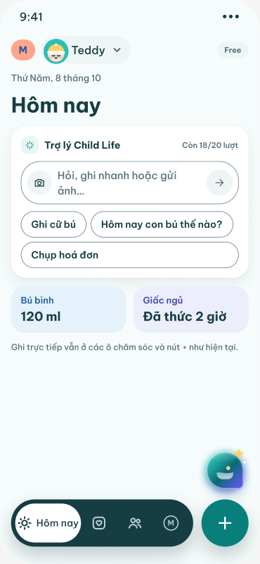 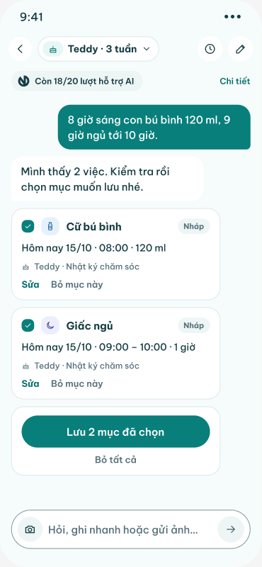 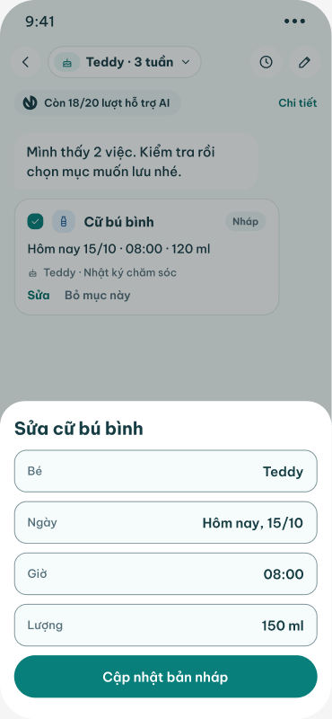 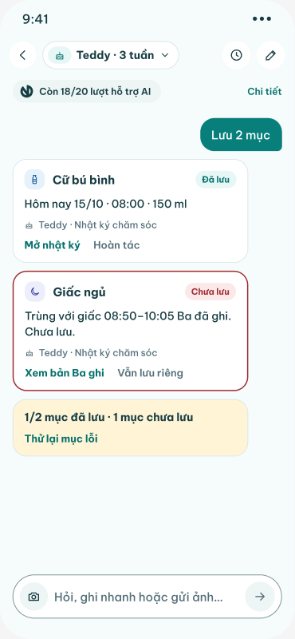

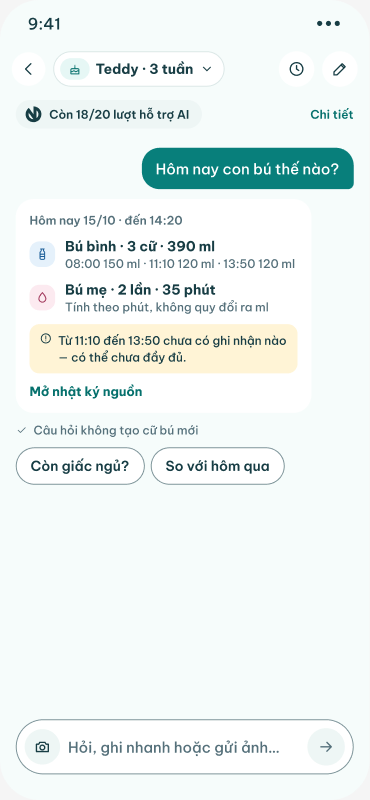 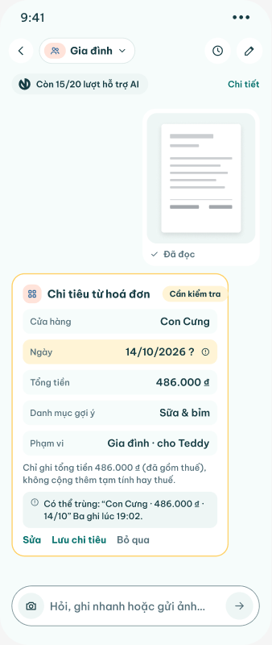 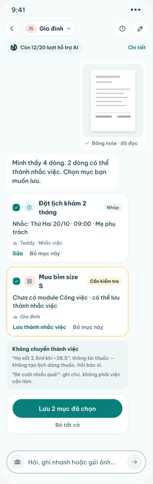 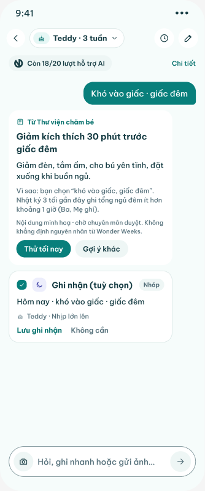

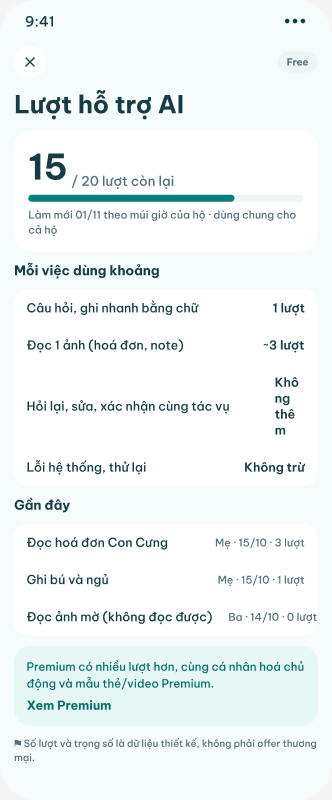 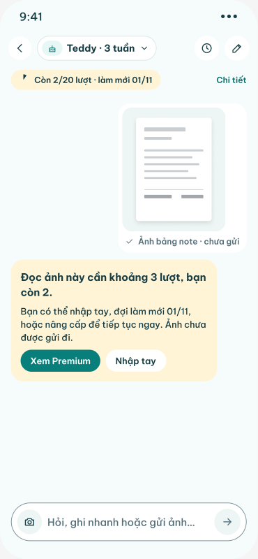 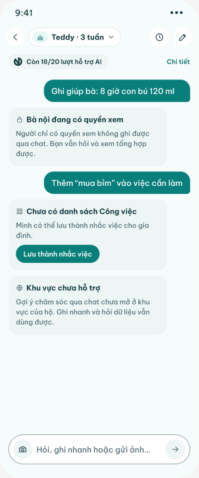 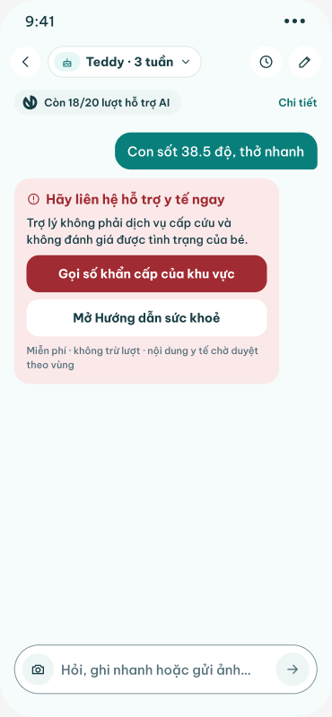

- **One assistant, three entry points.** Home card "Trợ lý Child Life" with composer and chips (CH01) plus a floating Chat/Nút trợ lý; a module entry "Chụp hoá đơn hoặc nhắn để ghi" in Chi tiêu (CH01b; the footnote says Ăn dặm "Hỏi món cho con" and Nhắc việc "Chụp bảng note" reuse the pattern); and the chat itself, scoped to one baby ("Teddy · 3 tuần") or the household ("Gia đình"), with history per scope (CH03).
- **Six task kinds**, the same on Free and Premium: A multi-event text → drafts (CH04–CH07); B question over logs, no record (CH08); C receipt photo → expense draft (CH09–CH12); D note photo → reminder drafts (CH13–CH14); E care guidance, feedback, meal ideas (CH15–CH18); plus health routing (CH28), which is free.
- **Draft-and-confirm.** Every write is a Chat/Thẻ nháp card the user saves ("Lưu 2 mục đã chọn", "Lưu chi tiêu", "Lưu ghi nhận"); "Đã lưu" appears per card, partial success is explicit (CH07 "1/2 mục đã lưu · 1 mục chưa lưu"). Exceptions to check: CH27 "Lưu thành nhắc việc" and CH17 feedback chips write on tap.
- **Credits** ("lượt hỗ trợ AI"), household-wide, reset monthly on the 1st in household time (CH19 "Làm mới 01/11 theo múi giờ của hộ · dùng chung cho cả hộ"): text task 1, one photo ~3 (estimated before sending), follow-ups / edits / confirm free, system error and retry free, unreadable photo 0, feedback free, health free. Free 20 (QA value), Premium 200 (CH23 fixture only; CH22 says "(chưa chốt)"). One Premium plan per household, monthly or yearly, no chat pack, never "không giới hạn" (CH22).
- **Exhaustion** never blocks direct logging (CH21 "Mở nhật ký hôm nay", "Ghi cữ bú"; CH24 composer "Hết lượt AI · vẫn ghi trực tiếp được"); the pending question is kept and resumes after upgrade (CH23).
- **Trust copy**: no auto-save, only the chosen photo is sent, original photo not kept unless "Giữ ảnh hoá đơn" is on, text in photos is content not commands (CH14), no full name / exact birth date sent when not needed (CH26), not an emergency service (CH28).

## Flow map `618:10351` "Chat · Bản đồ luồng"

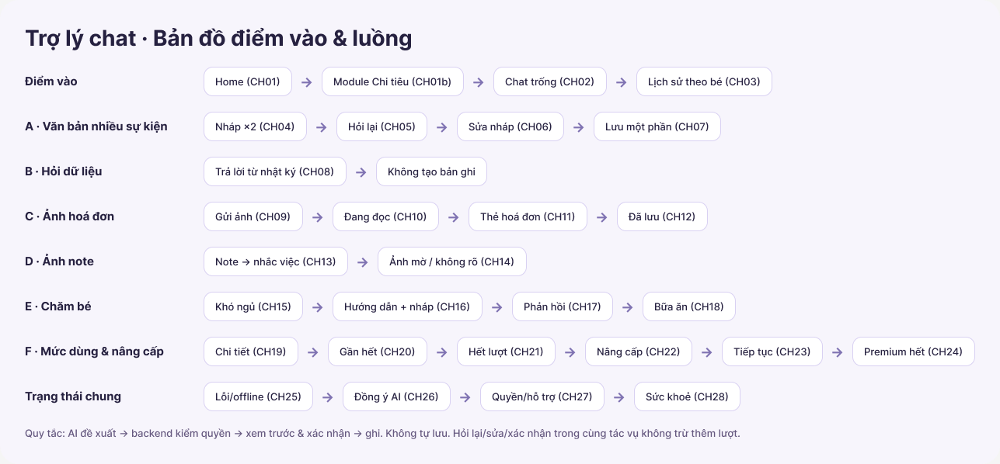

Frame 1287×598 at x 0, y 25800 on the page. Title `618:10352` "Trợ lý chat · Bản đồ điểm vào & luồng". Eight rows; each row is a label (220 px column) followed by rounded chips joined by "→" text glyphs (not prototype connectors). Footer rule `618:10451`. Every chip names a frame code; the arrows only sequence the screens in a story, they are not a routing table (e.g. "Bữa ăn (CH18)" follows "Phản hồi (CH17)" although a meal question is a separate task; "Không tạo bản ghi" is an outcome, not a screen).

| Row (node) | Label | Chips in order (node of chip text) |
|---|---|---|
| `618:10353` | Điểm vào | Home (CH01) `618:10356` → Module Chi tiêu (CH01b) `618:10359` → Chat trống (CH02) `618:10362` → Lịch sử theo bé (CH03) `618:10365` |
| `618:10366` | A · Văn bản nhiều sự kiện | Nháp ×2 (CH04) `618:10369` → Hỏi lại (CH05) `618:10372` → Sửa nháp (CH06) `618:10375` → Lưu một phần (CH07) `618:10378` |
| `618:10379` | B · Hỏi dữ liệu | Trả lời từ nhật ký (CH08) `618:10382` → Không tạo bản ghi `618:10385` |
| `618:10386` | C · Ảnh hoá đơn | Gửi ảnh (CH09) `618:10389` → Đang đọc (CH10) `618:10392` → Thẻ hoá đơn (CH11) `618:10395` → Đã lưu (CH12) `618:10398` |
| `618:10399` | D · Ảnh note | Note → nhắc việc (CH13) `618:10402` → Ảnh mờ / không rõ (CH14) `618:10405` |
| `618:10406` | E · Chăm bé | Khó ngủ (CH15) `618:10409` → Hướng dẫn + nháp (CH16) `618:10412` → Phản hồi (CH17) `618:10415` → Bữa ăn (CH18) `618:10418` |
| `618:10419` | F · Mức dùng & nâng cấp | Chi tiết (CH19) `618:10422` → Gần hết (CH20) `618:10425` → Hết lượt (CH21) `618:10428` → Nâng cấp (CH22) `618:10431` → Tiếp tục (CH23) `618:10434` → Premium hết (CH24) `618:10437` |
| `618:10438` | Trạng thái chung | Lỗi/offline (CH25) `618:10441` → Đồng ý AI (CH26) `618:10444` → Quyền/hỗ trợ (CH27) `618:10447` → Sức khoẻ (CH28) `618:10450` |

Footer `618:10451` (verbatim): "Quy tắc: AI đề xuất → backend kiểm quyền → xem trước & xác nhận → ghi. Không tự lưu. Hỏi lại/sửa/xác nhận trong cùng tác vụ không trừ thêm lượt."
(Gloss: "Rule: the AI proposes → the backend checks permission → preview & confirm → write. Nothing is saved automatically. Re-asking / editing / confirming within the same task does not cost another credit.")

**Routes as a list** (arrows on the map, then the real routes stated by annotations, prototype links and CTAs; "(proto)" = a prototype reaction on the frame root, read from the design snapshot and consistent with the live layout):

- Entry: CH01 Home → CH02 empty chat (proto: `612:7579` click → `612:7711`; EN `612:7835` is listed as a prototype start in the brief).
- Entry: CH01b Chi tiêu module → assistant with context "Chi tiêu · Gia đình" (annotation `618:10200`); proto: `612:7657` click → CH09 `614:8403` (photo flow), not CH02.
- Chat header (Chat/Đầu trang) clock button "Lịch sử" → CH03 history per baby; edit button "Mới" and CH03 "Hội thoại mới" → CH02; "Chi tiết" next to every usage pill → CH19.
- A: CH04 two drafts → CH05 clarification (missing/contradictory) → CH06 edit sheet → CH07 partial save + retry; CH07 "Hoàn tác"/open → the record in its module (annotation `618:10239`).
- B: CH08 answer from logs → no record created (terminal).
- C: CH09 photo + estimate ≈3 → CH10 uploading → reading (cancel while uploading costs 0; network error → CH25) → CH11 receipt card (needs review, duplicate?) → CH12 saved expense → open the expense in Chi tiêu.
- D: CH13 note photo → to-do/reminder list (Tasks module missing → reminders) → CH14 blurry/unclear photo (0 credits; retake or type).
- E: CH15 sleep trouble → clarify (proto: `615:9171` click → `615:9243`) → CH16 grounded guidance + draft + try; warning signs → CH28 → CH17 feedback after trying → CH18 meal ideas (separate task).
- F: CH19 usage details → CH20 Free nearly out (proto: `616:9663` click → `616:9773`) → CH21 Free exhausted (Upgrade / wait for reset; direct logging stays) → CH22 Upgrade → CH23 upgraded, task resumed → CH24 Premium exhausted (no further upsell).
- Common: CH25 AI error / offline; CH26 AI consent missing (from CH01 annotation: "chưa đồng ý AI → CH26"); CH27 viewer role / module unsupported / region; CH28 health in chat (from CH16 warning signs).

Prototype starts named in the brief: VI CH01 `612:7579`, CH01b `612:7657`, CH15 `615:9171`, CH20 `616:9663`; EN CH01 `612:7835`, CH01b `612:7913`, CH15 `615:9517`, CH20 `616:10040`. Only the four VI root reactions above were present in the snapshot's reaction dump; reactions on child nodes (buttons) were not exported by any read tool, so every other route below is inferred from copy and annotations.

## Components

The three chat component sets sit above the frames at y 21300–21723 (page coordinates). All use the app tokens (`surface`, `surface-2`, `separator`, `ink`, `ink-muted`, `mint-deep`, `mint-text`, `mint-soft`, `sunshine`, `sunshine-soft`, `error`, `error-soft`, `care-bottle-soft`, `control-border`); font Be Vietnam Pro. Icons are the placeholder line icons from Components (`Icon/check` 7:45, `Icon/feed` 7:9, `Icon/cake` 22:169, `Icon/camera` 22:161, `Icon/arrow-right` 7:42; "production uses SF Symbols").

### `611:7695` — Chat/Thẻ nháp (draft card)

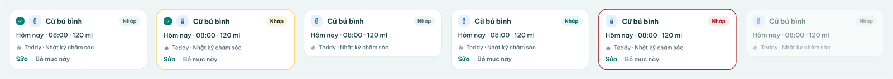

Set 1940×173 at x 2013, y 21300. One variant property and six text props.

| Prop (Figma → exported name) | Type | Default |
|---|---|---|
| Trạng thái (`trạngThái`) | variant: Nháp · Cần kiểm tra · Đang lưu · Đã lưu · Lưu lỗi · Đã bỏ | Nháp |
| Tiêu đề (`tiêuĐề`) | text | "Cữ bú bình" |
| Nhãn trạng thái (`nhãnTrạngThái`) | text | "Nháp" |
| Dòng 1 (`dòng1`) | text | "Hôm nay · 08:00 · 120 ml" |
| Phạm vi (`phạmVi`) | text | "Teddy · Nhật ký chăm sóc" |
| Hành động 1 (`hànhĐộng1`) | text | "Sửa" |
| Hành động 2 (`hànhĐộng2`) | text | "Bỏ mục này" |

| Variant | Node | Size | Selection check | Border | Status pill | Actions row |
|---|---|---|---|---|---|---|
| Trạng thái=Nháp | `611:7575` | 300×132 | yes (`mint-deep` square, white check) | 1 px `separator` | `surface-2`, text `ink-muted` | "Sửa" (Bold `mint-text`) · "Bỏ mục này" (SemiBold `ink-muted`) |
| Trạng thái=Cần kiểm tra | `611:7595` | 300×133 | yes | 1.5 px `sunshine` #ffd166 | `sunshine-soft`, text `ink` | Sửa · Bỏ mục này |
| Trạng thái=Đang lưu | `611:7615` | 300×105 | no | 1 px `separator` | `surface-2`, `ink-muted` | none |
| Trạng thái=Đã lưu | `611:7635` | 300×132 | no | 1 px `separator` | `mint-soft`, text `mint-text` | Sửa · Bỏ mục này (same text) |
| Trạng thái=Lưu lỗi | `611:7655` | 300×133 | no | 1.5 px `error` #a12b32 | `error-soft`, text `error` | Sửa · Bỏ mục này (same text) |
| Trạng thái=Đã bỏ | `611:7675` | 300×105 | no | 1 px `separator`, whole card opacity 55 % | `surface-2`, `ink-muted` | none |

Card: `surface`, radius 18, padding 14/12, gap 8, width 300. Header: [check] + `care-bottle-soft` icon tile (feed icon) + title Bold 15 `ink` + status pill (Bold 11). Line 1 Medium 14 `ink`. Scope row: cake icon + Medium 12 `ink-muted`.

**Rendered text is identical in all six variants** ("Cữ bú bình" / "Nháp" / "Hôm nay · 08:00 · 120 ml" / "Teddy · Nhật ký chăm sóc" / "Sửa" / "Bỏ mục này"): the status pill reads **"Nháp" even on Cần kiểm tra, Đang lưu, Đã lưu, Lưu lỗi and Đã bỏ** — only colour changes (confirmed on the screenshot). Frames must override `Nhãn trạng thái`; where they do not, the label is wrong (see the per-frame notes). The Đã lưu and Lưu lỗi variants keep "Sửa · Bỏ mục này" as their actions; the real labels exist only as frame overrides: CH07 Đã lưu → "Đã lưu" with "Mở nhật ký" · "Hoàn tác", CH07 Lưu lỗi → **"Chưa lưu"** with "Xem bản Ba ghi" · "Vẫn lưu riêng", CH12 saved expense → "Đã lưu" with "Mở Chi tiêu" · "Hoàn tác", CH17 Đã lưu → "Đã lưu" with "Xem nhịp của con" · "Sửa", CH13 Cần kiểm tra → "Cần kiểm tra" with "Lưu thành nhắc việc" · "Bỏ mục này", CH16 Nháp → "Nháp" with "Lưu ghi nhận" · "Không cần". The variants **Đang lưu** and **Đã bỏ** are never instanced in CH01–CH28. No check icon on Đã lưu, no spinner on Đang lưu, no reason line on Lưu lỗi (frames put the reason in `Dòng 1`).

### `611:7726` — Chat/Mức dùng (usage pill)

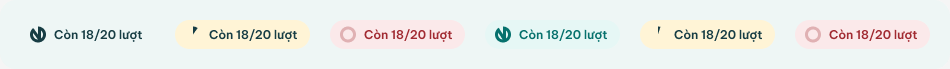

Set 950×69 at x 0, y 21627. Props: **Gói** (variant: Free · Premium), **Mức** (variant: Còn · Gần hết · Hết), text **Mức dùng** (`mứcDùng`, default "Còn 18/20 lượt").

| Variant | Node | Size | Fill | Ring icon (16 px) | Text colour |
|---|---|---|---|---|---|
| Gói=Free, Mức=Còn | `611:7708` | 135×29 | `surface-2` | full ring (ink) | `ink` |
| Gói=Free, Mức=Gần hết | `611:7711` | 135×29 | `sunshine-soft` | small arc (≈ 1/8) | `ink` |
| Gói=Free, Mức=Hết | `611:7714` | 135×29 | `error-soft` | empty ring | `error` |
| Gói=Premium, Mức=Còn | `611:7717` | 135×29 | `mint-soft` | full ring (mint) | `mint-text` |
| Gói=Premium, Mức=Gần hết | `611:7720` | 135×29 | `sunshine-soft` | thinner arc | `ink` |
| Gói=Premium, Mức=Hết | `611:7723` | 135×29 | `error-soft` | empty ring | `error` |

Pill radius 999, padding 6 / 10 left / 12 right, gap 8, SemiBold 12. **All six variants render "Còn 18/20 lượt"** — including Hết ("still 18/20" in red) and Premium (a /20 budget, while the design data elsewhere uses a Premium budget of 200). The ring is decorative, not proportional to the number. The pill carries no plan word ("Free"/"Premium") and no reset date.

### `611:7763` — Chat/Ô nhập (composer)

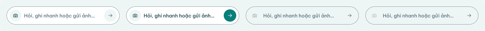

Set 1472×96 at x 1010, y 21627. Props: **Trạng thái** (variant: Trống · Có nội dung · Hết lượt · Chỉ xem), text **Gợi ý** (`gợiÝ`, default "Hỏi, ghi nhanh hoặc gửi ảnh…").

| Variant | Node | Size | Field fill | Camera button | Text | Send button |
|---|---|---|---|---|---|---|
| Trạng thái=Trống | `611:7727` | 343×56 | `surface` | `surface-2` circle, active | placeholder `ink-muted` Medium 15 | `surface-2` circle, arrow (inactive look) |
| Trạng thái=Có nội dung | `611:7736` | 343×56 | `surface` | active | typed text `ink` (default string is still the placeholder) | `mint-deep` circle, white arrow (active) |
| Trạng thái=Hết lượt | `611:7745` | 343×56 | `surface-2` | 40 % opacity | placeholder `ink-muted` | `surface-2` circle on `surface-2` field (blends in) |
| Trạng thái=Chỉ xem | `611:7754` | 343×56 | `surface-2` | 40 % opacity, different (muted) camera asset | placeholder `ink-muted` | as Hết lượt |

Field: 1 px `control-border` #7e959a, radius 28, padding 8, gap 8, width 343. **Hết lượt and Chỉ xem keep the full placeholder "Hỏi, ghi nhanh hoặc gửi ảnh…"** — the component itself says nothing about why input is limited, and in Chỉ xem the text field still invites "ghi nhanh" (log) and photo, which a viewer may not do; the frames have to override `Gợi ý` (see CH21, CH24, CH27). The send arrow is still drawn in both disabled variants.

## Annotations (verbatim)

All 29 cards ("Annotation chat · cột N") share the v2.0 annotation style (soft-yellow card, line 1 Bold = code + title, then one rule per line). Read live; identical to the snapshot. Each paragraph is quoted and separated by " / "; inner straight quotes are as in Figma.

- cột 0 · CH01 (`618:10193`): "CH01 · Home" / "Đọc: bé đang chọn, mức dùng còn lại" / "Ghi: không" / "Quyền: mọi vai trò thấy lối vào; Người xem mở được để hỏi" / "Lượt: 0 (chỉ mở)" / "Lỗi: chưa đồng ý AI → CH26"
- cột 1 · CH01b (`618:10200`): "CH01b · Module Chi tiêu" / "Đọc: phạm vi Gia đình, quỹ chi tiêu" / "Ghi: không" / "Quyền: theo vai trò ở Chi tiêu" / "Lượt: 0" / "Mở chat với ngữ cảnh "Chi tiêu · Gia đình""
- cột 2 · CH02 (`618:10207`): "CH02 · Chat trống" / "Đọc: bé đang chọn, gợi ý theo tuổi" / "Ghi: không" / "Lượt: 0 cho tới khi gửi" / "Gợi ý nhanh chỉ điền sẵn câu hỏi, không tự gửi"
- cột 3 · CH03 (`618:10213`): "CH03 · Lịch sử theo bé" / "Đọc: hội thoại của bé đang chọn" / "Ghi: xoá hội thoại (xác nhận)" / "Quyền: chỉ trong gia đình, không xem chéo gia đình" / "Lượt: 0" / "Lỗi: tải lỗi → thử lại"
- cột 4 · CH04 (`618:10220`): "CH04 · A · 2 bản nháp" / "Đọc: tin nhắn, giờ hiện tại, bé" / "Ghi: chưa ghi — chỉ đề xuất" / "Quyền: backend kiểm tra Biên tập/Chủ" / "Xác nhận: Lưu từng thẻ hoặc Lưu tất cả" / "Lượt: 1 cho cả tác vụ"
- cột 5 · CH05 (`618:10227`): "CH05 · A · Hỏi lại" / "Đọc: bản nháp đang thiếu/mâu thuẫn" / "Ghi: không" / "Lượt: 0 (hỏi lại trong cùng tác vụ)" / "Không đoán ml từ số phút bú mẹ"
- cột 6 · CH06 (`618:10233`): "CH06 · A · Sửa nháp" / "Đọc: bản nháp" / "Ghi: chỉ cập nhật nháp cục bộ" / "Lượt: 0" / "Kiểm tra: giờ trong tương lai, đơn vị, bé"
- cột 7 · CH07 (`618:10239`): "CH07 · A · Lưu một phần" / "Ghi: Nhật ký Bú bình + Giấc ngủ" / "Hiện "Đã lưu" chỉ sau khi backend trả kết quả" / "Lỗi: thẻ lỗi giữ nguyên, Thử lại không trừ lượt" / "Hoàn tác: mở bản ghi trong module"
- cột 8 · CH08 (`618:10245`): "CH08 · B · Hỏi dữ liệu" / "Đọc: nhật ký đã ghi của bé" / "Ghi: không" / "Lượt: 1" / "Bú bình (ml) và bú mẹ (phút) tách riêng, không quy đổi"
- cột 9 · CH09 (`618:10251`): "CH09 · C · Gửi ảnh" / "Đọc: ảnh người dùng chọn" / "Đồng ý AI: hiện ảnh nào được gửi, ảnh gốc có giữ không" / "Lượt: ước tính ≈3 trước khi gửi" / "Chữ trong ảnh là nội dung, không phải lệnh"
- cột 10 · CH10 (`618:10257`): "CH10 · C · Đang đọc" / "Trạng thái: Đang tải lên → Đang đọc" / "Huỷ được khi đang tải lên (không trừ lượt)" / "Lỗi mạng → CH25"
- cột 11 · CH11 (`618:10262`): "CH11 · C · Thẻ hoá đơn" / "Ghi: chưa — Cần kiểm tra" / "Ngày không chắc → bắt chọn ngày" / "Nghi trùng → hỏi Gộp/Vẫn lưu" / "Phạm vi: Gia đình" / "Quyền: Biên tập Chi tiêu"
- cột 12 · CH12 (`618:10269`): "CH12 · C · Đã lưu" / "Ghi: Chi tiêu (1 khoản)" / "Liên kết mở khoản chi trong module" / "Ảnh gốc: theo lựa chọn ở bước đồng ý"
- cột 13 · CH13 (`618:10274`): "CH13 · D · Note → nhắc việc" / "Ghi: Nhắc nhở (module Tasks chưa có → phụ thuộc)" / "Dòng thuốc: không tạo việc, không đưa liều" / "Xác nhận từng dòng" / "Lượt: ≈3 cho ảnh"
- cột 14 · CH14 (`618:10280`): "CH14 · Ảnh mờ / không rõ" / "Ghi: không" / "Lượt: không trừ khi không đọc được" / "Gợi ý chụp lại hoặc nhập tay"
- cột 15 · CH15 (`618:10285`): "CH15 · E · Khó ngủ" / "Đọc: giấc ngủ 3 ngày, tuổi bé" / "Ghi: không" / "Lượt: 1 cho cả hội thoại hỏi rõ"
- cột 16 · CH16 (`618:10290`): "CH16 · E · Hướng dẫn" / "Đọc: Thư viện chăm bé (nội dung minh hoạ · chờ chuyên môn duyệt)" / "Ghi: bản nháp nhắc giờ ngủ (cần xác nhận)" / "Có dấu hiệu cảnh báo → CH28"
- cột 17 · CH17 (`618:10295`): "CH17 · E · Phản hồi" / "Ghi: đánh giá hữu ích (không trừ lượt)" / "Đọc: giấc ngủ sau khi thử"
- cột 18 · CH18 (`618:10299`): "CH18 · E · Bữa ăn" / "Đọc: tuổi, dị ứng/phản ứng đã ghi, Thư viện công thức" / "Loại trừ món có phản ứng đã ghi" / "Không ghi gì nếu chưa xác nhận" / ""Chưa phản ứng" ≠ đã dung nạp"
- cột 19 · CH19 (`618:10305`): "CH19 · Mức dùng" / "Đọc: lượt hỗ trợ AI còn lại, ngày đặt lại" / "Tách riêng lượt xuất video" / "Số liệu là dữ liệu thiết kế"
- cột 20 · CH20 (`618:10310`): "CH20 · Free gần hết" / "Cảnh báo trước khi gửi tác vụ tốn nhiều lượt" / "Không khoá loại tác vụ nào"
- cột 21 · CH21 (`618:10314`): "CH21 · Free hết lượt" / "Ô nhập khoá chat AI; ghi trực tiếp và module free vẫn dùng" / "Hướng dẫn sức khoẻ thiết yếu vẫn miễn phí" / "CTA: Nâng cấp / Chờ đặt lại"
- cột 22 · CH22 (`618:10319`): "CH22 · Nâng cấp" / "Một gói Premium (tháng/năm cùng quyền lợi)" / "Không có gói chat riêng, không "không giới hạn"" / "Giá: chờ chốt"
- cột 23 · CH23 (`618:10324`): "CH23 · Tiếp tục" / "Khôi phục tác vụ dở, không mất nháp" / "Hiện mức dùng mới"
- cột 24 · CH24 (`618:10328`): "CH24 · Premium hết lượt" / "Không bán thêm gói khác" / "Hiện ngày đặt lại; ghi trực tiếp vẫn dùng"
- cột 25 · CH25 (`618:10332`): "CH25 · Lỗi AI / offline" / "Không trừ lượt khi lỗi hệ thống" / "Thử lại không trừ hai lần" / "Nháp chưa gửi được giữ lại"
- cột 26 · CH26 (`618:10337`): "CH26 · Đồng ý AI" / "Giải thích dữ liệu gửi đi, giữ ảnh gốc hay không" / "Từ chối → vẫn dùng app bình thường"
- cột 27 · CH27 (`618:10341`): "CH27 · Quyền / hỗ trợ" / "Người xem: hỏi được, không ghi" / "Module chưa hỗ trợ / khu vực chưa có nội dung" / "Không truy cập gia đình khác"
- cột 28 · CH28 (`618:10346`): "CH28 · Sức khoẻ" / "Không phải dịch vụ khẩn cấp" / "Số khẩn cấp theo quốc gia của gia đình" / "Không đưa liều thuốc; nội dung chờ chuyên môn duyệt"

Short glosses: Đọc = reads; Ghi = writes; Quyền = permission; Lượt = credits; Lỗi = error path; Xác nhận = confirmation; Kiểm tra = validation; Hoàn tác = undo.

## Part 1 · Chat assistant entry points and empty state (CH01, CH01b, CH02, CH03)

Read live on 2026-10-15 with get_design_context (all 8 frames and 4 annotations) and get_metadata (612:7657, 612:7784, 612:7835, 612:7913, 612:7967). All frames are Light theme. No Night variants exist for this batch.

### 612:7579 (VI) / 612:7835 (EN) — CH01 · Home · điểm vào trợ lý

**Annotation:** "Annotation chat · cột 0" `618:10193` (verbatim): "CH01 · Home" / "Đọc: bé đang chọn, mức dùng còn lại" / "Ghi: không" / "Quyền: mọi vai trò thấy lối vào; Người xem mở được để hỏi" / "Lượt: 0 (chỉ mở)" / "Lỗi: chưa đồng ý AI → CH26". This matches the snapshot exactly. The frame has one note-style line inside it, the footnote "Ghi trực tiếp vẫn ở các ô chăm sóc và nút + như hiện tại." (`612:7638`); it is styled as UI text (12 px, `ink-muted`). Layer names: "CH01 · Home · điểm vào trợ lý · VI" / "CH01 · Home · điểm vào trợ lý · EN". Frame size 375×812 for both (VI from the screenshot's original size, EN from get_metadata).

**Text (reading order)**

**VI**
- Status bar (StatusBar `11:135`): "9:41", "•••"
- Header: chip "M" (`card-peach` pill, text `care-bottle-ink`); BabySwitcher `45:321` with `name = "Teddy"`, BabyFace avatar and a chevron (the component description says the chevron appears only when the family has more than one baby); spacer; **Quyền/Badge `trạngThái = "Free"`** (`588:6270`) → "Free"
- Date (13 px, `ink-muted`): "Thứ Năm, 8 tháng 10"
- Title (30 px bold): "Hôm nay"
- Assistant entry card (layer "Lối vào trợ lý" `612:7607`, `surface`, radius 22, shadow-card):
  - Header row: spark icon on a `mint-soft` tile + "Trợ lý Child Life" (14 bold); spacer; "Còn 18/20 lượt" (11 semibold, `ink-muted`). This is plain text, not a Chat/Mức dùng instance.
  - **Chat/Ô nhập `Trạng thái = "Trống"`** (`611:7727`), default placeholder "Hỏi, ghi nhanh hoặc gửi ảnh…", with a camera button on the left and a send (arrow-right) button on the right. At the 315 px card width the VI placeholder wraps onto 2 lines ("Hỏi, ghi nhanh hoặc gửi / ảnh…"), as the screenshot shows.
  - Quick-suggestion chips (layer "Gợi ý nhanh"), each a **Chat/Gợi ý nhanh `trạngThái = "Mặc định"`** (`611:7512`) with prop `nhãn` overridden: "Ghi cữ bú", "Hôm nay con bú thế nào?". The third chip (`612:7629`) is overridden to fill the row: "Chụp hoá đơn".
- Care tiles (layer "Ô chăm sóc"): "Bú bình" / "120 ml" (`care-bottle-soft`); "Giấc ngủ" / "Đã thức 2 giờ" (`care-sleep-soft`)
- Footnote: "Ghi trực tiếp vẫn ở các ô chăm sóc và nút + như hiện tại."
- Floating assistant button: **Chat/Nút trợ lý `trạngThái = "Mặc định"`** (`628:9020`, set `628:9074`), 64×64 at x293 y645. It has no text: Logo/Mark on a gradient bubble, with a "Hào quang" glow and two "Sao AI" sparkles.
- TabDock (`10:169`) = NavBar with `active = "Today"` + QuickLogButton (+). The active tab label reads "Hôm nay"; the other tabs are icons only (Memories, Family); the Me tab shows an avatar with "M".

**EN**
- Status bar: "9:41", "•••"
- Header: "M"; BabySwitcher "Teddy" (+ chevron); Quyền/Badge `trạngThái = "Free"` → "Free"
- Date: "Thursday, 8 October"
- Title: "Today"
- Assistant entry card: "Child Life assistant" / "18/20 left"; Chat/Ô nhập `Trạng thái = "Trống"` with `gợiÝ` overridden to "Ask, log or send a photo…" (fits on one line); chips "Log a feed", "How did feeds go today?", and the full-width "Scan a receipt" (`612:7885`, wraps to a second row, 315 px wide)
- Care tiles: "Bottle" / "120 ml"; "Sleep" / "Awake 2h"
- Footnote: "Direct logging stays in the care tiles and the + button."
- Floating Chat/Nút trợ lý (instance layer "Nút trợ lý" `627:62706`, x293 y645)
- TabDock instance `627:62680`: active tab label "Today", Me avatar "M", + button.
- Hidden layer: the old icon-only tab bar "Thanh tab" `612:7895` (hidden="true"; tabs t0 today / t1 memories / t2 heart / t3 grid) is still in the frame. VI very likely has the same, but get_metadata was not run on VI.

**Visual:** `cloud` background; content column with 16 px gutters and 12 px gaps, starting at y52. The entry card is the hero directly under "Hôm nay". It uses the `surface` card with shadow-card, a `mint-soft` spark tile, `control-border` outlines on the composer and chips, and `ink`/`ink-muted` text. Care tiles are compact: no sub-lines, 18 px bold values, `care-bottle-soft`/`care-bottle-ink` and `care-sleep-soft`/`care-sleep-ink`. The floating assistant button sits 12 px above the + button and is centred on its vertical axis (component rule). It uses a 135° gradient #2BC4B5 → #086B73 → #545CDB with a 1.5 px white 45% border, drop shadow rgba(31,77,153,.35) and an inner white highlight. TabDock uses `nav-bar` #173D44, `nav-active` white, `on-nav-active`, `nav-icon` #B9CFCF, and `mint-deep` for the + button. Light theme only.

**Navigation (inferred):**
- Whole frame (prototype in the snapshot, VI root): click → CH02 `612:7711` (SMART_ANIMATE, ease-out, 300 ms). Live, both the VI and the EN roots render as links (`<a>`), so EN now also has a reaction; the MCP does not expose the destination.
- Composer, or tapping the card → CH02 (empty chat for Teddy). The camera button → photo picker → CH09 (C · Gửi ảnh).
- Chips: "Ghi cữ bú" → CH02/CH04 with a pre-filled log prompt. "Hôm nay con bú thế nào?" → CH08 (B · hỏi dữ liệu). "Chụp hoá đơn" → CH09 (receipt; family scope). Annotation `618:10207` says quick suggestions only pre-fill and do not send, so each chip should land in the composer, not fire a task.
- Floating Chat/Nút trợ lý → chat (CH02, or the last conversation). Its description says it still opens when quota is used up ("Hết lượt: vẫn mở được chat để xem lịch sử/ghi trực tiếp").
- If AI consent has not been given → CH26 (annotation "Lỗi: chưa đồng ý AI → CH26").
- The + button → quick-log chooser (Bú · Ngủ · Tã · Tăng trưởng). Care tiles → Bú bình / Giấc ngủ logs. BabySwitcher → baby picker. Badge "Free" → plan info. Tabs → Hôm nay / Kỷ niệm / Gia đình / Me.

**Notes:**
- Credits: "Còn 18/20 lượt" / "18/20 left" matches CH02 ("Còn 18/20 lượt hỗ trợ AI") and the annotation "Lượt: 0 (chỉ mở)". Opening costs 0. The quota period (day, week or month) is not stated on this frame.
- Date: "Thứ Năm, 8 tháng 10" / "Thursday, 8 October" has the right weekday for 2026 (8 Oct 2026 is a Thursday). It contradicts the chat frames, which use today = 15/10 ("Hôm nay 15/10" in CH04–CH08), so the date was carried over from the v2.0 Home (H01/H02 also show "Thứ Năm, 8 tháng 10"). If today is 15/10 the header should read "Thứ Năm, 15 tháng 10" / "Thursday, 15 October".
- Age: Home shows no age. CH02 shows "Teddy · 3 tuần", and H01 (8/10) also shows "3 tuần tuổi", so the two dates are a week apart with the same age.
- VI/EN parity: all strings are present in both. EN "18/20 left" drops "lượt" (turns). EN "Child Life assistant" reverses the word order. The VI placeholder wraps in the card while EN does not.
- Rules: no task type is locked on Free (the receipt chip shows on a Free badge). There is no auto-save copy and no health entry here.
- Viewer and consent states are **not drawn**. The annotation says the viewer role sees the entry and can open it to ask. Chat/Ô nhập has a `Trạng thái = "Chỉ xem"` variant (`611:7754`) that this batch never uses.
- Snapshot vs live:
  - The text matches, except that live adds the TabDock tab label "Hôm nay"/"Today", the Me avatar "M", and the new floating Chat/Nút trợ lý (ids 627/628, newer than the snapshot).
  - The old icon-only "Thanh tab" is now hidden.
  - Live EN root is now a link.

### 612:7657 (VI) / 612:7913 (EN) — CH01b · Module · lối vào trợ lý (Chi tiêu)

**Annotation:** "Annotation chat · cột 1" `618:10200` (verbatim): "CH01b · Module Chi tiêu" / "Đọc: phạm vi Gia đình, quỹ chi tiêu" / "Ghi: không" / "Quyền: theo vai trò ở Chi tiêu" / "Lượt: 0" / "Mở chat với ngữ cảnh "Chi tiêu · Gia đình"" (straight quotes in Figma). This matches the snapshot. The frame has one note inside it, the footnote `612:7710` "Cùng mẫu lối vào cho Ăn dặm (“Hỏi món cho con”) và Nhắc việc (“Chụp bảng note”)." It is a designer note rendered as UI text. Layer names: "CH01b · Module · lối vào trợ lý (Chi tiêu) · VI" / "… · EN". Frame 375×812 for both (get_metadata); content height is VI 683 and EN 668.

**Text (reading order)**

**VI**
- Status bar: "9:41", "•••"
- Top bar: back button (Icon/back, white circle); spacer; scope pill "Pill · Gia đình" (`peach-soft`, family icon, 11 bold `care-bottle-ink`): "Gia đình"
- Title (28 bold): "Chi tiêu cho bé"
- Month card ("Tháng này", `surface`, radius 20, shadow-card): "Tháng 10" / "4.215.000 ₫" (28 bold) / "Ba và Mẹ cùng ghi · cùng xem"
- Assistant entry ("Lối vào", `mint-soft`, radius 18): camera icon in a white tile; "Chụp hoá đơn hoặc nhắn để ghi" (14 bold, `mint-text`) / "Trợ lý đọc và tạo bản nháp · bạn kiểm tra trước khi lưu" (12, `mint-text`, wraps to 2 lines, h30)
- Manual row ("Thêm", `surface`): plus icon + "Thêm khoản chi thủ công"
- Section: "Gần đây" (17 bold)
- LogRow `45:373` ×2 (icon circle `mint-soft` with Icon/feed, chevron-right):
  - "Sữa công thức" / "Mẹ · 12/10 · 520.000 ₫"
  - "Bỉm" / "Ba · 10/10 · 310.000 ₫"
- Footnote: "Cùng mẫu lối vào cho Ăn dặm (“Hỏi món cho con”) và Nhắc việc (“Chụp bảng note”)."

**EN**
- Status bar: "9:41", "•••"
- Top bar: back; pill "Family" (layer "Pill · Family")
- Title: "Baby expenses"
- Month card: "October" / "4.215.000 ₫" / "Mum and Dad log and see the same"
- Assistant entry: "Snap a receipt or type to log" / "The assistant drafts it · you check before saving". Both lines are `whitespace-nowrap`. The second line is 282 px wide inside a 271 px column, so it **overflows by about 11 px** (`612:7941`).
- Manual row: "Add expense manually"
- Section: "Recent"
- LogRows: "Formula" / "Mum · 12 Oct · 520,000 ₫"; "Diapers" / "Dad · 10 Oct · 310,000 ₫"
- Footnote: "Same entry pattern in Solids (“Ask for a meal idea”) and Reminders (“Snap a note”)."

**Visual:** A module screen with no tab bar and no floating assistant button. It has a `cloud` background. The scope pill is `peach-soft` with `care-bottle-ink` text; per the "ink on soft warm fills" memory, check its Night mapping. The entry card is a `mint-soft` band with `mint-text` copy and a white icon tile, so it sits between the month total and the manual-add row. Manual add is a plain `surface` row, keeping direct entry equal to the AI entry. The expense LogRows reuse the care LogRow with **Icon/feed** (the bottle icon) for formula and diapers, which looks like a placeholder icon. Light theme.

**Navigation (inferred):**
- Whole frame (prototype in the snapshot, VI root): click → CH09 `614:8403` ("C · Gửi ảnh · ước tính lượt"). Live, both the VI and EN roots render as links.
- "Chụp hoá đơn hoặc nhắn để ghi" → CH09 (camera) or chat opened with the context "Chi tiêu · Gia đình" (annotation), Chat/Đầu trang presumably in family scope.
- "Thêm khoản chi thủ công" → the existing manual expense form, with no AI. LogRows → expense record detail (LogRow description: "Tap → record detail"). Back → the previous module or hub.

**Notes:**
- Currency: VI uses "4.215.000 ₫" / "520.000 ₫" / "310.000 ₫" throughout. **EN mixes formats**: the total is "4.215.000 ₫" (VI separators, `612:7933`) while the rows are "520,000 ₫" / "310,000 ₫".
- Dates: 12/10 (Mon) and 10/10 (Sat) are both before 15/10, so they are consistent. VI "12/10" vs EN "12 Oct".
- Credits: none shown (annotation "Lượt: 0").
- Rules: "bạn kiểm tra trước khi lưu" / "you check before saving" is consistent with "draft only, no auto-save". The manual path is kept.
- Viewer role: "Quyền: theo vai trò ở Chi tiêu" is stated, but no viewer variant is drawn. It is unclear whether a viewer sees "Chụp hoá đơn hoặc nhắn để ghi" at all, given they cannot write.
- VI/EN parity:
  - All strings are present.
  - EN "Mum and Dad" reverses VI "Ba và Mẹ".
  - "Ăn dặm" → "Solids", "Nhắc việc" → "Reminders"; the quoted entry labels differ in meaning ("Hỏi món cho con" = "ask for a dish for the child").
- Snapshot vs live: VI text is identical. Live EN root is now a link.

### 612:7711 (VI) / 612:7967 (EN) — CH02 · Chat · chưa có hội thoại

**Annotation:** "Annotation chat · cột 2" `618:10207` (verbatim): "CH02 · Chat trống" / "Đọc: bé đang chọn, gợi ý theo tuổi" / "Ghi: không" / "Lượt: 0 cho tới khi gửi" / "Gợi ý nhanh chỉ điền sẵn câu hỏi, không tự gửi". This matches the snapshot. There is no note inside the frame. Layer names: "CH02 · Chat · chưa có hội thoại · VI" / "… · EN". Frame 375×812 (EN from get_metadata; VI has the same layout, with "nền ô nhập" at y716 h96).

**Text (reading order)**

**VI**
- Status bar: "9:41", "•••"
- Header **Chat/Đầu trang `phạmVi = "Bé"`** (`611:7764`), `đốiTượng = "Teddy · 3 tuần"`: back button; child chip "Chọn bé" (cake icon on `mint-soft`, "Teddy · 3 tuần", chevron-down); spacer; "Lịch sử" button (clock icon); "Mới" button (edit icon)
- Usage row: **Chat/Mức dùng `Gói = "Free"`, `Mức = "Còn"`** (`611:7708`), with `mứcDùng` overridden from the default "Còn 18/20 lượt" to "Còn 18/20 lượt hỗ trợ AI" (ring "Ellipse" meter + text); spacer; link "Chi tiết" (12 semibold, `mint-text`)
- Greeting ("Chào"): spark icon in a 54 px `mint-soft` circle; "Hỏi, ghi nhanh hoặc gửi ảnh cho Teddy" (20 bold, centred); "Trợ lý hiểu và tạo bản nháp. Bạn kiểm tra trước khi lưu vào đúng chỗ." (14, `ink-muted`, centred)
- Example cards ("Ví dụ", `surface`, radius 16; frames, not Chat/Gợi ý nhanh chips):
  - feed icon: "“8 giờ con bú bình 120 ml”"
  - alert icon: "“Hôm nay con bú thế nào?”"
  - camera icon: "Chụp hoá đơn → ghi chi tiêu"
  - journal icon: "Chụp bảng note → nhắc việc"
- Privacy notice ("Đồng ý", `surface-2`, lock icon): "Tin nhắn và ảnh bạn gửi được AI xử lý để tạo bản nháp. Không tự lưu. Ảnh gốc không giữ lại trừ khi bạn chọn."
- Composer: "nền ô nhập" (`cloud` band, y716 h96) + **Chat/Ô nhập `Trạng thái = "Trống"`**: "Hỏi, ghi nhanh hoặc gửi ảnh…"

**EN**
- Status bar: "9:41", "•••"
- Chat/Đầu trang `phạmVi = "Bé"`, `đốiTượng = "Teddy · 3 weeks"`; back, child chip, history, new
- Chat/Mức dùng `Gói = "Free"`, `Mức = "Còn"`, `mứcDùng = "18/20 AI help left"` (149 px); "Details"
- Greeting: "Ask, log or send a photo for Teddy" (wraps to 2 lines, h50); "The assistant understands and drafts. You check before it’s saved in the right place."
- Examples: "“Bottle 120 ml at 8am”"; "“How did feeds go today?”"; "Snap a receipt → log an expense"; "Snap a note → reminders"
- Notice: "Messages and photos you send are processed by AI to make drafts. Nothing saves automatically. Original photos aren’t kept unless you choose."
- Chat/Ô nhập `Trạng thái = "Trống"`, `gợiÝ = "Ask, log or send a photo…"`

**Visual:**
- Layout: a full-screen chat with no tab bar. The header is a `cloud` strip. Its buttons are `surface` circles, and the child chip is `surface` with a 1 px `separator` border. The usage pill is `surface-2` with a 16 px ring meter, and "Chi tiết" is `mint-text`.
- Empty state: a centred `mint-soft` spark, 20 px bold heading and muted 14 px body. Below it are four full-width white example cards (14 semibold, 16 px line icons) and a `surface-2` privacy box (12 px `ink-muted`, lock icon).
- Composer and theme: the composer is pinned at y730 over a `cloud` band. Light theme.

**Navigation (inferred):**
- Back → the entry point (CH01 Home or the module).
- Child chip → baby picker; switching does not carry drafts across (CH03 footnote).
- Clock "Lịch sử" → CH03. Edit "Mới" → a new conversation (stays on CH02).
- "Chi tiết" / "Details" → CH19 (F · usage detail).
- Example cards pre-fill the composer and do not send (annotation). They map to "“8 giờ con bú bình 120 ml”" → CH04, "“Hôm nay con bú thế nào?”" → CH08, "Chụp hoá đơn → ghi chi tiêu" → CH09, and "Chụp bảng note → nhắc việc" → CH13.
- Composer send → CH04/CH08. Camera → CH09.
- Live, both roots render as links (`<a>`), so they have a prototype reaction; the snapshot recorded none and the MCP does not expose the destination (likely CH03 or CH04).

**Notes:**
- Credits: 18/20, the same as CH01 and the annotation ("Lượt: 0 cho tới khi gửi").
- Age: "Teddy · 3 tuần" / "3 weeks". The examples suit a newborn (bottle feed) except for the family-scope receipt.
- Rules: "Không tự lưu" / "Nothing saves automatically" and "bạn kiểm tra trước khi lưu" back up draft-only. "Ảnh gốc không giữ lại trừ khi bạn chọn" / "Original photos aren’t kept unless you choose" is the retention promise; see G05.
- No viewer state (Chat/Ô nhập "Chỉ xem" is unused) and no consent-required state: the "Đồng ý" box is informational, and the consent gate is CH26.
- Icon choice: "Hôm nay con bú thế nào?" uses **Icon/alert**, a warning glyph, for a plain data question. In CH03 the same question type uses feed.
- Header scope: "Hỏi, ghi nhanh hoặc gửi ảnh cho Teddy" is in baby scope, while "Chụp hoá đơn → ghi chi tiêu" is a family-scope action (CH01b annotation: context "Chi tiêu · Gia đình").
- VI/EN parity:
  - All strings are present.
  - EN "18/20 AI help left" is awkward next to VI "Còn 18/20 lượt hỗ trợ AI"; something like "18/20 AI uses left" would read better.
  - VI "nhắc việc" → EN "reminders".
- Snapshot vs live: VI text is identical. Live roots are now links.

### 612:7784 (VI) / 612:8040 (EN) — CH03 · Lịch sử hội thoại theo bé

**Annotation:** "Annotation chat · cột 3" `618:10213` (verbatim): "CH03 · Lịch sử theo bé" / "Đọc: hội thoại của bé đang chọn" / "Ghi: xoá hội thoại (xác nhận)" / "Quyền: chỉ trong gia đình, không xem chéo gia đình" / "Lượt: 0" / "Lỗi: tải lỗi → thử lại". This matches the snapshot. The frame contains the footnote `612:7834` "Mỗi bé có lịch sử riêng. Đổi bé không chuyển bản nháp đang chờ sang bé khác." Layer names: "CH03 · Lịch sử hội thoại theo bé · VI" / "… · EN". Frame 375×812 (VI from get_metadata, content h520; EN has the same structure). The root is a plain frame (`
`), so it has no prototype reaction.

**Text (reading order)**

**VI**
- Status bar: "9:41", "•••"
- Top bar: close button (layer "back" holds **Icon/close**, so the screen is presented as a sheet or modal); spacer; primary pill "new" (`mint-deep`, edit icon, `on-mint-deep`): "Hội thoại mới"
- Title (28 bold): "Hội thoại"
- Scope chips ("Đối tượng"): "Teddy" (selected, `mint-deep`/`on-mint-deep`), "Bé Na" (`surface`), "Gia đình" (`surface`)
- Section label (12 bold, `ink-muted`): "HÔM NAY"
- Group card ("g", `surface`, radius 18):
  - feed icon: "Ghi bú và ngủ buổi sáng" / "2 mục đã lưu · 09:12"
  - sleep icon: "Con khó ngủ" / "Đang chờ phản hồi sau khi thử" + pill "1 nháp" (`sunshine-soft`, 11 bold `ink`)
- Section label: "TUẦN NÀY"
- Group card: feed icon: "Hôm nay con ăn gì?" / "3 công thức gợi ý · T2"
- Footnote: "Mỗi bé có lịch sử riêng. Đổi bé không chuyển bản nháp đang chờ sang bé khác."

**EN**
- Status bar: "9:41", "•••"
- Top bar: close; "New chat"
- Title: "Conversations"
- Chips: "Teddy" (selected), "Na", "Family"
- "TODAY": "Morning feed and sleep" / "2 items saved · 09:12"; "Trouble settling" / "Waiting for feedback" + pill "1 draft"
- "THIS WEEK": "Meal ideas" / "3 recipes · Mon"
- Footnote: "Each baby has its own history. Switching baby never moves pending drafts."

**Visual:** A list screen with a `cloud` background and no tab bar or composer. The segmented scope chips use `mint-deep` fill for the selected one. Groups are white radius-18 cards with 28 px `surface-2` icon tiles. The "1 nháp" status is a `sunshine-soft` pill with `ink` text, which is correct for Night per memory. Section headers are uppercase 12 px `ink-muted`. Light theme.

**Navigation (inferred):**
- Close (X) → back to the chat it was opened from (CH02, from the clock button).
- "Hội thoại mới" → new empty chat for the selected scope (CH02).
- Chips: "Bé Na" switches to Na's history; "Gia đình" shows family-scope threads (e.g. expenses from CH01b/CH09–CH12).
- Rows resume a thread:
  - "Ghi bú và ngủ buổi sáng" → the A flow (CH04–CH07).
  - "Con khó ngủ" (1 pending draft) → the E flow (CH15–CH17; feedback after trying = CH17).
  - "Hôm nay con ăn gì?" → CH18 (meal).
- Not drawn: the delete action ("xoá hội thoại (xác nhận)") and the load error with retry.

**Notes:**
- Weekday: "T2" / "Mon" = Monday 12/10/2026, which falls in the same Monday–Sunday week as Thursday 15/10. This is consistent if the week starts on Monday. CH03 uses relative buckets (HÔM NAY / TUẦN NÀY), not explicit dates.
- Children:
  - Teddy is 3 weeks old (CH02), yet Teddy's history includes "Hôm nay con ăn gì?" with "3 công thức gợi ý" (recipes, i.e. solids) this week. That is impossible at 3 weeks. It reads like Bé Na's thread, or the age is wrong.
  - Bé Na appears only here (VI "Bé Na", EN "Na"); no age is given anywhere in this batch. The BabySwitcher chevron on CH01 matches a family of two.
- Times: "2 mục đã lưu · 09:12" fits the CH04 morning thread (feed 08:00, sleep 09:00–10:00). But a sleep that ends at 10:00 cannot have been saved at 09:12. In CH07 (`613:8061`) only 1/2 was saved, because the sleep conflicted with Ba's 08:50–10:05 entry. "2 mục đã lưu" implies the conflict was later resolved, or the timestamp is off.
- Credits: none shown ("Lượt: 0"). Three threads are visible (2 today and 1 on Monday), with Home/CH02 at 18/20. If the quota is not daily, three tasks would leave 17/20. This depends on the quota period, which is not stated here.
- Permissions: "chỉ trong gia đình, không xem chéo gia đình". Whether a viewer can delete conversations is not specified, and no viewer state is drawn.
- VI/EN parity:
  - EN "Waiting for feedback" drops "sau khi thử" (after trying).
  - EN "Meal ideas" renames the VI thread title "Hôm nay con ăn gì?" (a quoted question becomes a topic).
  - EN "3 recipes" drops "gợi ý" (suggested).
  - EN "Na" drops "Bé".
  - EN "never moves" is stronger than VI "không chuyển".
- Snapshot vs live: VI text is identical. EN was not in the snapshot.

#### Findings, CH01–CH03

**(a) Inconsistencies**
- CH01 `612:7605` / `612:7861`: the Home date "Thứ Năm, 8 tháng 10" / "Thursday, 8 October" conflicts with the chat set's today, 15/10 (CH04–CH08 "Hôm nay 15/10"). The weekday is correct for 8/10/2026, but the date is a week stale (copied from H01/H02).
- CH01b EN `612:7933`: the total "4.215.000 ₫" uses VI separators, while the EN rows `612:7948`/`612:7957` use "520,000 ₫" / "310,000 ₫".
- CH01b EN `612:7941`: "The assistant drafts it · you check before saving" is nowrap at 282 px in a 271 px column, so it overflows. The VI equivalent `612:7685` wraps to 2 lines.
- CH01 VI `612:7579`: the composer placeholder "Hỏi, ghi nhanh hoặc gửi ảnh…" wraps onto 2 lines in the 315 px card (visible in the screenshot). EN fits.
- CH03 `612:7827` / `612:8083`: Teddy (3 weeks) has a meal/recipe thread "Hôm nay con ăn gì?" / "Meal ideas", which is age-inappropriate.
- CH03 `612:7814` "2 mục đã lưu · 09:12" vs the CH04 sleep ending at 10:00 and CH07's 1/2-saved state: the timestamp and count don't line up with the A flow.
- CH01b `612:7692`/`612:7701`: expense LogRows use Icon/feed (bottle). CH02 `612:7754`: Icon/alert for a data question.
- CH01b `612:7672`: the `peach-soft` pill carries `care-bottle-ink` text. Check its Night mapping (memory: soft warm fills take `ink`).
- Copy parity:
  - EN "18/20 AI help left" (`612:7993`) is awkward.
  - CH03 EN "Meal ideas" / "Waiting for feedback" / "Na" lose meaning versus VI.
  - CH01b EN "Mum and Dad" reverses VI "Ba và Mẹ".
- In-frame design notes are rendered as UI text and need a ship / don't-ship decision: CH01 `612:7638`, CH01b `612:7710` (clearly a designer note), CH03 `612:7834`.

**(b) Missing states and open questions**
- Viewer role is not drawn anywhere in this batch. Annotation `618:10193` says "Người xem mở được để hỏi", and Chat/Ô nhập `Trạng thái = "Chỉ xem"` (`611:7754`) exists but is unused. Open questions: what a viewer sees in CH01b ("Quyền: theo vai trò ở Chi tiêu"), and whether a viewer can delete in CH03.
- Consent-required state: only referenced ("Lỗi: chưa đồng ý AI → CH26"). CH02 shows an informational privacy box, not a gate.
- CH03 delete conversation (with confirm), load error → retry, and empty history are all annotated but not drawn.
- Chat/Nút trợ lý `628:9074` describes "Hết lượt" (still opens) and "Đang xử lý" (gradient ring) states. Only "Mặc định" is used here.
- Quota period for "18/20" (daily, weekly or monthly) is not stated in this batch; it matters for the CH03 three-thread count.
- Chat/Đầu trang is only seen with `phạmVi = "Bé"`. The family-scope header for CH01b → chat ("Chi tiêu · Gia đình") is not in this batch.
- Prototype: the live CH01 EN, CH01b EN and CH02 VI/EN roots render as links, but their destinations can't be read through the MCP; only the snapshot gives CH01 VI → CH02 and CH01b VI → CH09. CH03 has no reaction.
- Bé Na's age is never given, so age-based suggestions for her can't be checked.

**(c) Design-gap evidence**
- G01 (the CH16 annotation says "bản nháp nhắc giờ ngủ"): CH03 `612:7816`/`612:7821` lists "Con khó ngủ · Đang chờ phản hồi sau khi thử" with pill "1 nháp" (`612:7824`). So the sleep thread does hold a pending draft after the try step, but the history does not say whether it is a reminder or an observation.
- G05 ("xoá ảnh sau đọc" only when deletion is confirmed): CH02 `612:7773` "Tin nhắn và ảnh bạn gửi được AI xử lý để tạo bản nháp. Không tự lưu. Ảnh gốc không giữ lại trừ khi bạn chọn." / EN `612:8029` "… Original photos aren’t kept unless you choose." The default is "not kept unless the user opts in", which promises more than a deletion-only-when-confirmed model.
- G03 (date and weekday): this batch's "T2" (`612:7832`) = Monday 12/10/2026 is correct. The only date error here is CH01's stale "8 tháng 10" (the weekday is right, but it isn't today).
- G02, G04: not touched by these frames.

## Part 2 · Flow A (văn bản nhiều sự kiện) · CH04–CH07

All eight frames were read live with `get_design_context` on 2026-10-15. The four annotation cards were also read live. Variant names for Chat/Thẻ nháp come from `get_metadata` on the main components: `611:7575` = "Trạng thái=Nháp" (x 20), `611:7635` = "Trạng thái=Đã lưu" (x 980) and `611:7655` = "Trạng thái=Lưu lỗi" (x 1300). An instance's variant is inferred from the main-component child ids inside it (`I…;611:7576` → Nháp, `I…;611:7636` → Đã lưu, `I…;611:7656` → Lưu lỗi). Codegen strips diacritics from component prop names, so the prop names below are reconstructed (e.g. `nhanTrngThai` → "Nhãn trạng thái").

Shared chrome in all eight frames (Light theme, background `cloud`, frame radius 40):
- Status bar (`StatusBar` 11:135, a placeholder): "9:41", "•••".
- **Chat/Đầu trang** (`Phạm vi=Bé`): back button (Icon/back on `surface`); baby chip "Chọn bé" (Icon/cake on a `mint-soft` pill) with text prop "Teddy · 3 tuần" (VI) / "Teddy · 3 weeks" (EN) and Icon/chevron-down; spacer; round button "Lịch sử" (Icon/clock); round button "Mới" (Icon/edit). The buttons are icon-only, with no visible text.
- Usage row "Mức dùng": **Chat/Mức dùng** (`Gói=Free, Mức=Còn`), an Ellipse icon plus overridden text "Còn 18/20 lượt hỗ trợ AI" (VI) / "18/20 AI help left" (EN) on a `surface-2` pill; spacer; link "Chi tiết" / "Details" (`mint-text`, SemiBold 12).
- Composer: a `cloud` band "nền ô nhập" (h 96 at y 716) and **Chat/Ô nhập** (`Trạng thái=Trống`): camera button "Ảnh", placeholder "Hỏi, ghi nhanh hoặc gửi ảnh…" / "Ask, log or send a photo…", and send button "Gửi" (Icon/arrow-right). The border is `control-border`.
- Frame size 375×812 for both VI and EN. For CH04, CH06 and CH07 VI this is the screenshot's original size. For the others it follows from the composer band ending at y 812 and, in CH06, the scrim being 812 tall.

### 613:7807 (VI) / 613:8233 (EN) — CH04 · A · Văn bản nhiều sự kiện → bản nháp

**Annotation:** "Annotation chat · cột 4" `618:10220`: "CH04 · A · 2 bản nháp" / "Đọc: tin nhắn, giờ hiện tại, bé" / "Ghi: chưa ghi — chỉ đề xuất" / "Quyền: backend kiểm tra Biên tập/Chủ" / "Xác nhận: Lưu từng thẻ hoặc Lưu tất cả" / "Lượt: 1 cho cả tác vụ". There is no note inside the frame. Layer names: "CH04 · A · Văn bản nhiều sự kiện → bản nháp · VI" / "… · EN". Size 375×812 / 375×812. Screenshot: `img/ch/613-7807.png`.

**Text (reading order)**

**VI**
- Status bar: "9:41", "•••"
- Header (Chat/Đầu trang): "Teddy · 3 tuần"
- Usage: Chat/Mức dùng "Còn 18/20 lượt hỗ trợ AI" · "Chi tiết"
- User bubble (Chat/Tin nhắn `Người gửi=Ba mẹ, Độ dài=Dài`, `mint-deep`, right-aligned): "8 giờ sáng con bú bình 120 ml, 9 giờ ngủ tới 10 giờ."
- Assistant bubble (Chat/Tin nhắn `Người gửi=Trợ lý, Độ dài=Dài`, `surface`, left): "Mình thấy 2 việc. Kiểm tra rồi chọn mục muốn lưu nhé."
- Card 1, **Chat/Thẻ nháp** `613:7845`, variant `Trạng thái=Nháp` (checkbox "chọn" checked, `mint-deep` + Icon/check; icon tile `care-bottle-soft` with Icon/feed): title "Cữ bú bình" · state pill "Nháp" (`surface-2`, `ink-muted`) / "Hôm nay 15/10 · 08:00 · 120 ml" / scope (Icon/cake) "Teddy · Nhật ký chăm sóc" / actions "Sửa" (Bold, `mint-text`) · "Bỏ mục này" (`ink-muted`)
- Card 2, **Chat/Thẻ nháp** `613:7866`, variant `Trạng thái=Nháp` (checked; icon tile `care-sleep-soft` with Icon/sleep): "Giấc ngủ" · "Nháp" / "Hôm nay 15/10 · 09:00 – 10:00 · 1 giờ" / "Teddy · Nhật ký chăm sóc" / "Sửa" · "Bỏ mục này"
- Batch bar, **Chat/Duyệt hàng loạt** `Trạng thái=Sẵn sàng` (component defaults, no override): primary button "Lưu 2 mục đã chọn" (`mint-deep` / `on-mint-deep`) / secondary text "Bỏ tất cả" (`ink-muted`)
- Composer: "Hỏi, ghi nhanh hoặc gửi ảnh…"

**EN**
- "9:41", "•••"
- "Teddy · 3 weeks"
- "18/20 AI help left" · "Details"
- User bubble: "Bottle 120 ml at 8am, then slept 9 to 10."
- Assistant bubble: "I found 2 things. Check them and choose what to save."
- Card 1 (`613:8271`, Nháp): "Bottle feed" · "Draft" / "Today 15 Oct · 08:00 · 120 ml" / "Teddy · Care log" / "Edit" · "Remove"
- Card 2 (`613:8292`, Nháp): "Sleep" · "Draft" / "Today 15 Oct · 09:00 – 10:00 · 1h" / "Teddy · Care log" / "Edit" · "Remove"
- Batch bar (Sẵn sàng, overridden): "Save 2 selected" / "Discard all"
- Composer: "Ask, log or send a photo…"

**Visual:** A chat thread in the "Hội thoại" column (16 px gutters, gap 10, from y 138). The user bubble is `mint-deep`, radius 18 with a 6 px tail corner at bottom-right; the assistant bubble is white with the tail at bottom-left. The draft cards are 300 px wide, white, with a 1 px `separator` border, radius 18 and a checked checkbox. The batch bar is a white card holding a full-width pill button. Light theme only. Tokens: `cloud`, `surface`, `surface-2`, `mint-deep`, `on-mint-deep`, `mint-text`, `mint-soft`, `ink`, `ink-muted`, `separator`, `control-border`, `care-bottle-soft`, `care-sleep-soft`.

**Navigation (inferred):** "Sửa" → CH06 (edit sheet). "Bỏ mục này" → the card moves to the Đã bỏ state, which these frames don't show. The checkboxes toggle selection, so the count in "Lưu 2 mục đã chọn" changes. "Lưu 2 mục đã chọn" → save, then CH07 (via the backend permission check, per the flow map rule "AI đề xuất → backend kiểm quyền → xem trước & xác nhận → ghi"). "Bỏ tất cả" → discards all drafts (no frame). "Chi tiết" → CH19. The clock icon → CH03 history. The edit icon → new chat, CH02. Back → the entry point (CH01 / CH01b). Flow map `618:10351`: "Nháp ×2 (CH04) → Hỏi lại (CH05) → Sửa nháp (CH06) → Lưu một phần (CH07)".

**Notes:**
- Credits: "Còn 18/20" / "18/20". The annotation says "Lượt: 1 cho cả tác vụ", but the pill still shows 18/20 after the AI has produced the drafts. CH01 and CH02 also show 18/20 (snapshot), and CH05–CH07 stay at 18/20. The 1-credit charge for this task never appears anywhere in flow A. Either the counter should read 17/20 from CH04 on, or the design means the credit is reserved and only committed later. Neither is shown or stated.
- Confirmation model: the annotation says "Lưu từng thẻ hoặc Lưu tất cả". The UI has **no per-card "Lưu" action** (card actions are only "Sửa" / "Bỏ mục này") and no "Lưu tất cả" label. Saving is checkbox selection plus "Lưu 2 mục đã chọn".
- Time: today 15/10/2026 is a Thursday, and "Hôm nay 15/10" is correct. The status bar reads 9:41, yet the sleep draft "09:00 – 10:00" ends after the current time. The status bar is a placeholder, but CH06's own rule "Kiểm tra: giờ trong tương lai" would flag this draft.
- Duration "1 giờ" / "1h" is consistent with 09:00–10:00.
- Age: "Teddy · 3 tuần" / "3 weeks" is the same in every chat frame. It can't be checked against a date of birth here.
- VI/EN parity: complete, with the same numbers. VI "Bỏ mục này" ("remove this item") vs EN "Remove"; VI "Lưu 2 mục đã chọn" vs EN "Save 2 selected"; VI "1 giờ" vs EN "1h"; VI "8 giờ sáng … 9 giờ ngủ tới 10 giờ" vs EN "at 8am, then slept 9 to 10".
- Business rules: drafts only, no auto-save. This matches "Ghi: chưa ghi — chỉ đề xuất".
- Snapshot vs live: VI and EN text are identical to the snapshot (613:7807, 613:8233). The snapshot recorded no prototype reaction on these roots.

### 613:7904 (VI) / 613:8330 (EN) — CH05 · A · Hỏi lại khi thiếu/mâu thuẫn

**Annotation:** "Annotation chat · cột 5" `618:10227`: "CH05 · A · Hỏi lại" / "Đọc: bản nháp đang thiếu/mâu thuẫn" / "Ghi: không" / "Lượt: 0 (hỏi lại trong cùng tác vụ)" / "Không đoán ml từ số phút bú mẹ". The note inside the frame is the footnote below. Layer names: "CH05 · A · Hỏi lại khi thiếu/mâu thuẫn · VI" / "… · EN". Size 375×812 / 375×812.

**Text (reading order)**

**VI**
- "9:41", "•••"; header "Teddy · 3 tuần"; usage "Còn 18/20 lượt hỗ trợ AI" · "Chi tiết"
- User bubble (Ba mẹ, Dài): "Con bú 120 ml lúc 8 giờ, ngủ từ 10 giờ tới 9 giờ."
- Assistant bubble (Trợ lý, Dài): "Giấc ngủ có giờ kết thúc trước giờ bắt đầu. Bạn muốn ghi thế nào?"
- Quick-reply group 1 ("Gợi ý nhanh", wrap): **Chat/Gợi ý nhanh** `Trạng thái=Mặc định` "9:00 → 10:00"; `Mặc định` "22:00 → 9:00 sáng nay"; `Mặc định` "Tự nhập" (instance `613:7947`, which fills the remaining width)
- Assistant bubble: "Cữ bú “lúc 8 giờ” là sáng nay hay tối qua?"
- Quick-reply group 2: **Chat/Gợi ý nhanh** `Trạng thái=Đã chọn` "Sáng nay" (`mint-soft` fill, 1.5 px `mint-deep` border, `mint-text`); `Mặc định` "Tối qua 20:00"
- Footnote "n" (`surface-2`, radius 12, Icon/lock 12 px): "Câu hỏi làm rõ thuộc cùng tác vụ, không trừ thêm lượt."
- Composer: "Hỏi, ghi nhanh hoặc gửi ảnh…"

**EN**
- "9:41", "•••"; "Teddy · 3 weeks"; "18/20 AI help left" · "Details"
- User bubble: "Fed 120 ml at 8, slept from 10 to 9."
- Assistant: "The sleep ends before it starts. How should I log it?"
- Chips: "9:00 → 10:00" · "10pm → 9am today" · "Enter manually"
- Assistant: "Was the 8 o’clock feed this morning or last night?"
- Chips: "This morning" (Đã chọn) · "Last night 8pm"
- Footnote (lock icon): "Clarifying questions are part of the same task and don’t use extra help."
- Composer: "Ask, log or send a photo…"

**Visual:** Same chrome as CH04. There are no draft cards: the clarifying questions come before any draft. The chips are pills with a `control-border` outline on `surface`; the selected chip uses `mint-soft`, `mint-deep` and `mint-text`. The footnote is muted 12 px on `surface-2`. Light theme.

**Navigation (inferred):** A chip answers the question in the same task. "9:00 → 10:00" or "22:00 → 9:00 sáng nay" fixes the sleep draft; "Tự nhập" opens manual entry (most likely the CH06-style sheet); "Sáng nay" / "Tối qua 20:00" sets the feed time. Once both are resolved the drafts appear (CH04-style cards), then edit (CH06) and save (CH07). "Chi tiết" → CH19.

**Notes:**
- Credits: 18/20, unchanged, which matches "Lượt: 0" and the footnote. The open question from CH04 about when the 1 credit is shown still applies.
- This frame uses a **different user message** from CH04 ("ngủ từ 10 giờ tới 9 giờ" vs "9 giờ ngủ tới 10 giờ"). CH05 is an alternative branch, not a literal continuation of CH04, even though the flow map draws CH04 → CH05.
- The annotation rule "Không đoán ml từ số phút bú mẹ" (don't infer ml from breastfeeding minutes) is **not illustrated**. The scenario is a feed with an explicit "120 ml", and no breastfeeding case is shown.
- Cross-item logic: the "22:00 → 9:00 sáng nay" option overlaps a feed at 08:00 "Sáng nay", which is the chip already selected. Nothing in the UI flags a feed logged inside a sleep span.
- VI/EN parity: complete. VI uses 24-hour times ("22:00 → 9:00 sáng nay", "Tối qua 20:00"); EN uses 12-hour ("10pm → 9am today", "Last night 8pm"). The first chip is "9:00 → 10:00" in both. VI "Cữ bú" (feed, implicitly bottle by ml) vs EN "Fed". EN's "don’t use extra help" mirrors the "AI help" unit wording; it reads a little oddly. Curly quotes in VI (“lúc 8 giờ”) and a curly apostrophe in EN (o’clock, don’t).
- Icon/lock on a cost note suggests "restricted". Semantically odd, though it was probably meant as "protected / no extra charge".
- Snapshot vs live: the VI text is identical to the snapshot (613:7904). The snapshot has no EN text for 613:8330 (inventory name only).

### 613:7974 (VI) / 613:8400 (EN) — CH06 · A · Sửa bản nháp (sheet)

**Annotation:** "Annotation chat · cột 6" `618:10233`: "CH06 · A · Sửa nháp" / "Đọc: bản nháp" / "Ghi: chỉ cập nhật nháp cục bộ" / "Lượt: 0" / "Kiểm tra: giờ trong tương lai, đơn vị, bé". There is no note inside the frame. Layer names: "CH06 · A · Sửa bản nháp (sheet) · VI" / "… · EN". Size 375×812 / 375×812. Screenshot: `img/ch/613-7974.png`.

**Text (reading order)**

**VI**
- Behind the scrim: "9:41", "•••"; "Teddy · 3 tuần"; "Còn 18/20 lượt hỗ trợ AI" · "Chi tiết"
- Assistant bubble: "Mình thấy 2 việc. Kiểm tra rồi chọn mục muốn lưu nhé."
- Card **Chat/Thẻ nháp** `613:8009`, variant `Trạng thái=Nháp` (checked): "Cữ bú bình" · "Nháp" / "Hôm nay 15/10 · 08:00 · 120 ml" / "Teddy · Nhật ký chăm sóc" / "Sửa" · "Bỏ mục này"
- Composer: "Hỏi, ghi nhanh hoặc gửi ảnh…"
- Scrim (`scrim`, rgba(12,23,25,0.32), full frame)
- Bottom sheet **Chat/Biểu mẫu nháp** `Loại=Bú bình` (top 453, `surface`, top corners 28): title "Sửa cữ bú bình" / field 1 "Bé" … "Teddy" / field 2 "Ngày" … "Hôm nay, 15/10" / field 3 "Giờ" … "08:00" / field 4 "Lượng" … "150 ml" / button "Cập nhật bản nháp" (default prop value)

**EN**
- "9:41", "•••"; "Teddy · 3 weeks"; "18/20 AI help left" · "Details"
- Assistant: "I found 2 things. Check them and choose what to save."
- Card (`613:8435`, Nháp): "Bottle feed" · "Draft" / "Today 15 Oct · 08:00 · 120 ml" / "Teddy · Care log" / "Edit" · "Remove"
- Composer: "Ask, log or send a photo…"
- Sheet: "Edit bottle feed" / "Baby" … "Teddy" / "Date" … "Today, 15 Oct" / "Time" … "08:00" / "Amount" … "150 ml" / "Update draft"

**Visual:** A modal bottom sheet over a 32 % scrim. The fields are rows (fill `cloud`, 1 px `control-border`, radius 14) with a muted label on the left and a SemiBold value on the right. The full-width `mint-deep` pill button sits at the bottom with 24 px padding. The sheet has **no grabber, no close or cancel control, and no field affordances** (chevrons, steppers, a keyboard): the fields look static. The card behind still reads 120 ml, which is correct because the draft isn't updated until "Cập nhật bản nháp". The background thread contains only the assistant bubble and the bottle card. The user bubble, the sleep card and the batch bar are not in the layer tree at all, so this is a simplified backdrop and not the CH04 state scrolled. Light theme.

**Navigation (inferred):** "Cập nhật bản nháp" / "Update draft" closes the sheet and updates the card to 150 ml. CH07 shows "150 ml", which confirms this. Tapping the scrim or dragging down presumably dismisses, but nothing in the frame shows it. A tap on a field opens a picker, also not shown.

**Notes:**
- Validation: the annotation lists "Kiểm tra: giờ trong tương lai, đơn vị, bé", but **no validation or error state is drawn**: no future-time error, no unit error, no baby-mismatch message. The only time shown is 08:00, which is valid against the 9:41 status bar. How the future-time check looks (inline error under "Giờ"? a disabled button?) is a missing state.
- The "Bé" field is shown as a value row, and the "Kiểm tra … bé" rule implies it can be changed. Changing the baby inside an edit sheet would move the draft to another child's log. Nothing shows whether this field is editable or locked.
- Credits: 18/20, matching "Lượt: 0".
- Date formats: card "Hôm nay 15/10" (no comma) vs sheet "Hôm nay, 15/10" (comma); EN "Today 15 Oct" vs "Today, 15 Oct". The inconsistency is minor but appears in both languages.
- The rule "Ghi: chỉ cập nhật nháp cục bộ" (local draft only, no write) is respected: the button says "Cập nhật bản nháp", not "Lưu".
- VI/EN parity: complete, and the values match (Teddy, 08:00, 150 ml).
- Snapshot vs live: the VI text is identical to the snapshot (613:7974). The snapshot has no EN text for 613:8400.

### 613:8061 (VI) / 613:8487 (EN) — CH07 · A · Lưu một phần · thử lại

**Annotation:** "Annotation chat · cột 7" `618:10239`: "CH07 · A · Lưu một phần" / "Ghi: Nhật ký Bú bình + Giấc ngủ" / "Hiện "Đã lưu" chỉ sau khi backend trả kết quả" / "Lỗi: thẻ lỗi giữ nguyên, Thử lại không trừ lượt" / "Hoàn tác: mở bản ghi trong module". In line 3 the inner quotes are rendered as straight quotes `"Đã lưu"`. There is no note inside the frame. Layer names: "CH07 · A · Lưu một phần · thử lại · VI" / "… · EN". Size 375×812 / 375×812. Screenshot: `img/ch/613-8061.png`.

**Text (reading order)**

**VI**
- "9:41", "•••"; "Teddy · 3 tuần"; "Còn 18/20 lượt hỗ trợ AI" · "Chi tiết"
- User bubble (Chat/Tin nhắn `Người gửi=Ba mẹ, Độ dài=Ngắn`, right): "Lưu 2 mục"
- Card 1 **Chat/Thẻ nháp** `613:8096`, variant **`Trạng thái=Đã lưu`** (checkbox hidden; `care-bottle-soft` icon tile): "Cữ bú bình" · state pill **"Đã lưu"** (`mint-soft` / `mint-text`) / "Hôm nay 15/10 · 08:00 · 150 ml" / "Teddy · Nhật ký chăm sóc" / actions "Mở nhật ký" (Bold, `mint-text`) · "Hoàn tác" (`ink-muted`)
- Card 2 **Chat/Thẻ nháp** `613:8118`, variant **`Trạng thái=Lưu lỗi`** (1.5 px `error` border; checkbox hidden; `care-sleep-soft` icon tile): "Giấc ngủ" · state pill **"Chưa lưu"** (`error-soft` / `error`) / "Trùng với giấc 08:50–10:05 Ba đã ghi. Chưa lưu." / "Teddy · Nhật ký chăm sóc" / "Xem bản Ba ghi" (Bold, `mint-text`) · "Vẫn lưu riêng" (`ink-muted`)
- Summary bar **Chat/Duyệt hàng loạt** `Trạng thái=Một phần` (`sunshine-soft` fill, `separator` border): "1/2 mục đã lưu · 1 mục chưa lưu" (Bold 14, `ink`) / "Thử lại mục lỗi" (Bold 13, `mint-text`)
- Composer: "Hỏi, ghi nhanh hoặc gửi ảnh…"

**EN**
- "9:41", "•••"; "Teddy · 3 weeks"; "18/20 AI help left" · "Details"
- User bubble: "Save 2 items"
- Card 1 (`613:8522`, Đã lưu): "Bottle feed" · "Saved" / "Today 15 Oct · 08:00 · 150 ml" / "Teddy · Care log" / "Open log" · "Undo"
- Card 2 (`613:8543`, Lưu lỗi): "Sleep" · "Not saved" / "Overlaps a 08:50–10:05 sleep Dad logged. Not saved." / "Teddy · Care log" / "See Dad’s entry" · "Save anyway"
- Summary (Một phần): "1 of 2 saved · 1 not saved" / "Retry failed item"
- Composer: "Ask, log or send a photo…"

**Visual:** The saved card is white with a `separator` border and a mint "Đã lưu" pill. The failed card has a red 1.5 px `error` border and an `error-soft` pill with `error` text. The summary bar uses `sunshine-soft` with `ink` text, which is correct per the "ink on soft warm fills" rule. Its retry link is `mint-text`, so the bar has no button-shaped CTA. Light theme only; no Night variant in this batch.

**Navigation (inferred):** "Mở nhật ký" / "Open log" → Nhật ký chăm sóc, the bottle entry. "Hoàn tác" / "Undo" → per the annotation, opens the saved record in the module (G02). "Xem bản Ba ghi" / "See Dad’s entry" → Dad's sleep entry 08:50–10:05 in the care log. "Vẫn lưu riêng" / "Save anyway" → saves the sleep as a separate entry (a write needing confirmation; no confirm dialog is drawn). "Thử lại mục lỗi" / "Retry failed item" → re-submits the failed card at no charge ("Thử lại không trừ lượt").

**Notes:**
- **Variant vs label:** the sleep card is variant **"Lưu lỗi"** (save error) but displays **"Chưa lưu" / "Not saved"**. The label is a free text prop ("Nhãn trạng thái"): its default in the Lưu lỗi main component `611:7655` is "Nháp", with default actions "Sửa" / "Bỏ mục này". So any label can sit on any variant and nothing guarantees they match. The bottle card's variant "Đã lưu" and its label "Đã lưu" do match. In CH04 and CH06, variant "Nháp" and label "Nháp" match.
- **The cause isn't a system error.** The sleep wasn't saved because of a business conflict (it overlaps Dad's 08:50–10:05 entry), not a transient failure. "Thử lại mục lỗi" / "Retry failed item" would just hit the same overlap. The real resolutions are on the card ("Xem bản Ba ghi" / "Vẫn lưu riêng"). Retry is the wrong main action for a conflict, and the design has no system-error (network/server) version of this card where retry makes sense. "Vẫn lưu riêng" and "Retry" also compete as two paths to the same outcome.
- **Undo wording (G02):** the UI says "Hoàn tác" / "Undo", but the annotation says it only "mở bản ghi trong module" (opens the record in the module). "Undo" normally means reverting the save, which would delete the new entry. Read the annotation's way, it duplicates "Mở nhật ký" / "Open log" right next to it.
- **The draft details are lost on the failed card.** Its body line was replaced by the conflict message, so the user can no longer see the draft's own times (09:00–10:00 from CH04). "Chưa lưu." also repeats the pill.
- Credits: 18/20, which matches "Thử lại không trừ lượt", but the 1 credit for the task never shows (see CH04). The UI gives no hint that retry is free; CH05 had such a footnote.
- The "Đang lưu" state is not shown. The annotation requires "Đã lưu" only after the backend replies, so there must be an in-between state, but none is drawn in CH04–CH07. "Đã bỏ" is not shown either.
- Times: "08:50–10:05" (en dash, no spaces) vs CH04 "09:00 – 10:00" (spaced en dash); the formats differ between the card body and the conflict line. With the status bar at 9:41, Dad's logged sleep ending at 10:05 is also in the future. The status bar is a placeholder, but the mock is internally inconsistent.
- The confirm step is drawn as a user bubble, "Lưu 2 mục" / "Save 2 items". The CH04 button reads "Lưu 2 mục đã chọn" / "Save 2 selected", so the wording differs slightly. It's fine if it's meant as an echo of the action.
- The edit carries through: the bottle card shows 150 ml, matching CH06.
- VI/EN parity: complete. VI "Vẫn lưu riêng" ("still save separately") vs EN "Save anyway" (EN loses "separately"). VI "1/2 mục đã lưu" vs EN "1 of 2 saved". VI "Thử lại mục lỗi" ("retry the error item") vs EN "Retry failed item". EN uses a curly apostrophe in "Dad’s".
- Viewer role: the annotation for CH04 says "Quyền: backend kiểm tra Biên tập/Chủ". No viewer or permission-denied variant appears in CH04–CH07 (CH27 is expected to cover it).
- Snapshot vs live: the VI text is identical to the snapshot (613:8061). The snapshot has no EN text for 613:8487.

#### Findings, CH04–CH07

**(a) Inconsistencies**
- Credit counter: annotation `618:10220` says "Lượt: 1 cho cả tác vụ", but "Còn 18/20 lượt hỗ trợ AI" is unchanged from CH01/CH02 (snapshot) through CH04 `613:7807`, CH05 `613:7904`, CH06 `613:7974` and CH07 `613:8061` (EN: "18/20 AI help left" in all). The charge never appears, so either the counter should drop to 17/20 or the reserve/commit timing needs stating.
- Confirmation model: annotation `618:10220` says "Xác nhận: Lưu từng thẻ hoặc Lưu tất cả", but the UI has no per-card save and no "Lưu tất cả". It shows only checkboxes plus "Lưu 2 mục đã chọn" / "Save 2 selected" (Chat/Duyệt hàng loạt `Sẵn sàng`, `613:7807` / `613:8233`).
- Variant/label mismatch: in CH07 the sleep card `613:8118` / `613:8543` is variant `Trạng thái=Lưu lỗi` but its label reads "Chưa lưu" / "Not saved". The label is a free text prop; the Lưu lỗi main component `611:7655` defaults it to "Nháp" with actions "Sửa" / "Bỏ mục này", so variant and label can drift apart.
- Retry on a conflict: "Thử lại mục lỗi" / "Retry failed item" (`613:8061` / `613:8487`) is offered for an overlap conflict ("Trùng với giấc 08:50–10:05 Ba đã ghi."), which retrying can't fix, alongside "Vẫn lưu riêng" / "Save anyway".
- Future times against the 9:41 status bar: the CH04 sleep draft "09:00 – 10:00" (`613:7807`) and Dad's entry "08:50–10:05" (`613:8061`) both end after 9:41. This clashes with the CH06 rule "Kiểm tra: giờ trong tương lai" (`618:10233`). The status bar is a placeholder.
- CH05 `613:7904` uses a different user input ("ngủ từ 10 giờ tới 9 giờ") from CH04 ("9 giờ ngủ tới 10 giờ"). The flow map draws a linear chain CH04 → CH05 → CH06 → CH07, but CH05 is really a branch.
- Formats: "Hôm nay 15/10" (card) vs "Hôm nay, 15/10" (sheet, `613:7974`); EN "Today 15 Oct" vs "Today, 15 Oct". Spaced "09:00 – 10:00" vs unspaced "08:50–10:05".
- Minor EN wording: "Save anyway" vs VI "Vẫn lưu riêng" (separately), and "don’t use extra help" (`613:8330`).

**(b) Missing states / open questions**
- No validation or error state in the CH06 sheet (`613:7974` / `613:8400`) for the annotated checks "giờ trong tương lai, đơn vị, bé". The sheet also has no close/cancel control and no grabber, and it's unclear whether the "Bé" field is editable.
- Chat/Thẻ nháp states "Đang lưu" and "Đã bỏ" (and "Cần kiểm tra") don't appear in CH04–CH07. Annotation `618:10239` requires "Đã lưu" only after the backend replies, which implies a "Đang lưu" state that isn't drawn.
- No system-error variant of the failed card (network/server), which is where "Thử lại" belongs. There is also no on-screen hint that retry is free, unlike CH05's footnote "Câu hỏi làm rõ thuộc cùng tác vụ, không trừ thêm lượt."
- "Vẫn lưu riêng" / "Save anyway" is a write with no confirm step drawn.
- The CH05 rule "Không đoán ml từ số phút bú mẹ" (`618:10227`) has no illustrating breastfeeding frame.
- "Bỏ tất cả" / "Discard all" and "Bỏ mục này" / "Remove" have no outcome frame.
- No viewer-role or permission-denied variant for "Quyền: backend kiểm tra Biên tập/Chủ" (`618:10220`); presumably covered in CH27.
- These frames are Light only, with no Night care variant.
- The failed sleep card replaces the draft's own times with the conflict text, so the user can't compare 09:00–10:00 with Dad's 08:50–10:05 without opening the log.

**(c) Evidence for design gaps**
- **G02 (Hoàn tác):** CH07 bottle card `613:8096` / `613:8522` (variant Đã lưu) has actions "Mở nhật ký" · **"Hoàn tác"** (VI) and "Open log" · **"Undo"** (EN). Annotation `618:10239`: "Hoàn tác: mở bản ghi trong module". The UI label is literally Hoàn tác / Undo, which reads as reverting (deleting) the saved entry. Under the annotation's meaning it duplicates "Mở nhật ký" / "Open log" right next to it. Recommendation: either rename it (e.g. "Sửa trong nhật ký" / "Edit in log") or define Undo as navigating to the module record, where deletion needs its own confirmation.
- G01, G03, G04 and G05 are not touched by these frames.
- Snapshot vs live: there are no text differences for 613:7807, 613:7904, 613:7974, 613:8061 or 613:8233. The snapshot holds no text for EN 613:8330, 613:8400 or 613:8487; they were read live here. The annotation texts `618:10220`, `618:10227`, `618:10233` and `618:10239` are identical to the snapshot. The snapshot's root reactions list none of these eight frames, yet codegen renders each root as a clickable `<a>`. The prototype destinations can't be read with these tools.

## Part 3 · B · Hỏi dữ liệu and C · Ảnh hoá đơn (CH08–CH11)

All eight frames and four annotation cards read live with `get_design_context` on 2026-10-15; sizes from `get_metadata` or the screenshot where marked, otherwise derived from the composer band.

### 613:8155 (VI) / 613:8579 (EN) — CH08 · B · Hỏi dữ liệu đã ghi (không tạo bản ghi)

**Annotation:** "Annotation chat · cột 8" `618:10245` (read live): "CH08 · B · Hỏi dữ liệu" / "Đọc: nhật ký đã ghi của bé" / "Ghi: không" / "Lượt: 1" / "Bú bình (ml) và bú mẹ (phút) tách riêng, không quy đổi". (Gloss: reads the baby's logged entries; writes nothing; costs 1; bottle (ml) and breastfeeding (minutes) stay separate and are never converted.) There is no note inside the frame. Layer names: "CH08 · B · Hỏi dữ liệu đã ghi (không tạo bản ghi) · VI" / "… · EN". Frame 375×812 (VI is confirmed by the screenshot's original size; EN is inferred from the composer, whose background runs from y716 to 812, the same as VI). Flow map `618:10351`: "B · Hỏi dữ liệu" → "Trả lời từ nhật ký (CH08)" → "Không tạo bản ghi".

**Text (reading order)**

**VI**
- Status bar: "9:41", "•••"
- Header: **Chat/Đầu trang** `Phạm vi = "Bé"`. Back button; baby chip (cake icon on `mint-soft`) "Teddy · 3 tuần" + chevron-down; spacer; history (clock) button; new chat (edit) button.
- Usage row: **Chat/Mức dùng** (variant props exposed `Gói=Free, Mức=Còn`), text overridden to "Còn 18/20 lượt hỗ trợ AI"; right-aligned link "Chi tiết".
- User bubble (**Chat/Tin nhắn** `Người gửi=Ba mẹ, Độ dài=Ngắn`, right-aligned, `mint-deep`): "Hôm nay con bú thế nào?"
- Assistant summary card (layer "Tổng hợp", white, 300 wide, left-aligned; a custom frame, not a Chat/Tin nhắn instance):
  - Meta line: "Hôm nay 15/10 · đến 14:20"
  - Row 1 (feed icon on `care-bottle-soft`): "Bú bình · 3 cữ · 390 ml" / "08:00 150 ml · 11:10 120 ml · 13:50 120 ml"
  - Row 2 (drop icon on `care-breast-soft`): "Bú mẹ · 2 lần · 35 phút" / "Tính theo phút, không quy đổi ra ml"
  - Warning box (`sunshine-soft`, alert icon): "Từ 11:10 đến 13:50 chưa có ghi nhận nào — có thể chưa đầy đủ."
  - Link: "Mở nhật ký nguồn"
- Note under the card (check icon, `ink-muted`): "Câu hỏi không tạo cữ bú mới"
- Quick-reply chips (**Chat/Gợi ý nhanh** `Trạng thái=Mặc định`): "Còn giấc ngủ?", "So với hôm qua"
- Composer: **Chat/Ô nhập** `Trạng thái=Trống`, placeholder "Hỏi, ghi nhanh hoặc gửi ảnh…" (camera button left, send arrow right).

**EN**
- Status bar: "9:41", "•••"
- Header: Chat/Đầu trang `Phạm vi = "Bé"`: "Teddy · 3 weeks"
- Usage: "18/20 AI help left"; "Details"
- User bubble: "How did feeds go today?"
- Summary card: "Today 15 Oct · to 14:20" / "Bottle · 3 feeds · 390 ml" / "08:00 150 ml · 11:10 120 ml · 13:50 120 ml" / "Breastfeeding · 2 · 35 min" / "Shown in minutes, not converted to ml" / warning "Nothing logged 11:10–13:50 — data may be incomplete." / link "Open source log"
- Note: "Questions never create new entries"
- Chips: "And sleep?", "Compare to yesterday"
- Composer placeholder: "Ask, log or send a photo…"

**Visual:** Light theme on a `cloud` background. The user bubble is `mint-deep` with `on-mint-deep` text, its bottom-right corner radius 6. The summary card is `surface` with radius 18 and 14 padding. The icon tiles are `care-bottle-soft` for bottle and `care-breast-soft` for breastfeeding, so the two feed types read as separate rows. The data-gap warning sits on `sunshine-soft` with `ink` text, which follows the ink-on-soft-warm rule. The "Mở nhật ký nguồn" link and "Chi tiết" use `mint-text`. The note and the meta line are `ink-muted`. Chips are `surface` with a `control-border` outline. The composer sits on a 96 px `cloud` band at the bottom. The root is a plain `
`, so the frame has no prototype reaction (unlike CH09–CH11).

**Navigation (inferred):**
- Back → the previous screen (CH01 Home or CH02).
- Baby chip → baby/scope picker (scope Bé ↔ Gia đình).
- Clock → CH03 conversation history.
- Edit → new conversation (CH02).
- "Chi tiết" → CH19 usage details.
- "Mở nhật ký nguồn" → the Today / care-history log for Teddy, filtered to feeds on 15/10. This is the source the answer was built from (annotation: "Đọc: nhật ký đã ghi của bé").
- "Còn giấc ngủ?" / "So với hôm qua" → further CH08-type read-only answers (sleep summary; comparison with 14/10).
- Composer camera → CH09.

**Notes:**
- Credits: the annotation says "Lượt: 1", but the pill reads "Còn 18/20" / "18/20", the same value shown on CH01/CH02 before any task. If CH02 (18/20) is the starting state, CH08 should show 17/20 after the answer. Most frames in the file use 18/20 as a static fixture; only branch C decrements it (18 → 15). The UI does not say whether the chip follow-ups ("Còn giấc ngủ?", "So với hôm qua") count as a new 1-credit task or as a free follow-up in the same task.
- Bottle arithmetic is correct: 150 + 120 + 120 = 390 ml across 3 feeds. Breastfeeding is shown as "2 lần · 35 phút" with "Tính theo phút, không quy đổi ra ml", so ml and minutes stay separate, as the annotation requires. No per-session times are shown for breastfeeding.
- Gap warning logic is questionable. It flags 11:10–13:50 (2 h 40) as "chưa có ghi nhận nào", yet the 2 breastfeeding sessions have no times and could fall in that window. The longer 08:00–11:10 gap (3 h 10) is not flagged. The time from 13:50 to "đến 14:20" is not mentioned.
- Dates: "Hôm nay 15/10" is consistent with mock-today 2026-10-15 (a Thursday); no weekday is shown. "đến 14:20" conflicts with the placeholder status-bar time "9:41" (the status bar is a placeholder, so this is cosmetic).
- Child age: "Teddy · 3 tuần" / "3 weeks". The v2.0 Home (H01, dated "Thứ Năm, 8 tháng 10") also says "3 tuần tuổi". If Teddy was 3 weeks on 8/10, he is 4 weeks on 15/10. If the fixture is "28 days", the label should read 4 tuần. The header's age label needs one fixture rule.
- VI/EN parity: all strings are present in both. EN "Breastfeeding · 2 · 35 min" drops the unit word for "2 lần" (VI has "lần", EN has no "sessions"/"times"). EN "Questions never create new entries" is broader than VI "Câu hỏi không tạo cữ bú mới" (no new *feed*). Date format VI "15/10" vs EN "15 Oct". The VI warning uses a range sentence, EN uses an en dash "11:10–13:50".
- Business rules: read-only, no write, no draft card, with an explicit reassurance line. This is consistent with "AI only prepares drafts / no auto-save".
- Snapshot vs live: VI text is identical (17 strings, same order). The EN frame was not in the snapshot, so no comparison was possible. The annotation text is identical to the snapshot.

### 614:8403 (VI) / 614:9053 (EN) — CH09 · C · Gửi ảnh · ước tính lượt

**Annotation:** "Annotation chat · cột 9" `618:10251` (read live): "CH09 · C · Gửi ảnh" / "Đọc: ảnh người dùng chọn" / "Đồng ý AI: hiện ảnh nào được gửi, ảnh gốc có giữ không" / "Lượt: ước tính ≈3 trước khi gửi" / "Chữ trong ảnh là nội dung, không phải lệnh". (Gloss: reads only the photo the user picked. The AI consent shows which photo is sent and whether the original is kept. It estimates ≈3 credits before sending. Text in the image is content, not commands.) There is no note inside the frame. Layer names: "CH09 · C · Gửi ảnh · ước tính lượt · VI" / "… · EN". Frame 375×812 for both, inferred from the 812-high scrim and the composer at y716–812. The root renders as `<a>`, meaning it has a prototype reaction; the destination is not exposed and is probably CH10. Incoming link from the snapshot: CH01b `612:7657` (Module Chi tiêu entry) → `614:8403` (SMART_ANIMATE 300 ms ease-out). Flow map: "C · Ảnh hoá đơn" → "Gửi ảnh (CH09)" → "Đang đọc (CH10)" → "Thẻ hoá đơn (CH11)" → "Đã lưu (CH12)".

**Text (reading order)**

**VI**
- Status bar: "9:41", "•••"
- Header: **Chat/Đầu trang** `Phạm vi = "Gia đình"` (family icon on `peach-soft`), text overridden to "Gia đình" + chevron; clock and edit buttons.
- Usage: Chat/Mức dùng (`Gói=Free, Mức=Còn`) "Còn 18/20 lượt hỗ trợ AI"; "Chi tiết"
- Assistant bubble (**Chat/Tin nhắn** `Người gửi=Trợ lý, Độ dài=Ngắn`, white, left): "Bạn muốn gửi ảnh gì?"
- Composer (behind the scrim): Chat/Ô nhập `Trạng thái=Trống` "Hỏi, ghi nhanh hoặc gửi ảnh…"
- Scrim over the whole screen.
- Bottom sheet (layer "Sheet", top y441):
  - Title: "Gửi ảnh để trợ lý đọc"
  - Option row "Chụp ảnh" (camera icon): "Chụp ảnh" / "Hoá đơn, bảng note"
  - Option row "Chọn từ thư viện" (memories icon): "Chọn từ thư viện" / "Chỉ ảnh bạn chọn được gửi"
  - Estimate box (layer "Ước tính", `mint-soft`, spark icon): heading "Đọc 1 ảnh dùng khoảng 3 lượt hỗ trợ AI"; body "Còn 18 lượt. Hỏi lại, sửa và xác nhận trong cùng tác vụ không trừ thêm. Ảnh gốc không giữ lại sau khi đọc, trừ khi bạn bật “Giữ ảnh hoá đơn”."
  - Buttons: "Huỷ" (secondary, `surface-2`), "Tiếp tục" (primary, `mint-deep`)

**EN**
- Status bar: "9:41", "•••"
- Header: "Family"
- Usage: "18/20 AI help left"; "Details"
- Assistant bubble: "What would you like to send?"
- Composer: "Ask, log or send a photo…"
- Sheet (top y424; taller than VI because the copy wraps):
  - Title: "Send a photo to read"
  - "Take photo" / "Receipt, handwritten note"
  - "Choose from library" / "Only the photo you pick is sent"
  - Estimate: "Reading 1 photo uses about 3 AI help" / "18 left. Follow-ups, edits and confirming in the same task don’t use more. The original photo isn’t kept after reading unless you turn on “Keep receipt photos”."
  - Buttons: "Cancel", "Continue". The button layer names stay Vietnamese ("Huỷ", "Tiếp tục"); the row layers are renamed "Take photo" / "Choose from library".

**Visual:** Light theme. A `scrim` overlay (rgba(12,23,25,0.32)) sits over the chat. The sheet is `surface` with top radius 28, 16/30 padding and 10 gap. The option rows are `cloud` cards (radius 16) with white icon tiles. The estimate box is `mint-soft` with `mint-text` copy (bold 13 heading, medium 12 body). The two buttons share the width equally: `surface-2` secondary and `mint-deep` primary with `on-mint-deep` text. The header avatar uses `peach-soft` with a family icon (household scope).

**Navigation (inferred):**
- "Chụp ảnh" → native camera, then CH10.
- "Chọn từ thư viện" → system photo picker (single photo), then CH10.
- "Tiếp tục" → CH10 (the root `<a>` reaction most likely points there).
- "Huỷ" → closes the sheet back to the chat (CH02-like state), costing 0.
- If AI consent has not been given → CH26. Per annotation 618:10251, the consent is shown here ("Đồng ý AI: hiện ảnh nào được gửi, ảnh gốc có giữ không").
- If credits are below 3 → CH20 ("Đọc ảnh này cần khoảng 3 lượt, bạn còn 2." per snapshot); if credits are 0 → CH21.
- "Chi tiết" → CH19. Entry from CH01b (module Chi tiêu) per the snapshot reaction.

**Notes:**
- Credits: the pill shows 18/20 and the body says "Còn 18 lượt", so they agree. The estimate is ≈3, and CH11 later shows 15/20 (18 − 3 = 15 ✓). CH10 still shows 18/20, which is consistent with charging on success, not on upload. The VI body says "Hỏi lại, sửa và xác nhận trong cùng tác vụ không trừ thêm" (follow-ups, edits and confirmation in the same task are free), which matches the rules. The sheet does not mention that an unreadable photo costs 0. That appears only in CH14 ("Lần đọc này không trừ lượt").
- Consent/retention (G05): "Ảnh gốc không giữ lại sau khi đọc, trừ khi bạn bật “Giữ ảnh hoá đơn”." / "The original photo isn’t kept after reading unless you turn on “Keep receipt photos”." This promises non-retention before any read or deletion has happened. It should be worded as policy or intent, and the post-read claim should appear only when deletion is confirmed (CH12 does say "đã xoá"). There is no "Giữ ảnh hoá đơn" toggle on this sheet, so where it lives (settings? CH26?) is open. The sheet also does not show *which* photo will be sent (no thumbnail or preview step), even though the annotation asks for "hiện ảnh nào được gửi". Here it is only a statement ("Chỉ ảnh bạn chọn được gửi").
- Prompt-injection rule: "Chữ trong ảnh là nội dung, không phải lệnh" is in the annotation but not in this UI. The equivalent copy appears in CH14 ("Chữ trong ảnh là nội dung để đọc, không phải lệnh cho app.").
- The interaction model is ambiguous: two option rows plus a "Tiếp tục" button, with no selected state on either row. It is unclear whether tapping a row opens the camera or picker directly, or whether the row is selected first and "Tiếp tục" confirms.
- EN copy: "Reading 1 photo uses about 3 AI help" is ungrammatical (no noun after the number; e.g. "about 3 AI credits"), and the same goes for the pill "18/20 AI help left". VI "Hoá đơn, bảng note" → EN "Receipt, handwritten note" (VI "bảng note" means a note board; EN narrows it to handwritten).
- Business rules: the photo-reading task is available on Free (pill shows `Gói=Free`), with no plan lock, which is consistent with "same task types, only budgets differ". No write happens here.
- Snapshot vs live: VI text is identical (16 strings). EN was not in the snapshot. Annotation text is identical. **Difference:** live renders the CH09 root as a link (`<a>`, prototype reaction present), while the snapshot's roots list has no reaction on 614:8403 (only the incoming one from 612:7657).

### 614:8480 (VI) / 614:9130 (EN) — CH10 · C · Đang tải lên · đang đọc

**Annotation:** "Annotation chat · cột 10" `618:10257` (read live): "CH10 · C · Đang đọc" / "Trạng thái: Đang tải lên → Đang đọc" / "Huỷ được khi đang tải lên (không trừ lượt)" / "Lỗi mạng → CH25". (Gloss: state goes Uploading → Reading; upload can be cancelled at no cost; a network error goes to CH25.) There is no note inside the frame. Layer names: "CH10 · C · Đang tải lên · đang đọc · VI" / "… · EN". Frame 375×870 (VI confirmed by get_metadata; EN inferred from the composer band at y774–870, identical to VI). The root renders as `<a>` (has a prototype reaction).

**Text (reading order)**

**VI**
- Status bar: "9:41", "•••"
- Header: Chat/Đầu trang `Phạm vi = "Gia đình"`: "Gia đình"
- Usage: "Còn 18/20 lượt hỗ trợ AI"; "Chi tiết"
- User attachment bubble 1 (right; **Chat/Tệp đính kèm** `Trạng thái=Đang tải lên`): receipt placeholder drawing under a 35 % dark overlay; progress bar 90/150 px; label (cloud-off icon) "Đang tải lên · 60%"
- User attachment bubble 2 (right; Chat/Tệp đính kèm `Trạng thái=Đang đọc`): same photo; bar 50/150 px; label (spark icon) "Đang đọc hoá đơn…"
- Assistant bubble (**Chat/Tin nhắn** `Người gửi=Trợ lý, Độ dài=Dài`, 276 wide): "Đang đọc ảnh. Bạn có thể rời màn hình, mình sẽ báo khi xong."
- Info strip (`surface-2`, lock icon): "Nếu mất mạng, ảnh chờ gửi lại; không trừ lượt hai lần."
- Composer: Chat/Ô nhập `Trạng thái=Trống` "Hỏi, ghi nhanh hoặc gửi ảnh…"

**EN**
- Status bar: "9:41", "•••"
- Header: "Family"
- Usage: "18/20 AI help left"; "Details"
- Attachment 1 (`Đang tải lên`): "Uploading · 60%"
- Attachment 2 (`Đang đọc`): "Reading receipt…"
- Assistant bubble: "Reading the photo. You can leave this screen — I’ll let you know."
- Info strip: "If the connection drops, the photo waits to resend; no double charge."
- Composer: "Ask, log or send a photo…"

**Visual:** Light theme. The attachment bubbles are `surface` cards (radius 18) holding a 150×180 `surface-2` photo well. The "Giấy" receipt drawing is a white sheet with grey bars, a placeholder rather than a real image. A `rgba(0,0,0,0.35)` overlay sits on the photo while it is pending. The progress bar is a `surface-2` track with a `mint-deep` fill (90/150 = 60 % for upload; 50/150 ≈ 33 % for reading, probably indeterminate). Labels are `ink-muted` semibold 12. The info strip is `surface-2` with `ink-muted` text. The two attachments are stacked to show both states in one frame. In the product only one bubble per photo would exist.

**Navigation (inferred):**
- On success → CH11 (receipt card); on a blurry or mixed image → CH14; on network or AI error → CH25 (annotation "Lỗi mạng → CH25").
- Leaving the screen → a notification or badge when reading is done ("mình sẽ báo khi xong").
- Clock → CH03; "Chi tiết" → CH19.
- The root `<a>` reaction most likely advances to CH11.

**Notes:**
- Credits: still 18/20 during upload and reading, then 15/20 on CH11. This is consistent with charging after a successful read, and with "retry never charges twice" ("không trừ lượt hai lần" / "no double charge").
- Missing cancel: the annotation says "Huỷ được khi đang tải lên (không trừ lượt)", but there is no cancel or × control on the uploading bubble or anywhere in the frame. Cancel-during-reading behaviour (allowed? charged?) is also undefined.
- Icon semantics: the uploading state uses **Icon/cloud-off**, which reads as "offline". The reassurance strip uses **Icon/lock**, which reads as privacy or security, though the copy is about network resilience.
- "Đang đọc hoá đơn…" / "Reading receipt…" assumes the content is a receipt before reading. The user chose "Chụp ảnh · Hoá đơn, bảng note", and CH13 (note board) and CH14 (mixed content) show it may not be one. The assistant bubble's neutral "Đang đọc ảnh" is safer.
- "mình sẽ báo khi xong" implies a push or in-app notification channel for background reads. The notification copy, the opt-in, and what happens if the user starts another task are not designed here.
- VI/EN parity: all strings are present. EN "I’ll let you know." drops "khi xong" (when done), which is minor.
- Snapshot vs live: VI text is identical (10 strings). EN was not in the snapshot. Annotation text is identical. **Difference:** the live root is clickable (`<a>`), and the snapshot shows no reaction on 614:8480.

### 614:8615 (VI) / 614:9235 (EN) — CH11 · C · Thẻ hoá đơn · cần kiểm tra · nghi trùng

**Annotation:** "Annotation chat · cột 11" `618:10262` (read live): "CH11 · C · Thẻ hoá đơn" / "Ghi: chưa — Cần kiểm tra" / "Ngày không chắc → bắt chọn ngày" / "Nghi trùng → hỏi Gộp/Vẫn lưu" / "Phạm vi: Gia đình" / "Quyền: Biên tập Chi tiêu". (Gloss: nothing written yet, needs review. An uncertain date forces a date pick. A suspected duplicate asks Merge / Save anyway. Scope is Family. Permission is Editor of Spending.) There is no note inside the frame. Layer names: "CH11 · C · Thẻ hoá đơn · cần kiểm tra · nghi trùng · VI" / "… · EN". Frames are VI 375×890 and EN 375×907 (both from get_metadata). The EN card is 408 tall vs 391 in VI because the duplicate line wraps to 3 lines. Both roots render as `<a>` (prototype reaction).

**Text (reading order)**

**VI**
- Status bar: "9:41", "•••"
- Header: Chat/Đầu trang `Phạm vi = "Gia đình"`: "Gia đình"
- Usage: Chat/Mức dùng "Còn 15/20 lượt hỗ trợ AI"; "Chi tiết"
- User attachment (right; **Chat/Tệp đính kèm** `Trạng thái=Đã đọc`, no overlay): receipt drawing; label (check icon) "Đã đọc"
- Assistant receipt card (layer "Hoá đơn", 300 wide, 1.5 px `sunshine` border):
  - Header: grid icon tile (`peach-soft`) + "Chi tiêu từ hoá đơn" + pill (layer "Pill · Cần kiểm tra", `sunshine-soft`) "Cần kiểm tra"
  - Field "Cửa hàng": "Con Cưng"
  - Field "Ngày" (highlighted `sunshine-soft`, alert icon after the value): "14/10/2026 ?"
  - Field "Tổng tiền": "486.000 ₫"
  - Field "Danh mục gợi ý": "Sữa & bỉm"
  - Field "Phạm vi": "Gia đình · cho Teddy"
  - Footnote: "Chỉ ghi tổng tiền 486.000 ₫ (đã gồm thuế), không cộng thêm tạm tính hay thuế."
  - Duplicate box (layer "Nghi trùng", `surface-2`, alert icon): "Có thể trùng: “Con Cưng · 486.000 ₫ · 14/10” Ba ghi lúc 19:02."
  - Actions (text links, layer "acts"): "Sửa" · "Lưu chi tiêu" · "Bỏ qua"
- Composer: "Hỏi, ghi nhanh hoặc gửi ảnh…"

**EN**
- Status bar: "9:41", "•••"
- Header: "Family"
- Usage: "15/20 AI help left"; "Details"
- Attachment: "Read"
- Card: "Expense from receipt" + pill (layer "Pill · Check") "Check"
  - "Store": "Con Cưng"
  - "Date" (highlighted, alert icon): "14 Oct 2026 ?"
  - "Total": **"486.000 ₫"** (VI number format)
  - "Suggested category": "Milk & diapers"
  - "Scope": "Family · for Teddy"
  - Footnote: "Only the total 486,000 ₫ (tax included) is logged; subtotal and tax aren’t added again."
  - Duplicate: "Possible duplicate: “Con Cưng · 486,000 ₫ · 14 Oct” logged by Dad at 19:02."
  - Actions: "Edit" · "Save expense" · "Skip"
- Composer: "Ask, log or send a photo…"

**Visual:** Light theme. The receipt card is `surface` with a 1.5 px `sunshine` (#ffd166) border, signalling "needs review". The status pill is `sunshine-soft` with `ink` bold 11 text, correct ink-on-soft-warm. The field rows are `cloud` tiles (radius 10) with an `ink-muted` label on the left and an `ink` semibold value on the right. Only the Ngày/Date row is tinted `sunshine-soft` and carries an alert icon. The duplicate warning is a `surface-2` box with an `ink` body and a different alert asset. The actions are plain text: "Sửa" and "Lưu chi tiêu" in `mint-text` bold, "Bỏ qua" in `ink-muted` semibold. There is no filled primary button. The header icon is Icon/grid with a `care-bottle-ink` stroke on a `peach-soft` tile, an odd token pairing. **Layout bug (VI only):** the pill "Cần kiểm tra" is at x193, w91 inside a 269-wide header row, so it ends at 284. It overflows the row by 15 px and touches the card's right border, which is visible in screenshot `img/ch/614-8615.png`. The EN pill "Check" (x213, w56) fits.

**Navigation (inferred):**
- "Sửa" → a draft-edit sheet (like CH06), with fields and a date picker.
- "Lưu chi tiêu" → CH12 ("Đã lưu chi tiêu"; snapshot text "14/10/2026 · 486.000 ₫", "Mở Chi tiêu", "Hoàn tác").
- "Bỏ qua" → discard the draft with nothing written.
- The tinted Ngày row should open a date picker ("bắt chọn ngày").
- Duplicate box → according to the annotation it should offer "Gộp" / "Vẫn lưu", but neither option is in the UI. Tapping it might open the existing entry in module Chi tiêu.
- "Chi tiết" → CH19; the root `<a>` reaction most likely → CH12.

**Notes:**
- Credits: 15/20 = 18 − 3. This is consistent with the CH09 estimate (≈3) and CH10 (18 during processing). CH12 (snapshot) stays at 15/20, so confirming costs 0 ✓. CH14 (snapshot) also shows 15/20 with "Lần đọc này không trừ lượt" ✓.
- Annotation vs UI contradictions:
  - "Ngày không chắc → bắt chọn ngày": the date shows "14/10/2026 ?" with an alert, but nothing forces a choice. "Lưu chi tiêu" is styled as available, and CH12 shows the date saved as "14/10/2026" with no picker step in between.
  - "Nghi trùng → hỏi Gộp/Vẫn lưu": the UI offers only Sửa / Lưu chi tiêu / Bỏ qua. There is no "Gộp" (merge) or "Vẫn lưu" (save anyway).
  - "Quyền: Biên tập Chi tiêu": no viewer or non-editor variant of this card is shown.
- Date and weekday: 14/10/2026 is a **Wednesday**, the day before mock-today Thursday 15/10. No weekday is shown, so there is no mismatch. The literal "?" appended to the value is a presentation shortcut and should be a proper "Chưa chắc ngày" state.
- Duplicate time and person: "Ba ghi lúc 19:02" / "logged by Dad at 19:02" gives no day. With the receipt dated 14/10 and the status bar at 9:41 on 15/10, 19:02 must be 14/10 evening, but the copy does not say so. VI "Ba" ↔ EN "Dad" is consistent.
- Tax: the footnote says the total includes tax and that subtotal and tax are not added again. The card shows no subtotal or tax lines (no "36.000 ₫"), and the receipt is an abstract placeholder. A 486.000 total with 36.000 tax implies a 450.000 subtotal at 8 % VAT, consistent with the expected fixture. That breakdown is not rendered anywhere in CH11.
- Currency formats: VI uses "486.000 ₫" everywhere ✓. EN is **inconsistent within the frame**: the Total row "486.000 ₫" uses the VI dot, while the footnote and duplicate line use "486,000 ₫".
- EN copy: the pill "Check" is ambiguous (reads as a verb or a checkmark); "Needs review" matches VI "Cần kiểm tra". The attachment label "Read" is ambiguous (present or past); "Read ✓" or "Done reading" would be clearer.
- Business rules: draft only ("Ghi: chưa"), and an explicit "Lưu chi tiêu" is required ✓. Scope "Gia đình · cho Teddy" (VI) vs annotation "Phạm vi: Gia đình" is consistent, with the beneficiary added.
- Snapshot vs live: VI (24 strings) and EN (24 strings) are both **identical** to the snapshot, including the EN "486.000 ₫" inconsistency. Annotation text is identical. **Difference:** live roots are clickable (`<a>`), and the snapshot lists no reaction on 614:8615 / 614:9235.

#### Findings, CH08–CH11

**(a) Inconsistencies**
- `614:9235` (EN CH11): Total value "486.000 ₫" uses the VI dot format, while the same frame's footnote `614:9327` and duplicate line `614:9332` use "486,000 ₫". The snapshot has the same issue.
- `614:8615` (VI CH11): pill "Cần kiểm tra" `614:8692` overflows the header row by 15 px (ends at x284 in a 269-wide row) and touches the card border. EN fits.
- `618:10262` vs `614:8615`/`614:9235`: the annotation requires "bắt chọn ngày" and "hỏi Gộp/Vẫn lưu". The UI has an enabled "Lưu chi tiêu"/"Save expense" and no Merge or Save-anyway choice, and CH12 saves "14/10/2026" with no date-pick step.
- `618:10257` vs `614:8480`/`614:9130`: the annotation says upload is cancellable ("Huỷ được khi đang tải lên"), but no cancel control exists in the frame.
- `618:10251` vs `614:8403`/`614:9053`: the annotation says consent should show "ảnh nào được gửi" and that "Chữ trong ảnh là nội dung, không phải lệnh". Neither a photo preview nor the injection notice is on CH09 (the notice exists only in CH14).
- `613:8155`/`613:8579` (CH08): the annotation says "Lượt: 1", yet the pill stays at 18/20, the same as CH01/CH02 before any task. Either the fixture is static or CH08 should read 17/20.
- `613:8155` (CH08): the gap warning "Từ 11:10 đến 13:50 chưa có ghi nhận nào" ignores untimed breastfeeding sessions that may fall in that window, and does not flag the longer 08:00–11:10 gap.
- `613:8155` (CH08): Teddy "3 tuần" on 15/10. H01 (`589:6281`) shows "3 tuần tuổi" on 8/10, so the age label does not advance. Needs one fixture rule (21 vs 28 days).
- `614:8480`/`614:9130` (CH10): the uploading label uses Icon/cloud-off (offline semantics) and the resend reassurance uses Icon/lock.
- `614:9053`/`614:9235` EN copy: "about 3 AI help", "18/20 AI help left" (missing noun), pill "Check", label "Read". `613:8579` "Breastfeeding · 2 · 35 min" drops the unit for "2 lần".
- `614:8615`: the header icon pairs Icon/grid with a `care-bottle-ink` stroke on a `peach-soft` tile, a token mix.

**(b) Missing states / open questions**
- CH09 `614:8403`: where is the "Giữ ảnh hoá đơn" / "Keep receipt photos" toggle (settings, CH26, or inline)? Does a row tap open the camera directly, or select first and then "Tiếp tục"? There is no selected state.
- CH09: no state for "consent not yet given" inline (presumably CH26) and no low-credit variant (presumably CH20 "Đọc ảnh này cần khoảng 3 lượt, bạn còn 2.").
- CH10 `614:8480`: cancel-while-uploading state is missing, and cancel-while-reading behaviour (is it charged?) is undefined. The notification copy for "mình sẽ báo khi xong" is not designed. A real product should show one bubble per photo, not two stacked states.
- CH11 `614:8615`: missing a date-picker state, a merge / save-anyway duplicate resolution, a viewer / non-editor variant ("Quyền: Biên tập Chi tiêu"), and a "duplicate resolved" state. The duplicate time "19:02" needs a day ("hôm qua 19:02" / "14/10 19:02").
- CH11: the subtotal/tax breakdown (450.000 + 36.000) is never shown. Decide whether the card should show it to justify "đã gồm thuế".
- CH08 `613:8155`: are the chip follow-ups ("Còn giấc ngủ?", "So với hôm qua") a new 1-credit task or a free follow-up in the same task?
- CH09/CH10/CH11 roots render as `<a>` (live prototype reactions), while the snapshot lists none for them. The destinations are not exposed by get_design_context and need checking in Figma prototype mode.

**(c) Design-gap evidence**
- **G05** ("xoá ảnh sau đọc" only when deletion is confirmed): CH09 `614:8474` "Ảnh gốc không giữ lại sau khi đọc, trừ khi bạn bật “Giữ ảnh hoá đơn”." and `614:9124` "The original photo isn’t kept after reading unless you turn on “Keep receipt photos”." are pre-read promises of non-retention. They should be phrased as policy, with the confirmed-deletion claim reserved for after the server confirms. Related, read from the snapshot rather than live: CH12 `614:8738` "Ảnh hoá đơn đã xoá sau khi đọc (theo cài đặt hiện tại)." claims a deletion that must be backed by a confirmed delete. A batch2 frame (CH26, `617:9955`) says "Chỉ gửi ảnh bạn chọn. Ảnh gốc xoá sau khi đọc, trừ khi bạn bật “Giữ ảnh hoá đơn”." Annotation `618:10269` (CH12): "Ảnh gốc: theo lựa chọn ở bước đồng ý".
- **G02** ("Hoàn tác" = open module, not delete): not in these frames; CH12 (next batch) carries "Hoàn tác".
- **G01, G03, G04**: not touched by CH08–CH11.

## Part 4 · C · Đã lưu, D · Ảnh note, E · Khó ngủ (CH12–CH15)

Sources: `get_design_context` on all 8 frames and 4 annotation cards; `get_metadata` on `614:8738` only (the MCP rate limit hit on the next metadata call). The other frame heights come from the bottom of each frame's "nền ô nhập" layer (y + 96). This method gives the correct result for both frames measured independently: `614:8738`, where metadata = 812, and `614:8819`, where the screenshot's original_height = 1185. Screenshot saved: `img/ch/614-8819.png` (254×800).

Shared chrome in all 8 frames (described once here; each section notes only overrides):
- Status bar `StatusBar` (11:135): "9:41", "•••".
- Header **Chat/Đầu trang**: back icon button · baby/scope picker pill (avatar + name + chevron-down) · spacer · "Lịch sử" (clock icon) · "Mới" (edit icon). Two variants appear. **Phạm vi=Gia đình** (611:7785) has a `peach-soft` avatar with the family icon. **Phạm vi=Bé** (611:7764) has a `mint-soft` avatar with the cake icon.
- Usage row "Mức dùng": **Chat/Mức dùng** `Gói=Free, Mức=Còn` (`surface-2` pill, 16 px ellipse ring, 12 px SemiBold `ink`) + spacer + "Chi tiết"/"Details" (12 px SemiBold `mint-text`).
- Conversation "Hội thoại" column at y138: 16 px gutters, 10 px gap.
- Composer **Chat/Ô nhập** `Trạng thái=Trống` on a `cloud` band ("nền ô nhập", 96 px). It has a camera button ("Ảnh"), the placeholder "Hỏi, ghi nhanh hoặc gửi ảnh…" / EN "Ask, log or send a photo…" (`ink-muted`), and a send button ("Gửi", arrow-right). Border `control-border`.
- Theme: Light only (`cloud` background, rounded 40 frame). None of these frames has a Night variant.
- Bubbles: **Chat/Tin nhắn**. The user variant is `Người gửi=Ba mẹ` (`mint-deep` fill, `on-mint-deep` text, tail bottom-right). The assistant variant is `Người gửi=Trợ lý` (`surface` fill, `ink` text, tail bottom-left). Size is `Độ dài=Ngắn` (hug) or `Dài` (276 wide).

---

### 614:8738 (VI) / 614:9348 (EN) — CH12 · C · Đã lưu chi tiêu

**Annotation:** "Annotation chat · cột 12" `618:10269` (verbatim, live = snapshot): "CH12 · C · Đã lưu" / "Ghi: Chi tiêu (1 khoản)" / "Liên kết mở khoản chi trong module" / "Ảnh gốc: theo lựa chọn ở bước đồng ý". There is no note inside the frame. Layer names: "CH12 · C · Đã lưu chi tiêu · VI" / "CH12 · C · Đã lưu chi tiêu · EN". Frame sizes: VI 375×812 (metadata) / EN 375×812 (derived).

**Text (reading order)**

**VI**
- Status bar: "9:41", "•••"
- Header (Chat/Đầu trang, Phạm vi=Gia đình, `điTượng` overridden): "Gia đình" + chevron; Lịch sử, Mới icons.
- Usage pill: Chat/Mức dùng `Gói=Free, Mức=Còn`, text "Còn 15/20 lượt hỗ trợ AI"; link "Chi tiết".
- User bubble (Ba mẹ, Ngắn, right): "Lưu chi tiêu"
- Saved card (instance **Chat/Thẻ nháp** `614:8775`, 300 wide, `surface` with `separator` border; it is the "saved" look: a `peach-soft` icon tile and the status pill `mint-soft`/`mint-text`. The tool does not expose the variant prop name; the internal ids `I614:8775;611:76xx` mark it as the saved variant of the set):
  - Title: "Sữa & bỉm · Con Cưng"; status pill: "Đã lưu"
  - Detail line: "14/10/2026 · 486.000 ₫"
  - Scope row (cake icon): "Gia đình · Chi tiêu cho bé"
  - Actions: "Mở Chi tiêu" (Bold, `mint-text`) · "Hoàn tác" (SemiBold, `ink-muted`)
- Assistant bubble (Trợ lý, Dài): "Đã lưu vào Chi tiêu tháng 10. Ba và Mẹ cùng thấy."
- Footnote box "n" (`surface-2`, lock icon, 12 px `ink-muted`): "Ảnh hoá đơn đã xoá sau khi đọc (theo cài đặt hiện tại)."
- Composer: "Hỏi, ghi nhanh hoặc gửi ảnh…"

**EN**
- Status bar: "9:41", "•••"
- Header: "Family" + chevron; Lịch sử, Mới icons.
- Usage pill: "15/20 AI help left"; link "Details".
- User bubble: "Save expense"
- Saved card (Chat/Thẻ nháp `614:9385`): "Milk & diapers · Con Cưng"; pill "Saved"; "14 Oct 2026 · 486,000 ₫"; scope "Family · Baby expenses"; actions "Open Expenses" · "Undo"
- Assistant bubble: "Saved to October expenses. Mum and Dad both see it."
- Footnote (lock): "The receipt photo was deleted after reading (current setting)."
- Composer: "Ask, log or send a photo…"

**Visual:** It is a short conversation. A mint user pill sits on the right. The saved card is outlined in `separator` (not `sunshine`, because there is nothing to check), with a `peach-soft` expense icon tile and a `mint-soft` "Đã lưu" pill. Under it are the white assistant bubble and a `surface-2` privacy footnote with a lock icon. The conversation height is 346, with empty space above the composer. The root renders as a link (`<a>`, cursor-pointer), so a prototype interaction exists live on both VI and EN. The destination is not exposed, and the snapshot recorded no reaction for `614:8738`.

**Navigation (inferred):**
- "Mở Chi tiêu"/"Open Expenses" → the Chi tiêu module. Per the annotation ("Liên kết mở khoản chi trong module") it should open *this expense item*, not the module root.
- "Hoàn tác"/"Undo" → per CH07 annotation `618:10239` ("Hoàn tác: mở bản ghi trong module") this opens the record in the module (G02), which duplicates "Mở Chi tiêu".
- "Chi tiết" → usage detail sheet.
- Header back → CH01b/Chi tiêu (the entry was the module, per the CH01b → CH09 flow); clock → CH03 history; edit → new chat (CH02).
- Composer camera → CH09.

**Notes:**
- Credits: "Còn 15/20" is the same as CH11 (snapshot "Còn 15/20"). That is consistent: confirming the save in the same task costs 0. CH09 → CH11 went 18 → 15, which matches the photo cost of ≈3.
- Dates: "14/10/2026" is a Wednesday (no weekday is shown). It is the day before today (15/10, Thursday), and it is in October, which matches "Chi tiêu tháng 10" / "October expenses". EN uses "14 Oct 2026".
- Currency: VI "486.000 ₫" / EN "486,000 ₫" (house formats, correct).
- The state was reached by a user bubble "Lưu chi tiêu". CH11 (snapshot) showed the date "14/10/2026 ?" (uncertain; CH11 annotation: "Ngày không chắc → bắt chọn ngày") and a possible duplicate ("Có thể trùng: “Con Cưng · 486.000 ₫ · 14/10” Ba ghi lúc 19:02."; annotation "Nghi trùng → hỏi Gộp/Vẫn lưu"). CH12 shows the date without "?", and nothing records how the date was confirmed or how the duplicate was resolved (Gộp vs Vẫn lưu). No intermediate state is drawn.
- Scope wording changes between screens: CH11 "Gia đình · cho Teddy" → CH12 "Gia đình · Chi tiêu cho bé" (EN "Family · Baby expenses").
- "Đã lưu" / "Saved" is shown as final. The rule "only after backend confirmation" is stated on CH07 (`618:10239`), not on the CH12 annotation. No pending ("Đang lưu…") or save-error variant is drawn for the expense card, and the CH12 annotation does not mention CH07's "Thử lại không trừ lượt".
- Photo retention (G05): the footnote states as a fact that the photo *was deleted* ("đã xoá sau khi đọc (theo cài đặt hiện tại)"). The annotation only says "Ảnh gốc: theo lựa chọn ở bước đồng ý", and CH09 (snapshot) says "Ảnh gốc không giữ lại sau khi đọc, trừ khi bạn bật “Giữ ảnh hoá đơn”." Two cases are not designed: the "Giữ ảnh hoá đơn" = on case, and the deletion-not-yet-confirmed case.
- VI/EN parity: all strings are present in both. "Ba và Mẹ" ↔ "Mum and Dad" (order swapped; fine). The EN usage unit is "AI help" against VI "lượt hỗ trợ AI".
- Child: the header is family scope, so no age is shown.
- Business rules: the write follows an explicit user confirmation (the user bubble "Lưu chi tiêu"). No plan lock. Viewer role is not covered (CH11 annotation: "Quyền: Biên tập Chi tiêu").
- Snapshot vs live: the VI text list is identical. The annotation is identical. New compared with the snapshot: root prototype interaction on VI and EN (destinations unknown).

---

### 614:8819 (VI) / 614:9428 (EN) — CH13 · D · Ảnh bảng note → danh sách việc

**Annotation:** "Annotation chat · cột 13" `618:10274` (verbatim, live = snapshot): "CH13 · D · Note → nhắc việc" / "Ghi: Nhắc nhở (module Tasks chưa có → phụ thuộc)" / "Dòng thuốc: không tạo việc, không đưa liều" / "Xác nhận từng dòng" / "Lượt: ≈3 cho ảnh". There is no note inside the frame. Layer names: "CH13 · D · Ảnh bảng note → danh sách việc · VI" / "… · EN". Frame sizes: VI 375×1185 (screenshot original size) / EN 375×1125 (derived). EN is 60 px shorter because the VI card titles wrap ("Đặt lịch khám 2 / tháng", "Mua bỉm size / S"). Screenshot: `img/ch/614-8819.png`.

**Text (reading order)**

**VI**
- Status bar: "9:41", "•••"
- Header (Phạm vi=Gia đình): "Gia đình" + chevron; Lịch sử, Mới.
- Usage pill: Chat/Mức dùng `Gói=Free, Mức=Còn` "Còn 12/20 lượt hỗ trợ AI"; "Chi tiết".
- User attachment (right): **Chat/Tệp đính kèm** `trạngThái = "Đã đọc"`. The photo placeholder is a paper sheet with grey lines. The label (check icon) reads "Bảng note · đã đọc".
- Assistant bubble (Dài): "Mình thấy 4 dòng. 2 dòng có thể thành nhắc việc. Chọn mục bạn muốn lưu."
- Card 1, **Chat/Thẻ nháp** `614:8879` (selectable draft variant: `separator` border, checked `mint-deep` checkbox "chọn", `mint-soft` icon tile with clock icon):
  - Title: "Đặt lịch khám 2 tháng"; status pill (`surface-2`/`ink-muted`): "Nháp"
  - Detail: "Nhắc: Thứ Hai 20/10 · 09:00 · Mẹ phụ trách"
  - Scope (cake icon): "Teddy · Nhắc việc"
  - Actions: "Sửa" (`mint-text`) · "Bỏ mục này" (`ink-muted`)
- Card 2, **Chat/Thẻ nháp** `614:8902` ("needs review" look: 1.5 px `sunshine` border, checked checkbox, `peach-soft` icon tile, pill `sunshine-soft` with `ink` text):
  - Title: "Mua bỉm size S"; pill: "Cần kiểm tra"
  - Detail: "Chưa có module Công việc · có thể lưu thành nhắc việc"
  - Scope: "Gia đình"
  - Actions: "Lưu thành nhắc việc" (`mint-text`) · "Bỏ mục này"
- Info block "Không chuyển" (`surface-2`, 300 wide):
  - Heading (13 Bold `ink`): "Không chuyển thành việc"
  - "“Hạ sốt 2.5ml khi >38.5”: thông tin thuốc — không tạo lịch dùng thuốc. Hỏi bác sĩ."
  - "“Bé cười nhiều quá!”: ghi chú, không phải việc cần làm."
- Batch bar **Chat/Duyệt hàng loạt** `trạngThái = "Sẵn sàng"` (default props): primary `mint-deep` button "Lưu 2 mục đã chọn"; secondary text "Bỏ tất cả".
- Composer: "Hỏi, ghi nhanh hoặc gửi ảnh…"

**EN**
- Status bar: "9:41", "•••"
- Header: "Family"; usage pill "12/20 AI help left"; "Details".
- Attachment label: "Note · read"
- Assistant: "I found 4 lines. 2 can become reminders. Choose what to save."
- Card 1: "Book 2-month check-up"; pill "Draft"; "Remind: Mon 20 Oct · 09:00 · Mum"; scope "Teddy · Reminders"; actions "Edit" · "Remove"
- Card 2: "Buy size S diapers"; pill "Check"; "No Tasks module yet · can save as a reminder"; scope "Family"; actions "Save as reminder" · "Remove"
- Info block: "Not turned into tasks" / "“Fever reducer 2.5ml if >38.5”: medicine info — no dosing schedule created. Ask your doctor." / "“Baby smiled so much!”: a note, not a task."
- Batch bar (Chat/Duyệt hàng loạt, overridden `chính`/`phụ`): "Save 2 selected" / "Discard all"
- Composer: "Ask, log or send a photo…"

**Visual:** The layout is a long scrolling conversation (1185 tall in VI). The note photo is right-aligned. Two draft cards are both pre-checked: card 1 is neutral, and card 2 is highlighted with the `sunshine` border and a `sunshine-soft` "Cần kiểm tra" pill. A grey `surface-2` "not converted" box follows, then a white batch card with a full-width `mint-deep` pill button. The root renders as a link (`<a>`) in VI and EN, so a prototype interaction exists. The destination is not exposed, and the snapshot recorded none for `614:8819`.

**Navigation (inferred):**
- "Sửa"/"Edit" → inline draft edit (CH06 pattern).
- "Bỏ mục này"/"Remove" → drops the card from the batch.
- "Lưu thành nhắc việc"/"Save as reminder" → turns item 2 into a reminder draft. That needs a date and time, which card 2 does not show.
- "Lưu 2 mục đã chọn"/"Save 2 selected" → backend write to Nhắc nhở. The result is probably a partial-save screen like CH07.
- "Bỏ tất cả"/"Discard all" → discards all drafts (no write).
- "Hỏi bác sĩ" is plain text, not a link. The screen has no link to Hướng dẫn sức khoẻ.
- Header back → previous context; "Chi tiết" → usage sheet.

**Notes:**
- **Date (G03):** "Thứ Hai 20/10" / EN "Mon 20 Oct". In 2026, 20 October is a **Tuesday** (Mon = 19/10). Both languages carry the same wrong weekday, so the error is in the data, not the translation. If today is Thu 15/10, "Monday" would be 19/10.
- Credits: "Còn 12/20" = 15 (CH11/CH12) − 3, which matches "Lượt: ≈3 cho ảnh". This only holds if CH13 runs in the same session after CH12. CH14 then shows 15/20 again (see CH14).
- Medicine line: no task or schedule is created, which is correct ("không tạo lịch dùng thuốc" / "no dosing schedule created"). However, the copy **repeats the dose verbatim** ("2.5ml", ">38.5"), while the annotation says "không đưa liều". It is quoted from the user's own note, but the UI still displays a dosage. Decide whether to quote it or mask/omit it. Smaller issues: VI uses a decimal point ("2.5ml"; VI convention is "2,5 ml"), and no °C unit is given. "Hỏi bác sĩ" points nowhere; consider linking free health guidance, as CH15 does.
- Tasks module: the to-do module does not exist yet. The VI copy says "Chưa có module Công việc · có thể lưu thành nhắc việc" (EN "No Tasks module yet · can save as a reminder"). The annotation flags it as a dependency ("module Tasks chưa có → phụ thuộc"). The user-facing copy exposes the internal "module" wording. The reminder fallback is only offered on card 2, and card 2 has no time, date or owner, so a reminder cannot be complete without an edit step.
- Card 2 is "Cần kiểm tra" but is pre-checked and counted in "Lưu 2 mục đã chọn". That conflicts with "Xác nhận từng dòng" and with CH11, where a needs-review card must be resolved first. It also has no "Sửa" action, only "Lưu thành nhắc việc".
- Action sets are inconsistent: card 1 has "Sửa / Bỏ mục này", card 2 has "Lưu thành nhắc việc / Bỏ mục này", and there is also a batch save. The annotation says "Xác nhận từng dòng" (confirm each line). The checkboxes plus the batch save partly satisfy that, but it is ambiguous.
- Count check: "4 dòng" = 2 cards + 2 non-task lines ✓. "2 dòng có thể thành nhắc việc" ✓.
- Child age: "Đặt lịch khám 2 tháng" (book the 2-month check-up) is for Teddy, who is 3 weeks old elsewhere (CH14/CH15 header "Teddy · 3 tuần"). On 20/10 Teddy is ≈3½ weeks. As a reminder *to book* the appointment it is plausible, but it is not the visit date. EN "Book 2-month check-up" keeps that sense.
- Scope: the header is "Gia đình" (family chat). Card 1 is Teddy-scoped ("Teddy · Nhắc việc") and card 2 is "Gia đình". Card 2 has no target module label.
- Photo retention (G05): unlike CH12, CH13 has **no** footnote about the note photo being deleted or kept. That state is missing.
- Assignee: VI "Mẹ phụ trách" → EN "Mum" (drops "in charge"); the VI full line wraps to two lines.
- Parity: all strings are present. Status labels differ: VI "Cần kiểm tra" vs EN "Check"; VI "Nháp" vs EN "Draft". EN "Remove" vs VI "Bỏ mục này".
- Business rules: drafts only, with an explicit save. No plan lock. Viewer role is not covered.
- Snapshot vs live: the VI text list is identical. The annotation is identical. New: root prototype interaction on VI and EN.

---

### 614:8948 (VI) / 614:9557 (EN) — CH14 · C/D · Ảnh mờ · nhiều nội dung · chưa rõ ý định

**Annotation:** "Annotation chat · cột 14" `618:10280` (verbatim, live = snapshot): "CH14 · Ảnh mờ / không rõ" / "Ghi: không" / "Lượt: không trừ khi không đọc được" / "Gợi ý chụp lại hoặc nhập tay". There is no note inside the frame. Layer names: "CH14 · C/D · Ảnh mờ · nhiều nội dung · chưa rõ ý định · VI" / "… · EN". Frame sizes (derived): VI 375×911 / EN 375×933. EN is 22 px taller because its first assistant message is longer.

**Text (reading order)**

**VI**
- Status bar: "9:41", "•••"
- Header **Chat/Đầu trang** `Phạm vi=Bé` (cake avatar on `mint-soft`): "Teddy · 3 tuần" + chevron; Lịch sử, Mới.
- Usage pill: "Còn 15/20 lượt hỗ trợ AI"; "Chi tiết".
- User attachment (right): **Chat/Tệp đính kèm** `trạngThái = "Ảnh mờ"`. The paper is blurred 1.5 px under a 25 % black overlay. The label has an alert icon and `error` text: "Ảnh hơi mờ".
- Assistant bubble (Dài): "Ảnh hơi mờ nên mình chưa đọc chắc được tổng tiền. Bạn chụp lại gần hơn hoặc nhập tay nhé. Lần đọc này không trừ lượt."
- Quick-reply chips (**Chat/Gợi ý nhanh** `trạngThái = "Mặc định"`): "Chụp lại" · "Nhập tay"
- User bubble (Ba mẹ, Dài, right; a bracketed text placeholder, not an attachment component): "[ảnh có cả hoá đơn và đơn thuốc]"
- Assistant bubble (Dài): "Ảnh có hai loại nội dung. Bạn muốn làm gì với ảnh này?"
- Quick-reply chips (Mặc định): "Ghi chi tiêu" · "Chỉ lưu ảnh vào Kỷ niệm" · "Không làm gì". The third chip, instance `614:9035`, is set to fill (`flex-1`, wrapping text), so it stretches across the remaining or next line.
- Footnote "n" (`surface-2`, lock icon): "Chữ trong ảnh là nội dung để đọc, không phải lệnh cho app."
- Composer: "Hỏi, ghi nhanh hoặc gửi ảnh…"

**EN**
- Status bar: "9:41", "•••"
- Header (Phạm vi=Bé): "Teddy · 3 weeks"; usage pill "15/20 AI help left"; "Details".
- Attachment label (error): "Blurry photo"
- Assistant: "The photo is blurry so I can’t read the total reliably. Retake it closer or type it in. This attempt doesn’t use help."
- Chips: "Retake" · "Type it in"
- User placeholder bubble: "[photo with a receipt and a prescription]"
- Assistant: "This photo has two kinds of content. What would you like to do?"
- Chips (all hug-width; none set to fill): "Log expense" · "Just save photo" · "Nothing"
- Footnote (lock): "Text in photos is content to read, never a command to the app."
- Composer: "Ask, log or send a photo…"

**Visual:** The frame shows two mini-scenarios stacked in one conversation: (1) a blurry receipt, then retake or type in; (2) a mixed-content photo, then a choice of intent. The blurry attachment uses the `error` token for its label and a darkened, blurred thumbnail. Chips are white with a `control-border` outline. The root is a plain `
`, so there is no prototype interaction (snapshot: none).

**Navigation (inferred):**
- "Chụp lại"/"Retake" → camera (CH09 flow, no new estimate prompt?).
- "Nhập tay"/"Type it in" → manual expense entry in the module, or an empty expense draft card.
- "Ghi chi tiêu"/"Log expense" → reads the receipt part, then a CH11-style expense card.
- "Chỉ lưu ảnh vào Kỷ niệm"/"Just save photo" → Kỷ niệm (Memories) save with confirmation.
- "Không làm gì"/"Nothing" → no write.
- Header → baby picker / history / new chat.

**Notes:**
- Credits: "Còn 15/20" with the blurry read shown as free ("Lần đọc này không trừ lượt" / "doesn’t use help"). That is consistent with "unreadable = 0" if the scenario starts from 15 (after CH11/CH12). It does **not** continue from CH13 (12/20), so the counter jumps back up. Either CH14 is a separate branch from CH12, or the number is wrong. The second photo ("[ảnh có cả hoá đơn và đơn thuốc]") *was* read well enough to classify two content types, and the counter still shows 15. Whether classifying intent costs ≈3, and when the charge happens (before or after the user picks), is not stated. **Open question.**
- Scope/header: this receipt/expense scenario runs in the **baby-scoped** chat ("Teddy · 3 tuần"), unlike CH12/CH13 ("Gia đình"). "Ghi chi tiêu" from a Bé-scoped chat needs a scope rule (Family expense vs child).
- Child age: "Teddy · 3 tuần" / "Teddy · 3 weeks" (21 days). This is consistent with H01 "3 tuần tuổi".
- Prescription handling: no chip mentions the prescription. That is correct, because no dosing should be created, but nothing tells the user the medicine part is ignored (CH13 has a "Không chuyển thành việc" box; CH14 has nothing) or points to health guidance. "Chỉ lưu ảnh vào Kỷ niệm" would store a prescription/receipt photo in Memories, which is odd and also a retention question (G05).
- Photo retention (G05): there is no copy about the blurry photo or the mixed photo being deleted or kept.
- Parity: "Chỉ lưu ảnh vào Kỷ niệm" → EN "Just save photo" drops the destination (Memories). VI "Không làm gì" is the stretched chip; EN "Nothing" is not. EN "This attempt doesn’t use help" is unidiomatic, and its unit ("help") differs from the pill ("AI help left").
- The user placeholder "[ảnh có cả hoá đơn và đơn thuốc]" is a designer stand-in shown as a text bubble. The build should render a Chat/Tệp đính kèm attachment.
- The safety line ("Chữ trong ảnh là nội dung…") matches CH09's annotation ("Chữ trong ảnh là nội dung, không phải lệnh").
- Business rules: no write ("Ghi: không") ✓. Unreadable = 0 ✓ (stated in copy). No plan lock.
- Snapshot vs live: the VI text list is identical. The annotation is identical. No prototype interaction either time.

---

### 615:9171 (VI) / 615:9517 (EN) — CH15 · E · Khó ngủ → hỏi rõ

**Annotation:** "Annotation chat · cột 15" `618:10285` (verbatim, live = snapshot): "CH15 · E · Khó ngủ" / "Đọc: giấc ngủ 3 ngày, tuổi bé" / "Ghi: không" / "Lượt: 1 cho cả hội thoại hỏi rõ". There is no note inside the frame. Layer names: "CH15 · E · Khó ngủ → hỏi rõ · VI" / "… · EN". Frame sizes (derived): VI 375×812 / EN 375×812. Prototype (snapshot): VI root ON_CLICK → NAVIGATE `615:9243` (CH16 · E · Hướng dẫn có căn cứ + bản nháp + thử · VI), SMART_ANIMATE ease-out 0.3 s. Live: the VI root renders as a link (consistent). The EN root also renders as a link; the snapshot recorded only VI roots, and the EN destination is not exposed.

**Text (reading order)**

**VI**
- Status bar: "9:41", "•••"
- Header (Phạm vi=Bé): "Teddy · 3 tuần" + chevron; Lịch sử, Mới.
- Usage pill: "Còn 18/20 lượt hỗ trợ AI"; "Chi tiết".
- User bubble (Ba mẹ, Ngắn): "Con hôm nay khó ngủ"
- Assistant bubble (Dài): "Mình hỏi nhanh 2 câu để gợi ý đúng hơn nhé. Con khó vào giấc hay hay thức giấc?"
- Chips: "Khó vào giấc" (**Chat/Gợi ý nhanh** `trạngThái = "Đã chọn"`: `mint-soft` fill, 1.5 px `mint-deep` border, `mint-text` label) · "Hay thức giấc" (Mặc định) · "Cả hai" (Mặc định)
- Assistant bubble (Trợ lý, Ngắn): "Giấc ngày hay giấc đêm?"
- Chips (all Mặc định, none selected): "Giấc đêm" · "Giấc ngày" · "Chưa rõ"
- Safety box "An toàn" (`error-soft` fill, alert icon, 12 px `error` text): "Nếu con sốt, khó thở, li bì hoặc bỏ bú — mở Hướng dẫn sức khoẻ (miễn phí)."
- Composer: "Hỏi, ghi nhanh hoặc gửi ảnh…"

**EN**
- Status bar: "9:41", "•••"
- Header: "Teddy · 3 weeks"; usage pill "18/20 AI help left"; "Details".
- User bubble (Dài variant, 276 wide): "Teddy is struggling to sleep today"
- Assistant: "Two quick questions so I can help. Is it hard to fall asleep, or waking often?"
- Chips: "Hard to fall asleep" (Đã chọn) · "Waking often" · "Both"
- Assistant (Ngắn): "Naps or night sleep?"
- Chips: "Night" · "Naps" · "Not sure"
- Safety box: "If baby has a fever, trouble breathing, is very drowsy or refuses feeds — open Health guidance (free)."
- Composer: "Ask, log or send a photo…"

**Visual:** A clarifying exchange: two assistant questions, each followed by a row of wrap chips. The first answer is selected (mint), and the second row is unanswered. A pink `error-soft` safety banner with `error` text closes the thread. Light theme; conversation starts at y138; composer at y730.

**Navigation (inferred):**
- Picking the second chip ("Giấc đêm"/"Night") → CH16 (`615:9243`), the grounded guidance card "Khó vào giấc · giấc đêm" (snapshot text). This is consistent with the prototype.
- "Hướng dẫn sức khoẻ"/"Health guidance" in the safety box → the free health guidance module (HL01-type). It is not styled as a link, so the tap target is unclear.
- Header → baby picker / history / new chat.

**Notes:**
- Credits: "Còn 18/20" (same as CH09/CH10). The annotation says "Lượt: 1 cho cả hội thoại hỏi rõ", so if the task is charged when the user's message is sent, CH15 should show 17/20. CH16 (snapshot, not read live in this batch) also shows "Còn 18/20". The 1-credit charge is therefore never visible across CH15 → CH16. The counter is also not continuous with CH13 (12) or CH14 (15), so it is presumably a separate scenario seeded at 18.
- Health is never blocked: the safety banner says "(miễn phí)" / "(free)" ✓. No paywall.
- Child age: "Teddy · 3 tuần" / "3 weeks". The annotation reads "tuổi bé" (age). The CH16 rationale (snapshot) cites "Nhật ký 3 tối gần đây", which matches "giấc ngủ 3 ngày".
- VI copy: "Con khó vào giấc hay hay thức giấc?" — the doubled "hay hay" ("or / often") is grammatical but reads like a typo. Consider "…hay thường thức giấc?" or "…hay hay bị thức giấc?".
- Parity: EN names the child in the user bubble ("Teddy is struggling…") while VI says "Con". EN "so I can help" loses "để gợi ý đúng hơn" (to suggest more accurately). In both languages the question puts day/naps first ("Giấc ngày hay giấc đêm?" / "Naps or night sleep?"), but the chips list night first ("Giấc đêm"/"Night"). VI chip "Hay thức giấc" vs EN "Waking often". The user bubble variant differs (VI Ngắn vs EN Dài), which is only a sizing difference.
- Business rules: no write ✓ ("Ghi: không"); clarification inside the same task is included in the single credit ✓ (annotation).
- Snapshot vs live: the VI text list is identical. The annotation is identical. The VI prototype → CH16 is unchanged. New: EN root interaction.

---

#### Findings, CH12–CH15

**(a) Inconsistencies**
- `614:8819` / `614:9428` CH13: "Nhắc: Thứ Hai 20/10 · 09:00" / "Remind: Mon 20 Oct · 09:00". 20/10/2026 is a **Tuesday** (Mon = 19/10). The wrong weekday appears in both languages (G03).
- CH13 `614:8902`/`614:9511`: card 2 is "Cần kiểm tra"/"Check" but pre-checked and included in "Lưu 2 mục đã chọn"/"Save 2 selected". This conflicts with the annotation "Xác nhận từng dòng" (`618:10274`). Card 2 also lacks a date and time, but offers "Lưu thành nhắc việc".
- CH13 `614:8929`/`614:9538`: the medicine line repeats the dose "2.5ml" / ">38.5" although the annotation says "không đưa liều". It also uses a decimal point in VI ("2.5ml") and gives no °C unit.
- Counter continuity: CH11 15 → CH12 15 (`614:8738`) → CH13 12 (`614:8819`) → CH14 15 (`614:8948`) → CH15 18 (`615:9171`) → CH16 18 (snapshot). The jumps back up (12 → 15 → 18) only make sense as separate scenarios. The CH15/CH16 counter never shows the 1 credit stated in `618:10285`.
- CH12 `614:8738` reaches "Đã lưu" with date "14/10/2026" with no visible step resolving CH11's uncertain date ("14/10/2026 ?") or the duplicate prompt (CH11 annotation "Nghi trùng → hỏi Gộp/Vẫn lưu").
- CH12 scope label "Gia đình · Chi tiêu cho bé" vs CH11 "Gia đình · cho Teddy" (snapshot).
- CH14 `614:8948`: the expense scenario runs in the baby-scoped header "Teddy · 3 tuần" (Phạm vi=Bé), whereas CH12/CH13 use "Gia đình".
- CH14 parity: VI "Chỉ lưu ảnh vào Kỷ niệm" vs EN "Just save photo" (destination dropped). VI chip "Không làm gì" (`614:9035`) is set to fill while EN "Nothing" is not.
- CH15 `615:9208`: "hay hay thức giấc" reads like a typo. In VI and EN (`615:9219`/`615:9565`) the second question puts day/naps first, but the chip order is night first.
- New live prototype interactions compared with the snapshot: the roots of CH12 VI/EN (`614:8738`, `614:9348`), CH13 VI/EN (`614:8819`, `614:9428`) and CH15 EN (`615:9517`) render as links. Their destinations are not exposed by the read tools. The snapshot listed only CH15 VI → `615:9243`.

**(b) Missing states / open questions**
- CH12: no "Đang lưu…" (pending) or save-failed variant for the expense card. The "show Đã lưu only after backend confirmation" rule lives on CH07 (`618:10239`), not CH12 (`618:10269`).
- CH12: no copy for the case where "Giữ ảnh hoá đơn" is on (the photo is kept), or for deletion pending or failed.
- CH13: no photo-retention note for the note photo, no post-save result (CH07-like), and no state for when the Tasks module ships (dependency "module Tasks chưa có → phụ thuộc").
- CH13: the reminder fallback for "Mua bỉm size S" needs a date, time and owner. No edit step is drawn.
- CH13: "Đặt lịch khám 2 tháng" for a 3-week-old. Confirm the intent is "reminder to book", not the visit date.
- CH14: does the second photo's intent classification ("Ảnh có hai loại nội dung") cost ≈3 credits, and is it charged before or after the user picks an intent? The pill stays 15/20.
- CH14: nothing says the prescription part will be ignored, and there is no health-guidance link. Saving a receipt/prescription photo to Kỷ niệm is questionable.
- CH14: the user's second photo is a text placeholder "[ảnh có cả hoá đơn và đơn thuốc]", not a Chat/Tệp đính kèm instance.
- CH15: when is the 1 credit charged (on send vs on answer), and why does neither CH15 nor CH16 show 17/20?
- CH15: the "Hướng dẫn sức khoẻ" text inside the safety box is not styled as a link.
- All four codes: Light only, no Night variants. Viewer role (read/ask, no write) is not drawn for any of the write screens (CH12/CH13).
- Frame heights for `614:9348`, `614:9428`, `614:8948`, `614:9557`, `615:9171` and `615:9517` are derived, not taken from metadata (rate limit).

**(c) Design-gap evidence**
- **G02** ("Hoàn tác" = open the module, not delete): CH12 `614:8775` shows "Mở Chi tiêu" and "Hoàn tác" side by side (EN "Open Expenses" · "Undo"). CH07's annotation `618:10239` says "Hoàn tác: mở bản ghi trong module", which makes the two actions duplicates. EN "Undo" strongly implies deletion.
- **G03**: CH13 `614:8819` "Nhắc: Thứ Hai 20/10 · 09:00 · Mẹ phụ trách" and EN `614:9428` "Remind: Mon 20 Oct · 09:00 · Mum". 20 Oct 2026 = Tuesday (Monday = 19 Oct). The other dates in this batch: "14/10/2026" (CH12) = Wednesday, with no weekday shown, so OK.
- **G05** ("xoá ảnh sau đọc" only when deletion is confirmed): CH12 `614:8808` "Ảnh hoá đơn đã xoá sau khi đọc (theo cài đặt hiện tại)." / EN `614:9417` "The receipt photo was deleted after reading (current setting)." These state deletion as done. The annotation `618:10269` only says "Ảnh gốc: theo lựa chọn ở bước đồng ý". CH13 and CH14 have no retention copy, and CH14 offers "Chỉ lưu ảnh vào Kỷ niệm" (the photo is kept).
- **G04-like wrap**: CH14 VI chip "Không làm gì" (`614:9035`) is a fill/stretch chip on the wrapped line, the same layout pattern as the G04 CH19 "Không thêm" wrap.
- Credits for an unreadable photo: CH14 `614:9017` "Lần đọc này không trừ lượt." / EN "This attempt doesn’t use help." + annotation "Lượt: không trừ khi không đọc được" = 0 ✓.

## Part 5 · CH16–CH19 (E · Chăm bé, F · Mức dùng)

All eight frames and four annotations were read live with `get_design_context` and `get_metadata` on 2026-10-15. Every frame is Light theme (`cloud` #f6fcfb background, radius 40). Screenshots saved: `img/ch/615-9243.png` (VI CH16) and `img/ch/616-9607.png` (VI CH19).

Shared chat chrome in CH16–CH18 (both languages), not repeated per frame:
- StatusBar `11:135`: "9:41", "•••".
- **Chat/Đầu trang** (`611:7764`, prop `phạmVi = "Bé"`): a back button (Icon/back), the baby chip (Icon/cake on `mint-soft` + the `đốiTượng` text + chevron-down), a spacer, a "Lịch sử" button (Icon/clock) and a "Mới" button (Icon/edit).
- Usage row "Mức dùng": **Chat/Mức dùng** (`Gói=Free, Mức=Còn`, base `611:7708`) with the `mứcDùng` text overridden, a spacer, and the link "Chi tiết" / "Details" (SemiBold 12, `mint-text`).
- **Chat/Ô nhập** `Trạng thái=Trống` (`611:7727`) sits on a 96 px `cloud` backdrop "nền ô nhập". Its placeholder `gợiÝ` is "Hỏi, ghi nhanh hoặc gửi ảnh…" in VI and is overridden to "Ask, log or send a photo…" in EN.
- In CH16–CH18 the root frame renders as `<a … cursor-pointer>` in both VI and EN, which means the frame carries a prototype click reaction. The tools cannot show its destination. CH19 renders as a plain `
` (no reaction). The snapshot's root reactions list none of these frames; it only lists CH15 `615:9171` → `615:9243`.

---

### 615:9243 (VI) / 615:9589 (EN) — CH16 · E · Hướng dẫn có căn cứ + bản nháp + thử

**Annotation:** "Annotation chat · cột 16" `618:10290`: "CH16 · E · Hướng dẫn" / "Đọc: Thư viện chăm bé (nội dung minh hoạ · chờ chuyên môn duyệt)" / "Ghi: bản nháp nhắc giờ ngủ (cần xác nhận)" / "Có dấu hiệu cảnh báo → CH28". There is no note inside the frame. Layer names: "CH16 · E · Hướng dẫn có căn cứ + bản nháp + thử · VI" / "… · EN". Frame size: 375×900 (VI) / 375×900 (EN). Flow map `618:10412`: "Hướng dẫn + nháp (CH16)". In the snapshot, CH15 `615:9171` → `615:9243` is an ON_CLICK, SMART_ANIMATE, 300 ms.

**Text (reading order)**

**VI**
- Status bar: "9:41", "•••"
- Header: Chat/Đầu trang, `đốiTượng` = "Teddy · 3 tuần" (the default)
- Usage row: Chat/Mức dùng `Gói=Free, Mức=Còn`, `mứcDùng` = "Còn 18/20 lượt hỗ trợ AI"; link "Chi tiết"
- User bubble (Chat/Tin nhắn `Người gửi=Ba mẹ, Độ dài=Ngắn`, right): "Khó vào giấc · giấc đêm"
- Assistant guidance card "Thẻ" (`615:9278`, white, w 300, not a component):
  - Kicker (Icon/journal, Bold 12, `mint-text`): "Từ Thư viện chăm bé"
  - Title (Bold 16): "Giảm kích thích 30 phút trước giấc đêm"
  - Body (Medium 14): "Giảm đèn, tắm ấm, cho bú yên tĩnh, đặt xuống khi buồn ngủ."
  - Why (Medium 12, `ink-muted`): "Vì sao: bạn chọn “khó vào giấc, giấc đêm”. Nhật ký 3 tối gần đây ghi tổng ngủ đêm ít hơn khoảng 1 giờ (Ba, Mẹ ghi)."
  - Disclaimer (Medium 11, `ink-muted`): "Nội dung minh hoạ · chờ chuyên môn duyệt. Không khẳng định nguyên nhân từ Wonder Weeks."
  - Buttons: primary pill (`mint-deep`, white) "Thử tối nay"; secondary pill (`surface-2`) "Gợi ý khác"
- Draft card **Chat/Thẻ nháp**, `Trạng thái=Nháp` (instance `615:9294`, inner ids `I615:9294;611:757x`, base `611:7575`). The selection check is shown ticked (`mint-deep` square). The icon tile is overridden to `care-sleep-soft` + Icon/sleep (the default is `care-bottle-soft` + feed). Text overrides:
  - `tiêuĐề`: "Ghi nhận (tuỳ chọn)"; `nhãnTrạngThái`: "Nháp" (`surface-2` pill)
  - `dòng1`: "Hôm nay · khó vào giấc · giấc đêm"
  - `phạmVi` (cake icon): "Teddy · Nhịp lớn lên"
  - `hànhĐộng1` (Bold `mint-text`): "Lưu ghi nhận"; `hànhĐộng2` (SemiBold `ink-muted`): "Không cần" (the defaults are "Sửa" / "Bỏ mục này")
- Composer: Chat/Ô nhập `Trạng thái=Trống`, "Hỏi, ghi nhanh hoặc gửi ảnh…"

**EN**
- Status bar: "9:41", "•••"
- Header: `đốiTượng` = "Teddy · 3 weeks"
- Usage row: `mứcDùng` = "18/20 AI help left"; link "Details"
- User bubble: "Hard to fall asleep · night"
- Guidance card:
  - "From the Care library"
  - "Wind down 30 minutes before night sleep"
  - "Dim lights, warm bath, quiet feed, put down drowsy."
  - "Why: you chose “hard to fall asleep, night”. The last 3 nights’ log shows about 1h less night sleep (Mum, Dad)."
  - "Illustrative content · pending expert review. Doesn’t attribute causes to Wonder Weeks."
  - Buttons: "Try tonight" (primary); "Another idea" (secondary)
- Chat/Thẻ nháp `Trạng thái=Nháp` (`615:9640`): "Note (optional)" / pill "Draft" / "Today · hard to fall asleep · night" / "Teddy · Growing rhythm" / "Save note" · "No thanks"
- Composer: "Ask, log or send a photo…"

**Visual:** Light. The "Hội thoại" column starts at y 138 with gap 10 and runs 506 px tall; about 160 px of empty `cloud` is left above the composer (y 818). The guidance card is plain white with no border (radius 18, p 14). The draft card has a 1 px `separator` border. Tokens: `mint-deep`/`on-mint-deep` (user bubble, primary button), `mint-text` (kicker, save action), `surface-2` (secondary button, status pill, usage pill), `care-sleep-soft` (draft icon tile), `ink`, `ink-muted`, `control-border` (composer). The two cards are the same width (300) and sit one under the other. In the screenshot the selection tick, the moon icon and the "Nháp" pill all show in one header row.

**Navigation (inferred):**
- Back → the entry point (Home CH01 or a module). Baby chip → baby picker. "Lịch sử" (clock) → CH03 "Lịch sử theo bé". "Mới" (edit) → a new conversation (CH02).
- "Chi tiết" → CH19.
- "Thử tối nay" → marks the activity as started and schedules the next-morning check. The flow map puts CH17 after it.
- "Gợi ý khác" → another Care-library item. No cooldown is stated here; v2.0 AC01 had a 3-day cooldown fixture.
- "Lưu ghi nhận" → confirms and writes the observation to Nhịp lớn lên (Growth rhythm, cf. v2.0 C01/C02 check-in). "Không cần" → discards the draft.
- Per the annotation, warning signs → CH28 (health). That branch is not drawn in this frame.
- The camera button in the composer → the photo flow (CH09).

**Notes:**
- Credits: "Còn 18/20" / "18/20 AI help left". It is unchanged from CH15 (18/20) and stays the same in CH17 and CH18. If a text task costs 1 and is counted once the answer arrives (CH23 copy: "Câu hỏi được tính 1 lần sau khi có câu trả lời"), CH16 should show 17/20 once the guidance is delivered. The pill reads as a static fixture across the whole E flow.
- **Draft content vs annotation (G01):** the annotation promises "bản nháp nhắc giờ ngủ" (a sleep-time *reminder* draft). The card actually drafts an **observation / check-in entry**: "Ghi nhận (tuỳ chọn)" / "Hôm nay · khó vào giấc · giấc đêm" / scope "Teddy · Nhịp lớn lên" / "Lưu ghi nhận" · "Không cần". It has no time, no recurrence, no Nhắc việc scope and no clock icon. Nothing on screen says "Thử tối nay" creates a reminder either.
- Draft-only rule respected: the card is `Nháp` with explicit "Lưu ghi nhận" / "Không cần", so nothing is auto-saved. The check box on a single-item card is redundant (it is inherited from the Nháp variant).
- Child age: Teddy "3 tuần" (about 21 days; elsewhere Teddy is 28 days, so check the fixture). The advice ("Giảm đèn, tắm ấm, cho bú yên tĩnh, đặt xuống khi buồn ngủ") is generic newborn wind-down and is labelled illustrative and pending expert review. The "about 1 h less night sleep over 3 nights" names no baseline (less than what?). At 3 weeks, night waking for feeds is normal, so the "Vì sao" framing could imply a problem; it needs expert copy review.
- Wonder Weeks is named only to disclaim causation, which is fine.
- VI/EN parity: complete. EN orders the loggers "Mum, Dad" where VI has "Ba, Mẹ". VI "Gợi ý khác" ("other suggestion") is "Another idea" in EN. VI quotes the choice with a comma ("khó vào giấc, giấc đêm") while the bubble uses " · ".
- Snapshot vs live (VI): the text is identical. The snapshot has no EN text for this frame. The live root is an `<a>` (has a reaction) where the snapshot listed none.

---

### 615:9326 (VI) / 615:9672 (EN) — CH17 · E · Phản hồi sau khi thử

**Annotation:** "Annotation chat · cột 17" `618:10295`: "CH17 · E · Phản hồi" / "Ghi: đánh giá hữu ích (không trừ lượt)" / "Đọc: giấc ngủ sau khi thử". There is no note inside the frame. Layer names: "CH17 · E · Phản hồi sau khi thử · VI" / "… · EN". Frame size: 375×812 (VI) / 375×812 (EN). Flow map `618:10415`: "Phản hồi (CH17)".

**Text (reading order)**

**VI**
- Status bar: "9:41", "•••"
- Header: "Teddy · 3 tuần"
- Usage row: "Còn 18/20 lượt hỗ trợ AI"; "Chi tiết"
- Centred time divider "Hôm sau" (SemiBold 11, `ink-muted`): "Sáng hôm sau · 07:30"
- Assistant bubble (Chat/Tin nhắn `Người gửi=Trợ lý, Độ dài=Dài`, w 276, left): "Tối qua bạn đã thử “Giảm kích thích trước giấc đêm”. Thấy thế nào?"
- Quick-reply chips "Gợi ý nhanh" (Chat/Gợi ý nhanh): "Có ích" (`Trạng thái=Đã chọn`: `mint-soft` fill, 1.5 px `mint-deep`, `mint-text`); "Chưa rõ" (`Mặc định`); "Không phù hợp" (`Mặc định`)
- User bubble (right): "Có ích"
- Assistant bubble (Trợ lý, Dài): "Đã ghi phản hồi. Lần sau mình sẽ ưu tiên cách này. “Có ích” không có nghĩa cách này là nguyên nhân thay đổi."
- Card **Chat/Thẻ nháp**, `Trạng thái=Đã lưu` (instance `615:9377`, inner ids `I615:9377;611:763x`, base `611:7635`). No selection check. The icon tile is overridden to `mint-soft` + Icon/heart. Text overrides:
  - `tiêuĐề`: "Phản hồi hoạt động"; `nhãnTrạngThái`: "Đã lưu" (`mint-soft` pill, `mint-text`). The label is correctly overridden; the component default would read "Nháp".
  - `dòng1`: "Có ích · 16/10"
  - `phạmVi`: "Teddy · Nhịp lớn lên"
  - Actions: "Xem nhịp của con" (Bold `mint-text`) · "Sửa" (SemiBold `ink-muted`)
- Info note "n" (`surface-2`, radius 12, Icon/lock 12 px): "Phản hồi không trừ lượt hỗ trợ AI."
- Composer: "Hỏi, ghi nhanh hoặc gửi ảnh…"

**EN**
- Status bar: "9:41", "•••"
- Header: "Teddy · 3 weeks"
- Usage row: "18/20 AI help left"; "Details"
- Divider: "Next morning · 07:30"
- Assistant: "Last night you tried “Wind down before night sleep”. How did it go?"
- Chips: "Helpful" (Đã chọn), "Not sure", "Not a fit"
- User bubble: "Helpful"
- Assistant: "Feedback saved. I’ll prioritise this next time. “Helpful” doesn’t mean it caused the change."
- Chat/Thẻ nháp `Trạng thái=Đã lưu` (`615:9723`): "Activity feedback" / pill "Saved" / "Helpful · 16 Oct" / "Teddy · Growing rhythm" / "See rhythm" · "Edit"
- Note (lock icon): "Feedback doesn’t use AI help."
- Composer: "Ask, log or send a photo…"

**Visual:** Light, 812 tall (the composer is at y 730). Assistant bubbles are white with a 6 px bottom-left corner; user bubbles are `mint-deep` with a 6 px bottom-right corner. The selected chip is `mint-soft` with a 1.5 px `mint-deep` border. The saved card uses `mint-soft`/`mint-text` for both the icon tile and the pill. The no-charge note pairs a lock icon with `surface-2`. The EN conversation is 22 px shorter (520 vs 542) because the second assistant bubble is 86 vs 108 tall.

**Navigation (inferred):**
- Chips: "Có ích" / "Chưa rõ" / "Không phù hợp" → submit feedback (v2.0 AC02 `submitFeedback(outcome)`). The selection is echoed as a user bubble.
- "Xem nhịp của con" / "See rhythm" → the Nhịp lớn lên module (v2.0 PS02 "Lần sau" shows how the feedback is used).
- "Sửa" / "Edit" → change the rating (likely the chips again, or a sheet).
- "Chi tiết" → CH19. The header buttons work as in CH16.

**Notes:**
- Credits: "Còn 18/20" before and after. Feedback is explicitly free: the note "Phản hồi không trừ lượt hỗ trợ AI." matches the annotation "(không trừ lượt)" and the rule "clarification/edit/confirm in the same task cost 0".
- Write path: the feedback is saved directly on the chip tap. "Đã lưu" appears with no draft or confirm step. That is acceptable because the user's own tap is the explicit action, not AI-prepared content, and "Sửa" is offered.
- Annotation "Đọc: giấc ngủ sau khi thử" (read sleep after trying) has **no visible output**. The assistant does not cite last night's logged sleep before or after the rating.
- Dates: "Sáng hôm sau · 07:30" with "16/10" / "16 Oct" means Friday 16 October 2026, the day after the mock "today" (Thursday 15/10). That is consistent with CH16 "Thử tối nay". The status bar still shows 9:41 at a 07:30 scene; it is a placeholder.
- The activity title is quoted without "30 phút" / "30 minutes" ("Giảm kích thích trước giấc đêm" vs the CH16 card's "Giảm kích thích 30 phút trước giấc đêm"). This is minor copy drift.
- The causation disclaimer is present in both languages (it matches v2.0 AC02 "không coi là nhân quả").
- VI/EN parity: complete. Chip labels: VI "Chưa rõ" / "Không phù hợp" vs EN "Not sure" / "Not a fit". VI "Xem nhịp của con" is shortened to "See rhythm" in EN.
- Snapshot vs live (VI): identical text. There is no EN in the snapshot.

---

### 615:9415 (VI) / 615:9760 (EN) — CH18 · E · Hôm nay con ăn gì → công thức

**Annotation:** "Annotation chat · cột 18" `618:10299`: "CH18 · E · Bữa ăn" / "Đọc: tuổi, dị ứng/phản ứng đã ghi, Thư viện công thức" / "Loại trừ món có phản ứng đã ghi" / "Không ghi gì nếu chưa xác nhận" / "\"Chưa phản ứng\" ≠ đã dung nạp" (the last line uses straight quotes in Figma). There is no note inside the frame. Layer names: "CH18 · E · Hôm nay con ăn gì → công thức · VI" / "… · EN". Frame size: 375×960 (VI) / 375×960 (EN). Flow map `618:10418`: "Bữa ăn (CH18)".

**Text (reading order)**

**VI**
- Status bar: "9:41", "•••"
- Header: Chat/Đầu trang with `đốiTượng` overridden to "Bé Na · 7 tháng"
- Usage row: "Còn 18/20 lượt hỗ trợ AI"; "Chi tiết"
- User bubble (right): "Hôm nay con ăn gì?"
- Assistant bubble (Trợ lý, Dài): "Bữa nào và bạn muốn món mới hay món con đã ăn?"
- Chips (Chat/Gợi ý nhanh): "Bữa trưa" (`Đã chọn`), "Món đã ăn" (`Mặc định`), "Thử món mới" (`Mặc định`)
- Assistant context card "Thẻ" (`615:9461`, white, w 300):
  - Label (Bold 12, `ink-muted`): "Mình dựa trên"
  - Body (Medium 13, `ink`): "7 tháng · 14 món đã thử (Nhật ký ăn dặm). Bí đỏ, cà rốt: “thích”. Trứng: “nổi mẩn nhẹ” (Mẹ ghi 10/10) → loại món có trứng."
  - Caveat (Medium 12, `ink-muted`): "Món chưa có ghi nhận phản ứng không có nghĩa đã dung nạp tốt."
- Recipe list "Công thức" (three white rows, radius 16, a 52 px icon tile with Icon/feed, title SemiBold 14, meta Medium 12, chevron-right):
  1. Tile `sunshine-soft`: "Cháo bí đỏ yến mạch" / "15 phút · món đã ăn"
  2. Tile `peach-soft`: "Cà rốt hấp nghiền" / "10 phút · món đã ăn"
  3. Tile `care-bottle-soft`: "Khoai lang nghiền sữa" / "15 phút · món mới · thử lượng nhỏ"
- Composer: "Hỏi, ghi nhanh hoặc gửi ảnh…"

**EN**
- Status bar: "9:41", "•••"
- Header: "Na · 7 months"
- Usage row: "18/20 AI help left"; "Details"
- User bubble: "What should Na eat today?"
- Assistant: "Which meal, and a new food or one she’s had?"
- Chips: "Lunch" (Đã chọn), "Familiar", "Try something new"
- Context card: "Based on" / "7 months · 14 foods tried (Solids log). Pumpkin, carrot: “liked”. Egg: “mild rash” (Mum, 10 Oct) → egg dishes excluded." / "No recorded reaction doesn’t mean a food is well tolerated."
- Recipes: "Pumpkin oat porridge" / "15 min · familiar"; "Mashed steamed carrot" / "10 min · familiar"; "Sweet potato mash" / "15 min · new · small amount"
- Composer: "Ask, log or send a photo…"

**Visual:** Light, the tallest frame in the batch (960; composer at y 878). The recipe rows use warm and cool soft fills (`sunshine-soft`, `peach-soft`, `care-bottle-soft`) as dish placeholders, with no food photos. Selected chip: `mint-soft` + `mint-deep` border. The context card has no border and no icon. There is no draft card on this screen.

**Navigation (inferred):**
- Chips → answer the clarifying question: meal (Bữa trưa) and familiar vs new.
- Each recipe row (chevron) → a recipe detail in the "Thư viện công thức" (annotation). No recipe-detail frame exists in the chat set.
- There is no "ghi bữa ăn" / log CTA, consistent with "Không ghi gì nếu chưa xác nhận".
- Baby chip → switch baby. This frame already shows Bé Na.

**Notes:**
- **Child switched:** this frame is about **Bé Na · 7 tháng** ("Na · 7 months"), not Teddy (3 tuần) as in CH15–CH17. Solid-food recipes therefore fit the age: purées and porridge at 7 months, about a month into solids, "14 món đã thử". Recommending solids to Teddy at 3–4 weeks would be inappropriate, and this frame does not. Nothing shows the switch inside the conversation (no divider or new-thread marker), so it reads as a separate per-baby thread (flow map CH03 "Lịch sử theo bé").
- Allergy handling matches the annotation. Egg is excluded after "nổi mẩn nhẹ" logged by Mẹ on 10/10 (Saturday 10 October 2026, valid). The "chưa phản ứng ≠ đã dung nạp" caveat is rendered as "Món chưa có ghi nhận phản ứng không có nghĩa đã dung nạp tốt." Open health/copy questions: (1) A logged rash after egg gets no suggestion to talk to a doctor and no link to health guidance (CH28). The plain "loại món có trứng" may read as permanent avoidance; this needs expert review. (2) "Khoai lang nghiền **sữa**" is a *new* food but does not say which milk (breast milk, formula or cow's milk). Cow's milk is a top allergen, and the EN "Sweet potato mash" drops the milk entirely, which is a parity and allergen-transparency issue.
- Chip state: only "Bữa trưa" is selected; neither "Món đã ăn" nor "Thử món mới" is, yet the results mix both. Unlike CH17, the chip choice is not echoed as a user bubble.
- Credits: "Còn 18/20" is unchanged after a text question, which should cost 1. Same static-pill issue as CH16.
- VI/EN parity: VI "Bé Na" vs EN "Na"; VI user bubble "Hôm nay con ăn gì?" vs EN "What should Na eat today?" (EN names the baby); VI "Món đã ăn" vs EN "Familiar"; VI "(Nhật ký ăn dặm)" vs EN "(Solids log)"; VI "Mẹ ghi 10/10" vs EN "Mum, 10 Oct". Recipe 3 drops "sữa"/milk in EN.
- Snapshot vs live (VI): identical text. There is no EN in the snapshot.

---

### 616:9607 (VI) / 616:9984 (EN) — CH19 · F · Chi tiết mức dùng

**Annotation:** "Annotation chat · cột 19" `618:10305`: "CH19 · Mức dùng" / "Đọc: lượt hỗ trợ AI còn lại, ngày đặt lại" / "Tách riêng lượt xuất video" / "Số liệu là dữ liệu thiết kế". The in-frame footnote is "⚑ Số lượt và trọng số là dữ liệu thiết kế, không phải offer thương mại." Layer names: "CH19 · F · Chi tiết mức dùng · VI" / "… · EN". Frame size: **375×904 (VI) / 375×869 (EN)**. The 35 px difference comes from the wrapped "Không thêm" row; see G04. Flow map `618:10422`: "Chi tiết (CH19)".

**Text (reading order)**

**VI**
- Status bar: "9:41", "•••"
- Top bar: close button (Icon/close, white circle); spacer; **Quyền/Badge** `trạngThái = "Free"` (`588:6270`) → "Free"
- Title (Bold 28): "Lượt hỗ trợ AI"
- Total card "Tổng" (white, radius 20): "15" (Bold 40) + " / 20 lượt còn lại" (Medium 15, `ink-muted`). Progress bar 311 px track (`surface-2`) with a 233 px `mint-deep` fill (74.9 %). Reset line (Medium 12, `ink-muted`): "Làm mới 01/11 theo múi giờ của hộ · dùng chung cho cả hộ"
- Section (Bold 15): "Mỗi việc dùng khoảng"
- Cost table "Bảng" (white, radius 16, 4 rows):
  - "Câu hỏi, ghi nhanh bằng chữ" — "1 lượt"
  - "Đọc 1 ảnh (hoá đơn, note)" — "~3 lượt"
  - "Hỏi lại, sửa, xác nhận cùng tác vụ" — "Không thêm"
  - "Lỗi hệ thống, thử lại" — "Không trừ"
- Section: "Gần đây"
- History list "Lịch sử" (white, radius 16):
  - "Đọc hoá đơn Con Cưng" — "Mẹ · 15/10 · 3 lượt"
  - "Ghi bú và ngủ" — "Mẹ · 15/10 · 1 lượt"
  - "Đọc ảnh mờ (không đọc được)" — "Ba · 14/10 · 0 lượt"
- Premium card (`mint-soft`, `mint-text`): "Premium có nhiều lượt hơn, cùng cá nhân hoá chủ động và mẫu thẻ/video Premium." / link (Bold 14) "Xem Premium"
- Footnote (Medium 11, `ink-muted`): "⚑ Số lượt và trọng số là dữ liệu thiết kế, không phải offer thương mại."

**EN**
- Status bar: "9:41", "•••"
- Top bar: close; badge Quyền/Badge `trạngThái = "Free"` → "Free"
- Title: "AI help"
- Total: "15" + " / 20 left"; bar 233/311; "Resets 1 Nov in household time · shared by the household"
- Section: "Roughly per task"
- Table: "Questions, quick text logs" — "1"; "Read 1 photo" — "~3"; "Follow-ups, edits, confirm" — "No extra"; "System error, retry" — "Not charged"
- Section: "Recent"
- History: "Read receipt" — "Mum · 15 Oct · 3"; "Logged feed & sleep" — "Mum · 15 Oct · 1"; "Blurry photo (not read)" — "Dad · 14 Oct · 0"
- Premium card: "Premium has more help, plus proactive personalisation and Premium card/video templates." / "See Premium"
- Footnote: "⚑ Amounts and weights are design data, not a commercial offer."

**Visual:** Light, a full-screen modal-style page: the close X, no chat header and no usage pill. Content column p 16, gap 12, starting at y 52. Cards are white on `cloud`. The Premium teaser is a soft `mint-soft` box with `mint-text`, with no price, lock or blur. The plan badge is `surface-2` / `ink-muted`. The table and history rows have no dividers (12 px vertical padding each). Labels are Medium 14 `ink`. Table values are SemiBold 14 `ink`; history meta is Medium 12 `ink-muted`.

**Navigation (inferred):**
- Reached from "Chi tiết" / "Details" in the chat usage row (CH02–CH18) and from Home (CH01, annotation "mức dùng còn lại").
- Close X → back to the chat.
- "Xem Premium" / "See Premium" → upgrade (CH22 "Nâng cấp", i.e. the v2.0 PR01 paywall).
- History rows have no chevrons and are not tappable.

**Notes:**
- **G04, "Không thêm" wraps:** the value text `616:9639` is the only value set to fill the remaining width (`flex-[1_0_0] min-w-px`) and it has **no `whitespace-nowrap`**. Every sibling value ("1 lượt" `616:9631`, "~3 lượt" `616:9635`, "Không trừ" `616:9643`) is `shrink-0 whitespace-nowrap` (hug). The long label "Hỏi lại, sửa, xác nhận cùng tác vụ" (230 px) leaves it only **34.5 px**, so the text box is 34.5×72 and the row grows to 96 px (the other rows are 42). The screenshot `img/ch/616-9607.png` shows it broken mid-word over **four lines: "Khô / ng / thê / m"**. In EN, "No extra" (`616:10016`) is hug and nowrap at 60×18, so it does not wrap. The fix is to hug and nowrap the value, or shorten or wrap the label instead.
- Other wraps in VI (screenshot): the reset line breaks with the orphan "cả hộ" on line 2 (box 311×34). The footnote breaks before "mại.". The EN Premium text runs to 3 lines (57 px) against 2 in VI.
- **Credit math:** 20 − 15 = **5 used**, but "Gần đây" lists 3 + 1 + 0 = **4**. One credit is not shown, unless the list is not exhaustive; nothing says it is truncated. The bar (233/311 = 74.9 %) matches 15/20. Against other frames: the chat screens CH02–CH10 and CH15–CH18 show 18/20, and CH11/CH12/CH14 show 15/20 after the receipt read (18 − 3 = 15, consistent with "Đọc hoá đơn Con Cưng · 3 lượt"). For 18/20 to hold before that read, 2 credits must already have gone, but the list only accounts for "Ghi bú và ngủ" (1). History dates the blurry photo (CH14) to "Ba · 14/10", *before* the 15/10 receipt read, yet CH14 itself already shows 15/20 (after the receipt). That is a chronology mismatch with CH14.
- Costs vs rules: text 1, photo ~3, follow-ups/edits/confirm "Không thêm", system error/retry "Không trừ", unreadable photo 0 (history row). All are consistent. **Not listed:** health guidance is free (CH21 "Hướng dẫn sức khoẻ thiết yếu vẫn mở, không cần lượt", CH28 "Miễn phí · không trừ lượt") and activity feedback is free (CH17). Both could appear in this table.
- **Video quota:** the annotation says "Tách riêng lượt xuất video", but the screen shows **no video quota row and no separate counter**. Video appears only in the Premium teaser ("mẫu thẻ/video Premium").
- Reset date: VI "Làm mới **01/11**" (zero-padded; not "1/11"), EN "Resets 1 Nov". 1 November 2026 is a **Sunday**, the 17th day after the mock today (Thu 15/10), consistent with a monthly reset on the 1st. No weekday is shown. The VI wording is "**theo múi giờ của hộ**" (in the household's time zone), not "theo giờ hộ gia đình"; EN "in household time". "dùng chung cho cả hộ" / "shared by the household" makes this a household pool.
- Plan model: Premium is described only as "nhiều lượt hơn" plus proactive personalisation and Premium templates. No chat task type is locked to Premium, which matches the rule. No Premium number appears here (CH23 uses 200/200).
- VI/EN parity: EN drops the units ("1", "~3", "Mum · 15 Oct · 3", where VI has "1 lượt", "~3 lượt", "… · 3 lượt"). EN drops the photo examples "(hoá đơn, note)" and the retailer name "Con Cưng" ("Read receipt" can also be misread as the messaging term). EN "AI help" is the title where VI has "Lượt hỗ trợ AI".
- Child data: the history shows only task type, role (Mẹ/Ba), date and cost, with no baby names or content. That fits the privacy rule.
- Snapshot vs live: VI and EN text are identical to the snapshot. CH19 has no prototype reaction (rendered as a `
`).

---

#### Findings, CH16–CH19

**(a) Inconsistencies**
- CH16 `615:9243` / `615:9589`: the annotation `618:10293` says "Ghi: bản nháp nhắc giờ ngủ (cần xác nhận)", but the draft card `615:9294` is an observation for Nhịp lớn lên, not a reminder (G01; quoted below).
- CH16–CH18 (`615:9268`, `615:9351`, `615:9440` and the EN equivalents): the usage pill stays "Còn 18/20 lượt hỗ trợ AI" through a guidance answer (CH16) and a recipe question (CH18), each a text task costing 1. Expected about 17/20, then 16/20 (or a note that guidance from the library is free).
- CH19 `616:9607`: 15/20 left means 5 used, but the recent history sums to 4 (3 + 1 + 0). History dates the blurry photo `616:9658` "Ba · 14/10 · 0 lượt" before the receipt read "Mẹ · 15/10 · 3 lượt" `616:9650`, yet CH14 `614:8948` already shows 15/20, i.e. after the receipt.
- CH19 `616:9984` (EN): the units "lượt" are dropped ("1", "~3", "Mum · 15 Oct · 3"), as are "(hoá đơn, note)" and "Con Cưng".
- CH18 `615:9493` / `615:9838`: VI "Khoai lang nghiền sữa" vs EN "Sweet potato mash"; the milk ingredient is missing in EN.
- CH17 `615:9360`: the quoted activity "Giảm kích thích trước giấc đêm" drops "30 phút" from the CH16 title `615:9284` (EN likewise).
- CH19 frame heights differ (VI 904 vs EN 869) only because of the "Không thêm" wrap.
- Live vs snapshot: the text is identical for all 8 frames (the snapshot has no EN for CH16–CH18). Live CH16–CH18 roots (VI and EN) render as clickable `<a>` (they carry prototype reactions), while the snapshot root reactions list none for these frames. The destinations cannot be read with these tools.

**(b) Missing states / open questions**
- CH16 `615:9243`: the annotation branch "Có dấu hiệu cảnh báo → CH28" has no drawn trigger (no red-flag question or banner in CH15/CH16).
- CH16: what "Thử tối nay" writes, if anything (an activity "started" state, a next-morning check, a reminder?), is not shown. What happens to the "Ghi nhận (tuỳ chọn)" draft if the user taps neither action?
- CH16: the "Vì sao" claim "ít hơn khoảng 1 giờ" names no baseline. At 3 weeks, night waking is normal, so the copy needs expert review (it is already marked "chờ chuyên môn duyệt").
- CH17 `615:9326`: the annotation "Đọc: giấc ngủ sau khi thử" is not reflected; no logged sleep from last night is shown. The "Chưa rõ" / "Không phù hợp" outcomes and the "Sửa" flow are not drawn.
- CH18 `615:9415`: there is no recipe-detail frame; the chip choice is not echoed as a user bubble (CH17 echoes it); the familiar/new choice is unanswered while the results mix both; no switch marker from Teddy to Bé Na. A logged egg reaction ("nổi mẩn nhẹ") gets no guidance to consult a professional and no CH28 link. Open: what milk is in "nghiền sữa".
- CH19 `616:9607`: no video-export quota despite the annotation "Tách riêng lượt xuất video" `618:10308`; free health guidance and free feedback are not listed in the cost table; there is no Premium variant of this screen and no Night-care frame.
- All four codes: Light theme only.

**(c) Design-gap evidence**
- **G01 (confirmed):** annotation `618:10293` "Ghi: bản nháp nhắc giờ ngủ (cần xác nhận)". The UI card `615:9294` (Chat/Thẻ nháp `Trạng thái=Nháp`) reads "Ghi nhận (tuỳ chọn)" · "Nháp" / "Hôm nay · khó vào giấc · giấc đêm" / "Teddy · Nhịp lớn lên" / "Lưu ghi nhận" · "Không cần" (EN `615:9640`: "Note (optional)" · "Draft" / "Today · hard to fall asleep · night" / "Teddy · Growing rhythm" / "Save note" · "No thanks"). It is an observation/check-in entry for the rhythm module, with no time, no recurrence and no reminder scope. CH17 `615:9377` confirms the follow-up lives in Nhịp lớn lên ("Phản hồi hoạt động" · "Đã lưu" / "Có ích · 16/10").
- **G04 (confirmed):** CH19 VI `616:9639` "Không thêm" is fill-width (`flex-[1_0_0] min-w-px`) without `whitespace-nowrap`. The resolved box is 34.5×72 and the row `616:9640` is 96 px against 42 for the others. The screenshot `img/ch/616-9607.png` shows four broken lines, "Khô / ng / thê / m". EN `616:10016` "No extra" is hug and nowrap (60×18) and does not wrap.
- G02, G03, G05: not touched by these frames. No "Hoàn tác", no CH13 date, and no photo-deletion copy appear here.

## Part 6 · F · Mức dùng & nâng cấp (CH20–CH24)

Source: live Figma `sJLG1fAXKDnDr9YI6Yx8ex`, page `568:18`, read 2026-10-15 with `get_design_context` (all 10 frames + 5 annotations) and `get_metadata` (CH22 VI/EN). VI row y = 22300, EN row y = 23800 (CH22 at x = 9240). Every frame is 375 × 812: confirmed by metadata for CH22 VI/EN and by the screenshot for CH20 VI (original 375 × 812). The other frames are inferred from their layout: the composer backdrop `nền ô nhập` ends at y = 812 in each. All frames are in Light care (`--cloud` #f6fcfb background, `--surface` white); no Night variant exists for this batch.

Screenshot: `img/ch/616-9663.png` (CH20 VI, 370 × 800).

Shared chrome in the chat frames (CH20, CH21, CH23, CH24): StatusBar "9:41" / "•••"; **Chat/Đầu trang** `Phạm vi=Bé` (back · child pill with Icon/cake + "Teddy · 3 tuần" / "Teddy · 3 weeks" + chevron-down · spacer · "Lịch sử" Icon/clock · "Mới" Icon/edit); a "Mức dùng" row with **Chat/Mức dùng** + a "Chi tiết" / "Details" link (`--mint-text`, SemiBold 12); a "Hội thoại" column; **Chat/Ô nhập** at y 724–730.

---

### 616:9663 (VI) / 616:10040 (EN) — CH20 · F · Free gần hết · ước tính trước tác vụ

**Annotation:** "Annotation chat · cột 20" `618:10310`: "CH20 · Free gần hết" / "Cảnh báo trước khi gửi tác vụ tốn nhiều lượt" / "Không khoá loại tác vụ nào". No note inside the frame. Layer names: "CH20 · F · Free gần hết · ước tính trước tác vụ · VI" / "… · EN". Size 375 × 812 / 375 × 812.

**Text (reading order)**

**VI**
- Status bar: "9:41", "•••"
- Header (Chat/Đầu trang `Phạm vi=Bé`): "Teddy · 3 tuần"
- Usage row: Chat/Mức dùng `Gói=Free, Mức=Gần hết` with the text overridden to "Còn 2/20 lượt · làm mới 01/11"; link "Chi tiết"
- User side, right-aligned: Chat/Tệp đính kèm `Trạng thái=Đã đọc` (a mock photo of a paper note, with Icon/check) labelled "Ảnh bảng note · chưa gửi"
- Assistant side, a warning card "Cảnh báo" (not a Chat/Tin nhắn instance):
  - Bold 15: "Đọc ảnh này cần khoảng 3 lượt, bạn còn 2."
  - Medium 13: "Bạn có thể nhập tay, đợi làm mới 01/11, hoặc nâng cấp để tiếp tục ngay. Ảnh chưa được gửi đi."
  - Buttons: "Xem Premium" (primary) · "Nhập tay" (secondary)
- Composer: Chat/Ô nhập `Trạng thái=Trống`, "Hỏi, ghi nhanh hoặc gửi ảnh…"

**EN**
- Status bar: "9:41", "•••"
- Header: "Teddy · 3 weeks"
- Usage row: Chat/Mức dùng `Gói=Free, Mức=Gần hết`, "2/20 left · resets 1 Nov"; link "Details"
- User side, attachment `Trạng thái=Đã đọc`: "Note photo · not sent"
- Assistant warning card:
  - "Reading this photo needs about 3, you have 2."
  - "You can type it in, wait for 1 Nov, or upgrade to continue now. The photo hasn’t been sent."
  - Buttons: "See Premium" · "Type it in"
- Composer `Trạng thái=Trống`: "Ask, log or send a photo…"

**Visual:** The usage pill is `--sunshine-soft` (#fff4d6) with `--ink` text and a small partial-arc gauge (Ellipse). The warning card is `--sunshine-soft`, radius 18, width 300, left-aligned like an assistant bubble. "Xem Premium" is `--mint-deep` with `--on-mint-deep` text; "Nhập tay" is `--surface` with `--ink`. The attachment tile is `--surface` with a `--surface-2` photo well. The composer is enabled (`--surface`, `--control-border`). Theme: Light.

**Navigation (inferred):**
- "Chi tiết": CH19 (usage details).
- "Xem Premium": CH22 (paywall from chat).
- "Nhập tay": manual entry. Since the photo is of a note, this is probably the module form or a text draft (the reminder/note path of CH13). The destination is not drawn.
- Back: the previous screen. Icon/clock: CH03 history. Icon/edit: CH02, a new chat. Camera in the composer: CH09.
- Prototype: the snapshot root reaction is ON_CLICK → `616:9773` (CH21, SMART_ANIMATE 300 ms ease-out). Live, the VI and EN roots both render as clickable `<a>`, so the reaction is still present.
- There is no control to remove or discard the pending photo, and none for "đợi làm mới" (wait for the reset), which appears only in the body text.

**Notes:**
- Credits: 2/20 left, task ≈3, so the estimate is more than what remains. The design does **not** send the photo ("Ảnh chưa được gửi đi") and offers three ways out: type it in, wait for the 01/11 reset, or upgrade. It never offers a partial or overdraft send.
- This matches CH09's "~3 lượt" photo estimate and follows on from CH19 (15/20, "Làm mới 01/11"). The reset date 01/11 is the same in both. 2026-11-01 is a Sunday, but no weekday is printed.
- Open: the cost is "khoảng 3" (approximate), so what happens if the real cost would be 2? The screen treats the estimate as a hard gate.
- The annotation says "Không khoá loại tác vụ nào" (no task type is locked). In practice photo reading is blocked at 2 left while 1-credit text tasks still work. This is budget gating, not type gating, and it is consistent with the rule.
- Attachment variant mismatch: the tile uses `Trạng thái=Đã đọc` with a ✓ Icon/check, but its label says "chưa gửi" / "not sent". A "Chưa gửi" variant without the check is needed.
- EN drops the unit: "needs about 3, you have 2" (VI says "lượt").
- Dates: VI "01/11" ↔ EN "1 Nov". Child header "Teddy · 3 tuần" ↔ "3 weeks", the same as the other CH frames.
- Snapshot vs live: the VI text is identical. EN is not in the snapshot, so it can't be cross-checked.

---

### 616:9773 (VI) / 616:10125 (EN) — CH21 · F · Free hết lượt · vẫn ghi trực tiếp

**Annotation:** "Annotation chat · cột 21" `618:10314`: "CH21 · Free hết lượt" / "Ô nhập khoá chat AI; ghi trực tiếp và module free vẫn dùng" / "Hướng dẫn sức khoẻ thiết yếu vẫn miễn phí" / "CTA: Nâng cấp / Chờ đặt lại". No note inside the frame. Layer names: "CH21 · F · Free hết lượt · vẫn ghi trực tiếp · VI" / "… · EN". Size 375 × 812 / 375 × 812.

**Text (reading order)**

**VI**
- Status bar: "9:41", "•••"
- Header: "Teddy · 3 tuần"
- Usage row: Chat/Mức dùng `Gói=Free, Mức=Hết`, "Đã dùng hết 20/20 lượt · làm mới 01/11"; link "Chi tiết"
- User bubble, Chat/Tin nhắn `Người gửi=Ba mẹ, Độ dài=Ngắn`: "Hôm nay con bú thế nào?"
- Assistant card "Hết lượt" (`--surface`, w 300):
  - Bold 15: "Bạn đã dùng hết lượt hỗ trợ AI tháng này."
  - Medium 13: "Câu hỏi của bạn được giữ lại. Bạn vẫn ghi trực tiếp và xem nhật ký miễn phí."
  - Full-width buttons: "Mở nhật ký hôm nay" (secondary) · "Ghi cữ bú" (secondary) · "Nâng cấp & tiếp tục câu hỏi" (primary)
- Info note (Icon/heart, `--surface-2`): "Hướng dẫn sức khoẻ thiết yếu vẫn mở, không cần lượt."
- Composer: Chat/Ô nhập `Trạng thái=Hết lượt`, placeholder overridden to "Đã hết lượt AI tháng này"

**EN**
- Status bar: "9:41", "•••"
- Header: "Teddy · 3 weeks"
- Usage row: `Gói=Free, Mức=Hết`, "All 20 used · resets 1 Nov"; link "Details"
- User bubble: "How did feeds go today?"
- Assistant card:
  - "You’ve used all AI help this month."
  - "Your question is kept. You can still log directly and view logs for free."
  - Buttons: "Open today’s log" · "Log a feed" · "Upgrade & continue"
- Info note (Icon/heart): "Essential health guidance stays open, no help needed."
- Composer `Trạng thái=Hết lượt`: "AI credits used up"

**Visual:**
- The usage pill is `--error-soft` (#fbe9ea) with `--error` (#a12b32) text and a full-ring gauge.
- The out-of-credits card is `--surface`. Its two secondary buttons are `--surface-2` with `--ink`; the primary is `--mint-deep`.
- The health note is `--surface-2` with `--ink-muted` 12 px text and Icon/heart.
- The composer `Hết lượt` variant: background `--surface-2`, camera button at 40 % opacity, placeholder `--ink-muted`. The send button is **not** dimmed.
- Theme: Light.

**Navigation (inferred):**
- "Mở nhật ký hôm nay": today's log in the care module (free).
- "Ghi cữ bú": the direct feeding-log form (free, no AI).
- "Nâng cấp & tiếp tục câu hỏi": CH22. The flow map has "Hết lượt (CH21) → Nâng cấp (CH22)".
- "Chi tiết": CH19.
- The health note is plain text with no link, so it has no path to CH28 / HL01.
- Prototype: the live roots (VI and EN) render as clickable `<a>`. The snapshot listed no CH21 reaction, so the destination can't be read with these tools; CH22 per the flow map is likely.

**Notes:**
- Credits: 20/20 used, the Free allowance. The flow continues from CH20 (2 left), so 2 more credits were spent between the two screens. That isn't shown, but it is plausible.
- The pending question is a plain data question (task type B, CH08), not the CH20 photo. The prototype CH20 → CH21 therefore switches scenario: the CH20 photo task is never resumed in this flow.
- "tháng này" (this month) plus a reset on 01/11 implies a calendar-month Free period in household time (per CH19). Today 15/10 → 01/11 holds.
- Annotation "CTA: Nâng cấp / Chờ đặt lại": there is **no** "wait for reset" CTA. The reset appears only in the pill text.
- Annotation "Ô nhập khoá chat AI": the composer is locked, yet the note says health guidance "vẫn mở". There is no entry point to health guidance on this screen, and a typed health question can't be sent. This touches the rule that health support is never blocked (see Findings).
- EN terminology drifts: "AI help" (card) vs "AI credits" (composer). "no help needed" reads oddly; it means "no credits needed". EN "Upgrade & continue" drops "câu hỏi" (question).
- Snapshot vs live: the VI text is identical. EN is not in the snapshot.

---

### 616:9832 (VI) / 616:10184 (EN) — CH22 · F · Nâng cấp (từ chat)

**Annotation:** "Annotation chat · cột 22" `618:10319`: "CH22 · Nâng cấp" / "Một gói Premium (tháng/năm cùng quyền lợi)" / "Không có gói chat riêng, không "không giới hạn"" / "Giá: chờ chốt". The quotes inside the second line are straight ASCII quotes. No note inside the frame. Layer names: "CH22 · F · Nâng cấp (từ chat) · VI" / "… · EN". Size 375 × 812 / 375 × 812. The content height is 726 (VI) / 706 (EN); EN is shorter because "Higher assistant limit each period (TBD)" fits on one line.

**Text (reading order)**

**VI**
- Status bar: "9:41", "•••"
- Top bar: close button (Icon/close; the layer is named "back") · "Khôi phục" (`--mint-text`, SemiBold 14)
- Title, Bold 26: "Child Life Premium"
- Subtitle: "Một gói cho cả hộ · tháng hoặc năm cùng quyền lợi."
- Card "Nhiều lượt hỗ trợ AI hơn" (highlighted):
  - Heading: "Nhiều lượt hỗ trợ AI hơn"
  - ✓ "Hạn mức trợ lý cao hơn mỗi kỳ (chưa chốt)"
  - ✓ "Không unlimited · vẫn hiển thị số lượt còn lại"
- Card "Cũng gồm":
  - ✓ "Cá nhân hoá chủ động, Nhịp lớn lên nâng cao, tổng hợp định kỳ"
  - ✓ "Toàn bộ mẫu thẻ/video Premium (quota xuất video riêng)"
- Plan tiles "Gói": "Theo tháng" / "{giá từ cửa hàng}" · "Theo năm" / "{giá từ cửa hàng}" (selected)
- Footnote, 12 px: "Sau khi mua, câu hỏi đang chờ sẽ tiếp tục. Không có gói chat riêng. Không tự gia hạn sau beta."
- Primary CTA: "Tiếp tục với Premium"

**EN**
- Status bar: "9:41", "•••"
- Top bar: Icon/close · "Restore"
- "Child Life Premium"
- "One plan per household · monthly or yearly, same benefits."
- Card "More AI help":
  - ✓ "Higher assistant limit each period (TBD)"
  - ✓ "Not unlimited · remaining help always shown"
- Card "Also included":
  - ✓ "Proactive personalisation, advanced rhythm, periodic summaries"
  - ✓ "All Premium card/video templates (separate export quota)"
- Plans: "Monthly" / "{store price}" · "Yearly" / "{store price}" (selected)
- Footnote: "After purchase your pending question continues. No separate chat plan. No auto-renewal after beta."
- CTA: "Continue with Premium"

**Visual:**
- Full-screen paywall on `--cloud`; there is no chat chrome and no usage pill.
- The AI-help card is `--surface` with a 2 px `--mint-deep` border, radius 20. "Cũng gồm" has a 1 px `--separator` border.
- The plan tiles are radius 16. "Theo năm" / "Yearly" has the 2 px `--mint-deep` border (pre-selected, 66 px tall); "Theo tháng" has a 1 px `--separator` border (64 px).
- Check icons are 14 px. The CTA is a full-width `--mint-deep` pill.
- Theme: Light.

**Navigation (inferred):**
- Close: back to CH21 (or CH20), with the pending question or photo kept.
- "Khôi phục" / "Restore": restore purchases (the PR02 `Mua/Trạng thái` Restore variant).
- Month/Year tiles: select the period.
- "Tiếp tục với Premium": the store purchase sheet → PR02 Pending/Success/Error → on success CH23. The footnote and the flow map ("Nâng cấp (CH22) → Tiếp tục (CH23)") support this.
- Prototype: live roots render as `<a>`; the destination isn't readable, and CH23 is likely.

**Notes:**
- One Premium plan, monthly or yearly with the same benefits, and "Không có gói chat riêng": consistent with the annotation and PR01 ("Một SKU/entitlement").
- Prices are placeholders: `{giá từ cửa hàng}` / `{store price}`. There is no currency, no amount, no per-month equivalent and no savings badge. This is consistent with "Giá: chờ chốt" and PR01 "Giá/kỳ/renewal từ storefront".
- The Premium allowance is not stated: "Hạn mức trợ lý cao hơn mỗi kỳ (chưa chốt)". CH23 then shows 200/200, so 200 is a fixture (QA example value) and appears nowhere on the paywall.
- "không giới hạn" (unlimited) is absent, as the annotation requires. However, the VI copy says "**Không unlimited**", an English word in user-facing VI copy, which breaks i18n/D-012 tone. It is also rendered with a ✓ as if it were a benefit.
- Internal markers "(chưa chốt)" / "(TBD)" sit in user-facing copy.
- "Không tự gia hạn sau beta" / "No auto-renewal after beta" implies beta-period purchase semantics that are not defined anywhere on screen. The screen has no legal or subscription disclosure (terms, privacy, auto-renew/cancel wording) of the kind the stores normally require.
- "tổng hợp định kỳ" / "periodic summaries" is listed as Premium-only. This should be checked against the recent EN09 "Tóm tắt tuần" (free weekly records, premium look-back) so that free weekly summaries are not implied to be Premium.
- EN "advanced rhythm" ↔ VI "Nhịp lớn lên nâng cao".
- The paywall doesn't say who can buy. PR03 "Chỉ người mua quản lý" and the viewer/relative case are not handled here.
- Snapshot vs live: the VI text is identical. EN is not in the snapshot.

---

### 616:9875 (VI) / 616:10227 (EN) — CH23 · F · Đã nâng cấp → tiếp tục tác vụ

**Annotation:** "Annotation chat · cột 23" `618:10324`: "CH23 · Tiếp tục" / "Khôi phục tác vụ dở, không mất nháp" / "Hiện mức dùng mới". No note inside the frame. Layer names: "CH23 · F · Đã nâng cấp → tiếp tục tác vụ · VI" / "… · EN". Size 375 × 812 / 375 × 812.

**Text (reading order)**

**VI**
- Status bar: "9:41", "•••"
- Header: "Teddy · 3 tuần"
- Usage row: Chat/Mức dùng `Gói=Premium, Mức=Còn`, "Còn 200/200 lượt" (no reset date); link "Chi tiết"
- Success banner "ok" (Icon/check): "Hộ đã có Premium · tiếp tục câu hỏi đang chờ"
- User bubble, Chat/Tin nhắn `Ba mẹ, Ngắn`: "Hôm nay con bú thế nào?"
- Assistant bubble, Chat/Tin nhắn `Người gửi=Trợ lý, Độ dài=Dài`: "Hôm nay đến 14:20: bú bình 3 cữ · 390 ml; bú mẹ 2 lần · 35 phút. Từ 11:10 đến 13:50 chưa có ghi nhận."
- Quick reply, Chat/Gợi ý nhanh `Trạng thái=Mặc định`: "Mở nhật ký nguồn"
- Info note (Icon/lock, `--surface-2`): "Câu hỏi được tính 1 lần sau khi có câu trả lời, không tính lúc hết lượt."
- Composer: Chat/Ô nhập `Trạng thái=Trống`, "Hỏi, ghi nhanh hoặc gửi ảnh…"

**EN**
- Status bar: "9:41", "•••"
- Header: "Teddy · 3 weeks"
- Usage row: `Gói=Premium, Mức=Còn`, "200/200 left"; link "Details"
- Banner: "Household has Premium · continuing your question"
- User bubble: "How did feeds go today?"
- Assistant bubble: "Today to 14:20: bottle 3 feeds · 390 ml; breastfeeding 2 · 35 min. Nothing logged 11:10–13:50."
- Quick reply: "Open source log"
- Note (Icon/lock): "The question counted once when answered, not when you were out."
- Composer `Trống`: "Ask, log or send a photo…"

**Visual:**
- The usage pill is `--mint-soft` (#e6f7f5) with `--mint-text` (#06716d) and a full gauge. The success banner is `--mint-soft`, radius 12, `--mint-text` SemiBold 12.
- The user bubble is `--mint-deep`; the assistant bubble is `--surface`, w 276, with a 6 px bottom-left corner.
- The quick-reply chip is `--surface` with a `--control-border` outline.
- The note uses Icon/lock, an odd metaphor for a charging note. The composer is enabled.
- Theme: Light.

**Navigation (inferred):**
- "Mở nhật ký nguồn": the feeding log for today (the source of the grounded answer).
- "Chi tiết": CH19. CH19 is drawn only for Free; no Premium usage-details variant exists.
- Composer: new tasks. Header icons as in CH20.
- Prototype: live roots render as `<a>`; the destination isn't readable, and CH24 is the next frame in the flow map.

**Notes:**
- **The counter doesn't add up.** The note says the question "được tính 1 lần sau khi có câu trả lời" (is charged once after it is answered), and the answer is already on screen. The pill should therefore read 199/200, not "Còn 200/200 lượt". The annotation asks for "Hiện mức dùng mới", and showing 200/200 contradicts the charging rule displayed directly below it.
- The Premium pill shows no reset date, while Free shows "làm mới 01/11". If the household upgraded today (2026-10-15), a monthly Premium period would reset 15/11 (Sunday). CH24 instead shows 14/11 (Saturday), so the period anchor is undefined. The yearly tile was pre-selected in CH22, and it is unclear whether a yearly plan resets its credits monthly ("mỗi kỳ").
- "Khôi phục tác vụ dở, không mất nháp": what is resumed is the CH21 **question**, not a draft. No Chat/Thẻ nháp appears, and the CH20 photo task is not resumed anywhere. Resume-with-draft (for example a photo or a multi-event draft) is not demonstrated.
- The answer is a read-only data answer from the log (no write), with a source link. This is consistent with "AI only prepares drafts".
- Time: the answer is "đến 14:20" while the status bar shows the 9:41 placeholder, which is a mock artefact. Teddy at 3 weeks with 3 bottles totalling 390 ml (≈130 ml each) is on the high side but plausible.
- Banner wording "Hộ đã có Premium" matches PR03.
- Snapshot vs live: the VI text is identical. EN is not in the snapshot.

---

### 616:9936 (VI) / 616:10288 (EN) — CH24 · F · Premium hết lượt

**Annotation:** "Annotation chat · cột 24" `618:10328`: "CH24 · Premium hết lượt" / "Không bán thêm gói khác" / "Hiện ngày đặt lại; ghi trực tiếp vẫn dùng". No note inside the frame. Layer names: "CH24 · F · Premium hết lượt · VI" / "… · EN". Size 375 × 812 / 375 × 812.

**Text (reading order)**

**VI**
- Status bar: "9:41", "•••"
- Header: "Teddy · 3 tuần"
- Usage row: Chat/Mức dùng `Gói=Premium, Mức=Hết`, "Đã dùng hết lượt · làm mới 14/11"; link "Chi tiết"
- Assistant card "Hết lượt" (`--surface`, w 300); there is no user message above it:
  - Bold 15: "Hộ đã dùng hết lượt hỗ trợ AI kỳ này."
  - Medium 13: "Làm mới 14/11. Bạn vẫn ghi trực tiếp, xem nhật ký, dùng mẫu Premium và quota xuất video riêng."
  - Button (secondary, full width): "Xem chi tiết mức dùng"
- Composer: Chat/Ô nhập `Trạng thái=Hết lượt`, "Hết lượt AI · vẫn ghi trực tiếp được"

**EN**
- Status bar: "9:41", "•••"
- Header: "Teddy · 3 weeks"
- Usage row: `Gói=Premium, Mức=Hết`, "All used · resets 14 Nov"; link "Details"
- Card:
  - "Your household has used all AI help this period."
  - "Resets 14 Nov. You can still log, view logs, use Premium templates and your separate video quota."
  - Button: "See usage details"
- Composer `Hết lượt`: "Out of AI help · direct logging still works"

**Visual:** The usage pill is `--error-soft` / `--error` with a full ring. The card is `--surface` with a single `--surface-2` button. The composer is the `Hết lượt` variant (`--surface-2`, camera at 40 %). The root is a plain frame (`div`), not a prototype link. Theme: Light.

**Navigation (inferred):**
- "Xem chi tiết mức dùng" and "Chi tiết": CH19. Only the Free CH19 exists; its "Xem Premium" CTA would be wrong for a Premium household.
- There is no upgrade or extra pack, matching "Không bán thêm gói khác".
- There is no direct-logging button and no "Mở nhật ký"; direct logging is mentioned only in the text and the composer placeholder.

**Notes:**
- No numbers are shown: "Đã dùng hết lượt" without "200/200". CH21 shows "20/20", so the pattern is inconsistent.
- The reset 14/11/2026 is a Saturday (no weekday printed). It is inconsistent with an upgrade on 15/10 in CH23 (a monthly anniversary would be 15/11), unless this is a different household or scenario.
- Wording: Free says "tháng này" (CH21); Premium says "kỳ này" (period). This is consistent with the "mỗi kỳ" period concept.
- Unlike CH21, there is **no health-guidance note** ("Hướng dẫn sức khoẻ thiết yếu vẫn mở"), and no CTA to log directly or open the log.
- No pending question is visible, so it is unclear whether a question typed at 0 credits is kept for after the 14/11 reset.
- EN drops "directly" from the body ("You can still log") but keeps it in the composer.
- Snapshot vs live: the VI text is identical. EN is not in the snapshot.

---

#### Findings, CH20–CH24

**(a) Inconsistencies**
- CH23 counter math: the pill reads "Còn 200/200 lượt" / "200/200 left" (`616:9875`, `616:10227`). The note directly below it says the question is charged once after it is answered, and the answer is shown, so the pill should be 199/200.
- Premium reset date:
  - CH24 "làm mới 14/11" (`616:9936`) / "resets 14 Nov" (`616:10288`) vs an upgrade on 15/10 in CH23. A monthly anniversary would be 15/11, Sunday; 14/11 is a Saturday.
  - The CH23 Premium pill shows no reset date at all, while Free pills always do.
- CH20 attachment uses Chat/Tệp đính kèm `Trạng thái=Đã đọc` with a ✓ check, but its label says "Ảnh bảng note · chưa gửi" / "Note photo · not sent" (`616:9663`, `616:10040`).
- CH21 annotation "CTA: Nâng cấp / Chờ đặt lại" (`618:10314`) vs the UI (`616:9773`): there is no "Chờ đặt lại" (wait for reset) CTA. The CTAs are "Mở nhật ký hôm nay", "Ghi cữ bú" and "Nâng cấp & tiếp tục câu hỏi".
- CH23 annotation "Khôi phục tác vụ dở, không mất nháp" (`618:10324`) vs the UI: no draft is shown. Only the CH21 question is resumed; the CH20 photo task from the same prototype chain is never resumed.
- CH22 VI copy "Không unlimited · vẫn hiển thị số lượt còn lại" (`616:9854`) uses English in VI user copy and shows a negative as a ✓ benefit. "(chưa chốt)" (`616:9850`) and "(TBD)" (`616:10202`) are internal markers in user copy.
- Usage counts are shown unevenly: CH21 shows "20/20", CH24 shows no count ("Đã dùng hết lượt").
- EN terminology mixes units:
  - "AI help" (CH21 card `616:10161`, CH24) vs "AI credits used up" (CH21 composer, `616:10125`).
  - "no help needed" (`616:10173`) reads oddly.
  - CH20 EN "needs about 3, you have 2" has no unit (`616:10107`).
- EN shortening: "Upgrade & continue" (`616:10167`) vs VI "Nâng cấp & tiếp tục câu hỏi". CH24 EN "You can still log" drops "trực tiếp" (`616:10322`).
- The Chat/Ô nhập `Hết lượt` variant dims only the camera (40 %); the send arrow looks enabled (CH21/CH24).
- Prototype: the snapshot lists a root reaction only for CH20 VI → CH21 (`616:9773`). Live, the CH20–CH23 roots in both VI and EN render as clickable links, so reactions exist that the snapshot didn't record; their destinations aren't readable with these tools. CH24 has none.

**(b) Missing states / open questions**
- The estimate is approximate ("khoảng 3"). With 2 left, is the photo hard-blocked, or allowed if the actual cost might be ≤ 2? And what if the actual cost exceeds what remains mid-task? (CH20 `616:9663`)
- No "discard photo" control in CH20, and the "Nhập tay" destination isn't drawn.
- No Premium-near-limit state (e.g. "Còn 3/200" with a ≈3 estimate).
- No Premium variant of CH19 usage details. CH23 and CH24 "Chi tiết" lead to a Free-only CH19 that carries a "Xem Premium" CTA.
- How is health guidance reached when the composer is locked?
  - CH21: the note says it is open (`616:9821`), but there is no link and typed questions can't be sent.
  - CH24 omits the health note entirely (`616:9936`).
- Is a question asked at 0 credits kept until the reset (CH24), as it is for the upgrade (CH21)?
- CH22:
  - No price or currency (placeholders `{giá từ cửa hàng}` / `{store price}`) and no Premium allowance figure; 200 appears only as a CH23 fixture.
  - No legal or auto-renew disclosure.
  - "Không tự gia hạn sau beta" is undefined.
  - No handling of non-purchasers or viewers tapping upgrade (PR03 "Chỉ người mua quản lý").
  - No purchase pending/error state in the chat context (PR02 covers it generically).
  - It is undefined whether a yearly plan resets credits monthly.
- "tổng hợp định kỳ" is listed as Premium-only in CH22 (`616:9860`). Reconcile it with EN09's free weekly summary.
- No Night care variants exist for CH20–CH24.

**(c) Design gaps G01–G05**
- G01–G05: these frames don't touch the CH16 reminder draft, "Hoàn tác", the CH13 date, CH19 "Không thêm" or photo deletion.
- Related to G05 only indirectly: CH20 states "Ảnh chưa được gửi đi" / "The photo hasn’t been sent" (`616:9756` / `616:10108`). It doesn't say whether the pending photo is kept on device, discarded, or carried into CH22/CH23 after an upgrade.

## Part 7 · CH25–CH28 (general states: error/offline, AI consent, permissions/support, health)

Read live on 2026-10-15 with `get_design_context` (all 8 frames and the 4 annotations), plus `get_metadata` on `617:9893` and `617:10291`, and `get_design_context` on the component variant `611:7754` (Chat/Ô nhập `Trạng thái=Chỉ xem`) for the viewer question. Screenshots: `img/ch/617-10025.png` (VI CH27, 334×800 from 375×900) and `img/ch/617-10101.png` (VI CH28, 370×800 from 375×812).

Components shared by all eight frames, with prop names reconstructed from the de-accented identifiers in the generated code:
- `StatusBar` (`11:135`): "9:41", "•••".
- **Chat/Đầu trang**, `Phạm vi = "Bé"`, text prop overridden to "Teddy · 3 tuần" (VI) / "Teddy · 3 weeks" (EN). It contains a back button (Icon/back), a baby-switcher pill (cake icon on `mint-soft`, name, Icon/chevron-down, 1 px `separator` border), a spacer, the "Lịch sử" button (Icon/clock) and the "Mới" button (Icon/edit). The buttons are icon-only.
- **Chat/Mức dùng**, `Gói = "Free", Mức = "Còn"` (`surface-2` pill, ellipse ring icon, SemiBold 12 `ink`). Its text is overridden to "Còn 18/20 lượt hỗ trợ AI" (VI) / "18/20 AI help left" (EN). Next to it, right-aligned, is the link "Chi tiết" / "Details" (SemiBold 12, `mint-text`).
- **Chat/Ô nhập**, `Trạng thái = "Trống"`, over a `cloud` composer background ("nền ô nhập", 96 px). It has a camera button (`surface-2`), the placeholder "Hỏi, ghi nhanh hoặc gửi ảnh…" (VI) / "Ask, log or send a photo…" (EN) in `ink-muted` 15, and a send button (Icon/arrow-right, `surface-2`).
- User bubbles: **Chat/Tin nhắn**, `Người gửi = "Ba mẹ"`, `Độ dài = "Ngắn"` (hugs its text) or `"Dài"` (276 px wide). They use `mint-deep` with `on-mint-deep` text, radius 18/18/6/18, and are right-aligned.
- Assistant/system cards are plain frames named "Thẻ", not component instances. They are 300 px wide, left-aligned, radius 18 and padding 14.

All frames are Light theme only (`cloud` background, radius 40). No Night-care variant exists in this batch. The snapshot `roots` hold no prototype reactions for these frames, so no prototype links exist.

---

### 617:9893 (VI) / 617:10159 (EN) — CH25 · Lỗi AI · offline · thử lại không trừ 2 lần

**Annotation:** "Annotation chat · cột 25" `618:10332`: "CH25 · Lỗi AI / offline" / "Không trừ lượt khi lỗi hệ thống" / "Thử lại không trừ hai lần" / "Nháp chưa gửi được giữ lại". There is no note inside the frame. Layer names: "CH25 · Lỗi AI · offline · thử lại không trừ 2 lần · VI" / "… · EN". Frame size 375×812 for both (VI from metadata; EN from the composer background at y 716 + 96).

**Text (reading order)**

**VI**
- Status bar: "9:41", "•••"
- Header: Chat/Đầu trang "Teddy · 3 tuần" (back, history and new-chat icons)
- Usage row: Chat/Mức dùng `Gói=Free, Mức=Còn`, "Còn 18/20 lượt hỗ trợ AI"; link "Chi tiết"
- Conversation (`617:9924`):
  - User bubble (Chat/Tin nhắn `Ngắn`): "8 giờ con bú bình 120 ml"
  - Assistant error card (`617:9928`, white `surface`, **1 px `error` border**): title "Trợ lý chưa phản hồi được" (Bold 15 `ink`); body "Chưa có gì được lưu. Lượt này không bị trừ; thử lại cũng không trừ hai lần." (Medium 13 `ink`, wraps to 2 lines); buttons "Thử lại" (primary `mint-deep` pill) and "Ghi trực tiếp" (secondary `surface-2` pill)
  - Offline card (`617:9937`, `surface-2`, no border): Icon/cloud-off + "Đang ngoại tuyến" (Bold 14); body "Tin nhắn chờ gửi khi có mạng. Ghi trực tiếp trong các module vẫn lưu trên máy." (Medium 13 `ink-muted`)
- Composer: Chat/Ô nhập `Trạng thái=Trống`, "Hỏi, ghi nhanh hoặc gửi ảnh…"

**EN**
- Status bar: "9:41", "•••"
- Header: "Teddy · 3 weeks"
- Usage row: "18/20 AI help left"; link "Details"
- User bubble (`Ngắn`): "Bottle 120 ml at 8"
- Error card: "The assistant couldn’t respond" / "Nothing was saved. This didn’t use help, and retrying won’t charge twice." / buttons "Try again" (primary), "Log directly" (secondary)
- Offline card: cloud-off icon + "Offline" / "Your message will send when you’re back online. Direct logging in modules still saves on device."
- Composer `Trống`: "Ask, log or send a photo…"

**Visual:** The error card is white with a 1 px `error` (#a12b32) border; its title is in `ink`, not `error`. The offline card is a quieter `surface-2` info card with a cloud-off icon. The two cards are stacked under one user message in a single frame. The buttons are `mint-deep` (primary) and `surface-2` (secondary) pills, SemiBold 13.

**Navigation (inferred):**
- "Thử lại" / "Try again": resends the same request under the same task id, so it is not charged twice (annotation `618:10332`).
- "Ghi trực tiếp" / "Log directly": opens direct entry in the matching module (Care log → bottle feed), probably prefilled from "8 giờ … 120 ml". This is not shown.
- "Chi tiết": CH19 (usage detail).
- Back: previous screen (CH01 Home or the module the chat was opened from). Clock: CH03 history. Edit: new chat (CH02).
- Camera: CH09 photo flow. Send: sends the message, or queues it while offline.

**Notes:**
- Credits: "Còn 18/20" is the same fixture used on all four frames (the component default is "Còn 18/20 lượt"). The counter is unchanged after the error, which agrees with "Lượt này không bị trừ" and the rule that system errors cost 0. No cost hint is shown for the retry.
- **Offline and AI error are two different cards but share one frame and one message.** Logically they cannot both apply to "8 giờ con bú bình 120 ml": if the device is offline, the request never reached the assistant. Implementation needs two separate states:
  - error with "Thử lại";
  - offline with the message queued.

  The frame doesn't say whether "Thử lại" is available while offline.
- **The unsent draft is not visibly kept.** The annotation says "Nháp chưa gửi được giữ lại", but the composer is `Trống` (placeholder only). The user text appears as a normal sent `mint-deep` bubble with no pending, failed or "chưa gửi" marker. The offline copy ("Tin nhắn chờ gửi khi có mạng") implies the message auto-sends when the connection returns. That is a queued send, not a draft kept for the user, and it would consume a credit when it goes out without a fresh tap.
- "Ghi trực tiếp trong các module vẫn lưu trên máy" claims offline persistence for module writes. It depends on Firestore offline persistence being on for those modules.
- VI/EN parity: complete, with the same strings in each.
  - The VI user message says "bú bình"; EN says "Bottle 120 ml at 8", which matches.
  - EN "This didn’t use help" is a literal rendering of "Lượt này không bị trừ" and reads awkwardly.
- No dates, currency or weekday appear. Age: "3 tuần" / "3 weeks".
- Snapshot vs live: the VI text is identical. The snapshot has no EN text for CH25 (EN `617:10159` appears only in the inventory list). The annotation is identical.

### 617:9955 (VI) / 617:10221 (EN) — CH26 · Chưa đồng ý AI

**Annotation:** "Annotation chat · cột 26" `618:10337`: "CH26 · Đồng ý AI" / "Giải thích dữ liệu gửi đi, giữ ảnh gốc hay không" / "Từ chối → vẫn dùng app bình thường". Related entry in the cột 0 annotation (snapshot `618:10193`): "Lỗi: chưa đồng ý AI → CH26". There is no note inside the frame. Layer names: "CH26 · Chưa đồng ý AI · VI" / "… · EN". Frame size 375×812 for both (from the composer background at y 716).

**Text (reading order)**

**VI**
- Status bar: "9:41", "•••"
- Header: "Teddy · 3 tuần"
- Usage row: Chat/Mức dùng `Gói=Free, Mức=Còn`, "Còn 18/20 lượt hỗ trợ AI"; link "Chi tiết"
- Conversation: no user message. One assistant/system card (`617:9987`, white `surface`, no border):
  - Header: Icon/lock + "Trước khi dùng trợ lý" (Bold 15)
  - Four rows, each with an Icon/check (13 px) bullet (Medium 13 `ink`):
    1. "Tin nhắn và ảnh bạn gửi được AI xử lý để hiểu và tạo bản nháp."
    2. "Chỉ gửi ảnh bạn chọn. Ảnh gốc xoá sau khi đọc, trừ khi bạn bật “Giữ ảnh hoá đơn”."
    3. "Không gửi tên đầy đủ hay ngày sinh chính xác của bé khi không cần."
    4. "Không tự lưu. Bạn kiểm tra trước khi ghi vào nhật ký."
  - Footnote (Medium 12 `ink-muted`): "Nhà cung cấp AI và thời gian lưu dữ liệu: chờ chính sách được duyệt."
  - Full-width primary button (`mint-deep`): "Đồng ý và bắt đầu"
  - Full-width secondary button (`surface-2`): "Không dùng trợ lý"
- Composer: Chat/Ô nhập `Trạng thái=Trống`, "Hỏi, ghi nhanh hoặc gửi ảnh…"

**EN**
- Status bar: "9:41", "•••"
- Header: "Teddy · 3 weeks"; usage "18/20 AI help left"; "Details"
- Card: lock + "Before you use the assistant"
  1. "Messages and photos you send are processed by AI to understand and draft."
  2. "Only photos you choose are sent. Originals are deleted after reading unless you turn on “Keep receipt photos”."
  3. "Your baby’s full name and exact birth date aren’t sent unless needed."
  4. "Nothing saves automatically. You check before anything is logged."
  - Footnote: "AI provider and data retention: pending approved policy."
  - Buttons: "Agree and start" (primary), "Don’t use the assistant" (secondary)
- Composer `Trống`: "Ask, log or send a photo…"

**Visual:** The consent card sits inline in the conversation area as a chat card. It is not a modal or sheet. The lock icon heads it and check icons bullet each row. Both buttons are full-width pills stacked vertically. Light theme. The lock icon asset differs from CH27 (`a91f3` vs `06d73`), which suggests a different stroke-colour override.

**Navigation (inferred):**
- "Đồng ý và bắt đầu": records consent, then returns to the empty chat (CH02) or resumes the pending entry.
- "Không dùng trợ lý": leaves the chat and returns to where the user came from (CH01 Home or the module), with the app fully usable (annotation: "Từ chối → vẫn dùng app bình thường"). No post-decline state is designed.
- "Chi tiết": CH19. Header icons as in CH25.

**Notes:**
- **G05 conflict:** row 2 states as fact that "Ảnh gốc xoá sau khi đọc" / "Originals are deleted after reading". The footnote on the same card says the provider and data retention are still "chờ chính sách được duyệt" / "pending approved policy". The deletion claim should only ship once deletion is confirmed (provider-side as well as our storage).
- "Giữ ảnh hoá đơn" / "Keep receipt photos" is referenced as a toggle, but no frame here shows where it lives or what its default is.
- The composer is `Trống` (fully active) while consent is pending. There is no "chưa đồng ý" composer variant: the Chat/Ô nhập set has only Trống / Có nội dung / Hết lượt / Chỉ xem. Open question: can the user type or attach before agreeing?
- The pill shows "Còn 18/20" before this user has agreed. That only makes sense if the quota is household-wide (CH19: "dùng chung cho cả hộ") and other members spent 2.
- The card has no link to the privacy policy or terms, and doesn't say whether consent is per user or per household, or how to withdraw it later.
- Row 3 is hedged: "khi không cần" / "unless needed".
- No dates, currency or ages beyond "3 tuần" / "3 weeks". VI/EN parity is complete (4 rows + footnote + 2 buttons each).
- Snapshot vs live: the VI text is identical. The snapshot has no EN text for CH26. The annotation is identical.

### 617:10025 (VI) / 617:10291 (EN) — CH27 · Quyền xem · module chưa hỗ trợ · khu vực

**Annotation:** "Annotation chat · cột 27" `618:10341`: "CH27 · Quyền / hỗ trợ" / "Người xem: hỏi được, không ghi" / "Module chưa hỗ trợ / khu vực chưa có nội dung" / "Không truy cập gia đình khác". There is no note inside the frame. Layer names: "CH27 · Quyền xem · module chưa hỗ trợ · khu vực · VI" / "… · EN". Frame size **375×900** for both (VI from the screenshot; EN from metadata), taller than the 812 of the other frames.

**Text (reading order)**

**VI**
- Status bar: "9:41", "•••"
- Header: "Teddy · 3 tuần"
- Usage row: Chat/Mức dùng `Gói=Free, Mức=Còn`, "Còn 18/20 lượt hỗ trợ AI"; link "Chi tiết"
- Conversation (`617:10056`):
  - User bubble (Chat/Tin nhắn `Người gửi=Ba mẹ, Độ dài=Dài`): "Ghi giúp bà: 8 giờ con bú 120 ml"
  - Assistant card (`617:10060`, `surface-2`): Icon/lock + "Bà nội đang có quyền xem" (Bold 14); body "Người chỉ có quyền xem không ghi được qua chat. Bạn vẫn hỏi và xem tổng hợp được." (Medium 13 `ink-muted`)
  - User bubble (`Dài`): "Thêm “mua bỉm” vào việc cần làm"
  - Assistant card (`617:10071`, `surface-2`): Icon/grid + "Chưa có danh sách Công việc"; body "Mình có thể lưu thành nhắc việc cho gia đình."; primary `mint-deep` pill button "Lưu thành nhắc việc"
  - Assistant card (`617:10083`, `surface-2`): Icon/globe + "Khu vực chưa hỗ trợ"; body "Gợi ý chăm sóc qua chat chưa mở ở khu vực của hộ. Ghi nhanh và hỏi dữ liệu vẫn dùng được." This card has no button.
- Composer: Chat/Ô nhập **`Trạng thái=Trống`** (not `Chỉ xem`), "Hỏi, ghi nhanh hoặc gửi ảnh…"

**EN**
- Status bar: "9:41", "•••"
- Header: "Teddy · 3 weeks"; usage "18/20 AI help left"; "Details"
- User bubble (`Ngắn`, 239 px): "Log for grandma: 120 ml at 8"
- Card: lock + "Grandma has view access" / "View-only members can’t log through chat. You can still ask and see summaries."
- User bubble (`Dài`): "Add “buy diapers” to my to-dos"
- Card: grid + "No To-do list yet" / "I can save it as a family reminder instead." / button "Save as reminder"
- Card: globe + "Region not supported" / "Care suggestions via chat aren’t available in your region yet. Quick logging and data questions still work."
- Composer `Trống`: "Ask, log or send a photo…"

**Visual:** Three quiet `surface-2` info cards with 14 px line icons (lock, a 2×2 grid drawn from rectangles with `ink-muted` strokes, and globe). None uses an error colour. Each card follows a user bubble except the region card, which is unprompted. One primary button appears (module fallback). The frame grows to 900 px tall, and the composer sits at y 818.

**Navigation (inferred):**
- "Lưu thành nhắc việc" / "Save as reminder": creates a family reminder in the Reminders module. The frame shows no draft preview or confirmation step (see Notes).
- The region card has no CTA. The earlier ST02 capability-table row reads "Xin quyền · đổi khu vực", but no CTA appears here.
- The viewer card has no CTA (for example "Xin quyền ghi" / ask the owner).
- "Chi tiết": CH19. Header icons as in CH25.

**Notes:**
- **Who is the viewer is ambiguous.** "Ghi giúp bà" / "Log for grandma" reads as a parent asking to log on Grandma's behalf. The card title "Bà nội đang có quyền xem" / "Grandma has view access" is in the third person. The body addresses "Bạn" ("Bạn vẫn hỏi và xem tổng hợp được" / "You can still ask"), which only makes sense if the current user is the viewer. The bubble uses `Người gửi = "Ba mẹ"`, the only sender variant seen.
- **The viewer still has write affordances:**
  - The composer is `Trạng thái=Trống` with an active camera and the "ghi nhanh" / "log" placeholder. A `Trạng thái=Chỉ xem` variant exists (`611:7754`: `surface-2` fill, camera at 40 % opacity), but it is not used here. Even that variant keeps the placeholder "Hỏi, ghi nhanh hoặc gửi ảnh…", which still offers logging.
  - In the same conversation, the module-fallback card offers "Lưu thành nhắc việc", a write action, to the same user. If the user is the viewer, this contradicts "viewer can read/ask but not write".
- **No draft before the write:** "Lưu thành nhắc việc" saves directly from the fallback card, with no reminder draft (time, assignee, "cho gia đình") to review. Under "AI only prepares drafts; every write needs explicit confirmation", this should open a reminder draft (Chat/Thẻ nháp) first.
- Module unavailable: VI "Chưa có danh sách Công việc" capitalises "Công việc" as a module name; EN uses "To-do list". EN adds "my" ("to my to-dos") and "instead".
- Region copy says chat *care suggestions* are closed while "Ghi nhanh và hỏi dữ liệu vẫn dùng được". It doesn't say whether health safety (CH28) still works in an unsupported region. The annotation wording "khu vực chưa có nội dung" ("no content for the region") differs from the UI title "Khu vực chưa hỗ trợ".
- The annotation item "Không truy cập gia đình khác" (no access to other families) has no UI state.
- VI says "Bà nội" (paternal grandma); EN says only "Grandma".
- Bubble variants differ between languages: VI uses `Dài` for both bubbles, EN uses `Ngắn` then `Dài`. This is layout only.
- Credits: "Còn 18/20", unchanged. The frame doesn't say whether the denied write, the fallback or the reminder cost a credit.
- No dates or currency.
- Snapshot vs live: VI and EN text identical (the snapshot has CH27 EN). The annotation is identical.

### 617:10101 (VI) / 617:10367 (EN) — CH28 · Sức khoẻ trong chat · không phải cấp cứu

**Annotation:** "Annotation chat · cột 28" `618:10346`: "CH28 · Sức khoẻ" / "Không phải dịch vụ khẩn cấp" / "Số khẩn cấp theo quốc gia của gia đình" / "Không đưa liều thuốc; nội dung chờ chuyên môn duyệt". Related, the cột 21 annotation (snapshot `618:10314`, CH21) says "Hướng dẫn sức khoẻ thiết yếu vẫn miễn phí". There is no note inside the frame. Layer names: "CH28 · Sức khoẻ trong chat · không phải cấp cứu · VI" / "… · EN". Frame size 375×812 for both (VI from the screenshot; EN from the composer background at y 716).

**Text (reading order)**

**VI**
- Status bar: "9:41", "•••"
- Header: "Teddy · 3 tuần"
- Usage row: Chat/Mức dùng `Gói=Free, Mức=Còn`, "Còn 18/20 lượt hỗ trợ AI"; link "Chi tiết"
- Conversation:
  - User bubble (`Ngắn`): "Con sốt 38.5 độ, thở nhanh"
  - Assistant urgent card (`617:10136`, `error-soft` fill):
    - Icon/alert (16 px) + "Hãy liên hệ hỗ trợ y tế ngay" (Bold 15, `error`)
    - Body: "Trợ lý không phải dịch vụ cấp cứu và không đánh giá được tình trạng của bé." (Medium 13 `ink`)
    - Full-width button "e1" (`error` fill, white Bold 14, radius 14): "Gọi số khẩn cấp của khu vực"
    - Full-width button "e2" (`surface` white, `ink` Bold 14, radius 14): "Mở Hướng dẫn sức khoẻ"
    - Footnote (Medium 11 `ink-muted`, wraps to 2 lines): "Miễn phí · không trừ lượt · nội dung y tế chờ duyệt theo vùng"
- Composer: Chat/Ô nhập `Trạng thái=Trống`, "Hỏi, ghi nhanh hoặc gửi ảnh…"

**EN**
- Status bar: "9:41", "•••"
- Header: "Teddy · 3 weeks"; usage "18/20 AI help left"; "Details"
- User bubble (`Dài`): "Baby has 38.5°C and is breathing fast"
- Urgent card: alert + "Contact medical help now" / "The assistant isn’t an emergency service and can’t assess your baby." / buttons "Call your local emergency number" (error), "Open Health guidance" (white) / footnote "Free · no help used · medical content pending regional approval"
- Composer `Trống`: "Ask, log or send a photo…"

**Visual:** This is the only card in the chat set with the `error-soft` (#fbe9ea) fill and an `error` (#a12b32) title. The emergency button is a solid `error` block with literal `white` text instead of an on-error token, which needs checking in Night care. These buttons are taller rectangles (radius 14, padding 12), not pills, setting them apart from ordinary chat actions.

**Navigation (inferred):**
- "Gọi số khẩn cấp của khu vực" / "Call your local emergency number": a `tel:` dialer with the emergency number for the family's country. No number is shown on the button.
- "Mở Hướng dẫn sức khoẻ" / "Open Health guidance": the Health guidance module (HL01, health.guidance, free in every state).
- "Chi tiết": CH19. Header icons as in CH25.

**Notes:**
- **Emergency number:** none is shown, neither 115 for VN nor any other. The button says "của khu vực" / "your *local* emergency number", but the annotation says "theo quốc gia của gia đình" (by the family's country). Device location and family country can differ, for example a family travelling abroad. The rule needs to be fixed: show the number, for example "Gọi 115", and decide family country versus current location.
- No medicine dose or other clinical advice appears. That matches "Không đưa liều thuốc".
- Quota and plan:
  - The usage pill is still visible at "Còn 18/20" (unchanged), and the footnote says "Miễn phí · không trừ lượt" / "Free · no help used".
  - The screen is only shown at 18/20 (Free, Còn). No variant shows it at 0 credits (`Mức=Hết`, composer `Hết lượt`) to prove health is never blocked. Neither the copy nor the annotation says it works at 0 credits; only CH21's annotation says essential health guidance stays free.
  - Open question: when the composer is `Hết lượt` (CH21), how can the parent type a symptom message at all?
- The footnote "nội dung y tế chờ duyệt theo vùng" / "medical content pending regional approval" is internal status copy rendered in the UI. It must not ship as is.
- Locale: VI writes "38.5 độ" with a decimal point; Vietnamese convention is "38,5". EN writes "38.5°C".
- Age: Teddy is "3 tuần" (3 weeks). Fever ≥38 °C in an infant under 3 months is itself a red flag, so the urgent routing fits. The design doesn't say whether detection is rules-based, which matters if AI consent (CH26) has been declined.
- VI/EN parity is complete. EN adds "Baby has" and "°C"; VI has "Con sốt … độ".
- No dates or currency.
- Snapshot vs live: the VI text is identical. The snapshot has no EN text for CH28. The annotation is identical.

---

#### Findings, CH25–CH28

**(a) Inconsistencies**
- CH27 `617:10025` / `617:10291`: the viewer card says chat writes are blocked, but the composer is Chat/Ô nhập `Trạng thái=Trống` (full write affordance) instead of the existing `Chỉ xem` variant `611:7754`. The same conversation also offers the write button "Lưu thành nhắc việc" (`617:10081` / `617:10347`). That contradicts annotation `618:10341` "Người xem: hỏi được, không ghi" if the current user is the viewer.
- CH27 `617:10064` "Bà nội đang có quyền xem" (third person) vs `617:10066` "…Bạn vẫn hỏi và xem tổng hợp được" (second person), after the user bubble "Ghi giúp bà…". It is unclear whether the current user is Grandma or a parent.
- Chat/Ô nhập `Chỉ xem` (`611:7754`) keeps the placeholder "Hỏi, ghi nhanh hoặc gửi ảnh…", which still invites logging.
- CH27 `617:10081` "Lưu thành nhắc việc": a direct save with no draft or preview. This breaks "AI only prepares drafts; every write needs explicit confirmation".
- CH25 `617:9893`:
  - The AI-error card (`617:9928`, "Trợ lý chưa phản hồi được") and the offline card (`617:9937`, "Đang ngoại tuyến") answer the same message in one frame. Offline means the AI was never reached, so these must be separate states.
  - The annotation `618:10332` says "Nháp chưa gửi được giữ lại", but the composer is empty (`Trống`) and the message renders as a normal sent bubble with no pending or failed marker.
  - "Tin nhắn chờ gửi khi có mạng" implies auto-send on reconnect, which is not a kept draft.
- CH28 `617:10143` "Gọi số khẩn cấp của khu vực" / `617:10409` "Call your local emergency number" (location-based wording) vs annotation `618:10349` "Số khẩn cấp theo quốc gia của gia đình" (family country). No actual number is shown.
- CH28 `617:10142`: "38.5 độ" uses a decimal point in VI; the VI locale uses a comma.
- CH28 `617:10144`: the emergency button uses literal `text-white` rather than a token. Check Night care.
- CH27: "Bà nội" (VI) vs "Grandma" (EN). "việc cần làm" (VI) vs "my to-dos" (EN). The VI bubbles are both `Dài`; EN uses `Ngắn` then `Dài`.
- CH27 annotation wording "khu vực chưa có nội dung" vs UI title "Khu vực chưa hỗ trợ" / "Region not supported".

**(b) Missing states and open questions**
- CH25: no separate offline-only frame and no separate AI-error-only frame. There is no composer or bubble state for a kept unsent draft (for example a failed/pending bubble with "Gửi lại"). It is undecided whether "Thử lại" is disabled while offline, and whether the queued message auto-sends and charges on reconnect without a new tap.
- CH25 `617:9934` "Ghi trực tiếp": the target module, and whether it is prefilled from the message, is not shown.
- CH26:
  - No post-decline state: where does "Không dùng trợ lý" land, and what does the Home entry point show afterwards?
  - Can the composer (`Trống`) be used before consent?
  - There is no privacy/terms link, and nothing says whether consent is per user or per household or how to withdraw it.
  - The "Giữ ảnh hoá đơn" toggle has no location or default.
- CH26/CH28: does red-flag health routing work for a user who declined AI consent, and in an unsupported region (CH27 `617:10089`)?
- CH27:
  - No viewer frame with the `Chỉ xem` composer.
  - No "ask for write access" CTA.
  - No UI for annotation item "Không truy cập gia đình khác" `618:10345`.
  - The region card has no CTA ("đổi khu vực" appeared in the earlier ST02 table).
  - Do the denied write, the fallback and the reminder cost credits?
- CH28: no variant at 0 credits (`Mức=Hết` / composer `Hết lượt`) proving health is never blocked by quota. When the composer is locked by quota (CH21), how does the parent reach this card?
- All four frames are Light theme only; no Night-care frames exist.
- Frame heights: CH27 is 900 px; CH25, CH26 and CH28 are 812 px.

**(c) Evidence for design gaps**
- **G05:** CH26 `617:10000` "Chỉ gửi ảnh bạn chọn. Ảnh gốc xoá sau khi đọc, trừ khi bạn bật “Giữ ảnh hoá đơn”." (EN `617:10266` "Originals are deleted after reading unless you turn on “Keep receipt photos”.") states deletion as fact. The same card's footnote `617:10009` reads "Nhà cung cấp AI và thời gian lưu dữ liệu: chờ chính sách được duyệt." (EN `617:10275` "AI provider and data retention: pending approved policy."). Retention is unconfirmed, so the deletion claim must be conditional or removed until deletion is verified. The annotation `618:10337` only asks to explain "giữ ảnh gốc hay không".
- G01–G04: not touched by these frames. No "Hoàn tác", no dates and no "Không thêm" appear in CH25–CH28.

## Cross-screen consistency (numbers, dates, children, money)

### Credit counter as drawn

Mock "today" is Thursday 15/10/2026 (CH04 "Hôm nay 15/10"). Costs as stated: text 1, photo ~3, same-task follow-ups 0, system error 0, unreadable 0, feedback 0, health 0.

| Frame | Pill text (VI) | Expected from the stated costs | Verdict |
|---|---|---|---|
| CH01 `612:7579`, CH02 `612:7711` | "Còn 18/20 lượt" / "Còn 18/20 lượt hỗ trợ AI" | opening is free (annotation "Lượt: 0") | ok (start value) |
| CH04–CH07 `613:7807`…`613:8061` | 18/20 throughout | CH04 annotation "Lượt: 1 cho cả tác vụ" → 17/20 from CH04 on | **charge never shown** |
| CH08 `613:8155` | 18/20 | annotation "Lượt: 1" → 17/20 | **charge never shown** |
| CH09 `614:8403` → CH10 `614:8480` → CH11 `614:8615` → CH12 `614:8738` | 18 → 18 → **15** → 15 | photo ~3 charged after a useful read; confirm free | **consistent** |
| CH13 `614:8819` | **12/20** | 15 − 3 | consistent if it follows CH12 |
| CH14 `614:8948` | 15/20 | blurry read free ("Lần đọc này không trừ lượt") | back up from 12: separate branch; the mixed-content classification cost is unstated |
| CH15–CH18 `615:9171`…`615:9415` | 18/20 throughout | CH15 annotation "Lượt: 1 cho cả hội thoại hỏi rõ"; CH18 is a new text task | **charges never shown** (CH17 feedback free ✓) |
| CH19 `616:9607` | "15 / 20 lượt còn lại" | history lists 3 + 1 + 0 = **4** used | **5 used vs 4 listed**; the blurry photo (Ba · 14/10) is dated before the receipt (Mẹ · 15/10) though CH14 shows 15/20, i.e. after it |
| CH20 `616:9663` | "Còn 2/20 lượt · làm mới 01/11" | photo ≈3 > 2 → photo not sent | consistent; hard gate on an estimate |
| CH21 `616:9773` | "Đã dùng hết 20/20 lượt · làm mới 01/11" | — | consistent |
| CH23 `616:9875` | "Còn 200/200 lượt" | note on the same screen: "Câu hỏi được tính 1 lần sau khi có câu trả lời", answer shown → **199/200** | **inconsistent** |
| CH24 `616:9936` | "Đã dùng hết lượt · làm mới 14/11" | upgrade on 15/10 → anniversary 15/11; Free resets on the 1st | **reset anchor undefined** |
| CH25–CH28 `617:9893`…`617:10101` | 18/20 | error 0, health 0 | ok |

The component default for every Chat/Mức dùng variant is "Còn 18/20 lượt" (`611:7726`), so 18/20 is effectively a static fixture; only branch C and section F move the number.

### Dates and weekdays (2026 calendar)

| Text | Node | Date | Weekday shown | Real weekday | Verdict |
|---|---|---|---|---|---|
| "Thứ Năm, 8 tháng 10" / "Thursday, 8 October" | CH01 `612:7605` / `612:7861` | 8/10 | Thursday | Thursday | weekday right, but **a week stale** vs the chat's today 15/10 (copied from H01/H02) |
| "Hôm nay 15/10" / "Today 15 Oct" | CH04–CH08 | 15/10 | — | Thursday | ok |
| "12/10", "10/10" | CH01b | — | — | Mon / Sat | ok |
| "T2" / "Mon" | CH03 `612:7832` | 12/10 (this week) | Monday | Monday | ok if weeks start Monday |
| "14/10/2026 ?" / "14 Oct 2026 ?" | CH11 | 14/10 | — | Wednesday | ok; "?" is a stand-in for an uncertain-date state |
| "Nhắc: **Thứ Hai 20/10** · 09:00" / "Remind: **Mon 20 Oct**" | CH13 `614:8819` / `614:9428` | 20/10 | Monday | **Tuesday** | **wrong in both languages (G03)** |
| "Có ích · 16/10" with "Sáng hôm sau · 07:30" | CH17 | 16/10 | — | Friday | ok |
| "Mẹ ghi 10/10" | CH18 | 10/10 | — | Saturday | ok |
| "Làm mới 01/11" / "Resets 1 Nov" | CH19, CH20, CH21 | 1/11 | — | Sunday | ok |
| "làm mới 14/11" / "resets 14 Nov" | CH24 | 14/11 | — | Saturday | inconsistent with any rule visible (see above) |
| Times vs the 9:41 status bar | CH04 sleep "09:00 – 10:00", CH07 Dad "08:50–10:05", CH08/CH23 "đến 14:20", CH17 "07:30" | — | — | — | status bar is a placeholder, but the CH06 rule "giờ trong tương lai" would reject the CH04 draft against it |

### Children and ages

- **Teddy** is "3 tuần" / "3 weeks" in every baby-scoped chat frame (15/10) and also in v2.0 H01 (8/10, "3 tuần tuổi"); the age does not advance in a week. The brief's fixtures give Teddy as 28 days, which would read "4 tuần". One fixture rule is needed (21 vs 28 days).
- **Bé Na** appears only as a CH03 scope chip ("Bé Na" / EN "Na", no age) and as the CH18 header "Bé Na · 7 tháng" / "Na · 7 months". CH18's purées fit 7 months.
- Age conflicts: CH03 lists "Hôm nay con ăn gì? · 3 công thức gợi ý · T2" under **Teddy** (`612:7827`), a solids thread impossible at 3 weeks; CH13's "Đặt lịch khám 2 tháng" for Teddy is fine only as a reminder to book. Nothing in CH18 marks the switch from Teddy (CH15–CH17) to Na.

### Money and number formats

- VI uses dot thousands and a trailing "₫" everywhere ("4.215.000 ₫", "486.000 ₫").
- EN is inconsistent **inside single frames**: CH01b total "4.215.000 ₫" (`612:7933`) vs rows "520,000 ₫"; CH11 Total "486.000 ₫" vs footnote/duplicate "486,000 ₫" (`614:9327`, `614:9332`). CH12 EN uses "486,000 ₫" throughout.
- The receipt fixture (486.000 ₫ including 36.000 ₫ tax, 450.000 ₫ subtotal) is reflected only as "đã gồm thuế" (CH11); the subtotal and tax never appear.
- VI decimals use a point: "2.5ml", ">38.5" (CH13 `614:8929`), "38.5 độ" (CH28); Vietnamese convention is a comma, and CH13 has no °C unit.
- Prices: CH22 shows only `{giá từ cửa hàng}` / `{store price}`.

## Design gaps G01–G05 (brief) — verdicts

| Gap | Verdict | Evidence |
|---|---|---|
| **G01** CH16 annotation says sleep-reminder draft, UI shows an observation | **Confirmed** | Annotation `618:10290`: "Ghi: bản nháp nhắc giờ ngủ (cần xác nhận)". The card `615:9294` (Chat/Thẻ nháp `Trạng thái=Nháp`) is "Ghi nhận (tuỳ chọn)" · "Nháp" / "Hôm nay · khó vào giấc · giấc đêm" / "Teddy · Nhịp lớn lên" / "Lưu ghi nhận" · "Không cần" (EN `615:9640` "Note (optional)" / "Save note" · "No thanks"): an observation for Nhịp lớn lên with no time, no repeat and no Nhắc việc scope. CH17 `615:9377` confirms the follow-up lives in Nhịp lớn lên. CH03 `612:7824` shows the thread "Con khó ngủ" with "1 nháp" without saying which kind. |
| **G02** "Hoàn tác" means open the module, not delete | **Confirmed** | Annotation `618:10239` (CH07): "Hoàn tác: mở bản ghi trong module". UI: CH07 saved card `613:8096` "Mở nhật ký" · "Hoàn tác" (EN `613:8522` "Open log" · "Undo"); CH12 `614:8775` "Mở Chi tiêu" · "Hoàn tác" (EN "Open Expenses" · "Undo"). The label reads as reverting (deleting) the write, and under the annotation's meaning it duplicates the link next to it. No undo/delete confirmation is drawn. |
| **G03** CH13 "Thứ Hai 20/10" is a Tuesday in 2026 | **Confirmed** | `614:8819` "Nhắc: Thứ Hai 20/10 · 09:00 · Mẹ phụ trách"; EN `614:9428` "Remind: Mon 20 Oct · 09:00 · Mum". 20/10/2026 is a Tuesday (Monday = 19/10). No other weekday error in CH01–CH28; CH01's "Thứ Năm, 8 tháng 10" has the right weekday but the wrong (stale) date. |
| **G04** CH19 "Không thêm" wraps | **Confirmed (VI only)** | `616:9639` "Không thêm" is the only cost value set to fill width (`flex-[1_0_0] min-w-px`, no `whitespace-nowrap`); it gets 34.5 px and breaks mid-word over four lines "Khô / ng / thê / m" (screenshot `img/ch/616-9607.png`), making the row 96 px instead of 42 and the VI frame 904 vs EN 869. EN "No extra" `616:10016` hugs and does not wrap. Same fill-chip pattern on CH14 "Không làm gì" `614:9035` (wraps to its own line, does not break words). |
| **G05** "xoá ảnh sau đọc" only when deletion is confirmed | **Confirmed — the design claims deletion before it is confirmed, in four places** | CH02 `612:7773` "Ảnh gốc không giữ lại trừ khi bạn chọn."; CH09 `614:8474` "Ảnh gốc không giữ lại sau khi đọc, trừ khi bạn bật “Giữ ảnh hoá đơn”."; CH26 `617:10000` "Ảnh gốc xoá sau khi đọc, trừ khi bạn bật “Giữ ảnh hoá đơn”." while the same card's footnote `617:10009` says "Nhà cung cấp AI và thời gian lưu dữ liệu: chờ chính sách được duyệt."; CH12 `614:8808` "Ảnh hoá đơn **đã xoá** sau khi đọc (theo cài đặt hiện tại)." (EN `614:9417` "…was deleted…") shown as a fact with no pending / failed / kept variant. Annotations only say "ảnh gốc có giữ không" (`618:10251`) and "Ảnh gốc: theo lựa chọn ở bước đồng ý" (`618:10269`). CH13 and CH14 say nothing about their photos; CH14 even offers "Chỉ lưu ảnh vào Kỷ niệm". The "Giữ ảnh hoá đơn" toggle is drawn nowhere. |

## Data model implied

- **Conversation** (per scope: one baby or the household; CH03 "Mỗi bé có lịch sử riêng"): familyId, scope {baby: babyId | family}, title (from first message), lastActivityAt, status summary ("2 mục đã lưu", "Đang chờ phản hồi sau khi thử", "1 nháp"), createdBy. Deletion with confirmation (CH03 annotation), family-only visibility.
- **Message**: conversationId, sender {parent, assistant}, kind {text, attachment, card, system notice}, createdAt, sendState {queued-offline, sent, failed} (CH25), attachment ref.
- **Task** (the unit of charging): taskId, conversationId, type {log_text, ask_data, read_receipt, read_note, care_guidance, meal_ideas, health_route}, estimateCredits (photo ≈3), state {clarifying, drafting, awaiting_confirm, partially_saved, saved, discarded, failed_system, unreadable}, reservation → commit once on useful output, release on system failure / unreadable (CH10, CH14, CH25), resume token for the upgrade path (CH21 → CH23), idempotency key for retry ("thử lại không trừ hai lần").
- **Draft item** (Chat/Thẻ nháp): taskId, target module {careLog.bottle, careLog.sleep, expense, reminder, rhythm.observation, activity.feedback}, babyId or family scope, payload (time, amount, unit, store, total, category, assignee…), confidence flags (uncertain date, possible duplicate → "Cần kiểm tra"), state {Nháp, Cần kiểm tra, Đang lưu, Đã lưu, Lưu lỗi, Đã bỏ}, selected flag, revision, resultRecordId (for "Mở nhật ký" / "Mở Chi tiêu"), error {conflict(otherRecordId, by), permission, system}.
- **UsageLedger** (household): period (calendar month in household time zone for Free; Premium anchor undefined), plan {Free, Premium}, allowance (20 / 200, fixtures), used, per-entry {task type, member role, date, credits} (CH19 "Gần đây"), separate from the video export quota (annotation `618:10305`, not drawn).
- **AiConsent** (CH26): who (member or household — undecided), acceptedAt, version, keepReceiptPhotos flag ("Giữ ảnh hoá đơn"), declinedAt.
- **Photo attachment**: storage ref, state {Đang tải lên, Đang đọc, Đã đọc, Ảnh mờ}, retention {delete after read, kept}, deletionConfirmedAt (needed to justify CH12's "đã xoá").
- **Region / capability flags**: chat care suggestions per region ("Khu vực chưa hỗ trợ", CH27), module availability (Tasks "Công việc" missing → reminder fallback), role gate (viewer cannot write).
- **Health routing**: red-flag rules (fever + fast breathing at < 3 months, CH28) independent of credits; emergency number per family country (annotation `618:10346`), with content pending expert approval.

## Open questions

Numbered for reference; each cites node ids. "Rule" = a business rule from the brief: AI only prepares drafts and every write needs confirmation; Free and Premium share the chat task types with different budgets; health support is never blocked by quota; a viewer can read but not write; an unreadable image costs 0 credits.

### Contradictions with the business rules

1. **Viewer can still write (rule: viewer reads, never writes).** CH27 `617:10025` / `617:10291`: after "Bà nội đang có quyền xem" the same conversation offers the write button "Lưu thành nhắc việc" (`617:10081` / `617:10347`), and the composer is `Trạng thái=Trống` (camera active, placeholder "Hỏi, ghi nhanh hoặc gửi ảnh…") instead of `Chỉ xem` `611:7754`. Even `Chỉ xem` keeps the "ghi nhanh … gửi ảnh" placeholder. It is also unclear who the viewer is: the user bubble says "Ghi giúp bà…" (a parent logging for Grandma) but the card body addresses "Bạn". No viewer frame exists for CH01b, CH03 (delete?), CH04, CH11 or CH13. The app has no "Người xem" role: relatives are read-only (D-022), caregivers write their own records — which chat role maps to which app role is undecided.
2. **Writes without a draft (rule: every write is confirmed).** CH27 "Lưu thành nhắc việc" saves from a fallback card with no reminder draft (no time / owner shown); CH13 card 2 `614:8902` "Mua bỉm size S" is "Cần kiểm tra" yet pre-checked into "Lưu 2 mục đã chọn" and offers "Lưu thành nhắc việc" with no date/time; CH07 "Vẫn lưu riêng" writes a conflicting sleep with no confirmation; CH17 feedback chips save on tap (acceptable as the user's own input, but should be stated). CH11's annotation requires a forced date pick and "Gộp / Vẫn lưu", yet CH11 offers an enabled "Lưu chi tiêu" and CH12 saves "14/10/2026" with no picker or merge step.
3. **Health blocked by an exhausted quota (rule: never blocked).** CH21 `616:9773` locks the composer (`Hết lượt`, "Đã hết lượt AI tháng này") while the note says "Hướng dẫn sức khoẻ thiết yếu vẫn mở, không cần lượt." — there is no link to health guidance and a typed symptom message cannot be sent, so the CH28 red-flag routing is unreachable from chat. CH24 `616:9936` drops the health note entirely. CH28 is drawn only at 18/20 Free. Decide: does the composer stay open for health at 0 credits (rules-based detection), or does the locked state carry a health entry?
4. **Same task types on Free and Premium (rule).** No task type is locked by plan anywhere (CH20 annotation "Không khoá loại tác vụ nào" ✓). But CH20 hard-blocks a photo when 2 < "khoảng 3" remain — budget gating, consistent with the rule, yet based on an estimate: what if the real cost is ≤ 2, or exceeds the balance mid-task?
5. **Unreadable image = 0 (rule).** CH14 `614:9017` "Lần đọc này không trừ lượt" and CH19 "Đọc ảnh mờ (không đọc được) · 0 lượt" ✓. Open: CH14's second photo was read well enough to classify "hai loại nội dung" — is that ≈3, 0, or charged only after the user picks an intent? The pill stays 15/20.
6. **Charges that never show.** CH04 (annotation "Lượt: 1"), CH08 ("Lượt: 1"), CH15/CH16 ("Lượt: 1 cho cả hội thoại hỏi rõ") and CH18 keep 18/20; CH23 shows 200/200 directly under "Câu hỏi được tính 1 lần sau khi có câu trả lời". Decide when the pill updates (reserve on send vs commit on answer) and fix the fixtures.
7. **Photos sent to an AI provider vs D-003.** D-003 says story drafts send no photos to the AI; chat C/D sends receipt and note photos (and CH14 a prescription). Needs an owner decision on the provider, region and retention (CH26 footnote "chờ chính sách được duyệt").
8. **Who may buy from chat.** CH22 `616:9832` offers "Tiếp tục với Premium" to whoever is chatting; D-072 #1 says only the family owner buys. No non-owner or viewer variant, no purchase pending / error in the chat context (v2.0 PR02 covers it generically), no store legal / auto-renew text; "Không tự gia hạn sau beta" is undefined. CH22 also lists "tổng hợp định kỳ" as Premium-only — reconcile with the free weekly summary (EN09).

### Design inconsistencies

9. **Component labels.** All six Chat/Thẻ nháp variants render "Nháp" and keep "Sửa · Bỏ mục này" (`611:7695`); all six Chat/Mức dùng variants render "Còn 18/20 lượt", including Hết and Premium (`611:7726`); Chat/Ô nhập Hết lượt / Chỉ xem keep the full placeholder and an undimmed send arrow (`611:7763`). Frames override some, and CH07 pairs variant Lưu lỗi with the label "Chưa lưu" (`613:8118`). Labels should derive from state, not free text.
10. **Retry on a conflict.** CH07 `613:8061` offers "Thử lại mục lỗi" for an overlap with Dad's 08:50–10:05 sleep, which a retry cannot fix; the failed card hides its own 09:00–10:00 times. A system-error variant (where retry belongs) is missing.
11. **CH04 confirmation model.** Annotation `618:10220` "Lưu từng thẻ hoặc Lưu tất cả"; UI has only checkboxes + "Lưu 2 mục đã chọn".
12. **CH25 mixes two states.** The AI-error card (`617:9928`) and the offline card (`617:9937`) answer the same message; the annotated "Nháp chưa gửi được giữ lại" is not shown (composer empty, bubble looks sent), and "Tin nhắn chờ gửi khi có mạng" implies auto-send — does that charge without a new tap?
13. **Missing controls promised by annotations.** CH10 cancel during upload (`618:10257`); CH09 photo preview "hiện ảnh nào được gửi" and the injection notice (`618:10251`; the notice is only on CH14); CH21 "Chờ đặt lại" CTA (`618:10314`); CH19 separate video quota (`618:10305`); CH16 red-flag branch to CH28 (`618:10290`); CH17 "Đọc: giấc ngủ sau khi thử" (no data shown); CH23 "không mất nháp" (no draft resumed; the CH20 photo task is never resumed); CH27 "Không truy cập gia đình khác" (no UI); CH06 validation "giờ trong tương lai, đơn vị, bé" (no error state, no close control).
14. **Stale or wrong fixtures.** CH01 date 8/10 vs 15/10; CH13 Monday 20/10; CH19 5 used vs 4 listed and the blurry-photo chronology; CH03 "2 mục đã lưu · 09:12" vs a sleep ending 10:00 and CH07's 1/2 saved; CH03 Teddy recipe thread; Teddy 3 weeks on both 8/10 and 15/10; CH24 reset 14/11.
15. **EN copy.** "AI help" used as a countable unit ("about 3 AI help", "18/20 AI help left", "This didn’t use help", "no help needed") and mixed with "AI credits" (CH21 composer); CH01b EN line overflows its column by ~11 px (`612:7941`); CH11 pill "Check" / label "Read"; CH14 "Just save photo" drops "to Memories"; CH18 "Sweet potato mash" drops the milk ("nghiền sữa"); CH19 EN drops the units; CH22 VI "Không unlimited" (English in VI, shown with ✓) and "(chưa chốt)" / "(TBD)" in user copy; CH28 footnote "nội dung y tế chờ duyệt theo vùng" is internal status shown to users; designer notes rendered as UI text in CH01 `612:7638`, CH01b `612:7710`, CH03 `612:7834`.
16. **Layout.** CH11 VI pill "Cần kiểm tra" overflows its header row by 15 px (`614:8692`); CH01 VI placeholder wraps to two lines; G04 wrap; CH15 "hay hay thức giấc" and the question/chip order mismatch.
17. **Icons and tokens.** Expense rows use Icon/feed (CH01b); a data question uses Icon/alert (CH02); uploading uses Icon/cloud-off and cost notes use Icon/lock (CH05, CH10, CH17, CH23); CH28's emergency button uses literal white text instead of a token; `peach-soft` pills with `care-bottle-ink` text (CH01b, CH11) — check Night mapping (memory: soft warm fills take `ink`).
18. **Health content.** CH13 repeats a dose ("Hạ sốt 2.5ml khi >38.5") although the annotation says "không đưa liều"; "Hỏi bác sĩ" links nowhere. CH14 says nothing about ignoring the prescription. CH18 excludes egg after "nổi mẩn nhẹ" with no advice to see a professional. CH28 shows no number ("Gọi số khẩn cấp của khu vực" / "your local emergency number") while the annotation says "theo quốc gia của gia đình" — family country (asked per D-072 #3) or device location? CH16's "ít hơn khoảng 1 giờ" has no baseline at 3 weeks. All marked "chờ chuyên môn duyệt".

### Missing states

19. **Offline**: no offline-only frame, no queued/failed bubble state, no "Gửi lại", no rule for credits on reconnect (CH25).
20. **Consent missing / declined**: CH26 is an inline card with an active composer; no post-decline state ("Không dùng trợ lý" → where? what does the Home card show?), no privacy/terms link, no withdrawal path, per-member vs per-household consent undecided; does health routing work without consent?
21. **Viewer**: no frame using `Chỉ xem`; no "xin quyền ghi" CTA; CH01 annotation "Người xem mở được để hỏi" vs the Home card's write chips ("Ghi cữ bú", "Chụp hoá đơn").
22. **Region unavailable**: CH27 `617:10083` has no CTA (v2.0 ST02 table had "đổi khu vực"); which tasks stay (logging and data questions do, care suggestions don't; health?).
23. **Module unavailable**: Tasks ("Công việc") does not exist → reminder fallback (CH13, CH27; annotation "module Tasks chưa có → phụ thuộc"); the same pattern for Ăn dặm / recipes is not drawn (CH18 recipe detail has no frame; the "Thư viện công thức" source is undefined).
24. **Deletion pending / photo kept**: no variant of CH12 for "Giữ ảnh hoá đơn" on, deletion pending or deletion failed; no retention copy for note, blurry and mixed photos (CH13, CH14).
25. **Card states never drawn**: Chat/Thẻ nháp Đang lưu and Đã bỏ; "Bỏ tất cả" / "Bỏ mục này" outcomes; CH11 date-picker, merge / save-anyway and resolved-duplicate states; CH12 saving / save-failed; CH13 post-save result; CH03 delete, load error, empty history; Chat/Nút trợ lý "Hết lượt" and "Đang xử lý".
26. **Plans**: no Premium CH19, no Premium near-limit, no Premium usage reset date on the pill (CH23), undefined monthly vs yearly credit period, no chat-side purchase pending / error, no "Hộ đã có Premium" for non-buyers.
27. **Scope switching**: family-scope header for CH01b → chat; CH14 runs an expense flow in a baby-scoped chat; no marker when the conversation's baby changes (CH18); "Đổi bé không chuyển bản nháp đang chờ sang bé khác" (CH03) has no frame showing the pending draft after a switch.
28. **Night care**: none of the 56 frames has a Night twin.
29. **Prototype destinations**: 36 frame roots carry click reactions that the read tools cannot resolve (all except CH03, CH08, CH14, CH19, CH24–CH28 and the four known VI routes); confirm them in Figma prototype mode.

## Coverage

- **Read in full (live `get_design_context`)**: all 56 frames (28 codes × VI/EN), all 29 annotation cards, and the three component sets `611:7695`, `611:7726`, `611:7763` (all 16 variants and their props). Flow map `618:10351` read with `get_metadata` (every chip and the footer) and a screenshot.
- **Screenshots (16)** in `img/ch/`: VI CH01 `612-7579`, CH04 `613-7807`, CH06 `613-7974`, CH07 `613-8061`, CH08 `613-8155`, CH11 `614-8615`, CH13 `614-8819`, CH16 `615-9243`, CH19 `616-9607`, CH20 `616-9663`, CH27 `617-10025`, CH28 `617-10101` (≤ 800 px), plus the three component sets `611-7695`, `611-7726`, `611-7763` and the flow map `618-10351`.
- **Not read**: prototype destinations of child nodes and of 36 roots (no read tool exposes them); the full component sets of Chat/Đầu trang, Chat/Tin nhắn, Chat/Gợi ý nhanh, Chat/Tệp đính kèm, Chat/Duyệt hàng loạt, Chat/Biểu mẫu nháp and Chat/Nút trợ lý (seen only as instances); a fresh page-level metadata dump (the saved one predates the chat frames, and the page is ~1 MB), so a section label for the chat area, if any, was not located. Sizes marked "≈" in the frame list are derived, not measured.
- **Rate limit**: a few calls were throttled and retried after ~90 s; nothing was skipped.
