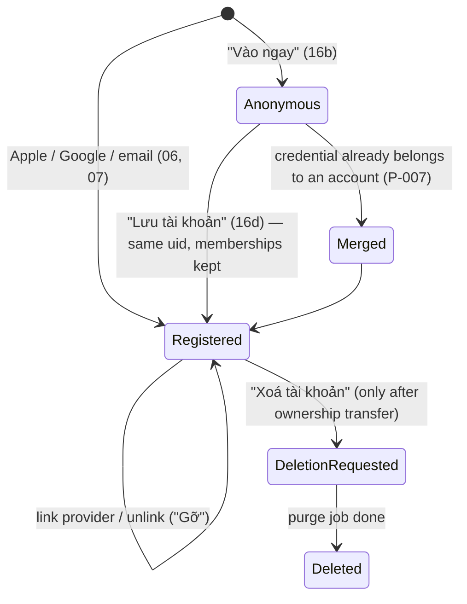
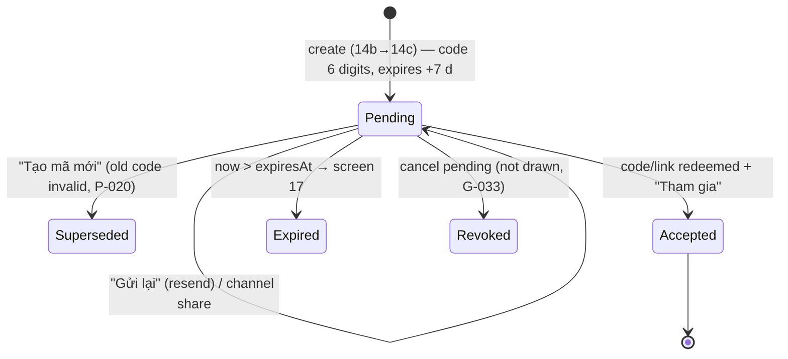
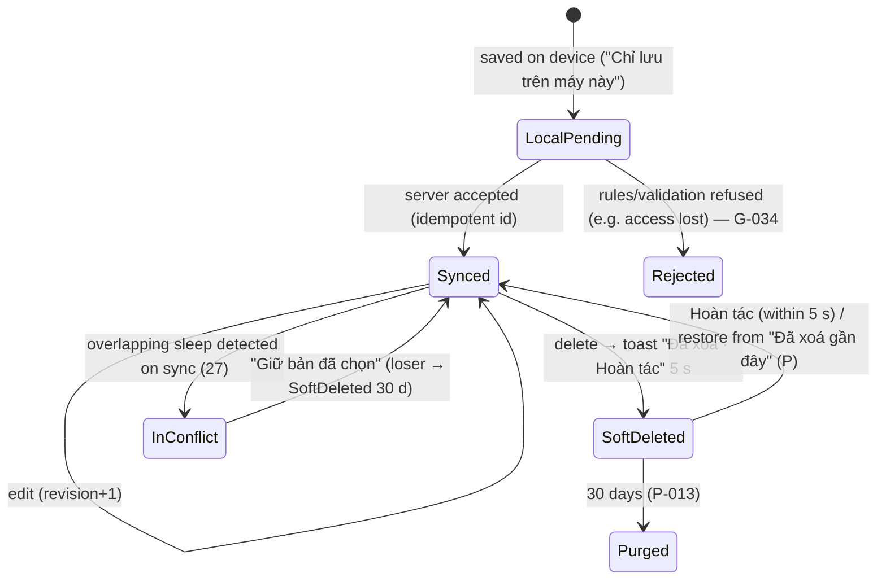
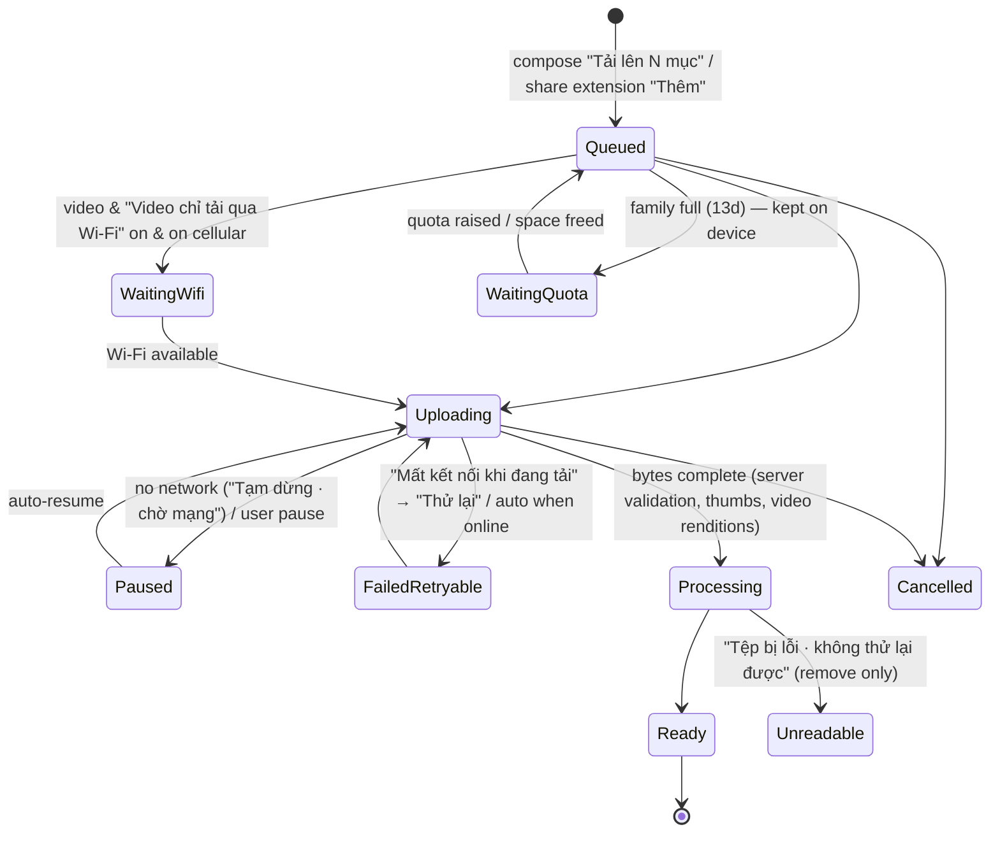
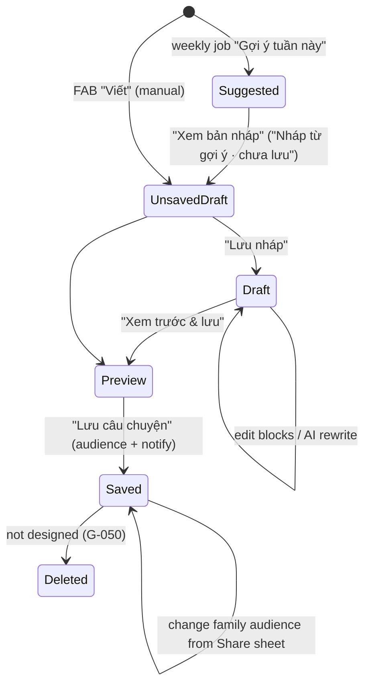
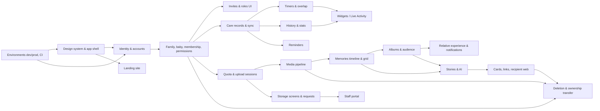

# Child Life V1 — Business Map

|                 |                                                                                                                                                                                                                           |
| --------------- | ------------------------------------------------------------------------------------------------------------------------------------------------------------------------------------------------------------------------- |
| Status          | Discovery output, **before** broad implementation. Nothing here is implemented yet.                                                                                                                                       |
| Scope authority | Final Figma file `sJLG1fAXKDnDr9YI6Yx8ex` (read-only). V1 = everything in Figma. Since **D-104** this is the historical V1 feature scope only; the shipped Flutter app is the authority for current UI and copy.       |
| Other sources   | Product plan site (Vision / V1 / Business rules / Development) — summary in [`../discovery/product-plan-site.md`](../discovery/product-plan-site.md); Engineering brief rev 2.0 (09 Oct 2026, PDF supplied by the owner). |
| Evidence        | Verbatim Figma extraction per section in [`../discovery/figma-extract/`](../discovery/figma-extract/). Node ids below (e.g. `46:2649`) point into those files and into Figma.                                             |
| Companion docs  | [`../development/implementation-plan.md`](../development/implementation-plan.md) · [`figma-coverage-checklist.md`](figma-coverage-checklist.md)                                                                           |
| Last updated    | 2026-10-10                                                                                                                                                                                                                |

## How to read this document

Every statement is tagged:

| Tag       | Meaning                                                                                                                                                                                                                           |
| --------- | --------------------------------------------------------------------------------------------------------------------------------------------------------------------------------------------------------------------------------- |
| **R-nnn** | **Confirmed design rule.** Stated in Figma (screen copy, frame annotation, or component description) — evidence node given. Implement as written.                                                                                 |
| **P-nnn** | **Engineering proposal.** Figma is silent or only implies it; this is how we intend to build it. Owner may override. Not a design decision.                                                                                       |
| **Q-nnn** | **Unresolved question.** Figma is contradictory or silent on something that changes privacy, business behaviour, cost or feasibility. Listed in §13 with impact, proposed default and the slice it blocks.                        |
| **G-nnn** | **Design gap (non-material).** A state Figma does not draw (loading, error, empty…). Engineering supplies it from existing components and copy tone; flagged for design review, never counted as "Figma-complete" until reviewed. |

Where the product plan site and Figma disagree, **Figma wins** (brief §01). Where two Figma frames disagree, the more specific screen wins over a component description or a copy-pasted annotation, and the conflict is listed.

**Since D-104 (2026-10-25)** the paragraph above and the R-nnn / G-nnn tags apply to **V1 feature scope and history only**:

- **Look and copy.** For current look and copy the shipped Flutter app (code, ARB, goldens) wins over Figma.
- **R-nnn.** An R-nnn records what Figma said; it is not a reason to restore an older design.
- **G-nnn.** "Reviewed" means a design-review pass on the rendered UI (`senior-ui-ux` skill).

Requirements, permissions and business rules are unchanged unless a later decision says so.

## Owner decisions (2026-10-10)

| ID        | Decision                                                                                                                                                                                                                                                                                                                                                                                                                                                                                                                                                                                                                                                                                                                                                          | Resolves                | Consequence                                                                                                                                                                                                                                                                                                                              |
| --------- | ----------------------------------------------------------------------------------------------------------------------------------------------------------------------------------------------------------------------------------------------------------------------------------------------------------------------------------------------------------------------------------------------------------------------------------------------------------------------------------------------------------------------------------------------------------------------------------------------------------------------------------------------------------------------------------------------------------------------------------------------------------------- | ----------------------- | ---------------------------------------------------------------------------------------------------------------------------------------------------------------------------------------------------------------------------------------------------------------------------------------------------------------------------------------- |
| **D-001** | New photos, videos and notes are **shareable by default**: compose and the share extension preselect **"Gia đình"** exactly as the app screens show.                                                                                                                                                                                                                                                                                                                                                                                                                                                                                                                                                                                                              | Q-002                   | The landing line "Ảnh mới mặc định chỉ ba mẹ thấy" (`221:3437`) contradicts the app; it must not ship as written — owner to supply replacement copy before the landing goes to prod (Figma stays unmodified).                                                                                                                            |
| **D-002** | Albums **may widen** visibility (sharing is allowed). Audience is stored per item; an item's **effective audience is "Gia đình" if the item itself is Gia đình or it is in any Gia đình album** (most permissive wins). Setting an album to Gia đình shares all current and later items (`180:356`). Setting an album to Chỉ ba mẹ makes its items Chỉ ba mẹ, except items still in another Gia đình album (the sheet states how many). In compose, picking a Gia đình album switches "Ai thấy" to Gia đình on the same sheet so the copy "Ảnh vẫn theo quyền 'Ai thấy' bạn đã chọn" stays true. A story saved to Gia đình shows its photos to family readers, private ones included; the save sheet states the count. Caregivers never see Memories in any case. | Q-004                   | P-035 (implementation of effective audience)                                                                                                                                                                                                                                                                                             |
| **D-003** | AI story drafts use **OpenAI (ChatGPT API) first**, called **server-side only** behind a provider adapter so the model/provider can be swapped. Data sent follows the portal's AI settings (`261:807–826`, R-196): **no photos** — only the week's notes / captions, milestone names, dates and counts; **nickname, never the real name**; **provider must not retain data**; **≤ 3 drafts per baby per week**.                                                                                                                                                                                                                                                                                                                                                   | Q-003                   | Only text leaves Google Cloud for OpenAI → API key per environment in Secret Manager; no client calls; prod requires OpenAI zero-data-retention (or equivalent no-retention terms) confirmed before launch; cross-border transfer still in legal review Q-020. Figma itself marks these settings "cần đội kỹ thuật và pháp lý xác nhận". |
| **D-004** | **Android mimics the iOS designs**: widgets reproduce the iOS layouts and states; Live Activity / Dynamic Island are mirrored by an ongoing timer / upload notification with the same content and actions; Photos share extension → Android share target; Sign in with Apple via web flow.                                                                                                                                                                                                                                                                                                                                                                                                                                                                        | Q-010                   | P-070 approved. "Có Teddy" library filter has no Android API → hidden on Android (noted, not a new feature).                                                                                                                                                                                                                             |
| **D-005** | Firebase dev/prod projects, billing and accounts will be **set up by the owner later**.                                                                                                                                                                                                                                                                                                                                                                                                                                                                                                                                                                                                                                                                           | §2 blockers in the plan | Work that needs no hosted project (repo, design system, emulator-backed slices) can start; anything requiring deploys, real devices against dev Firebase, push, App Check or email stays blocked and is reported as such.                                                                                                                |

| **D-006** | Dev Firebase project is **`child-life-dev`**; domain **childlife.app**; dev uses subdomains (`dev.childlife.app`, `admin.dev.childlife.app`), prod uses `childlife.app`, `admin.childlife.app`. | §2 plan blockers | Host map in implementation plan §3.7. |
| **D-007** | The staff portal is designed in Figma (page **Admin portal** `253:18`, screens A01–A12, "Child Life · Vận hành"). | Q-001 | §7.15 rules and §5.1 staff matrix; extraction in `figma-extract/08-admin-portal.md`. |
| **D-008** | **No SSO for the portal** — staff sign in with **Firebase Authentication** (email + password accounts created by an admin; no self sign-up). | Q-033 | Overrides A01's "Dùng tài khoản công ty". A01's 2-step code is kept as Firebase TOTP multi-factor (P-125), plus the 30-min idle sign-out. |
| **D-009** | Region **asia-southeast1 (Singapore)** for Firestore, Storage, Functions, Tasks; dev project on the Blaze (pay-as-you-go) plan. | plan §2 | Location-bound resources may now be created in `child-life-dev`. |
| **D-010** | Storage-expansion requests offer **only +10 GB and +20 GB** — in the app and in the portal (no +5 GB, no "Khác" custom amount). | Q-035 | Mobile 13e drops the "Khác" chip; portal shows the requested amount; P-120 (team lead above 20 GB) only applies if staff grant more than requested. |
| **D-011** | Video limits come from **server configuration** (`config/limits`: max duration, max file size, Wi-Fi-only default), adjustable later without an app release; the portal's global limits (A10) display them. | Q-028 | Defaults: duration unlimited (as A10 shows), max file size 4 GB until SP-3 measures cost; client and server both enforce. |
| **D-012** | **App and web are multi-language: Vietnamese and English first.** Device / browser language decides, with an in-app override; Vietnamese is the fallback. | P-062 | Figma copy is the Vietnamese source; English is drafted by engineering and reviewed by the owner. All strings live in ARB (mobile) / ICU catalogs (web) — no hard-coded copy. Locale-aware formatting (vi: decimal comma, `d thg m`; en: decimal point, `d MMM`). Server-generated text (invite / storage emails, push, AI story drafts) uses the recipient's saved locale. The language picker (Tôi → Ngôn ngữ, OptionRow) is not drawn — G-081. Layouts must also tolerate English length. |
| **D-013** | **Screen transitions use each platform's default** (iOS push with swipe-back, Android default / predictive back), overriding the Motion spec's custom "Chuyển màn hình" pattern. | Motion spec 271:324 | Under Reduce Motion screens fade (spec: "Mờ dần 150ms, không trượt"). All other Motion spec patterns apply as designed (R-200). |
| **D-014** | Firebase Auth on `child-life-dev` runs on **Identity Platform** (upgraded 2026-10-10; prod follows when created). | S2 | Needed for staff TOTP (D-008) and auth blocking functions; free under 50k MAU on Blaze; not reversible. Email/password enabled with an 8-character minimum (R-002); email enumeration protection stays on. |
| **D-015** | **Email accounts may continue unverified** (P-008): onboarding and baby creation work right away; sending invites and external sharing require a verified email. | Q-017 | 08 offers "Bỏ qua"; verification is detected on return to the app until universal links exist (Apple team pending). |
| **D-016** | **"Tiếp tục với Apple" uses the design's custom button** (black pill, Button style `apple`), with the Apple logo in place of the placeholder mark — not Apple's stock button widget. | Button 8:33 note | Must still follow Apple's sign-in button guidelines (logo, label, contrast). |
| **D-017** | **Only the owner manages Cùng nuôi**: any Cùng nuôi invites and manages caregivers and relatives; inviting, changing or removing another Cùng nuôi is owner-only; the owner cannot be changed or removed. | Q-013 | Enforced in `createFamilyInvite`, `updateFamilyMember`, `removeFamilyMember` (reasons `owner-only`, `owner-protected`); 14b / 14f show the co-parent option as owner-only. Ownership transfer is a later slice. |
| **D-018** | **"Chăm sóc hằng ngày" gives a relative a read-only Hôm nay tab** (tiles, history, stats when they ship), with no "+" and no reminders. | Q-006 | Tabs: Hôm nay · Kỷ niệm · Gia đình · Tôi for a granted relative; the Rules for care records (S4) must allow reads for `extraRights.viewDailyCare`. |
| **D-019** | **Relative extra rights are both off by default** (least privilege); the inviter turns them on in 14b2 or later in 14f. | Q-021 | `defaultExtraRights` in contracts. |
| **D-020** | ~~Superseded by D-054 (Resend).~~ **Transactional email goes through AWS SES** (sender `hello@childlife.app`, region ap-southeast-1) behind a provider adapter. | R-034 | SES keys are Firebase secrets `SES_ACCESS_KEY_ID` / `SES_SECRET_ACCESS_KEY` set by the owner; until then mail waits in `mail/` with status `waiting-provider` and is retried every 15 min. Needs SPF / DKIM / DMARC on childlife.app and SES production access. |
| **D-021** | **"Không phải tôi" only exits**: the invite stays pending and nobody is notified; a temporary identity that never joined is signed out. | Q-024 | 16 → 01. |
| **D-022** | **Any Cùng nuôi edits or deletes any care record; a caregiver only their own**; relatives never log. | Q-012 | Enforced in Firestore Rules (`canEditRecord`); 21 hides "Sửa" / "Xóa bản ghi" when not allowed and shows 12e's "chỉ xem" note. |
| **D-023** | **Relative times use the full form in the app** ("45 phút trước", "1 giờ 25 phút trước"); the compact form ("1g 25p") only in widgets. | Q-029 | `core/format/relative_time.dart`. |
| **D-024** | **Attribution:** Mẹ / Ba / Bà / Ông read as the relation label ("Mẹ ghi"); Bảo mẫu, Họ hàng, Bạn bè and Khác read as the member's name ("Cô Lan ghi"); the current user reads "Bạn". | Q-030 | The author is snapshotted on each record (Rules check it against the writer's membership). |
| **D-025** | **Sleep from "+" starts the timer at once; long-press enters it by hand.** The Giấc ngủ tile opens the chooser (25a); while a sleep timer runs, both open it (25). | Q-022 | Follows the 19a annotation; 25a stays the tile path. |
| **D-026** | **Pumping is never baby intake**: not in "Đã ghi hôm nay" or feed stats, its own filter only; **no Live Activity for pumping** (not designed). | Q-025 | Pump timer (23c) still runs in the app and is shared with the family. |
| **D-027** | **A sleep that crosses midnight** shows its full span with the real start in the timeline ("21:42 hôm qua – 06:30"); day totals are clipped per day; **"Giấc dài nhất" is the full uninterrupted sleep, counted on the day it ended.** | Q-026 | `care_calc.dart` (`sleepDay`, `sleepStats`); the rhythm rows still split at midnight. |
| **D-028** | **"30 ngày" and the sleep "Hôm nay" view reuse the 7-day components** (30 rows / bars; one row for today). | Q-031 | Not drawn in Figma; same cards, same copy. |
| **D-029** | **Any member who sees a reminder can move its notification to their own device** from the "Thông báo" row in 8e (one device at a time). There is still never a push to every device (R-091). | Q-005 | Rules: `notifyDevice` may only name the writer's own device; the app reschedules or cancels on the next sync. |
| **D-030** | **Cùng nuôi can delete a reminder** ("Xoá nhắc việc" in the edit form, with a confirmation), and **tapping the check of a done reminder undoes it** — any Cùng nuôi, or the caregiver who marked it. | Q-018 | Engineering copy awaiting design review (G-061). |
| **D-031** | **"Báo trước" options: Đúng giờ · 10 phút · 30 phút · 1 giờ · 2 giờ · 1 ngày** (default 1 giờ). **Date and time use a wheel in the baby's time zone and cannot be in the past.** Any Cùng nuôi edits any reminder (as D-022 for records). | G-061 | Not drawn; same wheel as the care time picker. |
| **D-032** | **Overdue reminders only turn red in the app**: one notification at due time minus "Báo trước", no repeats. A change of the baby's time zone keeps the instant (P-014); a change of the device's time zone needs no reschedule. | flow C | Notifications are scheduled for the absolute instant. |
| **D-033** | **The batch notice does not wait for videos held for Wi-Fi**: the family hears once, when every item is done or when at least one is ready and the rest only wait for Wi-Fi on the uploader's device (P-030). | Q-019 | `batchReadyToNotify` in `packages/contracts/src/memories.ts`; the uploader marks Wi-Fi waits on the item. |
| **D-034** | **"Nhắn ba mẹ" is a one-way in-app message attached to the item** (memory, photo, album or story; "Nhắn Mẹ" from a parent's care record for caregivers). Parents get one generic notice and read messages under the item and in a "Lời nhắn" list under Tôi; no chat, no reply thread. | Q-007 | Engineering copy for the parent side awaiting design review. |
| **D-035** | **Relatives cannot hide items** (the stale layer name "Người thân chỉ ẩn…" is not built). | Q-014 | — |
| **D-036** | **Relatives may download photos and videos** (videos as stored until SP-3 renditions), single items and whole shared albums. | Q-015 | — |
| **D-037** | **Ownership transfer and account deletion** (adopting the Q-016 proposal): the owner offers the whole family (all its babies) to an active Cùng nuôi of every baby who owns no other family; the receiver accepts or declines in the app (the owner may cancel). An account that owns babies cannot be deleted. Deleting an account removes memberships, devices, favourites, loves, the profile and the sign-in; care records, memories and messages it wrote stay with the family, shown as “Người dùng đã xoá”. | Q-016 | Mobile 13n transfer sheet + offer card on Tôi; `offerFamilyOwnership` / `answerFamilyOwnership` / `deleteMyAccount` (job). |
| **D-038** | **Undrawn S11 entry points** (adopting the Q-037 proposal for S11): “Xuất dữ liệu” lives in 13n (care for Cùng nuôi, photos and videos for the owner, R-187); “Trợ giúp & liên hệ” is an in-app form with a topic, a message and diagnostics only with consent; while a profile is being deleted every member sees a “đang được xoá” banner and writes are refused (Rules). All flagged for design review (G-072, G-073, G-077). | Q-037 | AI-draft reporting stays with S12. |
| **D-039** | **Remote sign-out and the device list** (13n): each install keeps one row (model name, platform, last active; no city — no IP location is collected). “Đăng xuất” on another device flags its row; that install signs itself out and removes the row when it next connects. Refresh tokens are not revoked (that would sign out every device). | — | Engineering decision on 13n; recorded for review. |
| **D-040** | **People are shown by their initial in V1**: 13m “Đổi ảnh” (user photo) is not built; baby photos are unaffected. | — | Engineering decision; revisit with design (G-078). |
| **D-041** | **Stories as built** (adopting P-090, P-091, P-092 and the Q-036 proposal): the weekly suggestion needs ≥ 5 new items, at most 3 per baby per week, is written from text only (captions, notes, milestone, dates, counts, nickname, relation labels) with ≤ 9 photos attached by the server; model output is checked so every number and name comes from the sources, otherwise a plain template draft is used; drafts are private to their writer (suggestions to every parent until one takes it); any Cùng nuôi edits a saved story; the first save to Gia đình sends one notice, later saves never; photos shown in a saved Gia đình story are seen by the family (D-002); deleting a story keeps its photos (G-050). Until the owner sets `OPENAI_API_KEY`, drafts use the template and paragraph rewrites say “AI chưa sẵn sàng”. | Q-036, P-090–P-092 | Feature flag `ai_story_drafts` gates the weekly job. |
| **D-042** | **External sharing as built** (adopting P-095 and P-096, filling 14k–14m gaps): a private link is created on “Sao chép & chia sẻ” (no unused links) with a 16-character random token and a nickname slug; its options cannot be changed afterwards (create a new one). The page `/s/{token}` is a live projection at view time: title, paragraphs and only photos the family can see that are still there — never Chỉ ba mẹ or deleted items; nickname and age, the sharer's given name; the birth date only when “Ẩn tên thật & ngày sinh” is off. The 4-digit passcode is shown once to copy; 5 wrong tries lock an address for 15 minutes. Revoked and unknown links show the same page; expired ones say so. Images are served by the same function (no signed URLs); downloads only when allowed, and the copy never promises screenshots are blocked (R-166). Cards are made on the phone (1080 × 1350, Lora / Dancing Script, only family-visible photos) and listed as irrevocable. | P-095, P-096 | 14m revoke asks first (not drawn). |
| **D-043** | **Portal sign-in is email + password or an email magic link — no TOTP / 2-step code** (owner, 2026-10-10). Staff accounts are still created only by an admin script with the `staff` claim and roles; the portal rejects anyone without the claim; 30-minute idle sign-out stays. No Identity Platform upgrade. | Q-033 | Replaces the TOTP part of D-008 and P-125; A01's code boxes are not built. |
| **D-044** | **Portal as built (S15)**, filling the A01–A12 gaps: an email-link account without the `staff` claim is deleted right after sign-in (no stray consumer accounts); sidebar badges count open tickets, pending storage requests and data jobs running or failed (G-079 user menu: language, sign out); staff may grant +5 / +10 / +20 GB, anything else needs the trưởng nhóm role — others see why the button is off (G-080); decline sends the family a message by email (G-075); replies go by email and need a reason; "Thử xử lý lại video" is not built (no per-upload server job to re-run); A11 shows the scope instead of an active-family count; the family notice defaults to the Vietnamese copy whatever the staff UI language; the audit target for a re-run is the DJ code; empty / loading / error states use existing components (G-078). | G-075, G-078…G-080 | Engineering decisions; flagged for design review. |
| **D-045** | **Interim iOS dev identity** (owner, 2026-10-11): until the Child Life Apple developer account exists, the iOS dev flavor is `dev.hsba.app` on the owner's team `VHFV2HNZGN`, signed manually with the owner's development profile "hsba app dev"; the App ID's universal APNs certificate (valid to 2027-11-10) goes into Firebase Cloud Messaging for `child-life-dev`. Android stays `app.childlife.dev`; prod stays `app.childlife`. The App ID has no Sign in with Apple, Associated Domains or App Groups yet, so Apple sign-in, universal links and widget/Live Activity extensions still wait. | — | Registered as a second iOS app in `child-life-dev`; reversible in `tool/ios_flavors.rb` and `AppEnvironment`. |
| **D-046** | **Share extension and upload feedback as built** (engineering, 2026-10-11): 10k is a native SwiftUI sheet (Flutter cannot run in an extension). It copies the shared photos and videos into the App Group with a manifest (baby, Ai thấy, Báo cho gia đình); the app moves them into the normal upload queue when it opens or comes back, so the footnote reads "Ảnh sẽ tải lên khi bạn mở Child Life" until native background transfer (SP-2). Only Cùng nuôi babies are offered; the strings come from the ARB catalogs through the App Group (D-012). A refused upload session is never silent: the A11 kill switch shows "Tải ảnh, video đang tạm dừng" and retries by itself; other refusals show "Chưa tải lên được" with "Thử lại". Buttons that call the server show a spinner while they work. | G-084 | Footnote differs from Figma's "Ảnh tải ở nền"; flagged for design review. |
| **D-047** | **App icon is always Light** (owner, 2026-10-11): iOS uses the Light icon in dark mode too (the Dark appearance is not shipped; Tinted stays for the user's tinted home screen); the dev flavor uses the same coloured Light icon on iOS and Android instead of the greyscale art, so dev is told apart by its name "Child Life Dev". | — | Replaces the S1 greyscale dev icon; Figma's Dark icon (35:225) is unused. |
| **D-048** | **Press feedback, navigation chrome and haptics follow the system** (owner, 2026-10-11): buttons, rows and tiles use the iOS button highlight (dim to 40 %, large surfaces 70 %, fade back; CupertinoButton timings) instead of the Motion spec's 0.96 press scale; the NavBar pill, label and icon colour move together on the standard spring, tabs change by tapping only, and the dock slides off screen while content scrolls down and returns after 8 px of upward scroll (P4 said fade to 30 %); tab and Me screens keep their header (baby chip row / back bar) pinned while content scrolls, with a compact title once the large one scrolls away; Kỷ niệm's floating Nhật ký · Ảnh · Album · Câu chuyện bar becomes the large-title tabs at the top; a selection haptic plays on a tab change and a medium haptic when a bottom sheet opens (P2 said none); inputs carry a resting stroke; the baby chip opens the baby's profile (one baby) or the picker (several). The upload pill (382:2807) floats above the dock on every tab instead of sitting in Nhật ký; a finished batch shows its result for 4 s, then stays in the queue sheet until dismissed. One splash only: the in-app 00 Splash draws exactly the native launch screen (150 pt mark on cloud, no glow, wordmark or tagline) so the hand-over is invisible. Bottom sheets keep pattern 270:108, driven by one controller so drag, scrim and release velocity stay in sync. | Motion spec 269:41, 270:296, 270:108; NavBar 44:362 | Night care keeps haptics off; Reduce Motion: highlight without fade, pill and dock fade or jump. Extends D-013. |
| **D-049** | **Growth is compared with the WHO standards** (owner, 2026-10-11; Figma v1.0 improvement 345:35701 · 20d, 20i): the growth card shows the latest weight or length with the baby's age, a status against the WHO normal band ("Bình thường" / "Dưới mức tham chiếu" / "Trên mức tham chiếu" = below the 3rd / above the 97th percentile) with a doctor note when outside it, and a chart with the band and the WHO median; 20i lists the 3rd percentile, median and 97th percentile ("Thấp · Trung vị · Cao") by week (0–13) or month (0–24), boys or girls, weight or length, with the baby's row marked. Supersedes R-056's "no percentiles" for growth only. | 345:35701 | Data hard-coded from the WHO Child Growth Standards LMS tables (WHO anthro, `tool/who_growth_data.py`); the design's 6-week P97 "6,2" is WHO 6.252, shown as 6,3. No other medical inference (R-012 stands). |
| **D-050** | **Widget tiles open the app's own log** (owner, 2026-10-11): a Medium/Large tile, or a Small widget outside its one-tap buttons, opens the same log sheet as the Hôm nay tile (ml, kind, side, time); one-tap buttons stay on Small widgets (W1). | W2 | iOS widgets cannot take text input; `/today?log=<type>`. |
| **D-051** | **Rule reminders as built** (engineering, 2026-10-11; v1.0 370:1247): Nhắc nhở has two halves, "Theo quy tắc" (new) and "Một lần" (the S7 dated reminders, unchanged: still a local notification on one device, R-091). A rule is per baby: Bú (bottle or breast) · Ngủ · Thay tã · Hút sữa, either "Sau lần ghi gần nhất" (30 min – 12 h in 15-min steps; sleep counts from waking, nothing while asleep) or "Giờ cố định" (up to 8 daily times, chosen weekdays, in the baby's zone). Cùng nuôi create, edit, pause and delete; recipients are Cùng nuôi and Người chăm sóc only. The server keeps the schedule (`babies/{id}/reminderRules`, written only by the Functions `saveRuleReminder`, `setRuleReminderEnabled`, `deleteRuleReminder`, `answerRuleReminder`), checks every minute and pushes to every recipient's devices (copy without the baby's name, R-120; muted by Thông báo → Nhắc việc). The first new log of the activity answers a due or snoozed reminder for everyone and is recorded in "Gần đây" with who logged. Lock screen (iOS): Ghi … (opens the log) · Báo lại sau 15 phút · Bỏ qua lần này, answered without opening the app; in the app: snooze 10 · 15 · 30 phút. Edit, delete and the per-rule history screen are not drawn and were added. Owner, 2026-10-11: "Một lần" comes first (and opens), "Theo quy tắc" second; the Hôm nay card lists the next 3 of both kinds (a rule by its next or pending time, overdue first) with "Xem thêm" | — |
| **D-052** | **Kỷ niệm order, quick-add widgets, shared stories** (owner, 2026-10-11): Kỷ niệm tabs read Ảnh · Album · Nhật ký · Câu chuyện and open on Ảnh. Two widgets (Home small, Lock circular) open the app straight on the camera (photo or video in one screen, length capped by the server limit) or the photo library, then "Soạn & chia sẻ"; only Cùng nuôi add, others get Hôm nay. Journal tiles wider than the thumbnail load the display rendition. The shared story page no longer shows when the link expires, and any photo opens full screen (CSS only; the page still runs no script) | — |
| **D-053** | **Admin portal v1.0 decisions** (owner, 2026-10-11, answering Q-040…Q-046 and asking to build it now): **no 2FA** for staff (D-043 stays; the 2FA column, KPI and status are not built); **no family suspension** ("Tạm khoá" is not built); staff invitations accept **any email domain** (no allow-list); the **first Owner is nvduc2910@gmail.com**, made by `create-staff.mjs --roles owner`. The other questions take the proposed defaults: Q-042 three acquisition buckets with no SDK (iOS counts as "Kho ứng dụng & khác"), Q-044 no full-email reveal, Q-045 WHO rows import-only with two-person approval for every table, Q-046 ownership transfer only with the current owner's yes. P-134…P-139 are built on that basis | Q-040…Q-046, P-134…P-139 |
| **D-054** | **Email through Resend from hello@childlife.app** (owner, 2026-10-11; supersedes D-020): every email goes through Resend's API (secret `RESEND_API_KEY`, set by the owner; `unset` = mail waits in `mail/`). The domain childlife.app stays at GoDaddy with Resend's DKIM / SPF / MX records on `send` and `resend._domainkey`; replies go to the GoDaddy mailbox. All templates (invite 14e, 13 account / service / staff mails, and the sign-in mails) share one branded layout in vi / en (`mail-templates.ts`). The sign-in mails ("Xác minh email" 08, "Quên mật khẩu" 09, the portal's "Link qua email") are Child Life's own, sent by the callable `sendAuthEmail` (one per minute and five per day per address, checked before any account lookup; portal links only for staff and invited staff); without the key the app and portal fall back to Firebase Auth's mail. Setup: `docs/development/email.md` | D-020, R-034 |
| **D-055** | **Chi tiêu rights as 8l** (owner, 2026-10-12; Figma v1.1 8l): spending is for Cùng nuôi. Per member and per baby, a Cùng nuôi can turn on **Ghi khoản đã chi** (record expenses; see and edit only their own) and **Xem toàn bộ chi tiêu** (every expense, totals, statistics, budget) for a Người chăm sóc or Người thân; both off by default. These two extra rights are the first not limited to relatives. Plan `docs/product/spending-plan.md` | D-017, D-019, D-022 |
| **D-056** | **"Ai trả" = the baby's real members + Khác** (owner, 2026-10-12): the payer list is the members of the baby by their label (Mẹ, Bố, Bà ngoại, Cô Lan…) plus "Khác", not Figma's fixed Mẹ / Bố / Ông bà / Khác; the payer is stored as a snapshot so a member who leaves still reads right; statistics group by payer | D-024 |
| **D-057** | **Recurring expenses are added automatically** (owner, 2026-10-12; Figma 8i): on the due day (baby's time zone) the server adds the occurrence as a normal expense that stays editable, and tells Cùng nuôi by push; the whole Chi tiêu cluster ships in one go | P-140 |
| **D-058** | **Sơ cứu trẻ em from the portal, hands-free** (owner, 2026-10-12): of the v1.1 page only the first-aid cluster is built now; Chăm sóc keeps its name and gains the red entry (7a). The guide is editorial content written in the portal (Nội dung · Sơ cứu), approved by a different person and published to `publicConfig/content_firstAid`; the app keeps the pack and every picture on the device, so it works offline, and picks up a new version by itself. Dev gets the Figma content at once; prod publishes only after a person with medical credentials approves it (reviewer, date and sources recorded and shown). Designer's revision 2 (same day): nothing to tap while helping — all steps on one page with static counts, "Gọi 115" dials at once (then "Đang gọi 115 · mm:ss" and the "Nói với tổng đài" card), "Đọc to hướng dẫn" reads aloud and scrolls, and the CPR page plays the 110/min beat by itself and says "thổi ngạt 2 lần" after every 30. Owner answers: no location is sent or shown; the seizure timer keeps its Start button; the CPR banner only says to call 115 | P-141 |
| **D-059** | **One-tap invite links, no OneLink** (owner, 2026-10-12): "Nhận lời mời" in the invite email opens the web page `/i/{token}` (with the app installed, iOS / Android may open the app straight away). The page walks through it: "Mở app và nhận lời mời" (a Universal / App Link to the same invite on the other landing domain, because iOS ignores a link to the page's own domain); without the app: install it, come back and tap the button, or open the app and type the 6-digit code shown with a copy button. Opening `/i/{token}` in the app joins at once: no account → a temporary one ("Vào ngay"), the relation the inviter chose, the name "Người thân" ("Family member") until changed in Gia đình, then Hôm nay; a closed invite shows 17, offline falls back to 16. Only `/i/*` opens the app on the web domains (story links `/s/…` stay on the web). AppsFlyer OneLink was tried and dropped the same day: simpler, no third party. Open: prod needs a second domain for the button, and store links once published. Setup: `docs/development/invite-links.md` | — |
| **D-060** | **Nhập chi tiêu** (owner, 2026-10-12): a Cùng nuôi brings spending kept elsewhere into one baby's Chi tiêu from a CSV or Excel file (columns found automatically, e.g. Money Lover / MISA / spreadsheets), or from pasted text or photos read by AI (OpenAI adapter of D-003, no baby name sent). The server previews, imports in the background, then emails and pushes the result to the importer; one import can be undone for 7 days. Categories in the file are matched by name, the rest chosen by the user; rows already recorded are skipped. Plan `docs/product/spending-import-plan.md` | P-144 |
| **D-061** | **App updates from the portal** (owner, 2026-10-12; v1.0 improvement UP1–UP6 `469:6454`…`469:54094`): staff write, per platform, the version in the store, the oldest version still allowed and the store link, plus the release notes ("Có gì mới": a one-line summary, up to 4 highlight rows, up to 5 pages with pictures, vi + en), on Hệ thống › Cập nhật ứng dụng; publishing goes to `publicConfig/appUpdate` at once, with a reason, history and audit. The app: below the oldest allowed → UP1 "Cần cập nhật để tiếp tục" instead of the whole app (offline too, from the cached config); below the store version → UP2 "Child Life có bản mới" over Hôm nay, again after "Để sau" runs out; first launch after updating → UP5 "Đã cập nhật …" on Hôm nay until opened or closed, "Xem" → UP3/UP4 pages; Tôi shows UP6 "Phiên bản …" with "Cập nhật" when a newer one exists. Publishing needs Hệ thống · Sửa (Kỹ sư, Admin, Owner); viewing Hệ thống · Xem. Setup and release steps: `docs/development/app-updates.md` | P-143 |
| **D-062** | **Staff portal keeps the session** (owner, 2026-10-12: "đừng logout portal. keep login"): no idle sign-out; the A01 line "Tự đăng xuất sau 30 phút không hoạt động" and the idle notice are removed. A staff session ends only on Đăng xuất or when access ends (paused, removed, access window over, role taken away: `staffMe` refuses). Network trouble or a slow first call no longer signs anyone out; the portal tries again. Replaces the idle part of R-180 / D-008. Code: `apps/portal/src/App.tsx`, `session.ts`, `screens/SignIn.tsx`; test `apps/portal/test/portal.test.tsx` | R-180 |
| **D-063** | **Staff portal on shadcn/ui** (owner, 2026-10-12: "cái portal UI/UX thật sự ko ổn … tìm thư viện / open source theme / dashboard nào miễn phí và xài nó"; picked shadcn/ui with the shadcn-admin layout, MIT, and the Child Life colours): Tailwind 4 + Radix; a collapsible icon sidebar with groups and badges, a header with breadcrumb, ⌘K search and the theme menu; light, dark or system theme (Night care palette in dark). Figma `253:18` stays the source for screens, content, flows, data and permissions; its visuals give way to shadcn's. Code: `apps/portal/src/index.css`, `theme.tsx`, `Shell.tsx`, `ui.tsx`, `components/ui/*`; the pre-shadcn CSS is the `legacy` layer until each screen moves over. | — |
| **D-064** | **Email-link sign-in in the app** (owner, 2026-10-13: "Trong phần đăng nhập chưa có button đăng nhập qua link (magic link)"), as drawn in 07a / 07b / 07c: "Dùng email" opens "Đăng nhập | Tài khoản mới" with "Đăng nhập" first; "Đăng nhập" sends a link ("Gửi link đăng nhập", no password) and offers "Đăng nhập bằng mật khẩu" (07c, footer "Quên mật khẩu? · Gửi link đăng nhập"); "Tài khoản mới" still creates an account with a password. The link signs in or creates the account alike. Child Life's own mail through Resend (D-054, `sendAuthEmail` kind `appSignInLink`, one a minute and five a day per address); the link is Firebase's rebuilt on the website, `https://dev.childlife.app/auth/link/?mode=signIn&oobCode=…&exp=…`, a Universal / App Link into the app (AASA and the dev App Links filter, both landing domains). 07b "trong 15 phút": `exp` is checked by the app and the page, Firebase's own expiry still applies after it. "Trên điện thoại này": the address is kept on the phone until the link is used; opened elsewhere, the app asks for it. Opened in a browser, `/auth/link/` is a page (`signInLinkLanding`) whose button opens the app through the other domain, or says the link expired. Undrawn states (signing in, address to confirm, expired, offline) are engineering copy (G-001). Replaces P-129. Code: `apps/mobile/lib/features/auth/email_link.dart`, `auth_screens.dart`; `firebase/functions/src/auth-mail.ts`, `pages.ts`; tests `test/features/email_link_test.dart`, `firebase/functions/test/auth-mail.test.ts` | R-001 |
| **D-065** | **Góp ý & đánh giá** (owner, 2026-10-13, Figma FB1–FB5 `477:6397`, rules in `docs/discovery/figma-extract/26-feedback-rating.md`): Tôi gets "Góp ý cho Child Life" (FB2) and "Đánh giá trên App Store" / "… Google Play" (the store page, user-initiated, always there). FB2: Ý tưởng / Báo lỗi / Khác, free text, an optional screenshot, "Gửi kèm thông tin thiết bị" (no baby data), "Cho phép liên hệ lại"; FB3 confirms (reply within 2 working days; history in Trợ giúp & liên hệ). FB4: after a screenshot, a dismissible toast "Có gì chưa ổn ở màn này? · Báo lỗi" pre-attaches it, at most once per session. FB5 rating: the system prompt only (SKStoreReviewController / Play In-App Review), never a custom "Bạn có thích app không?" first (review gating is against store policy); only after a happy moment (a milestone or memory saved, a full week with a log every day, the first reaction to a family memory); eligible from 7 days after install, 10 logs and 3 active days in the last 7; never in Night care, with a timer running, on first aid, after an error or crash, right after an update, or within 30 days of a bug report; at most once per app version and 120 days apart (the OS caps it further). Tracked first-party and aggregate only (P-137): `reviewPromptEligible`, `reviewPromptRequested`, feedback sent by type (`appEventsDaily`). Code: `apps/mobile/lib/features/feedback/`, `me/help_screen.dart`; `firebase/functions/src/feedback.ts`; tests `test/features/feedback_test.dart`, `review_prompt_test.dart`, `firebase/tests/feedback.*.test.ts` | P-145 |
| **D-066** | **Tự lưu kỷ niệm, free beta on iOS** (owner, 2026-10-13, Figma AS01–AS20 / AR01–AR08 `479:7357`, `486:7158`; extraction `docs/discovery/figma-extract/27-auto-save.md`, plan `auto-save-plan.md`; the owner's later answers the same day replace a first draft that had a 7-day trial, a background-upload switch and several babies per photo): a future premium feature offered first as a **free beta with no time limit** ("Beta đi", "beta ko cần 7 ngày"; a 7-day trial waits for the paid plan, Q-058); **iOS only** for the beta (Android not built for this feature — an exception to "done = iOS and Android"); a **separate, plain-language consent for face analysis** that makes clear Tự lưu keeps no photos of the baby and the face data stays on the parent's phone (P-147); settings, sample photos, face data and suggestions **stay on each device** (not synced, never uploaded); **approved items always keep uploading in the background** — the "Tiếp tục tải khi app chạy nền" switch is removed from AS05 and AS19; **one baby per photo in v1** (AS09 single choice as drawn; the owner allowed this if several babies is too costly, P-149); **v1 recognition does not have to be accurate** — suggestions are proposals the parents review (P-149); grouping and ranking in the review grid delegated to engineering (P-146); **the AS01 entry stays at the top of the Ảnh and Nhật ký tabs** (owner: "giữ nguyên như cũ, ko theo design mới"; the frame's "Dòng thời gian / Ảnh & video" tabs are not built, D-052 stands). Uploads default to Chỉ ba mẹ and no family notice as drawn (differs from D-001 on purpose). | — | Beta access P-148; dedupe ledger and the `Gal` loop P-150; open Q-054 … Q-058; design gaps G-102 … G-106. |
| **D-067** | **Sign-in screens, password first** (owner, 2026-10-13: "dùng icon google và apple… có button đăng nhập đăng ký. đăng nhập thì nên giữ ô password. đăng nhập là button chính. và button secondary gửi link đăng nhập"): 06 / R1 show Apple's and Google's own logos (`assets/brands/`, also on 10, 16b and 16d) and, instead of "Dùng email", two buttons "Đăng nhập" and "Đăng ký" that open 07 on that segment. 07 "Đăng nhập" keeps email + password with "Đăng nhập" as the main button, "Quên mật khẩu?" under the fields, and "Gửi link đăng nhập" (D-064, email only) as the secondary button; 07a's link-first layout and "Đăng nhập bằng mật khẩu" are dropped. Code: `apps/mobile/lib/features/auth/auth_screens.dart`; tests `test/features/email_link_test.dart`, `onboarding_screens_test.dart` | D-064 |
| **D-068** | **Kỷ niệm 2.0 — Video kỷ niệm & Thiệp cột mốc, first answers** (owner, 2026-10-13, Figma MM01–MM17 `528:9260` … `532:9741`; extraction `docs/discovery/figma-extract/29-remember-2.md`): (1) **Video kỷ niệm renders on the server with Remotion** — free under the Remotion License while the company has at most 3 people; a Company License is needed once it grows past that (re-check before hiring). (2) **Câu chuyện tab keeps today's stories as their own section** (owner: "thêm 1 section cho cái hiện tại"): MM15's quick-create row, "Video kỷ niệm" and "Thiệp cột mốc" sections come first, then the existing Stories list (D-041: drafts, AI suggestions, shared stories, filters and "Viết") as a further section; nothing about today's stories is removed. (3) **Free beta like Tự lưu** (owner: "Beta như tự lưu"): cards and videos, including templates badged "★ Cao cấp", are free while in beta with no time limit; access is a rollout flag per family (P-148 pattern), premium gating waits for the paid plan (Q-058) — resolves Q-059. (4) **Push when a video is ready**, to the person who started it only, on top of MM17's in-app banner — resolves Q-060. (5) **Generated cards and videos count toward the family storage quota** (P-001) — resolves Q-061. (6) **Light comes from the components** (owner: "Component tự có light mà"): MM frames are drawn in Night care only; Light uses the same components and tokens, no separate frames are needed. (7) **Template artwork is controlled and distributed from the portal, never built into the app** (owner: "Hình ảnh template cũng nên control và distribute ở portal ko hard code template hình ảnh trong app"): a card template is layers of a fixed set of primitives (background, photo, text, shape, image) with pictures uploaded in the portal (public, immutable, content-hashed under `content/keepsakes/`), published through the Sơ cứu workflow (draft, a second person approves, rollback) to `publicConfig/keepsakes`; the app has one generic renderer; video motion stays in Remotion code but its pictures, music and texts come from the portal (plan §4.1). (8) **Miễn phí / Cao cấp is controlled in the portal** (owner: "Tôi cần miễn phí hay premium thì control ở portal nha"): each template's tier, and for the whole catalog whether Cao cấp templates are open to everyone (the beta default, #3) or hidden, and whether the badges show; a "chỉ người đã mua gói" mode comes with the paid plan (Q-058). Changing it bumps no template version; the server enforces it when a card is saved or a video requested. (9) **Milestone nudges, always on, worked out on the phone** (owner: local notifications from the date of birth; "Có tên bé", "gửi 9:00", "Ko cần, luôn gợi ý. Nếu bé nào đã qua các mốc cũng push luôn. Sau 7 ngày xài app thì push kiểu xem lại các mốc trước của bé nếu có hình các mốc đó"): a local notification at 09:00 on the day of each age occasion (7 ngày, 1 tháng, 100 ngày, 1 tuổi) with the baby's name; after 7 days of use (from the account's creation, else the phone's first open), a "Nhìn lại" notification at 09:00 for each occasion already passed that has photos in Kỷ niệm and no card, at least 3 days apart, once each; MM03 on Ảnh from 7 days before to 14 days after an age occasion and for 7 days after a first-time milestone is tagged (× ends that occasion's nudges, "Để sau" hides it 3 days). No setting turns them off; a card made for the occasion ends them; no server job (the date of birth never leaves the phone). (10) **Every template carries the Child Life logo** (owner, 2026-10-14: "cần có logo text hoặc chữ child life ở mỗi template nhé"): the official horizontal lockup on every card format and through every video (corner mark + end card), tinted to the palette's ink so it follows "Màu"; part of the template, not removable by the parent (spec `docs/product/remember-2-templates.md` §1.8, E-13). (11) **Sample photos: free real photos** (owner, 2026-10-14: "dùng ảnh thật mà free trên mạng được xài"): template previews and covers use real baby photos under a free licence (CC0 via StockSnap, `design/sample-photos`), without a model / guardian release; the owner accepts that risk for now, and the preview tool refuses any person photo that has neither a release nor this recorded acceptance. Still open: Q-062 music, design gap G-107. | — | Extends D-041, D-052, R-161 |
| **D-069** | **Chăm sóc / Tiện ích regrouped, tab labels always shown** (owner, 2026-10-14): Chăm sóc = "Chăm hằng ngày" (Nhắc nhở · Tiêm chủng · Thống kê · Lịch sử · Tăng trưởng), "Hiểu con & phát triển" (Wonder Weeks · Theo tuổi của bé · Mốc phát triển · Ăn dặm) and "Kiến thức chăm bé" (Thư viện chăm bé, moved from Tiện ích); "Dinh dưỡng" is dropped. Tiện ích = "Công cụ" (Sơ cứu trẻ em · Chi tiêu) and "Gia đình" (Thành viên & chia sẻ · Mời người thân). The tab bar shows every tab's icon over its label, chosen or not, sharing the bar equally (NavBar v1.0.1 369:2540), instead of a labelled pill for the active tab only. Code: `apps/mobile/lib/features/care/care_hub_screen.dart`, `utilities/utilities_screen.dart`, `core/widgets/cl_navigation.dart` | D-048 |
| **D-070** | **Tự lưu: at most 200 items per upload, one family notice per upload** (owner, 2026-10-14: "200 đi, gộp thông báo luôn"): a review (AS07) holds at most `config/limits.autoSaveItemsPerApprove` (default 200, shown read-only in portal A10) picked items; groups join a review in order while their picks fit, ticking past the limit shows "Mỗi lần tải tối đa 200 mục", and the rest stay pending for the next review ("… gợi ý còn lại chờ lần sau") instead of being marked seen. Why: 1,000 items at once would take half the 10 GB quota, several GB of copies on the phone, minutes of preparing and ~34 Nhật ký posts. One "Tải lên" is one batch per baby, sent as memories of up to `mediaItemsPerAdd` (R-102) that share its `batchId`; the last part carries `batchParts`, and the server sends the single Gia đình notice (P-030) only when every part has arrived, counting all items. A batch still missing parts after 2 h (app closed mid-way) is closed with what arrived by the hourly sweep (`uploadBatchesWaiting`). Code: `apps/mobile/lib/features/auto_save/auto_save_review.dart`, `auto_save_controller.dart` (`approve`), `firebase/functions/src/memories.ts` (`createMemory`, `maybeNotifyBatch`, `closeWaitingBatches`); tests `firebase/tests/memory-batch-parts.integration.test.ts`, `apps/mobile/test/features/auto_save_screens_test.dart` | D-066, P-030, R-102 |
| **D-071** | **Android: no Sign in with Apple; plan the rest of Android parity** (owner, 2026-10-14: "ko cần login via apple rồi lên kế hoạch làm hết nhé"): the Apple button is not shown on Android (sign-in, "Tài khoản đã tồn tại", 16d save account); Google, email and email link remain. Every other Android gap found on 2026-10-14 (widgets, background upload, share target, camera video, notification actions and channels, keepsake progress, prod App Links, release signing and store, device testing) is planned in `docs/product/android-plan.md`; Tự lưu (D-066) and the watch app (Q-048) stay iOS-only. | D-004, D-045, SP-6 |
| **D-072** | **Premium & Cá nhân hoá (Nhịp lớn lên), first answers** (owner, 2026-10-14, brief v2.0 + Figma `568:18`; plan `docs/product/premium-personalization-plan.md`): (1) **Only the family owner buys and manages the plan** (owner: "chỉ chủ hộ (ba hoặc mẹ)") — the `isOwner` Cùng nuôi; other members see "Hộ đã có Premium". (2) **Caregiver may check in and give feedback on suggestions but not generate AI summaries**; reads the handover (owner: "đồng ý"). (3) **Country of residence for existing families is asked**, on first open of Nhịp lớn lên, never inferred from locale/IP (owner: "hỏi"). (4) **No staging: build and test on dev** (`child-life-dev`, `test_`-prefixed synthetic data); the brief's staging checks (indexes, concurrency, out-of-order webhooks, store sandbox) run on dev (owner: "bỏ qua khái niệm staging chỉ có dev trước"). (5) **Free age-based content ships at a basic level, under a better name than "Thẻ theo tuổi"** (owner: "mức cơ bản mà đổi tên được ko thẻ theo tuổi nghe ko hợp lý"); user-facing name "Tuần này của {bé}" / "{Baby}'s week" (Q-067). (6) **Billing uses `in_app_purchase` with our own server verification** (App Store Server API + Notifications V2, Play Developer API + RTDN); no third-party billing service (owner: "in ap purchase"). (7) **Reference calendar label combines both**: "Lịch tham khảo" / "Reference calendar" as the section, stages labelled with Wonder Weeks as a reference (e.g. "Giai đoạn 1 (Wonder Weeks)"), never implying partnership (owner: "combine cả hai"); the name/model rights check stays a release gate before prod. | P-148, Q-058 (partly), extract 20 Q#13 (partly) | Plan §2 rows 1–11 and §10 updated; step R0 (basic age content) is in scope; P-151… cover the action matrix and data model |
| **D-073** | **Nhịp lớn lên, Slice 2 answers** (owner, 2026-10-15: "Q-068 tự động dc ko ko cần hỏi. Q-069 làm nội dung như 1 chuyên môn đi. Người duyệt sau"): (1) **A day counts for the sleep baseline automatically; parents are never asked to mark it "ghi đủ"**: a valid day is a completed day in the baby's time zone with no sleep timer still open from it, no unresolved sleep overlap touching it, at least one sleep record, and no stretch longer than the configured gap (default 6 h) without any logged care; thresholds are versioned config, not clinical norms. (2) **Engineering drafts the expert content now** (reference stages, activities, weekly age cards "Tuần này của {bé}", health signs and routing) in vi and en, written from public guidance (WHO, AAP, CDC, NHS) with sources; every item carries `review: null` and shows "Nội dung minh hoạ · chờ chuyên môn duyệt" until a qualified reviewer signs it; prod publishing still requires the review (D-058 pattern). | Q-068, Q-069 (drafting only; the reviewer is still open) | Plan §10; no "ghi đủ" UI (G closed); content in `content/rhythm/` |
| **D-074** | **Real Apple / Google payment later** (owner, 2026-10-15: "Thanh toán thật với apple google làm sau nha"): Slice 4 builds the provider-neutral billing core (adapter interface, fake adapter, start / verify / restore, binding, grants, reconcile) and the app's paywall, purchase states and resume behind a store gateway that is "not open yet"; no store SDK, no Apple / Google server libraries, credentials, notification endpoints or console setup now. The video quota ledger stays in scope. | Narrows D-072 #6 (timing only) | `premium_billing` stays off; real payments are a later slice |
| **D-075** | **Assistant v3 answers** (owner, 2026-10-15): (1) **One credit pool for all AI** — handover / explain / moment summaries use the assistant credits (Free and Premium, different budgets), and **a beta may give every Premium feature for free** (group A, Cao cấp templates, the Premium credit budget), configured per campaign in the portal ("chung quỹ credit và cho beta miễn phí toàn bộ tính năng premium trước. control ở portal"). (2) **One shared conversation per baby for Ba, Mẹ and Người chăm sóc** (Cùng nuôi + caregiver); spending stays out of it ("cho chia sẻ giữa bố và mẹ và người giúp việc (trừ chi tiêu). mọi thành viên chung 1 hội thoại"). (3) **Receipt photos are kept with the expense** ("kèm theo khoản chi"). (4) **Chi tiêu gets other currencies** ("có vì app phục vụ nước ngoài nữa"). (5) **Reminders get date-only and an assignee** ("có"). | Q-074, Q-075, Q-076, Q-077, Q-078; supersedes the brief's "Beta A never opens templates" and P-158 / P-159 | Changes entitlements (beta campaigns), ai-summary quota, assistant conversations, Chi tiêu and reminders |
| **D-076** | **Device-test feedback round 1** (owner, 2026-10-15; Figma is a suggestion, logic wins): (1) personalization onboarding EN01–EN03 (`559:2288`, `559:2383`, `559:2458`) right after a baby profile is created; a family that skipped it sees the Home card "Hôm nay theo cách của nhà bạn" (`559:57870`); (2) notification centre: bell (`559:57622`), inbox EN06 `560:2884`, settings EN07 `560:2981`, push copy EN08 `561:3011`; verify push delivery on device; (3) weekly summary EN09 `561:3102` gets "Tạo video tuần N"; (4) Home "Dành cho bé hôm nay" follows `559:57583`; (5) **"Thẻ theo tuổi" is renamed "Giai đoạn của bé"** in app and portal ("Nội dung theo giai đoạn"), built from 2a/2b `310:42550`/`310:42649` and B05/B06 `319:2030`/`319:2345`; (6) Mốc phát triển 3a–3g (`311:1184`…`311:41795`) + portal B07/B08; (7) Thư viện chăm bé 4a–4f (`312:1446`…`312:42236`) + portal articles and review B01–B04; (8) the Today personalization section is reorderable in Tuỳ chỉnh, default right after the quick-track tiles; (9) no "Miễn phí / Luôn miễn phí" labels on Premium-feature screens; (10) activity history with feedback (C01 `589:6451`, AC02 `590:6558`); after "Thử tối nay" the action becomes a done / waiting state, feedback only once there was a chance to try; (11) Lumi assistant button (`627:62667`) gets an attention animation and a first-run tooltip (`669:64442`); (12) chat hides the remaining-credits pill (`612:7737`); "Chi tiết" usage moves into the top bar (`612:7715`); (13) the assistant card is removed from Home (`612:7863`); (14) bug: Con có điều mới → lưu vào mốc → chọn thẻ mốc (cơ bản / Cao cấp) cannot continue. |
| **D-077** | **Notifications: asked after onboarding, never lost on a cold start** (owner, 2026-10-17, after a 1-month nudge (D-068 #9) did not arrive on a device): (1) **Always ask after onboarding**: once a baby is created (12 "Xong") or an invite accepted (15), Hôm nay asks for notifications: EN03 (`559:2458`) inside the personalisation flow when it opens (D-076 #1), else EN03 on its own (no step bars, "Lịch tiêm, nhắc việc bạn tự đặt và những ngày đáng nhớ của con", examples Nhắc lịch tiêm + Ngày đáng nhớ, plus Nhịp lớn lên with its rollout), unless the phone already shows notifications or asked before (the system asks once; 8d then links to Settings). "Để sau" does not count as asked, so 8c can still ask after the first reminder. (2) **The device sync never takes "still loading" for "nothing"**: it cancels what it is not given, so it waits until reminders, milestone nudges and Nhịp lớn lên have each answered (a value, from the cache too, or an error); an iOS background launch that draws one frame before Firestore answers no longer cancels the next morning's notifications. | `apps/mobile/lib/features/today/today_personalize.dart`, `reminders/reminder_notifications.dart`, `keepsakes/keepsake_nudges.dart`, `rhythm/rhythm_local.dart`; tests `test/features/today_personalize_test.dart`, `reminder_test.dart`, golden `hn/en03_after_onboarding` | Extends D-076 #1, D-068 #9, D-029 |
| **D-078** | **Families outside Việt Nam, first slice** (owner, 2026-10-17: "phía kỹ thuật: ok sửa hết" and "gợi ý luôn", on the 2026-10-16 content review): (1) **the country is asked on 11 Thông tin bé** ("Gia đình sống ở"), preselected only when the chosen time zone belongs to one country and always visible; it fills `families/{id}.country` when the family has none and never overwrites it; the owner changes it in Tôi → "Nơi gia đình sống" (extends D-072 #3). Only the 30 countries whose ambulance number is known are offered. (2) **Sơ cứu calls the family's country number**: the guide's text says `{emergency}` and the app fills it; the large call button names the country outside Việt Nam ("Gọi 911 · Hoa Kỳ"); no country, or one without a known number, keeps the pack's 115. (3) **The vaccine schedule stays Việt Nam's**: a family elsewhere sees a notice to follow its local clinic, and reminders ring only for the doses whose date it set. (4) **A device in a language other than vi / en opens in English**; a device with no language still gets Vietnamese (changes D-012's fallback). (5) Content choices delegated to engineering: co-sleeping guidance stays risk-reduction (NHS / UNICEF), not "never"; child CPR keeps 5 rescue breaths first (ERC), compressions only when breaths are not possible; keepsake occasions take the milestone names "Đầy tháng" / "Thôi nôi" (en "One month" / "First birthday"). (6) **Content may ship before the medical review; a doctor reviews later** ("tự động duyệt luôn và sau này bác sĩ sẽ tự kiểm tra và update nếu cần"): unreviewed items keep `review: null` and the "chờ chuyên môn duyệt" label, never an invented reviewer. | Q-069 (beta regions, partly); D-012 fallback; Q-039 (partly) | Not done yet: (6) needs the server's two-person rule (D-058) and prod review gate changed, held for the owner's explicit permission; the landing claim "được chuyên môn rà soát" must go while nothing is reviewed (Q-039); (5) occasion names wait for per-occasion nudge phrases ("Hôm nay Bơ đầy tháng!", not "tròn Đầy tháng"); units stay metric; per-country vaccine schedules and poison lines are later slices |
| **D-079** | **Approval policy switches; the Owner may approve alone** (owner, 2026-10-18: "hiện tại tôi chỉ có 1 nhân sự và đó chính là tôi" … "ok cách 1 đi. thêm cờ để owner tự duyệt dc"): `config/content` holds two switches the Owner changes on the portal (Hàng đợi duyệt → "Chính sách duyệt", with a reason, audited as `content.policy`): (1) **`ownerSelfApprove`** (default off): the Owner may approve and publish what they wrote themselves, for Sơ cứu, Nhịp lớn lên, articles, stages, milestones, keepsake templates and reference data; every other role still needs a second person; (2) **`reviewRequiredOnProd`** (default on): off, prod publishes with `review: null` and the app keeps the "chờ chuyên môn duyệt" label (implements D-078 #6). Turning a switch back on restores D-058 / P-138 without a release. | D-078 #6; relaxes D-058, D-073 #2, P-138 while the Owner is the only staff | The defaults stay safe, so the Owner turns both on (dev now; prod with the prod deploy); the landing claim "được chuyên môn rà soát" still has to go (Q-039) |
| **D-080** | **Editorial content reaches 36 months; the library grows for production** (owner, 2026-10-18: "nội dung trên admin đã đủ cho việc lên production và phục vụ đại đa số chưa. nếu chưa thì hãy như chuyên gia tạo thêm nội dung"): (1) **Giai đoạn and Mốc cover 0–36 months**: two half-year stage ranges (24–30, 30–36) join the fixed buckets, with the 2 stages and 12 milestones drafted on 2026-10-16 (CDC 30-month / 3-year checklists); (2) **12 more articles** on what parents look for and the library lacked: night waking and self-settling, night weaning, back to work while breastfeeding, dummy and bottle habits, dengue and mosquitoes, thrush and cradle cap, ear infection, sticky and watery eyes, starting childcare, flat head, first steps, genital care. All are engineering drafts with `review: null` (D-073 #2 pattern) until a doctor reviews them. | Narrows SEED-NOTES "24–36 for V1.1"; Q-069 (partly) | Nhịp lớn lên age cards and activities stay 0–24 months; articles past 24 months are few (tantrums, hand-foot-mouth and the new ones) |
| **D-081** | **Credits stay out of the main screens** (owner, 2026-10-18: "Tôi ko muốn show mấy cái credit này ở ngoài home. hay cái nào mất credit cái nào ko"): no remaining-credit count on the Hôm nay assistant card, no "không trừ lượt" / "dùng N lượt" notes in the Lumi chat (clarifications, retries, feedback, uploads, voice, health links, the photo cost box), no "Lượt xuất video kỳ này" card on the video templates or MM07 and no reservation notes on the export screen, no "Thẻ Premium không trừ lượt" footnote. Credits, costs and the export ledger are shown only in the assistant's "Chi tiết" usage page. Out-of-credit states (exhausted cards, not enough credits for a photo, QUOTA_EXCEEDED) still say why something cannot run. | — | Narrows D-076 #12, MO04, CH09 quote; the server still charges and refunds as before |
| **D-082** | **No "minh hoạ" label; a small guidance footnote instead** (owner, 2026-10-18: "đừng hiển thị nội dung minh hoạ" … "cái nhãn đó nên nhỏ thôi nhé. và ko cần nằm ở vị trí quan trọng"): content without a qualified review no longer says "Nội dung minh hoạ · chờ chuyên môn duyệt". It says "Biên soạn theo hướng dẫn WHO, AAP, NHS · Tham khảo, không thay thế bác sĩ" / "Written from WHO, AAP and NHS guidance · For reference, not a substitute for a doctor", as small muted text at the end of an article, a stage, a milestone or a Nhịp lớn lên card, and in the assistant's care answers; cards, rows and page headers carry no badge. The owner also asked to record a doctor's approval; engineering declined to enter a reviewer, since no clinician reviewed the content and the app would show the name to parents (D-078 #6 stands: no invented reviewer). When a doctor signs an item, the footnote becomes "Được {bác sĩ} rà soát". | Changes the D-073 #2 label wording and placement | The landing claim "được chuyên môn rà soát" (Q-039) is still untrue until a doctor reviews |
| **D-083** | **Dinh dưỡng theo giai đoạn comes back** (owner, 2026-10-18, Figma 9a–9g `440:3934`…`441:4100` and portal D01–D04 `442:4354`, `442:4716`, `442:53582`, `442:53870`: "là 1 developer phân tích và triển khai tính năng này … là product owner phân tích flow cho chặt chẽ … là 1 chuyên gia dinh dưỡng / bác sĩ soạn nội dung lên portal"): reverses the D-069 drop. A **Dinh dưỡng** tile in Chăm hằng ngày (replacing the "Ăn dặm" teaser) opens the current stage by age (milk reference with the 7-day bottle average, WHO growth position, micronutrients, a sample day, tips), milk by stage, micronutrient articles, growth-based suggestions when the 2 latest measurements are outside P3–P97 (never a diagnosis), the stages timeline and the national vitamin A campaign days with a reminder. Stages, nutrients and suggestion rules are portal content on the editorial workflow (D-076, D-079). Flows and defaults in `docs/product/nutrition-plan.md` (P-163) | D-069, D-076, D-079, D-082 | Nutrition content ships as drafts and needs the qualified review before prod; the "Ăn dặm" teaser left the Care hub until D-085. |
| **D-084** | **Vaccination schedules for families abroad, first six countries** (owner, 2026-10-18: "Làm lịch tiêm cho Mỹ, Úc, Anh, Singapore, Nhật, Hàn trước"): a family whose country (D-078) is the US, Australia, the UK, Singapore, Japan or South Korea gets that country's routine schedule in Sổ tiêm chủng and in the reminders, named in a small note ("Theo lịch tiêm chủng … của CDC, cập nhật …"); the Việt Nam-only parts (6in1 / 5in1 choice, "Tiêm chủng mở rộng") do not apply there, and programmes read "Chương trình quốc gia" / "Khuyến nghị, có thể tự chi trả". Other countries keep Việt Nam's schedule with the D-078 notice. The schedules ship with the app (`packages/contracts/src/vaccine-countries.ts`), read from official pages on 2026-10-18; Việt Nam's stays the portal-edited reference data (P-138). Engineering drafts awaiting medical review; sources and simplifications in `docs/product/vaccines-by-country.md`. | Extends D-078 #3 | US: CDC narrowed its schedule in January 2026 but a court paused it; the rows follow the CDC pages in force and need revisiting after the appeal. Portal editing per country, Canada and Europe are later |
| **D-085** | **Ăn dặm: diary, library and personal suggestions** (owner, 2026-10-18, Figma 5a–5h `313:1681`…`314:2169`: "phân tích để làm tính năng ăn dặm này trên portal và mobile app … với tư cách là product owner / product manager. Nên có tính năng cá nhân hoá để gợi ý ăn dặm cho bé (khi đủ tuổi ăn dặm) … tạo ra những bài viết về ăn dặm để làm thành thư viện ăn dặm"): a live **Ăn dặm** tile in Chăm hằng ngày opens a per-baby opt-in, a meal diary shared by everyone who feeds the baby (slot, ingredients with first tries, amount, how the baby took it, symptoms with a 115 path), foods tried by group, a solids library of guides and recipes for the baby's age, a Today card, and on-device suggestions once the baby is old enough (next foods, allergen introduction and upkeep, iron-rich foods, retries, recipes from foods the baby likes). Foods and recipes are portal content on the editorial workflow (D-076, D-079). Owner answers the same day: (1) personalization is **free**; (2) meal **photos are allowed** (stored like Kỷ niệm); (3) meals **appear in Lịch sử, Thống kê and the care export**; (4) tracking starts **from 6 months only**. Flows, rules and phases in `docs/product/solids-plan.md` (P-164) | Figma 5a–5h open questions (`20-v11-content-features.md` §5), P-163 #11 | Brings back the Ăn dặm tile removed by P-163 #11. Meals are child data: device-only suggestions, never in analytics; a new per-baby `meals` collection purged with the baby. The 23 solids guides become readable in the app (today it shows only `care` articles). |
| **D-086** | **Ăn dặm: family recipes, dishes made and the day-by-day history** (owner, 2026-10-19: "cả 2 và cần biết được lịch sử bé ngày nào đã ăn món gì này nọ … rồi cá nhân hoá gợi ý ăn dặm món phù hợp", after asking whether recipes the family makes can be saved): (1) a recipe page shows how often the family made it, when, and how the baby took it, and a meal links back to its recipe; (2) **"Công thức nhà mình"**: the family saves its own recipes (from scratch or from a logged meal) with a photo, ingredients, steps and a note, shared by everyone who cares for the baby; (3) the diary answers "which day did the baby eat what": a month calendar, search by dish or ingredient, every date on a food; (4) personalization (D-085 #1, free) also ranks the family's recipes. Plan `docs/product/solids-plan.md` §12 (P-165) | Not in Figma 5a–5h (the owner asked) | Family recipes are child data: never in analytics, purged with the baby, in the care export; the app only nudges on honey, seasonings and choking, it never blocks the family's own text. |
| **D-087** | **Easier long reads, distinct thumbnails, and content that follows the family's country** (owner, 2026-10-19: "cải thiện cách hiển thị nội dung của mấy bài viết trong mục ăn dặm … thumbnail hiện tại đang bị lặp lại … đã support đa quốc gia chưa, nội dung bài viết còn một số gọi 115; review tất cả"): the article reader gets a contents card, reading progress, a key-takeaways card, myth and step layouts, a red "Gọi {số}" callout and a comfortable line length; solids guides and recipes get their own pictures; editorial content writes `{emergency}` and the app dials the family's country number (D-078); vitamin A campaign days show only for families in Việt Nam. Plan `docs/product/library-readability-intl-plan.md` (P-166) | D-078 (2) extended to the libraries; Figma 4d (reader) | Content republished on dev; on prod the app must ship before content with `{emergency}`. |
| **D-088** | **Lumi connects the whole app, logs the way parents log, and answers fast** (owner, 2026-10-19: "phân tích toàn bộ các tính năng của toàn bộ hệ thống để cải thiện cái trợ lý Lumi để tạo kết nối toàn bộ chức năng … con ngủ rồi họ mới muốn bắt đầu log giờ … hiệu năng tốt hơn, nhanh chóng và mượt mà"): Lumi treats "đang …" as a timer started in the past, never asks what the phone already knows, answers about every module and opens it, offers the next step after a save, and logs routine care without waiting on the model. Review, root causes and phases in `docs/product/lumi-plan.md` (P-167). | The device case of 2026-10-19: "Bé đang ngủ. Vừa ngủ được 5p rồi" became a finished 5-minute sleep, "ngủ cách đây 5p" got a morning/evening question at 11:26, and the typed answer got the help text (plan §2) | Phase L1 (plan §4.1–4.3) fixes the three failures first. **Owner answers (2026-10-19):** rule-read logs and read cards cost 0 lượt; no `minInstances`, the functions are kept warm by a scheduled ping (plan §4.4); "Bé dậy chưa?" for a running sleep timer, personal and well timed (plan §7.1); Lumi entries from some screens only (the timer, Lịch sử chăm sóc, the Ăn dặm diary, Chi tiêu). Order: L1 and L2, then L6, then Phase 2 reads with Phase 4 next steps, then Phase 3 per module (plan §9) |
| **D-089** | **One "Tính năng & Premium" hub; Premium turns every premium feature on** (owner, 2026-10-21: "những ai đã đăng ký premium thì tự động được bật toàn bộ tính năng premium trên app … bật premium cho mỗi tính năng tới mỗi user … bật toàn bộ tính năng premium cho bất kỳ user nào mà ko cần ghi lý hay duyệt … tương tự tính năng beta … cá nhân hoá thì như 1 tính năng", then on the analysis: merge, keep app updates separate; tier editable with confirmation and a 30-day grace; an admin-granted Premium skips the country check): /features, /premium and the personalization switches become one hub with a feature catalogue (tier Miễn phí / Premium / Beta, rollout, kill switch), a family view with per-feature overrides, "Bật toàn bộ Premium" (no reason, no end by default) and beta membership, the engineering switches and the Premium plan settings. Rule: kill switch → family override → Premium (skips rollout) → beta → free rollout. "Cập nhật ứng dụng" stays separate. Plan `docs/product/features-premium-hub-plan.md` (P-173) | /features vs /premium split, P-122, D-072, D-075 | A paying family no longer misses a premium feature still in internal rollout; beta campaigns become Beta features. |
| **D-090** | **No reasons in the portal** (owner, 2026-10-21: "bỏ toàn bộ lý do khi sửa gì dì vì portal hiện tại chỉ có mình tôi là owner"): no portal action asks for a reason; the server accepts none and still writes an automatic audit line (actor, action, before/after). The two-person review rules stay behind the D-079 policy switch. | Every staff reason field (P-122 and later) | Audit lines carry an empty reason. |
| **D-091** | **Home draws at once from what this phone last knew** (owner, 2026-10-22: "button lumi AI đã bật nhưng khi mở app phải chờ … mục dành cho bé hôm nay, tuần này của teddy cũng phải chờ … có thể cache được ko?", then "cách 1"): (1) the capabilities answer already kept per baby is used while `getCapabilities` loads, only when it was kept for the same person (billing fields are per viewer); it shapes the UI only, the server still decides every action. (2) A reduced copy of today's personal snapshot (P-172) is kept per person and baby for the Home card only: activity ids, the person's own responses to them, today's time, weekly focus and counts. No notes, care records, reminder titles, patterns, age card or health; a health day removes it, a health check-in from another phone hides it, it expires at the next local midnight. Other personal-day pages still wait for the server. This amends the P-172 rule that callable responses never persist to disk. | Device feedback 2026-10-22: Lumi button, "Dành cho bé hôm nay" and "Tuần này" appeared seconds after launch | `capabilitiesNowProvider` (premium_repository.dart), `PersonalDayHomeCache` / `personalDayHomeProvider` (personalization_v2_repository.dart); a placeholder holds the card while nothing is kept; tests `personal_day_cache_test.dart`. First launch after the update still waits once (no owner recorded yet) |
| **D-092** | **Notifications & Smart Engagement go ahead** (owner, 2026-10-22, on [P-174](../notifications/09-implementation-report.md)): (1) the notification ledger keeps 120 days; (2) G-109 becomes real notifications — someone joined (to the co-parents, switch "Thành viên gia đình"), an invitation declined (to the inviter, same switch), a role changed and a member removed (to that person, always delivered; a removed person's tap opens only the inbox); (3) Smart Engagement assumptions A-01–A-14 (doc 17) are approved; (4) operational settings live in the Portal: Thông báo & Gắn kết → Cài đặt edits `config/notifications` and the Smart Engagement policy `config/engagement` (approval, caps, quiet hours), audited; (5) device-scheduled local notifications are not mirrored into the inbox (closes G-109b); (6) no 2-hour device lease for proactive pushes: the device a person last opened keeps receiving them for `deviceLeaseDays` (default 30, 1–60) while it has a token, is signed in and the person is still a member (doc 18 #10) | `docs/notifications/`, `firebase/functions/src/family.ts`, `notification-templates.ts`, `packages/contracts/src/engagement.ts` | Closes P-174's open questions, G-109, doc 18 #10 |
| **D-093** | **"Gửi cho Jun" sends the handover inside the app** (owner, 2026-10-23: "phương án 2", then "theo đề xuất, làm luôn"): the Bàn giao screen's main action sends one stored handover to one family member who reads care, in either direction (Cùng nuôi → Người chăm sóc and back); several possible recipients are asked first. The recipient gets a push and an inbox row that say who sent it and nothing about the child (R-120), behind a new per-person switch "Bàn giao" (default on), in quiet hours like other family notices; it opens that handover, which marks it seen; "Tôi đã nhận bàn giao" acknowledges it. The sender sees "Đã gửi cho Jun · giờ", then "Jun đã xem" / "Jun đã nhận bàn giao". When the push cannot reach the recipient (no signed-in device or the switch is off) the app says so and offers the system share sheet; "Chia sẻ qua ứng dụng khác…" stays available. One send per handover and recipient (idempotent). | Before: the button only opened the system share sheet with the text, while its label read like an in-app send | Callables `sendHandover` / `markHandover` (`firebase/functions/src/handover-send.ts`), `babies/{b}/handoverSends` (Rules: sender and recipient read, server writes), kind `handoverSent` → destination `CARE_HANDOVER` (`/rhythm/handover?summary=`), template `ai.handover_sent`, setting `handovers`; Home's handover row shows "Mới" until opened. Tests: `firebase/tests/handover-send.integration.test.ts`, rules in `ai-summary.rules.test.ts`, widget tests in `ai_summary_test.dart` |
| **D-094** | **Pushes name the baby** (owner, 2026-10-23: "thêm tên vào lỡ 1 người có nhiều bé để phân biệt"): every push tied to one baby (care reminders, vaccines, new moments/story/video, Smart Engagement) carries the baby's nickname through the `baby_name` placeholder, so a parent of several babies can tell them apart on the lock screen. A new per-person switch, "Hiện tên bé trong thông báo" (EN07, on by default, `babyName` in `settings/notifications`), turns it off: that person's copy says "bé" / "your baby". Family-wide notices (storage, messages, members) never name a baby. The name is rendered per recipient and never stored in the delivery ledger, logs or analytics. | Distinguishing babies in pushes (owner request) | `baby_name` placeholder in `packages/contracts/src/notification-platform.ts`; per-recipient render in `firebase/functions/src/notifications.ts`; `babyName` in contracts `notifications.ts`, `firestore.rules`, EN07; [05-templates](../notifications/05-templates.md) |
| **D-095** | **Story editor and photo card follow what the story has, not Figma 14b/14i** (owner, 2026-10-23: "ấn vào viết vài dòng lại hiển thị sửa, viết lại, ấm hơn … ko hợp lý", "post 1 ảnh mà vào chia sẻ cho chọn 2 ảnh rồi 3 ảnh", then "ko cần theo figma"): (1) "Đoạn văn" opens the writing screen straight away and the paragraph joins the story only once it has words — a cancel leaves nothing; (2) tapping an empty paragraph opens the writing screen, not the Sửa / Viết lại / Ấm hơn bar (that bar stays for a paragraph with text); (3) a paragraph emptied in the editor is removed; (4) Viết lại / Ngắn hơn / Ấm hơn are disabled until there are words; (5) Thiệp ảnh offers "3 ảnh" / "4 ảnh" only when the story has that many family photos. Code: `apps/mobile/lib/features/stories/story_editor.dart` (`_addBlock`, `_editParagraph`, `ParagraphEditorScreen`), `share_screens.dart` (`CardScreen`). |
| **D-096** | **Every page card looks like the Care cards** (owner, 2026-10-23: "ở light mode mấy cái card section background khá chìm xuống nền … cần thống nhất toàn bộ app. theo mấy cái card ở màn hình chăm sóc"): a card on the page background is `surface` with the `shadow-card` token, in every feature — `ClCardGroup` wears it by default (a group given its own `color`, inside a sheet, does not), and the feature group cards (LbGroup, MtGroupCard, NuGroup, SpGroup, Tiện ích) and hand-drawn page cards follow. Night care is unchanged (its `shadow-card` is empty). Outlined cards, chips, bottom bars, sheet contents and overlays on photos keep their own look. Supersedes the Figma "white group card, no shadow". Code: `apps/mobile/lib/core/widgets/cl_rows.dart` (`ClCardGroup.shadow`). |
| **D-097** | **Adaptive Experience goes ahead as proposed** (owner, 2026-10-24: "theo đề xuất", on the [plan](adaptive-experience-plan.md) §7): Q-087 the goal term is scored relative to the band's presets while the goals are untouched (AX10–AX14 are the cold-start Todays) — **refined 2026-10-24 after the owner's device test** (Cam, 17 months: ticked preset goals ranked last): once the person ticks goals every ticked goal counts the same, which also gives AX06 ([plan](adaptive-experience-plan.md) §4.4, §13; `5a0a4a15`); Q-088 the quick log follows the child's trackers, with band defaults at add-child (0–1 bú bình, bú mẹ, ngủ, tã; 1–3 ngủ, tã; 3+ Tăng trưởng only, since a child needs one tracker — the quick log still starts hidden there); Q-089 goals and the Hôm nay arrangement are per person × child and synced (`users/{uid}/experience/{babyId}`; P-061 no longer applies to Today); Q-090 Hồ sơ keeps every current Tôi row in an extra "Ứng dụng" group; Q-091 Night care for every age, the "Đêm" pill shown while a care tracker is on; Q-092 a caregiver's Hôm nay has care widgets only, their own arrangement, no goal step. With them P-175 (engine), P-176 (manual order wins) and P-177 (migration without re-onboarding) are accepted. Q-093 / Q-094 keep the plan's defaults until asked | `packages/contracts/src/adaptive.ts`, `apps/mobile/lib/features/adaptive/`, `apps/mobile/lib/features/today/` | Closes Q-087 … Q-092 |
| **D-098** | **Notifications on from the start** (owner, 2026-10-24: "mấy cái option của gợi ý thông minh ko bật lên được. default khi user cài app thì nên bật hết. và hỏi permission thông báo của system lúc vào app luôn nhé. ngoài ra nếu user tắt thông báo thì show warning / info ở màn hình thông báo là đang bị tắt"): (1) Gợi ý thông minh (`consent` and ENG-01/02/03/05/06) default to on for anyone who never chose — `engagementPreferencesSchema` defaults, and the send-time recheck reads through the schema; an explicit "off" is kept. Supersedes the ENG-00 opt-in default; (2) the system notification prompt shows on the first entry into the app (home shell), once per install; (3) when notifications are off in system settings, Thông báo opens with a warning "Thông báo đang tắt" that opens system settings; (4) the Gợi ý thông minh switches use the screen's own rows, move at once (no wait on the paced reload) and grey out the kinds while the main switch is off; "Tiếp tục nhận gợi ý" shows only when a pause can be lifted. Code: `packages/contracts/src/engagement.ts`, `firebase/functions/src/engagement.ts`, `apps/mobile/lib/features/notifications/notification_settings_screen.dart` (`_SmartSuggestions`), `reminders/reminder_notifications.dart` (`askNotificationsOnLaunch`). |
| **D-099** | **"Gợi ý mỗi ngày" is a server push at the chosen time, every day** (owner, 2026-10-24: "cứ nghĩ là mở hay ko mở thì 8:00 theo giờ tôi đặt tôi sẽ có 1 gợi ý", then "Đổi sang server nha. Ko có gì thì khỏi push"): (1) ENG-06 is the daily suggestion, no longer a weekly Lumi insight: the `lastLumiAt + 7 days` hold is removed; (2) the server queues each person's next slot (today, or tomorrow once today's time has passed) from the app's refresh and from the hourly `dailySuggestionScheduler`, for every install holding a live ENG-06 push lease, so the push no longer depends on opening the app before the chosen time; the time is `settings/personalization.digestTime`, 20:30 until chosen; a changed time or install moves the unsent slot; (3) what it suggests is read at send time (`personalizedDay`): a health day, "bận", fewer than 3 recent records or no activity ends the slot with no push; the push names the activity; (4) the "Hôm nay của bé" device switch (`personalizationDelivery`) no longer gates it and is removed from that screen; the Gợi ý thông minh row (D-098 default on) reads "Gợi ý mỗi ngày · {time} mỗi ngày" and opens the time choice; the device-scheduled local digest stays off (the server owns the lane). Engine caps are unchanged (`config/engagement.dailyCap` 1 across Gợi ý thông minh, spacing, fatigue pause), so a day another smart suggestion was sent can move it to the next day. Supersedes the P-172 B1 local-only scheduling. | Device test 2026-10-22…24: enabled at 08:00, only 22/10 was ever reserved (the app had been opened before 08:00), 23/10 was resolved on another install's device id, nothing on 24/10 | `firebase/functions/src/engagement-sources.ts` (`scheduleDailySuggestion`, `scheduleDailySuggestions`, ENG-06 in `validateEngagementSource`), `engagement.ts` (decide), `index.ts` (`dailySuggestionScheduler`), `firestore.indexes.json` (collection-group `settings.handoffKinds`); app `notification_settings_screen.dart`, `personalization_v2_screen.dart`; tests `engagement.integration.test.ts` |
| **D-100** | **Plainer wording on Mốc phát triển and on an idea already tried** (owner, 2026-10-25: "Đánh dấu đã quan sát nghe như đã biết nhìn"; "Wording mình sẽ thử cho nội dung đã thử trước đó cũng ko thân thiện"): milestones say what the parent saw the baby do, as the rest of the module already does ("Ghi nhận khi bé làm được"): "Đánh dấu đã quan sát" → "Bé đã làm được", "Đã quan sát" (3a section, 3c sheet, 3d chip) → "Bé đã làm được", "Lưu để theo dõi" → "Theo dõi mốc này", "Đã lưu để theo dõi" → "Đang theo dõi" (EN: "My baby does this", "Already does", "Follow this milestone", "Following"). An activity already tried (helpful or unsure) offers "Thử lại lần nữa" instead of "Mình sẽ thử", and both now ask when to remind (P-179). Supersedes the Figma copy for these strings. | Device test 2026-10-25 | `apps/mobile/lib/l10n/app_{vi,en}.arb` (`mtMarkSeen`, `mtSeen`, `mtFollow`, `mtFollowed`, `rhTryAgain`), `rhythm/activity_screens.dart`; milestone goldens regenerated |
| **D-101** | **Premium v2 goes ahead** (owner, 2026-10-25, on the [plan](premium-v2-plan.md) §5; Figma `958:13863`; "in app purchase sẽ làm sau"): Q-095 **Free storage is 1 GB for every family** from launch, no grandfathering ("áp dụng 1gb cho toàn bộ trước"); Free and Premium values stay configuration the owner changes in the portal; Q-096 every existing Free family starts with a fresh 30 Lumi credit + 2 video exports, past use not counted; Q-097 families already over the caregiver seats keep everyone, only new writers are refused (E12 → PW05), the seat picker PV44 is for a downgrade; Q-098 **D-081 stays**: no credit cost on buttons and no balance in the Lumi header (PV00 / PV00B overruled here); Q-099 … Q-104 as the plan recommends (credit for Lumi, lượt for video; full Premium on upgrade; everyone keeps write until the manager chooses; PW10 shows the add-on as "Sắp có" until IAP; any second admin approves a config version; photo reading 3 credit). In-app purchase (PV30–PV33) is later | `packages/contracts/src/entitlements.ts`, `firebase/functions/src/`, `apps/mobile/lib/features/premium/` | Closes Q-095 … Q-104 |
| **D-102** | **One way to try an idea, everywhere** (owner, 2026-10-25, UI/UX audit of "Dành cho bé hôm nay" and Nhịp lớn lên, mockup approved "ok"): an idea has three steps with one word each — **"Mình sẽ thử"** (asks when to remind, P-179) → **"Sẽ thử · tối nay"** (one line; someone else's plan reads "Mẹ sẽ thử · tối 07/10") → **"Con thế nào?"** with three tiles **Có ích / Chưa rõ / Không hợp**, on the Home card itself once there was a chance to try, with "Chưa thử được" beside it. "Để hôm khác" puts an idea off; "Thôi, không thử" takes my plan back. Retired: "Thử tối nay", "Mình định thử", "Mình đã thử" as a separate step (an answer records the attempt), "Kể lại kết quả", "Thấy sao?", "Đã lên kế hoạch", "Bỏ kế hoạch", "Không phải hôm nay", the "Chưa thử" pill on Cách làm. Personalization v2 "Không hợp" maps to its `dislike`. **One history, "Cách nhà mình đã thử"** (`TriedScreen`, both old routes open it): three tiles (đã thử · có ích · sẽ thử), filter chips (Tất cả / Có ích / Sẽ thử / Đã lưu / Đã ẩn, shown when not empty), each idea once from both sources (the newer wins), a state icon, "Mẹ · 07/10 · Có ích" with the note, and the one action left ("Con thế nào?" or "Khôi phục"); one footnote. Replaces "Các cách đã thử" and "Đã lưu, đã thử và đã ẩn". **One hero on Hôm nay**: the idea of the day leads "Dành cho bé hôm nay"; the "Để ý tuần này" carousel shows only when there is none; "Hỗ trợ phù hợp với con" (free) is one quiet row. **Nhịp lớn lên wording**: "đợt quan sát" → "Mấy ngày con khác" / "Theo dõi" (the dots show the days; the sentence no longer lists who and when); the sleep comparison says "Gần đây ít hơn khoảng 2 giờ so với trước" with its basis on one short line; "Cả nhà đã cùng chăm" is one bar per person; one "không phải chẩn đoán" per screen. | UI/UX audit 2026-10-25 | `rhythm_home.dart`, `activity_screens.dart`, `rhythm_plans.dart`, `rhythm_widgets.dart` (`RhOutcomeChoices`), `personal_day_widgets.dart` (`nextSteps`, `askOutcome`) |
| **D-103** | **Bàn giao brings itself up to date on opening** (owner, 2026-10-25: "Cái có ghi nhận mới này toàn phải tự tạo lại là thế nào nhỉ", then "Tự cập nhật khi mở"): opening Bàn giao when the stored handover is older than the diary (`stale` or a newer `dataVersion`) makes it again at once — for someone who may generate, online, not opened from a send (a handover sent to Jun stays as sent). The old one shows meanwhile with "Đang cập nhật theo ghi nhận mới…"; a refresh that fails (quota, network) shows no error, just the stored one with "Có ghi nhận mới · Tạo lại". Each refresh is one AI call from the pool. Supersedes "never regenerated by itself" for the opener (server `listSummaries` still only marks). Code: `apps/mobile/lib/features/ai/handover_screen.dart`; test `ai_summary_test.dart`. |
| **D-104** | **The Flutter app is the source of truth for current UI and copy; Figma is history** (owner, 2026-10-25, Product Design Skill System step 3, decision D1). Covers what is built and its ARB strings: code in `apps/mobile/lib`, `lib/l10n/app_vi.arb` / `app_en.arb`, goldens in `test/golden/goldens`. New screens are designed and built in code without a Figma frame, through the `senior-ui-ux` skill's code-first workflow; done means a design review on rendered goldens (Light + Night care × vi + en). **Still valid:** product requirements, business rules and owner decisions, unless a later decision supersedes them. **Kept for tracking:** Figma `sJLG1fAXKDnDr9YI6Yx8ex`, the saved extraction and `figma-coverage-checklist.md` as the historical V1 feature-scope record. **Never:** restore an outdated Figma look or copy just because Figma differs. **Supersedes, for look and copy:** "Figma wins" (How to read this document), "Figma copy is the Vietnamese source" in D-012 (the vi ARB template is now the source; D-012's languages and parity stand), and the old `senior-ui-ux` rules "Figma copy is the source when it exists" and "Check Figma" before a mockup. | Gap analysis C1–C4 (`docs/design/skill-gap-analysis.md`) | `CLAUDE.md` (Source of truth, Product design); `.claude/skills/senior-ui-ux/SKILL.md`; `docs/design/product-design-skill-architecture.md` |
| **D-105** | **One dominant primary action, with clarity over button counts** (owner, 2026-10-25, decision D3). A screen or sheet has **one dominant filled primary button** where a primary applies. **Dashboards** may hold many interactive cards: each card has one obvious primary destination, and the whole card is tappable rather than gaining extra buttons. **Secondary actions** never compete visually with the primary. **Quick and frequent actions** are easy to recognise and reach, placed by context and how often they are used. Clarifies the "One Primary per screen" note on `ClButton` and the old skill rule "one primary action, at most one secondary". | Gap analysis C6 | `.claude/skills/senior-ui-ux/SKILL.md` §5.2; `apps/mobile/lib/core/widgets/cl_button.dart` |
| **D-106** | **Design tokens grow from real needs** (owner, 2026-10-25, decision D2). The existing Child Life tokens are the foundation: no arbitrary colours, type, spacing or radius. When no token supports a legitimate need: inspect existing usage, decide whether a **semantic** token is justified, prefer a reusable design-system solution, record the decision here, and avoid needless variants. Tokens change only through `packages/design-tokens/tokens.json` → `generate.ts` (Dart and web CSS), never by editing `tokens.g.dart`. A new token needs an owner OK. Existing literals (see `docs/design/design-system-discovery.md` §3–4) are debt: they are fixed when a screen is touched, not copied and not mass-rewritten. No token is changed by this decision. | Gap analysis C5 | `packages/design-tokens/tokens.json`; `apps/mobile/lib/core/design/tokens.g.dart` |
| **D-107** | **Shared components, purposeful variation** (owner, 2026-10-25, decision D4). Components standardise behaviour and foundations (surface, elevation per D-096, padding, radius, press feedback, semantics) but not one visual look. A future shared `ClCard` family may serve distinct purposes: **standard content**, **interactive action**, **insight / statistics**, **media / memories**, **Premium presentation**. Feature-prefixed copies (`RhCard`, `NuCard`, `SpCard`, `LbCard`, `AxCard`, `AsCard`, `PrintCard` …) converge on it over time. No new feature kit is started: a need that recurs in 2+ features goes into `lib/core/widgets`. Extends D-096 (elevation) to the other card rules. `ClCard` is **not** implemented by this decision. | Gap analysis C9 | `docs/design/design-system-discovery.md` §5.3, §9.1 |
| **D-108** | **Hôm nay (Adaptive) follows Version A, "Refined current"** (owner, 2026-10-25: "ok theo bản A", on `docs/design/explorations/today-adaptive-v2/comparison.md`). The AX card structure stays; its execution changes as rendered in `docs/design/explorations/today-adaptive-v2/assets/version-a_*`. **Changes:** reminder rows in two lines (title, then status · time), never truncated, up to 3 rows (`ReminderPeek.shown`); ordinary overdue in the warm attention style (alert icon + "Quá hạn …" in `pending` on a `sunshineSoft` chip) instead of `error` red; the reminders card labelled with the existing "Nhắc việc" keys (`reminderPeekTitle` / `reminderPeekLabel`, "Xem tất cả"); the care section titled "Nhịp hôm nay · Xem lịch sử" for every age band, with no history link on the first run; in-card buttons tinted instead of filled; AX cards on tokens (`ClRadius.card`, `ClSpace.s4`, scale text styles); care tiles show `ClSkeleton` until records load, so loading never reads "Chưa có"; tiles laid out in content-sized rows so they grow at 200 % text; the greeting keeps its style and intent with a no-name fallback ("Chào buổi chiều"). **Not adopted:** Version B's heading-outside grammar and the Step 9A attention line. **Unchanged:** Adaptive ranking, visibility, Customize and every destination. Applies to the shared `ReminderPeek` and tile layout on the legacy Today too. TA-6 (grey area at 3–6) is treated as a fixture artefact until checked with a real photo. Making "Nhắc việc" the app-wide canonical term (the Reminders screen still says "Nhắc nhở") stays an open terminology decision | Step 9A / 9A.1 (`docs/design/proposals/2026-10-25-today-adaptive-v2.md`) | `features/adaptive/today_adaptive.dart`, `features/today/today_screen.dart`, `features/reminders/reminder_screens.dart` (`ReminderPeek`); prototype `apps/mobile/test/design_explorations/today_v2/` |
| **D-109** | **Autonomous product-design workflow** (owner, 2026-10-25: the product owner should not approve every screen redesign; Claude Code works as a trusted senior product designer and Flutter UI/UX engineer). UI/UX improvement runs by default as Audit → Prioritise → Design → Implement → Render → Review → Iterate → Report, under three levels. **L1 autonomous polish:** spacing, typography, overflow, contrast, card styling, icon sizing, state presentation, copy within approved terms, responsive layout. **L2 autonomous redesign:** hierarchy, section order within a screen, composition, fewer CTAs, density, restructured layouts (major screens included), consolidated visuals, clearer affordances to the same destinations; no owner approval while business meaning, reachability, destinations, permissions, user preferences and existing decisions are unchanged. **L3 owner decision:** business logic, feature removal, new capabilities, Adaptive ranking, User Customization behaviour, permissions, behaviour-changing navigation, entitlements and pricing, canonical terms, new tokens or design-system direction, legal / privacy / consent, material AI or health claims, ambiguity that could misrepresent data. An L3 item is isolated (current behaviour kept, reported with a recommendation) while the L1 / L2 work continues. Completion still requires rendered before / after images, `cl-design-review` gates, tests and documented limits. **Supersedes** the "propose first" list of `senior-ui-ux` §3 (substantial restructure of a major screen, new interaction pattern, new visual direction now L2 unless they change behaviour or need a token) and the "recommendation is not authorisation" rule of `cl-design-review` for L1 / L2. D-104 … D-108 stand | Step 9 owner request | `.claude/skills/senior-ui-ux/SKILL.md` §2–§3, §7, `references/multi-screen-execution.md`; `.claude/skills/cl-design-review/`; `docs/design/product-design-skill-architecture.md` |
| **D-110** | **Content simplification is a mandatory stage of every UI/UX change** (owner, 2026-10-25: "Every UI element must earn its place"; "Optimize for comprehension, not explanation"). The autonomous workflow (D-109) becomes Discover → Audit → **Simplify** → Structure → Design → Implement → Render → Review → Iterate → Verify, then Report. Simplify classifies every visible element as Essential / Contextual / Redundant and applies one of REMOVE, MERGE, REWRITE, RELOCATE, PRESERVE, for words and for visual structure (cards, nested containers, dividers, icons, badges, duplicate CTAs). Minimalism never overrides correctness: units, status, sync, timer state, warnings, validation, errors and permission consequences stay. Routine simplification is L1 / L2; business semantics, canonical names, permissions, data accuracy, subscription, navigation, destructive actions, consent, privacy and Adaptive ranking / Customization stay L3. No seventh skill: the model lives in `senior-ui-ux/references/content-simplification.md`, copy rules in `cl-ux-writing/references/simplifying-copy.md`, structure in `cl-screen-patterns/references/compact-and-decluttered.md`, optional content slots in `cl-components/references/component-selection.md` §5, the review dimension 11 "Content necessity & information density" in `cl-design-review/references/ux-quality-rubric.md`, the philosophy in `cl-design-foundations/SKILL.md`. | Owner | `.claude/skills/*`, `docs/design/product-design-skill-architecture.md` |
| **D-111** | **Fresh render is the visual truth; stored screenshots are never assumed current** (owner, 2026-10-25: "Source Code = Implementation Truth. Fresh Render = Visual Truth."). Every UI/UX audit or redesign runs Discover → Verify sources → **Fresh render** → Audit → Simplify → Structure → Design → Implement → Re-render → Review → Iterate → Verify. Images used as evidence are classified Current (rendered from the current code), Outdated (an older implementation, e.g. a failing golden baseline), Unverified (origin unknown: findings stay H) or Historical (explorations, review assets, Figma extract: never the current UI). Golden baselines are test baselines: `apps/mobile/tool/golden_freshness.sh` runs them without `--update-goldens` and lists Current vs Outdated, with fresh renders in `test/golden/failures/*_testImage.png`. Baselines are updated only for screens the change touches, after the new render is inspected and the change confirmed intended; never to make a run pass, never for another session's change; Historical evidence is never overwritten or deleted, obsolete images are reported first. Claude may on its own find outdated images, render fresh ones, improve fixtures and rendering scripts, and document freshness. | Owner | `.claude/skills/cl-design-review/references/visual-verification.md` §0, `senior-ui-ux/SKILL.md` §2, `apps/mobile/tool/golden_freshness.sh` |
| **D-112** | **Workflow v2: preserving behaviour does not mean preserving the layout** (owner, 2026-10-25, "Autonomous Product Design Workflow v2"). Every screen under review is classified KEEP / REFINE / RESTRUCTURE / REDESIGN across six dimensions (information architecture, visual hierarchy, layout composition, interaction efficiency, content simplification, visual quality), with observed problems and expected benefit; never a structural change by default. RESTRUCTURE / REDESIGN require two rendered Flutter prototypes (A refined existing, B structural alternative) in `apps/mobile/test/design_explorations/<topic>/`, compared with weighted criteria (task efficiency 25, hierarchy 20, clarity 20, interaction 15, visual 10, consistency / a11y 10) and selected autonomously; inconclusive → the lower-risk direction. A ten-question self-critique on the re-rendered screen is mandatory. Owner-set orders and groupings (e.g. D-069 / D-083 / D-085 on Chăm sóc) remain decisions: changing them is L3. Canonical text: `.claude/skills/senior-ui-ux/references/structural-evaluation.md`; first application: `docs/design/reviews/care-structural-redesign-v2.md` | Owner | `.claude/skills/*`, `apps/mobile/test/design_explorations/care_v2/` |
| **D-113** | **Chăm sóc rows ordered by how often they are used** (owner, 2026-10-26: "Ok theo đề xuất", on the L3 item of `docs/design/reviews/care-structural-redesign-v2.md`). "Chăm hằng ngày" reads Lịch sử · Thống kê · Nhắc nhở · Tiêm chủng · Tăng trưởng (not for caregivers) · Ăn dặm · Dinh dưỡng; in every group, "Sớm ra mắt" teasers come after the live rows. **Supersedes** the row order of D-069 and "Ăn dặm right after Dinh dưỡng" of D-085; the groups themselves (D-069), Dinh dưỡng in Chăm hằng ngày (D-083) and every destination stay. Code: `apps/mobile/lib/features/care/care_hub_screen.dart`; tests `care_hub_test.dart`, `solids_screens_test.dart` | Owner | D-069, D-083, D-085, D-112 |
| **D-115** | **Tuỳ chỉnh Hôm nay saves again; its rows and the setup preview are names only** (owner, 2026-10-26: "Sao màn hình ko có tác dụng gì sau khi lưu. Và cải thiện ui/ux … bỏ label ko cần thiết"). Cause: P-181 added the `care_duty` widget ("Ai đang trông bé") to the app but not to `packages/contracts/src/adaptive.ts` nor the Rules `validWidgetList`, so every save listing it was refused and the app (which ignores the write error) fell back to the server copy. Fixed in the contract and Rules (deployed to dev 2026-10-26), with `firebase/tests/experience.rules.test.ts` and `apps/mobile/test/features/adaptive_wire_parity_test.dart` guarding app ↔ contract ↔ Rules ids. UI (D-110): AX14 rows drop the ranking reasons ("Theo mục tiêu …", "Gợi ý cho tuổi …", "Luôn có", "Ẩn theo gợi ý tuổi …"); the intro becomes "Kéo để đổi thứ tự. Ghim để luôn ở đầu."; the AX06 setup preview is a numbered list without "Vì: …". Ranking, pins, hides, order and goals behave as before | Owner | D-097, D-110, P-181 |
| **D-116** | **Growth flow: fewer explanatory labels, same meaning** (owner, 2026-10-26: "Review những màn hình của flow growth … có thể remove label giải thích ko cần thiết"). Nhịp lớn lên: "còn N ngày" (not "… đến giai đoạn"); the calendar line reads "Theo ngày dự sinh … · mỗi bé một khác" (the "LỊCH THAM KHẢO" pill already says reference). Giai đoạn / Lịch tham khảo: no portal model version ("Mô hình ref_…") for parents; the calendar note keeps "chưa được chứng minh chính xác cho từng bé". Tóm tắt tuần: no subtitles under "Đã ghi trong tuần" / "Nhìn lại tuần qua"; the sleep-coverage note is dropped on screen (the tile says "trung bình ngày ghi đủ · 6/7 ngày ghi đủ") and kept in the shared text. Mốc phát triển: lead "Mỗi bé có nhịp riêng."; the detail shows the reassurance note only when there is no "Khi nào nên hỏi bác sĩ" card. Every health and reference disclaimer that was the only one of its kind stays. Kept as they are: Bàn giao, Gợi ý / Hoạt động, Check-in, Nhắc gợi ý (digest) | Owner | `docs/design/reviews/2026-10-26-growth-flow.md` |
| **D-117** | **Whole-app copy review: the rest of the app keeps its explanations** (owner, 2026-10-26: "Review những màn hình của mobile app … remove label giải thích ko cần thiết"). Reviewed on fresh renders (1,750 / 1,750 Current): Kỷ niệm, Tôi / settings, onboarding, Gia đình, Tiêm chủng, Chi tiêu, Sơ cứu, Thư viện, Thông báo inbox, Câu chuyện / video, Lumi. Removed only labels that restated their title: "Gom vào album Yêu thích của bạn" (actions sheet), "Biểu đồ cân nặng, chiều cao" (baby profile), and the thanks sentence of Góp ý ("Đội ngũ Child Life đọc từng góp ý." stays). Everything else that looks like explanation states a permission, privacy, AI-processing, safety, cost or data-basis fact, and stays. Not touched (other sessions have uncommitted edits): Hôm nay, Nhắc việc, Thông báo settings | Owner | `docs/design/reviews/2026-10-26-app-copy-review.md` |
| **D-118** | **Full screen-by-screen review of every golden (468 screens, 29 groups)** (owner, 2026-10-26: "Có vẻ bạn chưa đi hết các màn hình", after D-117 sampled ~50). Removed: the invite subtitle "Chọn người đó là ai và được làm gì." (the two sections say it); on Hôm nay của nhà mình the "Gợi ý cho hôm nay" sub shows only the chosen mode ("Chỉ vài phút"), its explanation stays on the option; Giai đoạn của bé intro "Mỗi bé phát triển theo nhịp riêng." Checklist per group: `docs/design/reviews/2026-10-26-app-copy-review.md` | Owner | D-110, D-117 |
| **D-119** | **Two owner-approved removals from the full review** (owner, 2026-10-26: "Ok theo đề xuất"). Lumi no longer shows "Chữ trong ảnh là nội dung để đọc, không phải lệnh cho app." (CH09, CH14); text in a photo is still treated as content, never a command. Nhắc nhở says "Thông báo chỉ được đặt trên máy tạo nhắc việc" once where a reminder is made (the create / edit sheet footnote) and in the notification prompt; the list note and the detail note (the "Thông báo" row already names the device) are gone; the assignee note stays | Owner | D-118 |
| **D-120** | **Kỷ niệm on the live state** (owner, 2026-10-26, device screenshots: "Có vẻ bạn làm ko kỹ", "vào rồi về lại ko dc", "chưa xem mà nó tự mất"). Fixed after rendering the tab with what dev families have on (Tự lưu, Gợi ý thông minh, Kỷ niệm 2.0; new golden `s9/10b_photos_live`, `s9/as02_auto_save_intro`): (1) one "+" (the dock's) instead of two for the same sheet; the header keeps it only where there is no dock; (2) the "Tuần … ⌄" jump pill shows once the grid reaches the filter bar (it covered "5 ảnh"); (3) week captions wrap instead of "6 ảnh, 3 vid…"; (4) a smart suggestion is one design-system row (title, "…" for Xem gợi ý / Để sau / Bỏ qua gợi ý) instead of a Material card with three text buttons and "Bạn luôn là người quyết định…"; (5) the list keeps showing while it reloads (a reload drew as loading and hid the card for up to a minute); (6) "Nhìn lại tuần qua" opens `/memories/week` above Kỷ niệm (it replaced the tab root, so Back had nowhere to go); (7) the milestone nudge buttons wrap (English overflow); (8) "Ảnh PNG để chia sẻ" → "Ảnh để chia sẻ"; Tự lưu intro: shorter lead, step 1 without a hint, the on-device sentence moved to step 2, no repeated "Bản beta miễn phí", storage reads "đã dùng …" | Owner | `apps/mobile/test/features/engagement_shelf_test.dart`, `test/app/safe_navigation_test.dart` |
| **D-121** | **"Beta miễn phí" is said once, on the Tự lưu intro** (owner, 2026-10-26: "sao tự lưu kỉ niệm nó cứ hiển thị label beta miễn phí"). The badge was hard-coded (D-066 free beta, no end date) on the Kỷ niệm row, the intro and the Tự lưu home, and the settings switch read "Đang bật · Beta miễn phí". Now only the intro (AS02) shows it; the switch reads "Đang bật". Whether Tự lưu is still a beta, free, or part of Premium v2 (D-101 does not mention it) is open for the owner | Owner | D-066, D-101 |
| **D-122** | **"Beta miễn phí" follows the portal tier** (owner, 2026-10-26: "cần theo tính năng đó là beta hay ko ở portal"). The badge was a constant in the app; the portal's Tính năng › Hạng (`config/features`, D-089) already holds Miễn phí / Premium / Beta per feature, and on dev Tự lưu was Miễn phí. `getFeatureAccess` now also returns `autoSaveBeta` (tier = Beta; deployed to dev 2026-10-26), the app remembers it per baby, and shows the badge on the Tự lưu intro and "· Beta miễn phí" on the settings switch only then. Tests: `firebase/tests/features.integration.test.ts`, `features-hub.integration.test.ts` | Owner | D-066, D-089, D-121 |
| **D-123** | **Tự lưu review: one unit, nothing hidden, the person overrules the guesses** (owner, 2026-10-26: "Chưa có option để bỏ hình đã có. Và chưa có option để chọn hình đã trùng hoặc chọn hết. Vì thuật toán có thể phát hiện trùng sai", then, after two sheet-based attempts, "làm đi làm lại vẫn ko đúng và khó hiểu. hãy phân tích lại ui/ux" and "hai cái tabbar … chiếm nhiều diện tích"): on AS07 "Có thể có {tên}" (1) every photo or video is its own tile and every count counts files — the week pill, "Ảnh & video · n", 📷/🎬 and "Tiếp tục với n mục" always agree (the near-copy grouping no longer hides files behind "+n"); (2) near-copies are laid out together in a tinted block "n ảnh giống nhau · đã chọn k" with the clearest tagged "Rõ nhất" and pre-ticked, and a "Chọn cả nhóm" / "Chỉ giữ ảnh rõ nhất" link; (3) items the app thinks are already in Kỷ niệm (same capture second as a memory — a guess) wait folded at the end, "Đã có trong Kỷ niệm · n", unticked, and can be opened and ticked (a ticked one is uploaded); (4) the top bar keeps one "Chọn hết / Bỏ chọn hết" toggle (no sheet: the ticks are the state); (5) the week and the kind are two pills on one row ("Tuần 6 · 14 ▾", "Ảnh & video · 14 ▾"), as on Kỷ niệm Ảnh, each opening its choice; (6) the week sheet says, for each week of age, how many files are already in Kỷ niệm and how many wait ("3 đã có trong Kỷ niệm · 7 chờ bạn xem", its days, and a mint / sunshine bar); (7) "Tất cả các tuần" (owner: "có nên thêm 1 option là chọn tất cả các tuần để upload toàn bộ ko") reviews every week in one upload — still at most the per-upload limit (D-070), the rest held for next time; the newest week stays the default (P-171). (8) Counts follow the reader's model (owner: "bạn lại bắt user tính toán nữa … chỉ cần duyệt 199 hình đó thôi và button nên hiển thị tải lên 199 hình khi chọn tất cả", then "bỏ mấy cái hiển thị 5/6 và 1 hình giống nhau … chỉ hiển thị số lượng những ảnh chưa tải lên thôi"): "chờ bạn xem" and the week and kind pills count only what is not yet in Kỷ niệm; the footer shows only 📷 / 🎬 / size of what is ticked (no ratio, no reasons); ticked "Đã có" items simply grow the button. Also (L1/L2): the line under the title only says everything starts ticked; the footer is 📷 n · 🎬 n · ~size above the button; "còn lại chờ lần sau" counts only what this week's upload leaves for later (D-070). Code: `apps/mobile/lib/features/auto_save/auto_save_review.dart`, `lib/core/widgets/cl_choices.dart` (`ClFilterPill`, promoted from Kỷ niệm), `tool/as07_review_strings.py`; tests `auto_save_screens_test.dart`, golden `auto_save_review_golden_test.dart` (`goldens/as/as07_*`). |
| **D-124** | **Unlimited video exports; plan quality replaces export-count quotas** (owner, 2026-10-26: "tôi muốn đổi lại là ko giới hạn lượt xuất video nhưng mà free thì chỉ 720p mà premium thì full hd"). Both Free and Premium have unlimited video export counts. Free exports at **720p** with basic templates; Premium exports at **Full HD 1080p** and includes premium templates. Replaces the Free video trial and Premium per-cycle video-export counts of D-101; Lumi credit, family sharing and storage limits remain separate. **Status: implementation authorized by the owner, 2026-10-26; implemented behind `premium_v2`, not yet deployed.** Video quality is explicit at export; no plan count or daily count quota in v2. Concurrency, storage and temporary burst protection remain operational checks. | Owner | Figma merged benefit `1085:18506`; `docs/design/reviews/2026-10-26-premium-flow-wording.md`; quality contract `packages/contracts/src/keepsake-jobs.ts`; legacy count fields remain for historical plan versions, while v2 ledger settlement records usage without an admission quota |
| **D-125** | **Introduce Premium before the gated action** (owner, 2026-10-26: "bất kì entry point nào cần premium thì cần giới thiệu premium trước cho chức năng đó", plus explicit quality choice). Show the Premium requirement on the entry/option before tapping, explain the benefit for that feature, preserve the draft and a Free path, then open plans only on an explicit Premium action. Free video defaults to HD 720p; Full HD 1080p is visibly Premium and opens a contextual introduction without selecting or rendering it. Premium defaults to Full HD and may choose HD. Downloading an existing file keeps its actual quality; a higher-quality export is a new render. A quota/role/region/temporary service issue is never presented as an upgrade. | Owner | Figma `1153:5491`; `apps/mobile/lib/features/keepsakes/video_quality_selector.dart`; `features/premium/paywall_v2.dart`; `docs/design/reviews/2026-10-26-premium-v2-implementation.md` |
| **D-126** | **Upload flow: never start what can't finish, always a way out, every file visible** (owner, 2026-10-26: "thêm lỗi cơ bản về flow khi hết bộ nhớ. ko show premium. mà text hiển thị cũng kỳ. hết bộ nhớ lại cho chuẩn bị file. mà khi tải lên lỗi cả hết thì ui cứ show mãi. đang chuẩn bị 104 file thì người dùng muốn được xem mỗi file đó chuẩn bị gì và đang như thế nào … hãy audit phân tích ui/ux và flow cho tốt đi"): (1) AS10 uploads nothing until the family space is known ("Đang kiểm tra dung lượng…", disabled); (2) AS18 with no room: the notice sits first, "Gia đình đã hết dung lượng · n mục cần khoảng X", and the only button is the way out, named by plan before the tap (D-125): "Thêm dung lượng với Premium" with "Premium có thêm dung lượng cho cả nhà." in the notice for a Free family on Premium v2, "Mua thêm dung lượng" (add-on) for the Premium plan's manager, "Nhờ {tên} thêm dung lượng" for a Premium member who doesn't manage the plan (D-127 Q7), "Quản lý dung lượng" (Dung lượng) without v2 — no upload, no "tải trước 0 mục"; with room for some: "Chỉ đủ chỗ cho k/n mục", "Tải trước k mục vừa đủ" plus "Thêm dung lượng"; (3) "Tải lên" opens a per-file list (thumb, capture time, Chờ / Đang chuẩn bị / Đã vào hàng tải / Không đọc được tệp) with "Đang chuẩn bị d/n"; with unreadable files it stays with "x đã vào hàng tải · y không đọc được" and "Xong"; (4) the upload queue (all uploads) never sits stuck: over the quota it shows "Hết dung lượng gia đình" with the same plan-named way out and "Bỏ n mục khỏi hàng chờ", unreadable files get a hint and "Bỏ n tệp không đọc được", "Tạm dừng" shows only while something can move, and "tự thử lại khi có mạng" only for network failures. Code: `apps/mobile/lib/features/auto_save/auto_save_review.dart` (AutoSaveConfirmScreen), `auto_save_controller.dart` (`approve(onItem:)`, `ApprovePrep`), `lib/features/memories/memory_sheets.dart` (QueueSheet), `tool/as10_upload_flow_strings.py`; tests `auto_save_screens_test.dart` (AS10/AS18), goldens `goldens/as/as10_*`, `goldens/s9/10i_queue_quota_*`. |
| **D-127** | **Flow and error-state rules from the 2026-10-26 audit** (owner, 2026-10-26, on `docs/design/flow-error-audit-2026-10-26.md` §5: "fix toàn bộ", recommendations accepted): (Q1) a file larger than the family's whole storage limit is refused at pick time ("Video lớn hơn dung lượng gói ({limit})" + the plan-named way out of D-125), never queued; (Q2) "full" in Tôi › Dung lượng uses the server's arithmetic, used + reserved, and the screen shows reserved space as its own line ("đang giữ chỗ cho n mục"); (Q3) pending writer invites hold a seat and the family sees it ("2 / 3 chỗ · 1 lời mời đang giữ chỗ"); the invite preview returns the seat state so a joiner learns the family is full before "Tham gia"; (Q4) one switch for the "Ảnh mới có thể có bé" push: EN07 and AS19 both read and write `photoSuggestions`; (Q5) opening Bàn giao (and AiMomentNudge) never spends AI credits without a tap: newer data shows "Có ghi nhận mới · Tạo lại"; (Q6) canonical terms: "Gói của gia đình", "Free" (v2), "chỗ người ghi", "lượt" (never "Credit"), "Dùng mẫu miễn phí"; (Q7) on Premium only the plan manager sees "Thêm dung lượng"; others see "Nhờ {name} thêm dung lượng"; (Q8) the print file export runs as a background job with progress (like keepsake videos), so the person can leave. Also, as a standing rule: unknown is never shown as empty, 0, Free or "full" — loading gets a skeleton, failure an error with a way out | Owner | D-101, D-123, D-125, D-126 |
| **D-128** | **Living Header on Hôm nay** (owner, 2026-10-27): implement the header from Figma `1187:15786` while keeping the current app tab bar and other sections. Wallpaper preferences are **per device**, scoped to account + baby; selecting previews a draft, Apply saves it. Care duty has a fixed position in the header and **visibility only**: no reorder or pin control, and hiding it shortens the header. Other widgets retain their saved visibility, pinning and order. Existing care permissions, one-carer suppression and shift expiry remain; unknown status is not shown as nobody. Photo overlays blend softly in Light and Night care. Code: `features/today/living_header.dart`, `header_settings.dart`, `header_appearance_screen.dart`, `features/adaptive/today_adaptive.dart`; tests `living_header_test.dart`, goldens `lh/*`. | Owner | D-097, D-109, P-181 |

| **D-129** | **Ba và Mẹ cùng trông** (owner, 2026-10-27: chọn “Thêm lựa chọn Ba và Mẹ cùng trông”). Extends P-181: one carer or a verified active mother+father pair in the same family. The parent starting joint care names the other eligible parent; the server checks both memberships and relations. Ending “ca của tôi” removes only the caller, leaving the other parent on duty with the joint-start time. A solo takeover or received handover replaces the pair. Fresh retries are idempotent, expired shifts can be renewed, and the existing 24h expiry remains. Sheet actions show loading, prevent duplicate submission and recover after failure. Header and handover show the parent pair; no reminders/push changes. Also remove “Hình nền” / “Xem trước” labels from appearance settings as requested. | Owner | P-181, D-128 |

| **D-130** | **Saved header photos appear from the device cache on reopening** (owner, 2026-10-27: “hình thumbnail thật phải được cache và khi mở app nó hiển thị luôn nếu dc set từ trước đó”). Persist the applied avatar/memory wallpaper per account + baby, hydrate and decode the selected cached image before the first app frame where possible, and retain it while metadata/network loads. A preview never replaces the applied cache. Known removal, avatar replacement and lost access invalidate the old image. Keep FAM-01’s existing co-parent disk-cache policy; no signed URLs or shared family preference. Code: `features/today/header_photo_cache.dart`, `living_header.dart`, `header_appearance_screen.dart`, `main.dart`, `app/local_privacy_guard.dart`; tests `header_photo_cache_test.dart`. | Owner | D-128, FAM-01 |

| **D-131** | **Compact Home with inline care actions** (owner, 2026-10-27, Figma `1294:17376`): lower the living header to the approved compact composition; greetings wrap to at most three lines and care duty follows the actual title height. Group each heading with its content, use consistent 16 pt section spacing and 8 pt heading/content gaps. Preserve Light tile shadows and Night care surfaces. Home care cards reuse the original mini illustrations on circular backgrounds; bottle has 60 ml / 90 ml / Other, breastfeeding has left/right, diaper has wet/dirty/both. Presets open the existing form and require Save; a running timer opens its current session. Start sleep uses the existing timer flow. Keep selected trackers, saved order, visibility, roles and destinations; suggested memories follow care cards and remain available if cards are hidden. At large text sizes cards grow and stack in one column. | Owner | D-108, D-128, D-130 |

| **D-132** | **Home presets save immediately** (owner, 2026-10-28): supersedes D-131's preset-to-form behavior. Bottle starts with two amounts from the existing published age table; prioritize the user's two most recent distinct saved amounts, persisted locally per account + baby. Tapping an amount creates the record directly; Other retains the existing entry sheet and remembers its saved amount. Wet/dirty/both log immediately with existing queued-sync feedback and Undo; left/right starts the existing breastfeeding timer immediately. Preserve role checks, running-session access, manual logging and existing offline writes; prevent rapid duplicate saves. Code: `care/bottle_quick_memory.dart`, `care/care_sheets.dart`, `today/today_screen.dart`, `app/local_privacy_guard.dart`; tests `home_quick_actions_test.dart`, `local_privacy_guard_test.dart`; renders `home_quick_actions_golden_test.dart`. | Owner | D-131, D-012, FAM-01 |
| **D-133** | **UI visual verification scales with the change** (owner, 2026-10-28: "ok theo đề xuất", after reviewing image/token costs). Reuse one current render set across audit, review, self-critique and reporting; rerender/reopen only after relevant changes or for unanswered visual questions. Keep automated vi/en × Light/Night coverage and attribute all diffs; select visual inspection by scope, use readable crops for local fixes, and distinguish automated from visually inspected coverage. Substantial screen changes retain all four final main variants. A/B prototypes are conditional on material unresolved structural trade-offs, including RESTRUCTURE / REDESIGN. Small fixes use targeted checks, not the full screen-design ceremony. **Supersedes** the blanket repeat-render/open-every-image requirements of D-109/D-111 and mandatory A/B/re-render clauses of D-112; freshness, essential content, behaviour and evidence honesty remain. Single authority: `.claude/skills/cl-design-review/references/visual-verification.md` → Visual evidence policy. Documentation-only changes need no UI renders. | Owner | `CLAUDE.md`, `.claude/skills/*`, `docs/design/product-design-skill-architecture.md`; workflow-only, no app/golden change |

| **D-134** | **Prepare Premium prices before plan selection** (owner, 2026-10-28): warm configured prices from Home; retain a successful family-plan read briefly and persist only display prices per account, baby and currency for up to 24 hours. Refresh on resume/reconnect and while active. All Premium v2 purchase entries show plan selection only with valid prices; a first load without a valid cache has a preparation/retry state, never guessed prices or empty priced tiles. Server price removal overrides the cache. Pricing amounts, entitlement decisions and deferred real-store billing stay unchanged. Code: `premium/paywall_price_cache.dart`, `premium/premium_v2.dart`, `premium/paywall_screen.dart`, `home/home_shell.dart`, `app/app.dart`; tests `premium_price_cache_test.dart`, `premium_price_preparation_golden_test.dart`. | Owner | D-074, D-101, P-152 |
| **D-135** | **Cùng Chăm Con: owner answers to the analysis** (owner, 2026-10-28, on `docs/design/explorations/cung-cham-con/ANALYSIS-2026-10-28.md` §9): (Q1) Ba and Mẹ are never shown as the one caring: they care equally. Only a helper with care rights (bảo mẫu, ông bà in the caregiver role) is shown as caring now; the "Ai đang trông bé" chip leaves the Home header and its Tuỳ chỉnh toggle becomes "Việc chăm con cần làm"; parents no longer take or end a duty (supersedes the parent side of P-181 / D-129; stored `careDuty` data is kept). (Q3) A helper's handover to the parents may use the AI summary (extends D-072 #2 to the sending side; consent, quota and Premium gates unchanged). (Q5) Care-task reminders get a per-person option to ring during quiet hours, **on by default**. (Q8) The co-care report and share card show no per-person percentages and no "đúng nhịp" score. (Q4, same day) Home keeps two separate sections, never merged: "Việc chăm con cần làm" above holds only the shared Cùng Chăm Con tasks; Nhắc việc (ReminderPeek) below keeps personal reminders unchanged. (Q2, Q6, Q7, Q9: "ok theo đề xuất") A helper's shift spans the day's time groups assigned to them; only plan managers get the morning "Lịch đã sẵn" push; the "vừa xong" push carries no amounts; the helper's tabs follow their current rights. |
| **D-136** | **Cùng Chăm Con step 4: how a day's plan is chosen** (owner, 2026-10-28, on the step 4 questions): (1) The age-based "Lịch cơ bản", "EASY 3.5" and "EASY 4" templates are **drafted by engineering with sources, marked "chờ duyệt", and offered only on dev** until the owner reviews the content (`docs/design/explorations/cung-cham-con/templates-draft.md`); they never include medicine or doses. (2) "Theo nhịp của bé" (a draft from the care log) needs **7 of the last 7 days** with both a feed and a sleep logged. (3) "Tự tạo lịch mỗi sáng" makes a **draft**: the plan managers get the N5 "Lịch đã sẵn" push, and nothing is reminded (N1) until someone taps "Dùng lịch này"; the switch is per family, **off by default**, changed by plan managers. Drafted days (rhythm, templates, morning) open as a draft the family can edit before using it. (4, same day) **EASY 3.5 and EASY 4 are offered only to a baby under 6 months** (app hides them, server refuses `template-unavailable`); older babies see only the age-based basic plan; with no date of birth all are offered. |
| **D-137** | **Scope of D-104: Flutter wins only where Flutter is ahead of Figma** (owner, 2026-10-28, on the Cùng Chăm Con review). "Flutter is the source of truth, Figma is history" applies only to screens that were already improved in Flutter before Figma caught up. A feature or screen the owner designed in Figma after that (e.g. Cùng Chăm Con, section `1349:22026`) is built **to match its Figma design**: layout, components, art and copy. Departures from such a design are not decided autonomously under D-109/D-110: list them for the owner, except where an owner decision (D-xxx) already overrides the frame. Product rules and owner decisions still win over a frame. Narrows D-104. |
| **D-138** | **Cùng Chăm Con and Care are one record** (owner, 2026-10-29). Finishing a plan task that is a care log writes that log: "Bú bình" asks how many ml (prefilled from the ml planned on the task, which the task now carries), "Bú mẹ", "Hút sữa" and "Thay tã" open their log, "Ngủ" starts the sleep timer; the record then shows in Nhịp hôm nay and Lịch sử like any other. Other tasks (Tắm, Nằm sấp, Vitamin, Đọc sách…) show as a row of the day in Lịch sử when done, without counting toward Bú / Ngủ / Tã. Logging in Care also ticks the open task of the same kind nearest its time that day, within ±1 hour, as done by whoever logged it (owner, 2026-10-29, `onRecordForCarePlan`). Báo cáo (11) is built in full; its badge rules (`CarePlanBadgeRules`, docs/design/reviews/2026-10-29-cung-cham-con-d138.md) were drafted by engineering and approved by the owner on 2026-10-29; hearts count once "thả tim" (step 5) exists. Supersedes D-135's "ticking a task is not a care record". |
| **D-139** | **Khám phá and Chăm sóc are one tab screen** (owner, 2026-10-30: "phân tích gộp hai màn hình này thành 1 ở tabbar", then "làm luôn đi"). With NavBar v2 (adaptive nav), Khám phá holds the Chăm sóc content inline for whoever reads care: one search; "Gợi ý cho {tên} lúc này" (only items not already among the care rows); "Chăm hằng ngày" with its live lines (Nhắc nhở · n đang bật, Tiêm chủng · quá hạn / mũi tới, Thống kê, Lịch sử, Tăng trưởng, Ăn dặm, Dinh dưỡng); "Hiểu con & phát triển" and "Kiến thức chăm bé"; then Kỷ niệm, Sức khoẻ & an toàn, Gia đình & trợ lý. The rows the care content covers (Bú ngủ tã → Chăm sóc, Thống kê, Tăng trưởng, Tiêm chủng, Nhắc nhở, Mốc phát triển, Tất cả chăm sóc) are no longer listed twice, and no row opens the Chăm sóc screen any more. The `/care` route and its pages stay (old nav, links, notifications). Both lists share one row and section style. Code: `apps/mobile/lib/features/adaptive/explore_screen.dart`, `lib/features/care/care_hub_screen.dart` (`careHubSections`); tests `adaptive_nav_test.dart`; goldens `goldens/ax/ax20_*`, `ax21_*`. |
| **D-140** | **Sprint wow: "Sắp tới", "Bé dậy chưa?", Lumi ghi "bây giờ" và "Nhắc cữ tiếp"** (owner, 2026-10-30: "làm sprint wow đi", on `docs/audits/2026-10-29-lumi-ca-nhan-hoa-nhip.md` §4). (1) **W1 "Sắp tới" on Hôm nay**: the next feed and the next nap (or, while a daytime sleep timer runs, the waking) as clock ranges "khoảng 14:10–14:40" from this baby's own last 14 days (the middle half of recorded intervals, ≥ 5 on 3 days, never wider than ×2, as P-172 `routinePatterns`); no norms, no targets, nothing for night sleep; computed on the phone from the records Hôm nay already reads; for those who read care in a household with `rhythm.advanced`, and **no upgrade prompt** while the store purchase is closed (pre-release audit COM-01). (2) **L6 "Bé dậy chưa?"** as lumi-plan §7.1 (person who started the timer, this phone, max(median × 1.3, median + 20 min), never in the night window or quiet hours, a local switch in EN07, on by default); a tap opens the timer; the buttons (2026-10-30, second slice): "Dậy rồi" ends that sleep at the moment it was tapped, "Dậy lúc…" opens the timer on the wake-time picker, "Vẫn ngủ" asks once more after half the usual sleep (≥ 30 min) without opening the app, only if that is still before the night window and the quiet hours; the second ask has no "Vẫn ngủ". The first ask this phone shows ends with where to turn it off ("Tắt lời hỏi này trong Hồ sơ › Thông báo"); no sound or vibration when it rings in Night care, read as the "Tối" theme or the Night care schedule at that time (engineering reading: not "Tự động", since the system look at that hour is unknown, and not the running timer, which always runs here). (3) **L8 now by default**: a completed log with no time words is now ("bé bú 120ml"; "bú mẹ 15 phút" ended now); "sáng nay", "hồi nãy", "hôm qua"… still ask `time.missing`, on the rule and the model paths alike (the model path used to save those as now). (4) **L4 "Nhắc cữ tiếp"** on a feed saved through Lumi in the last 3 h (Cùng nuôi), opening the "after the last feed" rule with the usual gap. Code: `apps/mobile/lib/features/rhythm/{coming_up,coming_up_card,wake_check}.dart`, `firebase/functions/src/assistant-{text,understanding}.ts`; tests `test/features/{coming_up,wake_check,timer}_test.dart`, `test/app/safe_navigation_test.dart`, goldens `test/golden/goldens/coming_up/`, e2e `firebase/tests/assistant-e2e/cases/19-now-by-default-l8.json` | Owner | P-172, lumi-plan §7, §7.1, §11.3 |
| **D-141** | **Sprint Premium: tuổi hiệu chỉnh, "Chuẩn bị đi khám", thẻ Premium mới** (owner, 2026-10-30: "chuyên gia của tôi đã đọc và duyệt nội dung rồi", "làm sprint tiếp"; answers in session: content reviewed is the 2026-10-30 version, corrected age yes, weaning and screen-time wording kept, Sprint Premium). (1) **Corrected age (D3)** for "Tuần này của {bé}": a baby born ≥ 21 days before the due date gets `cardAgeDays` = actual − days early until 24 months of actual age (contracts `cardAgeDays`, app `rhythm_calc.dart`; server `rhythm.ts`, `personalization-v2.ts`); WHO growth bands and activities keep the actual age. (2) **U1 "Chuẩn bị đi khám"** (`/care/visit`, Chăm sóc tile): growth with the WHO band, feeds / sleep / diapers per day over the last 7 complete days against the 7 before (sleep on complete days only), vaccines due so far / overdue / next, the family's questions (this phone only), shared as text; for readers of care and baby info with `rhythm.advanced`, nothing otherwise. (3) **Premium cards** "Nói một câu, Lumi ghi giúp" and "Biết trước cữ bú, giấc ngủ" (the Figma demos stay). (4) **Content sign-off pending** the reviewer's name, credential and date (`contentReviewSchema`), not supplied yet; nothing is marked reviewed until then. (5) **U3 "Thư của con" not built**: it would send child photos outside the app, an owner privacy decision first (audience of each photo, who receives it) | Owner | D-073, D-101, D-140, R-119 |
| **D-145** | **Lumi keeps its rule fast path** (owner, 2026-10-30: "Keep fast path", on lumi-plan L9c). Messages the rules read ("bé bú 120ml", "thay tã ướt"…) stay instant and use no model call or credit; the regex guards (`careStatesIn`, `phaseCue`, `timerPlan`, `previousTurnOf`) stay as the fast path and the model path's safety net. L9c ends with the removal of the unused v8 extraction call (`74c74ff4`). Code: `firebase/functions/src/assistant-{rules,text,worker}.ts` | Owner | lumi-plan §12.4, D-140 |
| **D-146** | **Lumi keeps one model** (owner, 2026-10-30: "giữ model như hiện tại", on lumi-plan L9b). The understanding call stays on `OPENAI_MODEL` (`gpt-4.1-mini` on dev); `OPENAI_MODEL_UNDERSTANDING` stays unset and no other tier is measured. L9b closes without a live run. | Owner | lumi-plan §12.4, D-145 |
| **D-147** | **Premium invites everywhere before launch** (owner, 2026-10-30: "ủa dấu vậy sao biết mà nâng cấp lên premium", "ứng dụng chưa golive … luồng thực sự mua được sẽ làm sau. nên cần lời mời premium cho toàn bộ premium để test trước"). Supersedes the "no upgrade prompt while purchase is closed" parts of D-140 (1) and D-141 (2): every Premium part a Free household cannot use shows as an invite that opens Premium (`openPaywall`, entry `rhythm`, card `rhythm`), whose CTA already says purchase is not open yet. Added: Hôm nay "Sắp tới" (only when this baby's log already gives ranges; no times shown) and Chăm sóc "Chuẩn bị đi khám" ("Có trong Premium"). Already invites: Tuần này, Nhịp riêng, "Hỗ trợ phù hợp", Premium templates. Only `PREMIUM_REQUIRED` invites; a plan not known yet or another gate reason still shows nothing (D-125). Lumi running out needs the `assistant_upsell` flag on (portal). Code: `apps/mobile/lib/features/rhythm/coming_up_card.dart`, `apps/mobile/lib/features/care/{visit_report,care_hub_screen}.dart`; tests `test/features/premium_invites_test.dart`, goldens `coming_up/invite_*`, `s4/v1i_care_hub_live_*` | Owner | D-140, D-141, D-144, COM-01 |

Still open and material: see §13 (notably Q-037 user-facing export / support / report entry points that the mobile Figma does not draw).

---

## 1. Product scope (V1 = whole Figma)

| Area                  | Figma sections                       | What it is                                                                                                                                                                                                                                                                                                                                                                                                                                      |
| --------------------- | ------------------------------------ | ----------------------------------------------------------------------------------------------------------------------------------------------------------------------------------------------------------------------------------------------------------------------------------------------------------------------------------------------------------------------------------------------------------------------------------------------- |
| Onboarding & identity | 1, 2, 3                              | Splash, welcome + 4-step tour, sign-in (Apple / Google / email), email verification, password reset, account linking, "who are you to the baby", baby profile, trackers, appearance & Night care schedule.                                                                                                                                                                                                                                      |
| Family & roles        | 4, 4b, 7, 12                         | Family tab, invite (relation + role + extra rights) via QR / link / email with 6-digit code, accept / join-now-save-later, member role change / expiry / removal, multiple babies (≤3 created), role-specific UI (parent, caregiver, relative).                                                                                                                                                                                                 |
| Daily care            | 5, 9                                 | Today dashboard, quick log, bottle / breast / pump / sleep / diaper / growth, timers, overlapping-sleep resolver, record detail, edit / delete / undo, history with filters, date picker, feeding & sleep statistics, offline pending sync, lost access.                                                                                                                                                                                        |
| Reminders             | 8                                    | Per-baby reminders, local notification on creating device, permission prompt after first save.                                                                                                                                                                                                                                                                                                                                                  |
| Widgets & lock screen | 6                                    | Home-screen widgets S/M/L, lock-screen accessories, Live Activity, Dynamic Island, one-tap logging with ~5 s undo (iOS 17 App Intents).                                                                                                                                                                                                                                                                                                         |
| Memories              | 10, 11                               | Journal timeline, photo grid, multi-select batch actions, delete with 30-day recovery, view modes, albums (incl. automatic per-user Favorites), album options, viewer, add via camera / library / files / note, compose (date, milestone, album, audience, notify), upload queue, background upload, share extension, sharing private items; relative's view.                                                                                   |
| Profile & storage     | 13                                   | Me tab per role, 10 GB family storage with breakdown, near-full / full, contact admin, baby profiles (view / edit / delete), user profile, account & sign-in & devices, delete-account precondition.                                                                                                                                                                                                                                            |
| Stories               | 14, 11i                              | Weekly AI-drafted story, editor (blocks, AI rewrite actions), preview & save with audience, saved story, family reading & reactions, share: photo card (5 templates), private web link (expiry, passcode, download), recipient web page, link management & revoke.                                                                                                                                                                              |
| Website               | Website page                         | Marketing landing page (desktop + mobile).                                                                                                                                                                                                                                                                                                                                                                                                      |
| Admin portal          | Admin portal page `253:18` (A01–A12) | Staff console "Child Life · Vận hành": Firebase sign-in + 2-step code (D-008), overview KPIs & alerts, support inbox with consented diagnostics, storage-expansion approvals, data-request jobs (exports, deletions, re-run), system health for storage/media and AI suggestions (budget, safety settings), feature flags & staged rollout with kill switches, append-only audit log. Staff never see photos, videos, captions or care records. |
| Design system         | Foundations, Components, Logo        | Tokens (Light + Night care), Be Vietnam Pro type scale, spacing / radius / shadow, ~80 components, illustrations, official "Khoảnh khắc" logo + app icons. No motion values (P-060).                                                                                                                                                                                                                                                            |

Motion is specified on the Figma page **Motion spec** (`269:19`, extract [`10-motion-spec.md`](../discovery/figma-extract/10-motion-spec.md)): tokens instant 100 ms / quick 200 ms / standard ~350 ms spring / exit 250 ms / gentle 600 ms, press scale 0.96 (photos 0.98), scrim 0 → 32 %, stagger 30 ms ≤ 6 items, Night care without bounce or flashes, Reduce Motion fades, haptics light on tap / success on save / warning before delete (none at night except success) — **R-200**.

Product principles stated on the Figma cover (`17:492`) and enforced throughout: latest state first; one tap to start, ≤3 taps to save; few, exact words; calm, no judgement (no streaks, scores, guilt warnings); intentional sharing (audience always visible before posting). Primary design target: "Một tay, lúc 3 giờ sáng, có làm được trong 10 giây không?"

---

## 2. Actors and identity

| Actor                                        | Description                                                                                                                                                                                                                                                                                                                              | Evidence          |
| -------------------------------------------- | ---------------------------------------------------------------------------------------------------------------------------------------------------------------------------------------------------------------------------------------------------------------------------------------------------------------------------------------- | ----------------- |
| **Account**                                  | One person. Providers: Apple, Google, email + password (≥8 chars). Email verification and password reset by **link**. One account may link several providers.                                                                                                                                                                            | R-001…R-005       |
| **Temporary identity**                       | Created when an invitee taps **"Vào ngay"** (join without account). Holds real membership. Upgraded by "Lưu tài khoản" without losing memberships or records.                                                                                                                                                                            | R-030, R-031      |
| **Member (per baby)**                        | An account's membership on one baby: role + relationship label (+ extra rights for relatives, + optional access end date). The same person can hold different roles on different babies.                                                                                                                                                 | R-020, R-021      |
| **Profile owner ("chủ hồ sơ")**              | The account that created the baby profile. Only the owner can delete the baby; ownership must be transferred before account deletion.                                                                                                                                                                                                    | R-045, R-046      |
| **External recipient**                       | Anyone with a private story link. No account, no membership; sees only the approved projection of one saved story.                                                                                                                                                                                                                       | R-160…R-168       |
| **Child Life staff ("Quản trị Child Life")** | Uses the admin portal (Firebase Auth email/password + TOTP, D-008). Roles **Vận hành** (operations: storage approvals, rollout), **Hỗ trợ** (support tickets), **Kỹ thuật** (engineering: kill switches, data-job re-runs), **trưởng nhóm** (team lead: storage grants over 20 GB). Sees masked emails and anonymised family codes only. | R-180…R-199, §5.1 |

### 2.1 Roles (per baby)

| Role                                       | Figma subtitle                                                      | Summary                                                                                                                                                                                                                                            |
| ------------------------------------------ | ------------------------------------------------------------------- | -------------------------------------------------------------------------------------------------------------------------------------------------------------------------------------------------------------------------------------------------- |
| **Cùng nuôi** (co-parent; "ba mẹ" in copy) | "Toàn quyền, như ba mẹ" (`116:11916`)                               | Manages care, profile, memories, stories, members, sharing.                                                                                                                                                                                        |
| **Người chăm sóc** (caregiver)             | "Ghi & xem chăm sóc, không mời người" (`118:12056`)                 | Logs and views care of assigned baby; views reminders and marks done; edits only own records; no Memories, no full profile, no invites / permissions / storage.                                                                                    |
| **Người thân** (relative)                  | "Xem kỷ niệm, chọn thêm quyền xem" / "Chỉ xem kỷ niệm được chia sẻ" | Sees "Gia đình" memories, shared albums and stories; loves, private favourites, download, message parents. Optional extra view rights: **Thông tin bé** (DOB, weight) and **Chăm sóc hằng ngày** (feeds, sleep, diapers, view only) (`121:11672`). |

**R-020** Relationship label is independent of role: e.g. "Bà · Người chăm sóc", "Bảo mẫu · Người chăm sóc", "Bà · Người thân" (`116:11916`, `192:1438`). Labels: self — Mẹ, Ba, Bà, Ông, Bảo mẫu, Họ hàng, Khác… (`115:11756`); invitee — Ba, Bà, Ông, Bảo mẫu, Họ hàng, Bạn bè, Khác… (`116:11916`).
**R-021** Role is per baby: "Bạn là Mẹ" for Teddy and Na, "Bạn là Người chăm sóc" for Bin (`125:13223`).
**R-022** Records are attributed as "<label> ghi" ("Mẹ ghi", "Ba ghi", "Cô Lan ghi"); the current user is rendered "Bạn" in widgets and "(bạn)" in detail (`115:11756`, `46:2649`, `81:551`). "Gia đình thấy tên và vai trò này khi bạn ghi chép hay chia sẻ." (`199:501`). Q-030 covers label-vs-name.

---

## 3. Entities

Status: **C** = fields confirmed by Figma; **P** = proposed by engineering; **C+P** = core confirmed, details proposed.

| Entity                         | Purpose                                                                                                   | Key fields                                                                                                                                                                                                                                                                 | Scope / owner          | Status               |
| ------------------------------ | --------------------------------------------------------------------------------------------------------- | -------------------------------------------------------------------------------------------------------------------------------------------------------------------------------------------------------------------------------------------------------------------------- | ---------------------- | -------------------- |
| `User`                         | Account                                                                                                   | uid, displayName ("Tên hiển thị"), avatar, email, emailVerified, providers[], isAnonymous, createdAt, deletion state                                                                                                                                                       | self                   | C+P                  |
| `Device` / session             | "Thiết bị đang đăng nhập"                                                                                 | deviceId, name ("iPhone 15 của Mai"), city, lastActiveAt, isCurrent, push tokens (FCM, APNs Live Activity)                                                                                                                                                                 | user                   | C+P                  |
| `DevicePrefs`                  | Appearance                                                                                                | theme {Sáng, Tối, Tự động}, nightCare {enabled, start, end (5-min steps)}, notification toggle                                                                                                                                                                             | **per device** (P-061) | C+P                  |
| `Family`                       | Ownership + 10 GB quota container                                                                         | familyId, ownerUid, quotaBytes (10 GB default; staff can raise), usedBytes, reservedBytes, babyIds[]                                                                                                                                                                       | owner                  | P-001                |
| `Baby`                         | Child profile                                                                                             | babyId, familyId, ownerUid, nickname ("Tên thân mật"), dateOfBirth (≤ today), gender {Bé gái, Bé trai, Không nêu} optional, timezone (auto from device or manual), avatar {photo \| preset 1–4}, trackers ⊆ {bottle, breast, sleep, diaper, pump, growth}, state           | family                 | C                    |
| `Membership`                   | Person ↔ baby                                                                                             | uid, babyId, role, relationLabel (+ custom text for "Khác…"), extraRights {viewBabyInfo, viewDailyCare} (relatives), accessUntil?, joinedAt, invitedBy, status {active, removed, expired}, recordCount (derived)                                                           | baby                   | C                    |
| `Invite`                       | Pending membership                                                                                        | inviteId, babyId, inviterUid, relationLabel, role, extraRights, code (6 digits), linkToken, recipientEmail?, channels used, createdAt, expiresAt (+7 d), status {pending, accepted, expired, revoked, superseded}, resendCount                                             | baby                   | C+P                  |
| `CareRecord`                   | One logged event / span                                                                                   | recordId (client-generated), babyId, type, occurredAt / startedAt, endedAt?, payload (per type), note?, createdBy, createdAt ("Ghi lúc"), updatedAt, revision, source {app, widget, liveActivity, timer, manual, shareExt}, deletedAt?, babyTzAtWrite                      | baby                   | C+P                  |
| `ActiveTimer`                  | Running sleep / breast / pump session shared to family                                                    | babyId, type, startedAt (editable), startedBy, state {running, paused}, sides & per-side accumulated time, pausedAt?, localOnly flag                                                                                                                                       | baby (one per type)    | C+P                  |
| `SleepConflict`                | Two overlapping sleeps detected on sync                                                                   | babyId, recordIds[2], detectedAt, surfacedTo, resolution {kept, editedFrom}, resolvedBy                                                                                                                                                                                    | baby                   | C+P                  |
| `DaySummary`                   | Derived per-day totals for Today, history, stats, widgets                                                 | babyId, localDate (baby tz), bottle {count, ml}, breast {count, min, left, right}, sleep {finishedMin, segments, longest}, diaper {total, wet, dirty}, pump {count, ml}, lastEvents                                                                                        | baby                   | P-012                |
| `Reminder`                     | Shared to-do with due time                                                                                | reminderId, babyId, title ("Việc cần nhớ"), dueAt + baby timezone, leadTime ("Báo trước"), createdBy, createdAt, notifyDevice {deviceId, name}, status {upcoming, overdue (derived), done}, doneBy, doneAt                                                                 | baby                   | C                    |
| `Memory` (journal entry)       | One compose action: caption + milestone + media                                                           | memoryId, babyId, createdBy, date mode {per capture date \| one date}, caption?, milestoneId?, audience, albumIds[], reactions (derived), state {draft, uploading, published, partially_failed, deleted}                                                                   | baby                   | C+P                  |
| `MediaItem`                    | One photo / video                                                                                         | mediaId, babyId, memoryId, type, captureAt, audience (item-level; effective audience per D-002), sizeBytes, duration, dimensions, storage paths (original, display, thumb, poster, video renditions), processing state, deletedAt?                                         | baby                   | C+P                  |
| `Note`                         | Text-only memory ("Viết ghi chú")                                                                         | as Memory with no media                                                                                                                                                                                                                                                    | baby                   | C                    |
| `Milestone`                    | "Mốc"                                                                                                     | milestoneId, babyId, name, date, kind {preset (age-based), custom (family-created)}                                                                                                                                                                                        | baby                   | C                    |
| `Album`                        | Organises media; carries an audience                                                                      | albumId, babyId, name, coverMediaId, audience {Chỉ ba mẹ, Gia đình}, sort {Mới nhất, Cũ nhất, Mới thêm vào album}, itemIds (with addedAt), notifyOnChange                                                                                                                  | baby                   | C                    |
| `Favorite`                     | Per-user bookmark ("Yêu thích")                                                                           | uid, mediaId, createdAt — private per user; drives automatic "Yêu thích" album ("Chỉ mình bạn")                                                                                                                                                                            | user × baby            | C                    |
| `Reaction` ("Thương")          | Love on media / memory / album / story                                                                    | uid, targetType, targetId, createdAt — counts visible to family, names visible to parents                                                                                                                                                                                  | baby                   | C                    |
| `ParentMessage` ("Nhắn ba mẹ") | Relative → parents note on a memory / story; caregiver → parent "Nhắn Mẹ"                                 | senderUid, babyId, context ref, text, recipients, readAt                                                                                                                                                                                                                   | baby                   | C (composer) + Q-007 |
| `UploadBatch` / `UploadItem`   | Device-side queue mirrored to server session                                                              | batchId, items[] {file ref, bytes sent / total, state}, Wi-Fi-only flag for video, notifyFamily, reservation id                                                                                                                                                            | device + baby          | C+P                  |
| `QuotaReservation`             | Transactional reservation of bytes before upload                                                          | familyId, batchId/itemId, bytes, expiresAt, state {reserved, committed, released}                                                                                                                                                                                          | family                 | P-031                |
| `Story`                        | Growth story / letter                                                                                     | storyId, babyId, kind {story, letter}, origin {aiSuggestion, manual}, status {draft, saved}, title, subtitle?, coverMediaId, blocks[], audience, notifyFamily, author, dateRange, sourceMediaIds[], milestoneRefs[], revision, savedAt, updatedAt                          | baby                   | C+P                  |
| `StoryBlock`                   | Ordered content                                                                                           | type {cover, title, paragraph, photoGroup (≤4 photos + captions), milestone, quote}, text, aiGenerated / editedByUser ("Đã sửa · không còn là văn AI")                                                                                                                     | story                  | C                    |
| `StoryDraftJob`                | Weekly AI suggestion                                                                                      | babyId, week, sourceMediaIds, milestone, state {queued, generating, ready, failed, dismissed}, model, cost, per-paragraph alternatives                                                                                                                                     | baby                   | P-090                |
| `StoryCardExport`              | "Thiệp ảnh đã lưu"                                                                                        | storyId, template {Một khoảnh khắc, Ba khung, Bốn góc, Lá thư, Đêm dịu}, quote, photo(s), showAgeInsteadOfDob (default on), 1080×1350, exportedAt — irrevocable                                                                                                            | story                  | C                    |
| `ShareLink`                    | "Liên kết xem riêng"                                                                                      | linkId, token, slug, storyId, createdBy, expiry {24 h, 7 d, 30 d}, expiresAt, hideRealNameAndDob (default on), allowDownload (default off), passcode (4 digits, optional, hashed), viewCount, status {active, expired, revoked}, revokedAt                                 | story                  | C+P                  |
| `StorageRequest`               | "Xin thêm dung lượng"                                                                                     | familyId, requesterUid, amount {+10 GB, +20 GB} (D-010), message?, attached email + usage snapshot, status {open, granted, declined}, staff reply, grantedBytes                                                                                                            | family                 | C+P                  |
| `Notification`                 | Push / in-app                                                                                             | type {familyNewMoments(count, sharerName), familyNewStory, invite, …}, no media, no baby name in lock-screen copy                                                                                                                                                          | user                   | C+P                  |
| `DeletionJob`                  | Baby / account / media purge                                                                              | target, requestedBy, steps[], cursor, state {queued, running, failed, done}                                                                                                                                                                                                | system                 | P-110                |
| `AuditEvent`                   | Sensitive actions (role change, removal, ownership transfer, link create/revoke, staff actions, deletion) | actor, action, category {Hỗ trợ, Dung lượng, Dữ liệu, Tính năng}, target id, **reason** (required), before/after, at — append-only, kept ≥ 2 years                                                                                                                         | system                 | C (portal) + P-111   |
| `StaffUser`                    | Portal operator                                                                                           | Firebase Auth email (admin-created, D-008), roles ⊆ {Vận hành, Hỗ trợ, Kỹ thuật, trưởng nhóm}, TOTP enrolled, session (30 min idle timeout)                                                                                                                                | system                 | C+P                  |
| `SupportTicket`                | "Trợ giúp & liên hệ" request                                                                              | id `CL-####`, category {Kỷ niệm & media, Gia đình & vai trò, Lời mời, Đồng bộ, Tài khoản, Dung lượng, Câu chuyện}, masked requester, message, status {Chưa nhận, Đang xử lý, Chờ người dùng, Đã đóng}, assignee, replies (templates), consented `DiagnosticsSnapshot`      | user                   | C (portal) + G-057   |
| `DiagnosticsSnapshot`          | Sent only with user consent                                                                               | platform, app version, device model, recent upload/sync event summaries, last sync, role, family composition counts, storage used/quota — no child content                                                                                                                 | user                   | C                    |
| `DataJob`                      | Export / deletion pipeline                                                                                | id `DJ-####`, type {export_care (CSV \| JSON), export_media (ZIP, owner only), delete_baby, delete_account}, scope, steps[] with state, progress, failure step + cause, status {Đang chuẩn bị, Sẵn sàng, Hết hạn, Đang xoá, Thất bại, Hoàn tất}, download link expiry 24 h | family / user          | C                    |
| `FeatureFlag`                  | Kill switch + staged rollout                                                                              | key {media_upload, video_upload, ai_story_drafts, story_share_link, invites, lock_widgets, night_auto}, enabled, scope {internal, 10/25/50/100% of families}, guard metrics, optional in-app notice, lastEditedBy                                                          | system                 | C                    |
| `AiBudget` / `AiDraftStats`    | AI cost & safety                                                                                          | monthly budget (VND), spent, alert 80%, auto-pause 100%, cost per draft, outcomes {edited+saved, saved as-is, ignored, deleted}, content reports, error rate                                                                                                               | system                 | C                    |
| `OpsAlert`                     | "Cần xử lý"                                                                                               | severity, source, text, deep link                                                                                                                                                                                                                                          | system                 | C                    |

---

## 4. Family, ownership and quota model

Confirmed facts:

- **R-040** 10 GB per family: "Mỗi gia đình có 10 GB. Liên hệ quản trị Child Life để mở rộng." (`194:164`).
- **R-041** Shared by all the owner's babies and counts every parent's uploads: "Dùng chung cho tất cả các bé của bạn" (`194:78`); "Dùng chung cho tất cả các bé · ảnh ba và mẹ tải lên đều tính vào đây" (`194:164`); per-baby "Tính vào 10 GB của bạn" (`199:168`).
- **R-042** Breakdown by baby (photo / video counts, size) and by type (Video — "Xem video lớn nhất", Ảnh, Câu chuyện & ghi chú) (`194:164`).
- **R-043** Each account can create at most 3 baby profiles: "Mỗi tài khoản tạo được tối đa 3 hồ sơ bé." with counter "Thêm bé · 2/3"; babies where you are only a member do not count (`199:83`, `125:13223`).
- **R-044** "Mẹ · chủ hồ sơ của Teddy, Na" — one owner for several babies (`194:78`).
- **R-045** Only the owner deletes a baby: "Chỉ chủ hồ sơ (Mai) làm được" (`199:168`).
- **R-046** Account deletion requires transferring ownership: "Cần chuyển chủ hồ sơ của Teddy, Na cho Minh trước" (`199:602`).

**P-001 (proposal, confirm with owner).** A `Family` is created the first time an account creates a baby; that account is the family **owner** and the **chủ hồ sơ** of every baby in it. Every later baby the same account creates joins the same family (max 3). The 10 GB quota belongs to the family; every upload for any of its babies, by any member, is charged to it. Ownership transfer moves the whole family to another active **Cùng nuôi** member of all its babies (13n example: Teddy and Na → Minh). A co-parent who is not an owner and creates a baby creates **their own** family (own 10 GB, own 3-baby limit) — Figma shows no other path. Q-011 asks the owner to confirm the co-parent case.

**P-002** Membership is per baby (R-021); an invite is per baby ("Mời người cùng chăm Teddy"). Inviting the same person to two babies creates two memberships. The Family tab lists members of the **selected baby** ("Những người cùng chăm Teddy", `116:11226`).

**P-003** Owner powers beyond Cùng nuôi: delete baby, transfer ownership, delete family. Storage view and "Liên hệ quản trị" are available to every Cùng nuôi of a baby in the family (13b/13e drawn for the owner; non-owner co-parent view not drawn — G-040).

---

## 5. Permission matrix

Legend: ✅ allowed · ❌ not allowed · 👁 view only · ⚙ only if parent granted at invite / later · **(P)** proposal where Figma is silent. All checks are enforced server-side (Firestore / Storage Rules + Functions); UI hiding is cosmetic (brief §05).

| Capability                                                   | Cùng nuôi                                      | Owner extra    | Người chăm sóc                              | Người thân                                  | Evidence                                                                |
| ------------------------------------------------------------ | ---------------------------------------------- | -------------- | ------------------------------------------- | ------------------------------------------- | ----------------------------------------------------------------------- |
| Tabs (NavBar v1.0.1; v2 with `adaptive_nav`, P-178) | Hôm nay · Kỷ niệm · Chăm sóc · Tiện ích + "+"; v2: Hôm nay · Kỷ niệm · Khám phá · Hồ sơ, Lumi at the end outside the bar, "+" on Hôm nay / Kỷ niệm | — | Hôm nay · Chăm sóc · Tiện ích + "+"; v2: Hôm nay · Khám phá · Hồ sơ | Kỷ niệm · Tiện ích (+ 👁 Hôm nay with viewDailyCare); v2: Kỷ niệm · Hồ sơ, no Lumi, no "+" | NavBar `44:362`, `124:13717`, `124:13778` |
| Log care (6 types, timers)                                   | ✅                                             |                | ✅                                          | ❌                                          | `192:19`, `192:365`                                                     |
| View Today / history / stats                                 | ✅                                             |                | ✅ assigned baby                            | ⚙ viewDailyCare (👁)                         | `192:19`, `121:11672`                                                   |
| Edit / delete own care records                               | ✅                                             |                | ✅                                          | ❌                                          | `192:19` "Chỉ bản ghi do chính mình tạo"                                |
| Edit / delete others' care records                           | ✅ **(P-004)**                                 |                | ❌ "Bản ghi của ba mẹ: chỉ xem" + "Nhắn Mẹ" | ❌                                          | `192:32463`; `46:2649` "Chỉ người ghi hoặc chủ sở hữu được sửa" → Q-012 |
| Resolve sleep overlap                                        | ✅                                             |                | ✅ own version (P)                          | ❌                                          | `47:3145`                                                               |
| Reminders: view                                              | ✅                                             |                | ✅                                          | ❌ **(P)** unless viewDailyCare             | `127:13602`, `192:1327`                                                 |
| Reminders: create / edit                                     | ✅                                             |                | ❌ "Ba mẹ tạo nhắc việc"                    | ❌                                          | `192:1436`                                                              |
| Reminders: mark done                                         | ✅                                             |                | ✅                                          | ❌                                          | `192:1436`                                                              |
| Baby info: DOB, weight, full profile                         | ✅                                             |                | ❌                                          | ⚙ viewBabyInfo; nickname only by default    | `192:19`, `199:292`, `121:11672`                                        |
| Baby avatar photo                                            | ✅                                             |                | ✅ ("chỉ người trong gia đình")             | ✅                                          | `41:1861`                                                               |
| Edit baby profile                                            | ✅ **(P)**                                     |                | ❌                                          | ❌                                          | `199:292` (drawn for owner)                                             |
| Delete baby                                                  | ❌                                             | ✅             | ❌                                          | ❌                                          | `199:168`                                                               |
| Create baby                                                  | ✅ (≤3 own)                                    |                | ✅ (own family, ≤3) **(P)**                 | ✅ (own family) **(P)**                     | `199:83`                                                                |
| Family list                                                  | ✅ manage                                      |                | 👁 (no pending invites)                      | 👁 **(P, not drawn)**                        | `192:1438`, G-030                                                       |
| Invite / resend / regenerate code                            | ✅                                             |                | ❌                                          | ❌                                          | `116:11226`, `192:19`                                                   |
| Change role / relation / access end date; remove member      | ✅ **(P: any Cùng nuôi; cannot remove owner)** | ✅             | ❌                                          | ❌                                          | `118:12056`, Q-013                                                      |
| Leave family                                                 | ✅ (not owner without transfer) **(P)**        | transfer first | ✅ "Rời khỏi gia đình này"                  | ✅ **(P)**                                  | `192:1460`, G-031                                                       |
| Memories tab                                                 | ✅ both audiences                              |                | ❌ never (even after sharing)               | ✅ "Gia đình" audience only                 | `192:19`, `158:21457`, `188:835`                                        |
| Add memories (camera, library, files, note, share extension) | ✅                                             |                | ❌ (Q-008: landing claims caregiver upload) | ❌                                          | `188:835` "Không thêm, sửa, xoá hay đổi 'Ai thấy'"                      |
| Change audience ("Ai thấy") of item / album                  | ✅                                             |                | ❌                                          | ❌                                          | `188:835`                                                               |
| Delete memory items                                          | ✅ "Chỉ ba mẹ mới xoá được."                   |                | ❌                                          | ❌ (hide for self — Q-014)                  | `171:23114`                                                             |
| Albums: create / rename / cover / sort / select / delete     | ✅                                             |                | ❌                                          | ❌ (sees shared albums; Love + Download)    | `179:18`, `188:472`                                                     |
| Favourite ("Yêu thích")                                      | ✅ private to self                             |                | ❌                                          | ✅ private to self                          | `177:425`, `187:30126`                                                  |
| Love ("Thương")                                              | ✅                                             |                | ❌                                          | ✅                                          | `188:835`                                                               |
| Download photos                                              | ✅                                             |                | ❌                                          | ✅ (videos: Q-015)                          | `188:835`                                                               |
| Message parents ("Nhắn")                                     | n/a                                            |                | ✅ "Nhắn Mẹ" from a parent's record         | ✅ "Nhắn ba mẹ"                             | `192:1321`, `208:36394`, Q-007                                          |
| Stories: create / edit / save                                | ✅                                             |                | ❌                                          | ❌                                          | `204:84`                                                                |
| Stories: read                                                | ✅                                             |                | ❌                                          | ✅ if audience Gia đình                     | `208:36344`                                                             |
| External share (card, private link)                          | ✅ "Chỉ ba mẹ thấy mục 'Ra ngoài'"             |                | ❌                                          | ❌                                          | `208:56`                                                                |
| Manage / revoke links                                        | ✅ (P: any Cùng nuôi, not only creator)        |                | ❌                                          | ❌                                          | `208:36267`                                                             |
| Storage view / contact admin                                 | ✅ (P-003)                                     |                | ❌                                          | ❌                                          | `197:286`, `197:391`                                                    |
| Account & sign-in, devices, sign out                         | ✅                                             |                | ✅                                          | ✅                                          | `199:602`                                                               |
| Delete own account                                           | ✅ after ownership transfer                    |                | ✅ **(P)**                                  | ✅ **(P)**                                  | `199:602`, Q-016                                                        |

Additional confirmed rules:

- **R-023** Removing a member keeps their records: "Bản ghi của Cô Lan vẫn được giữ." (`118:12056`).
- **R-024** Membership can be time-limited: "Thời hạn · Đến 31 tháng 12, 2026" (`118:12056`). **P-005** a scheduled job expires memberships at `accessUntil` (baby timezone, end of day) and Rules reject access after it.
- **R-025** Lost access hides local content: "Bạn không còn quyền xem hồ sơ này" / "Quyền của bạn đã thay đổi. Nội dung trên máy này đã được ẩn." + "Về trang chính" / "Xin lời mời mới" (`127:15135`). **P-006** the device purges cached data for that baby (Firestore cache cleared for the baby's queries, media cache deleted, widgets reset) and drops unsynced pending writes for that baby after showing the user what was lost (G-032).
- **R-026** Caregiver role note copy: "Bạn sửa được bản ghi của mình. Bản ghi của ba mẹ chỉ xem." (`192:618`).

### 5.1 Staff (admin portal) matrix

| Action                                                                              | Vận hành                         | Hỗ trợ | Kỹ thuật | trưởng nhóm           | Evidence                                      |
| ----------------------------------------------------------------------------------- | -------------------------------- | ------ | -------- | --------------------- | --------------------------------------------- |
| View aggregate dashboards (A02, A08, A09)                                           | ✅                               | ✅ (P) | ✅ (P)   | ✅                    | `254:232` "Số liệu gộp toàn hệ thống"         |
| Support tickets: claim, reply (templates), retry video processing, send Wi-Fi guide | ✅ (sidebar "Vận hành · Hỗ trợ") | ✅     | ❌ (P)   | ✅                    | A03, A12                                      |
| Approve / decline storage ≤ 20 GB (reason required)                                 | ✅                               | ❌ (P) | ❌ (P)   | ✅                    | A05, A12                                      |
| Approve storage > 20 GB / custom                                                    | ❌                               | ❌     | ❌       | ✅ (P-120: role gate) | `256:553` "Trên 20 GB cần trưởng nhóm duyệt"  |
| View data jobs; re-run failed deletion step (reason)                                | 👁 (P)                            | 👁 (P)  | ✅       | ✅                    | A06, A07, A12                                 |
| Download a user's export                                                            | ❌                               | ❌     | ❌       | ❌                    | `257:697` "Nhân viên không tải được tệp xuất" |
| Open photos, videos, captions, care records                                         | ❌                               | ❌     | ❌       | ❌                    | A01, A03, A04, A08                            |
| Toggle kill switch (reason, optional user notice)                                   | ❌ (P)                           | ❌     | ✅       | ✅                    | A11, A12                                      |
| Advance rollout % (guard metrics)                                                   | ✅                               | ❌     | ✅ (P)   | ✅                    | A10, A12                                      |
| Read audit log / export CSV                                                         | ✅                               | ✅     | ✅       | ✅                    | A12 (export logged, P)                        |
| Edit global limits (10 GB, video length, link TTL)                                  | ❌ display only                  | ❌     | ❌       | ❌                    | `263:933`                                     |

Figma draws only one staff user, so role-based hiding is not designed; P-121 enforces the matrix server-side (custom claims) and hides unavailable actions.

P-132 adds the **Kiểm thử** role (claim `qa`) for the QA handbook only: it sees no dashboards, tickets, storage requests or jobs. Every staff role may read the handbook and record results; opening runs and writing cases needs Kiểm thử, Kỹ thuật or trưởng nhóm.

---

## 6. Lifecycles (state machines)

### 6.1 Identity and membership

Email account: `created → verification sent (08) → verified` (link). Unverified-email gating: Q-017 (proposal P-008: allow onboarding to continue, block invite sending and external sharing until verified).

Invite:

Membership: `active → (role/relation/extra rights changed) → active`; `active → removed` (by parent) | `expired` (accessUntil) | `left` (self). All three keep authored records (R-023) and trigger R-025 on the member's devices.

### 6.2 Baby profile

`active → deletion_requested (owner typed nickname, 13l) → purging (job) → deleted`. Purge must finish before anyone sees "deleted" (plan flow F). Ownership: `owner A → transfer → owner B` (flow not designed, Q-016).

### 6.3 Care record

Active timer: `running ⇄ paused (breast, pump only; sleep has no pause) → ended → exactly one CareRecord` | `cancelled ("Hủy, không lưu", confirmed)`; start time editable while running (R-073).

### 6.4 Reminder

`upcoming → overdue (derived: dueAt < now, not done) → done (doneBy, doneAt)`; `upcoming/overdue → edited`. Delete/cancel and undo-done are not designed (Q-018). Local notification lifecycle on the creating device: `not requested → pre-prompt (after first save) → granted | denied ("Đã lưu… Chưa bật thông báo trên máy này" + "Cài đặt")`.

### 6.5 Upload item and memory publish

Memory: `draft (compose) → uploading → published (visible to its audience)`. **P-030** a memory becomes visible to others when its first item is `Ready` (text-only notes immediately); remaining items appear as they finish; the batch's single family notification is sent once, when every item is terminal (`Ready`, `Unreadable`, `Cancelled`) **or** after the first item is ready if remaining items are only waiting for Wi-Fi (Q-019 confirms). Notification is idempotent per batch.

### 6.6 Album

`created (audience) → items added/removed → audience changed (applies to current items; later items follow album — R-104) → renamed / cover / sort → deleted (memories kept — R-106)`.

### 6.7 Story

Share link: `created → active (views counted) → expired (at expiresAt) | revoked ("Thu hồi")`. Story card: `exported → listed under "Thiệp ảnh đã lưu" (terminal, irrevocable)`.

### 6.9 Portal processes

- **Support ticket:** `Chưa nhận → (Nhận xử lý) Đang xử lý ⇄ Chờ người dùng → Đã đóng`; alert when unclaimed > 4 h (`254:319`).
- **Data job – export:** `Đang chuẩn bị → Sẵn sàng (signed link, 24 h, permission re-checked at download) → Hết hạn | downloaded`; failure path not drawn (G-076).
- **Data job – deletion:** `Đang xoá` steps lock writes → delete care → delete media → delete account & email → confirmation email; `Thất bại (stopped at step)` → "Chạy lại" with reason resumes at the failed step, completed steps skipped → `Hoàn tất`. Families cannot write during deletion (`257:707`) — client state G-077. P-110 extends steps to stories, links, albums, derived assets, reminders, widgets/Live Activities and quota release.
- **Feature flag:** `OFF ⇄ ON` (reason + audit, optional in-app notice); scope ladder `Thử nội bộ → 10% → 25% → 50% → 100%` gated by guards (content reports < 0.1%, generation errors < 1%, budget headroom); `ai_story_drafts` auto-pauses new suggestions at 100% of the AI budget (saved stories unaffected).

### 6.8 Storage request

`Chờ duyệt (sent from 13e) → Đã duyệt (quota += grant; in-app notice + email to owner) | Từ chối (reason logged; user message G-075) ; > 20 GB or custom → requires trưởng nhóm`; quota state per family: `ok (<80%) → near_full (≥80%) → full (≥100%: media uploads paused, care unaffected)`.

---

## 7. Confirmed business rules by domain

### 7.1 Onboarding, identity, appearance

- **R-001** Providers: "Tiếp tục với Apple" (official button), "Tiếp tục với Google", "Dùng email" (`27:488`). No phone, no Facebook.
- **R-002** Email form segments "Tài khoản mới" / "Đăng nhập"; password "8+ ký tự" with show/hide (`27:538`).
- **R-003** Verification by link: "Mình đã gửi link xác minh tới …" + "Mở Mail" / "Gửi lại email" (`27:588`).
- **R-004** Reset by link: "Nhập email, mình gửi link đặt lại." (`27:634`).
- **R-005** Collision: "Email đã có tài khoản" / "Đăng nhập bằng Apple, rồi liên kết." (`27:673`).
- **R-006** Splash ≤1 s, "sun rises 8px + fade in (duration-base, ease-out), then crossfade"; Reduce Motion → static logo, crossfade only; native launch screen = layout without glow (`36:2233`).
- **R-007** Welcome: "Khám phá" (tour) / "Đăng nhập" / "Mã mời"; tour 4 steps with "Bỏ qua"; last step "Tạo hồ sơ bé" (`26:4…26:277`). Promise "Tối đa 3 chạm là lưu xong."
- **R-008** "Bạn là ai với bé?" captures display name + relation; "Cả nhà sẽ thấy 'Mẹ ghi' trên từng bản ghi." (`115:11756`).
- **R-009** Baby profile: nickname, avatar (camera / library / 4 illustrations), DOB (native wheel, default today, no future, live age "Teddy được 3 tuần tuổi"), timezone ("Tự động theo máy" or list), gender optional (Bé gái / Bé trai / Không nêu); "Người thân chỉ thấy tên thân mật"; avatar "Chỉ người trong gia đình xem được ảnh này." (`29:721`, `38:1498`, `38:1581`, `41:1861`).
- **R-010** Trackers "Theo dõi gì?" — Bú bình, Bú mẹ, Giấc ngủ, Thay tã (on), Hút sữa, Tăng trưởng (off in mock); "Đổi lại lúc nào cũng được."; CTA "Xong · N mục" (`29:795`). Tile set on Today follows trackers per baby (`125:13338`).
- **R-011** Appearance: Sáng / Tối / Tự động; Night care toggle "Theo lịch 21:00 – 06:00"; schedule sheet with 5-minute steps and presets 20:00–23:00; "Ngoài lịch, Night care vẫn tự bật khi bạn bắt đầu timer ngủ."; "Áp dụng ngay cho cả app" (`29:1063`, `43:2067`). Night care is "cho cữ bú đêm — không phải diện mạo thương hiệu" (`18:4`).
- **R-012** Today first run: same layout as Today with "Chưa có / Chạm để ghi"; 3-step coachmark (Bú bình tile, Tăng trưởng tile, "+" button) that turns off after first log; "Không streak, không mục tiêu." (`29:904`).
- **R-013** Legal: "Điều khoản · Quyền riêng tư" link on sign-in; no consent checkbox drawn (Q-020).

### 7.2 Family, invites, roles

- **R-030** Join without account: "Không cần tạo tài khoản. Có thể lưu lại sau." → "Vào ngay"; banner "Chưa lưu tài khoản · Lưu" (`123:12571`, `123:12623`).
- **R-031** "Lưu tài khoản" — "Để không mất Teddy khi đổi máy hoặc cài lại app." Apple / Google / email / "Để sau" (`123:12712`).
- **R-032** Invite flow: relation chips + role radio (+ "Xem chi tiết quyền") → "Tiếp · Gửi lời mời" → channels **Mã QR / Link / Email**; code **6 digits** ("482 913"); "Hết hạn sau 7 ngày"; "Chia sẻ lời mời" (share sheet); "Bà không quét được?" help with "Tạo mã mới" / "Gửi qua email thay thế" (`116:11916`, `117:11435`, `121:12549`). Screens win over CodeInput description "10 characters" (P-020).
- **R-033** Relative rights sheet: "Luôn có: xem kỷ niệm, thả tim"; toggles "Thông tin bé · Ngày sinh, cân nặng" and "Chăm sóc hằng ngày · Bú, ngủ, tã · chỉ xem" (`121:11672`). Defaults: Q-021 (proposal: both off — least privilege).
- **R-034** Invite email: subject "Mai mời bạn cùng chăm Teddy", from hello@childlife.app, "Vai trò: …", CTA "Nhận lời mời", code + expiry, "Không quen người gửi? Bỏ qua email này.", footer "Huỷ nhận email" (`118:11494`).
- **R-035** Pending invite row "ba.ngoai@gmail.com · Bà ngoại · hết hạn 15 thg 10" + "Gửi lại" (`116:11226`).
- **R-036** Accept: countdown "Còn 68 giờ"; "Mẹ Mai mời bạn cùng chăm bé Teddy với vai trò …"; permission tiles; "Tham gia" / "Không phải tôi" (`30:1259`). Invitee confirms name and can change relation, not role: "Mai đã chọn 'Bà'. Đổi nếu chưa đúng." (`118:12227`).
- **R-037** Code entry "6 số trong lời mời, hoặc quét mã QR." + in-app "Quét mã QR" (`30:1222`); expired screen "Lời mời đã hết hạn" / "Nhờ người mời gửi link mới nhé." with "Nhập mã khác" / "Về trang đầu" (`30:1346`).
- **R-038** Member sheet: "Bảo mẫu · tham gia 20 thg 9 · đã ghi 46 lần"; role change; "Thời hạn"; "Là ai với bé"; "Xoá Cô Lan khỏi gia đình"; footnote "Người được mời chỉ thấy những gì bạn cho phép. Bạn có thể đổi quyền hoặc xoá bất cứ lúc nào." (`118:12056`).
- **R-039** Baby switcher: "Chọn bé" lists every baby you have access to with "<age> · Bạn là <role>"; toast "Đã chuyển sang Na"; tiles, reminders, totals, attribution and role-based UI change with the baby (`125:13223`, `125:13338`).

### 7.3 Care logging

- **R-050** Today tiles = log + view; tap opens that type's sheet in one tap; lines show last entry (how long ago · detail · who) (`46:2266`).
- **R-051** Quick log "+" on every tab: 6 tiles; "Ngủ: nếu chưa có timer thì bắt đầu ngay, nhấn giữ để nhập thủ công." (`50:3572`) — conflicts with chooser 25a (Q-022).
- **R-052** Bottle: defaults remember last type and last milk type, time = now; "Lượng sữa · tùy chọn" (ml); "Sữa mẹ" / "Sữa công thức"; save in 2 taps; keypad with decimal comma; Save above keypad (`46:3141`).
- **R-053** Breast: side Trái / Phải / Cả hai, remembers last side and suggests the other ("Lần trước kết thúc bên phải"); "Thời lượng · tùy chọn"; "Bấm giờ thay vì nhập"; time row is **start** (`46:3234`).
- **R-054** Pump: own sheet, side, "Lượng sữa" (ml, not marked optional), "Nhập riêng từng bên", duration, start; **pumped milk is never counted as baby intake** (`106:11118`, plan).
- **R-055** Diaper: Ướt / Bẩn / Cả hai; default last type; after save Today tile bounces + ✓ (`46:3308`). "Cả hai" counts as both wet and dirty in summaries.
- **R-056** Growth: "Ngày đo" (date), "Cân nặng" (kg, required), "Chiều dài · tùy chọn" (cm); delta vs previous ("+0,4 kg · +1,5 cm so với lần đo 1 thg 10"); first record "Lúc sinh"; **no percentiles, no good/bad judgement** — "nguyên tắc: không suy luận y khoa"; kg/cm, decimal comma (`47:3210`). The WHO band and status of D-049 supersede "no percentiles" for growth.
- **R-057** Record detail shows type, value, "Thời gian" (event), "Người ghi", "Ghi lúc" (creation), "Đồng bộ"; footer "Mọi người trong gia đình thấy bản ghi này. Chỉ người ghi hoặc chủ sở hữu được sửa."; Edit/Delete hidden without permission; delete = action-sheet confirm then toast "Đã xóa · Hoàn tác" 5 s (`46:2649`).
- **R-058** Optional note field exists on records ("Ghi chú · Bé bú hết, ợ hơi tốt", `192:32463`) — entry UI for it is not drawn (G-020).
- **R-059** Choice controls remember last choice; amounts are optional unless stated; time defaults to now and is picked on a wheel (component descriptions `9:124`, `45:386`, `45:403`, `45:387`).

### 7.4 Timers and sleep

- **R-070** Running timers are shared live: "Cả nhà đang thấy"; "<who> bắt đầu lúc HH:mm" (`47:3028`, `112:11135`, `113:11207`).
- **R-071** Timer screens: auto Night care inside the night schedule; breathing ring (static with Reduce Motion); end → save + success haptic; "Hủy, không lưu" confirms; timer continues on lock screen (Live Activity) (`47:3028`).
- **R-072** Breast timer: per-side discs, "Chạm để đổi bên", total = sum of sides, "Tạm dừng", "Kết thúc cữ bú". Pump timer: double pump, both sides run, "chạm 1 bên để dừng riêng", total = wall-clock, "Xong · nhập lượng sữa" (`112:11135`, `113:11207`).
- **R-073** Sleep: chooser "Teddy đang ngủ hay đã ngủ xong rồi?" → "Bắt đầu hẹn giờ" / "Nhập giấc đã ngủ"; switch between timer and manual any time; timer has "Sửa giờ bắt đầu", no pause (`69:4213`, `47:3028`).
- **R-074** Manual sleep: start / end with "Hôm qua / Hôm nay", "Qua đêm" chip; "Giấc qua đêm được chia vào tổng của từng ngày theo múi giờ của bé." (`47:3074`).
- **R-075** Overlap: "Chỉ hiện khi đồng bộ phát hiện 2 giấc ngủ chồng thời gian." "Chọn bản đúng. App không tự gộp hay ghi đè." Primary disabled until a choice; "Giữ bản đã chọn" / "Sửa tay từ bản của tôi"; unchosen version kept 30 days in "Đã xoá gần đây" (`47:3145`).
- **R-076** Running sleep is not counted in daily totals until it ends (`48:409`).

### 7.5 History and statistics (computation rules)

All bucketing in the **baby's timezone** (R-074). Detailed formulas: [`../discovery/figma-extract/02-today-care-history-widgets.md`](../discovery/figma-extract/02-today-care-history-widgets.md) § "Computation rules for stats".

- **R-080** Timeline newest first, grouped "Sáng (05–11) · Trưa (11–13) · Chiều (13–18) · Tối (18–22) · Đêm (22–05)", count per period; sleep and breast are spans, others events; tap → detail; "Tăng trưởng" filter shows measurements (`46:2469`, `59:431`).
- **R-081** Filters (single-select): Tất cả · Bú (bottle + breast) · Hút sữa · Ngủ · Tã · Tăng trưởng.
- **R-082** Day strip: rolling 7 days ending today, swipe for earlier; month picker "Chọn ngày": dots = days with records, cannot pick before DOB or future, "Về hôm nay", weeks start Monday (`108:10271`).
- **R-083** "Đã ghi hôm nay" card (calendar day): bottle count + ml, breast count + minutes, finished sleep (clipped to day), diaper count; 24 h strip; pump and growth excluded; pending entries count (`48:409`, `104:10130`).
- **R-084** Filtered cards: "Cữ gần nhất" (now − last feed start), "Cách nhau trung bình" (mean gap between consecutive feed starts, bottle + breast), sleep "Tổng đã ngủ / Số giấc / Giấc dài nhất / Đang thức", diaper "Tổng / Ướt / Bẩn / Gần nhất".
- **R-085** Empty filtered day offers back-logging: "Nếu quên ghi lúc đó, bạn có thể ghi bù với giờ của ngày này." (`105:9471`).
- **R-086** Stats windows "Hôm nay · 7 ngày · 30 ngày" (segmented remembers last); day/night "Ngày 06:00–18:00 · Đêm 18:00–06:00"; feeding "Hôm nay" = "Từ 18h hôm qua"; feed counts include breast, volumes bottle only; day/night share by ml; hourly average bottle ml with peak callout; breast avg feeds/day, min/feed, left/right share; sleep avg/day, sleeps/day, longest stretch, day/night split by duration, longest-night trend, 7-day rhythm rows, longest-per-day bars (`109:10562`, `110:10949`, `111:10994`).
- **R-087** Stats entry points only from Bú and Ngủ filters.

### 7.6 Reminders

- **R-090** Fields: "Việc cần nhớ", "Ngày giờ", "Báo trước"; "Theo giờ của Teddy (GMT+7)"; no repeat, no assignee (`127:13728`). *Assignee and date-only ("Cả ngày") superseded by D-075 #5 (`docs/product/reminders-allday-assignee-plan.md`).*
- **R-091** "Gia đình thấy nhắc việc trong app. Thông báo chỉ được đặt trên máy tạo nhắc việc." — **local notifications on the creating device only; never push to all devices instead** (`127:13602`, plan flow C).
- **R-092** Permission pre-prompt only **after** the first save; denial keeps the reminder: "Đã lưu nhắc việc. Chưa bật thông báo trên máy này." + "Cài đặt" (`127:13809`, `127:13867`).
- **R-093** Groups Quá hạn / Sắp tới / Đã xong; "X tạo"; "X đánh dấu xong · date"; detail rows Ngày giờ, Múi giờ, Báo trước, Thông báo ("iPhone của Mai"), Người tạo; "✓ Đánh dấu đã xong", "Sửa nhắc việc" (`127:13910`).
- **R-094** Reminders are per baby; ReminderPeek on Today: next upcoming + count (`125:13338`, `128:665`).

### 7.7 Offline and sync

- **R-095** Status always icon + words: "Đã đồng bộ", "Chờ đồng bộ · N", "Chưa lưu được"; pending copy "Đã lưu trên máy này. Đang chờ đồng bộ."; **pending saves must survive an app restart** (`8:84`).
- **R-096** Offline Today banner "Đang offline · 2 bản ghi chờ đồng bộ" → sheet "Chỉ lưu trên máy này" / "Tự gửi khi có mạng. Người cùng chăm chưa thấy các bản ghi này." / "Thử lại ngay" (`127:14758`, `127:14970`).
- **R-097** Offline timer: "Chỉ trên máy này" / "Giấc ngủ này chưa được đồng bộ" (`127:15087`).
- **R-098** Save failure banner: "Chưa lưu được. Thử lại, nội dung vẫn ở đây." + "Thử lại" (`8:85`).

### 7.8 Widgets and lock screen (iOS as designed)

- **R-100w** "Bấm = ghi ngay, widget hiện 'Đã ghi · Hoàn tác' ~5 giây." Buttons run in background (App Intent) without opening the app; tapping elsewhere opens the right screen (`76:5440`, `84:6581`).
- **R-101w** Small widgets per type (Bottle "+ <last ml>", Breast "Bắt đầu bú", Sleep "Bắt đầu ngủ" / "Thức dậy", Diaper Ướt/Bẩn/Cả hai) with logged / running / empty ("Hôm nay chưa ghi") / signed-out ("Đăng nhập để dùng widget") states; Medium = 4 tiles (Bottle = last amount, Breast/Sleep = start timer, Diaper = Wet) with Logged and Offline ("Chưa đồng bộ · 2 bản ghi chờ"); Large = sleep status + quick log + 3 recent entries (`73:399`).
- **R-102w** Lock screen accessories circular (Sleep, Feed), rectangular, inline; Live Activity for running **Sleep** and **Breast** with in-place actions ("Thức dậy", "Sửa giờ bắt đầu" → opens timer; "Đổi bên", "Kết thúc"); Dynamic Island compact / minimal / expanded (`75:576`, `75:606`).
- **R-103w** Widgets log offline and sync later for the whole family (`84:7189`).

### 7.9 Memories, upload, albums

- **R-100** Add sheet "Thêm vào Kỷ niệm": recent photos quick-add, "Chụp ảnh hoặc quay video" (recommended), "Chọn từ Thư viện ảnh", "Chọn từ Tệp", "Viết ghi chú" (`159:18345`).
- **R-101** In-app camera: photo/video modes, burst with counter, "Lưu vào Kỷ niệm của Teddy", "Xong (N)" → compose (`159:18609`).
- **R-102** Library picker: max **30 items per add** ("Tối đa 30 mục/lần"), filters Gần đây / Có Teddy / Video / Album (`146:17006`).
- **R-103** Compose: caption optional ("Viết vài dòng… (không bắt buộc)"); date "Theo ngày chụp" (default) or "Một ngày cho tất cả" (range DOB → today); one milestone (age-based presets + family-created custom, "Không gắn mốc"); multiple albums — "Có thể chọn nhiều album. Ảnh vẫn theo quyền 'Ai thấy' bạn đã chọn."; "Ai thấy": "Chỉ ba mẹ · Chỉ ba mẹ xem được" / "Gia đình · Cả nhà cùng xem" (**selected by default in every compose frame — confirmed by D-001**); "Báo cho gia đình · Gia đình nhận 1 thông báo" (on by default); "Tải lên N mục"; "Ảnh tải ở nền — xong sẽ báo bạn." (`158:21241`, `185:18…185:639`).
- **R-104** Album audience: "Áp dụng cho cả 15 mục trong album" / "Ảnh thêm sau này cũng theo quyền của album. Người chăm không thấy Kỷ niệm." + "Báo cho gia đình · 1 thông báo chung, không kèm ảnh" (`180:356`). Album-picker wording and multi-album membership resolved by **D-002**.
- **R-105** Custom milestone = name + date (default Hôm nay), reusable by the whole family (`185:461`).
- **R-106** Delete album ≠ delete memories: "15 ảnh và video vẫn còn ở tab Ảnh và Nhật ký. Chỉ album bị xoá." + "Gia đình sẽ không thấy album này nữa." (`181:429`).
- **R-107** Automatic per-user "Yêu thích" album, pill "Chỉ mình bạn" (`177:425`); milestone collections "Gom từ mốc bạn đã gắn" (`135:17615`).
- **R-108** Album options: rename (suggestions), cover, audience, select (remove from album, change audience…), sort (Mới nhất default / Cũ nhất / Mới thêm vào album, applied immediately), download all ("15 mục · khoảng 180 MB", save to a Photos album with the same name, "Chỉ tải qua Wi-Fi" on by default, "Tải ở nền — xong sẽ báo bạn."), delete (`179:18…181:429`).
- **R-109** Photo grid: Tất cả / Tháng / Chọn; month headers with counts; "Chọn cả tháng"; jump "Đi tới tháng" (years ≥ birth, months without media disabled) (`133:16697`, `171:22503`, `175:23809`).
- **R-110** Batch actions: Ai thấy · Album · Tải về · Gửi đi; more: Yêu thích, Gắn mốc, Đổi ngày, "Kể thành câu chuyện" (use selection as draft), "Đặt làm ảnh bìa album" (only with 1 item) (`171:23012`).
- **R-111** Delete items: removed for the whole family, originals on device untouched, **recoverable for 30 days in "Đã xoá gần đây"**, "Chỉ ba mẹ mới xoá được." (`171:23114`).
- **R-112** View options sheet: Nhóm theo Tuần (default) / Ngày / Tháng; Kiểu xem Lưới nhỏ / Lưới lớn / Danh sách; Hiện Tất cả / Ảnh / Video / Có mốc; Ai thấy Tất cả / Gia đình / Chỉ ba mẹ; "Xem như người thân"; "Áp dụng" (`158:20925`).
- **R-113** Timeline groups by baby age week: "Tuần thứ 3 — 1 – 8 tháng 10 · 13 ảnh, 3 video"; entries show creator, relative date, audience icon, caption, milestone chip, loves ("Bà nội, Ông ngoại thương") (`133:16184`).
- **R-114** Viewer (parent): close, audience pill, "♥ Thương" count, Yêu thích, Tải về, Chia sẻ (`135:18156`); edit / delete / info not in viewer (delete via selection).
- **R-115** Upload pill and queue copy: "Đang tải 4/7 mục · Cứ làm việc khác, xong sẽ báo bạn"; "Tạm dừng · chờ mạng · Tự tải tiếp khi có mạng"; "2 mục chưa tải được · Chạm để thử lại hoặc bỏ qua"; "Đã tải xong 7 mục · Đã báo cho Bà nội, Ông ngoại"; rows "62% · 2,1 MB/3,4 MB", "Chờ Wi-Fi · video 48 MB", "Mất kết nối khi đang tải" + "Thử lại", "Tệp bị lỗi · không thử lại được", "Đã tải lên"; pause all; "Thử lại tất cả (2)"; "Video chỉ tải qua Wi-Fi" on by default, photos use mobile data; failed items stay on device and retry automatically (`132:898`, `132:1036`, `158:21349`).
- **R-116** Lock screen while uploading: Live Activity "Đang tải 4/7 mục · 57%", notification "1 video đang chờ Wi-Fi"; **no photos on the lock screen** (`149:17761`).
- **R-117** Share extension from Photos: Bé (picker), Ai thấy, Báo cho gia đình; Huỷ / Thêm (`150:17772`).
- **R-118** Sharing private items: "Chia sẻ với gia đình?" — "Sẽ thấy sau khi chia sẻ: Gia đình · 2 người thân"; "Người chăm (Cô Lan) không thấy Kỷ niệm."; "Gửi 1 thông báo chung, không kèm ảnh"; "Chia sẻ 3 ảnh" / "Để sau" (`158:21457`).

### 7.10 Relatives

- **R-119** Rules card `188:835` (verbatim in extract 05): sees Gia đình items, shared albums & stories, milestones on them, family loves; does not see Chỉ ba mẹ items & private albums, care data unless enabled at invite, parents' favourites, upload queue, storage; can love, favourite privately, download photos, message parents; cannot add / edit / delete / change "Ai thấy".
- **R-120** Family notifications are generic with no photo and no baby name: "Có 7 khoảnh khắc mới / Mai vừa chia sẻ với gia đình. Mở để xem."; "Có 1 câu chuyện mới / Từ Kỷ niệm của gia đình" (`151:18383`). Empty state "Chưa có kỷ niệm nào được chia sẻ" (`188:729`).

### 7.11 Storage and Me

- **R-121** Near full at ≥80%: "Sắp đầy · 82%" / "Video chiếm nhiều chỗ nhất. Xoá bớt video dài hoặc liên hệ quản trị để mở rộng." Full: "Đã dùng hết 10 GB" / "Tạm dừng tải ảnh, video. 3 mục mới được giữ trên máy, không mất. Ghi chép chăm sóc vẫn lưu bình thường."; CTA becomes primary (`194:267`, `194:377`). Memories stay browsable; upload pill "Hết dung lượng 10 GB · 3 mục giữ trên máy · chạm để xem" (`195:177`).
- **R-122** "Xin thêm dung lượng": +10 GB / +20 GB (**"Khác" removed by D-010**), "Lời nhắn (không bắt buộc)", "Gửi kèm: <email> · đang dùng 10 GB / 10 GB", "Gửi yêu cầu", "Quản trị Child Life sẽ trả lời qua email, thường trong 1–2 ngày làm việc." **No purchase flow.** (`195:18`).
- **R-123** Me per role: parent — profile ("Mẹ · chủ hồ sơ của …"), storage card, Hồ sơ các bé, Thông báo, Giao diện, Đã chia sẻ ra ngoài ("2 liên kết đang mở"), Tài khoản & đăng nhập, Trợ giúp & liên hệ, Đăng xuất; caregiver — "Bé được giao · Teddy · do Mai mời"; relative — "Các bé bạn theo dõi · Teddy · Mai chia sẻ"; no storage for either (`194:78`, `197:286`, `197:391`).
- **R-124** Baby profile view: age + DOB, latest weight / length, info (DOB, gender, timezone), "Gia đình của Teddy", "Tăng trưởng", "Dung lượng của Teddy · Tính vào 10 GB của bạn", delete card (`199:168`). Edit reuses create form, "Lưu thay đổi" (`199:292`).
- **R-125** Delete baby: "Mọi ghi chép chăm sóc, ảnh, video và câu chuyện của Teddy sẽ bị xoá với cả gia đình. Không khôi phục được." / "Giải phóng 2,4 GB · 4 người mất quyền xem" / "Nên tải ảnh về máy trước khi xoá." / type nickname / "Xoá vĩnh viễn" (`199:385`).
- **R-126** User profile: display name, avatar, per-baby relation ("Bạn là ai với bé"), "Lưu" (`199:501`).
- **R-127** Account: Email "· đã xác minh", Apple "Đã liên kết" + "Gỡ", signed-in devices with city and per-device "Đăng xuất", "Xoá tài khoản" precondition (`199:602`).

### 7.12 Stories and AI

- **R-130** Weekly suggestion card "Gợi ý tuần này" — "Từ 9 ảnh · bạn sửa trước khi lưu" — "Xem bản nháp"; list filters Tất cả / Bản nháp · N / Đã chia sẻ; card variants 1 photo, collage, video, letter, AI draft "Nháp từ gợi ý · chưa lưu"; FAB "Viết" (`204:84`).
- **R-131** Draft editor: "AI viết nháp từ 9 ảnh. Chạm vào bất kỳ đoạn, ảnh hay tiêu đề nào để sửa."; meta "1 – 8 tháng 10 · 9 ảnh · mốc Lần đầu cười"; block toolbar Sửa / Viết lại / Ấm hơn; add "Thêm đoạn · ảnh · mốc"; "Sắp xếp"; "Xem trước & lưu"; "Lưu nháp" (`205:18`).
- **R-132** Paragraph editor: AI bar Viết lại / Ngắn hơn / Ấm hơn / Hoàn tác; "Gợi ý cho đoạn này" with "Dùng câu này" / "Gợi ý khác"; edited text tagged "Đã sửa · không còn là văn AI"; word count (`205:100`).
- **R-133** Photos in a story are references to the baby's Memories: "Chọn từ Kỷ niệm của Teddy"; ≤4 photos per group; captions; set cover; "Bỏ khỏi câu chuyện · Ảnh vẫn còn trong Kỷ niệm" (`206:18`).
- **R-134** Reorder by drag; swipe left deletes a block (`206:136`).
- **R-135** Save: audience "Chỉ ba mẹ · Riêng tư" / "Gia đình · Cả nhà cùng đọc", "Báo cho gia đình · 1 thông báo chung", "Lưu xong mới chia sẻ ra ngoài được." (`206:212`); toast "Đã lưu · đã báo cho gia đình" (`206:264`).
- **R-136** AI never invents facts — **product-plan rule only**; no Figma copy states it (D-003 provider; P-092 adds server-side guardrails, no UI change).

### 7.13 External sharing

- **R-160** Share sheet: "Trong gia đình — Gia đình đang đọc · Đã báo cả nhà · chạm để đổi"; "Ra ngoài — Thiệp ảnh (Facebook, Instagram, Zalo) / Liên kết xem riêng (Có hạn · không cần cài app)"; "Chỉ ba mẹ thấy mục 'Ra ngoài'. Mặc định ẩn tên thật và ngày sinh." (`208:56`).
- **R-161** Card: 5 templates (1 ảnh "Một khoảnh khắc", 3 ảnh "Ba khung", 4 ảnh "Bốn góc", Chữ "Lá thư", Tối "Đêm dịu"); choose quote and photo; "Hiện tuổi thay ngày sinh" on; output one image 1080×1350 via OS share sheet; "Child Life" mark on every card (`208:104`, `208:312`).
- **R-162** Saved cards are irrevocable: "Ảnh · không thu hồi được" (`208:36267`).
- **R-163** Link options: "Hết hạn sau" 24 giờ / 7 ngày / 30 ngày; "Ẩn tên thật & ngày sinh — Chỉ hiện 'Teddy' và số tuần tuổi" (on); "Cho tải ảnh về — Tắt: người xem chỉ xem, không lưu" (off); "Hỏi mật mã 4 số — Gửi mật mã riêng cho người nhận" (off); "Bạn thấy được số lượt xem và thu hồi bất cứ lúc nào."; "Sao chép & chia sẻ" (`208:36164`).
- **R-164** Recipient web: no app needed; shows cover, title, "Teddy · 3 tuần tuổi · Mai chia sẻ", paragraphs, photos, expiry notice "Liên kết hết hạn ngày 15 thg 10 · không tải ảnh được", app banner "Tải app" (`208:36210`).
- **R-165** Link manager under Tôi: "Đang mở" ("12 lượt xem · còn 6 ngày" + "Thu hồi"), "Thiệp ảnh đã lưu", "Đã hết hạn" (`208:36267`).
- **R-166** Brief: a download-disabled view cannot prevent screenshots or copying bytes already delivered; never promise otherwise in copy or docs.

### 7.14 Website (landing)

- **R-170** Site (v5b home `475:3726`, redesigned 2026-10-13; v3 mobile `362:3398` and stage pages): home — Nav (Hành trình · Năm đầu đời · Apple Watch · Các chặng · Kỷ niệm · Hỏi đáp), Hero "Cùng con lớn lên, đồng hành từng bước." (no store badges), Hành trình (4 stage cards), Chặng 1 · Năm đầu đời frame (bento, Tiện ích cho ba mẹ: Sơ cứu + Chi tiêu, Theo cách của bạn, Apple Watch card, "Xem đầy đủ năm đầu đời" → Chặng 1 page), Các chặng tiếp theo (path + 3 "Sắp ra mắt" stage cards), Lớn lên cùng con (band 1 / 6 / 12 tuổi + Kỷ niệm của con: 6 keepsake products), CTA, Hỏi đáp (9 Q, 2 answered), Footer. Sức khoẻ and the family strip were removed. Stage pages: Chặng 1 `370:50752` = switcher + stage hero + the feature sections + prev/next + CTA + FAQ; Chặng 2–4 = switcher, hero, highlights, quote, prev/next, CTA. Desktop frames only since v4; mobile layouts and stage paths (`/hanh-trinh/<slug>/`, `/en/journey/<slug>/`) are engineering proposals. Photos in the image slots are licensed stock photos (`apps/landing/src/assets/photos/CREDITS.md`). No forms, no login. v6 (`649:6251`, 2026-10-15): nav gains "Lumi" (Apple Watch link dropped), the Chặng 1 frame gains a Lumi block (suggestion orbit + 6 chat mock-ups), stage cards use illustrations instead of photos with a "Lumi ở chặng này" teaser, and "Lumi theo con suốt hành trình" (4 stage columns, 2–4 "Định hướng") closes Các chặng; "Dành cho con" (`699:5798`, 2026-10-16) follows the Lumi block (3 "Hôm nay của bé" cards with "Vì sao bạn thấy thẻ này", button → Lumi page `#mot-ngay-cho-con`). **Lumi page** `650:4798` at `/lumi/` · `/en/lumi/`: hero chat mock, Lợi ích, Một ngày cùng Lumi, Còn nhiều việc, the journey block, Cách Lumi làm việc, Gói (Free · Plus · Pro, monthly/yearly toggle, comparison table, credit rules), Một ngày dành riêng cho con (`700:5832`: Lumi vs Hôm nay của bé, 3 worked examples, "Bạn luôn kiểm soát"), Hỏi đáp (6 Q, answers 2–6 PROPOSED), Kết (store badges). Specs: `docs/discovery/figma-extract/11–15`, `22`, `25`, `28-landing-v5b-home.md`, `32-landing-v6-home.md`, `33-landing-lumi-page.md`. **V8** (`734:5373`, 2026-10-19; specs `34-landing-v8-home.md`, `35-landing-v8-first-year.md`, `36-landing-v8-lumi-and-stages.md`) replaces the structure: nav Chăm sóc · Kỷ niệm · Lumi · Năm đầu đời · Hỏi đáp + "Bắt đầu" (mobile menu, sticky download bar); home = hero with the download block, Ba giá trị, Kỷ niệm, Cả nhà cùng chăm + Trên cổ tay, Lumi & gợi ý cho bé, Tiện ích (8 tools), Hành trình (stage statuses), Miễn phí & niềm tin + 5 FAQ (answers 2–5 PROPOSED), Kết; the Chặng 1 path becomes the "Năm đầu đời" page (hero, quick links, 5 groups, a new Lịch tiêm & tăng trưởng section, FAQ, Kết); Chặng 2–4 use the "Đang phát triển" template (directions = the former Lumi roadmap items; the drawn "Nhận tin…" button is not built — no email flow); the Lumi page drops "Còn nhiều việc" and the stage roadmap and shows the price row. **Download component before launch (owner, 2026-10-19): store badges are plain pictures with "Sắp có trên iPhone và Android." until `storeLinks` exist — no "sắp có" toast.** **V9** (`785:7030`, 2026-10-21; specs `37-landing-v9-home.md`, `38-landing-v9-first-year.md`, `39-landing-v9-lumi-and-stages.md`): nav Năm đầu đời · Chăm sóc · Kỷ niệm · Lumi · Hỏi đáp; home adds 2b "Bắt đầu lúc nào cũng kịp" (age picker, timeline, what gets sorted), 6 Kỷ niệm steps, the family illustration (members, handover), quick-log ways (widget, iOS Controls, Siri), "Thử hỏi Lumi" (4 Q&A cards) and 5b "Không bỏ lỡ những khoảnh khắc quan trọng" (reminder topics, lock screen); the Kết card is centred without a photo; the Năm đầu đời Tuổi thơ section becomes a 5-step flow; the Lumi page drops Một ngày, Một ngày cho con and Gói (no price row) and adds "Lumi hiểu cả app" (6 modules), and its Kết uses the badges. **Store badges are Apple's and Google's official artwork in vi and en (owner, 2026-10-21); before launch they stay plain pictures with "Sắp có…".** Feature claims beyond the map: Q-039.
- **R-171** Landing claims that the app must make true: "Ảnh mới mặc định chỉ ba mẹ thấy" (**contradicts D-001** — replacement copy needed from the owner), "Ảnh của con không hiện trên màn hình khoá, và đường link gửi đi sẽ tự hết hạn", caregiver "Gửi ảnh bé cho ba mẹ, không xem album riêng" (conflicts with app rules, Q-008), "Ông ngoại đã xem 12 ảnh mới" (seen receipts not in app, Q-009), "Có dùng được trên Android không?" (Android in scope; question dropped from the v3 FAQ).

### 7.15 Admin portal (staff)

- **R-180** Sign-in: Figma shows "Dùng tài khoản công ty, sau đó nhập mã xác minh 2 bước." (authenticator app, 6 digits) and "Tự đăng xuất sau 30 phút không hoạt động" (`264:1150`). **Owner override D-008:** Firebase Auth email/password instead of company SSO; 2-step code and idle sign-out kept. **D-043** dropped the 2-step code; **D-062** dropped the idle sign-out.
- **R-181** Privacy boundary: "Không xem được ảnh, video, chú thích hay ghi chép"; "Hỗ trợ không mở được ảnh, video, chú thích hay ghi chép chăm sóc. Mọi thao tác đều được ghi vào nhật ký."; "Duyệt chỉ thay đổi dung lượng." (`264:1167`, `255:419`, `256:558`).
- **R-182** Pseudonymisation: "Chỉ thấy email đã che và mã gia đình ẩn danh" — emails `x***@domain`, families `F-XXXX` (`264:1177`).
- **R-183** Every action needs a reason and is logged: "Mọi thao tác đều cần lý do và được ghi nhật ký"; log "chỉ thêm, không sửa hay xoá được"; retention "tối thiểu 2 năm (đề xuất)" (`264:1172`, `264:940`, `264:1149`).
- **R-184** Overview (A02): aggregate KPIs only (active families, new accounts, setup completion, families with ≥ 2 carers, onboarding funnel, weekly care logs by type, storage, upload failure rate, video queue / median latency) and "Cần xử lý" alerts (unclaimed tickets > 4 h, video median > 2 min, queue > 15) (`254:151`).
- **R-185** Support (A03): tickets with categories, statuses, user message, **consented** diagnostics (app version, device, recent upload/sync events), allowed actions (claim, reply templates, "Thử xử lý lại video", "Gửi hướng dẫn tải qua Wi-Fi") (`255:220`).
- **R-186** Storage expansion (A04/A05): queue with masked family, usage by type, growth & projected full date, previous expansions; guidance +5 GB / +10 GB / "Tuỳ chỉnh · Trên 20 GB cần trưởng nhóm duyệt"; target "Mục tiêu dưới 24 giờ"; grant is additive ("10 GB → 20 GB"); "Gửi qua thông báo trong app và email của chủ tài khoản" (`256:293`, `256:559`).
- **R-187** Data requests (A06/A07): export care CSV/JSON, export media ZIP — "Chỉ chủ tài khoản xuất được toàn bộ ảnh, video. Quyền được kiểm tra lại ngay trước khi tải."; "Link tải tệp xuất tự hết hạn sau 24 giờ"; "Nhân viên không tải được tệp xuất của người dùng, chỉ xem trạng thái và chạy lại."; deletion "Trong lúc xoá, gia đình tạm không ghi được. Không hứa xoá tức thì, không hứa khôi phục."; "Người dùng chỉ nhận email khi việc xoá hoàn tất."; re-run resumes, "Các bước đã xong sẽ được bỏ qua." (`257:423`, `257:708`).
- **R-188** System storage & media (A08): bytes by type, growth, near-full families, video processing queue and latency, upload failure causes; "Không xem được ảnh" (`260:570`).
- **R-189** Feature flags (A10/A11): keys media_upload, video_upload, ai_story_drafts, story_share_link, invites, lock_widgets, night_auto; "Công tắc chỉ bật hoặc tắt tính năng, không thay đổi quyền xem của ai. Khi tắt tải lên, gia đình vẫn ghi chăm sóc, xem kỷ niệm cũ, xuất và xoá dữ liệu bình thường."; "Video đang tải dở sẽ chờ và tự tải tiếp khi bật lại."; reason mandatory; optional in-app notice; staged rollout with guards (`263:711`, `263:954`).
- **R-190** Global limits shown: "Dung lượng mỗi gia đình · 10 GB · mở rộng khi cần", "Độ dài video · Không giới hạn", export link 24 h (`263:933`) — answers Q-028 duration (no limit; size/cost controlled by quota and processing).
- **R-196** AI settings (A09, "Thiết lập đề xuất — cần đội kỹ thuật và pháp lý xác nhận"): "Gửi ảnh cho AI · Không · chỉ gửi ghi chép trong tuần"; "Tên thật của bé · Không · dùng biệt danh"; "Nhà cung cấp AI lưu dữ liệu · Không lưu"; "Bản nháp mỗi bé · Tối đa 3 mỗi tuần"; budget alert 80%, "Nếu chạm 100%, AI tự tạm dừng gợi ý mới. Câu chuyện đã lưu không bị ảnh hưởng."; metrics: drafts, outcomes, content reports, errors, cost per draft (`261:643`).

---

## 8. Side effects of commands

Every command carries a client-generated `opId`; the server stores processed opIds per actor so duplicates are no-ops (brief §05). "Rules" = Firestore/Storage Rules direct write; "Fn" = callable Cloud Function (online only).

| Command (UI)                                    | Path                                                                 | Writes                                    | Derived / async effects                                                                                                                                                 | Notifications                                         | Quota                               | Audit            |
| ----------------------------------------------- | -------------------------------------------------------------------- | ----------------------------------------- | ----------------------------------------------------------------------------------------------------------------------------------------------------------------------- | ----------------------------------------------------- | ----------------------------------- | ---------------- |
| Create account / sign in                        | Auth + Fn `onUserCreate`                                             | `users/{uid}`                             | —                                                                                                                                                                       | Auth emails (verify / reset)                          | —                                   | —                |
| Create baby (11–12)                             | Fn `createBaby`                                                      | family (if first), baby, owner membership | cap 3 checked in transaction                                                                                                                                            | —                                                     | —                                   | ✅               |
| Edit baby / timezone                            | Fn `updateBaby`                                                      | baby                                      | tz change → recompute `DaySummary` for affected days, reschedule nothing (reminders keep absolute instant, P-014)                                                       | —                                                     | —                                   | ✅               |
| Create invite (14c)                             | Fn `createInvite`                                                    | invite (code unique among active)         | —                                                                                                                                                                       | email (email channel) via transactional provider      | —                                   | ✅               |
| Resend / regenerate                             | Fn                                                                   | invite                                    | old code invalidated on regenerate                                                                                                                                      | email                                                 | —                                   | ✅               |
| Redeem code / link (15–16)                      | Fn `previewInvite`, `acceptInvite`                                   | membership, invite → accepted             | rate limit per uid / IP                                                                                                                                                 | inviter: in-app "X đã tham gia" (P)                   | —                                   | ✅               |
| Change role / rights / expiry / remove (14f)    | Fn `updateMembership`                                                | membership                                | revoke → R-025 on member devices (custom claim refresh + Firestore signal); end Live Activity on their devices                                                          | —                                                     | —                                   | ✅               |
| Log care / edit / delete                        | Rules (direct, offline-capable)                                      | `babies/{b}/records/{id}`                 | trigger: `DaySummary` recompute (idempotent), overlap check for sleep, widget timeline push (P)                                                                         | —                                                     | —                                   | —                |
| Start / stop / edit timer                       | Rules + Fn for cross-device                                          | `activeTimers/{b}_{type}` → record on end | Live Activity start / update / end via APNs for family devices (spike SP-1)                                                                                             | APNs LA push                                          | —                                   | —                |
| Resolve overlap (27)                            | Fn `resolveConflict`                                                 | keep one, soft-delete other               | summary recompute                                                                                                                                                       | —                                                     | —                                   | —                |
| Reminder create / edit / done                   | Rules                                                                | `babies/{b}/reminders/{id}`               | device schedules local notification if `notifyDeviceId == this`                                                                                                         | local only                                            | —                                   | —                |
| Compose upload (10h) / share ext                | Fn `createUploadSession` → native upload → Storage finalize → worker | memory, media items, reservation          | validate (type sniff, size), thumbnails, video renditions + poster, EXIF strip GPS (P-033), commit reservation, update usage                                            | one generic push per batch when terminal (P-030)      | reserve → commit / release          | —                |
| Change audience (item / album / 10o)            | Fn `setAudience`                                                     | items / album                             | fan-out to items in album; derived assets ACL unchanged (private bucket)                                                                                                | optional single generic push                          | —                                   | ✅               |
| Delete items                                    | Fn `deleteMedia`                                                     | items soft-deleted                        | 30 d later purge bytes + derived assets + story/link references; release quota at purge (P-034)                                                                         | —                                                     | released at purge                   | ✅               |
| Delete album                                    | Fn                                                                   | album                                     | items untouched                                                                                                                                                         | —                                                     | —                                   | ✅               |
| Love / favourite                                | Rules                                                                | reaction / favorite                       | counters via trigger                                                                                                                                                    | none (P: no push for loves)                           | —                                   | —                |
| Nhắn ba mẹ                                      | Fn                                                                   | message                                   | —                                                                                                                                                                       | push to parents (Q-007)                               | —                                   | —                |
| Generate weekly draft                           | Scheduler → queue → worker                                           | draft job → story draft                   | model call (bounded cost)                                                                                                                                               | none (card appears)                                   | —                                   | ✅ (model, cost) |
| Save story                                      | Rules/Fn                                                             | story                                     | —                                                                                                                                                                       | one generic push if audience = Gia đình and toggle on | —                                   | —                |
| Export card                                     | client render                                                        | export record                             | —                                                                                                                                                                       | —                                                     | —                                   | ✅               |
| Create / revoke link                            | Fn                                                                   | link                                      | token, passcode hash                                                                                                                                                    | —                                                     | —                                   | ✅               |
| View link (web)                                 | Fn `shareView` (Hosting rewrite)                                     | view counter                              | projection rebuilt at view time (P-095)                                                                                                                                 | —                                                     | egress                              | sampled          |
| Request storage                                 | Fn                                                                   | storage request                           | portal queue; email ack                                                                                                                                                 | email to staff / user                                 | —                                   | ✅               |
| Grant / decline storage (staff)                 | Portal Fn (role-gated, reason)                                       | family.quotaBytes, request                | WaitingQuota items resume                                                                                                                                               | in-app notice + email to owner                        | raised                              | ✅               |
| Submit support ticket (+ consented diagnostics) | Fn                                                                   | ticket                                    | ops alert if unclaimed > 4 h                                                                                                                                            | ack email (P)                                         | —                                   | —                |
| Staff reply / retry video                       | Portal Fn                                                            | ticket reply / processing task            | —                                                                                                                                                                       | user email / in-app (P)                               | —                                   | ✅               |
| Request export (care CSV/JSON, media ZIP)       | Fn → DataJob                                                         | job                                       | build archive in private bucket; signed link 24 h; permission re-check at download                                                                                      | in-app + email when ready (P)                         | temporary, outside family quota (P) | ✅               |
| Re-run data job                                 | Portal Fn (Kỹ thuật, reason)                                         | job                                       | resume at failed step                                                                                                                                                   | —                                                     | —                                   | ✅               |
| Toggle flag / change rollout                    | Portal Fn (reason)                                                   | flag                                      | clients & Functions read flag; upload-off keeps queues waiting                                                                                                          | optional in-app notice                                | —                                   | ✅               |
| Delete baby (13l)                               | Fn `requestBabyDeletion` → job                                       | baby state → purging                      | revoke memberships, delete records / media / stories / links / derived assets / summaries / reminders, release quota, end Live Activities, purge widget caches via push | members: generic "hồ sơ đã bị xoá" (P)                | released                            | ✅               |
| Delete account                                  | Fn → job                                                             | user state                                | requires no owned families; remove memberships; delete authored content? (Q-016)                                                                                        | —                                                     | —                                   | ✅               |

---

## 9. Failure and recovery cases (acceptance-test seeds)

| Flow                 | Case                                                        | Expected behaviour                                                                                                      | Source      |
| -------------------- | ----------------------------------------------------------- | ----------------------------------------------------------------------------------------------------------------------- | ----------- |
| A Join & permissions | Invite expired                                              | Screen 17; inviter sees row expired; "Gửi lại" creates fresh expiry                                                     | R-037       |
|                      | Wrong code / brute force                                    | Generic error, 5 attempts / 15 min / uid+IP then cool-down (P-021, G-035)                                               | P           |
|                      | Code regenerated                                            | Old code → "invalid" (G-035 copy)                                                                                       | P-020       |
|                      | Already a member / accepting own invite                     | Friendly no-op, open baby                                                                                               | G-036       |
|                      | "Không phải tôi"                                            | Close without joining; invite stays pending (P, Q-024)                                                                  | R-036       |
|                      | Anonymous user reinstalls before saving                     | Membership lost on device; parent can resend; warned by 16d copy                                                        | R-031       |
|                      | Save account with credential already used                   | Sign into existing account, transfer anonymous memberships & authored records server-side (P-007)                       | Q-023       |
|                      | Role downgraded / removed while app open                    | Next read denied → 9d; cache purged; pending writes for that baby rejected and shown                                    | R-025       |
|                      | Access end date passes                                      | Same as removal at end of day (baby tz)                                                                                 | R-024       |
| B Care, timer, chart | Double tap Save / retry after timeout                       | Same client id → one record                                                                                             | brief §05   |
|                      | Two members log same feed                                   | Two records (both real); no auto-merge                                                                                  | plan        |
|                      | Two devices start sleep timer                               | First server write wins the `activeTimer` slot; second device joins the running timer (shows "Ba bắt đầu lúc…")         | P-011       |
|                      | Offline timer then another member logs overlapping sleep    | On sync → conflict 27 for the later writer; never overwrite                                                             | R-075       |
|                      | Overnight sleep / midnight                                  | Split per day in baby tz                                                                                                | R-074       |
|                      | Baby timezone changed                                       | Records keep instant; summaries recomputed; UI shows new tz                                                             | P-014       |
|                      | Device clock wrong                                          | Server `createdAt`; event time as user entered; warn if event > now + 5 min (G-021)                                     | P           |
|                      | App killed with pending writes                              | Persisted outbox / Firestore cache replays on launch                                                                    | R-095       |
|                      | Widget log offline                                          | App Group queue → app drains on next run / background refresh                                                           | R-103w      |
| C Reminders          | Notifications denied                                        | Reminder saved; card with "Cài đặt"                                                                                     | R-092       |
|                      | Creator device lost / signed out                            | Reminder remains visible in-app; no device notifies (Q-005)                                                             | R-091       |
|                      | Overdue                                                     | Moves to "Quá hạn"; no extra push (P)                                                                                   | R-093       |
|                      | Baby tz changed                                             | Due instant unchanged; display in new tz; creator device reschedules on next sync                                       | P-014       |
| D Upload & album     | App killed / phone locked mid-upload                        | Native background transfer continues (iOS URLSession background / Android WorkManager); resumes from offset             | R-115, SP-2 |
|                      | Network drop                                                | Paused, auto-resume                                                                                                     | R-115       |
|                      | Corrupt / unsupported file                                  | Unreadable, remove only, reservation released                                                                           | R-115       |
|                      | Quota full mid-batch                                        | Remaining items WaitingQuota on device; banner 13d; resume after grant / delete                                         | R-121       |
|                      | Partial batch failure                                       | Published items visible; one notification for the batch (P-030); pill "N mục chưa tải được"                             | R-115       |
|                      | Audience changed while processing                           | Item takes the latest audience at publish; permission re-checked before publish (plan)                                  | P-032       |
|                      | Retry after crash                                           | Same batch / item ids → no duplicate media, no duplicate notification, no double quota                                  | brief §05   |
| E Story & link       | AI fails / times out                                        | Draft card not shown; job retried with backoff; no partial text (G-051)                                                 | P-090       |
|                      | Source photo deleted or made private after save             | Story render omits it for viewers who can't see it; link projection drops it (P-095); editor shows placeholder          | plan E      |
|                      | Link expired / revoked / wrong passcode / too many attempts | Calm web states (G-052), no content leak, generic 404 for unknown tokens                                                | R-163       |
|                      | Card already downloaded                                     | Irrevocable; copy never claims otherwise                                                                                | R-162       |
| F Storage & deletion | Delete baby job fails midway                                | Job resumable from cursor; baby stays "đang xoá" (hidden from members) until verified empty; never report deleted early | plan F      |
|                      | Delete account with owned babies                            | Blocked with transfer requirement                                                                                       | R-046       |

---

## 10. Cross-cutting rules

- **Time**: store UTC instants; every baby has an IANA timezone (P-014; UI shows "GMT+7" like Figma). Bucketing, day/night, period headers, reminders and "Hôm nay" use the baby's timezone, not the device's.
- **Units & formats**: metric only (ml, kg, cm, phút); decimal comma; durations "X giờ Y phút" (rows), "X giờ Y" (cards), "Xg Yp" (KPIs/widgets); dates "d thg m", "Thứ Năm, 8 tháng 10"; timers h:mm:ss / mm:ss with tabular figures (`18:351`). Relative-time canonical forms: Q-029 (proposal in extract 02).
- **Attribution** everywhere: "<label> ghi / tạo / kể / chia sẻ / bắt đầu"; current user "Bạn".
- **Calm UX**: no streaks, goals, scores or medical inference (R-012, R-056).
- **Privacy**: child data never in telemetry (names, DOB, photos, captions, care payloads, tokens) — brief §05; lock-screen content generic (R-116, R-120); private bucket; links default to hide real name & DOB; staff do not browse child media by default (Q-001).
- **Accessibility**: icon + words for every status; icon-only buttons labelled ("Tiếp tục", "Quay lại", "Đóng", "Ghi nhanh"); Dynamic Type to 200%; layouts tolerate +30% Vietnamese length; Reduce Motion variants; ≥44 pt targets (`18:353`, `18:417`).
- **Localization (D-012)**: Vietnamese and English in V1; every string externalised (mobile ARB with Vietnamese template, web ICU catalogs with identical ids); `User.locale` stored for server-generated text; numbers, dates and relative times formatted per locale.

---

## 11. Capability dependencies

Rules that gate ordering: no sharing (family or external) before audience/permission enforcement exists (plan); charts and widgets only after care computations are correct and tested (plan); spikes for native background upload, share extension, Live Activity push and AI run before their slices (plan + brief).

---

## 12. Engineering proposals (consolidated)

| ID    | Proposal                                                                                                                                                                                                                                                                                                                                                               | Why                                                           | Needs owner sign-off?                      |
| ----- | ---------------------------------------------------------------------------------------------------------------------------------------------------------------------------------------------------------------------------------------------------------------------------------------------------------------------------------------------------------------------- | ------------------------------------------------------------- | ------------------------------------------ |
| P-001 | Family = owner's quota/ownership container; owner = chủ hồ sơ of all its babies; co-parent-created babies form their own family                                                                                                                                                                                                                                        | Figma "của bạn", 3 per account, transfer "Teddy, Na" together | **Yes** (Q-011)                            |
| P-002 | Membership & invite per baby                                                                                                                                                                                                                                                                                                                                           | R-021                                                         | No                                         |
| P-003 | Any Cùng nuôi sees storage & can request more; owner-only delete / transfer                                                                                                                                                                                                                                                                                            | 13b drawn for owner only                                      | Light                                      |
| P-004 | Cùng nuôi can edit/delete any care record of the baby; caregivers own only                                                                                                                                                                                                                                                                                             | "Toàn quyền như ba mẹ" vs "chủ sở hữu" footer                 | Yes (Q-012)                                |
| P-005 | Scheduled expiry of memberships at accessUntil                                                                                                                                                                                                                                                                                                                         | R-024                                                         | No                                         |
| P-006 | Purge device cache + reject pending writes on revocation                                                                                                                                                                                                                                                                                                               | R-025                                                         | No                                         |
| P-007 | Anonymous → account merge path when credential exists                                                                                                                                                                                                                                                                                                                  | plan acceptance                                               | Light (Q-023)                              |
| P-008 | Unverified email may onboard; cannot send invites or external links until verified                                                                                                                                                                                                                                                                                     | abuse control                                                 | Light                                      |
| P-011 | One running timer per baby & type, transactional slot; joiners attach                                                                                                                                                                                                                                                                                                  | "Cả nhà đang thấy"                                            | No                                         |
| P-012 | Server-maintained `DaySummary` docs (idempotent recompute per day) used by Today, stats, widgets                                                                                                                                                                                                                                                                       | performance, widgets offline snapshot                         | No                                         |
| P-013 | "Đã xoá gần đây" = 30-day soft delete for care records (overlap losers) and media; location: Memories view sheet + record detail entry (G-022)                                                                                                                                                                                                                         | R-075, R-111                                                  | Design review                              |
| P-014 | IANA timezone per baby; instants in UTC; tz change recomputes summaries only                                                                                                                                                                                                                                                                                           | DST, travel                                                   | No                                         |
| P-020 | 6-digit numeric codes (screens win); unique among active invites; regenerate invalidates old and resets 7 days                                                                                                                                                                                                                                                         | R-032                                                         | No                                         |
| P-021 | Redemption rate limits & lockout                                                                                                                                                                                                                                                                                                                                       | security                                                      | No                                         |
| P-030 | Memory visible from first ready item; one notification per batch when terminal (videos waiting for Wi-Fi don't block)                                                                                                                                                                                                                                                  | R-115, plan D                                                 | Yes (Q-019)                                |
| P-031 | Quota reservation before upload, commit on finalize, release on failure / abandon after 24 h                                                                                                                                                                                                                                                                           | brief §05                                                     | No                                         |
| P-032 | Audience re-checked at publish                                                                                                                                                                                                                                                                                                                                         | plan                                                          | No                                         |
| P-033 | Strip GPS/EXIF location from stored originals and all renditions                                                                                                                                                                                                                                                                                                       | privacy                                                       | Light                                      |
| P-034 | Quota released when bytes are purged (after 30-day bin), shown as "đang chờ xoá" in storage (G-041)                                                                                                                                                                                                                                                                    | R-111                                                         | Light                                      |
| P-060 | ~~Engineering motion values~~ → superseded by the **Figma Motion spec** (page 269:19, R-200)                                                                                                                                                                                                                                                                           | —                                                             | —                                          |
| P-063 | Figma line-icon SVGs on both platforms instead of SF Symbols on iOS (Android mimics iOS — D-004); icons stay tintable (`currentColor`)                                                                                                                                                                                                                                 | Components 7:6                                                | Light                                      |
| P-064 | Be Vietnam Pro ships no `tnum`; timers and numerals use a fixed-width digit layout (`ClTabularText`) to meet "chữ số đều để timer không nhảy" (18:353)                                                                                                                                                                                                                 | font audit                                                    | No                                         |
| P-061 | Appearance & Night care stored per device; "Tối" = Night care palette; "Tự động" follows OS dark mode; schedule independent; timer-forced Night care ends with the timer if outside schedule                                                                                                                                                                           | Q-027                                                         | Yes                                        |
| P-062 | ~~Vietnamese only~~ → superseded by **D-012** (vi + en)                                                                                                                                                                                                                                                                                                                | —                                                             | —                                          |
| P-070 | Android equivalents: Glance widgets (same states), ongoing notification with chronometer + actions for running timers (Live Updates on Android 16+), share-target activity, Material back / predictive back; same visual design                                                                                                                                        | Figma iOS-only, landing promises Android                      | **Approved — D-004**                       |
| P-090 | Weekly story job per baby (when ≥5 new parent-visible items that week), server-side OpenAI call via provider adapter (D-003), structured JSON blocks, Vietnamese; bounded tokens; no automatic sharing                                                                                                                                                                 | R-130                                                         | Provider approved (D-003); threshold light |
| P-035 | Effective audience computed server-side (item audience OR membership in any Gia đình album), denormalised on each media doc as `effectiveAudience` and recomputed by a trigger on item/album changes; Rules and relative queries use it                                                                                                                                | D-002                                                         | No                                         |
| P-091 | Editing a saved story does not re-notify                                                                                                                                                                                                                                                                                                                               | spam control                                                  | Light                                      |
| P-092 | AI guardrails: only facts present in captions, milestones, dates, counts; no names beyond nickname & relation labels; no medical claims; output validated                                                                                                                                                                                                              | plan "không bịa"                                              | No                                         |
| P-095 | Link view = live projection of saved story at view time, re-checking each source item's status; private / deleted items dropped                                                                                                                                                                                                                                        | plan E                                                        | Light                                      |
| P-096 | Passcode generated server-side (4 digits), shown once to creator to copy; 5 attempts per 15 min per link + IP                                                                                                                                                                                                                                                          | 14k not drawn                                                 | Light                                      |
| P-110 | Deletion as resumable jobs with verification step                                                                                                                                                                                                                                                                                                                      | plan F                                                        | No                                         |
| P-111 | Audit log for sensitive actions, readable by staff portal with justification                                                                                                                                                                                                                                                                                           | brief §05                                                     | No                                         |
| P-120 | Storage grants > 20 GB or custom require the trưởng nhóm role (server-enforced role gate, not a second click by the same person)                                                                                                                                                                                                                                       | `256:553`                                                     | Light (Q-034)                              |
| P-125 | Staff accounts live in the same Firebase project's Auth: created only by an admin script / Kỹ thuật, sign-up disabled for the portal, email verified, **TOTP MFA required** (Identity Platform MFA), custom claim `staff` + roles; mobile app rejects staff-only sessions and the portal rejects any user without the claim; failed-login lockout and sign-ins audited | D-008                                                         | No                                         |
| P-121 | Staff roles as custom claims (P-125); every portal callable checks role + requires a non-empty reason; portal hides unavailable actions                                                                                                                                                                                                                                | §5.1                                                          | Light (Q-033)                              |
| P-122 | Feature flags stored in Firestore `config/flags` (server-readable, client-readable via a public projection), rollout by stable hash of `familyId` into 100 buckets, internal cohort = allow-listed families; Functions enforce flags on writes (e.g. upload sessions refused when `media_upload` is off, queues kept)                                                  | A10                                                           | No                                         |
| P-123 | Exports run as DataJobs writing to a private export bucket, signed download link 24 h for the requesting owner only, objects deleted after expiry; staff see status only                                                                                                                                                                                               | R-187                                                         | No                                         |
| P-124 | Ticket messages and storage-request messages are user free text and may contain child details: shown to staff as typed (Figma), retained 1 year after close, excluded from analytics                                                                                                                                                                                   | `255:379`                                                     | Light                                      |
| P-126 | Bottle quick picks by age (v1.0 improvement 22, 346:47151): Figma draws only "bé 3 tuần → 60 · 90 · 120 · 150 ml"; engineering drafted the other ages from common bottle-feeding guidance (first week 30–75 ml, 1–3 weeks 60–150, 1–2 months 90–180, 2–4 months 120–210, from 4 months 150–240), as shortcuts only, the field stays free and optional (`bottle_suggestions.dart`) | Owner to confirm or replace the table |
| P-127 | NavBar v1.0.1 and Chăm sóc (v1.0 improvement 370:1248–370:2174): "Tôi" leaves the dock and opens from the header avatar as a pushed screen; the Chăm sóc tab gathers Nhắc nhở · Thống kê · Lịch sử · Tăng trưởng (no Tăng trưởng for caregivers, whose reminder line counts the reminders that ring on their phone). Undesigned choices: "Thống kê" opens a feeding / sleep chooser; the five "Sớm ra mắt" tiles only show a toast; search filters the tab's own tiles and rows; the "Cài đặt" section (Tuỳ chỉnh theo dõi · Thông báo) is left out at the owner's request (2026-10-11); there is no editor for a baby's trackers after setup yet. The Hôm nay layout (section order, shown sections, hidden tiles) is kept on this device per baby, like Giao diện (`today_layout.dart`) | Owner to confirm the chooser and device-only storage |
| P-128 | Onboarding v1.0 (368:836 / 368:837) as built: 01 gets the new copy and the growth-journey illustration, drawn in Flutter so its captions translate (D-012), with the privacy-safe illustrated baby in the photo node; the same journey sits behind 06 and R1; in Night care it is veiled, since only Light is drawn. A device that has signed in to a real account (not a "Vào ngay" identity) is remembered in app preferences; signed out, it opens R1 "Chào mừng trở lại" (no Back, no 01 / tour), while sign-in, email and invite links stay reachable. A reinstall shows onboarding again; R1 has no "Mã mời" (as drawn) | Owner to confirm reinstall behaviour and whether R1 needs a way to an invite code |
| P-129 | ~~Passwordless email-link sign-in (07a / 07b / R2) is not built yet: Firebase email links need a universal-link domain, i.e. Associated Domains on the iOS App IDs (missing from the dev provisioning profile) and Android App Links; until then "Dùng email" keeps the current email + password screen (07c)~~ → built as **D-064** | Owner to add Associated Domains to the App IDs and approve the link domain |
| P-130 | Rule reminder details not in Figma, drafted by engineering: "Không nhắc ban đêm" moves a reminder that would ring 22:00 – 06:00 to 06:00 (not dropped); a day the rule skips moves it to the next chosen day; "Bỏ qua lần này" on an after-log rule rings again one interval later if nothing is logged; a fixed time left unanswered when the next one rings is recorded as "Chưa ai xử lý"; a rule made long after the last log rings at once; the type of a saved rule cannot change; notifications already delivered on other phones stay until opened (they then show who handled it) | Owner to confirm each |
| P-131 | "Nhật ký gọn hơn" as built (v1.0 382:2793): the compact entry card replaces the old one (one item as a 128 px strip, two at 96 px, more as one row of four with "+N"). Ảnh groups by week of age by default ("Xem ảnh theo": Tuần tuổi · Tháng tuổi · Tháng trong năm; calendar months when the birthday is not visible to the viewer). Week N is days 7(N−1) … 7N−1 after birth, so the birth day sits in Tuần thứ 1 (no separate "Mới sinh" bucket, matching the journal, R-113); month of age N runs from one monthly birthday to the day before the next. "Hiển thị" counts what the viewer may see; "Đã yêu thích" is the bookmark favourite (not loves). "Đi tới tuần" uses each week's newest item as its cover and lists only weeks with items. Multi-select keeps a round ✓ button next to the pills (no entry point is drawn) | Owner to confirm week boundaries, the cover rule and the select button |
| P-133 | Sổ tiêm chủng (Figma VX 0 – VX 9a, plan `docs/product/vaccination-plan.md`): engineering defaults for the design's open questions. The drawn 30-dose schedule is reference data in `packages/contracts` (programme / route of undrawn rows from Vietnamese practice, for medical review; no age or interval warnings, R-012). The 5in1 path adds a polio row (2 · 3 · 4 tháng). "Không tiêm" leaves the total and can be undone. Doses are planned at DOB + N calendar months in the baby's zone; given dates are never in the future; "Dời lịch" moves one dose; overdue starts the day after. Cùng nuôi record / edit / delete, Người chăm sóc record and change their own, relatives with daily care only view; the plan (6in1 / 5in1, reminders, recipients) is Cùng nuôi's. Caregivers see dates through `vaccinePlan.scheduleFrom` (the DOB kept by Cùng nuôi), which widens DOB visibility to caregivers. Reminders: push 3 days before and the evening before at 19:00 to the chosen recipients, without the baby's name (R-120). The vaccine info page does not claim an expert review (the design's "đội chuyên môn Child Life" line is left out until one exists). Photos of the book / slip (one per dose, up to 10 of the whole book) are readable by whoever reads care and are not yet counted in family storage | Owner to confirm each, and to arrange the medical review |
| P-134 | Portal v1.0 staff RBAC (Figma A18–A21, [portal v1.0 plan](portal-v1.0-plan.md) §2.3): roles and per-function levels live server-side (`staffRoles`, `staffMembers`), the ID token keeps only `staff: true` + a roles version, every callable checks `requireLevel(fn, level)`. Levels — · Xem · che · Xem · Sửa (routine action) · Duyệt (sensitive action, approve someone else's request) · Toàn quyền (Duyệt + configure). System roles Owner (≥ 1 enforced, banner below 2; no billing scope in V1), Admin, Kiểm thử (P-132); editable Vận hành, Hỗ trợ (never reveal / export / delete), Kỹ sư (renamed Kỹ thuật; no ticket access, P-124), Phân tích, Chuyên gia. Rows add "Phân tích · xuất CSV" and "Phát triển · Sổ tay kiểm thử"; "Yêu cầu dữ liệu" is "theo dõi, chạy lại" (R-187). P-120 becomes "Mở rộng dung lượng: Duyệt". Migration lead → Admin, ops → Vận hành, support → Hỗ trợ, eng → Kỹ sư, qa → Kiểm thử; role saves need a reason and are audited | v1.0 roles (A19) differ from §5.1; gaps 13–19 in `18-admin-portal-v1.md` | Built per D-053; owner to review the default levels |
| P-135 | Portal v1.0 staff provisioning and sign-in (A01–A01d, A18, A20): D-043 kept — no 2FA column, KPI or status until Q-040; invitations from the portal (any email domain, D-053; 7-day TTL; bound on first email-link sign-in), access "Không giới hạn / 30 ngày / Đến ngày…" revoked by a scheduled job (refresh tokens revoked), reason + audit; `create-staff.mjs` only as break-glass for the first Owner; wrong password shows the generic error and Firebase throttling, never a remaining-attempts count (enumeration); the field is "Email" | A18/A20 vs D-043, P-125; gaps 9–12 | Decided D-053 (no 2FA, any domain) |
| P-136 | Portal v1.0 families directory (A15–A17, R-181/R-182): no family name and no baby age (a family is its hashed `F-XXXX` code; babies are ordinals with counts); members show masked email, the product's relationship label and per-baby role, status, last active, platform + app version (never the device name), language instead of region; no full-email reveal (Q-044); opening a detail is audited (`family.view`); search by code or by an exact email matched by hash and never echoed; no member cap. Staff-initiated ownership transfer reuses P-001 / P-003: reason + ticket, current owner confirms in 48 h by email / in-app, candidate must be Cùng nuôi of every baby, cancel and expiry shown on A16; owner without access out of scope (Q-046). "Gửi lại lời mời" and "Tạm khoá" not built (D-053) | A15–A17 show names, ages, full-email reveal; gaps 1–8, 20–23 | Decided D-053 |
| P-137 | Portal v1.0 analytics (A13/A14, reconciled with A02/A15): first-party, aggregate-only, no SDK. Active family (day) = a member opened the app (device `lastActiveAt` heartbeat, once per local day) or wrote a record / memory; DAU/WAU/MAU distinct families in 1/7/30 Vietnam days; stickiness DAU÷MAU; D30 = families created 30 ± 3 days ago active on day 28–32; cohorts by ISO week of family creation. Channels: invite (server-known), website (Android Play install referrer only), store & other (all iOS). Versions count active devices. Feature usage counts writes (growth records, dose records, active reminders), not views. Nightly `rollupDaily` / weekly `rollupWeekly` into `statsDaily` / `statsWeekly` from `familyActivity`; backfill approximates history. "Kỹ thuật" tab hidden; CSV export audited | A02/A13/A14/A15 numbers disagree; no data collected; gaps 24–34 | Decided D-053 (three buckets, no SDK) |
| P-138 | Portal v1.0 reference data (C01–C04): datasets growth.weight, growth.length, bottle.quickPicks, vaccines.schedule with version-level status Nháp → Chờ duyệt → Đang dùng → Đã thay (no per-row status); a different person with "Duyệt" approves, approval publishes to `publicConfig/reference_{dataset}`, rollback re-publishes; the app reads it offline-first, validates, falls back to the bundled copy. Growth moves from LMS to the P3/P50/P97 table interpolated by day (bundled v1 generated from today's LMS, results unchanged), WHO rows import-only (Q-045), shipped ARB copy kept (D-049). Bottle v1 = P-126 with bands [from, to) and a ± step. Vaccines v1 = the shipped 30-dose schedule (P-133), "Mũi kế tiếp" derived, a new version moves only doses not yet given. CSV: templates per dataset, UTF-8 ± BOM, decimal point or comma, increasing ages, P3 < P50 < P97, ±30 % sanity range, row errors listed, diff preview | App bundles the datasets; C01–C04 drawn without delivery or approval; gaps 35–40 | Decided D-053 (WHO import-only) |
| P-139 | Portal v1.0 reasons and audit (R-183): every new mutation (staff invite / revoke / role, family transfer / suspend, reference draft / approve / publish / rollback, analytics export) needs a 3–500 character reason and writes `staffAudit`; re-running a failed deletion step (A07) needs a second person with "Yêu cầu dữ liệu: Duyệt" ("Xoá cần người thứ hai duyệt"); A12 adds categories Gia đình, Nhân sự, Dữ liệu tham chiếu, Phân tích and staff sign-ins; the QA handbook stays outside the audit (P-132) | R-183; gaps 41–42 | Built per D-053 |
| P-132 | QA handbook on the staff portal (owner request 2026-10-11): "Phát triển › Sổ tay kiểm thử" with "Bắt đầu", what each module does and its smoke / core cases; results per test run (Chưa chạy · Đạt · Lỗi · Bị chặn · Bỏ qua) with comments, archived runs read-only. Built-in cases in `firebase/functions/src/qa-catalog.ts` (stable ids, append only); staff add cases ("CARE-Q01") and edit or archive any case per environment. New staff role **Kiểm thử** (`qa`) reaches only the handbook; every staff role reads it and records results; Kiểm thử, Kỹ thuật and trưởng nhóm open runs and write cases. No family data, so no `staffAudit` entry (results and comments carry who and when); `qaCases` / `qaRuns` are callable-only. Case text is Vietnamese (it quotes the app's labels) | Owner request 2026-10-11 (reference screenshots); no QA tooling existed | Owner to confirm the Kiểm thử role and Vietnamese-only case text |
| P-140 | Chi tiêu (Figma v1.1 8a–8o, plan `docs/product/spending-plan.md`): engineering defaults for what the design leaves open — whole VND, "1.020.000 ₫" / "4,2 tr" (vi) and "1,020,000 ₫" / "4.2M" (en); an expense has a date (no time) in the baby's zone; "Trung bình/ngày" = total ÷ days elapsed; "So với tháng trước" compares the same number of days; categories are family-wide (`families/{id}/spendingCategories`), built-ins seeded on first edit, only Cùng nuôi manage them, delete moves expenses, recurring items and caps (callable); budget per baby = one standing monthly total + optional cap per category, "Gần chạm mức" from 90 % of a cap, the 80 % push once a month to Cùng nuôi with no baby name (R-120); recurring schedules monthly (1–2 days), every N weeks, yearly; vaccine cost = an expense with `source: vaccine` linked to the dose key, prefilled from the last cost of that vaccine, the dose itself unchanged; receipts like vaccine photos (JPEG ≤ 4 MB, not counted in quota, not in the CSV); CSV built on the device; amounts and descriptions never logged | Owner to confirm each |
| P-141 | Sơ cứu (plan `docs/product/first-aid-plan.md`, spec `20-v11-content-features.md` Parts D–G): engineering defaults. The emergency number is a pack field (115). The age variant defaults from the selected baby's age; newborn-only pages move down after 3 months. Undrawn variants (CPR from 1 year, wound with an object, eye swelling) were written from standard guidance and await medical review (`content/first-aid/SEED-NOTES.md`). The disclaimer claims no expert review until one is recorded. After each set of compressions the beat waits 4 s for the breaths and pauses while the guide is read aloud; reading uses the device's own voice. The call bar counts from the tap (the app cannot see the call). The seizure timer is never logged. Saved situations are per account (`users/{uid}/settings/firstAid`). Pictures are public, immutable WebP; content roles: Vận hành edits, Chuyên gia approves, Hỗ trợ views | Owner to confirm; medical review before prod |
| P-142 | Apple Watch (Figma page `464:18` W01–W14, plan `docs/product/apple-watch-plan.md`, spec `23-apple-watch.md`): a native SwiftUI watchOS 10+ app that logs over HTTPS on its own (Firestore REST through the same Rules, reusing `ios/Shared/Glance*` as a shared Swift package; no Firestore SDK on the watch), linked once from the iPhone over WatchConnectivity, with its own offline queue. Defaults: Cùng nuôi and Người chăm sóc only; every watch log is "now"; W06 undo 5 s (soft delete); bottle prefilled from the last bottle, crown step 10 ml; breast start screen suggests the other side; tapping Ngủ starts at once; pump defaults to both sides and stays out of intake (D-026); Double Tap also stops breast and sleep timers (proposal); "cữ bú tiếp" = next feed reminder, never an estimate; W07 answered on the wrist with "Ghi bú bình {ml} ml" and the existing snooze; voice always confirms (W08). Wave 1 = W01–W06, W11–W13, circular complication. |
| P-143 | App updates (D-061): engineering defaults. Versions compare as x.y.z per platform (`CFBundleShortVersionString` / `versionName`); the server refuses a minimum above the store version and a store version without an https App Store / TestFlight / Google Play / Firebase App Distribution link. Never blocks without a config, an unreadable version, or nothing newer to install. "Để sau" (and closing UP2 any other way) hides UP2 for `snoozeDays` (portal, default 3) per offered version; UP2 shows only on Hôm nay, 1.2 s after it settles. UP5 shows only when the release's version is the installed one and this phone ran an older version before (fresh installs see nothing); "Xem" or × ends it. UP1 counts uploads still queued on the phone ("N lần ghi chưa đồng bộ"); care records waiting in Firestore's offline cache are not countable and survive the update anyway. UP6 shows build and environment outside prod ("1.0.3 (86) · dev"). Raising a minimum shows a red warning in the portal before publishing and is flagged in the audit entry. UP1 keeps a way into Sơ cứu (owner, 2026-10-12): "Sơ cứu" next to "Có gì mới trong …" when the offline guide is on the phone, opening the guide over UP1 (search, saved, situations, calling 115); back returns to UP1 | Owner to confirm the rest |
| P-144 | Nhập chi tiêu as built (D-060): the phone reads CSV (UTF-8/16, `,` `;` tab) and `.xlsx` into a grid (no `.xls`); ≤ 10 MB, 5 000 rows, 40 columns; header and columns found by name or content; day and money formats as listed in the plan; mixed signs → negative rows are spending, income and other currencies skipped, future days refused; AI text ≤ 20 000 characters or ≤ 5 photos; imported expenses are `source: import`, deterministic ids, no receipt; undo soft-deletes the whole import; uploads deleted after 7 days; email / push without baby name, amounts or descriptions | No design for import | Owner to confirm each
| P-145 | Góp ý & đánh giá as built (D-065), engineering choices to confirm: a Góp ý is a support ticket (`supportTickets`, category `feedback`, ticket number CL-…) so the portal's Hỗ trợ answers it; with "Cho phép liên hệ lại" off no email is kept, so the team cannot write back, and a "Vào ngay" identity may send this way; the screenshot (≤ 4 MB) goes to `feedback/{uid}/{requestId}.{jpg|png}`, readable by Functions / staff only (kept like the ticket, P-124); FB4 attaches the app's own capture of the screen (iOS reports only that a screenshot was taken), is offered only to a signed-in person and not on Góp ý itself, hides after 8 s, and needs Android 14+ (older Android has no screenshot signal); the rating counters live on the install (SharedPreferences): an install from before this release starts counting days then; "right after an update" = the 24 h after a new version first opens; "the first shared memory reaction" = this person's first ♥ on a family memory; Trợ giúp & liên hệ lists the person's last 30 tickets and Góp ý (status Đã nhận · Đang xem · Đã trả lời · Đã xong); the rate row says "Child Life chưa có trên cửa hàng ứng dụng" until `publicConfig/appUpdate` has a store link | Owner to confirm; portal Hỗ trợ to show the type, the screenshot and "không liên hệ lại" |
| P-146 | Tự lưu review grid (D-066 #1): suggestions split into moments (> ~3 min gap) and grouped by Vision FeaturePrint (a burst is one group); the best-scored photo of each group is the tile and pre-selected (two when the group has ≥ 6 and the runner-up is close), the rest start unselected behind a stack tile "+n" that opens AS08; score within a group only: Face Capture Quality of the baby's face, sharpness, face size, Aesthetics on iOS 18+, bonus for favourites; `isUtility` photos dropped; thresholds and weights in `config/limits`; videos not grouped in v1; AR05 uses the same groups. |
| P-147 | Face-analysis consent (D-066 #4): AS05 "Bước 3/3" has one tick only, unticked — "Nhận ra {bé} ngay trên máy này"; the library card leads to the iOS prompt and the upload card is information only (no switch, D-066); the CTA works once the face card is ticked and "Để sau · thêm ảnh thủ công" stays. The copy answers the fear first: Tự lưu keeps **no photos** of the baby (samples stay where they are, in Kỷ niệm or the library; only a list of numbers per face is kept), all of it stays **on this phone**, nothing goes to Child Life's servers or to anyone, not used for ads, deletable any time; a "Child Life lưu gì?" sheet lists what stays on this phone, what is never kept and what is uploaded. Engineering guarantees exactly that: no copy of a sample or face crop written to disk; face data (embeddings, scores, matches) never leaves the device and never reaches logs, analytics or crash keys; the store is excluded from backup; "Xoá ảnh mẫu và dữ liệu gợi ý" or withdrawal deletes it at once, turning Tự lưu off deletes it after 30 days; consent version and time kept on the device, analytics only counts. Copy in `auto-save-plan.md` §4; legal review Q-055. |
| P-148 | Tự lưu beta access (D-066 #2): no trial and no end date in the beta. Access is the rollout flag `auto_save` in `config/flags` (off → internal → % → all iOS), also the kill switch; no entitlement document yet. The app cannot read a family's `internal` field, so the callable `getFeatureAccess` answers per baby (Cùng nuôi only, the same family bucket as AI drafts); the phone keeps the last answer, so background checks stop too when the flag goes off. In the portal (A10) the scope reads "Ai được dùng": **Một vài gia đình** (picked by family code or a parent's exact email; stored as family ids, shown as codes, never mirrored to clients; they count as internal for that flag only) or **Tất cả gia đình** (owner, 2026-10-13: "bật lên thì chọn 1 vài gia đình hoặc là cho all"). Debug runs against dev always have it; release builds follow the flag. A stored `config/flags` without a newer key reads that key as its default (off) instead of failing the document. The badge "Beta miễn phí" stays as drawn. Before a paid plan (Q-058) beta users get an in-app notice at least 14 days ahead; the 7-day trial then becomes the StoreKit introductory offer (IAP, guideline 3.1.1); saved memories are never affected. Metrics are counts only, through `recordAppEvent` into `appEventsDaily` (several at once with `n`; kept on the phone until sent): setup started / done, photo access full / limited / denied, suggested, approved, unticked, "Không phải ảnh của bé", "Bỏ qua lần này", missed (added by hand after a check saw it), background checks, notifications, turned off, data deleted; shown in the portal's Phân tích › Tính năng. |
| P-149 | Tự lưu v1 matching, one baby per photo (D-066 #7, #8): Apple Vision only, no third-party model, so the beta has no licence question (Q-054 is for later). Faces are found with `VNDetectFaceRectanglesRequest`; each face crop gets a `VNGenerateImageFeaturePrintRequest` print compared with the sample faces of each enabled baby; approved photos become extra samples (recent ages first) and "Không phải ảnh của bé" adds negative examples. Loose threshold, suggestions ordered by score, wording stays "Có thể có {bé}". A photo goes to the one baby whose face matches best; AS09 (single choice, as drawn) moves it. The device ledger keys rows by (`localIdentifier`, `babyId`) so several babies per photo can come later without a migration (one memory per baby, since memories and Storage paths carry one `babyId`). The matcher sits behind a protocol so a licensed face model can replace it. |
| P-150 | Tự lưu dedupe before the beta: a device ledger PhotoKit `localIdentifier` → `mediaId` (uploads are re-encoded, P-033, so bytes cannot be compared); manual picks record it too; items uploaded by another member match on capture time + pixel size ("Đã có"); saving to the phone moves off `Gal` to a native call that records the id, so downloads are not suggested back; first scan looks back 30 days (or to birth); `BGProcessingTask` needs `processing` in `UIBackgroundModes`. |
| P-151 | Premium AI (Q-070 open, owner said "làm tiếp cho xong"): keep OpenAI behind the existing `AiProvider` (D-003); per-person consent `ai-consent-v1` (`users/{uid}/settings/ai`), another person's notes only with their own `shareMyNotes`; health check-ins never reach the model; fact ids and suggestion ids validated (`aiGate`), claims screened, template fallback free; AI quota per baby per day and per family per month in `config/entitlements`, cache hits free. |
| P-152 | Billing defaults until Q-071: product ids in `config/billing` (none set = purchase button hidden), monthly + yearly, prices from the storefront only; quotas stay the fixture values (video free 1 / month, premium 5 / billing period; AI 1 / baby / day, 10 / family / month), all config. |
| P-153 | Buyer leaves the family or hands over ownership (Q-073): the grant stays with the household until the store period ends; the purchaser keeps managing it in their store account; renewal after leaving is not re-bound automatically (support case). |
| P-154 | Cao cấp switch (Q-072): code ships with `subscribers` mode ready and the catalog on `everyone`; switching is a portal change made only after the owner sets the date and a ≥14-day in-app notice (P-148). |
| P-155 | Assistant v3 (brief 15/10): no Genkit for now — a `ModelGateway` (OpenAI raw fetch, JSON schema, `store:false`, D-003) plus a scripted fake; the server runs read / prepare tools, the model only extracts and words. (docs/assistant/architecture.md) |
| P-156 | Assistant confirm writes through server domain writers that produce exactly the documents the client Rules accept (same keys, limits, author), `source:'assistant'`, deterministic ids per draft; per-item results, partial success kept. |
| P-157 | Assistant uses modules as they exist: care (bottle, breast, sleep), Chi tiêu VND only, one-off reminders (Cùng nuôi, date + time, no assignee), observations = check-ins, feedback = recFeedback; no Tasks, meal log or recipes yet → MODULE_UNAVAILABLE / "chưa có công thức được duyệt". *Currencies and reminder date-only + assignee superseded by D-075 #4 / #5.* |
| P-158 | Assistant conversations are private to their owner; domain records stay role-shared. *Superseded for child scope by D-075 #2: one shared thread per baby (Cùng nuôi + Người chăm sóc); household / expense tasks stay private.* |
| P-159 | One household credit pool `assistant` (text 1, photo 3, health 0; Free 20 / calendar month, Premium 200 / paid period — QA config in `config/entitlements.quotas.assistant`). AI summaries keep their v2 quota until Q-074. *Superseded by D-075 #1: summaries charge 1 credit from this pool; beta campaigns may grant the Premium budget.* |
| P-160 | Separate assistant consent (`assistant-consent-v1`) for messages, photos and context; declining keeps the app usable. Photos to the provider follow the D-060 precedent (spending import). |
| P-161 | Assistant kill switches: `assistant`, `assistant_images`, `assistant_care`, `assistant_live`, `assistant_writes`, `assistant_upsell`. |
| P-162 | Chi tiêu currencies (D-075 #4, plan `docs/product/spending-currency-plan.md`): an expense, a recurring item and a budget carry an optional ISO 4217 `currency` (absent = VND, so old data and old apps keep working); `amount` is in the currency's minor units (VND 0, USD 2, JPY 0) under a per-currency ceiling; 16 currencies (VND USD EUR GBP AUD CAD NZD SGD JPY KRW TWD THB HKD CNY CHF MYR). The household currency (`families/{f}/spendingSettings/main`, set by any Cùng nuôi from 8h "Tiền tệ chính"; default the family's country, else VND) is the add form's default and what totals, statistics and the budget count; other currencies show apart, never converted or added. A budget counts its own currency only (the 80 % push too); after the household changes currency the old budget starts over. Imports keep a row's named currency ("$" = the household's dollar, else USD), unmarked rows are the household's, unsupported ones are skipped. The assistant saves any supported currency; unknown or unclear ones stay in review. Owner to confirm. |
| P-163 | Dinh dưỡng (D-083, plan `docs/product/nutrition-plan.md`): one set of stages in completed months [0,1) [1,4) [4,6) [6,9) [9,12) [12,24) [24,36]; the milk band is the expert's ml/day, the 7-day average needs ≥ 3 days of bottle amounts; growth rules fire on the 2 latest in-range measurements outside WHO P3–P97 and are evaluated on the device; caregivers see no growth card or growth suggestions; vitamin A rounds are structured on the nutrient (taken per baby, Cùng nuôi only, reminder = one-time reminder at 08:00 the day before, calendar = .ics share); the tile is live once a published stage covers the baby's age (no flag); portal blocks Gửi duyệt on "suy dinh dưỡng", "béo phì", "chậm lớn", "thiếu chất" and dose patterns, and refuses overlapping live stages. | Gaps in Figma 9a–9g (stage boundaries, milk band, growth trigger, roles, vitamin A). | Yes: milk bands, reminder delays and the vitamin A ages are engineering drafts for the owner. |
| P-164 | Ăn dặm (D-085, plan `docs/product/solids-plan.md`): under 6 months the diary stays closed (readiness guide, library and a reminder at 5 months 2 weeks); per-baby settings written by Cùng nuôi; meals in `babies/{b}/meals` with soft delete, caregivers edit only their own; symptoms chips on the meal with a 115 card for swelling or breathing difficulty, and foods with symptoms kept out of suggestions until a Cùng nuôi clears them (never called "dị ứng"); first tries, counts and the latest reaction computed on the device; new editorial kinds `food` (catalogue: group, allergen, min age, iron, preparation) and `recipe` (quantities, texture, methods, storage) with `food-too-young` and `unsafe-copy` gates; suggestions are 9 ordered on-device rules, 1 primary + 2 secondary a day; one photo per meal on the Kỷ niệm storage path and quota; Lịch sử, Thống kê and the export read the `meals` collection (care record types unchanged). | Gaps in Figma 5a–5h: no age gate, no allergy record, no catalogue for first tries or groups, thin recipes, no suggestion logic, roles unclear. | Owner answered plan §11 on 2026-10-18 (D-085); the rest are engineering defaults. |
| P-165 | Ăn dặm additions (D-086, plan §12): family recipes in `babies/{b}/recipes/{fr_…}` written like meals (client ids, soft delete, 30-day bin, caregivers edit their own) with one photo in Storage `babies/{b}/recipes/`; a meal's `recipeId` may be `rcp_…` or `fr_…`; "Nhà mình đã làm N lần · gần nhất · {bé} thích" from the meals; nudges instead of blocks on family text; 5d month calendar and search over dish, ingredient and recipe names; family recipes join "Dành cho {bé}" with the editorial ranking. | The owner asked for both parts and the day history; the storage and roles follow meals so nothing new is needed in the permission model. | No: engineering defaults under D-086. |
| P-166 | Readability and families abroad (D-087, plan): `{emergency}` in all editorial text, filled from `emergencyNumbers` (115 by default); callout tone `urgent` with a call button; reader contents card, progress, takeaways card, myth cards, numbered steps, paragraphs ≤ ~450 characters; 11 new food line icons, solids `subtopic` and recipe main-ingredient pictures; vitamin A campaign hidden outside VN; "trạm y tế hoặc phòng khám gần nhà" in care guides. | 199 literal "115" in content, one repeated thumbnail for 23 guides and 37 recipes, long paragraphs. | No: engineering defaults under D-087. |
| P-167 | Lumi (D-088, plan `docs/product/lumi-plan.md`): (1) a present-tense state with a length, "cách đây X" or a clock starts the timer at that moment, never a finished span (finished only with "dậy / xong / đến"); (2) no morning/evening question for a relative time, a clock within 6 h before now or one a known length fixes; (3) typed words answer my open question (re-asked if unreadable), never the help text; (4) a rule-based reader for routine logs before the model, text skips `quoteTask`, the app draws from its listeners, an optimistic card; target ≤ 1.5 s p50 / ≤ 3 s p95 for a routine log; (5) read cards for the day, diapers and pump, growth percentile, the running timer, vaccines, reminders, month spending, Ăn dặm, Mốc, first aid and the library, each opening its module; (6) writes for meals, vaccine doses, milestones, a photo to the album, edit and undo, recurring reminders; (7) next-step chips after a save; Lumi entries on the timer, Lịch sử chăm sóc, the Ăn dặm diary and Chi tiêu only; (8) rule-read logs, read cards and app actions at 0 credits; (9) text runs the worker inside `startTask` and a scheduled `warmAssistant` pings `startTask` and `getAssistantTask` every 5 min 06:00–23:59 Asia/Ho_Chi_Minh, no `minInstances`; (10) "Bé dậy chưa?": a local notification only for the person who started the sleep timer, at max(median × 1.3, median + 20 min) of this baby's last 14 days of the same kind (≥ 5 sleeps; else a nap at 2 h 30), never in the night window (default 19:00–06:00) or quiet hours, a night asks once in the morning, "Dậy rồi" / "Dậy lúc…" / "Vẫn ngủ" (one more ask at most), no verdict words, a switch in EN07. | The device case and the reach map (plan §1–2): parents log when the baby sleeps, and most of a log's 4–6 s is round trips plus one model call that rules could skip. | Answered 2026-10-19, order included; the notification times, the night window and the warm-up hours are engineering defaults the owner can change. |
| P-168 | Lumi conversation model (D-088, plan `docs/product/lumi-plan.md` §11): (1) a per-author dialogue state on the conversation (open question, waiting drafts, records saved in the last 30 min, running timers, last 3 turns as kinds and times) replaces `previousTurnOf`; (2) a resolver in `startTask` before rules or the model: an open question takes the message as its answer (server authority, the app only hints), a short reply or a correction edits the waiting draft or the just-saved record, "là sao / sao không ghi" restates what Lumi waits for, a new topic closes the open question with "Giữ lại"; short replies never start a new task while something waits; (3) a completed log with no time takes now and the card offers "Sửa giờ"; the `intent` question only for a bare kind word with nothing waiting; (4) one task shape in the document and the view (`clarification` in both), `mergeTask` never drops an open question at equal versions, client replay in both arrival orders; (5) the composer shows "Đang trả lời: …" / "Đang chờ bạn lưu …"; (6) conversation-level e2e scripts. Hotfix L1b first: the app never read `pendingClarification`, so after L2's inline snapshot the raw document replaced the view and every open question vanished (no chips, typed answers became new tasks). | The 2026-10-19 13:54 / 14:00 device conversations (plan §11): "13:00" to "Việc này lúc mấy giờ?" became a new task and "Bạn muốn xem nhật ký hay ghi thêm?"; the model reads one message at a time with no state of the conversation. | Engineering defaults under D-088; the owner may change "now by default" for a log without a time (plan §11.3 #3). L1b and L7 (#1, #2, #6) done on dev 2026-10-19; L8 (#3, #5) open. |
| P-169 | Lumi understanding v1 (D-088, plan `docs/product/lumi-plan.md` §12): one model call reads the meaning in an explicit schema — a dialogue act (log / answer / correct / undo / continue / read / ask / meta / talk / none, with the target item by id and a confidence) and events whose time is written out (`status` ongoing / finished / planned, `started` and `ended` as ago / clock / unknown, `durationMin`); one server function resolves instants and timers from it; the text regexes keep only the strict fast path and the validators (no future, limits, overlap, health); an ongoing state or a new fact is never a correction without a correcting word; a correction never saves by itself; the understanding call may use a stronger model tier (measured, ≤ 2× cost per message); every owner-reported sentence becomes a live eval case run on each prompt change; the superseded readers (`careStatesIn`, `phaseCue`, `timerPlan` guessing, `correctionIn` as a reader, `previousTurnOf`) are removed. | After L1, L1b and L7 the owner's next sentence ("Bé đã ngủ được 10p trước đó và vẫn đang ngủ") was read as a correction of a waiting draft and became a finished span: four readers in two packages compete, and the model's facts are re-derived from the text by regex (plan §12.2). | Yes: the model tier and its cost (§12.3 #5); the rest are engineering defaults under D-088. |
| P-170 | Video playback and uploads as built (owner, 2026-10-19: "play rất chậm nếu clip nặng"; review of the upload flow): (1) **a streaming rendition per video** — after the original is `ready`, a job (`videoRenditionJobs/{mediaId}`, Function `buildVideoRendition`, ffmpeg) writes `media/{id}/display.mp4`: H.264 High / AAC, short side ≤ 1080 px, ≤ 30 fps, CRF 23 under 6 Mbit/s (3.5 at 720p), SDR (HDR tone-mapped to BT.709), index first ("fast start"), metadata dropped (the original's location tag never reaches it, P-033); the app plays `display` when present, else the original; "Tải về" / "Chia sẻ" / exports keep the original (D-036); a poster is taken from the rendition when the phone sent none; originals over 20 min or 3 GB keep playing as recorded (`rendition.state = skipped`); a stalled job is re-queued by the hourly sweep, three attempts in all; (2) **rendition bytes are not charged to the family quota** (`renditionBytes` beside `storedBytes`, for the portal's storage view — Q-079); (3) **the device no longer rewrites a video before upload**: the earlier on-device remux (iOS `AVAssetExportSession` passthrough, Android `FastStart.kt`, owner 2026-10-12) copied every video a second time after PhotoKit had already exported it, so a lô of 69 items sat at "Đang chuẩn bị" for minutes; the queue now takes PhotoKit's temp copy by a rename, deletes the temp HEIC once its JPEG exists, prepares two files at a time, and fast start comes from the server rendition; (4) **no CDN for now**: media stays behind Storage Rules (ADR-004); a CDN needs signed URLs / cookies in front of a load balancer, and a family's video has a handful of viewers next to an `asia-southeast1` bucket, so the rendition is the win — revisit with signed URLs if playback start stays over ~2 s on Wi-Fi; (5) **queue fixes**: `enqueue` returns once the batch is saved (it awaited the whole upload loop, so Tự lưu showed "Đang chuẩn bị 19/19…" until the last file was up), a batch added while the loop runs gets its session at the loop's next step (it waited for the next network change — "11/38" in the app against "18/19" on the lock screen), "Đang chuẩn bị" counts prepared files, the lock screen says "N video chờ Wi‑Fi" only off Wi-Fi, and a transfer the platform lost (force quit, reboot) is found at launch and sent afresh; (6) **prod rollout checklist** (prepared 2026-10-19; nothing deployed to prod yet — the owner runs it, CLAUDE.md) — _deploy order_, each step `CHILD_LIFE_PROD_APPROVED=yes scripts/deploy.sh prod <targets>`: ① `functions:buildVideoRendition` (the trigger must exist before any job is written), ② `functions:onMediaUploaded,functions:releaseStaleMemoryUploads` (new uploads queue a job; the hourly sweep re-queues a stalled one, three attempts), ③ `functions:staffSystem,functions:staffOverview,functions:staffRequeueVideoRendition,functions:staffBackfillVideoRenditions,hosting:admin` (the portal's "Chuyển mã video" section in Hệ thống › Dung lượng & media, the "Cần xử lý" alert at ≥ 3 failed jobs in 24 h, "Thử xử lý lại video" (R-185) and the backfill, all under `system.video` = system › edit); no new Firestore index (the backfill reads the existing `media` type + status collection-group index, the figures a single-field range on `videoRenditionJobs.createdAt`); after ③, POST `{"data":{}}` without auth to the two new callables: JSON `UNAUTHENTICATED` is healthy, Cloud Run's HTML 403 means the public invoker is missing (prod IAM needs the owner); _backfill_ (from the portal, "Chuyển mã video cũ"): `staffBackfillVideoRenditions` queues the ready, undeleted videos that have neither `paths.display` nor `rendition.state`, oldest first, 50 per run by default (max 500), each run audited as `system.videoBackfill` with the reason; `buildVideoRendition` runs at most 5 jobs at once (4 vCPU / 4 GiB, 540 s each), so run batches of 20–50, let Chờ / Đang chạy drain, repeat until "còn 0"; the app keeps playing the original until `display.mp4` exists, so nothing breaks meanwhile; on dev the 28 existing videos were back-filled this way on 2026-10-19; _expected cost_: ffmpeg at 4 vCPU / 4 GiB takes ≈ 1 s per second of 4K source (≈ 0.3–0.5 s per second of 1080p); at Cloud Run list prices (asia-southeast1 tier 1: $0.000024 per vCPU-s + $0.0000025 per GiB-s ≈ $0.0001 per compute-second) that is ≈ $0.006–0.01 per one-minute 4K clip, ≈ $6–10 per 1,000 such clips, plus storage for the rendition at ≈ 10–20 % of a 4K HEVC original (the 6 Mbit/s cap ≈ 45 MB per minute) at ≈ $0.02 per GB-month — a service copy, not charged to the family (Q-079 a); _open before the owner runs prod_ (Q-079): (a) whether rendition bytes count toward the 10 GB (built: not charged), (b) the 1080p / 30 fps ceiling, or 4K60 for Premium — deciding this after the backfill means transcoding everything again, (c) the 20-minute / 3 GB limit above which the original plays as recorded. | Memories | Owner review of #2 and the 1080p30 cap; owner's go for the prod rollout (#6) |
| P-171 | Tự lưu review by week of age (owner, 2026-10-19: "chọn scan hình tuần 1, tuần 2… để giảm thiểu lượng file upload 1 lần; tuần 1 scan xong thì đánh dấu xong"): with one baby and a known date of birth, AS07 adds a row of week chips ("Tuần 3 · 24", "Trước sinh · 2" for items before the birth) and reviews one week at a time — the earliest week with suggestions opens first, "Chọn / Bỏ chọn tất cả", the 200-item round (D-070) and "Tiếp tục với N mục" count that week only, and only that week's items are decided (the others stay pending); after a week is sent, AS10 goes straight back to the review when more weeks wait; a week sent in this app run with nothing left reads "Tuần 3 · xong" (kept in memory, not saved). Several babies in one review, or no date of birth, keep the single list. | Auto-save | Owner review of the chip copy; whether "xong" should survive an app restart (needs a saved per-week ledger) |
| P-172 | Personalization v2, consolidated at the owner's request on 2026-10-20 ([plan](personalization-v2-plan.md), [audit](personalization-review-2026-10-20.md)): preserve A–F (quality-qualified diary facts/ranges and explicit reminders; optional fresh digest and one combined weekly summary; scoped feedback with save/intention/attempt/helpfulness distinct; content depth/reporting and conditional developmental-age review; confirmed, editable notebook with scope/expiry; one primary + at most two supporting cards in the beta). Add G: optional expiring context and chosen weekly focus; H: factual handover plus explicit transactional acceptance/completion of existing assigned care work; I: read-time eligibility/expiry, scope-safe migration and trustworthy minimum instrumentation. Server-readable sources rank on the server; device-only solids joins through a shared-priority local compositor. Roadmap: (1) freshness, scope/migration, save/hide, minimum funnel and enabled digest; (2) one useful action/context, then quality-qualified rhythm; (3) handover/roles, notebook, after-try outcomes, combined weekly summary and richer editorial analytics. Content drafts run alongside; corrected developmental age waits for domain review/owner decision. Earlier 2+5+5-week estimates and fixed KPI/prune percentages are superseded; establish baseline and validate usefulness with voluntary beta/task studies. | Historical 2026-10-19 snapshot plus 2026-10-20 workspace review; current Home/check-in diary insight is sleep, while other modules and Lumi have separate data capabilities. Review found implicit freshness, shared exclusions from ambiguous feedback, inconsistent fewer semantics and missing app funnel calls. No new live Firebase/device validation during consolidation. | Q-080 (rhythm access), Q-081 (notebook), Q-082 (digest consent), Q-083 (content drafts), Q-084 (feedback scope/authority), Q-085 (handover roles/access), Q-086 (developmental-age policy). Owner requested implementation on 2026-10-20; core code and automated verification are in the workspace ([review handoff](../development/personalization-v2-review-2026-10-20.md)). Implementation choices for Q-080–Q-085 are documented there; clinical expansion/Q-086, content publication and device/rollout verification remain open. No new D-xxx decision or production release is claimed. |
| P-173 | "Tính năng & Premium" hub (D-089): catalogue v1 of 9 features mapped onto flags and capabilities; `config/features` tiers and beta lists; `families/{f}/featureOverrides` (server-written); one pure effective-access function in contracts used by `getCapabilities` and `featureAccess`; "Bật toàn bộ Premium" = a staff grant of every premium capability with no reason and no end by default; moving a feature to Premium keeps current users on it for 30 days; engineering switches in their own tab. | Two pages, three mechanisms (flags, grants, campaigns) for one question: does this family get this feature. | Owner answered the four questions (D-089). |
| P-174 | Unified notification platform (engineering, 2026-10-22, [docs](../notifications/00-implementation-plan.md)): `notifyUsers` stays the only writer and persists first — inbox row `n_{notice id}` + server-only ledger `notificationDeliveries` in one transaction (deterministic ids: a producer retry writes nothing twice); four independent states (lifecycle, delivery, read, action; provider *accepted* ≠ delivered); transient provider errors retry 3× (1/5/30 min) then `failed`, ENG sends never retry; 17 semantic destinations with fallbacks shared by server, Portal and app (no editable URLs); 21 VI/EN templates whose version 0 is today's code copy, published versions immutable, pause/rollback fall back to code; daily stats counted exactly once from the ledger; Portal module "Thông báo & Gắn kết" (templates, catalog, delivery, journeys, audited family timeline, analytics, ops switches); staff actions `notifications.view/edit/publish/timeline/ops`; ledger kept 120 days, purged with the account or baby. Smart Engagement remains a producer (doc 18 #19, #21, #22 fixed). Nothing deployed | Owner to confirm retention, permission mapping, and G-109 |
| P-175 | Adaptive Experience engine (engineering, 2026-10-24, [plan](adaptive-experience-plan.md) §4; Figma `930:11858`): age band from DOB in the child's time zone (0–1 / 1–3 / 3–6 / 6+), six goals with presets per band, Hôm nay widget registry, AX00 weights with the goal term scored **relative to the band's presets** (so the presets give exactly the AX00 default order, AX10–AX14), hard rules (available only, pinned first, hidden never returns, manual order kept), `bandApplied` freezes defaults so a birthday never changes Today. Stored per person × child in `users/{uid}/experience/{babyId}` (client-written, Rules-validated, purged with the baby); supersedes P-061 for Today only. Flag `adaptive_experience` | `packages/contracts/src/adaptive.ts`, `apps/mobile/lib/features/adaptive/adaptive_engine.dart`, `firebase/firestore.rules`, tests in `packages/contracts/test/adaptive.test.ts`, `apps/mobile/test/features/adaptive_engine_test.dart`, `firebase/tests/experience.rules.test.ts` | Phase A in the workspace, dark; Q-087, Q-089 |
| P-176 | Manual order wins (engineering, 2026-10-24, [plan](adaptive-experience-plan.md) §4.4): once a person drags (AX06/AX14) their order is kept; usage and recency never reshuffle it; widgets released later follow it by score. Only pins are fixed in AX00, so this is an engineering choice | adaptive.ts `rankToday` | Owner to confirm |
| P-177 | Migration without re-onboarding (engineering, 2026-10-24, [plan](adaptive-experience-plan.md) §4.5): a Today layout saved on the device (`today.layout.<babyId>`) becomes the person's arrangement (`goalsSource: migrated`, its order manual, its hides kept); goals = band presets; existing families never see the goal steps unless they open Tuỳ chỉnh | `migrateTodayLayout` | Owner to confirm |
| P-178 | Navigation v2 with unchanged paths (engineering, 2026-10-24, [plan](adaptive-experience-plan.md) §4.6): Hôm nay · Kỷ niệm · Khám phá · Hồ sơ by role (NavBar v2 `917:3012`); `/care/*` and `/utilities/*` stay real routes pushed above Khám phá, `/me` → `/profile`, so notification destinations, Lumi read links, ENG-04 and glance links keep working (a route test enumerates them). Hồ sơ = AX34 + an "Ứng dụng" group carrying every current Tôi row. Flag `adaptive_nav` (needs `adaptive_experience`) | — | Not started; Q-090 |
| P-179 | "Mình sẽ thử" reminds at a chosen time and asks the next morning (owner, 2026-10-24: "mấy gợi ý này có được … nhắc nhở làm khi người ta chọn mình sẽ thử ko", then agreed to the proposal): after "Mình sẽ thử" the app asks "Nhắc mình thử lúc nào?" (tonight 19:00 / 20:30 while ahead, in 1 hour before 21:00, else tomorrow 09:00, or none). This phone rings at that time ("Đến giờ thử rồi" · the idea) and, unless an answer came first, at 08:30 the next morning ("Đã thử chưa?" · the idea · "Chạm để trả lời"); both open the activity. An attempt, an outcome or putting the idea away clears both; saving does not. Device-local like the person's own reminders (the choice is made in the app, so it is always scheduled), per person and phone, not sent to the family. Answer buttons on the notification itself (Đã thử · Có ích / Chưa rõ / Chưa thử) are a follow-up: they need iOS categories / Android actions and a background write. | Device test 2026-10-24: "Có ích" + "Mình sẽ thử" with no reminder, so plans were never closed and "Tuần này điều gì hữu ích" stayed thin | Implemented 2026-10-24: `apps/mobile/lib/features/rhythm/try_reminders.dart`, `personalization_v2_screen.dart` (`mutateDay`, `_askTryReminder`), `reminders/reminder_notifications.dart`; test `try_reminders_test.dart`. Device run on dev pending |
| P-180 | One "Bàn giao" for the next person (owner, 2026-10-25: "tôi là người chăm mà lại hiển thị là nhận bàn giao", "Thông tin màn hình bàn giao này đã đủ cho người chăm sóc chưa", then "Cải thiện flow bàn giao như bạn đề xuất nha"): the handover screen (SU01 + D-093) leads with what a caregiver needs in 30 seconds, live from the diary: Bé lúc này (sleeping since / awake since, last feed with clock and ml and the next feed from the last day's usual gap, last diaper and today's count), Sắp tới (today's open reminders, the next vaccines within a week), Cần lưu ý (health signs of today and yesterday, the family's emergency number, Sơ cứu), Cách giúp bé (ideas found helpful); the AI summary follows under "Tóm tắt mấy ngày qua". The sender may add a note (≤300 characters, stored on the send, never logged or pushed) that the recipient reads above "Tôi đã nhận bàn giao". The P-172 H screen becomes "Việc cần làm hôm nay" (take / finish / hand back work only); its date-only last records and its per-person "Nhận bàn giao" are removed; "Hôm nay của nhà mình" links to Bàn giao. Titles: "Bàn giao" / "Handover". v2 (owner, 2026-10-25, mockup approved; first use of the `senior-ui-ux` skill): a hero card with the sleep state and its duration in large type and a 24 h strip of sleep, feeds and diapers; "Bú gần nhất" / "Tã gần nhất" as how-long-ago tiles; "Tiếp theo" with the next feed on a progress bar, reminders and vaccines (overdue on the warm fill); helpful ideas as chips; the AI summary folded behind one row; health line and "Gọi 115" / "Sơ cứu" above the action. Actions by role: the recipient gets "Tôi đã nhận bàn giao" (then "Bạn đã nhận…") and no send; the sender gets the send states, "Gửi bàn giao", share and report. Not yet: medicine (no medicine care type) and allergies (no profile field); a shared "who is on duty" state. | Device test 2026-10-25 | `apps/mobile/lib/features/ai/handover_now.dart`, `handover_screen.dart` (note sheet, banner), `rhythm/personal_day_pages.dart`, `personalization_v2_screen.dart`; `packages/contracts/src/ai-summary.ts` (`note`), `firebase/functions/src/handover-send.ts`; tests `handover_now_test.dart`, `ai_summary_test.dart` |
| P-181 | **Extended by D-129 (27/10/2026): Ba và Mẹ may care together.** Original scope: "Ai đang trông bé": one person on duty per baby, the same on every phone (owner, 2026-10-25: "Làm tiếp phần ai đang trông bé", mockup approved, reminders later = option b): `babies/{b}/careDuty/current` {uid, since, via, previousUid, previousUntil}, written only by the `setCareDuty` callable ("Tôi trông bé từ bây giờ" / "Kết thúc ca của tôi") and by `markHandover` when a carer receives a handover ("Tôi nhận trông bé"); read by everyone who reads care. Cùng nuôi and Người chăm sóc may be on duty; ending is only one's own. Shown as a chip under the Hôm nay title ("Bà Lan đang trông · từ 08:20"; 12 h+ "trông từ hôm qua", muted; 24 h+ not shown as current; only in families with two or more carers) and as the first line of Bàn giao; both open "Ai đang trông Teddy?" (who is on, who was before, the one action). No push on a change. Age (Adaptive Experience, owner 2026-10-25 "làm theo độ tuổi luôn … có cài đặt cho người ta ẩn hay hiện ở tuỳ chỉnh home"): `WidgetId.careDuty` is on by the band defaults up to 6 years, from 6 only with the Gia đình goal or the person's own switch in Tuỳ chỉnh Hôm nay (which always wins); without Adaptive Experience the chip follows the same age rule. Available only where two or more people care for the baby. Next (not built): reminders ring the person on duty ("Nhắc nhở đúng người đang chăm bé", landing promise). | Device test 2026-10-25 | `packages/contracts/src/care-duty.ts`, `firebase/functions/src/care-duty.ts`, `handover-send.ts`, `index.ts` (`setCareDuty`), `firestore.rules`; app `features/care/care_duty.dart`, `today_screen.dart`, `ai/handover_screen.dart`; tests `handover-send.integration.test.ts`, `ai-summary.rules.test.ts`, `care_duty_test.dart` |

---

## 13. Unresolved questions

**Material** (privacy / business / cost / platform) — asked of the owner now or before the blocking slice. Q-002, Q-003, Q-004 and Q-010 were resolved on 2026-10-10 (see Owner decisions). **Design gaps** follow.

| ID        | Question                                                                                                                                                                                                                                                                                                                                                                                                                                | Evidence                                        | Impact                   | Proposed default                                                                                                                                               | Blocks       |
| --------- | --------------------------------------------------------------------------------------------------------------------------------------------------------------------------------------------------------------------------------------------------------------------------------------------------------------------------------------------------------------------------------------------------------------------------------------- | ----------------------------------------------- | ------------------------ | -------------------------------------------------------------------------------------------------------------------------------------------------------------- | ------------ |
| ~~Q-001~~ | Portal purpose and staff data access                                                                                                                                                                                                                                                                                                                                                                                                    | `253:18`                                        | —                        | **Resolved by D-007** (designed staff console; no child content)                                                                                               | —            |
| ~~Q-002~~ | Default audience for new photos                                                                                                                                                                                                                                                                                                                                                                                                         | `158:21241`, `221:3437`                         | —                        | **Resolved by D-001** (Gia đình default; landing copy to change)                                                                                               | —            |
| ~~Q-003~~ | AI provider and data handling                                                                                                                                                                                                                                                                                                                                                                                                           | `204:84`                                        | —                        | **Resolved by D-003** (OpenAI first, server-side, adapter)                                                                                                     | —            |
| ~~Q-004~~ | Audience widening via albums / stories                                                                                                                                                                                                                                                                                                                                                                                                  | `185:639`, `180:356`, `206:212`                 | —                        | **Resolved by D-002** (most permissive wins; sharing allowed)                                                                                                  | —            |
| ~~Q-005~~ | Reminder notifications when creator's device is gone; can another member take over via the "Thông báo" row (chevron in 8e)? (**Resolved by D-029**)                                                                                                                                                                                                                                                                                     | `127:13975`                                     | Missed reminders         | Row lets any viewing member move the notification to **their** device (one device at a time)                                                                   | S7           |
| ~~Q-006~~ | Relative extra rights scope: does "Chăm sóc hằng ngày" include reminders, Today tiles, history and stats? Do relatives get a Today tab when granted? (**Resolved by D-018**)                                                                                                                                                                                                                                                            | `121:11672`                                     | Role UI                  | Grant shows a read-only Today tab (tiles, history, stats), no reminders, no "+"                                                                                | S3/S6        |
| ~~Q-007~~ | "Nhắn ba mẹ" / "Nhắn Mẹ": where do parents read messages, are they notified, can they reply? (**Resolved by D-034**)                                                                                                                                                                                                                                                                                                                    | `208:36394`, `192:1321`                         | New surface              | In-app message attached to the item; push to parents; parents see a "Lời nhắn" list in Me + thread under the item; one-way (no chat)                           | S10          |
| Q-008     | Landing says caregivers can send photos to parents; app says caregivers never see Memories.                                                                                                                                                                                                                                                                                                                                             | `221:3395` vs `192:19`                          | Feature or copy          | Follow app (no caregiver upload); flag landing copy                                                                                                            | S9/S14       |
| Q-009     | Landing shows "Ông ngoại đã xem 12 ảnh mới" (seen receipts); app has none.                                                                                                                                                                                                                                                                                                                                                              | `232:845`                                       | Feature or copy          | Not built; landing copy flagged                                                                                                                                | S14          |
| ~~Q-010~~ | Android equivalents                                                                                                                                                                                                                                                                                                                                                                                                                     | Cover "Ứng dụng iOS"                            | —                        | **Resolved by D-004** (mimic iOS designs)                                                                                                                      | —            |
| Q-011     | Confirm P-001 family/quota ownership, esp. co-parent creating a baby.                                                                                                                                                                                                                                                                                                                                                                   | `194:78`, `199:83`                              | Quota, schema            | P-001                                                                                                                                                          | S2           |
| ~~Q-012~~ | Who can edit others' care records: any Cùng nuôi, or only creator + owner ("chủ sở hữu")? (**Resolved by D-022**)                                                                                                                                                                                                                                                                                                                       | `46:2649` vs `116:11916`                        | Permissions              | Any Cùng nuôi                                                                                                                                                  | S4           |
| ~~Q-013~~ | Can a co-parent remove / downgrade another co-parent or the owner? (**Resolved by D-017**)                                                                                                                                                                                                                                                                                                                                              | `118:12056`                                     | Abuse between parents    | Co-parents manage caregivers/relatives; only owner manages co-parents; owner can't be removed                                                                  | S3           |
| ~~Q-014~~ | Relatives "hide" items (layer name "Người thân chỉ ẩn kh…")? Not drawn in relative screens. (**Resolved by D-035**)                                                                                                                                                                                                                                                                                                                     | `171:23114`                                     | Feature                  | Not built (no relative UI drawn)                                                                                                                               | S10          |
| ~~Q-015~~ | Can relatives download videos? Original quality? (**Resolved by D-036**)                                                                                                                                                                                                                                                                                                                                                                | `188:835` "Tải ảnh"                             | Bandwidth, privacy       | Photos + videos (display rendition), album download included                                                                                                   | S10          |
| ~~Q-016~~ | Ownership transfer and account deletion flows (not drawn); what happens to content authored by a deleted account?                                                                                                                                                                                                                                                                                                                       | `199:602`                                       | Data retention           | **Resolved by D-037**                                                                                                                                          | S11          |
| ~~Q-017~~ | Must email be verified before using the app? (**Resolved by D-015**)                                                                                                                                                                                                                                                                                                                                                                    | `27:588`                                        | Abuse                    | P-008                                                                                                                                                          | S2           |
| ~~Q-018~~ | Reminder delete/cancel and undo "done" are not designed (plan mentions cancel). (**Resolved by D-030**)                                                                                                                                                                                                                                                                                                                                 | `127:13910`                                     | Feature                  | Add "Xoá nhắc việc" in edit form; tapping a done row's check undoes (design review)                                                                            | S7           |
| ~~Q-019~~ | When is the family notified for a batch with videos waiting for Wi-Fi? (**Resolved by D-033**)                                                                                                                                                                                                                                                                                                                                          | plan D                                          | Notification timing      | P-030                                                                                                                                                          | S9           |
| Q-020     | Legal: explicit consent for child data (Vietnam Decree 13/2023, PDPL 2025) — sign-in has a link only. Privacy policy & terms content and data residency (asia-southeast1 Singapore) need legal approval.                                                                                                                                                                                                                                | `27:488`                                        | Compliance               | Add consent line under sign-in buttons after legal review                                                                                                      | S2, release  |
| ~~Q-021~~ | Relative extra-rights default toggles (mock: Thông tin bé on, Chăm sóc off). (**Resolved by D-019**)                                                                                                                                                                                                                                                                                                                                    | `121:11672`                                     | Privacy default          | Both off                                                                                                                                                       | S3           |
| ~~Q-022~~ | Sleep from "+": start immediately (19a annotation) or chooser (25a)? (**Resolved by D-025**)                                                                                                                                                                                                                                                                                                                                            | `50:3572` vs `69:4213`                          | Behaviour                | "+" → Ngủ starts timer, long-press → manual; CareTile → chooser 25a; running timer → opens 25                                                                  | S5           |
| Q-023     | Anonymous user saves with a credential that already has an account.                                                                                                                                                                                                                                                                                                                                                                     | `123:12712`                                     | Data loss                | P-007 merge                                                                                                                                                    | S3           |
| ~~Q-024~~ | "Không phải tôi": decline invite or just exit? Notify inviter? (**Resolved by D-021**)                                                                                                                                                                                                                                                                                                                                                  | `30:1259`                                       | Behaviour                | Exit only; invite stays pending; no notification                                                                                                               | S3           |
| ~~Q-025~~ | Pump: counted anywhere in totals? Live Activity for pump? Stats? (**Resolved by D-026**)                                                                                                                                                                                                                                                                                                                                                | `106:11118`                                     | Scope                    | Not in intake totals (R-054); no pump LA (not designed); own filter only                                                                                       | S5/S6        |
| ~~Q-026~~ | Midnight-crossing sleep: row shows full or clipped duration; "Giấc dài nhất" on full or split segments? (**Resolved by D-027**)                                                                                                                                                                                                                                                                                                         | `46:2469`, `111:10994`                          | Stats correctness        | Row shows full span with real start; totals clipped per day; longest = full uninterrupted sleep attributed to the day it ended                                 | S6           |
| Q-027     | Night care semantics ("Tối" vs Night care, "Tự động").                                                                                                                                                                                                                                                                                                                                                                                  | `29:1063`                                       | Theming                  | P-061                                                                                                                                                          | S1           |
| ~~Q-028~~ | Video limits                                                                                                                                                                                                                                                                                                                                                                                                                            | `263:933`                                       | —                        | **Resolved by D-011** (server-configurable; defaults unlimited duration, 4 GB file)                                                                            | —            |
| ~~Q-029~~ | Canonical relative-time formats (several variants in mocks). (**Resolved by D-023**)                                                                                                                                                                                                                                                                                                                                                    | `46:2266`                                       | Consistency              | Full form in app ("1 giờ 25 phút trước"), compact "1g 25p" in widgets                                                                                          | S4           |
| ~~Q-030~~ | Attribution uses relation label or name? ("Mẹ ghi" vs "Cô Lan ghi") (**Resolved by D-024**)                                                                                                                                                                                                                                                                                                                                             | `115:11756`                                     | Consistency              | Label for family relations (Mẹ, Ba, Bà, Ông); "<prefix> <name>" for Bảo mẫu/Họ hàng/Bạn bè/Khác (Cô Lan)                                                       | S4           |
| ~~Q-031~~ | Seed scope of "30 ngày" stats and Hôm nay sleep stats (not drawn). (**Resolved by D-028**)                                                                                                                                                                                                                                                                                                                                              | `109:10562`                                     | Design gap               | Same components, 30 rows / bars                                                                                                                                | S6           |
| ~~Q-033~~ | Staff sign-in provider                                                                                                                                                                                                                                                                                                                                                                                                                  | `264:1185`                                      | —                        | **Resolved by D-008** (Firebase Auth, no SSO)                                                                                                                  | —            |
| Q-034     | How is "trưởng nhóm" approval for > 20 GB enforced?                                                                                                                                                                                                                                                                                                                                                                                     | `256:553`                                       | Abuse                    | P-120 role gate (only trưởng nhóm may approve > 20 GB / custom)                                                                                                | S15          |
| ~~Q-035~~ | +5 GB vs app amounts                                                                                                                                                                                                                                                                                                                                                                                                                    | `256:469` vs `195:18`                           | —                        | **Resolved by D-010** (+10 / +20 only)                                                                                                                         | —            |
| ~~Q-036~~ | AI "no photos" vs mobile "AI viết nháp từ 9 ảnh"                                                                                                                                                                                                                                                                                                                                                                                        | `261:811` vs `205:18`                           | Feature behaviour        | **Resolved by D-041**                                                                                                                                          | S12          |
| Q-037     | Entry points the mobile Figma does not draw: request data export, "Trợ giúp & liên hệ" ticket form with diagnostics consent, "báo nội dung chưa phù hợp" on AI drafts, writes-locked state during deletion                                                                                                                                                                                                                              | A03, A06, A09                                   | Required by portal flows | Build with existing components (Me → Tài khoản → "Xuất dữ liệu"; Me → Trợ giúp & liên hệ form; overflow on AI drafts) and flag for design review (G-072…G-077) | S11, S12     |
| Q-038     | Should staff views/lookups (not only mutations) and staff sign-ins be audited?                                                                                                                                                                                                                                                                                                                                                          | `264:965`                                       | Compliance               | Yes — log views of tickets and family metrics and all sign-ins                                                                                                 | S15          |
| Q-032     | Are there other Figma pages not visible through the MCP page listing? (The Admin portal page `253:18` was missing from it.)                                                                                                                                                                                                                                                                                                             | MCP lists only Cover, Logo                      | Scope completeness       | Owner confirms the full page list                                                                                                                              | —            |
| Q-039     | Landing v3 promises features with no D/R entry: interval reminders ("3 giờ sau lần bú gần nhất"), choosing who is reminded, Ghi / Báo lại / Bỏ qua on the notification and "nhắc tự tắt với mọi người" (vs R-091 local notification on the creating device only); Hiểu con (age cards, Wonder Week calendar + reminder, milestones); Thư viện chăm bé; ăn dặm diary and recipes; Sơ cấp cứu; "đội chuyên môn / chuyên gia y tế rà soát". v3 adds: a roadmap to adulthood (Chặng 2–4: first steps/words, routines, play ideas, "vì sao" questions, feelings, artwork, family goals, "Khoảng riêng của con"; marked "Đang cùng con chuẩn bị" on the home but not on the stage pages), a retention promise ("không mất đi khi con lớn"), and caregiver "nhận nhắc… không lo ghi trùng" v4 adds (`22-landing-v4-home` §12): "được chuyên môn rà soát" with no recorded review; "Dinh dưỡng theo giai đoạn" shown as available (app: "Sớm ra mắt"); Night care "chữ to" (palette only); spending "cùng xem một sổ như nhau" / "Mẹ ghi · Ba ghi" (only two Cùng nuôi; app splits by payer); vaccine reminders "cho cả nhà" (Cùng nuôi + Người chăm sóc only); first aid "từng bước có hình minh hoạ" and offline before the first download, hidden on prod until medical review (D-058); the Tiện ích tab has no D/R entry; Today customisation is per device (P-127) v5 adds (`25-landing-v5-home` §9): an Apple Watch section and FAQ advertising a watch app that is not released (simulator only, not bundled; Q-047), incl. pump timer, Double Tap for breast/sleep (P-142, Series 9+), the notification log action and a watch-face complication that are not built; "chạm hai ngón" (Apple: "chạm hai lần"); "chỉ với một chạm" (bottle and diaper take two taps); no Android watch app (Q-048) v5b adds (`28-landing-v5b-home` §12): keepsake products with no D/R entry — MP4 memory videos with templates and music (app: text/photo stories, D-041), milestone card templates with PNG export, "Ngày ấy và bây giờ" comparison/transition video/collage, voice messages to the child ("Chỉ gia đình nghe được"; D-034 covers one-way text only; voice needs a privacy/retention position), first-year book PDF and "Đặt in sách ảnh" (payment, address, print partner); stages 2–4 now "Sắp ra mắt"; a 12-year retention promise with dates (2032, 2038); the detail card still lists "lịch tiêm" and "sơ cứu" (D-058) v6 + Lumi page add (`32` §12, `33` §16–17): **pricing Free · Plus · Pro (30 / 300 / 1.000 credits; 0đ / 79.000đ / 179.000đ a month, 790.000đ / 1.790.000đ a year) vs the app's single Child Life Premium (Free 20 / Premium 200), Q-071 open, store billing deferred (D-074)**; "Ba gói chỉ khác nhau ở số lượt" / Free gets every template and personalisation feature (vs Premium groups A/B, Q-072); memory videos and cards credited to Lumi; recipes and allergen avoidance (P-157: none yet); "Lumi càng hiểu nếp nhà bạn" (P-155: no long-term memory); receipt-photo retention wording vs D-075 #3; the FAQ privacy answer needs legal review (Q-070, P-160); diaper drafts and "bú ít" in the home mocks; stage 2–4 Lumi features (roadmap); "Dành cho con" / "Một ngày dành riêng cho con" show meal ideas that avoid a logged reaction ("Đã ghi phản ứng: trứng") and activity/reading suggestions from library content still awaiting expert review (the section's own note says so), plus per-card heart / dismiss feedback and topic hiding V8 adds (`34` §K, `35` §24, `36` §C): Apple Watch shown as available (✓ chip, "Ghi 1 chạm") while the watch app is unreleased (Q-047, P-142); "Đồng hồ Android (Wear OS) · Sắp có" vs Q-048 (no Wear OS in V1); "Bà nội đã xem 3 ảnh mới" seen receipts (Q-009 — shipped as PROPOSED "thương"); reminders "đúng người đang chăm" vs R-091; "Mẹ thấy ngay" reads like a log notification; "Cần thêm lượt? Có thể chọn gói Lumi cao hơn" (D-074, Q-071); "kỷ niệm cơ bản dùng miễn phí" (Q-072); "Ngày ấy & bây giờ", "Lời nhắn cho con", "Sách năm đầu đời · Sắp có" (no D/R); first aid on prod (D-058); new Lịch tiêm & tăng trưởng (P-133, D-084, D-049, D-083 nutrition review); "được chuyên môn rà soát" (D-082); Lumi credit rules re-worded for D-088 (routine logs and quick reads 0 lượt — PROPOSED). V9 adds (`37`–`39`): "Tìm lại 214 ảnh từ ngày con chào đời" and Tự lưu (iOS beta, D-066, 30-day first scan); album comments "bình luận" (D-034: no comments); Siri phrases and iOS Controls (no D/R); reminder topics and a lock screen of Kỷ niệm / Phát triển / Dinh dưỡng notifications vs D-068 #9 and R-091; family roles "Quản lý gia đình" / "Ghi & xem tất cả" vs the app's roles; Lumi questions "Tìm ảnh lần đầu con cười", "Hôm nay ai đã chăm con?" and the "Tóm tắt tuần" / "Tìm ảnh" chips (P-167); Lumi FAQ answers 2–4 PROPOSED; V9 removes the Gói section, so the price-row items of Q-071 / D-074 no longer show | `324:1946`, `324:45334`, `324:2042`, `330:2582` | Scope / claims           | Shipped on dev as designed; owner confirms these are V1 (and who reviews health content) before the prod landing goes live, or supplies replacement copy       | Prod landing |
| ~~Q-040~~ | Staff 2FA: the v1.0 design requires it at first sign-in (A18, A20) but A01 has no second factor and D-043 dropped TOTP. Keep D-043, or enable TOTP (Identity Platform upgrade, billing)? | `408:51112`, `409:51368` | Security / cost | Keep D-043; hide the 2FA column (P-135) | S15b · resolved by D-053 |
| ~~Q-041~~ | "Tạm khoá" a family (A15/A16): needed in v1.0? Grounds, effect, notice, unlock? | `408:3781` | Business / privacy | Not built until answered; if kept, pause sharing only (P-136) | S15b · resolved by D-053 |
| ~~Q-042~~ | Acquisition channel (A13): iOS cannot tell store from website without a third-party SDK. Accept invite / website (Android) / store & other, or add an onboarding question "Bạn biết Child Life từ đâu?" (not designed)? | `407:3570` | Product / privacy | Three buckets, no SDK (P-137) | S15b · resolved by D-053 |
| ~~Q-043~~ | Staff company email domain for invitations (design shows @childlife.vn and @tencongty.vn) and whether contractors outside it are allowed | `409:51384`, `265:1219` | Security | Allow-list in `config/staff`, domain from the owner (P-135) | S15b · resolved by D-053 |
| ~~Q-044~~ | Full-email reveal for staff (A16 note, A21 limit): ever needed? | `408:3980`, `409:51759` | Privacy | Not built; emails always masked (P-136) | S15b · resolved by D-053 |
| ~~Q-045~~ | Reference data authority: who is the Chuyên gia reviewer, and may WHO growth rows be edited at all? | `347:47761`, `347:47795` | Medical / liability | WHO rows import-only; bottle and vaccine tables editable with two-person approval (P-138) | S15b · resolved by D-053 |
| ~~Q-046~~ | Ownership transfer when the current owner cannot confirm (lost access, death) | `408:50895` | Legal | Out of scope; manual legal process (P-136) | S15b · resolved by D-053 |
| Q-047     | Apple Watch priority: build Wave 1 now, or after the remaining S8 widget / Live Activity work? | `464:18` | Planning | Wave 1 now; it shares the native care package with S8 (P-142) | Watch |
| Q-048     | Does D-004 (Android mirrors iOS) extend to a Wear OS app for the Apple Watch page? | `464:18` | Platform / cost | Not in V1; Android watches get the mirrored phone notifications | Watch |
| Q-049     | W09 rectangular complication and W10 Smart Stack show the baby's nickname on an always-visible watch face, unlike the generic lock-screen copy (R-116, R-120). Keep it? | `465:78`, `465:96` | Privacy | As drawn; circular and inline never show a name | Watch |
| Q-050     | "cữ bú tiếp ~ 17:00" (W09): the next feed reminder, or an estimate from the usual interval? | `465:78` | Product | Next reminder only; hidden without one | Watch |
| Q-051     | May caregivers with an access end date (accessUntilAt) link a watch? | — | Security | Yes, while their access lasts | Watch |
| Q-052     | Voice logging (W08): Siri phrases, an in-app mic, or both? | `465:64` | Product / platform | Both, always with the W08 confirm card (after spike SW-4) | Watch |
| Q-053     | Minimum watchOS 10 (Series 4 and later) acceptable? Double Tap needs Series 9+ / Ultra 2 | — | Platform | Yes; elsewhere the on-screen button does the same | Watch |
| Q-054     | Tự lưu face model after the beta: buy a commercial licence or train our own? (InsightFace / ArcFace weights are non-commercial; the beta uses Apple Vision only, P-149) | `479:7357` | Cost / legal | Decide with beta data ("Không phải ảnh của bé" rate, missed photos) | Auto-save |
| Q-055     | Lawyer review of the P-147 consent and privacy-policy text (Law 91/2025: children's and biometric data) before the beta | `480:6879` | Legal | Required before any external beta user | Auto-save |
| Q-056     | "Chỉ tải qua Wi-Fi": videos only (AS11) or every approved item (AS19)? | `482:7084`, `483:54819` | Product | Videos only, as manual uploads | Auto-save |
| Q-057     | Who may turn Tự lưu on: any Cùng nuôi or only the family owner? | `479:7566` | Product | Any Cùng nuôi; caregivers and relatives never | Auto-save |
| Q-058     | Price and plan after the beta (monthly / yearly, or with extra storage); the 7-day trial starts with it | — | Business | Not needed for the beta | Auto-save |
| ~~Q-059~~ | Card templates badged "★ Cao cấp" (MM10 Hồng phấn, Đêm sao) while no paid plan exists (Q-058): free in V1 like Tự lưu's beta, hidden, or locked behind a paywall (not drawn)? Any premium video template? | `530:9515` | Business | **Resolved by D-068 #3** (free beta like Tự lưu) | Kỷ niệm 2.0 |
| ~~Q-060~~ | "Video đã sẵn sàng": only the in-app banner drawn in MM17, or also a phone notification to the person who started it when the app is closed? | `532:9741` | Product | **Resolved by D-068 #4** (push to the creator) | Kỷ niệm 2.0 |
| ~~Q-061~~ | Do generated cards and videos count toward the family storage quota (P-001)? | — | Business | **Resolved by D-068 #5** (counts toward quota) | Kỷ niệm 2.0 |
| Q-062     | Background music for videos (MM07 "Ru con nhẹ nhàng · Đổi"): which licensed source, how many tracks, and is a music picker in V1 (not drawn)? | `530:9248` | Legal / product | A few royalty-free tracks with a commercial licence, one per template, no picker in V1 | Kỷ niệm 2.0 |
| ~~Q-063~~ | Android has no Sign in with Apple (D-071): people who signed up with Apple on an iPhone sign in on Android through an email link to their Apple email (including Hide My Email)? | — | Product / auth | **Resolved (owner, 2026-10-14): yes**, after a dev check that the link opens the same account; the mail sender must be registered with Apple's private email relay | Android A1 |
| ~~Q-064~~ | Android has no lock-screen widgets: are the ongoing timer notification and home-screen widgets enough? | — | Product | **Resolved (owner, 2026-10-14): yes** | Android A5 |
| ~~Q-065~~ | Sharing into the app on Android: open Child Life with the iOS share choices (baby, audience, notify) in a sheet, rather than a native sheet over the other app? | — | Product | **Resolved (owner, 2026-10-14): yes** | Android A4 |
| ~~Q-066~~ | Android's system camera has no combined photo-and-video mode: show two choices, "Chụp ảnh" / "Quay video"? | — | Product | **Resolved (owner, 2026-10-14): yes** | Android A4 |
| ~~Q-067~~ | Free age-based content (Figma "Thẻ theo tuổi" 2a–2c, H01 "Theo tuổi của Teddy"): which user-facing name (D-072 #5)? Proposed: section "Tuần này của {bé}" / "{Baby}'s week", card "Tuần 3 · điều con có thể làm" | `310:42550`, `589:6281` | Product | **Resolved (owner, 2026-10-14: "gợi ý luôn"): "Tuần này của {bé}" / "{Baby}'s week"; card title "Tuần {n} · điều con có thể làm" / "Week {n} · things your baby may do"** | docs/product/premium-personalization-plan.md R0 |
| ~~Q-068~~ | Where does a parent confirm a day was logged completely ("ghi đủ")? Needed for valid baseline days (brief p.12, ST01 "2/5 ngày ghi đủ"); not drawn | `594:6967`, `573:1109` | Product / design | **Resolved (owner, 2026-10-15): automatic, never asked (D-073 #1)** | docs/product/premium-personalization-plan.md R2 |
| Q-069 | Medical reviewer(s) for activities, health routing and the reference model; beta regions besides VN | `576:3679` | Product / medical | Partly (D-073 #2): engineering drafts the content now; reviewer and beta regions still open | docs/product/premium-personalization-plan.md R3 |
| Q-070 | AI for handover and explanations: keep OpenAI (D-003)? Consent and retention text (ties to Q-020) | `574:1222` | Product / legal | Open | docs/product/premium-personalization-plan.md A1 |
| Q-071 | Premium SKUs (monthly/yearly), price, intro offer, quotas (fixtures: video free 1/month, premium 5/period; AI 1/baby/day + 10/family/month), beta duration and end notice (30 days proposed) | `592:6826`, `593:6931` | Product / commercial | Open | docs/product/premium-personalization-plan.md B4, E3 |
| Q-072 | When do ★ Cao cấp templates move from free beta (D-068 #3) to subscribers only, and how are beta families told (P-148: ≥14 days)? | `592:6782` | Product | Open | docs/product/premium-personalization-plan.md Q1 |
| Q-073 | The buyer leaves the family or hands ownership over (D-037): the store subscription stays with the buyer's store account; does the grant stay with the family until expiry? | `593:6931` | Product / support | Open | docs/product/premium-personalization-plan.md B1 |
| ~~Q-074~~ | Assistant v3 says AI is no longer Premium-only. Should the v2 AI handover / explain summaries move into the same assistant credit pool (and open to Free), or keep their own quota? | `591:6564` | Product | **Resolved (owner, 2026-10-15): one pool; beta may give all Premium (D-075 #1)** | docs/discovery/figma-extract/31-chat-assistant.md |
| ~~Q-075~~ | Should family members ever share an assistant conversation (explicit sharing), or stay private to each person (P-158)? | `612:7784` | Product / privacy | **Resolved (owner, 2026-10-15): one shared conversation per baby for Cùng nuôi + caregiver, spending excluded (D-075 #2)** | docs/discovery/figma-extract/31-chat-assistant.md |
| ~~Q-076~~ | Receipt photo retention: default "xoá sau khi đọc" vs keep with the expense; provider retention text for photos (G05) | `614:8474`, `617:9955` | Product / legal | **Resolved (owner, 2026-10-15): kept with the expense (D-075 #3)** | docs/discovery/figma-extract/31-chat-assistant.md |
| ~~Q-077~~ | Chi tiêu supports VND only; receipts in other currencies: add currencies to Chi tiêu, or keep them out of the assistant? | `614:8615` | Product | **Resolved (owner, 2026-10-15): add currencies (D-075 #4)** | docs/discovery/figma-extract/31-chat-assistant.md |
| ~~Q-078~~ | Reminders from note photos: one-off reminders need a time and have no assignee — add date-only and assignee to reminders, or keep the assistant within today's fields? | `614:8819` | Product | **Resolved (owner, 2026-10-15): add date-only and assignee (D-075 #5)** | docs/discovery/figma-extract/31-chat-assistant.md |
| Q-079 | Video renditions (P-170): (a) are the streaming copies (`display.mp4`, roughly 30–50 % of a phone original) charged to the family's 10 GB, or kept as a service copy as built? (b) is 1080p / 30 fps the right ceiling, or should Premium keep 60 fps / 4K renditions? (c) when a video is longer than 20 min it plays from the original only — acceptable, or raise the limit (longer jobs need a Cloud Run worker)? | `149:17761` | Business / product | Open — built as "not charged, 1080p30, 20 min" | Memories |
| Q-080 | Personalization v2 (P-172 A2): is "Nhịp hôm nay" — a quality-qualified typical range from the baby's own diary — free for every family, or part of group A? | plan `personalization-v2-plan.md` §4 A2; existing P-167 #10 pattern | Product / commercial | Proposed free factual view; A3 interpretations retain `rhythm.advanced`; current capabilities stay until decided | v2 Phase 2 |
| Q-081 | Sổ tay nhà mình (P-172 E): who may write/confirm notes, is there a free limit, and may Lumi propose a note from chat? How do scope, expiry and conflicts apply? | plan §4 E1–E3; D-072 #2 role matrix; P-169 confirmation rule | Product / privacy | Proposed Cùng nuôi and Người chăm sóc write within confirmed permissions; Người thân read with daily-care rights; no limit; Lumi proposes, person confirms; no expired/conflicting note silently enters ranking | v2 Phase 3 |
| Q-082 | Daily suggestion (P-172 B1): explicit opt-in or enable for existing users who selected EN02 time? Remove EN02 if no digest will be shipped? | EN02/EN07; G-108; consolidated plan B1 | Product | Updated proposal: explicit enable control and OS permission; a stored clock alone does not silently enable the channel. At most one suggestion digest/person/day across babies/modules, outside quiet hours, fresh only; local scheduling has validity limits | v2 Phase 1 |
| Q-083 | Toddler activity pack 12–36 months (P-172 D1): engineering drafts now under D-073 #2, or wait for the reviewer (Q-069)? | plan §4 D1; thin age/need coverage in historical audit | Product / medical | Proposed drafts now with sources, `review: null`, including short activities; existing review before release | Parallel with v2 Phase 2 |
| Q-084 | Personalization feedback (P-172 C4/I2): which responses exclude for the baby, who may set/restore shared exclusions, and may the brief's existing exclusion behavior be refined? | consolidated plan §4 C4/I2 | Product / permissions | Personal snooze/dislike remains personal; propose Cùng nuôi manages explicit baby exclusions, caregivers report concerns; preserve existing clinical/symptom rules and historical exclusions | v2 Phase 1 |
| Q-085 | Handover (P-172 H): add acceptance/completion/reassignment of existing care work under which roles, and is basic factual coordination free? | consolidated plan §4 H1/H2; existing reminder assignments | Product / permissions / commercial | Proposed co-parents assign/reassign, authorized assigned caregivers accept/complete, relatives read only where allowed; factual handover proposed free, AI keeps existing entitlement; no generic Tasks product | v2 Phase 3 |
| Q-086 | Corrected developmental age (P-172 D3): may activities/age cards depart from the actual-age brief, and what calculation/eligibility/end point should apply? | consolidated plan §4 D3; existing actual-age contract | Product / domain review | Keep current behavior pending reviewer specification and owner approval; do not apply automatically to feeding, vaccines or health routing | Conditional D3 |
| Q-087 | Adaptive ranking: score the goal term relative to the age preset (AX10–AX14 are the cold-start Todays; AX06's Cả nhà-before-Nhắc nhở is the outlier), or follow AX06 literally (which also reorders AX10/AX11)? | `40-adaptive-experience.md` Q1; plan §2.3 #1 | Owner | Relative to the preset (P-175) | Phase B |
| Q-088 | Quick log follows the child's trackers, with band defaults at add-child (0–1 bú bình, bú mẹ, ngủ, tã; 1–3 ngủ, tã; 3+ none) — resolves AX41 vs its note? | AX11, AX41, AX05 | Owner | Yes | Phase C |
| Q-089 | Goals and Hôm nay arrangement per person × child, synced (supersedes P-061 for Today)? | AX00 rule 6; P-061 | Owner | Per person × child (P-175) | Phase B |
| Q-090 | Hồ sơ (AX34) lacks Gói, Góp ý, version, language, Night care schedule, sign-out: keep them in an extra "Ứng dụng" group? | AX34; me_screen.dart | Owner / design | Yes, nothing removed | Phase D |
| Q-091 | Night care for every age, the "Đêm" pill shown when a care tracker is on (not by age)? No Night frames in 930:11858 | AX10, AX33 | Owner / design | Yes | Phase B |
| Q-092 | Caregiver Hôm nay / Khám phá (not drawn): care widgets and trackers only, own layout, no goal step; Khám phá rows the role can open? | NavBar v2 Caregiver; AX32 note | Owner | As described | Phase B/D |
| Q-093 | Beta limit "3 hồ sơ bạn quản lý" (AX30): per person, invited children not counted; move to `config/limits`? | AX30 | Owner | Yes | Phase D |
| Q-094 | Children over 12: stay in the 6–12 experience until a later chapter? Stage card only at 12/36/72 months | AX00, AX33 | Owner | Yes | — |

**Design gaps (G)** — engineering supplies the state with existing components; tracked in the coverage checklist with status "eng-supplied, needs design review". Portal-driven: G-072 export request UI, G-073 support ticket form + diagnostics consent, G-074 report AI content, G-078 user profile photo (D-040); G-075 storage decline message & custom amount input, G-076 export failure / re-run, G-077 writes-locked state during deletion, G-078 portal empty / loading / error states, G-079 portal sign-out & profile menu, G-080 team-lead approval UI, G-081 language picker (Tôi → Ngôn ngữ) and English copy review for every screen, G-082 ThemeOption mini-screen artwork (drawn programmatically until exported), G-083 Motion spec internal conflicts (button press 0.97 vs 0.96 → 0.96 used; undo toast 4 s in app vs ~5 s on widgets; sleep-ring breathing by opacity vs moon scale; tooltip close 150 ms vs exit token). Earlier gaps:

**Portal v1.0 design gaps (G-085 … G-091)** — engineering supplies these with existing components for design review ([portal v1.0 plan](portal-v1.0-plan.md) §2.8): G-085 v1.0 sidebar with permission-driven visibility, user menu and the PHÁT TRIỂN section (P-132); G-086 A13/A14 metric tooltips, empty / loading / error states, "Kỹ thuật" tab hidden; G-087 families list without names or ages, pending-transfer state on A16, suspend dialog (if Q-041); G-088 staff "Lời mời" tab, member row actions (change role, pause, revoke), "Tạo vai trò" form, save confirmation with reason; G-089 reference approval queue, diff preview, CSV import errors, version history and rollback, Cân nặng tab, "Theo tháng" view, "Thêm mũi" form; G-090 two-person approval in A07; G-091 mobile: staff-initiated ownership confirmation sheet, suspended-family banner (if Q-041), reference version label in 20i.
G-001 loading/error states for every network action in auth, invites, upload, story, link; G-020 care note entry; G-021 future-time validation; G-022 "Đã xoá gần đây" screen; G-030 relative Family tab; G-031 leave-family confirmation; G-032 lost-access pending-writes notice; G-033 cancel pending invite; G-034 rejected write state; G-035 invalid/regenerated code copy; G-036 already-member; G-040 non-owner storage view; G-041 storage pending-deletion bytes; G-050 delete story; G-051 AI failure / empty week; G-052 recipient web states (passcode entry, wrong, locked, expired, revoked, not found, desktop, download enabled); G-053 revoke confirmation; G-054 14c Link / Email tabs; G-055 "Bà không nhận được?"; G-056 notification settings screen; G-057 "Trợ giúp & liên hệ"; G-058 largest-videos screen; G-059 change email/password; G-060 widget states for multi-baby, permission lost, no baby, Live Activities disabled; G-061 reminders "Báo trước" options & date-time picker; G-062 pump per-side amounts; G-063 diaper/pump stats (explicitly absent — not built); G-064 empty states for other filters; G-065 FAQ answers 3–6 and legal pages content; G-066 30-day stats and "Hôm nay" sleep stats; G-067 running sleep / breast in timeline and cards; G-068 summary-card copy for past days; G-069 edit-mode titles for log sheets; G-070 delete action-sheet copy; G-071 overlap with 3+ sleeps or both versions already on the server.

**Apple Watch design gaps (G-092 … G-101)** — engineering supplies these for design review ([Apple Watch plan](apple-watch-plan.md)): G-092 linking the watch from the iPhone, sign-out and account switch; G-093 empty and no-permission states (no baby the user can log for); G-094 start screens for breast (side), sleep and pump (one / both sides); G-095 pump ml entry after W14; G-096 a timer started on another device; G-097 save failure and sleep overlap ("Mở điện thoại để xử lý"); G-098 corner and inline complications; G-099 what the Nhắc tile opens; G-100 night red palette tokens for W11; G-101 41 / 42 / 45 / 49 mm layouts, Always-On and English copy.

**Auto-save design gaps (G-102 … G-106)** — engineering supplies these for design review ([Tự lưu plan](auto-save-plan.md)): G-102 stack tile for a group of similar photos (P-146); G-103 the face-analysis consent card in AS05 and its "Child Life lưu gì?" sheet (P-147); G-104 AS05 and AS19 without the background-upload switch (D-066); G-105 ~~AS09 as multi-choice~~ withdrawn: one baby per photo in v1, AS09 as drawn (P-149); G-106 frame mismatches: AS07 video count, AS13 thumbnails vs "4 gợi ý", AS15 four slots for max five, Wi-Fi scope wording AS11 vs AS19, AS07N "Đã có" contrast.

**Kỷ niệm 2.0 design gaps (G-107)** — [extraction](../discovery/figma-extract/29-remember-2.md): G-107 MM04 / MM05 (video template picker and preview) not found in the file; MM11's Ảnh / Lời nhắn / Màu panels, the music picker, the "Ai xem được" picker and a paywall are not drawn; the Câu chuyện tab with today's stories as an extra section (D-068 #2) is not drawn; MM09 files the video under Tuần 4, MM17 under Tuần 5.

**Personalization v2 gaps (G-108)** — [plan](personalization-v2-plan.md): G-108 EN02 "giờ nhận gợi ý" (`559:2383`) is asked in onboarding and stored as `digestTime`, but no notification, digest or screen fires on it (quiet hours are used; the digest time only shows again in Cài đặt thông báo); closed by P-172 B1 (an explicitly enabled, fresh digest with local-scheduling validity limits and deduplication) or by removing EN02 from the flow (Q-082). Implementation update (2026-10-20): explicit opt-in, existing clock consumption, same-day server reservation and local schedule integration are now coded and emulator-tested; physical-device delivery/restart/cancellation checks remain open. See the [review handoff](../development/personalization-v2-review-2026-10-20.md).

**Notification catalog gaps (G-109)** — [catalog](../notifications/01-audit-and-catalog.md): **resolved by D-092** — invitation accepted / declined, role changed and member removed are notifications (`memberJoined`, `inviteDeclined`, `roleChanged`, `memberRemoved`); invitation received and security/account changes stay email only (the invitee has no account yet; account mail already exists). G-109b closed: local reminders are not mirrored into the inbox (D-092 #5).

**Adaptive Experience gaps (G-110)** — [extraction](../discovery/figma-extract/40-adaptive-experience.md), [plan](adaptive-experience-plan.md): engineering supplies with existing components for design review: step 4/4 "Gợi ý Hôm nay" for 0–1; the goal editor behind "Sửa" (AX14) and Hồ sơ › bé › "mục tiêu & Hôm nay"; "Tuỳ chỉnh theo dõi" screen; "Báo tôi khi có" confirmation; Khám phá search results; populated Kỷ niệm and the Relative Hồ sơ in the new nav; Night care twins of every AX frame; offline Today; caregiver Today / Khám phá; English copy (D-012).

**Premium v2 gaps (G-111)** — [extraction](../discovery/figma-extract/41-premium-v2.md), [plan](premium-v2-plan.md) §7: engineering supplies with existing components for design review: offline / loading states of PV40–PV45 and the paywall; Night care for E05–E13, PV40–PV45 and PW (the Premium sheet stays dark in both); the relative's and the view-only (suspended) writer's views; a Premium family at 4 / 4 videos (E03 refill date) and 6 / 6 seats (E12 without a paywall); what "Nhờ … nâng cấp" sends (a share-sheet message, nothing server-side); PV44's manager row is fixed and nobody else is pre-checked (Note · PV44); PT01 revenue waits for IAP; E07 / E10 wiring waits for the chat copy and the Kỷ niệm upload pill; English copy (D-012).

---

## 14. Design inconsistencies to implement around (no Figma edits)

| Where                                           | Inconsistency                                        | Implementation choice                   |
| ----------------------------------------------- | ---------------------------------------------------- | --------------------------------------- |
| Many frames (14a, 14f, 16c, 16d, 7–12 sections) | Today annotation copy-pasted                         | Ignore outside Today                    |
| 23b / 23c                                       | Sleep-timer annotation reused ("lưu giấc ngủ")       | Save the feed / pump record             |
| CodeInput `23:355`                              | "10 characters, auto-uppercase" vs 6 digits          | 6 digits                                |
| 16 vs 16b                                       | Caregiver permission tiles differ                    | Use role matrix §5 (16 is correct)      |
| 16c                                             | Guest caregiver Today shows Memories tab, avatar "M" | Role-based nav per §5                   |
| 13h                                             | Relative Me shows "+"                                | No "+" for relatives                    |
| 13f                                             | Parent Memories without "+" in dock                  | Parent dock always has "+"              |
| QuickLogButton desc                             | Lists 4 types                                        | 6 types per sheet                       |
| SleepTimer desc                                 | "arc mint" vs sleep accent                           | Sleep accent (as drawn on screens)      |
| 13 Giao diện                                    | Inter Regular 12 texts                               | Text/caption                            |
| Mock data                                       | Storage, counts, stats numbers don't reconcile       | Build a reconciled QA seed dataset      |
| 14l                                             | Recipient shows pre-edit text                        | Render saved text                       |
| 11e (relative)                                  | "Gom từ mốc bạn đã gắn"                              | Same component; copy flagged (G)        |
| Night 10i                                       | Wi-Fi status line low contrast                       | Use pending/ink tokens meeting contrast |
