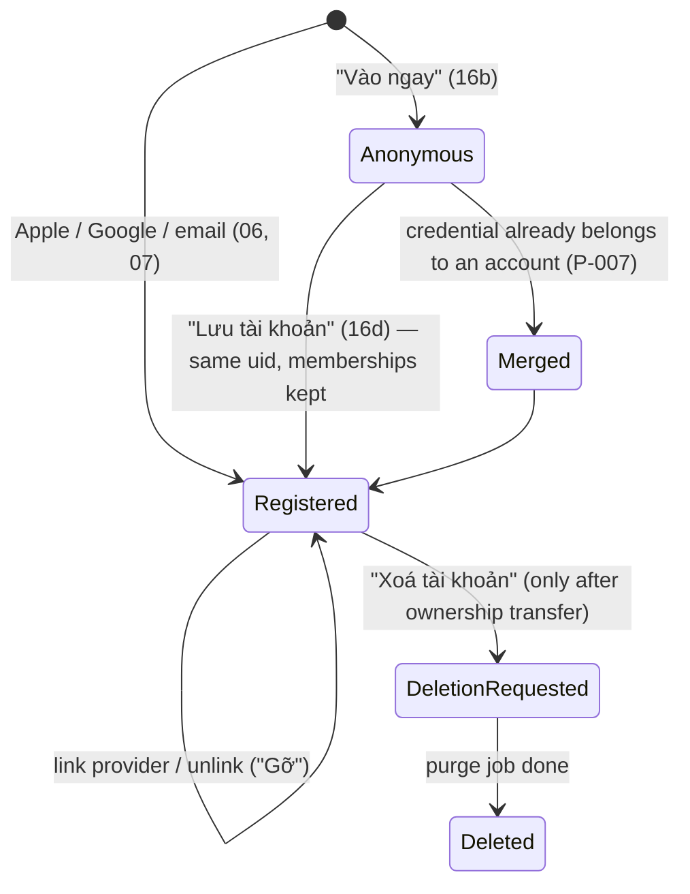
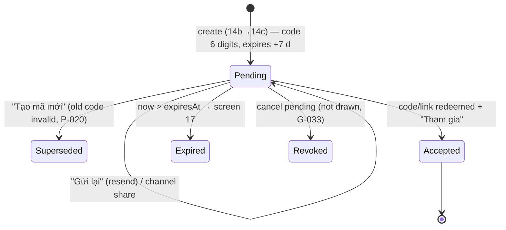
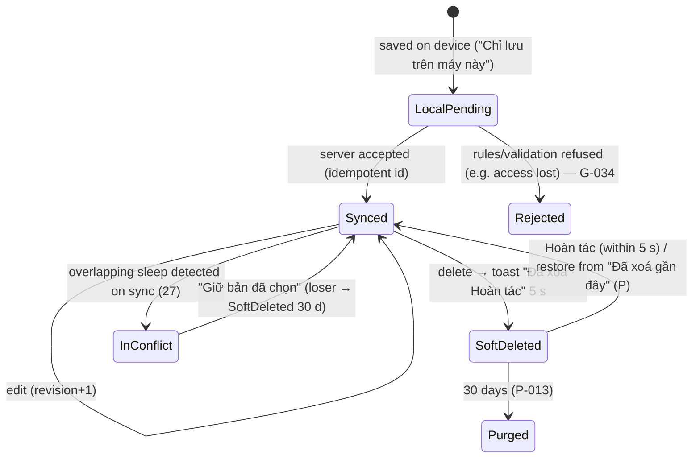
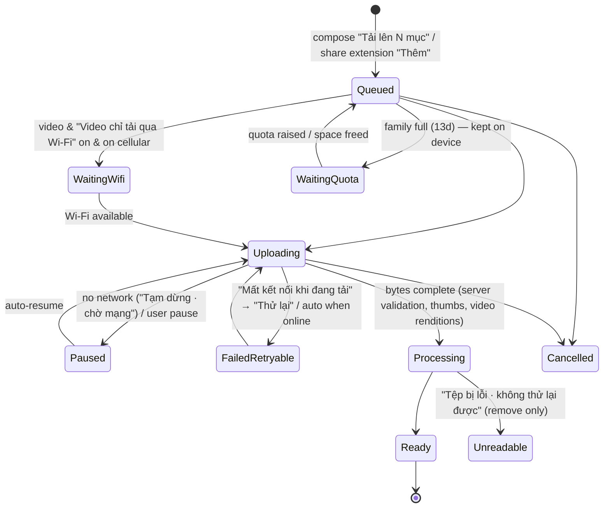
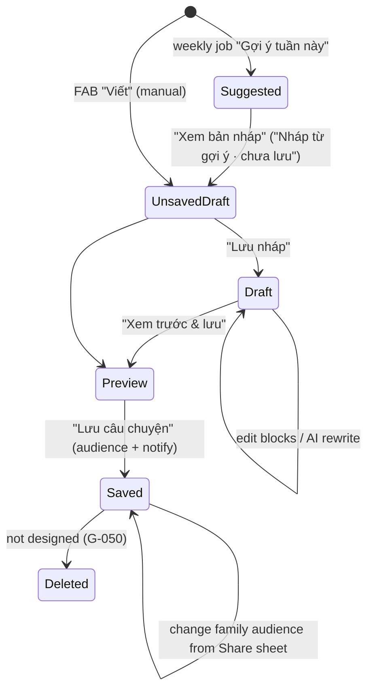
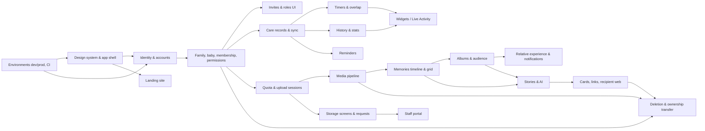

# Child Life V1 — Business Map

|                 |                                                                                                                                                                                                                           |
| --------------- | ------------------------------------------------------------------------------------------------------------------------------------------------------------------------------------------------------------------------- |
| Status          | Discovery output, **before** broad implementation. Nothing here is implemented yet.                                                                                                                                       |
| Scope authority | Final Figma file `sJLG1fAXKDnDr9YI6Yx8ex` (read-only). V1 = everything in Figma.                                                                                                                                          |
| Other sources   | Product plan site (Vision / V1 / Business rules / Development) — summary in [`../discovery/product-plan-site.md`](../discovery/product-plan-site.md); Engineering brief rev 2.0 (09 Oct 2026, PDF supplied by the owner). |
| Evidence        | Verbatim Figma extraction per section in [`../discovery/figma-extract/`](../discovery/figma-extract/). Node ids below (e.g. `46:2649`) point into those files and into Figma.                                             |
| Companion docs  | [`../development/implementation-plan.md`](../development/implementation-plan.md) · [`figma-coverage-checklist.md`](figma-coverage-checklist.md)                                                                           |
| Last updated    | 2026-10-10                                                                                                                                                                                                                |

## How to read this document

Every statement is tagged:

| Tag       | Meaning                                                                                                                                                                                                                           |
| --------- | --------------------------------------------------------------------------------------------------------------------------------------------------------------------------------------------------------------------------------- |
| **R-nnn** | **Confirmed design rule.** Stated in Figma (screen copy, frame annotation, or component description) — evidence node given. Implement as written.                                                                                 |
| **P-nnn** | **Engineering proposal.** Figma is silent or only implies it; this is how we intend to build it. Owner may override. Not a design decision.                                                                                       |
| **Q-nnn** | **Unresolved question.** Figma is contradictory or silent on something that changes privacy, business behaviour, cost or feasibility. Listed in §13 with impact, proposed default and the slice it blocks.                        |
| **G-nnn** | **Design gap (non-material).** A state Figma does not draw (loading, error, empty…). Engineering supplies it from existing components and copy tone; flagged for design review, never counted as "Figma-complete" until reviewed. |

Where the product plan site and Figma disagree, **Figma wins** (brief §01). Where two Figma frames disagree, the more specific screen wins over a component description or a copy-pasted annotation, and the conflict is listed.

## Owner decisions (2026-10-10)

| ID        | Decision                                                                                                                                                                                                                                                                                                                                                                                                                                                                                                                                                                                                                                                                                                                                                          | Resolves                | Consequence                                                                                                                                                                                                                                                                                                                              |
| --------- | ----------------------------------------------------------------------------------------------------------------------------------------------------------------------------------------------------------------------------------------------------------------------------------------------------------------------------------------------------------------------------------------------------------------------------------------------------------------------------------------------------------------------------------------------------------------------------------------------------------------------------------------------------------------------------------------------------------------------------------------------------------------- | ----------------------- | ---------------------------------------------------------------------------------------------------------------------------------------------------------------------------------------------------------------------------------------------------------------------------------------------------------------------------------------- |
| **D-001** | New photos, videos and notes are **shareable by default**: compose and the share extension preselect **"Gia đình"** exactly as the app screens show.                                                                                                                                                                                                                                                                                                                                                                                                                                                                                                                                                                                                              | Q-002                   | The landing line "Ảnh mới mặc định chỉ ba mẹ thấy" (`221:3437`) contradicts the app; it must not ship as written — owner to supply replacement copy before the landing goes to prod (Figma stays unmodified).                                                                                                                            |
| **D-002** | Albums **may widen** visibility (sharing is allowed). Audience is stored per item; an item's **effective audience is "Gia đình" if the item itself is Gia đình or it is in any Gia đình album** (most permissive wins). Setting an album to Gia đình shares all current and later items (`180:356`). Setting an album to Chỉ ba mẹ makes its items Chỉ ba mẹ, except items still in another Gia đình album (the sheet states how many). In compose, picking a Gia đình album switches "Ai thấy" to Gia đình on the same sheet so the copy "Ảnh vẫn theo quyền 'Ai thấy' bạn đã chọn" stays true. A story saved to Gia đình shows its photos to family readers, private ones included; the save sheet states the count. Caregivers never see Memories in any case. | Q-004                   | P-035 (implementation of effective audience)                                                                                                                                                                                                                                                                                             |
| **D-003** | AI story drafts use **OpenAI (ChatGPT API) first**, called **server-side only** behind a provider adapter so the model/provider can be swapped. Data sent follows the portal's AI settings (`261:807–826`, R-196): **no photos** — only the week's notes / captions, milestone names, dates and counts; **nickname, never the real name**; **provider must not retain data**; **≤ 3 drafts per baby per week**.                                                                                                                                                                                                                                                                                                                                                   | Q-003                   | Only text leaves Google Cloud for OpenAI → API key per environment in Secret Manager; no client calls; prod requires OpenAI zero-data-retention (or equivalent no-retention terms) confirmed before launch; cross-border transfer still in legal review Q-020. Figma itself marks these settings "cần đội kỹ thuật và pháp lý xác nhận". |
| **D-004** | **Android mimics the iOS designs**: widgets reproduce the iOS layouts and states; Live Activity / Dynamic Island are mirrored by an ongoing timer / upload notification with the same content and actions; Photos share extension → Android share target; Sign in with Apple via web flow.                                                                                                                                                                                                                                                                                                                                                                                                                                                                        | Q-010                   | P-070 approved. "Có Teddy" library filter has no Android API → hidden on Android (noted, not a new feature).                                                                                                                                                                                                                             |
| **D-005** | Firebase dev/prod projects, billing and accounts will be **set up by the owner later**.                                                                                                                                                                                                                                                                                                                                                                                                                                                                                                                                                                                                                                                                           | §2 blockers in the plan | Work that needs no hosted project (repo, design system, emulator-backed slices) can start; anything requiring deploys, real devices against dev Firebase, push, App Check or email stays blocked and is reported as such.                                                                                                                |

| **D-006** | Dev Firebase project is **`child-life-dev`**; domain **childlife.app**; dev uses subdomains (`dev.childlife.app`, `admin.dev.childlife.app`), prod uses `childlife.app`, `admin.childlife.app`. | §2 plan blockers | Host map in implementation plan §3.7. |
| **D-007** | The staff portal is designed in Figma (page **Admin portal** `253:18`, screens A01–A12, "Child Life · Vận hành"). | Q-001 | §7.15 rules and §5.1 staff matrix; extraction in `figma-extract/08-admin-portal.md`. |
| **D-008** | **No SSO for the portal** — staff sign in with **Firebase Authentication** (email + password accounts created by an admin; no self sign-up). | Q-033 | Overrides A01's "Dùng tài khoản công ty". A01's 2-step code is kept as Firebase TOTP multi-factor (P-125), plus the 30-min idle sign-out. |
| **D-009** | Region **asia-southeast1 (Singapore)** for Firestore, Storage, Functions, Tasks; dev project on the Blaze (pay-as-you-go) plan. | plan §2 | Location-bound resources may now be created in `child-life-dev`. |
| **D-010** | Storage-expansion requests offer **only +10 GB and +20 GB** — in the app and in the portal (no +5 GB, no "Khác" custom amount). | Q-035 | Mobile 13e drops the "Khác" chip; portal shows the requested amount; P-120 (team lead above 20 GB) only applies if staff grant more than requested. |
| **D-011** | Video limits come from **server configuration** (`config/limits`: max duration, max file size, Wi-Fi-only default), adjustable later without an app release; the portal's global limits (A10) display them. | Q-028 | Defaults: duration unlimited (as A10 shows), max file size 4 GB until SP-3 measures cost; client and server both enforce. |
| **D-012** | **App and web are multi-language: Vietnamese and English first.** Device / browser language decides, with an in-app override; Vietnamese is the fallback. | P-062 | Figma copy is the Vietnamese source; English is drafted by engineering and reviewed by the owner. All strings live in ARB (mobile) / ICU catalogs (web) — no hard-coded copy. Locale-aware formatting (vi: decimal comma, `d thg m`; en: decimal point, `d MMM`). Server-generated text (invite / storage emails, push, AI story drafts) uses the recipient's saved locale. The language picker (Tôi → Ngôn ngữ, OptionRow) is not drawn — G-081. Layouts must also tolerate English length. |
| **D-013** | **Screen transitions use each platform's default** (iOS push with swipe-back, Android default / predictive back), overriding the Motion spec's custom "Chuyển màn hình" pattern. | Motion spec 271:324 | Under Reduce Motion screens fade (spec: "Mờ dần 150ms, không trượt"). All other Motion spec patterns apply as designed (R-200). |
| **D-014** | Firebase Auth on `child-life-dev` runs on **Identity Platform** (upgraded 2026-10-10; prod follows when created). | S2 | Needed for staff TOTP (D-008) and auth blocking functions; free under 50k MAU on Blaze; not reversible. Email/password enabled with an 8-character minimum (R-002); email enumeration protection stays on. |
| **D-015** | **Email accounts may continue unverified** (P-008): onboarding and baby creation work right away; sending invites and external sharing require a verified email. | Q-017 | 08 offers "Bỏ qua"; verification is detected on return to the app until universal links exist (Apple team pending). |
| **D-016** | **"Tiếp tục với Apple" uses the design's custom button** (black pill, Button style `apple`), with the Apple logo in place of the placeholder mark — not Apple's stock button widget. | Button 8:33 note | Must still follow Apple's sign-in button guidelines (logo, label, contrast). |
| **D-017** | **Only the owner manages Cùng nuôi**: any Cùng nuôi invites and manages caregivers and relatives; inviting, changing or removing another Cùng nuôi is owner-only; the owner cannot be changed or removed. | Q-013 | Enforced in `createFamilyInvite`, `updateFamilyMember`, `removeFamilyMember` (reasons `owner-only`, `owner-protected`); 14b / 14f show the co-parent option as owner-only. Ownership transfer is a later slice. |
| **D-018** | **"Chăm sóc hằng ngày" gives a relative a read-only Hôm nay tab** (tiles, history, stats when they ship), with no "+" and no reminders. | Q-006 | Tabs: Hôm nay · Kỷ niệm · Gia đình · Tôi for a granted relative; the Rules for care records (S4) must allow reads for `extraRights.viewDailyCare`. |
| **D-019** | **Relative extra rights are both off by default** (least privilege); the inviter turns them on in 14b2 or later in 14f. | Q-021 | `defaultExtraRights` in contracts. |
| **D-020** | **Transactional email goes through AWS SES** (sender `hello@childlife.app`, region ap-southeast-1) behind a provider adapter. | R-034 | SES keys are Firebase secrets `SES_ACCESS_KEY_ID` / `SES_SECRET_ACCESS_KEY` set by the owner; until then mail waits in `mail/` with status `waiting-provider` and is retried every 15 min. Needs SPF / DKIM / DMARC on childlife.app and SES production access. |
| **D-021** | **"Không phải tôi" only exits**: the invite stays pending and nobody is notified; a temporary identity that never joined is signed out. | Q-024 | 16 → 01. |
| **D-022** | **Any Cùng nuôi edits or deletes any care record; a caregiver only their own**; relatives never log. | Q-012 | Enforced in Firestore Rules (`canEditRecord`); 21 hides "Sửa" / "Xóa bản ghi" when not allowed and shows 12e's "chỉ xem" note. |
| **D-023** | **Relative times use the full form in the app** ("45 phút trước", "1 giờ 25 phút trước"); the compact form ("1g 25p") only in widgets. | Q-029 | `core/format/relative_time.dart`. |
| **D-024** | **Attribution:** Mẹ / Ba / Bà / Ông read as the relation label ("Mẹ ghi"); Bảo mẫu, Họ hàng, Bạn bè and Khác read as the member's name ("Cô Lan ghi"); the current user reads "Bạn". | Q-030 | The author is snapshotted on each record (Rules check it against the writer's membership). |
| **D-025** | **Sleep from "+" starts the timer at once; long-press enters it by hand.** The Giấc ngủ tile opens the chooser (25a); while a sleep timer runs, both open it (25). | Q-022 | Follows the 19a annotation; 25a stays the tile path. |
| **D-026** | **Pumping is never baby intake**: not in "Đã ghi hôm nay" or feed stats, its own filter only; **no Live Activity for pumping** (not designed). | Q-025 | Pump timer (23c) still runs in the app and is shared with the family. |
| **D-027** | **A sleep that crosses midnight** shows its full span with the real start in the timeline ("21:42 hôm qua – 06:30"); day totals are clipped per day; **"Giấc dài nhất" is the full uninterrupted sleep, counted on the day it ended.** | Q-026 | `care_calc.dart` (`sleepDay`, `sleepStats`); the rhythm rows still split at midnight. |
| **D-028** | **"30 ngày" and the sleep "Hôm nay" view reuse the 7-day components** (30 rows / bars; one row for today). | Q-031 | Not drawn in Figma; same cards, same copy. |
| **D-029** | **Any member who sees a reminder can move its notification to their own device** from the "Thông báo" row in 8e (one device at a time). There is still never a push to every device (R-091). | Q-005 | Rules: `notifyDevice` may only name the writer's own device; the app reschedules or cancels on the next sync. |
| **D-030** | **Cùng nuôi can delete a reminder** ("Xoá nhắc việc" in the edit form, with a confirmation), and **tapping the check of a done reminder undoes it** — any Cùng nuôi, or the caregiver who marked it. | Q-018 | Engineering copy awaiting design review (G-061). |
| **D-031** | **"Báo trước" options: Đúng giờ · 10 phút · 30 phút · 1 giờ · 2 giờ · 1 ngày** (default 1 giờ). **Date and time use a wheel in the baby's time zone and cannot be in the past.** Any Cùng nuôi edits any reminder (as D-022 for records). | G-061 | Not drawn; same wheel as the care time picker. |
| **D-032** | **Overdue reminders only turn red in the app**: one notification at due time minus "Báo trước", no repeats. A change of the baby's time zone keeps the instant (P-014); a change of the device's time zone needs no reschedule. | flow C | Notifications are scheduled for the absolute instant. |
| **D-033** | **The batch notice does not wait for videos held for Wi-Fi**: the family hears once, when every item is done or when at least one is ready and the rest only wait for Wi-Fi on the uploader's device (P-030). | Q-019 | `batchReadyToNotify` in `packages/contracts/src/memories.ts`; the uploader marks Wi-Fi waits on the item. |
| **D-034** | **"Nhắn ba mẹ" is a one-way in-app message attached to the item** (memory, photo, album or story; "Nhắn Mẹ" from a parent's care record for caregivers). Parents get one generic notice and read messages under the item and in a "Lời nhắn" list under Tôi; no chat, no reply thread. | Q-007 | Engineering copy for the parent side awaiting design review. |
| **D-035** | **Relatives cannot hide items** (the stale layer name "Người thân chỉ ẩn…" is not built). | Q-014 | — |
| **D-036** | **Relatives may download photos and videos** (videos as stored until SP-3 renditions), single items and whole shared albums. | Q-015 | — |
| **D-037** | **Ownership transfer and account deletion** (adopting the Q-016 proposal): the owner offers the whole family (all its babies) to an active Cùng nuôi of every baby who owns no other family; the receiver accepts or declines in the app (the owner may cancel). An account that owns babies cannot be deleted. Deleting an account removes memberships, devices, favourites, loves, the profile and the sign-in; care records, memories and messages it wrote stay with the family, shown as “Người dùng đã xoá”. | Q-016 | Mobile 13n transfer sheet + offer card on Tôi; `offerFamilyOwnership` / `answerFamilyOwnership` / `deleteMyAccount` (job). |
| **D-038** | **Undrawn S11 entry points** (adopting the Q-037 proposal for S11): “Xuất dữ liệu” lives in 13n (care for Cùng nuôi, photos and videos for the owner, R-187); “Trợ giúp & liên hệ” is an in-app form with a topic, a message and diagnostics only with consent; while a profile is being deleted every member sees a “đang được xoá” banner and writes are refused (Rules). All flagged for design review (G-072, G-073, G-077). | Q-037 | AI-draft reporting stays with S12. |
| **D-039** | **Remote sign-out and the device list** (13n): each install keeps one row (model name, platform, last active; no city — no IP location is collected). “Đăng xuất” on another device flags its row; that install signs itself out and removes the row when it next connects. Refresh tokens are not revoked (that would sign out every device). | — | Engineering decision on 13n; recorded for review. |
| **D-040** | **People are shown by their initial in V1**: 13m “Đổi ảnh” (user photo) is not built; baby photos are unaffected. | — | Engineering decision; revisit with design (G-078). |
| **D-041** | **Stories as built** (adopting P-090, P-091, P-092 and the Q-036 proposal): the weekly suggestion needs ≥ 5 new items, at most 3 per baby per week, is written from text only (captions, notes, milestone, dates, counts, nickname, relation labels) with ≤ 9 photos attached by the server; model output is checked so every number and name comes from the sources, otherwise a plain template draft is used; drafts are private to their writer (suggestions to every parent until one takes it); any Cùng nuôi edits a saved story; the first save to Gia đình sends one notice, later saves never; photos shown in a saved Gia đình story are seen by the family (D-002); deleting a story keeps its photos (G-050). Until the owner sets `OPENAI_API_KEY`, drafts use the template and paragraph rewrites say “AI chưa sẵn sàng”. | Q-036, P-090–P-092 | Feature flag `ai_story_drafts` gates the weekly job. |
| **D-042** | **External sharing as built** (adopting P-095 and P-096, filling 14k–14m gaps): a private link is created on “Sao chép & chia sẻ” (no unused links) with a 16-character random token and a nickname slug; its options cannot be changed afterwards (create a new one). The page `/s/{token}` is a live projection at view time: title, paragraphs and only photos the family can see that are still there — never Chỉ ba mẹ or deleted items; nickname and age, the sharer's given name; the birth date only when “Ẩn tên thật & ngày sinh” is off. The 4-digit passcode is shown once to copy; 5 wrong tries lock an address for 15 minutes. Revoked and unknown links show the same page; expired ones say so. Images are served by the same function (no signed URLs); downloads only when allowed, and the copy never promises screenshots are blocked (R-166). Cards are made on the phone (1080 × 1350, Lora / Dancing Script, only family-visible photos) and listed as irrevocable. | P-095, P-096 | 14m revoke asks first (not drawn). |
| **D-043** | **Portal sign-in is email + password or an email magic link — no TOTP / 2-step code** (owner, 2026-10-10). Staff accounts are still created only by an admin script with the `staff` claim and roles; the portal rejects anyone without the claim; 30-minute idle sign-out stays. No Identity Platform upgrade. | Q-033 | Replaces the TOTP part of D-008 and P-125; A01's code boxes are not built. |

Still open and material: see §13 (notably Q-037 user-facing export / support / report entry points that the mobile Figma does not draw).

---

## 1. Product scope (V1 = whole Figma)

| Area                  | Figma sections                       | What it is                                                                                                                                                                                                                                                                                                                                                                                                                                      |
| --------------------- | ------------------------------------ | ----------------------------------------------------------------------------------------------------------------------------------------------------------------------------------------------------------------------------------------------------------------------------------------------------------------------------------------------------------------------------------------------------------------------------------------------- |
| Onboarding & identity | 1, 2, 3                              | Splash, welcome + 4-step tour, sign-in (Apple / Google / email), email verification, password reset, account linking, "who are you to the baby", baby profile, trackers, appearance & Night care schedule.                                                                                                                                                                                                                                      |
| Family & roles        | 4, 4b, 7, 12                         | Family tab, invite (relation + role + extra rights) via QR / link / email with 6-digit code, accept / join-now-save-later, member role change / expiry / removal, multiple babies (≤3 created), role-specific UI (parent, caregiver, relative).                                                                                                                                                                                                 |
| Daily care            | 5, 9                                 | Today dashboard, quick log, bottle / breast / pump / sleep / diaper / growth, timers, overlapping-sleep resolver, record detail, edit / delete / undo, history with filters, date picker, feeding & sleep statistics, offline pending sync, lost access.                                                                                                                                                                                        |
| Reminders             | 8                                    | Per-baby reminders, local notification on creating device, permission prompt after first save.                                                                                                                                                                                                                                                                                                                                                  |
| Widgets & lock screen | 6                                    | Home-screen widgets S/M/L, lock-screen accessories, Live Activity, Dynamic Island, one-tap logging with ~5 s undo (iOS 17 App Intents).                                                                                                                                                                                                                                                                                                         |
| Memories              | 10, 11                               | Journal timeline, photo grid, multi-select batch actions, delete with 30-day recovery, view modes, albums (incl. automatic per-user Favorites), album options, viewer, add via camera / library / files / note, compose (date, milestone, album, audience, notify), upload queue, background upload, share extension, sharing private items; relative's view.                                                                                   |
| Profile & storage     | 13                                   | Me tab per role, 10 GB family storage with breakdown, near-full / full, contact admin, baby profiles (view / edit / delete), user profile, account & sign-in & devices, delete-account precondition.                                                                                                                                                                                                                                            |
| Stories               | 14, 11i                              | Weekly AI-drafted story, editor (blocks, AI rewrite actions), preview & save with audience, saved story, family reading & reactions, share: photo card (5 templates), private web link (expiry, passcode, download), recipient web page, link management & revoke.                                                                                                                                                                              |
| Website               | Website page                         | Marketing landing page (desktop + mobile).                                                                                                                                                                                                                                                                                                                                                                                                      |
| Admin portal          | Admin portal page `253:18` (A01–A12) | Staff console "Child Life · Vận hành": Firebase sign-in + 2-step code (D-008), overview KPIs & alerts, support inbox with consented diagnostics, storage-expansion approvals, data-request jobs (exports, deletions, re-run), system health for storage/media and AI suggestions (budget, safety settings), feature flags & staged rollout with kill switches, append-only audit log. Staff never see photos, videos, captions or care records. |
| Design system         | Foundations, Components, Logo        | Tokens (Light + Night care), Be Vietnam Pro type scale, spacing / radius / shadow, ~80 components, illustrations, official "Khoảnh khắc" logo + app icons. No motion values (P-060).                                                                                                                                                                                                                                                            |

Motion is specified on the Figma page **Motion spec** (`269:19`, extract [`10-motion-spec.md`](../discovery/figma-extract/10-motion-spec.md)): tokens instant 100 ms / quick 200 ms / standard ~350 ms spring / exit 250 ms / gentle 600 ms, press scale 0.96 (photos 0.98), scrim 0 → 32 %, stagger 30 ms ≤ 6 items, Night care without bounce or flashes, Reduce Motion fades, haptics light on tap / success on save / warning before delete (none at night except success) — **R-200**.

Product principles stated on the Figma cover (`17:492`) and enforced throughout: latest state first; one tap to start, ≤3 taps to save; few, exact words; calm, no judgement (no streaks, scores, guilt warnings); intentional sharing (audience always visible before posting). Primary design target: "Một tay, lúc 3 giờ sáng, có làm được trong 10 giây không?"

---

## 2. Actors and identity

| Actor                                        | Description                                                                                                                                                                                                                                                                                                                              | Evidence          |
| -------------------------------------------- | ---------------------------------------------------------------------------------------------------------------------------------------------------------------------------------------------------------------------------------------------------------------------------------------------------------------------------------------- | ----------------- |
| **Account**                                  | One person. Providers: Apple, Google, email + password (≥8 chars). Email verification and password reset by **link**. One account may link several providers.                                                                                                                                                                            | R-001…R-005       |
| **Temporary identity**                       | Created when an invitee taps **"Vào ngay"** (join without account). Holds real membership. Upgraded by "Lưu tài khoản" without losing memberships or records.                                                                                                                                                                            | R-030, R-031      |
| **Member (per baby)**                        | An account's membership on one baby: role + relationship label (+ extra rights for relatives, + optional access end date). The same person can hold different roles on different babies.                                                                                                                                                 | R-020, R-021      |
| **Profile owner ("chủ hồ sơ")**              | The account that created the baby profile. Only the owner can delete the baby; ownership must be transferred before account deletion.                                                                                                                                                                                                    | R-045, R-046      |
| **External recipient**                       | Anyone with a private story link. No account, no membership; sees only the approved projection of one saved story.                                                                                                                                                                                                                       | R-160…R-168       |
| **Child Life staff ("Quản trị Child Life")** | Uses the admin portal (Firebase Auth email/password + TOTP, D-008). Roles **Vận hành** (operations: storage approvals, rollout), **Hỗ trợ** (support tickets), **Kỹ thuật** (engineering: kill switches, data-job re-runs), **trưởng nhóm** (team lead: storage grants over 20 GB). Sees masked emails and anonymised family codes only. | R-180…R-199, §5.1 |

### 2.1 Roles (per baby)

| Role                                       | Figma subtitle                                                      | Summary                                                                                                                                                                                                                                            |
| ------------------------------------------ | ------------------------------------------------------------------- | -------------------------------------------------------------------------------------------------------------------------------------------------------------------------------------------------------------------------------------------------- |
| **Cùng nuôi** (co-parent; "ba mẹ" in copy) | "Toàn quyền, như ba mẹ" (`116:11916`)                               | Manages care, profile, memories, stories, members, sharing.                                                                                                                                                                                        |
| **Người chăm sóc** (caregiver)             | "Ghi & xem chăm sóc, không mời người" (`118:12056`)                 | Logs and views care of assigned baby; views reminders and marks done; edits only own records; no Memories, no full profile, no invites / permissions / storage.                                                                                    |
| **Người thân** (relative)                  | "Xem kỷ niệm, chọn thêm quyền xem" / "Chỉ xem kỷ niệm được chia sẻ" | Sees "Gia đình" memories, shared albums and stories; loves, private favourites, download, message parents. Optional extra view rights: **Thông tin bé** (DOB, weight) and **Chăm sóc hằng ngày** (feeds, sleep, diapers, view only) (`121:11672`). |

**R-020** Relationship label is independent of role: e.g. "Bà · Người chăm sóc", "Bảo mẫu · Người chăm sóc", "Bà · Người thân" (`116:11916`, `192:1438`). Labels: self — Mẹ, Ba, Bà, Ông, Bảo mẫu, Họ hàng, Khác… (`115:11756`); invitee — Ba, Bà, Ông, Bảo mẫu, Họ hàng, Bạn bè, Khác… (`116:11916`).
**R-021** Role is per baby: "Bạn là Mẹ" for Teddy and Na, "Bạn là Người chăm sóc" for Bin (`125:13223`).
**R-022** Records are attributed as "<label> ghi" ("Mẹ ghi", "Ba ghi", "Cô Lan ghi"); the current user is rendered "Bạn" in widgets and "(bạn)" in detail (`115:11756`, `46:2649`, `81:551`). "Gia đình thấy tên và vai trò này khi bạn ghi chép hay chia sẻ." (`199:501`). Q-030 covers label-vs-name.

---

## 3. Entities

Status: **C** = fields confirmed by Figma; **P** = proposed by engineering; **C+P** = core confirmed, details proposed.

| Entity                         | Purpose                                                                                                   | Key fields                                                                                                                                                                                                                                                                 | Scope / owner          | Status               |
| ------------------------------ | --------------------------------------------------------------------------------------------------------- | -------------------------------------------------------------------------------------------------------------------------------------------------------------------------------------------------------------------------------------------------------------------------- | ---------------------- | -------------------- |
| `User`                         | Account                                                                                                   | uid, displayName ("Tên hiển thị"), avatar, email, emailVerified, providers[], isAnonymous, createdAt, deletion state                                                                                                                                                       | self                   | C+P                  |
| `Device` / session             | "Thiết bị đang đăng nhập"                                                                                 | deviceId, name ("iPhone 15 của Mai"), city, lastActiveAt, isCurrent, push tokens (FCM, APNs Live Activity)                                                                                                                                                                 | user                   | C+P                  |
| `DevicePrefs`                  | Appearance                                                                                                | theme {Sáng, Tối, Tự động}, nightCare {enabled, start, end (5-min steps)}, notification toggle                                                                                                                                                                             | **per device** (P-061) | C+P                  |
| `Family`                       | Ownership + 10 GB quota container                                                                         | familyId, ownerUid, quotaBytes (10 GB default; staff can raise), usedBytes, reservedBytes, babyIds[]                                                                                                                                                                       | owner                  | P-001                |
| `Baby`                         | Child profile                                                                                             | babyId, familyId, ownerUid, nickname ("Tên thân mật"), dateOfBirth (≤ today), gender {Bé gái, Bé trai, Không nêu} optional, timezone (auto from device or manual), avatar {photo \| preset 1–4}, trackers ⊆ {bottle, breast, sleep, diaper, pump, growth}, state           | family                 | C                    |
| `Membership`                   | Person ↔ baby                                                                                             | uid, babyId, role, relationLabel (+ custom text for "Khác…"), extraRights {viewBabyInfo, viewDailyCare} (relatives), accessUntil?, joinedAt, invitedBy, status {active, removed, expired}, recordCount (derived)                                                           | baby                   | C                    |
| `Invite`                       | Pending membership                                                                                        | inviteId, babyId, inviterUid, relationLabel, role, extraRights, code (6 digits), linkToken, recipientEmail?, channels used, createdAt, expiresAt (+7 d), status {pending, accepted, expired, revoked, superseded}, resendCount                                             | baby                   | C+P                  |
| `CareRecord`                   | One logged event / span                                                                                   | recordId (client-generated), babyId, type, occurredAt / startedAt, endedAt?, payload (per type), note?, createdBy, createdAt ("Ghi lúc"), updatedAt, revision, source {app, widget, liveActivity, timer, manual, shareExt}, deletedAt?, babyTzAtWrite                      | baby                   | C+P                  |
| `ActiveTimer`                  | Running sleep / breast / pump session shared to family                                                    | babyId, type, startedAt (editable), startedBy, state {running, paused}, sides & per-side accumulated time, pausedAt?, localOnly flag                                                                                                                                       | baby (one per type)    | C+P                  |
| `SleepConflict`                | Two overlapping sleeps detected on sync                                                                   | babyId, recordIds[2], detectedAt, surfacedTo, resolution {kept, editedFrom}, resolvedBy                                                                                                                                                                                    | baby                   | C+P                  |
| `DaySummary`                   | Derived per-day totals for Today, history, stats, widgets                                                 | babyId, localDate (baby tz), bottle {count, ml}, breast {count, min, left, right}, sleep {finishedMin, segments, longest}, diaper {total, wet, dirty}, pump {count, ml}, lastEvents                                                                                        | baby                   | P-012                |
| `Reminder`                     | Shared to-do with due time                                                                                | reminderId, babyId, title ("Việc cần nhớ"), dueAt + baby timezone, leadTime ("Báo trước"), createdBy, createdAt, notifyDevice {deviceId, name}, status {upcoming, overdue (derived), done}, doneBy, doneAt                                                                 | baby                   | C                    |
| `Memory` (journal entry)       | One compose action: caption + milestone + media                                                           | memoryId, babyId, createdBy, date mode {per capture date \| one date}, caption?, milestoneId?, audience, albumIds[], reactions (derived), state {draft, uploading, published, partially_failed, deleted}                                                                   | baby                   | C+P                  |
| `MediaItem`                    | One photo / video                                                                                         | mediaId, babyId, memoryId, type, captureAt, audience (item-level; effective audience per D-002), sizeBytes, duration, dimensions, storage paths (original, display, thumb, poster, video renditions), processing state, deletedAt?                                         | baby                   | C+P                  |
| `Note`                         | Text-only memory ("Viết ghi chú")                                                                         | as Memory with no media                                                                                                                                                                                                                                                    | baby                   | C                    |
| `Milestone`                    | "Mốc"                                                                                                     | milestoneId, babyId, name, date, kind {preset (age-based), custom (family-created)}                                                                                                                                                                                        | baby                   | C                    |
| `Album`                        | Organises media; carries an audience                                                                      | albumId, babyId, name, coverMediaId, audience {Chỉ ba mẹ, Gia đình}, sort {Mới nhất, Cũ nhất, Mới thêm vào album}, itemIds (with addedAt), notifyOnChange                                                                                                                  | baby                   | C                    |
| `Favorite`                     | Per-user bookmark ("Yêu thích")                                                                           | uid, mediaId, createdAt — private per user; drives automatic "Yêu thích" album ("Chỉ mình bạn")                                                                                                                                                                            | user × baby            | C                    |
| `Reaction` ("Thương")          | Love on media / memory / album / story                                                                    | uid, targetType, targetId, createdAt — counts visible to family, names visible to parents                                                                                                                                                                                  | baby                   | C                    |
| `ParentMessage` ("Nhắn ba mẹ") | Relative → parents note on a memory / story; caregiver → parent "Nhắn Mẹ"                                 | senderUid, babyId, context ref, text, recipients, readAt                                                                                                                                                                                                                   | baby                   | C (composer) + Q-007 |
| `UploadBatch` / `UploadItem`   | Device-side queue mirrored to server session                                                              | batchId, items[] {file ref, bytes sent / total, state}, Wi-Fi-only flag for video, notifyFamily, reservation id                                                                                                                                                            | device + baby          | C+P                  |
| `QuotaReservation`             | Transactional reservation of bytes before upload                                                          | familyId, batchId/itemId, bytes, expiresAt, state {reserved, committed, released}                                                                                                                                                                                          | family                 | P-031                |
| `Story`                        | Growth story / letter                                                                                     | storyId, babyId, kind {story, letter}, origin {aiSuggestion, manual}, status {draft, saved}, title, subtitle?, coverMediaId, blocks[], audience, notifyFamily, author, dateRange, sourceMediaIds[], milestoneRefs[], revision, savedAt, updatedAt                          | baby                   | C+P                  |
| `StoryBlock`                   | Ordered content                                                                                           | type {cover, title, paragraph, photoGroup (≤4 photos + captions), milestone, quote}, text, aiGenerated / editedByUser ("Đã sửa · không còn là văn AI")                                                                                                                     | story                  | C                    |
| `StoryDraftJob`                | Weekly AI suggestion                                                                                      | babyId, week, sourceMediaIds, milestone, state {queued, generating, ready, failed, dismissed}, model, cost, per-paragraph alternatives                                                                                                                                     | baby                   | P-090                |
| `StoryCardExport`              | "Thiệp ảnh đã lưu"                                                                                        | storyId, template {Một khoảnh khắc, Ba khung, Bốn góc, Lá thư, Đêm dịu}, quote, photo(s), showAgeInsteadOfDob (default on), 1080×1350, exportedAt — irrevocable                                                                                                            | story                  | C                    |
| `ShareLink`                    | "Liên kết xem riêng"                                                                                      | linkId, token, slug, storyId, createdBy, expiry {24 h, 7 d, 30 d}, expiresAt, hideRealNameAndDob (default on), allowDownload (default off), passcode (4 digits, optional, hashed), viewCount, status {active, expired, revoked}, revokedAt                                 | story                  | C+P                  |
| `StorageRequest`               | "Xin thêm dung lượng"                                                                                     | familyId, requesterUid, amount {+10 GB, +20 GB} (D-010), message?, attached email + usage snapshot, status {open, granted, declined}, staff reply, grantedBytes                                                                                                            | family                 | C+P                  |
| `Notification`                 | Push / in-app                                                                                             | type {familyNewMoments(count, sharerName), familyNewStory, invite, …}, no media, no baby name in lock-screen copy                                                                                                                                                          | user                   | C+P                  |
| `DeletionJob`                  | Baby / account / media purge                                                                              | target, requestedBy, steps[], cursor, state {queued, running, failed, done}                                                                                                                                                                                                | system                 | P-110                |
| `AuditEvent`                   | Sensitive actions (role change, removal, ownership transfer, link create/revoke, staff actions, deletion) | actor, action, category {Hỗ trợ, Dung lượng, Dữ liệu, Tính năng}, target id, **reason** (required), before/after, at — append-only, kept ≥ 2 years                                                                                                                         | system                 | C (portal) + P-111   |
| `StaffUser`                    | Portal operator                                                                                           | Firebase Auth email (admin-created, D-008), roles ⊆ {Vận hành, Hỗ trợ, Kỹ thuật, trưởng nhóm}, TOTP enrolled, session (30 min idle timeout)                                                                                                                                | system                 | C+P                  |
| `SupportTicket`                | "Trợ giúp & liên hệ" request                                                                              | id `CL-####`, category {Kỷ niệm & media, Gia đình & vai trò, Lời mời, Đồng bộ, Tài khoản, Dung lượng, Câu chuyện}, masked requester, message, status {Chưa nhận, Đang xử lý, Chờ người dùng, Đã đóng}, assignee, replies (templates), consented `DiagnosticsSnapshot`      | user                   | C (portal) + G-057   |
| `DiagnosticsSnapshot`          | Sent only with user consent                                                                               | platform, app version, device model, recent upload/sync event summaries, last sync, role, family composition counts, storage used/quota — no child content                                                                                                                 | user                   | C                    |
| `DataJob`                      | Export / deletion pipeline                                                                                | id `DJ-####`, type {export_care (CSV \| JSON), export_media (ZIP, owner only), delete_baby, delete_account}, scope, steps[] with state, progress, failure step + cause, status {Đang chuẩn bị, Sẵn sàng, Hết hạn, Đang xoá, Thất bại, Hoàn tất}, download link expiry 24 h | family / user          | C                    |
| `FeatureFlag`                  | Kill switch + staged rollout                                                                              | key {media_upload, video_upload, ai_story_drafts, story_share_link, invites, lock_widgets, night_auto}, enabled, scope {internal, 10/25/50/100% of families}, guard metrics, optional in-app notice, lastEditedBy                                                          | system                 | C                    |
| `AiBudget` / `AiDraftStats`    | AI cost & safety                                                                                          | monthly budget (VND), spent, alert 80%, auto-pause 100%, cost per draft, outcomes {edited+saved, saved as-is, ignored, deleted}, content reports, error rate                                                                                                               | system                 | C                    |
| `OpsAlert`                     | "Cần xử lý"                                                                                               | severity, source, text, deep link                                                                                                                                                                                                                                          | system                 | C                    |

---

## 4. Family, ownership and quota model

Confirmed facts:

- **R-040** 10 GB per family: "Mỗi gia đình có 10 GB. Liên hệ quản trị Child Life để mở rộng." (`194:164`).
- **R-041** Shared by all the owner's babies and counts every parent's uploads: "Dùng chung cho tất cả các bé của bạn" (`194:78`); "Dùng chung cho tất cả các bé · ảnh ba và mẹ tải lên đều tính vào đây" (`194:164`); per-baby "Tính vào 10 GB của bạn" (`199:168`).
- **R-042** Breakdown by baby (photo / video counts, size) and by type (Video — "Xem video lớn nhất", Ảnh, Câu chuyện & ghi chú) (`194:164`).
- **R-043** Each account can create at most 3 baby profiles: "Mỗi tài khoản tạo được tối đa 3 hồ sơ bé." with counter "Thêm bé · 2/3"; babies where you are only a member do not count (`199:83`, `125:13223`).
- **R-044** "Mẹ · chủ hồ sơ của Teddy, Na" — one owner for several babies (`194:78`).
- **R-045** Only the owner deletes a baby: "Chỉ chủ hồ sơ (Mai) làm được" (`199:168`).
- **R-046** Account deletion requires transferring ownership: "Cần chuyển chủ hồ sơ của Teddy, Na cho Minh trước" (`199:602`).

**P-001 (proposal, confirm with owner).** A `Family` is created the first time an account creates a baby; that account is the family **owner** and the **chủ hồ sơ** of every baby in it. Every later baby the same account creates joins the same family (max 3). The 10 GB quota belongs to the family; every upload for any of its babies, by any member, is charged to it. Ownership transfer moves the whole family to another active **Cùng nuôi** member of all its babies (13n example: Teddy and Na → Minh). A co-parent who is not an owner and creates a baby creates **their own** family (own 10 GB, own 3-baby limit) — Figma shows no other path. Q-011 asks the owner to confirm the co-parent case.

**P-002** Membership is per baby (R-021); an invite is per baby ("Mời người cùng chăm Teddy"). Inviting the same person to two babies creates two memberships. The Family tab lists members of the **selected baby** ("Những người cùng chăm Teddy", `116:11226`).

**P-003** Owner powers beyond Cùng nuôi: delete baby, transfer ownership, delete family. Storage view and "Liên hệ quản trị" are available to every Cùng nuôi of a baby in the family (13b/13e drawn for the owner; non-owner co-parent view not drawn — G-040).

---

## 5. Permission matrix

Legend: ✅ allowed · ❌ not allowed · 👁 view only · ⚙ only if parent granted at invite / later · **(P)** proposal where Figma is silent. All checks are enforced server-side (Firestore / Storage Rules + Functions); UI hiding is cosmetic (brief §05).

| Capability                                                   | Cùng nuôi                                      | Owner extra    | Người chăm sóc                              | Người thân                                  | Evidence                                                                |
| ------------------------------------------------------------ | ---------------------------------------------- | -------------- | ------------------------------------------- | ------------------------------------------- | ----------------------------------------------------------------------- |
| Tabs                                                         | Hôm nay · Kỷ niệm · Gia đình · Tôi + "+"       | —              | Hôm nay · Gia đình · Tôi + "+"              | Kỷ niệm · Gia đình · Tôi (lands on Kỷ niệm) | NavBar `44:362`, `124:13717`, `124:13778`                               |
| Log care (6 types, timers)                                   | ✅                                             |                | ✅                                          | ❌                                          | `192:19`, `192:365`                                                     |
| View Today / history / stats                                 | ✅                                             |                | ✅ assigned baby                            | ⚙ viewDailyCare (👁)                         | `192:19`, `121:11672`                                                   |
| Edit / delete own care records                               | ✅                                             |                | ✅                                          | ❌                                          | `192:19` "Chỉ bản ghi do chính mình tạo"                                |
| Edit / delete others' care records                           | ✅ **(P-004)**                                 |                | ❌ "Bản ghi của ba mẹ: chỉ xem" + "Nhắn Mẹ" | ❌                                          | `192:32463`; `46:2649` "Chỉ người ghi hoặc chủ sở hữu được sửa" → Q-012 |
| Resolve sleep overlap                                        | ✅                                             |                | ✅ own version (P)                          | ❌                                          | `47:3145`                                                               |
| Reminders: view                                              | ✅                                             |                | ✅                                          | ❌ **(P)** unless viewDailyCare             | `127:13602`, `192:1327`                                                 |
| Reminders: create / edit                                     | ✅                                             |                | ❌ "Ba mẹ tạo nhắc việc"                    | ❌                                          | `192:1436`                                                              |
| Reminders: mark done                                         | ✅                                             |                | ✅                                          | ❌                                          | `192:1436`                                                              |
| Baby info: DOB, weight, full profile                         | ✅                                             |                | ❌                                          | ⚙ viewBabyInfo; nickname only by default    | `192:19`, `199:292`, `121:11672`                                        |
| Baby avatar photo                                            | ✅                                             |                | ✅ ("chỉ người trong gia đình")             | ✅                                          | `41:1861`                                                               |
| Edit baby profile                                            | ✅ **(P)**                                     |                | ❌                                          | ❌                                          | `199:292` (drawn for owner)                                             |
| Delete baby                                                  | ❌                                             | ✅             | ❌                                          | ❌                                          | `199:168`                                                               |
| Create baby                                                  | ✅ (≤3 own)                                    |                | ✅ (own family, ≤3) **(P)**                 | ✅ (own family) **(P)**                     | `199:83`                                                                |
| Family list                                                  | ✅ manage                                      |                | 👁 (no pending invites)                      | 👁 **(P, not drawn)**                        | `192:1438`, G-030                                                       |
| Invite / resend / regenerate code                            | ✅                                             |                | ❌                                          | ❌                                          | `116:11226`, `192:19`                                                   |
| Change role / relation / access end date; remove member      | ✅ **(P: any Cùng nuôi; cannot remove owner)** | ✅             | ❌                                          | ❌                                          | `118:12056`, Q-013                                                      |
| Leave family                                                 | ✅ (not owner without transfer) **(P)**        | transfer first | ✅ "Rời khỏi gia đình này"                  | ✅ **(P)**                                  | `192:1460`, G-031                                                       |
| Memories tab                                                 | ✅ both audiences                              |                | ❌ never (even after sharing)               | ✅ "Gia đình" audience only                 | `192:19`, `158:21457`, `188:835`                                        |
| Add memories (camera, library, files, note, share extension) | ✅                                             |                | ❌ (Q-008: landing claims caregiver upload) | ❌                                          | `188:835` "Không thêm, sửa, xoá hay đổi 'Ai thấy'"                      |
| Change audience ("Ai thấy") of item / album                  | ✅                                             |                | ❌                                          | ❌                                          | `188:835`                                                               |
| Delete memory items                                          | ✅ "Chỉ ba mẹ mới xoá được."                   |                | ❌                                          | ❌ (hide for self — Q-014)                  | `171:23114`                                                             |
| Albums: create / rename / cover / sort / select / delete     | ✅                                             |                | ❌                                          | ❌ (sees shared albums; Love + Download)    | `179:18`, `188:472`                                                     |
| Favourite ("Yêu thích")                                      | ✅ private to self                             |                | ❌                                          | ✅ private to self                          | `177:425`, `187:30126`                                                  |
| Love ("Thương")                                              | ✅                                             |                | ❌                                          | ✅                                          | `188:835`                                                               |
| Download photos                                              | ✅                                             |                | ❌                                          | ✅ (videos: Q-015)                          | `188:835`                                                               |
| Message parents ("Nhắn")                                     | n/a                                            |                | ✅ "Nhắn Mẹ" from a parent's record         | ✅ "Nhắn ba mẹ"                             | `192:1321`, `208:36394`, Q-007                                          |
| Stories: create / edit / save                                | ✅                                             |                | ❌                                          | ❌                                          | `204:84`                                                                |
| Stories: read                                                | ✅                                             |                | ❌                                          | ✅ if audience Gia đình                     | `208:36344`                                                             |
| External share (card, private link)                          | ✅ "Chỉ ba mẹ thấy mục 'Ra ngoài'"             |                | ❌                                          | ❌                                          | `208:56`                                                                |
| Manage / revoke links                                        | ✅ (P: any Cùng nuôi, not only creator)        |                | ❌                                          | ❌                                          | `208:36267`                                                             |
| Storage view / contact admin                                 | ✅ (P-003)                                     |                | ❌                                          | ❌                                          | `197:286`, `197:391`                                                    |
| Account & sign-in, devices, sign out                         | ✅                                             |                | ✅                                          | ✅                                          | `199:602`                                                               |
| Delete own account                                           | ✅ after ownership transfer                    |                | ✅ **(P)**                                  | ✅ **(P)**                                  | `199:602`, Q-016                                                        |

Additional confirmed rules:

- **R-023** Removing a member keeps their records: "Bản ghi của Cô Lan vẫn được giữ." (`118:12056`).
- **R-024** Membership can be time-limited: "Thời hạn · Đến 31 tháng 12, 2026" (`118:12056`). **P-005** a scheduled job expires memberships at `accessUntil` (baby timezone, end of day) and Rules reject access after it.
- **R-025** Lost access hides local content: "Bạn không còn quyền xem hồ sơ này" / "Quyền của bạn đã thay đổi. Nội dung trên máy này đã được ẩn." + "Về trang chính" / "Xin lời mời mới" (`127:15135`). **P-006** the device purges cached data for that baby (Firestore cache cleared for the baby's queries, media cache deleted, widgets reset) and drops unsynced pending writes for that baby after showing the user what was lost (G-032).
- **R-026** Caregiver role note copy: "Bạn sửa được bản ghi của mình. Bản ghi của ba mẹ chỉ xem." (`192:618`).

### 5.1 Staff (admin portal) matrix

| Action                                                                              | Vận hành                         | Hỗ trợ | Kỹ thuật | trưởng nhóm           | Evidence                                      |
| ----------------------------------------------------------------------------------- | -------------------------------- | ------ | -------- | --------------------- | --------------------------------------------- |
| View aggregate dashboards (A02, A08, A09)                                           | ✅                               | ✅ (P) | ✅ (P)   | ✅                    | `254:232` "Số liệu gộp toàn hệ thống"         |
| Support tickets: claim, reply (templates), retry video processing, send Wi-Fi guide | ✅ (sidebar "Vận hành · Hỗ trợ") | ✅     | ❌ (P)   | ✅                    | A03, A12                                      |
| Approve / decline storage ≤ 20 GB (reason required)                                 | ✅                               | ❌ (P) | ❌ (P)   | ✅                    | A05, A12                                      |
| Approve storage > 20 GB / custom                                                    | ❌                               | ❌     | ❌       | ✅ (P-120: role gate) | `256:553` "Trên 20 GB cần trưởng nhóm duyệt"  |
| View data jobs; re-run failed deletion step (reason)                                | 👁 (P)                            | 👁 (P)  | ✅       | ✅                    | A06, A07, A12                                 |
| Download a user's export                                                            | ❌                               | ❌     | ❌       | ❌                    | `257:697` "Nhân viên không tải được tệp xuất" |
| Open photos, videos, captions, care records                                         | ❌                               | ❌     | ❌       | ❌                    | A01, A03, A04, A08                            |
| Toggle kill switch (reason, optional user notice)                                   | ❌ (P)                           | ❌     | ✅       | ✅                    | A11, A12                                      |
| Advance rollout % (guard metrics)                                                   | ✅                               | ❌     | ✅ (P)   | ✅                    | A10, A12                                      |
| Read audit log / export CSV                                                         | ✅                               | ✅     | ✅       | ✅                    | A12 (export logged, P)                        |
| Edit global limits (10 GB, video length, link TTL)                                  | ❌ display only                  | ❌     | ❌       | ❌                    | `263:933`                                     |

Figma draws only one staff user, so role-based hiding is not designed; P-121 enforces the matrix server-side (custom claims) and hides unavailable actions.

---

## 6. Lifecycles (state machines)

### 6.1 Identity and membership

Email account: `created → verification sent (08) → verified` (link). Unverified-email gating: Q-017 (proposal P-008: allow onboarding to continue, block invite sending and external sharing until verified).

Invite:

Membership: `active → (role/relation/extra rights changed) → active`; `active → removed` (by parent) | `expired` (accessUntil) | `left` (self). All three keep authored records (R-023) and trigger R-025 on the member's devices.

### 6.2 Baby profile

`active → deletion_requested (owner typed nickname, 13l) → purging (job) → deleted`. Purge must finish before anyone sees "deleted" (plan flow F). Ownership: `owner A → transfer → owner B` (flow not designed, Q-016).

### 6.3 Care record

Active timer: `running ⇄ paused (breast, pump only; sleep has no pause) → ended → exactly one CareRecord` | `cancelled ("Hủy, không lưu", confirmed)`; start time editable while running (R-073).

### 6.4 Reminder

`upcoming → overdue (derived: dueAt < now, not done) → done (doneBy, doneAt)`; `upcoming/overdue → edited`. Delete/cancel and undo-done are not designed (Q-018). Local notification lifecycle on the creating device: `not requested → pre-prompt (after first save) → granted | denied ("Đã lưu… Chưa bật thông báo trên máy này" + "Cài đặt")`.

### 6.5 Upload item and memory publish

Memory: `draft (compose) → uploading → published (visible to its audience)`. **P-030** a memory becomes visible to others when its first item is `Ready` (text-only notes immediately); remaining items appear as they finish; the batch's single family notification is sent once, when every item is terminal (`Ready`, `Unreadable`, `Cancelled`) **or** after the first item is ready if remaining items are only waiting for Wi-Fi (Q-019 confirms). Notification is idempotent per batch.

### 6.6 Album

`created (audience) → items added/removed → audience changed (applies to current items; later items follow album — R-104) → renamed / cover / sort → deleted (memories kept — R-106)`.

### 6.7 Story

Share link: `created → active (views counted) → expired (at expiresAt) | revoked ("Thu hồi")`. Story card: `exported → listed under "Thiệp ảnh đã lưu" (terminal, irrevocable)`.

### 6.9 Portal processes

- **Support ticket:** `Chưa nhận → (Nhận xử lý) Đang xử lý ⇄ Chờ người dùng → Đã đóng`; alert when unclaimed > 4 h (`254:319`).
- **Data job – export:** `Đang chuẩn bị → Sẵn sàng (signed link, 24 h, permission re-checked at download) → Hết hạn | downloaded`; failure path not drawn (G-076).
- **Data job – deletion:** `Đang xoá` steps lock writes → delete care → delete media → delete account & email → confirmation email; `Thất bại (stopped at step)` → "Chạy lại" with reason resumes at the failed step, completed steps skipped → `Hoàn tất`. Families cannot write during deletion (`257:707`) — client state G-077. P-110 extends steps to stories, links, albums, derived assets, reminders, widgets/Live Activities and quota release.
- **Feature flag:** `OFF ⇄ ON` (reason + audit, optional in-app notice); scope ladder `Thử nội bộ → 10% → 25% → 50% → 100%` gated by guards (content reports < 0.1%, generation errors < 1%, budget headroom); `ai_story_drafts` auto-pauses new suggestions at 100% of the AI budget (saved stories unaffected).

### 6.8 Storage request

`Chờ duyệt (sent from 13e) → Đã duyệt (quota += grant; in-app notice + email to owner) | Từ chối (reason logged; user message G-075) ; > 20 GB or custom → requires trưởng nhóm`; quota state per family: `ok (<80%) → near_full (≥80%) → full (≥100%: media uploads paused, care unaffected)`.

---

## 7. Confirmed business rules by domain

### 7.1 Onboarding, identity, appearance

- **R-001** Providers: "Tiếp tục với Apple" (official button), "Tiếp tục với Google", "Dùng email" (`27:488`). No phone, no Facebook.
- **R-002** Email form segments "Tài khoản mới" / "Đăng nhập"; password "8+ ký tự" with show/hide (`27:538`).
- **R-003** Verification by link: "Mình đã gửi link xác minh tới …" + "Mở Mail" / "Gửi lại email" (`27:588`).
- **R-004** Reset by link: "Nhập email, mình gửi link đặt lại." (`27:634`).
- **R-005** Collision: "Email đã có tài khoản" / "Đăng nhập bằng Apple, rồi liên kết." (`27:673`).
- **R-006** Splash ≤1 s, "sun rises 8px + fade in (duration-base, ease-out), then crossfade"; Reduce Motion → static logo, crossfade only; native launch screen = layout without glow (`36:2233`).
- **R-007** Welcome: "Khám phá" (tour) / "Đăng nhập" / "Mã mời"; tour 4 steps with "Bỏ qua"; last step "Tạo hồ sơ bé" (`26:4…26:277`). Promise "Tối đa 3 chạm là lưu xong."
- **R-008** "Bạn là ai với bé?" captures display name + relation; "Cả nhà sẽ thấy 'Mẹ ghi' trên từng bản ghi." (`115:11756`).
- **R-009** Baby profile: nickname, avatar (camera / library / 4 illustrations), DOB (native wheel, default today, no future, live age "Teddy được 3 tuần tuổi"), timezone ("Tự động theo máy" or list), gender optional (Bé gái / Bé trai / Không nêu); "Người thân chỉ thấy tên thân mật"; avatar "Chỉ người trong gia đình xem được ảnh này." (`29:721`, `38:1498`, `38:1581`, `41:1861`).
- **R-010** Trackers "Theo dõi gì?" — Bú bình, Bú mẹ, Giấc ngủ, Thay tã (on), Hút sữa, Tăng trưởng (off in mock); "Đổi lại lúc nào cũng được."; CTA "Xong · N mục" (`29:795`). Tile set on Today follows trackers per baby (`125:13338`).
- **R-011** Appearance: Sáng / Tối / Tự động; Night care toggle "Theo lịch 21:00 – 06:00"; schedule sheet with 5-minute steps and presets 20:00–23:00; "Ngoài lịch, Night care vẫn tự bật khi bạn bắt đầu timer ngủ."; "Áp dụng ngay cho cả app" (`29:1063`, `43:2067`). Night care is "cho cữ bú đêm — không phải diện mạo thương hiệu" (`18:4`).
- **R-012** Today first run: same layout as Today with "Chưa có / Chạm để ghi"; 3-step coachmark (Bú bình tile, Tăng trưởng tile, "+" button) that turns off after first log; "Không streak, không mục tiêu." (`29:904`).
- **R-013** Legal: "Điều khoản · Quyền riêng tư" link on sign-in; no consent checkbox drawn (Q-020).

### 7.2 Family, invites, roles

- **R-030** Join without account: "Không cần tạo tài khoản. Có thể lưu lại sau." → "Vào ngay"; banner "Chưa lưu tài khoản · Lưu" (`123:12571`, `123:12623`).
- **R-031** "Lưu tài khoản" — "Để không mất Teddy khi đổi máy hoặc cài lại app." Apple / Google / email / "Để sau" (`123:12712`).
- **R-032** Invite flow: relation chips + role radio (+ "Xem chi tiết quyền") → "Tiếp · Gửi lời mời" → channels **Mã QR / Link / Email**; code **6 digits** ("482 913"); "Hết hạn sau 7 ngày"; "Chia sẻ lời mời" (share sheet); "Bà không quét được?" help with "Tạo mã mới" / "Gửi qua email thay thế" (`116:11916`, `117:11435`, `121:12549`). Screens win over CodeInput description "10 characters" (P-020).
- **R-033** Relative rights sheet: "Luôn có: xem kỷ niệm, thả tim"; toggles "Thông tin bé · Ngày sinh, cân nặng" and "Chăm sóc hằng ngày · Bú, ngủ, tã · chỉ xem" (`121:11672`). Defaults: Q-021 (proposal: both off — least privilege).
- **R-034** Invite email: subject "Mai mời bạn cùng chăm Teddy", from hello@childlife.app, "Vai trò: …", CTA "Nhận lời mời", code + expiry, "Không quen người gửi? Bỏ qua email này.", footer "Huỷ nhận email" (`118:11494`).
- **R-035** Pending invite row "ba.ngoai@gmail.com · Bà ngoại · hết hạn 15 thg 10" + "Gửi lại" (`116:11226`).
- **R-036** Accept: countdown "Còn 68 giờ"; "Mẹ Mai mời bạn cùng chăm bé Teddy với vai trò …"; permission tiles; "Tham gia" / "Không phải tôi" (`30:1259`). Invitee confirms name and can change relation, not role: "Mai đã chọn 'Bà'. Đổi nếu chưa đúng." (`118:12227`).
- **R-037** Code entry "6 số trong lời mời, hoặc quét mã QR." + in-app "Quét mã QR" (`30:1222`); expired screen "Lời mời đã hết hạn" / "Nhờ người mời gửi link mới nhé." with "Nhập mã khác" / "Về trang đầu" (`30:1346`).
- **R-038** Member sheet: "Bảo mẫu · tham gia 20 thg 9 · đã ghi 46 lần"; role change; "Thời hạn"; "Là ai với bé"; "Xoá Cô Lan khỏi gia đình"; footnote "Người được mời chỉ thấy những gì bạn cho phép. Bạn có thể đổi quyền hoặc xoá bất cứ lúc nào." (`118:12056`).
- **R-039** Baby switcher: "Chọn bé" lists every baby you have access to with "<age> · Bạn là <role>"; toast "Đã chuyển sang Na"; tiles, reminders, totals, attribution and role-based UI change with the baby (`125:13223`, `125:13338`).

### 7.3 Care logging

- **R-050** Today tiles = log + view; tap opens that type's sheet in one tap; lines show last entry (how long ago · detail · who) (`46:2266`).
- **R-051** Quick log "+" on every tab: 6 tiles; "Ngủ: nếu chưa có timer thì bắt đầu ngay, nhấn giữ để nhập thủ công." (`50:3572`) — conflicts with chooser 25a (Q-022).
- **R-052** Bottle: defaults remember last type and last milk type, time = now; "Lượng sữa · tùy chọn" (ml); "Sữa mẹ" / "Sữa công thức"; save in 2 taps; keypad with decimal comma; Save above keypad (`46:3141`).
- **R-053** Breast: side Trái / Phải / Cả hai, remembers last side and suggests the other ("Lần trước kết thúc bên phải"); "Thời lượng · tùy chọn"; "Bấm giờ thay vì nhập"; time row is **start** (`46:3234`).
- **R-054** Pump: own sheet, side, "Lượng sữa" (ml, not marked optional), "Nhập riêng từng bên", duration, start; **pumped milk is never counted as baby intake** (`106:11118`, plan).
- **R-055** Diaper: Ướt / Bẩn / Cả hai; default last type; after save Today tile bounces + ✓ (`46:3308`). "Cả hai" counts as both wet and dirty in summaries.
- **R-056** Growth: "Ngày đo" (date), "Cân nặng" (kg, required), "Chiều dài · tùy chọn" (cm); delta vs previous ("+0,4 kg · +1,5 cm so với lần đo 1 thg 10"); first record "Lúc sinh"; **no percentiles, no good/bad judgement** — "nguyên tắc: không suy luận y khoa"; kg/cm, decimal comma (`47:3210`).
- **R-057** Record detail shows type, value, "Thời gian" (event), "Người ghi", "Ghi lúc" (creation), "Đồng bộ"; footer "Mọi người trong gia đình thấy bản ghi này. Chỉ người ghi hoặc chủ sở hữu được sửa."; Edit/Delete hidden without permission; delete = action-sheet confirm then toast "Đã xóa · Hoàn tác" 5 s (`46:2649`).
- **R-058** Optional note field exists on records ("Ghi chú · Bé bú hết, ợ hơi tốt", `192:32463`) — entry UI for it is not drawn (G-020).
- **R-059** Choice controls remember last choice; amounts are optional unless stated; time defaults to now and is picked on a wheel (component descriptions `9:124`, `45:386`, `45:403`, `45:387`).

### 7.4 Timers and sleep

- **R-070** Running timers are shared live: "Cả nhà đang thấy"; "<who> bắt đầu lúc HH:mm" (`47:3028`, `112:11135`, `113:11207`).
- **R-071** Timer screens: auto Night care inside the night schedule; breathing ring (static with Reduce Motion); end → save + success haptic; "Hủy, không lưu" confirms; timer continues on lock screen (Live Activity) (`47:3028`).
- **R-072** Breast timer: per-side discs, "Chạm để đổi bên", total = sum of sides, "Tạm dừng", "Kết thúc cữ bú". Pump timer: double pump, both sides run, "chạm 1 bên để dừng riêng", total = wall-clock, "Xong · nhập lượng sữa" (`112:11135`, `113:11207`).
- **R-073** Sleep: chooser "Teddy đang ngủ hay đã ngủ xong rồi?" → "Bắt đầu hẹn giờ" / "Nhập giấc đã ngủ"; switch between timer and manual any time; timer has "Sửa giờ bắt đầu", no pause (`69:4213`, `47:3028`).
- **R-074** Manual sleep: start / end with "Hôm qua / Hôm nay", "Qua đêm" chip; "Giấc qua đêm được chia vào tổng của từng ngày theo múi giờ của bé." (`47:3074`).
- **R-075** Overlap: "Chỉ hiện khi đồng bộ phát hiện 2 giấc ngủ chồng thời gian." "Chọn bản đúng. App không tự gộp hay ghi đè." Primary disabled until a choice; "Giữ bản đã chọn" / "Sửa tay từ bản của tôi"; unchosen version kept 30 days in "Đã xoá gần đây" (`47:3145`).
- **R-076** Running sleep is not counted in daily totals until it ends (`48:409`).

### 7.5 History and statistics (computation rules)

All bucketing in the **baby's timezone** (R-074). Detailed formulas: [`../discovery/figma-extract/02-today-care-history-widgets.md`](../discovery/figma-extract/02-today-care-history-widgets.md) § "Computation rules for stats".

- **R-080** Timeline newest first, grouped "Sáng (05–11) · Trưa (11–13) · Chiều (13–18) · Tối (18–22) · Đêm (22–05)", count per period; sleep and breast are spans, others events; tap → detail; "Tăng trưởng" filter shows measurements (`46:2469`, `59:431`).
- **R-081** Filters (single-select): Tất cả · Bú (bottle + breast) · Hút sữa · Ngủ · Tã · Tăng trưởng.
- **R-082** Day strip: rolling 7 days ending today, swipe for earlier; month picker "Chọn ngày": dots = days with records, cannot pick before DOB or future, "Về hôm nay", weeks start Monday (`108:10271`).
- **R-083** "Đã ghi hôm nay" card (calendar day): bottle count + ml, breast count + minutes, finished sleep (clipped to day), diaper count; 24 h strip; pump and growth excluded; pending entries count (`48:409`, `104:10130`).
- **R-084** Filtered cards: "Cữ gần nhất" (now − last feed start), "Cách nhau trung bình" (mean gap between consecutive feed starts, bottle + breast), sleep "Tổng đã ngủ / Số giấc / Giấc dài nhất / Đang thức", diaper "Tổng / Ướt / Bẩn / Gần nhất".
- **R-085** Empty filtered day offers back-logging: "Nếu quên ghi lúc đó, bạn có thể ghi bù với giờ của ngày này." (`105:9471`).
- **R-086** Stats windows "Hôm nay · 7 ngày · 30 ngày" (segmented remembers last); day/night "Ngày 06:00–18:00 · Đêm 18:00–06:00"; feeding "Hôm nay" = "Từ 18h hôm qua"; feed counts include breast, volumes bottle only; day/night share by ml; hourly average bottle ml with peak callout; breast avg feeds/day, min/feed, left/right share; sleep avg/day, sleeps/day, longest stretch, day/night split by duration, longest-night trend, 7-day rhythm rows, longest-per-day bars (`109:10562`, `110:10949`, `111:10994`).
- **R-087** Stats entry points only from Bú and Ngủ filters.

### 7.6 Reminders

- **R-090** Fields: "Việc cần nhớ", "Ngày giờ", "Báo trước"; "Theo giờ của Teddy (GMT+7)"; no repeat, no assignee (`127:13728`).
- **R-091** "Gia đình thấy nhắc việc trong app. Thông báo chỉ được đặt trên máy tạo nhắc việc." — **local notifications on the creating device only; never push to all devices instead** (`127:13602`, plan flow C).
- **R-092** Permission pre-prompt only **after** the first save; denial keeps the reminder: "Đã lưu nhắc việc. Chưa bật thông báo trên máy này." + "Cài đặt" (`127:13809`, `127:13867`).
- **R-093** Groups Quá hạn / Sắp tới / Đã xong; "X tạo"; "X đánh dấu xong · date"; detail rows Ngày giờ, Múi giờ, Báo trước, Thông báo ("iPhone của Mai"), Người tạo; "✓ Đánh dấu đã xong", "Sửa nhắc việc" (`127:13910`).
- **R-094** Reminders are per baby; ReminderPeek on Today: next upcoming + count (`125:13338`, `128:665`).

### 7.7 Offline and sync

- **R-095** Status always icon + words: "Đã đồng bộ", "Chờ đồng bộ · N", "Chưa lưu được"; pending copy "Đã lưu trên máy này. Đang chờ đồng bộ."; **pending saves must survive an app restart** (`8:84`).
- **R-096** Offline Today banner "Đang offline · 2 bản ghi chờ đồng bộ" → sheet "Chỉ lưu trên máy này" / "Tự gửi khi có mạng. Người cùng chăm chưa thấy các bản ghi này." / "Thử lại ngay" (`127:14758`, `127:14970`).
- **R-097** Offline timer: "Chỉ trên máy này" / "Giấc ngủ này chưa được đồng bộ" (`127:15087`).
- **R-098** Save failure banner: "Chưa lưu được. Thử lại, nội dung vẫn ở đây." + "Thử lại" (`8:85`).

### 7.8 Widgets and lock screen (iOS as designed)

- **R-100w** "Bấm = ghi ngay, widget hiện 'Đã ghi · Hoàn tác' ~5 giây." Buttons run in background (App Intent) without opening the app; tapping elsewhere opens the right screen (`76:5440`, `84:6581`).
- **R-101w** Small widgets per type (Bottle "+ <last ml>", Breast "Bắt đầu bú", Sleep "Bắt đầu ngủ" / "Thức dậy", Diaper Ướt/Bẩn/Cả hai) with logged / running / empty ("Hôm nay chưa ghi") / signed-out ("Đăng nhập để dùng widget") states; Medium = 4 tiles (Bottle = last amount, Breast/Sleep = start timer, Diaper = Wet) with Logged and Offline ("Chưa đồng bộ · 2 bản ghi chờ"); Large = sleep status + quick log + 3 recent entries (`73:399`).
- **R-102w** Lock screen accessories circular (Sleep, Feed), rectangular, inline; Live Activity for running **Sleep** and **Breast** with in-place actions ("Thức dậy", "Sửa giờ bắt đầu" → opens timer; "Đổi bên", "Kết thúc"); Dynamic Island compact / minimal / expanded (`75:576`, `75:606`).
- **R-103w** Widgets log offline and sync later for the whole family (`84:7189`).

### 7.9 Memories, upload, albums

- **R-100** Add sheet "Thêm vào Kỷ niệm": recent photos quick-add, "Chụp ảnh hoặc quay video" (recommended), "Chọn từ Thư viện ảnh", "Chọn từ Tệp", "Viết ghi chú" (`159:18345`).
- **R-101** In-app camera: photo/video modes, burst with counter, "Lưu vào Kỷ niệm của Teddy", "Xong (N)" → compose (`159:18609`).
- **R-102** Library picker: max **30 items per add** ("Tối đa 30 mục/lần"), filters Gần đây / Có Teddy / Video / Album (`146:17006`).
- **R-103** Compose: caption optional ("Viết vài dòng… (không bắt buộc)"); date "Theo ngày chụp" (default) or "Một ngày cho tất cả" (range DOB → today); one milestone (age-based presets + family-created custom, "Không gắn mốc"); multiple albums — "Có thể chọn nhiều album. Ảnh vẫn theo quyền 'Ai thấy' bạn đã chọn."; "Ai thấy": "Chỉ ba mẹ · Chỉ ba mẹ xem được" / "Gia đình · Cả nhà cùng xem" (**selected by default in every compose frame — confirmed by D-001**); "Báo cho gia đình · Gia đình nhận 1 thông báo" (on by default); "Tải lên N mục"; "Ảnh tải ở nền — xong sẽ báo bạn." (`158:21241`, `185:18…185:639`).
- **R-104** Album audience: "Áp dụng cho cả 15 mục trong album" / "Ảnh thêm sau này cũng theo quyền của album. Người chăm không thấy Kỷ niệm." + "Báo cho gia đình · 1 thông báo chung, không kèm ảnh" (`180:356`). Album-picker wording and multi-album membership resolved by **D-002**.
- **R-105** Custom milestone = name + date (default Hôm nay), reusable by the whole family (`185:461`).
- **R-106** Delete album ≠ delete memories: "15 ảnh và video vẫn còn ở tab Ảnh và Nhật ký. Chỉ album bị xoá." + "Gia đình sẽ không thấy album này nữa." (`181:429`).
- **R-107** Automatic per-user "Yêu thích" album, pill "Chỉ mình bạn" (`177:425`); milestone collections "Gom từ mốc bạn đã gắn" (`135:17615`).
- **R-108** Album options: rename (suggestions), cover, audience, select (remove from album, change audience…), sort (Mới nhất default / Cũ nhất / Mới thêm vào album, applied immediately), download all ("15 mục · khoảng 180 MB", save to a Photos album with the same name, "Chỉ tải qua Wi-Fi" on by default, "Tải ở nền — xong sẽ báo bạn."), delete (`179:18…181:429`).
- **R-109** Photo grid: Tất cả / Tháng / Chọn; month headers with counts; "Chọn cả tháng"; jump "Đi tới tháng" (years ≥ birth, months without media disabled) (`133:16697`, `171:22503`, `175:23809`).
- **R-110** Batch actions: Ai thấy · Album · Tải về · Gửi đi; more: Yêu thích, Gắn mốc, Đổi ngày, "Kể thành câu chuyện" (use selection as draft), "Đặt làm ảnh bìa album" (only with 1 item) (`171:23012`).
- **R-111** Delete items: removed for the whole family, originals on device untouched, **recoverable for 30 days in "Đã xoá gần đây"**, "Chỉ ba mẹ mới xoá được." (`171:23114`).
- **R-112** View options sheet: Nhóm theo Tuần (default) / Ngày / Tháng; Kiểu xem Lưới nhỏ / Lưới lớn / Danh sách; Hiện Tất cả / Ảnh / Video / Có mốc; Ai thấy Tất cả / Gia đình / Chỉ ba mẹ; "Xem như người thân"; "Áp dụng" (`158:20925`).
- **R-113** Timeline groups by baby age week: "Tuần thứ 3 — 1 – 8 tháng 10 · 13 ảnh, 3 video"; entries show creator, relative date, audience icon, caption, milestone chip, loves ("Bà nội, Ông ngoại thương") (`133:16184`).
- **R-114** Viewer (parent): close, audience pill, "♥ Thương" count, Yêu thích, Tải về, Chia sẻ (`135:18156`); edit / delete / info not in viewer (delete via selection).
- **R-115** Upload pill and queue copy: "Đang tải 4/7 mục · Cứ làm việc khác, xong sẽ báo bạn"; "Tạm dừng · chờ mạng · Tự tải tiếp khi có mạng"; "2 mục chưa tải được · Chạm để thử lại hoặc bỏ qua"; "Đã tải xong 7 mục · Đã báo cho Bà nội, Ông ngoại"; rows "62% · 2,1 MB/3,4 MB", "Chờ Wi-Fi · video 48 MB", "Mất kết nối khi đang tải" + "Thử lại", "Tệp bị lỗi · không thử lại được", "Đã tải lên"; pause all; "Thử lại tất cả (2)"; "Video chỉ tải qua Wi-Fi" on by default, photos use mobile data; failed items stay on device and retry automatically (`132:898`, `132:1036`, `158:21349`).
- **R-116** Lock screen while uploading: Live Activity "Đang tải 4/7 mục · 57%", notification "1 video đang chờ Wi-Fi"; **no photos on the lock screen** (`149:17761`).
- **R-117** Share extension from Photos: Bé (picker), Ai thấy, Báo cho gia đình; Huỷ / Thêm (`150:17772`).
- **R-118** Sharing private items: "Chia sẻ với gia đình?" — "Sẽ thấy sau khi chia sẻ: Gia đình · 2 người thân"; "Người chăm (Cô Lan) không thấy Kỷ niệm."; "Gửi 1 thông báo chung, không kèm ảnh"; "Chia sẻ 3 ảnh" / "Để sau" (`158:21457`).

### 7.10 Relatives

- **R-119** Rules card `188:835` (verbatim in extract 05): sees Gia đình items, shared albums & stories, milestones on them, family loves; does not see Chỉ ba mẹ items & private albums, care data unless enabled at invite, parents' favourites, upload queue, storage; can love, favourite privately, download photos, message parents; cannot add / edit / delete / change "Ai thấy".
- **R-120** Family notifications are generic with no photo and no baby name: "Có 7 khoảnh khắc mới / Mai vừa chia sẻ với gia đình. Mở để xem."; "Có 1 câu chuyện mới / Từ Kỷ niệm của gia đình" (`151:18383`). Empty state "Chưa có kỷ niệm nào được chia sẻ" (`188:729`).

### 7.11 Storage and Me

- **R-121** Near full at ≥80%: "Sắp đầy · 82%" / "Video chiếm nhiều chỗ nhất. Xoá bớt video dài hoặc liên hệ quản trị để mở rộng." Full: "Đã dùng hết 10 GB" / "Tạm dừng tải ảnh, video. 3 mục mới được giữ trên máy, không mất. Ghi chép chăm sóc vẫn lưu bình thường."; CTA becomes primary (`194:267`, `194:377`). Memories stay browsable; upload pill "Hết dung lượng 10 GB · 3 mục giữ trên máy · chạm để xem" (`195:177`).
- **R-122** "Xin thêm dung lượng": +10 GB / +20 GB (**"Khác" removed by D-010**), "Lời nhắn (không bắt buộc)", "Gửi kèm: <email> · đang dùng 10 GB / 10 GB", "Gửi yêu cầu", "Quản trị Child Life sẽ trả lời qua email, thường trong 1–2 ngày làm việc." **No purchase flow.** (`195:18`).
- **R-123** Me per role: parent — profile ("Mẹ · chủ hồ sơ của …"), storage card, Hồ sơ các bé, Thông báo, Giao diện, Đã chia sẻ ra ngoài ("2 liên kết đang mở"), Tài khoản & đăng nhập, Trợ giúp & liên hệ, Đăng xuất; caregiver — "Bé được giao · Teddy · do Mai mời"; relative — "Các bé bạn theo dõi · Teddy · Mai chia sẻ"; no storage for either (`194:78`, `197:286`, `197:391`).
- **R-124** Baby profile view: age + DOB, latest weight / length, info (DOB, gender, timezone), "Gia đình của Teddy", "Tăng trưởng", "Dung lượng của Teddy · Tính vào 10 GB của bạn", delete card (`199:168`). Edit reuses create form, "Lưu thay đổi" (`199:292`).
- **R-125** Delete baby: "Mọi ghi chép chăm sóc, ảnh, video và câu chuyện của Teddy sẽ bị xoá với cả gia đình. Không khôi phục được." / "Giải phóng 2,4 GB · 4 người mất quyền xem" / "Nên tải ảnh về máy trước khi xoá." / type nickname / "Xoá vĩnh viễn" (`199:385`).
- **R-126** User profile: display name, avatar, per-baby relation ("Bạn là ai với bé"), "Lưu" (`199:501`).
- **R-127** Account: Email "· đã xác minh", Apple "Đã liên kết" + "Gỡ", signed-in devices with city and per-device "Đăng xuất", "Xoá tài khoản" precondition (`199:602`).

### 7.12 Stories and AI

- **R-130** Weekly suggestion card "Gợi ý tuần này" — "Từ 9 ảnh · bạn sửa trước khi lưu" — "Xem bản nháp"; list filters Tất cả / Bản nháp · N / Đã chia sẻ; card variants 1 photo, collage, video, letter, AI draft "Nháp từ gợi ý · chưa lưu"; FAB "Viết" (`204:84`).
- **R-131** Draft editor: "AI viết nháp từ 9 ảnh. Chạm vào bất kỳ đoạn, ảnh hay tiêu đề nào để sửa."; meta "1 – 8 tháng 10 · 9 ảnh · mốc Lần đầu cười"; block toolbar Sửa / Viết lại / Ấm hơn; add "Thêm đoạn · ảnh · mốc"; "Sắp xếp"; "Xem trước & lưu"; "Lưu nháp" (`205:18`).
- **R-132** Paragraph editor: AI bar Viết lại / Ngắn hơn / Ấm hơn / Hoàn tác; "Gợi ý cho đoạn này" with "Dùng câu này" / "Gợi ý khác"; edited text tagged "Đã sửa · không còn là văn AI"; word count (`205:100`).
- **R-133** Photos in a story are references to the baby's Memories: "Chọn từ Kỷ niệm của Teddy"; ≤4 photos per group; captions; set cover; "Bỏ khỏi câu chuyện · Ảnh vẫn còn trong Kỷ niệm" (`206:18`).
- **R-134** Reorder by drag; swipe left deletes a block (`206:136`).
- **R-135** Save: audience "Chỉ ba mẹ · Riêng tư" / "Gia đình · Cả nhà cùng đọc", "Báo cho gia đình · 1 thông báo chung", "Lưu xong mới chia sẻ ra ngoài được." (`206:212`); toast "Đã lưu · đã báo cho gia đình" (`206:264`).
- **R-136** AI never invents facts — **product-plan rule only**; no Figma copy states it (D-003 provider; P-092 adds server-side guardrails, no UI change).

### 7.13 External sharing

- **R-160** Share sheet: "Trong gia đình — Gia đình đang đọc · Đã báo cả nhà · chạm để đổi"; "Ra ngoài — Thiệp ảnh (Facebook, Instagram, Zalo) / Liên kết xem riêng (Có hạn · không cần cài app)"; "Chỉ ba mẹ thấy mục 'Ra ngoài'. Mặc định ẩn tên thật và ngày sinh." (`208:56`).
- **R-161** Card: 5 templates (1 ảnh "Một khoảnh khắc", 3 ảnh "Ba khung", 4 ảnh "Bốn góc", Chữ "Lá thư", Tối "Đêm dịu"); choose quote and photo; "Hiện tuổi thay ngày sinh" on; output one image 1080×1350 via OS share sheet; "Child Life" mark on every card (`208:104`, `208:312`).
- **R-162** Saved cards are irrevocable: "Ảnh · không thu hồi được" (`208:36267`).
- **R-163** Link options: "Hết hạn sau" 24 giờ / 7 ngày / 30 ngày; "Ẩn tên thật & ngày sinh — Chỉ hiện 'Teddy' và số tuần tuổi" (on); "Cho tải ảnh về — Tắt: người xem chỉ xem, không lưu" (off); "Hỏi mật mã 4 số — Gửi mật mã riêng cho người nhận" (off); "Bạn thấy được số lượt xem và thu hồi bất cứ lúc nào."; "Sao chép & chia sẻ" (`208:36164`).
- **R-164** Recipient web: no app needed; shows cover, title, "Teddy · 3 tuần tuổi · Mai chia sẻ", paragraphs, photos, expiry notice "Liên kết hết hạn ngày 15 thg 10 · không tải ảnh được", app banner "Tải app" (`208:36210`).
- **R-165** Link manager under Tôi: "Đang mở" ("12 lượt xem · còn 6 ngày" + "Thu hồi"), "Thiệp ảnh đã lưu", "Đã hết hạn" (`208:36267`).
- **R-166** Brief: a download-disabled view cannot prevent screenshots or copying bytes already delivered; never promise otherwise in copy or docs.

### 7.14 Website (landing)

- **R-170** Sections (v3, `321:1222` / `324:45487`): Nav (Chăm con · Hiểu con · Kỷ niệm · Gia đình · Hỏi đáp), Hero ("Miễn phí cho cả gia đình", store badges, "Miễn phí trên iPhone và Android."), Mọi thứ trong một app (bento), Thao tác nhanh, Chăm sóc, Nhắc nhở, Cùng chăm, Hiểu con, Thư viện & ăn dặm, Sơ cấp cứu, Tuổi thơ, Night care, Quyền xem, CTA, Hỏi đáp (6 Q on desktop, 5 on mobile; only 2 answered), Footer (Quyền riêng tư, Điều khoản, Liên hệ). No forms, no login. Desktop 1440 + mobile 375; specs in `docs/discovery/figma-extract/11–13`. Feature claims beyond the map: Q-039.
- **R-171** Landing claims that the app must make true: "Ảnh mới mặc định chỉ ba mẹ thấy" (**contradicts D-001** — replacement copy needed from the owner), "Ảnh của con không hiện trên màn hình khoá, và đường link gửi đi sẽ tự hết hạn", caregiver "Gửi ảnh bé cho ba mẹ, không xem album riêng" (conflicts with app rules, Q-008), "Ông ngoại đã xem 12 ảnh mới" (seen receipts not in app, Q-009), "Có dùng được trên Android không?" (Android in scope; question dropped from the v3 FAQ).

### 7.15 Admin portal (staff)

- **R-180** Sign-in: Figma shows "Dùng tài khoản công ty, sau đó nhập mã xác minh 2 bước." (authenticator app, 6 digits) and "Tự đăng xuất sau 30 phút không hoạt động" (`264:1150`). **Owner override D-008:** Firebase Auth email/password instead of company SSO; 2-step code and idle sign-out kept.
- **R-181** Privacy boundary: "Không xem được ảnh, video, chú thích hay ghi chép"; "Hỗ trợ không mở được ảnh, video, chú thích hay ghi chép chăm sóc. Mọi thao tác đều được ghi vào nhật ký."; "Duyệt chỉ thay đổi dung lượng." (`264:1167`, `255:419`, `256:558`).
- **R-182** Pseudonymisation: "Chỉ thấy email đã che và mã gia đình ẩn danh" — emails `x***@domain`, families `F-XXXX` (`264:1177`).
- **R-183** Every action needs a reason and is logged: "Mọi thao tác đều cần lý do và được ghi nhật ký"; log "chỉ thêm, không sửa hay xoá được"; retention "tối thiểu 2 năm (đề xuất)" (`264:1172`, `264:940`, `264:1149`).
- **R-184** Overview (A02): aggregate KPIs only (active families, new accounts, setup completion, families with ≥ 2 carers, onboarding funnel, weekly care logs by type, storage, upload failure rate, video queue / median latency) and "Cần xử lý" alerts (unclaimed tickets > 4 h, video median > 2 min, queue > 15) (`254:151`).
- **R-185** Support (A03): tickets with categories, statuses, user message, **consented** diagnostics (app version, device, recent upload/sync events), allowed actions (claim, reply templates, "Thử xử lý lại video", "Gửi hướng dẫn tải qua Wi-Fi") (`255:220`).
- **R-186** Storage expansion (A04/A05): queue with masked family, usage by type, growth & projected full date, previous expansions; guidance +5 GB / +10 GB / "Tuỳ chỉnh · Trên 20 GB cần trưởng nhóm duyệt"; target "Mục tiêu dưới 24 giờ"; grant is additive ("10 GB → 20 GB"); "Gửi qua thông báo trong app và email của chủ tài khoản" (`256:293`, `256:559`).
- **R-187** Data requests (A06/A07): export care CSV/JSON, export media ZIP — "Chỉ chủ tài khoản xuất được toàn bộ ảnh, video. Quyền được kiểm tra lại ngay trước khi tải."; "Link tải tệp xuất tự hết hạn sau 24 giờ"; "Nhân viên không tải được tệp xuất của người dùng, chỉ xem trạng thái và chạy lại."; deletion "Trong lúc xoá, gia đình tạm không ghi được. Không hứa xoá tức thì, không hứa khôi phục."; "Người dùng chỉ nhận email khi việc xoá hoàn tất."; re-run resumes, "Các bước đã xong sẽ được bỏ qua." (`257:423`, `257:708`).
- **R-188** System storage & media (A08): bytes by type, growth, near-full families, video processing queue and latency, upload failure causes; "Không xem được ảnh" (`260:570`).
- **R-189** Feature flags (A10/A11): keys media_upload, video_upload, ai_story_drafts, story_share_link, invites, lock_widgets, night_auto; "Công tắc chỉ bật hoặc tắt tính năng, không thay đổi quyền xem của ai. Khi tắt tải lên, gia đình vẫn ghi chăm sóc, xem kỷ niệm cũ, xuất và xoá dữ liệu bình thường."; "Video đang tải dở sẽ chờ và tự tải tiếp khi bật lại."; reason mandatory; optional in-app notice; staged rollout with guards (`263:711`, `263:954`).
- **R-190** Global limits shown: "Dung lượng mỗi gia đình · 10 GB · mở rộng khi cần", "Độ dài video · Không giới hạn", export link 24 h (`263:933`) — answers Q-028 duration (no limit; size/cost controlled by quota and processing).
- **R-196** AI settings (A09, "Thiết lập đề xuất — cần đội kỹ thuật và pháp lý xác nhận"): "Gửi ảnh cho AI · Không · chỉ gửi ghi chép trong tuần"; "Tên thật của bé · Không · dùng biệt danh"; "Nhà cung cấp AI lưu dữ liệu · Không lưu"; "Bản nháp mỗi bé · Tối đa 3 mỗi tuần"; budget alert 80%, "Nếu chạm 100%, AI tự tạm dừng gợi ý mới. Câu chuyện đã lưu không bị ảnh hưởng."; metrics: drafts, outcomes, content reports, errors, cost per draft (`261:643`).

---

## 8. Side effects of commands

Every command carries a client-generated `opId`; the server stores processed opIds per actor so duplicates are no-ops (brief §05). "Rules" = Firestore/Storage Rules direct write; "Fn" = callable Cloud Function (online only).

| Command (UI)                                    | Path                                                                 | Writes                                    | Derived / async effects                                                                                                                                                 | Notifications                                         | Quota                               | Audit            |
| ----------------------------------------------- | -------------------------------------------------------------------- | ----------------------------------------- | ----------------------------------------------------------------------------------------------------------------------------------------------------------------------- | ----------------------------------------------------- | ----------------------------------- | ---------------- |
| Create account / sign in                        | Auth + Fn `onUserCreate`                                             | `users/{uid}`                             | —                                                                                                                                                                       | Auth emails (verify / reset)                          | —                                   | —                |
| Create baby (11–12)                             | Fn `createBaby`                                                      | family (if first), baby, owner membership | cap 3 checked in transaction                                                                                                                                            | —                                                     | —                                   | ✅               |
| Edit baby / timezone                            | Fn `updateBaby`                                                      | baby                                      | tz change → recompute `DaySummary` for affected days, reschedule nothing (reminders keep absolute instant, P-014)                                                       | —                                                     | —                                   | ✅               |
| Create invite (14c)                             | Fn `createInvite`                                                    | invite (code unique among active)         | —                                                                                                                                                                       | email (email channel) via transactional provider      | —                                   | ✅               |
| Resend / regenerate                             | Fn                                                                   | invite                                    | old code invalidated on regenerate                                                                                                                                      | email                                                 | —                                   | ✅               |
| Redeem code / link (15–16)                      | Fn `previewInvite`, `acceptInvite`                                   | membership, invite → accepted             | rate limit per uid / IP                                                                                                                                                 | inviter: in-app "X đã tham gia" (P)                   | —                                   | ✅               |
| Change role / rights / expiry / remove (14f)    | Fn `updateMembership`                                                | membership                                | revoke → R-025 on member devices (custom claim refresh + Firestore signal); end Live Activity on their devices                                                          | —                                                     | —                                   | ✅               |
| Log care / edit / delete                        | Rules (direct, offline-capable)                                      | `babies/{b}/records/{id}`                 | trigger: `DaySummary` recompute (idempotent), overlap check for sleep, widget timeline push (P)                                                                         | —                                                     | —                                   | —                |
| Start / stop / edit timer                       | Rules + Fn for cross-device                                          | `activeTimers/{b}_{type}` → record on end | Live Activity start / update / end via APNs for family devices (spike SP-1)                                                                                             | APNs LA push                                          | —                                   | —                |
| Resolve overlap (27)                            | Fn `resolveConflict`                                                 | keep one, soft-delete other               | summary recompute                                                                                                                                                       | —                                                     | —                                   | —                |
| Reminder create / edit / done                   | Rules                                                                | `babies/{b}/reminders/{id}`               | device schedules local notification if `notifyDeviceId == this`                                                                                                         | local only                                            | —                                   | —                |
| Compose upload (10h) / share ext                | Fn `createUploadSession` → native upload → Storage finalize → worker | memory, media items, reservation          | validate (type sniff, size), thumbnails, video renditions + poster, EXIF strip GPS (P-033), commit reservation, update usage                                            | one generic push per batch when terminal (P-030)      | reserve → commit / release          | —                |
| Change audience (item / album / 10o)            | Fn `setAudience`                                                     | items / album                             | fan-out to items in album; derived assets ACL unchanged (private bucket)                                                                                                | optional single generic push                          | —                                   | ✅               |
| Delete items                                    | Fn `deleteMedia`                                                     | items soft-deleted                        | 30 d later purge bytes + derived assets + story/link references; release quota at purge (P-034)                                                                         | —                                                     | released at purge                   | ✅               |
| Delete album                                    | Fn                                                                   | album                                     | items untouched                                                                                                                                                         | —                                                     | —                                   | ✅               |
| Love / favourite                                | Rules                                                                | reaction / favorite                       | counters via trigger                                                                                                                                                    | none (P: no push for loves)                           | —                                   | —                |
| Nhắn ba mẹ                                      | Fn                                                                   | message                                   | —                                                                                                                                                                       | push to parents (Q-007)                               | —                                   | —                |
| Generate weekly draft                           | Scheduler → queue → worker                                           | draft job → story draft                   | model call (bounded cost)                                                                                                                                               | none (card appears)                                   | —                                   | ✅ (model, cost) |
| Save story                                      | Rules/Fn                                                             | story                                     | —                                                                                                                                                                       | one generic push if audience = Gia đình and toggle on | —                                   | —                |
| Export card                                     | client render                                                        | export record                             | —                                                                                                                                                                       | —                                                     | —                                   | ✅               |
| Create / revoke link                            | Fn                                                                   | link                                      | token, passcode hash                                                                                                                                                    | —                                                     | —                                   | ✅               |
| View link (web)                                 | Fn `shareView` (Hosting rewrite)                                     | view counter                              | projection rebuilt at view time (P-095)                                                                                                                                 | —                                                     | egress                              | sampled          |
| Request storage                                 | Fn                                                                   | storage request                           | portal queue; email ack                                                                                                                                                 | email to staff / user                                 | —                                   | ✅               |
| Grant / decline storage (staff)                 | Portal Fn (role-gated, reason)                                       | family.quotaBytes, request                | WaitingQuota items resume                                                                                                                                               | in-app notice + email to owner                        | raised                              | ✅               |
| Submit support ticket (+ consented diagnostics) | Fn                                                                   | ticket                                    | ops alert if unclaimed > 4 h                                                                                                                                            | ack email (P)                                         | —                                   | —                |
| Staff reply / retry video                       | Portal Fn                                                            | ticket reply / processing task            | —                                                                                                                                                                       | user email / in-app (P)                               | —                                   | ✅               |
| Request export (care CSV/JSON, media ZIP)       | Fn → DataJob                                                         | job                                       | build archive in private bucket; signed link 24 h; permission re-check at download                                                                                      | in-app + email when ready (P)                         | temporary, outside family quota (P) | ✅               |
| Re-run data job                                 | Portal Fn (Kỹ thuật, reason)                                         | job                                       | resume at failed step                                                                                                                                                   | —                                                     | —                                   | ✅               |
| Toggle flag / change rollout                    | Portal Fn (reason)                                                   | flag                                      | clients & Functions read flag; upload-off keeps queues waiting                                                                                                          | optional in-app notice                                | —                                   | ✅               |
| Delete baby (13l)                               | Fn `requestBabyDeletion` → job                                       | baby state → purging                      | revoke memberships, delete records / media / stories / links / derived assets / summaries / reminders, release quota, end Live Activities, purge widget caches via push | members: generic "hồ sơ đã bị xoá" (P)                | released                            | ✅               |
| Delete account                                  | Fn → job                                                             | user state                                | requires no owned families; remove memberships; delete authored content? (Q-016)                                                                                        | —                                                     | —                                   | ✅               |

---

## 9. Failure and recovery cases (acceptance-test seeds)

| Flow                 | Case                                                        | Expected behaviour                                                                                                      | Source      |
| -------------------- | ----------------------------------------------------------- | ----------------------------------------------------------------------------------------------------------------------- | ----------- |
| A Join & permissions | Invite expired                                              | Screen 17; inviter sees row expired; "Gửi lại" creates fresh expiry                                                     | R-037       |
|                      | Wrong code / brute force                                    | Generic error, 5 attempts / 15 min / uid+IP then cool-down (P-021, G-035)                                               | P           |
|                      | Code regenerated                                            | Old code → "invalid" (G-035 copy)                                                                                       | P-020       |
|                      | Already a member / accepting own invite                     | Friendly no-op, open baby                                                                                               | G-036       |
|                      | "Không phải tôi"                                            | Close without joining; invite stays pending (P, Q-024)                                                                  | R-036       |
|                      | Anonymous user reinstalls before saving                     | Membership lost on device; parent can resend; warned by 16d copy                                                        | R-031       |
|                      | Save account with credential already used                   | Sign into existing account, transfer anonymous memberships & authored records server-side (P-007)                       | Q-023       |
|                      | Role downgraded / removed while app open                    | Next read denied → 9d; cache purged; pending writes for that baby rejected and shown                                    | R-025       |
|                      | Access end date passes                                      | Same as removal at end of day (baby tz)                                                                                 | R-024       |
| B Care, timer, chart | Double tap Save / retry after timeout                       | Same client id → one record                                                                                             | brief §05   |
|                      | Two members log same feed                                   | Two records (both real); no auto-merge                                                                                  | plan        |
|                      | Two devices start sleep timer                               | First server write wins the `activeTimer` slot; second device joins the running timer (shows "Ba bắt đầu lúc…")         | P-011       |
|                      | Offline timer then another member logs overlapping sleep    | On sync → conflict 27 for the later writer; never overwrite                                                             | R-075       |
|                      | Overnight sleep / midnight                                  | Split per day in baby tz                                                                                                | R-074       |
|                      | Baby timezone changed                                       | Records keep instant; summaries recomputed; UI shows new tz                                                             | P-014       |
|                      | Device clock wrong                                          | Server `createdAt`; event time as user entered; warn if event > now + 5 min (G-021)                                     | P           |
|                      | App killed with pending writes                              | Persisted outbox / Firestore cache replays on launch                                                                    | R-095       |
|                      | Widget log offline                                          | App Group queue → app drains on next run / background refresh                                                           | R-103w      |
| C Reminders          | Notifications denied                                        | Reminder saved; card with "Cài đặt"                                                                                     | R-092       |
|                      | Creator device lost / signed out                            | Reminder remains visible in-app; no device notifies (Q-005)                                                             | R-091       |
|                      | Overdue                                                     | Moves to "Quá hạn"; no extra push (P)                                                                                   | R-093       |
|                      | Baby tz changed                                             | Due instant unchanged; display in new tz; creator device reschedules on next sync                                       | P-014       |
| D Upload & album     | App killed / phone locked mid-upload                        | Native background transfer continues (iOS URLSession background / Android WorkManager); resumes from offset             | R-115, SP-2 |
|                      | Network drop                                                | Paused, auto-resume                                                                                                     | R-115       |
|                      | Corrupt / unsupported file                                  | Unreadable, remove only, reservation released                                                                           | R-115       |
|                      | Quota full mid-batch                                        | Remaining items WaitingQuota on device; banner 13d; resume after grant / delete                                         | R-121       |
|                      | Partial batch failure                                       | Published items visible; one notification for the batch (P-030); pill "N mục chưa tải được"                             | R-115       |
|                      | Audience changed while processing                           | Item takes the latest audience at publish; permission re-checked before publish (plan)                                  | P-032       |
|                      | Retry after crash                                           | Same batch / item ids → no duplicate media, no duplicate notification, no double quota                                  | brief §05   |
| E Story & link       | AI fails / times out                                        | Draft card not shown; job retried with backoff; no partial text (G-051)                                                 | P-090       |
|                      | Source photo deleted or made private after save             | Story render omits it for viewers who can't see it; link projection drops it (P-095); editor shows placeholder          | plan E      |
|                      | Link expired / revoked / wrong passcode / too many attempts | Calm web states (G-052), no content leak, generic 404 for unknown tokens                                                | R-163       |
|                      | Card already downloaded                                     | Irrevocable; copy never claims otherwise                                                                                | R-162       |
| F Storage & deletion | Delete baby job fails midway                                | Job resumable from cursor; baby stays "đang xoá" (hidden from members) until verified empty; never report deleted early | plan F      |
|                      | Delete account with owned babies                            | Blocked with transfer requirement                                                                                       | R-046       |

---

## 10. Cross-cutting rules

- **Time**: store UTC instants; every baby has an IANA timezone (P-014; UI shows "GMT+7" like Figma). Bucketing, day/night, period headers, reminders and "Hôm nay" use the baby's timezone, not the device's.
- **Units & formats**: metric only (ml, kg, cm, phút); decimal comma; durations "X giờ Y phút" (rows), "X giờ Y" (cards), "Xg Yp" (KPIs/widgets); dates "d thg m", "Thứ Năm, 8 tháng 10"; timers h:mm:ss / mm:ss with tabular figures (`18:351`). Relative-time canonical forms: Q-029 (proposal in extract 02).
- **Attribution** everywhere: "<label> ghi / tạo / kể / chia sẻ / bắt đầu"; current user "Bạn".
- **Calm UX**: no streaks, goals, scores or medical inference (R-012, R-056).
- **Privacy**: child data never in telemetry (names, DOB, photos, captions, care payloads, tokens) — brief §05; lock-screen content generic (R-116, R-120); private bucket; links default to hide real name & DOB; staff do not browse child media by default (Q-001).
- **Accessibility**: icon + words for every status; icon-only buttons labelled ("Tiếp tục", "Quay lại", "Đóng", "Ghi nhanh"); Dynamic Type to 200%; layouts tolerate +30% Vietnamese length; Reduce Motion variants; ≥44 pt targets (`18:353`, `18:417`).
- **Localization (D-012)**: Vietnamese and English in V1; every string externalised (mobile ARB with Vietnamese template, web ICU catalogs with identical ids); `User.locale` stored for server-generated text; numbers, dates and relative times formatted per locale.

---

## 11. Capability dependencies

Rules that gate ordering: no sharing (family or external) before audience/permission enforcement exists (plan); charts and widgets only after care computations are correct and tested (plan); spikes for native background upload, share extension, Live Activity push and AI run before their slices (plan + brief).

---

## 12. Engineering proposals (consolidated)

| ID    | Proposal                                                                                                                                                                                                                                                                                                                                                               | Why                                                           | Needs owner sign-off?                      |
| ----- | ---------------------------------------------------------------------------------------------------------------------------------------------------------------------------------------------------------------------------------------------------------------------------------------------------------------------------------------------------------------------- | ------------------------------------------------------------- | ------------------------------------------ |
| P-001 | Family = owner's quota/ownership container; owner = chủ hồ sơ of all its babies; co-parent-created babies form their own family                                                                                                                                                                                                                                        | Figma "của bạn", 3 per account, transfer "Teddy, Na" together | **Yes** (Q-011)                            |
| P-002 | Membership & invite per baby                                                                                                                                                                                                                                                                                                                                           | R-021                                                         | No                                         |
| P-003 | Any Cùng nuôi sees storage & can request more; owner-only delete / transfer                                                                                                                                                                                                                                                                                            | 13b drawn for owner only                                      | Light                                      |
| P-004 | Cùng nuôi can edit/delete any care record of the baby; caregivers own only                                                                                                                                                                                                                                                                                             | "Toàn quyền như ba mẹ" vs "chủ sở hữu" footer                 | Yes (Q-012)                                |
| P-005 | Scheduled expiry of memberships at accessUntil                                                                                                                                                                                                                                                                                                                         | R-024                                                         | No                                         |
| P-006 | Purge device cache + reject pending writes on revocation                                                                                                                                                                                                                                                                                                               | R-025                                                         | No                                         |
| P-007 | Anonymous → account merge path when credential exists                                                                                                                                                                                                                                                                                                                  | plan acceptance                                               | Light (Q-023)                              |
| P-008 | Unverified email may onboard; cannot send invites or external links until verified                                                                                                                                                                                                                                                                                     | abuse control                                                 | Light                                      |
| P-011 | One running timer per baby & type, transactional slot; joiners attach                                                                                                                                                                                                                                                                                                  | "Cả nhà đang thấy"                                            | No                                         |
| P-012 | Server-maintained `DaySummary` docs (idempotent recompute per day) used by Today, stats, widgets                                                                                                                                                                                                                                                                       | performance, widgets offline snapshot                         | No                                         |
| P-013 | "Đã xoá gần đây" = 30-day soft delete for care records (overlap losers) and media; location: Memories view sheet + record detail entry (G-022)                                                                                                                                                                                                                         | R-075, R-111                                                  | Design review                              |
| P-014 | IANA timezone per baby; instants in UTC; tz change recomputes summaries only                                                                                                                                                                                                                                                                                           | DST, travel                                                   | No                                         |
| P-020 | 6-digit numeric codes (screens win); unique among active invites; regenerate invalidates old and resets 7 days                                                                                                                                                                                                                                                         | R-032                                                         | No                                         |
| P-021 | Redemption rate limits & lockout                                                                                                                                                                                                                                                                                                                                       | security                                                      | No                                         |
| P-030 | Memory visible from first ready item; one notification per batch when terminal (videos waiting for Wi-Fi don't block)                                                                                                                                                                                                                                                  | R-115, plan D                                                 | Yes (Q-019)                                |
| P-031 | Quota reservation before upload, commit on finalize, release on failure / abandon after 24 h                                                                                                                                                                                                                                                                           | brief §05                                                     | No                                         |
| P-032 | Audience re-checked at publish                                                                                                                                                                                                                                                                                                                                         | plan                                                          | No                                         |
| P-033 | Strip GPS/EXIF location from stored originals and all renditions                                                                                                                                                                                                                                                                                                       | privacy                                                       | Light                                      |
| P-034 | Quota released when bytes are purged (after 30-day bin), shown as "đang chờ xoá" in storage (G-041)                                                                                                                                                                                                                                                                    | R-111                                                         | Light                                      |
| P-060 | ~~Engineering motion values~~ → superseded by the **Figma Motion spec** (page 269:19, R-200)                                                                                                                                                                                                                                                                           | —                                                             | —                                          |
| P-063 | Figma line-icon SVGs on both platforms instead of SF Symbols on iOS (Android mimics iOS — D-004); icons stay tintable (`currentColor`)                                                                                                                                                                                                                                 | Components 7:6                                                | Light                                      |
| P-064 | Be Vietnam Pro ships no `tnum`; timers and numerals use a fixed-width digit layout (`ClTabularText`) to meet "chữ số đều để timer không nhảy" (18:353)                                                                                                                                                                                                                 | font audit                                                    | No                                         |
| P-061 | Appearance & Night care stored per device; "Tối" = Night care palette; "Tự động" follows OS dark mode; schedule independent; timer-forced Night care ends with the timer if outside schedule                                                                                                                                                                           | Q-027                                                         | Yes                                        |
| P-062 | ~~Vietnamese only~~ → superseded by **D-012** (vi + en)                                                                                                                                                                                                                                                                                                                | —                                                             | —                                          |
| P-070 | Android equivalents: Glance widgets (same states), ongoing notification with chronometer + actions for running timers (Live Updates on Android 16+), share-target activity, Material back / predictive back; same visual design                                                                                                                                        | Figma iOS-only, landing promises Android                      | **Approved — D-004**                       |
| P-090 | Weekly story job per baby (when ≥5 new parent-visible items that week), server-side OpenAI call via provider adapter (D-003), structured JSON blocks, Vietnamese; bounded tokens; no automatic sharing                                                                                                                                                                 | R-130                                                         | Provider approved (D-003); threshold light |
| P-035 | Effective audience computed server-side (item audience OR membership in any Gia đình album), denormalised on each media doc as `effectiveAudience` and recomputed by a trigger on item/album changes; Rules and relative queries use it                                                                                                                                | D-002                                                         | No                                         |
| P-091 | Editing a saved story does not re-notify                                                                                                                                                                                                                                                                                                                               | spam control                                                  | Light                                      |
| P-092 | AI guardrails: only facts present in captions, milestones, dates, counts; no names beyond nickname & relation labels; no medical claims; output validated                                                                                                                                                                                                              | plan "không bịa"                                              | No                                         |
| P-095 | Link view = live projection of saved story at view time, re-checking each source item's status; private / deleted items dropped                                                                                                                                                                                                                                        | plan E                                                        | Light                                      |
| P-096 | Passcode generated server-side (4 digits), shown once to creator to copy; 5 attempts per 15 min per link + IP                                                                                                                                                                                                                                                          | 14k not drawn                                                 | Light                                      |
| P-110 | Deletion as resumable jobs with verification step                                                                                                                                                                                                                                                                                                                      | plan F                                                        | No                                         |
| P-111 | Audit log for sensitive actions, readable by staff portal with justification                                                                                                                                                                                                                                                                                           | brief §05                                                     | No                                         |
| P-120 | Storage grants > 20 GB or custom require the trưởng nhóm role (server-enforced role gate, not a second click by the same person)                                                                                                                                                                                                                                       | `256:553`                                                     | Light (Q-034)                              |
| P-125 | Staff accounts live in the same Firebase project's Auth: created only by an admin script / Kỹ thuật, sign-up disabled for the portal, email verified, **TOTP MFA required** (Identity Platform MFA), custom claim `staff` + roles; mobile app rejects staff-only sessions and the portal rejects any user without the claim; failed-login lockout and sign-ins audited | D-008                                                         | No                                         |
| P-121 | Staff roles as custom claims (P-125); every portal callable checks role + requires a non-empty reason; portal hides unavailable actions                                                                                                                                                                                                                                | §5.1                                                          | Light (Q-033)                              |
| P-122 | Feature flags stored in Firestore `config/flags` (server-readable, client-readable via a public projection), rollout by stable hash of `familyId` into 100 buckets, internal cohort = allow-listed families; Functions enforce flags on writes (e.g. upload sessions refused when `media_upload` is off, queues kept)                                                  | A10                                                           | No                                         |
| P-123 | Exports run as DataJobs writing to a private export bucket, signed download link 24 h for the requesting owner only, objects deleted after expiry; staff see status only                                                                                                                                                                                               | R-187                                                         | No                                         |
| P-124 | Ticket messages and storage-request messages are user free text and may contain child details: shown to staff as typed (Figma), retained 1 year after close, excluded from analytics                                                                                                                                                                                   | `255:379`                                                     | Light                                      |

---

## 13. Unresolved questions

**Material** (privacy / business / cost / platform) — asked of the owner now or before the blocking slice. Q-002, Q-003, Q-004 and Q-010 were resolved on 2026-10-10 (see Owner decisions). **Design gaps** follow.

| ID        | Question                                                                                                                                                                                                                                                                                                                                                                                                                                | Evidence                                        | Impact                   | Proposed default                                                                                                                                               | Blocks       |
| --------- | --------------------------------------------------------------------------------------------------------------------------------------------------------------------------------------------------------------------------------------------------------------------------------------------------------------------------------------------------------------------------------------------------------------------------------------- | ----------------------------------------------- | ------------------------ | -------------------------------------------------------------------------------------------------------------------------------------------------------------- | ------------ |
| ~~Q-001~~ | Portal purpose and staff data access                                                                                                                                                                                                                                                                                                                                                                                                    | `253:18`                                        | —                        | **Resolved by D-007** (designed staff console; no child content)                                                                                               | —            |
| ~~Q-002~~ | Default audience for new photos                                                                                                                                                                                                                                                                                                                                                                                                         | `158:21241`, `221:3437`                         | —                        | **Resolved by D-001** (Gia đình default; landing copy to change)                                                                                               | —            |
| ~~Q-003~~ | AI provider and data handling                                                                                                                                                                                                                                                                                                                                                                                                           | `204:84`                                        | —                        | **Resolved by D-003** (OpenAI first, server-side, adapter)                                                                                                     | —            |
| ~~Q-004~~ | Audience widening via albums / stories                                                                                                                                                                                                                                                                                                                                                                                                  | `185:639`, `180:356`, `206:212`                 | —                        | **Resolved by D-002** (most permissive wins; sharing allowed)                                                                                                  | —            |
| ~~Q-005~~ | Reminder notifications when creator's device is gone; can another member take over via the "Thông báo" row (chevron in 8e)? (**Resolved by D-029**)                                                                                                                                                                                                                                                                                     | `127:13975`                                     | Missed reminders         | Row lets any viewing member move the notification to **their** device (one device at a time)                                                                   | S7           |
| ~~Q-006~~ | Relative extra rights scope: does "Chăm sóc hằng ngày" include reminders, Today tiles, history and stats? Do relatives get a Today tab when granted? (**Resolved by D-018**)                                                                                                                                                                                                                                                            | `121:11672`                                     | Role UI                  | Grant shows a read-only Today tab (tiles, history, stats), no reminders, no "+"                                                                                | S3/S6        |
| ~~Q-007~~ | "Nhắn ba mẹ" / "Nhắn Mẹ": where do parents read messages, are they notified, can they reply? (**Resolved by D-034**)                                                                                                                                                                                                                                                                                                                    | `208:36394`, `192:1321`                         | New surface              | In-app message attached to the item; push to parents; parents see a "Lời nhắn" list in Me + thread under the item; one-way (no chat)                           | S10          |
| Q-008     | Landing says caregivers can send photos to parents; app says caregivers never see Memories.                                                                                                                                                                                                                                                                                                                                             | `221:3395` vs `192:19`                          | Feature or copy          | Follow app (no caregiver upload); flag landing copy                                                                                                            | S9/S14       |
| Q-009     | Landing shows "Ông ngoại đã xem 12 ảnh mới" (seen receipts); app has none.                                                                                                                                                                                                                                                                                                                                                              | `232:845`                                       | Feature or copy          | Not built; landing copy flagged                                                                                                                                | S14          |
| ~~Q-010~~ | Android equivalents                                                                                                                                                                                                                                                                                                                                                                                                                     | Cover "Ứng dụng iOS"                            | —                        | **Resolved by D-004** (mimic iOS designs)                                                                                                                      | —            |
| Q-011     | Confirm P-001 family/quota ownership, esp. co-parent creating a baby.                                                                                                                                                                                                                                                                                                                                                                   | `194:78`, `199:83`                              | Quota, schema            | P-001                                                                                                                                                          | S2           |
| ~~Q-012~~ | Who can edit others' care records: any Cùng nuôi, or only creator + owner ("chủ sở hữu")? (**Resolved by D-022**)                                                                                                                                                                                                                                                                                                                       | `46:2649` vs `116:11916`                        | Permissions              | Any Cùng nuôi                                                                                                                                                  | S4           |
| ~~Q-013~~ | Can a co-parent remove / downgrade another co-parent or the owner? (**Resolved by D-017**)                                                                                                                                                                                                                                                                                                                                              | `118:12056`                                     | Abuse between parents    | Co-parents manage caregivers/relatives; only owner manages co-parents; owner can't be removed                                                                  | S3           |
| ~~Q-014~~ | Relatives "hide" items (layer name "Người thân chỉ ẩn kh…")? Not drawn in relative screens. (**Resolved by D-035**)                                                                                                                                                                                                                                                                                                                     | `171:23114`                                     | Feature                  | Not built (no relative UI drawn)                                                                                                                               | S10          |
| ~~Q-015~~ | Can relatives download videos? Original quality? (**Resolved by D-036**)                                                                                                                                                                                                                                                                                                                                                                | `188:835` "Tải ảnh"                             | Bandwidth, privacy       | Photos + videos (display rendition), album download included                                                                                                   | S10          |
| ~~Q-016~~ | Ownership transfer and account deletion flows (not drawn); what happens to content authored by a deleted account?                                                                                                                                                                                                                                                                                                                       | `199:602`                                       | Data retention           | **Resolved by D-037**                                                                                                                                          | S11          |
| ~~Q-017~~ | Must email be verified before using the app? (**Resolved by D-015**)                                                                                                                                                                                                                                                                                                                                                                    | `27:588`                                        | Abuse                    | P-008                                                                                                                                                          | S2           |
| ~~Q-018~~ | Reminder delete/cancel and undo "done" are not designed (plan mentions cancel). (**Resolved by D-030**)                                                                                                                                                                                                                                                                                                                                 | `127:13910`                                     | Feature                  | Add "Xoá nhắc việc" in edit form; tapping a done row's check undoes (design review)                                                                            | S7           |
| ~~Q-019~~ | When is the family notified for a batch with videos waiting for Wi-Fi? (**Resolved by D-033**)                                                                                                                                                                                                                                                                                                                                          | plan D                                          | Notification timing      | P-030                                                                                                                                                          | S9           |
| Q-020     | Legal: explicit consent for child data (Vietnam Decree 13/2023, PDPL 2025) — sign-in has a link only. Privacy policy & terms content and data residency (asia-southeast1 Singapore) need legal approval.                                                                                                                                                                                                                                | `27:488`                                        | Compliance               | Add consent line under sign-in buttons after legal review                                                                                                      | S2, release  |
| ~~Q-021~~ | Relative extra-rights default toggles (mock: Thông tin bé on, Chăm sóc off). (**Resolved by D-019**)                                                                                                                                                                                                                                                                                                                                    | `121:11672`                                     | Privacy default          | Both off                                                                                                                                                       | S3           |
| ~~Q-022~~ | Sleep from "+": start immediately (19a annotation) or chooser (25a)? (**Resolved by D-025**)                                                                                                                                                                                                                                                                                                                                            | `50:3572` vs `69:4213`                          | Behaviour                | "+" → Ngủ starts timer, long-press → manual; CareTile → chooser 25a; running timer → opens 25                                                                  | S5           |
| Q-023     | Anonymous user saves with a credential that already has an account.                                                                                                                                                                                                                                                                                                                                                                     | `123:12712`                                     | Data loss                | P-007 merge                                                                                                                                                    | S3           |
| ~~Q-024~~ | "Không phải tôi": decline invite or just exit? Notify inviter? (**Resolved by D-021**)                                                                                                                                                                                                                                                                                                                                                  | `30:1259`                                       | Behaviour                | Exit only; invite stays pending; no notification                                                                                                               | S3           |
| ~~Q-025~~ | Pump: counted anywhere in totals? Live Activity for pump? Stats? (**Resolved by D-026**)                                                                                                                                                                                                                                                                                                                                                | `106:11118`                                     | Scope                    | Not in intake totals (R-054); no pump LA (not designed); own filter only                                                                                       | S5/S6        |
| ~~Q-026~~ | Midnight-crossing sleep: row shows full or clipped duration; "Giấc dài nhất" on full or split segments? (**Resolved by D-027**)                                                                                                                                                                                                                                                                                                         | `46:2469`, `111:10994`                          | Stats correctness        | Row shows full span with real start; totals clipped per day; longest = full uninterrupted sleep attributed to the day it ended                                 | S6           |
| Q-027     | Night care semantics ("Tối" vs Night care, "Tự động").                                                                                                                                                                                                                                                                                                                                                                                  | `29:1063`                                       | Theming                  | P-061                                                                                                                                                          | S1           |
| ~~Q-028~~ | Video limits                                                                                                                                                                                                                                                                                                                                                                                                                            | `263:933`                                       | —                        | **Resolved by D-011** (server-configurable; defaults unlimited duration, 4 GB file)                                                                            | —            |
| ~~Q-029~~ | Canonical relative-time formats (several variants in mocks). (**Resolved by D-023**)                                                                                                                                                                                                                                                                                                                                                    | `46:2266`                                       | Consistency              | Full form in app ("1 giờ 25 phút trước"), compact "1g 25p" in widgets                                                                                          | S4           |
| ~~Q-030~~ | Attribution uses relation label or name? ("Mẹ ghi" vs "Cô Lan ghi") (**Resolved by D-024**)                                                                                                                                                                                                                                                                                                                                             | `115:11756`                                     | Consistency              | Label for family relations (Mẹ, Ba, Bà, Ông); "<prefix> <name>" for Bảo mẫu/Họ hàng/Bạn bè/Khác (Cô Lan)                                                       | S4           |
| ~~Q-031~~ | Seed scope of "30 ngày" stats and Hôm nay sleep stats (not drawn). (**Resolved by D-028**)                                                                                                                                                                                                                                                                                                                                              | `109:10562`                                     | Design gap               | Same components, 30 rows / bars                                                                                                                                | S6           |
| ~~Q-033~~ | Staff sign-in provider                                                                                                                                                                                                                                                                                                                                                                                                                  | `264:1185`                                      | —                        | **Resolved by D-008** (Firebase Auth, no SSO)                                                                                                                  | —            |
| Q-034     | How is "trưởng nhóm" approval for > 20 GB enforced?                                                                                                                                                                                                                                                                                                                                                                                     | `256:553`                                       | Abuse                    | P-120 role gate (only trưởng nhóm may approve > 20 GB / custom)                                                                                                | S15          |
| ~~Q-035~~ | +5 GB vs app amounts                                                                                                                                                                                                                                                                                                                                                                                                                    | `256:469` vs `195:18`                           | —                        | **Resolved by D-010** (+10 / +20 only)                                                                                                                         | —            |
| ~~Q-036~~ | AI "no photos" vs mobile "AI viết nháp từ 9 ảnh"                                                                                                                                                                                                                                                                                                                                                                                        | `261:811` vs `205:18`                           | Feature behaviour        | **Resolved by D-041**                                                                                                                                          | S12          |
| Q-037     | Entry points the mobile Figma does not draw: request data export, "Trợ giúp & liên hệ" ticket form with diagnostics consent, "báo nội dung chưa phù hợp" on AI drafts, writes-locked state during deletion                                                                                                                                                                                                                              | A03, A06, A09                                   | Required by portal flows | Build with existing components (Me → Tài khoản → "Xuất dữ liệu"; Me → Trợ giúp & liên hệ form; overflow on AI drafts) and flag for design review (G-072…G-077) | S11, S12     |
| Q-038     | Should staff views/lookups (not only mutations) and staff sign-ins be audited?                                                                                                                                                                                                                                                                                                                                                          | `264:965`                                       | Compliance               | Yes — log views of tickets and family metrics and all sign-ins                                                                                                 | S15          |
| Q-032     | Are there other Figma pages not visible through the MCP page listing? (The Admin portal page `253:18` was missing from it.)                                                                                                                                                                                                                                                                                                             | MCP lists only Cover, Logo                      | Scope completeness       | Owner confirms the full page list                                                                                                                              | —            |
| Q-039     | Landing v3 promises features with no D/R entry: interval reminders ("3 giờ sau lần bú gần nhất"), choosing who is reminded, Ghi / Báo lại / Bỏ qua on the notification and "nhắc tự tắt với mọi người" (vs R-091 local notification on the creating device only); Hiểu con (age cards, Wonder Week calendar + reminder, milestones); Thư viện chăm bé; ăn dặm diary and recipes; Sơ cấp cứu; "đội chuyên môn / chuyên gia y tế rà soát" | `324:1946`, `324:45334`, `324:2042`, `330:2582` | Scope / claims           | Shipped on dev as designed; owner confirms these are V1 (and who reviews health content) before the prod landing goes live, or supplies replacement copy       | Prod landing |

**Design gaps (G)** — engineering supplies the state with existing components; tracked in the coverage checklist with status "eng-supplied, needs design review". Portal-driven: G-072 export request UI, G-073 support ticket form + diagnostics consent, G-074 report AI content, G-078 user profile photo (D-040); G-075 storage decline message & custom amount input, G-076 export failure / re-run, G-077 writes-locked state during deletion, G-078 portal empty / loading / error states, G-079 portal sign-out & profile menu, G-080 team-lead approval UI, G-081 language picker (Tôi → Ngôn ngữ) and English copy review for every screen, G-082 ThemeOption mini-screen artwork (drawn programmatically until exported), G-083 Motion spec internal conflicts (button press 0.97 vs 0.96 → 0.96 used; undo toast 4 s in app vs ~5 s on widgets; sleep-ring breathing by opacity vs moon scale; tooltip close 150 ms vs exit token). Earlier gaps:
G-001 loading/error states for every network action in auth, invites, upload, story, link; G-020 care note entry; G-021 future-time validation; G-022 "Đã xoá gần đây" screen; G-030 relative Family tab; G-031 leave-family confirmation; G-032 lost-access pending-writes notice; G-033 cancel pending invite; G-034 rejected write state; G-035 invalid/regenerated code copy; G-036 already-member; G-040 non-owner storage view; G-041 storage pending-deletion bytes; G-050 delete story; G-051 AI failure / empty week; G-052 recipient web states (passcode entry, wrong, locked, expired, revoked, not found, desktop, download enabled); G-053 revoke confirmation; G-054 14c Link / Email tabs; G-055 "Bà không nhận được?"; G-056 notification settings screen; G-057 "Trợ giúp & liên hệ"; G-058 largest-videos screen; G-059 change email/password; G-060 widget states for multi-baby, permission lost, no baby, Live Activities disabled; G-061 reminders "Báo trước" options & date-time picker; G-062 pump per-side amounts; G-063 diaper/pump stats (explicitly absent — not built); G-064 empty states for other filters; G-065 FAQ answers 3–6 and legal pages content; G-066 30-day stats and "Hôm nay" sleep stats; G-067 running sleep / breast in timeline and cards; G-068 summary-card copy for past days; G-069 edit-mode titles for log sheets; G-070 delete action-sheet copy; G-071 overlap with 3+ sleeps or both versions already on the server.

---

## 14. Design inconsistencies to implement around (no Figma edits)

| Where                                           | Inconsistency                                        | Implementation choice                   |
| ----------------------------------------------- | ---------------------------------------------------- | --------------------------------------- |
| Many frames (14a, 14f, 16c, 16d, 7–12 sections) | Today annotation copy-pasted                         | Ignore outside Today                    |
| 23b / 23c                                       | Sleep-timer annotation reused ("lưu giấc ngủ")       | Save the feed / pump record             |
| CodeInput `23:355`                              | "10 characters, auto-uppercase" vs 6 digits          | 6 digits                                |
| 16 vs 16b                                       | Caregiver permission tiles differ                    | Use role matrix §5 (16 is correct)      |
| 16c                                             | Guest caregiver Today shows Memories tab, avatar "M" | Role-based nav per §5                   |
| 13h                                             | Relative Me shows "+"                                | No "+" for relatives                    |
| 13f                                             | Parent Memories without "+" in dock                  | Parent dock always has "+"              |
| QuickLogButton desc                             | Lists 4 types                                        | 6 types per sheet                       |
| SleepTimer desc                                 | "arc mint" vs sleep accent                           | Sleep accent (as drawn on screens)      |
| 13 Giao diện                                    | Inter Regular 12 texts                               | Text/caption                            |
| Mock data                                       | Storage, counts, stats numbers don't reconcile       | Build a reconciled QA seed dataset      |
| 14l                                             | Recipient shows pre-edit text                        | Render saved text                       |
| 11e (relative)                                  | "Gom từ mốc bạn đã gắn"                              | Same component; copy flagged (G)        |
| Night 10i                                       | Wi-Fi status line low contrast                       | Use pending/ink tokens meeting contrast |
